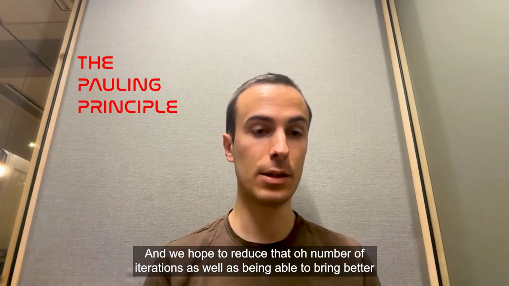
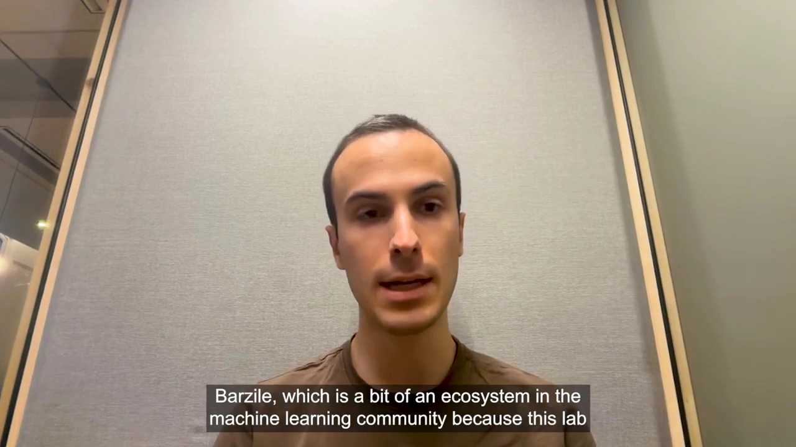
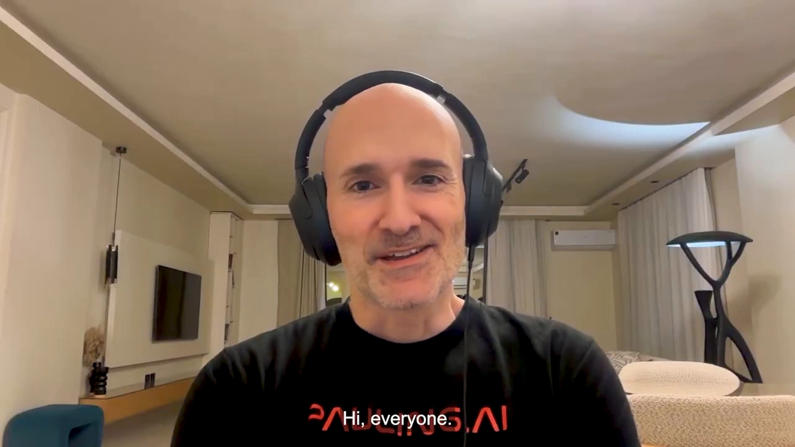
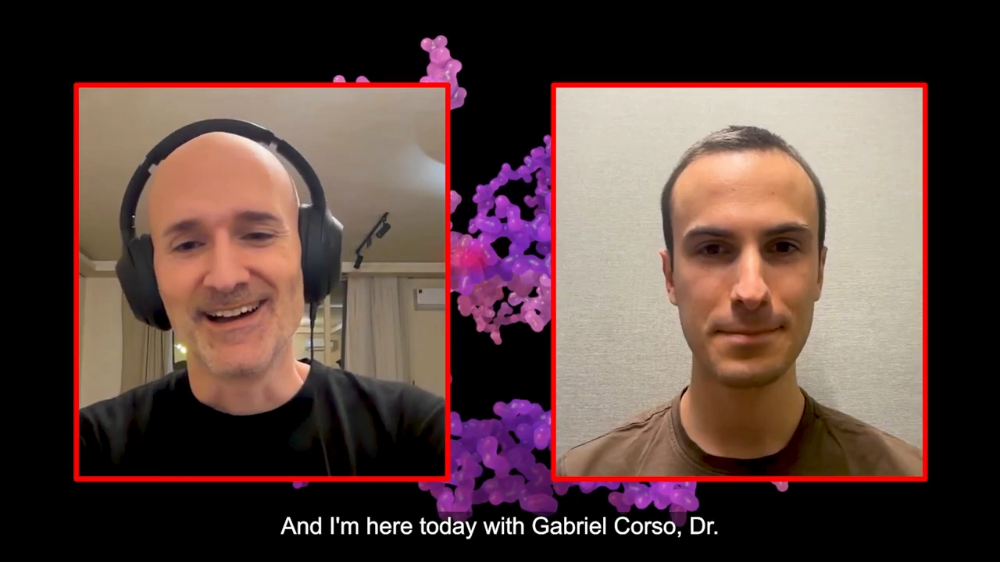
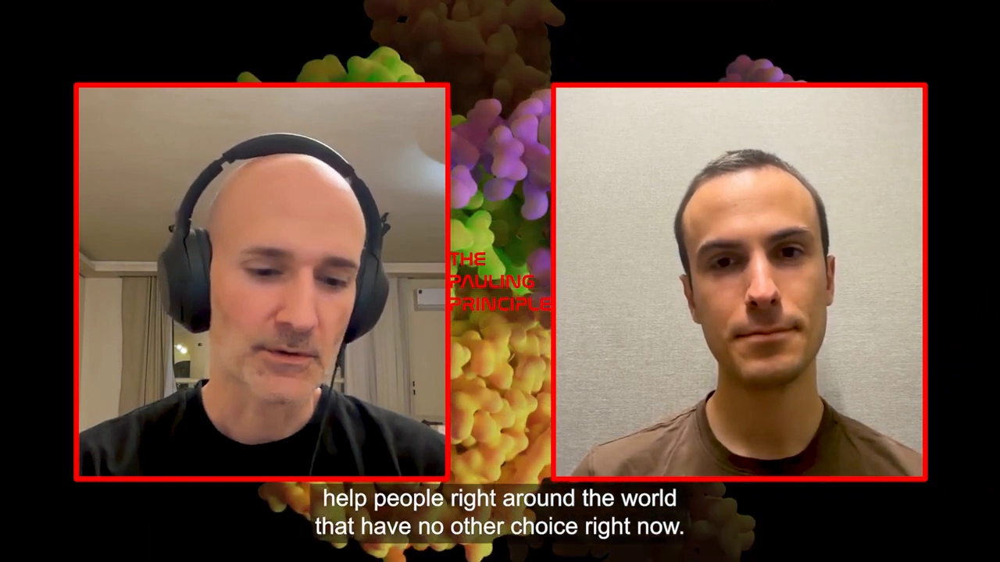

# Boltz-2 之后：分子基础模型走到哪一步了（Gabriele Corso 访谈）

> 本文配套视频：[《The Pauling Principle》第 22 期：Boltz-2、BoltzGen 与分子基础模型](https://www.youtube.com/watch?v=GF2De0XRino)（2025 年 11 月，约 61 分钟）。主持人为 Javier，嘉宾是 **Gabriele Corso**（MIT，Boltz 系列第一作者之一）。访谈发生在 **BoltzGen 发布三天后**，因此前半段回顾 Boltz-1 / Boltz-2 的来路，后半段大量讨论「这些模型到底能不能替代湿实验」以及领域的开放问题。

> 说明：这是一档两人分屏的播客节目，全程没有幻灯片，所以本文配图只保留少量画面，主要信息都在对话里。

---

## 这场访谈要回答的核心问题（SCQA）

**背景（S）**：AlphaFold2 之后，结构预测在几年内被 AI 改写；2024 年 AlphaFold3 把「任意生物分子复合物」也纳入进来，但模型闭源。

**冲突（C）**：闭源意味着工业界和学术界都没法在它上面继续做研究；而即便结构预测得再准，药物研发真正要的是「结合多强」「能不能设计出一个结合物」，而且这些模型在真实湿实验里的命中率、可开发性、适用边界都还不清楚。

**疑问（Q）**：Boltz-1 是怎么在 5 个月内追平 AlphaFold3 并开源的？Boltz-2 为什么要从结构走到亲和力？BoltzGen 又解决了什么？这条路线离「替代湿实验」还有多远？

**回答（中心思想）**：Corso 的答案是三句话——**(1)** Boltz-1/2 的价值来自「开源 + 基础模型式复用」（结构训练出来的内部表示可以支撑亲和力、设计等下游任务）；**(2)** 设计类模型已经把湿实验命中率从 0.1% 量级推到 25–30%，但**它不是药**，真正作用是减少 20–30 轮的设计迭代；**(3)** 领域离终点还很远：结构预测在抗体上成功率仍低于 50%，蛋白功能不是良定义问题，构象变化、蛋白-蛋白亲和力、RNA/DNA/酶全是开放问题。

---

## 一、从图神经网络到 Boltz：一条绕了远路的个人史

Corso 的路径解释了他后来为什么反复强调「要把问题定义好」：

1. **剑桥本科（计算机）**：本想毕业去 Google 做软件工程师，结果半路迷上机器学习，进了 Peter Liò 的实验室，做了几年**图神经网络**研究。他的反思是：「做下一代机器学习模型很好玩，但有时看不到我们做的东西的意义。」
2. **转向应用**：想把方法用在能影响人的地方——药物发现与结构生物学；恰好那时 AlphaFold2 发表，于是他去了 MIT，进了 **Tommi Jaakkola 与 Regina Barzilay 的组**。这个组就在 Kendall Square 一堆制药公司中间，是「想在这些应用领域做机器学习」的人眼中的参考点之一。
3. **第一个代表作 DiffDock**：进组时他既不懂生物也不懂化学，是博士后 Octavian Ganea 带他做「生物分子相互作用」——AlphaFold2 解决单体，那么「蛋白怎么和别的分子结合」显然就是下一个大方向。

---

## 二、DiffDock 的关键洞察：结构预测应该是「生成问题」，不是「回归问题」

这是整场访谈里最有方法论价值的一段 [【跳转到 04:00】](https://www.youtube.com/watch?v=GF2De0XRino&t=240)。

他指出：以前的机器学习对接模型，很多错误都出在**处理不确定性的方式**上。如果把问题设成**回归**、用平方损失，模型就会输出「平均值」；当模型对几种可能犹豫不决时，平均值往往是**物理上根本不存在的中间态**——一个既不像 A 也不像 B 的姿态。

DiffDock 的做法是把结构预测改成**生成式建模**：不去预测唯一答案，而是学习分布、从分布里采样。

主持人立刻接了一句很好的类比：这不就像语言模型里的采样（temperature、top-k）吗？Corso 回答得很严谨：**机制类似但空间不同**——语言的 token 是**离散**的，所以有自回归解码；结构是**连续**的，要在连续空间做生成建模。他们当时正好赶上扩散模型这套范式刚被提出，于是成了最早把扩散模型用到这个任务上的团队之一。

> **给初学者的直觉**：回归 = 「猜一个最能平均掉误差的答案」；生成 = 「把可能的好答案都采样出来，再挑最好的」。当正确答案本身就是「多峰」的时候（一个配体可能有几种合理结合姿态），前者必然出错。

这段之后，他们用大约两年时间把 DiffDock 系列做大（更多数据、更大架构、更好的泛化与柔性处理），其中 DiffDock-L 是跑得更快的版本。

---

## 三、Boltz-1：AlphaFold3 开源不了，那就自己复现一个

访谈里对 AlphaFold3 的评价很客观：它在「用生成式扩散模型做结构预测」这个方向上做了**出色的架构与工程化**，并且**用一个模型**覆盖了单链蛋白、蛋白-蛋白、蛋白-抗体、蛋白-小分子、RNA/DNA 结构以及它们与蛋白的相互作用。

但出于商业原因它不公开。Corso 的逻辑是：**「如果你要继续做下一代模型，就不能建在一个不存在的基线上。」** 于是他和 Jeremy Wohlwend、Saro Passaro 决定先复现到「接近 AF3 的水平」 [【跳转到 11:25】](https://www.youtube.com/watch?v=GF2De0XRino&t=685)，这就是 **Boltz-1**（2024 年 11 月，AF3 论文发表约 5 个月后，第一个接近 AF3 的完全开源模型）。

### 一个容易被误解的点：多序列比对（MSA）并没有被抛弃

主持人问：AlphaFold2 靠序列比对，AlphaFold3 是不是干脆抛开它、直接预测原子？

Corso 的回答纠正了这个流行误解：**模型仍然非常依赖 MSA。** 他解释了 MSA 的原理（也是本节最好懂的入门材料）：

- MSA 是「与目标蛋白序列相关的一组序列」（比如人体的某个蛋白，在其它物种里的同源序列）；
- 看这些序列里的**突变**，会发现一个规律：**如果两个残基在空间上彼此靠近，它们的突变是相关的**（一个变了，另一个往往也跟着变，否则结构会坏）；
- 于是从 MSA 就能反推出大量结构信息，这正是 AlphaFold2 最大的技术突破。

那为什么 AF3 还需要生成式组件？因为 MSA 对**多聚体界面**、**蛋白-小分子**、**抗体**这类对象给不出进化信号。没有进化信号，就只能靠「生成 + 不确定性建模」把可能的构象采样出来。AF3 还往前走了一步：**不只以氨基酸为尺度，而是以任意生物分子为建模单元。**

---

## 四、Boltz-2：从「结构」到「亲和力」，关键是复用内部表示

### 4.1 为什么之前做不出亲和力

Boltz-1 发布后几乎成了业界的默认结构预测模型，团队因此收到海量反馈，这些反馈被做进了 Boltz-2 的结构模型。而亲和力这件事，他们「盯了很久」：**「在新一代模型之前，我们试过几次，全都失败了。」**

转折点不是换了个更聪明的损失函数，而是思路变了。

### 4.2 用「基础模型」的方式做亲和力

主持人问了个很好的问题：既然都是预测亲和力，为什么用**同一个模型联合预测**，比「先预测 pose、再用对接工具估亲和力」更好？

Corso 的回答是这段访谈的技术核心 [【跳转到 18:20】](https://www.youtube.com/watch?v=GF2De0XRino&t=1100)：**因为他们不是在结构上再套一个回归器，而是在复用模型学到的内部表示。**

- 「基础模型」的核心思想是：你训练模型去做任务 A（结构预测），但模型在这个过程中学到了大量关于任务 B（结合亲和力）的知识；
- 所以 Boltz-2 的做法是：拿 trunk 的**内部表示**（而不只是输出的坐标）当作「模型对蛋白-小分子相互作用的理解」，在这个表示上做亲和力预测；
- 结果就是：**比从结构出发的对接模型准得多**。

主持人把它总结为「中间有一层嵌入（embedding），你用嵌入而不是原始原子结构去预测亲和力」，Corso 确认「完全正确」。

> 这条经验对做 AI for Science 的人很有用：**别把上游模型只当特征提取器用它的输出，它的中间表示往往才是下游任务的富矿。**

---

## 五、BoltzGen：把「结构 + 亲和力」串成一条设计流水线

BoltzGen 在访谈录制前三天发布 [【跳转到 19:40】](https://www.youtube.com/watch?v=GF2De0XRino&t=1180)，做的是**蛋白设计**（多肽、纳米抗体、抗体等），而 Boltz-2 做的是**小分子**。

为什么蛋白设计更难？Corso 的解释很直观：**蛋白的可能空间比小分子大得多**，从头设计（de novo）时「聪明地搜索」极其困难。

BoltzGen 的做法是：

1. **一个生成模型**（也是扩散模型）负责「发明」新蛋白；
2. **一套规格语言**：你指定想要的分子类型（多肽 / nanobody / 抗体）和目标物，再叠加任意数量的约束；
3. **串成流水线**：设计出的蛋白用 Boltz-2 预测结构（看是不是设计想要的那个折叠）、再预测亲和力，然后按亲和力与其它性质过滤，选出最好的。

他们与多位合作者在多个靶点上验证过，其中不少靶点在 PDB 里**原本没有任何已知结合物**，也有一些来自产业伙伴的真实问题。

### 关于命中率的一段数字（很值得记住）

主持人引用了论文里的数字：**他们得到的 binder 中约 25%–30% 是真正好的结合物**，而领域平均水平大约 2%–5%——差不多好一个数量级。

Corso 补充了这条曲线的历史[【跳转到 24:00】](https://www.youtube.com/watch?v=GF2De0XRino&t=1440)：蛋白设计这两年进步极快，尤其「为抗体找 mini binder」的方向；从两年前很多情况下**不到 0.1%**，到一年前的**个位数百分比**，现在已是**两位数**。

但他紧接着指出了一个结构性问题：**过去一年里，那些最好用的、经过精修的模型（尤其抗体、纳米抗体方向）绝大多数是闭源的**——有些公司只是宣布成果，没有开源。这正是 BoltzGen 选择开源的理由：**让产业界和学术界每个人都能用上。**

---

## 六、把预期校准：模型不是药，它省的是「迭代次数」

主持人问「AI 设计出来的东西跟湿实验对得上吗」，并提到抗体药是当今最赚钱的药物之一（他举例 Keytruda，年销售额约 200–250 亿美元，「本质上就是一段氨基酸序列」——把序列做出来、证明有效，就可能是几十亿美元的产品）。

Corso 的回答非常克制，值得原样记住 [【跳转到 25:50】](https://www.youtube.com/watch?v=GF2De0XRino&t=1550)：

- **「我们并不是说从这条流水线里拿到一个候选分子就该直接送进临床。」** 药物发现是复杂、漫长的系统；
- 现实是：把一个药推到临床通常要 **20–30 轮设计迭代**，每轮因为要做实验验证，**一到两个月**；
- 模型真正的作用是**减少迭代次数**、并带来更好的起点；
- 而且**结合并不是唯一要优化的性质**：还有选择性、ADMET、可开发性等等。拿到一个好的结合物只是「好的起点」。

他还提到团队想做的事：提供工具，把「从找靶点 → 有靶点之后 → 推进临床」这条流程打通，让学术界和产业界都能用。主持人补充了一个常被忽略的现实：即使进了临床，后面还有 5–10 年。

---

## 七、ColabFold、Rosetta 与 Boltz：模型多是好事

被问「Boltz-2 和 ColabFold、Rosetta 工具怎么比」，Corso 的回答几乎是「先讲态度再讲差异」 [【跳转到 28:20】](https://www.youtube.com/watch?v=GF2De0XRino&t=1700)：

- **态度**：这个领域能进步这么快，很大程度上是因为很多人愿意公开结果、开源模型；DeepMind 在 AlphaFold2（以及论文里对 AlphaFold3 的信息披露）上也非常慷慨。「我们互相推动。」
- **差异**：每个模型有自己的特点，在特定类型的预测上更强。他能直接说的一句是：**在小分子亲和力上，Boltz-2 目前仍是学术界和产业界很多人的参照选择**；BoltzGen 还需要更多第三方评测。
- **BoltzGen 的位置**：在纳米抗体（以及预期中的抗体）上，论文结果优于此前所有已宣布或发布的模型；但在 mini binder 上，也有其它方法（如 BindCraft）达到相当水平。
- **使用建议**：不必只试一个模型，可以都试；他们论文展示的是「单一模型、单一流水线覆盖一整套多样问题」的能力。

---

## 八、物理 vs 机器学习：一场被误解的争论

主持人抛出了常见质疑：这些模型「不懂物理」——它们不知道原子之间有电磁力、甚至不知道这是个三维世界。是不是最终必须引入等变性、或与物理方法结合？

Corso 的回答用了一个绝妙的类比[【跳转到 36:00】](https://www.youtube.com/watch?v=GF2De0XRino&t=2160)：

> 在大语言模型领域，你现在能看到模型解 IMO 难题、甚至被用来攻数学开放问题；但同时也能看到有人发帖说它连基础算术都算错。**关键取决于你训练它去做什么。**

对应到分子：如果你只想让模型满足一些基本物理规则（键长、手性、不冲突），你完全能做到——**但这不是我们真正关心的**。「你其实不需要理解折叠过程，就能预测蛋白大概会怎么折叠。」

他用 **Boltz-1x / Boltz-2x** 做了实证：

- 他们在 Boltz-1 上加了物理势（Boltz-2 同理），确实修掉了手性翻转、键长偏差、原子冲突；
- **但「预测正确折叠」的精度并没有提升**，变好的只是那些「物理学家或跑模拟的人才会在意的小细节」。

所以他判断：

- 像 RNA 折叠、蛋白-DNA 选择性这类问题，**不会靠往模型里塞几个简单物理势就解决**；机器学习能从数据里学到这么多，是有原因的，这个趋势会继续；
- 物理方法未来更可能扮演两个角色：**(1) 合成数据的「求解器/裁判」**（类比代码/数学领域用求解器判断输出对错来生成合成数据）；**(2) 更底层的模拟工具**（比如用 DFT 生成高精度数据，再训练 ML 力场——这在材料领域（如 Meta 的 Open Catalyst）已经发生，代价是可解释性下降，但精度更高）。

> 一句话结论：**「物理正确」与「预测准确」是两个不同的目标，别用前者去论证后者。**

---

## 九、为什么「蛋白功能预测」这么难：它不是个良定义的问题

主持人问：机器学习能不能解决蛋白功能问题（比如酶催化、断键形成键，这需要量子层面的描述）[【跳转到 43:10】](https://www.youtube.com/watch?v=GF2De0XRino&t=2590)？Corso 给了一个很少见但很有价值的回答框架：

- 蛋白功能从生物学角度非常有趣、非常难，**但它不一定是个良定义（well-posed）的问题**；
- 「从序列直接到功能」的做法一直在尝试，问题始终是：**数据够不够？模型是不是真的学到了足够深的东西？**
- 他倾向于把机器学习问题**组织成有结构的形式**。对比一下两种提问方式：
  - ✅ 良定义：「我有一个蛋白、一个分子，它们结不结合？怎么结合？结合多强？」——这正是 Boltz-2 做的事；
  - ❌ 非良定义：「给你一个蛋白，它有什么功能？」——缺少边界与评价标准。
- 而且**功能高度依赖上下文**：这个蛋白在哪个物种里、在细胞内还是细胞外、在哪里被发现。「这些上下文对单纯的预测模型来说，有些困难。」
- 所以在酶设计/酶预测上，他预期会有大进展，但前提是「把问题组织好、用正确的方式提问」；也许多年以后，强推理的语言模型可以把「懂亲和力、懂物理性质」的模型当作工具去做新发现，但** 生物学家短时间内还是会很忙**——他们用 Boltz 这类工具去理解机制、替代大量重复的实验测试。

他还顺带认可了主持人提的一个具体研究方向：用模型穷尽地跑「蛋白以复合物还是单体出现」「细胞里常见的小分子与什么相互作用」，可能带来大量可被验证的发现。

---

## 十、领域现在最大的挑战：先达到「比实验室更好」这条最低门槛

这是访谈里最「扎心」的一段[【跳转到 48:00】](https://www.youtube.com/watch?v=GF2De0XRino&t=2880)，Corso 给了一个清晰的标准：

> 一个计算工具要有用，**不只是要比上一个计算工具更好，它必须比一个生物学家或化学家在实验室里做的更好**。「更好」可以是更精确，也可以是更省钱、能规模化。这里存在一条帕累托前沿，问题是：**我们有没有达到那条前沿，让真正在做项目的人愿意用它？**

他的自查结论分档：

| 方向 | 是否越过「最低门槛」 |
| --- | --- |
| 蛋白从头设计 | 基本达到（进步最快的一块） |
| 小分子 hit 发现 | 接近，取决于靶点；柔性靶点仍吃力 |
| 结构预测（抗体） | 未达到：最好的模型在新颖抗体上成功率仍 **< 50%** |
| 蛋白-蛋白亲和力 | 未解决，仍需真正答案 |
| RNA / DNA / 酶 | 完全开放 |
| ADMET / 可开发性 | 现有模型难可靠预测 |

他还提到一个非常有意思的、超越分子尺度的方向——**靶点发现**：既然我们已经理解分子尺度上的相互作用，能不能用这种理解去**解码细胞数据**？现在的单细胞扰动实验非常精巧，但「我看到健康细胞和疾病细胞有差异，却说不清是哪个靶点造成了这个转变」；如果能借助相互作用/知识图谱的视角把这层解读出来，会有大量工作可做。

### 构象变化与 GPCR：为什么「单静态结构」不够

主持人提出：几乎所有模型都只预测一个静态结构，但要理解 GPCR 这类蛋白（开/闭构象），必须理解构象变化——而那正是找到结合物的关键。

Corso 承认这是**最值得关注的开放问题之一**：GPCR 既是物理上有趣的对象，也是治疗开发的热点；他们「已经有一些 Boltz-2 表现很好的案例」，之后又投入了很多精力。他判断这个问题一半是数据问题（PDB 里这类构象变化本来就少），**但主要是技术与建模问题**，所以他对未来几年很有信心。他也提到微软 Frank Noé 团队的 BioEmu 在这个方向上做了工作，Boltz-2 也尝试把 MD 数据整合进来（有提升，但仍难以预测数据里没见过的构象变化）。

---

## 十一、接下来会是什么：从「40–50% 靶点可用」到「90–95%」

被要求预测「下一代模型（AlphaFold4 / Boltz-3）会发生什么」[【跳转到 56:30】](https://www.youtube.com/watch?v=GF2De0XRino&t=3390)，Corso 没有给出花哨的答案，而是三个方向：

1. **持续改进 + 扩大适用范围**：现在的关键是「让这些模型不是只在 40%、50% 的靶点上工作，而是在 90%、95% 的靶点上工作」。这需要在模型失败的地方做系统研究，把「模型还不理解的东西」变成能学的东西。
2. **推理时扩展（inference-time scaling）**：BoltzGen 的设计流水线一跑就是**很多小时**，他们观察到清晰的单调关系——**采样的候选越多，结果越好**。这与 LLM 里「推理时多算就能更强」的逻辑一致；未来的方向是让模型不只给出「还不错的结合物」，而是「极好的结合物」，并据此树立新的治疗标准。
3. **把工具交到每个化学家和生物学家手里**：现在这些工具主要被「懂计算的人」使用。真正的下一步是让做湿实验的人、药物化学家能带着自己的问题和数据，在很大规模上用起来——「如果这些工具真的会替代现在湿实验室里的大量工作，那它会改变生物学家和化学家的工作方式」。

主持人最后的感慨也很有画面感：如果启动一个药物发现项目不再需要几百万、几千万美元，而只要几十万美元，那么对于那些今天还没有药的成千上万种疾病，就可能出现更多项目、更多治愈——「帮到世界各地目前别无选择的人」。

---

## 小结

- **方法论主线**：DiffDock 把结构预测从「回归」改成「生成」，解决了「模型在几种可能之间取平均、给出不存在的中间态」这个根本问题。
- **MSA 没有被抛弃**：它是 AlphaFold2 最大的技术突破；AF3 与 Boltz 之所以还需要生成式组件，是因为界面、小分子、抗体这些对象**没有进化信号**。
- **Boltz-1 的定位**：AF3 不开源 → 自己复现到接近水平并完全开源（AF3 论文后约 5 个月）。
- **Boltz-2 的技术内核**：不是「结构 → 亲和力」的两段式，而是**复用 trunk 的内部表示**做亲和力预测——这是「基础模型」思路的具体落地。
- **BoltzGen 的成绩与坦诚**：湿实验命中率 25%–30%（领域 2%–5%）；两年从 <0.1% 到两位数；但最好的抗体类模型多为闭源，所以选择开源。
- **预期校准**：模型不是药，它省的是 20–30 轮设计迭代；结合只是众多性质之一。
- **物理 vs ML 的正确提问**：「物理正确」不等于「预测准确」；加物理势修的是可用性，不是精度；物理方法未来更像数据生成的求解器。
- **功能预测难在「不是良定义问题」**：要把问题组织成「蛋白 + 分子 → 是否结合/多强」这种可评价的形式。
- **最低门槛**：比实验室里的化学家/生物学家更好（更精确或更便宜/可规模化），而不是只比上一个计算工具更好。
- **下一步**：把可用靶点比例从 40–50% 推到 90–95%；靠推理时扩展换取质量；把工具交到湿实验科学家手里。

## 关键术语速查

| 术语 | 一句话解释 |
| --- | --- |
| DiffDock | Corso 等人在 MIT 做的扩散式分子对接模型；第一个把结构预测当生成问题处理的代表作 |
| 回归 vs 生成 | 回归输出「平均答案」，生成从分布中采样；当正确答案多峰时，回归会给出物理上不存在的中间态 |
| MSA（多序列比对） | 目标序列在各物种中的同源序列集合；残基间「共变」可反推空间接触，是 AlphaFold2 的技术核心 |
| 共折叠 / 共折叠模型 | 把多种生物分子一起输入、一次性预测复合物结构的模型（AF3、Boltz 系列） |
| 基础模型（foundation model） | 先在相关任务上大规模训练，再把其表示迁移到目标任务；Boltz-2 用它做亲和力 |
| 内部表示（embedding） | 模型中间层的向量表示，比最终输出包含更多信息；是下游任务的关键输入 |
| 结合亲和力 | 分子与靶点结合强弱的度量 |
| BoltzGen | 同团队的蛋白（多肽/纳米抗体/抗体）设计生成模型，与 Boltz-2 串成设计-评估流水线 |
| mini binder | 为抗体/靶点设计的小型结合蛋白骨架 |
| BindCraft | 另一条蛋白 binder 设计路线，在 mini binder 上与 BoltzGen 结果可比 |
| hit-to-lead / 先导优化 | 从「能结合的初始分子」优化到「可成药的候选分子」的两个阶段 |
| ADMET / 可开发性 | 吸收、分布、代谢、排泄、毒性等成药性性质（蛋白类药物对应称 developability） |
| 构象变化（conformational change） | 蛋白在开/闭等状态间的结构切换；目前模型基本只能预测单一静态结构 |
| GPCR | G 蛋白偶联受体，药物靶点大户，功能高度依赖开/闭构象状态 |
| BioEmu | 微软 Frank Noé 团队的构象系综生成模型，与本工作互为参照 |
| 推理时扩展（inference-time scaling） | 推理阶段多采样/多搜索来提升质量，而非只改训练 |
| 帕累托前沿 | 「精度-成本」平面上不被其它方法同时超越的边界；工具是否有用的判据 |
