# Boltz-2 精读：一个开源模型如何把「结构预测」推进到「结合亲和力预测」

> 本文配套视频：[《Boltz-2: Towards Accurate and Efficient Binding Affinity Prediction》](https://www.youtube.com/watch?v=iHDauMATkr0)（Valence Labs 与 MIT / Recursion 团队的论文精读分享，2025 年 6 月，约 59 分钟）。主讲是 Boltz 系列的三位作者：**Gabriele Corso**（前半段讲背景与展望）、**Jeremy Wohlwend**（结构预测模块）、**Saro Passaro**（亲和力预测模块）。本文按视频原话整理，术语与数字均可在对应时间戳处核对。（B 站有同一场分享的中文机器翻译版本 [BV1XfNJzGEJK](https://www.bilibili.com/video/BV1XfNJzGEJK/)，可对照观看；但机翻把 Boltz-2 译成「球体二」，术语错漏较多，本文按英文原声校对。）

---

## 本次精读要解决的核心问题（SCQA）

**背景（S）**：2020 年 AlphaFold2 把单链蛋白结构预测做到了接近实验精度；2024 年 5 月 AlphaFold3 进一步用一个模型预测 DNA、RNA、蛋白、小分子等任意生物分子复合物的结构，为几乎所有模态立了新的精度标准。

**冲突（C）**：AlphaFold3 因为商业原因没有公开模型，只在约半年后放出了仅限非商业使用的推理代码。而结构只是问题的一半——药物研发真正关心的「这个分子结合得多紧」并没有被解决：亲和力数据的公开量少、噪声大、还带系统性偏倚。团队自己也说：「在新一代模型之前，我们试过几次亲和力预测，全都失败了。」

**疑问（Q）**：能不能做一个**完全开源**的模型，既预测结构、又预测结合亲和力，而且快到可以在真实项目里反复调用？

**回答（中心思想）**：Boltz-2 的做法是「**在一个强结构模型（Boltz-1）的骨干表示之上，加一个轻量亲和力模块**」，再靠大量数据工程（去噪、去偏、按化学系列重采样）把亲和力学到可用。结果是：在 FEP+ 基准上接近自由能扰动（FEP）这类物理金标准的精度，**速度却快 1000 倍以上**（约 20 秒一次预测）；但它仍然**没有解决结构预测本身**（抗体等模态仍有差距），亲和力的适用边界也必须靠使用者自己在相似靶点上先验证。

---

## 一、结构只是问题的一半：药物研发真正卡在亲和力

### 1.1 理解生物学，本质上是理解「相互作用」

Gabriele 开场的观点很朴素：我们理解生物学的方式，是通过相互作用的视角——CRISPR-Cas9 与 DNA 的识别、酶的催化、Paxlovid 结合到 SARS-CoV-2 主蛋白酶上、或者工程化一个带来特定效应的 G 蛋白，都是「两个分子怎么凑在一起、凑得多紧」的问题。所谓药物设计，很大程度上就是在**调节这种相互作用的强度**——也就是亲和力。

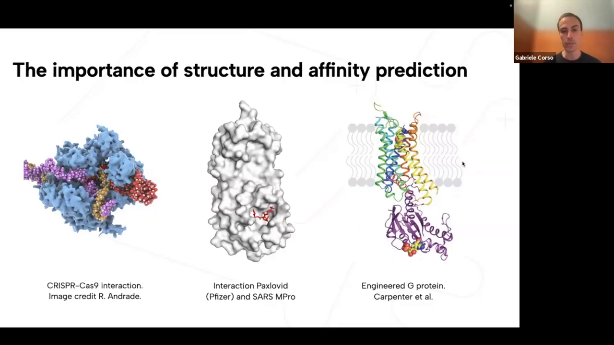

### 1.2 亲和力是临床前开发里最大的瓶颈

药物研发流程可以粗分为四段：**靶点发现 → hit 发现 → hit-to-lead → 先导优化**。每一段都在问同一个问题：这些分子结合得够不够紧、够不够专一（脱靶效应就是「不该结合的地方结合太紧」）。而实验室里能测的分子数和蛋白数永远有限，**「测不过来」就成了整个流程的物理瓶颈**。

这里先把几个容易混的术语讲清楚：

- **亲和力（binding affinity）**：分子与靶点结合强弱的度量，常写成解离常数 $K_d$，数值越小结合越紧。
- **IC50**：在某个实验条件下，抑制 50% 活性所需的浓度。它和 $K_d$ 不完全等价，测的是同一件事的不同侧面。
- **pIC50**：把 IC50 取负对数（$-\log_{10}\text{IC50}$），让「更大 = 更强」、且跨越数量级时数值更线性。做先导优化时人们基本都在看 pIC50 的变化。

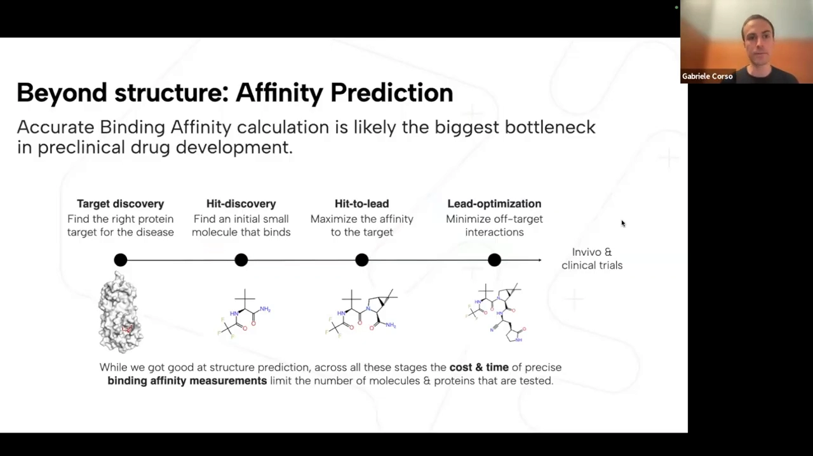

一句话总结这一节：**结构预测回答「长什么样」，亲和力预测回答「有多牢」；后者才是药物化学家每天在做决策时看的东西** [【跳转到 04:23】](https://www.youtube.com/watch?v=iHDauMATkr0&t=263)。

---

## 二、Boltz-2 的整体架构：一个大 trunk，两个头

### 2.1 从 AlphaFold2 到 Boltz-1 的路线

时间线只有三步，但这三步解释了 Boltz 系列的定位：

1. **2020 年 AlphaFold2**：单链蛋白结构预测的突破（后来获得诺贝尔奖）。
2. **2024 年 5 月 AlphaFold3**：任意生物分子复合物，但**不开源**。
3. **2024 年 11 月 Boltz-1**：AF3 论文发表 5 个月后发布，是**第一个精度接近 AF3 的完全开源模型**。

团队的说法是：既然要继续做下一代模型，就必须先自己达到 AF3 那条线；否则所有后续工作都建在不存在的基线上 [【跳转到 01:53】](https://www.youtube.com/watch?v=iHDauMATkr0&t=113)。

Boltz-1 的社区采纳度本身也是它成为「默认选项」的原因：分享时 GitHub 已有 **2800+ star、35+ 贡献者**，Slack 社区成员超过 **1900 人**，既有学术界也有工业界的反馈 [【跳转到 03:58】](https://www.youtube.com/watch?v=iHDauMATkr0&t=238)。Boltz-2 里的很多改进，直接来自这批用户的诉求。

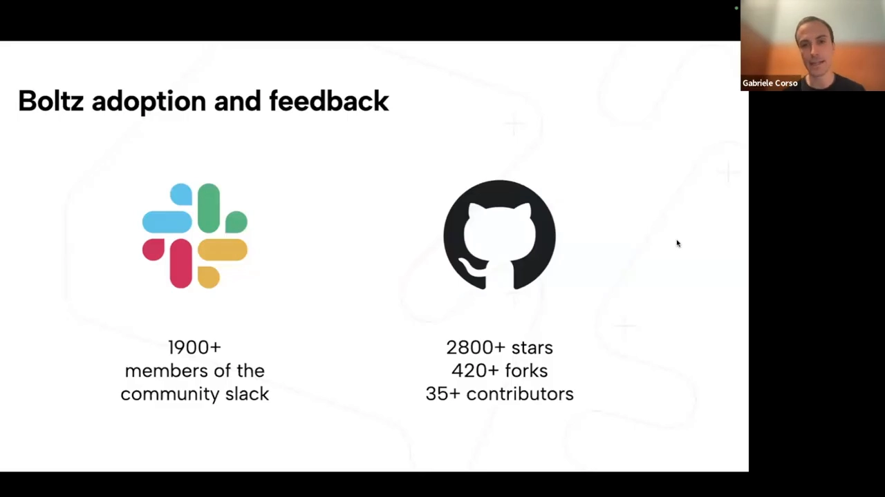

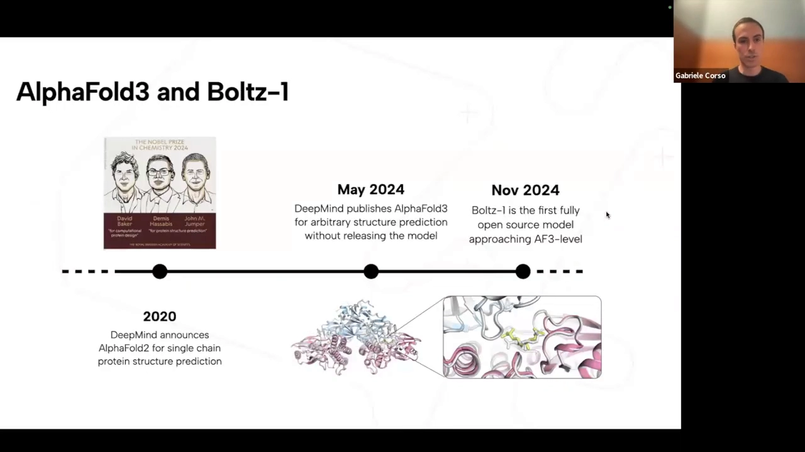

### 2.2 架构总览：trunk 里做「魔法」，两个头分别出结构与亲和力

Jeremy 用一张图讲完了整个模型，这张图是理解后续所有改进的锚点：

- **Trunk（骨干）**：先编码原子级信息（小分子的构象、蛋白侧链的构象）和各种条件信息，并在模板与 MSA 上运算；随后进入一个很大的 **Pairformer**，反复更新「任意两个 token 之间」的成对表示——三角运算就发生在这一步。
- **结构模块**：把成对嵌入当作偏置，用一个**扩散模型**从随机原子坐标出发去噪，得到三维结构。
- **两个头**：一个是**置信度头**（和 Boltz-1 相同，告诉你结构有多可信）；另一个是**新的亲和力头**，利用 trunk 输出的全部信息预测蛋白与小分子之间的亲和力。

这张架构总览是本讲的地图 [【跳转到 06:54】](https://www.youtube.com/watch?v=iHDauMATkr0&t=414)。有一个常被问到的细节：这次**没有为训练亲和力而微调 trunk**，并且复用了一个更小的置信度模型——因为亲和力模块复用的正是 trunk 已经学好的表示，而不是重新学一遍结构。

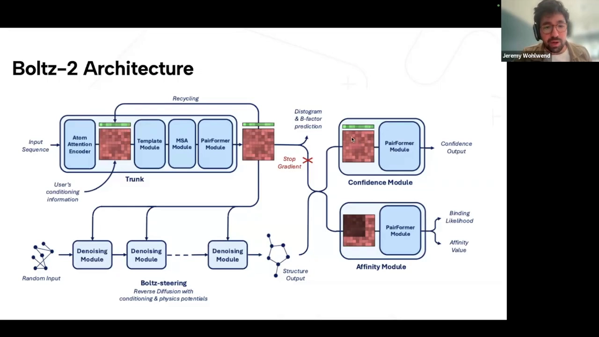

---

## 三、结构模块的四个改进：都是「社区反馈」驱动的

Jeremy 明确说：Boltz-1 发布后几乎成了业界的默认结构预测模型，收到的反馈被整理成四块需求，Boltz-2 逐条回应。

### 3.1 控制（control）：让使用者能把已知信息喂进去

这是用户呼声最高的一块，具体做了三件事：

1. **实验方法条件化（method conditioning）**：PDB 里的结构来源很杂——X 射线、冷冻电镜、NMR，团队还加了蒸馏数据与分子动力学（MD）数据。把「这条数据是哪类测量得到的」作为条件喂给模型，模型就能学到**以测量方式为条件的分布**。后面会看到，加了 MD 条件会让模型更多探索局部构象空间。
2. **模板（templates）**：Boltz-1 完全没有模板。Boltz-2 不但加了，还往前推了一步——AlphaFold3 的模板只能用于单链单体蛋白，Boltz-2 支持**多聚体模板**（论文里给了一个配套的小算法）。
3. **任意接触条件化（contacts / pocket）**：Boltz-1 只能指定「binder 与口袋里某个残基」；现在可以指定**任意已知的接触关系**。这对「手里没有完整三维结构、但知道大致的折叠/接触信息」的真实场景特别有用 [【跳转到 09:30】](https://www.youtube.com/watch?v=iHDauMATkr0&t=570)。

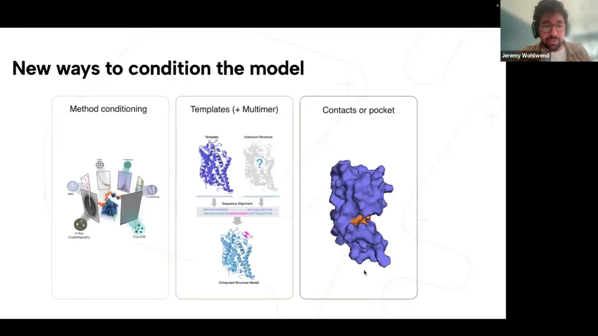

### 3.2 局部动力学：把 MD 数据变成监督信号

结构的「柔性」在实验里体现为 B 因子（mmCIF 里每个原子的可动程度）。团队引入了三个公开 MD 数据集：**ATLAS**（只有蛋白）、**MISATO**（蛋白-配体动力学）、**MDCath**，并用两种方式把其中的信息变成监督信号：

- **从「单结构」到「分布」**：原来是从一个结构得到独热表示的直方图；现在从一组构象样本算出**距离分布**，用 **KL 散度**去监督成对距离的分布。等于告诉模型：「这个距离应该在一个范围里抖动」，而不是一个死数。
- **Multiplicity 改造**：AlphaFold3 / Boltz-1 训练时会采样输入分子的不同取向（multiplicity）再并行去噪；Boltz-2 改成先采样 **N 个不同构象**，共用同一套嵌入，但每个都用各自加噪版本作为输入，最后分别对每个构象做监督。
- 另外把 **B 因子**也当作预测目标。

这部分改动从头到尾都在讲「怎么把 MD 数据变成监督信号」 [【跳转到 11:21】](https://www.youtube.com/watch?v=iHDauMATkr0&t=681)。效果用 **RMSF**（衡量某个原子位置的抖动幅度）评估：Boltz-2 明显好于 Boltz-1，而且**主要收益来自 MD 条件化**，甚至与专门做局部动力学的模型（如 BioEmu）相当或更好。

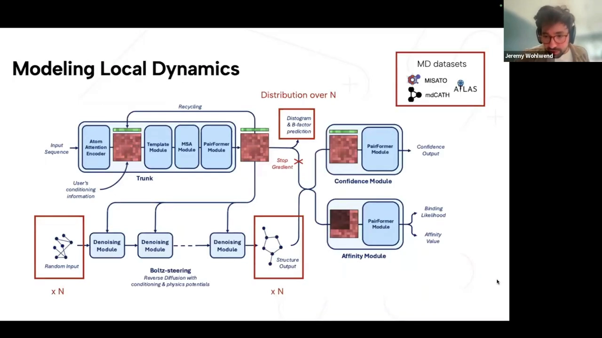

### 3.3 物理质量：用 Feynman-Kac 引导势修掉「不该出现的结构」

扩散模型出来的结构常常有物理上荒谬的地方：**手性中心被翻转**（虽然构象输入里给了正确手性）、键长不准、出现空间位阻冲突，模型很不确定时链与链甚至会互相穿透。AlphaFold3 的论文也报告过同类问题。

Boltz-2 的解法是 **Feynman-Kac 引导势（steering potentials）**，机制有三层：

1. **多条路径**：不再只跑一条扩散路径，而是同时跑多个「粒子」（仓库里默认 3 个），用可以自己定义的势函数（比如惩罚冲突、惩罚手性错误）去给路径打分。
2. **重采样 + 倾斜**：在不同时间步向「更符合势函数」的路径靠拢，并把奖励作为倾斜分布的因素。
3. **x0 梯度微调**：每步预测出 $x_0$ 后，只要势函数可微，就沿梯度方向对 $x_0$ 做小幅修正。

整套机制的讲解从 15:13 开始 [【跳转到 15:13】](https://www.youtube.com/watch?v=iHDauMATkr0&t=913)。这套东西带来一个重要而容易被误解的结论：**物理有效性从 Boltz-1 提升到接近满分，但 RMSD（预测对不对）基本没变。** 也就是说，它不是在让模型「更准」，而是在让结构「更可用」——尤其对下游的物理计算与模拟而言。

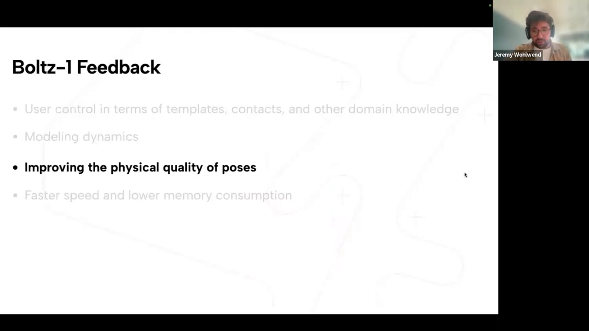

### 3.4 速度与显存：NVIDIA 官方 kernel

推理侧的速度来自与 NVIDIA 的合作：NVIDIA 把 Boltz 选为主要支持并加速的结构预测模型，在 2025 年欧洲 GTC 上宣布，发布当天 kernel 就进了仓库。两个 kernel 分别加速**三角注意力**和**三角乘法**——据他们说是第一个专门加速三角乘法层的 kernel，整体带来 **2–4 倍**加速（取决于蛋白大小）[【跳转到 18:13】](https://www.youtube.com/watch?v=iHDauMATkr0&t=1093)。

### 3.5 精度现状：容易的模态打平，难的模态追近但没追平

在 DNA、蛋白、配体、蛋白-蛋白/蛋白-配体界面这些「好表示的模态」上，各模型（AF3、Chai-1、Protenix、Boltz-1/1x/2/2x）表现非常接近。真正拉开差距的是难模态 [【跳转到 20:06】](https://www.youtube.com/watch?v=iHDauMATkr0&t=1206)：

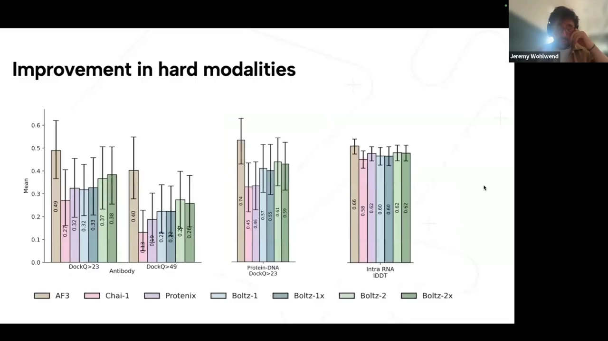

- **抗体**：DockQ>23 口径下 AF3 0.49，Boltz-1 0.33 → Boltz-2 0.38；DockQ>49 口径下 AF3 0.40，Boltz-2 0.26。有提升，但差距明显。
- **蛋白-DNA**：AF3 0.74，Boltz-2 0.61。
- **RNA（intra-RNA IDDT）**：AF3 0.66，Boltz-2 0.62。

Jeremy 很坦率：「很多人问我是否知道抗体上的差距为什么存在，答案是并不真的知道，我们有一些假设。」——这种「不确定就说不确定」的表述，恰恰是判断一个模型真本事时最值得参考的部分。

---

## 四、为什么亲和力比结构更难：不是数据少，而是每个数据点「信息少」

Saro 接棒后，先把难点讲透了 [【跳转到 21:30】](https://www.youtube.com/watch?v=iHDauMATkr0&t=1290)。他的核心论点是：**亲和力难，不是因为数据点数量少——恰恰相反，他们解析出的数据点比结构数据还多——而是因为单个数据点携带的信息少得多。**

- 一个复合物结构里大约有 N 个数据点（N = 复合物的 token/原子数）；而一个亲和力测量值，**每个复合物只有一个数**。
- **噪声大**：公开数据里，二分类数据存在大量假阳性甚至假阴性；同一分子在不同实验室、不同实验条件下测出的数值差异很大。
- **系统性偏倚（spurious bias）**：最典型的是亲和力与**分子量**相关。这多半是 hit-to-lead 与先导优化历史留下的痕迹——人们总是从一个小的片段出发，往上加基团让它变大变强，于是「大 = 强」成了数据里的伪规律。

他们的解决路线因此很明确：**先有一个极强的结构表示（Boltz-2 trunk 就是），再在这个表示上训练亲和力；同时花大力气整理数据、选择采样方式与损失函数，把数据里的信号从噪声中「榨」出来。**

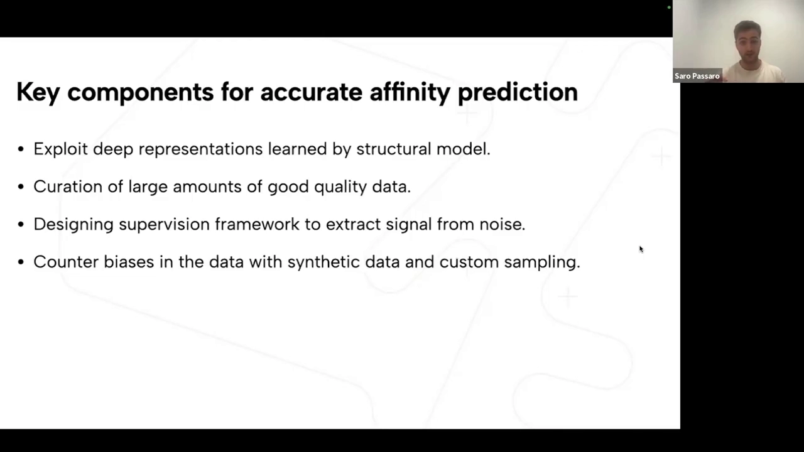

---

## 五、亲和力模块：两个输出、一份数据、四个训练技巧

### 5.1 架构：一个 Pairformer + 两个输出头

亲和力模块出奇地简单，复用了 trunk 的架构 [【跳转到 23:35】](https://www.youtube.com/watch?v=iHDauMATkr0&t=1415)：

- **输入**：trunk 循环 5 次后输出的成对表示，以及**预测出的坐标**（为了让坐标质量最好，扩散模型采样 5 次，取 pTM 最优的那组坐标）。
- **处理**：一个作用在成对表示上的 Pairformer；并且**把「链内」表示 mask 掉**，让模型只关注界面上蛋白-配体、配体内部的相互作用——因为亲和力只由界面决定。
- **两个输出**，正好对应两类使用场景：
  - **结合似然（binding likelihood，0–1）**：给 **hit 发现**用——「这个分子到底会不会结合」；
  - **亲和力数值（IC50 口径）**：给 **hit-to-lead 与先导优化**用——「这个分子比上一个强多少」。

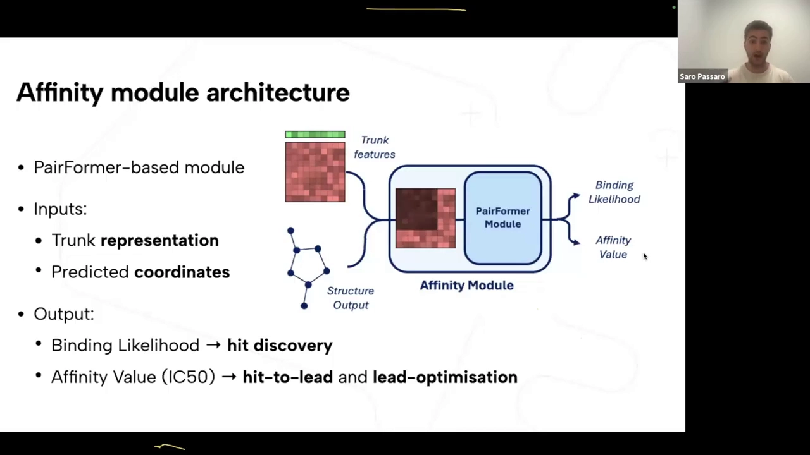

### 5.2 数据：150 万条亲和力值、2500 多个靶点、500 万诱饵

数据这一页的信息量最大 [【跳转到 25:15】](https://www.youtube.com/watch?v=iHDauMATkr0&t=1515)。数据来源包括 PubChem/BindingDB 等公开库、ChEMBL 的片段筛选，以及一个代谢方向的筛选集。规模上：

| 类型 | 规模 | 来源 |
| --- | --- | --- |
| 亲和力数值 | 约 150 万条，跨越约 2500 个靶点 | PubChem、ChEMBL、BindingDB 等 |
| 二分类（结合/不结合） | 约 50 万个正例 + 约 500 万个 decoy | ChEMBL、BindingDB、CaLiSol、MOAD 等 |

三条数据质量原则值得记住（它们解释了「为什么同样用公开数据，效果差很多」）：

1. **只保留高质量结构的数据点**：用置信度模型过滤掉低置信度的复合物，避免模型去学「错的结构 + 对的数值」这种伪规律。
2. **给每个 binder 配上剂量-反应测量**：高通量筛选数据平均假阳性率极高，约**一半**报告为阳性的其实是 decoy。方法是对每个 binder 做「去诱饵化」配对。
3. **合成 decoy**：把 hit-to-lead 数据里的 binder 用合理方式打乱，生成合成 decoy，进一步抵消数据集的偏倚。

### 5.3 四个训练技巧：每一个都针对一个具体的坑

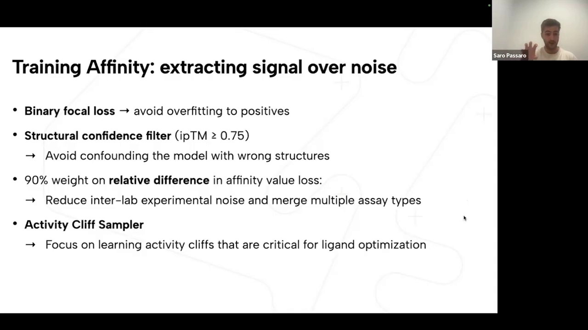

1. **二分类用 focal loss**：二分类数据量小，模型很快在正样本上过拟合、学不出 binder 与 decoy 的关键差别。focal loss 在模型已经很自信时降低损失权重，大幅缓解过拟合。
2. **结构置信度过滤（ipTM ≥ 0.75）**：把平均 ipTM 低于 0.75 的实验数据整条丢掉，避免模型被错结构带偏。
3. **90% 权重压在同实验内的相对差值**：这一条最关键。不同实验之间的绝对值差异大，但对**同一实验内部两个分子取差**时，很多系统误差会抵消——包括 **Cheng-Prusoff 方程**里的那项修正（它把 IC50 映射到 $K_i$，修正量与底物浓度、$K_m$ 有关）。取差之后，IC50 与 $K_i$ 就能被「同等对待」，不同来源的数据也能合到一起用。这也解释了为什么模型输出是 IC50 口径：数据里绝大多数是 IC50，模型对 Ki 口径的预测会略偏高，这在预期之内。
这四个技巧是这一讲最「可迁移」的部分 [【跳转到 26:55】](https://www.youtube.com/watch?v=iHDauMATkr0&t=1615)。4. **Activity Cliff Sampler**：对「活性差异大」的实验上采样、对差异小的下采样，让模型专注于**先导优化真正关心的那些数量级跳变**——因为化学家要的不是绝对值的精确，而是「改一个取代基会不会强十倍」的排序能力。

---

## 六、结果一：hit-to-lead 上逼近 FEP，速度快 1000 倍

评测用的是 **FEP+ 基准**（计算化学领域的金标准，Schrödinger 为评测 FEP+ 软件构建的数据集），另外在 **OpenFE** 集合（约 900 个复合物、4 个特定靶点）上跑齐了各种物理基线。在跑大基准之前，他们先在一个 **TYK2 的 hit-to-lead 系列**上做了演示：同一个口袋、一群结构相似的分子，横轴实验亲和力、纵轴 Boltz-2 预测值，点基本落在对角线附近，**更强的结合物被正确排序出来** [【跳转到 30:52】](https://www.youtube.com/watch?v=iHDauMATkr0&t=1852)。

四个靶点上的平均 Pearson 相关系数（越高越好）：

| 方法 | 类型 | Pearson |
| --- | --- | ---: |
| FEP+ | 物理（>1 小时） | **0.78** |
| ABFE（绝对自由能扰动） | 物理（>1 小时） | 0.75 |
| **Boltz-2** | **机器学习** | **0.66** |
| OpenFE | 物理（>1 小时） | 0.66 |
| FMO（碎片化 DFT） | 物理（<1 小时） | 0.55 |
| GAT | 机器学习 | 0.40 |
| ChemGAUSS | 物理 | 0.26 |
| MM/PBSA | 物理 | 0.19 |
| BACHI | — | 0.11 |

换成 OpenFE 子集，排序差不多：FEP+ 0.72、OpenFE 0.63、**Boltz-2 0.62**。

右边那张**帕累托曲线**（横轴时间对数、纵轴 Pearson，约 [【跳转到 32:32】](https://www.youtube.com/watch?v=iHDauMATkr0&t=1952) 起）才是全篇最值得记住的一张图：在 Boltz-2 之前，帕累托前沿完全被物理方法占着——ABFE 一天跑一个复合物、相关性最好但极贵且难扩展；FMO 约 15 分钟；分子对接很快但相关性很差（图里 Docking 只有约 0.26）。**Boltz-2 平均 20 秒一次，把前沿往「又快又准」的方向推了一大块。**

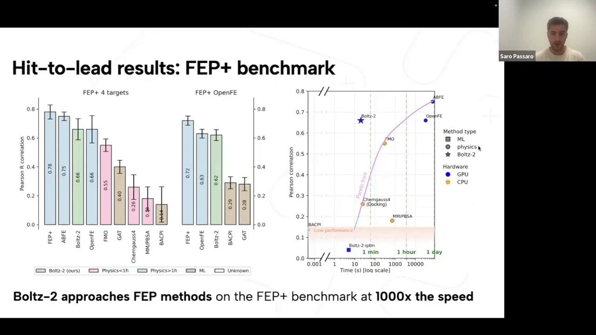

**外部与前瞻性验证**：

- **CASP16 亲和力挑战**：约 140 个蛋白-配体对、2 个靶点，由 Rush 提供，收到顶尖实验室的 31 个提交；回顾性评估中 **Boltz-2 是最好的模型**。
- **Recursion 内部靶点**：8 个真实场景的 hit 实验，**8 个里有 3 个 Pearson > 0.55**——按团队说法，这大致就是「可以替代一部分实验验证」的门槛。作为对比，很多机器学习模型在这些真实靶点上相关性接近 0。同时他们提醒：即便是 FEP，也只对大约 **50%** 的靶点家族适用。

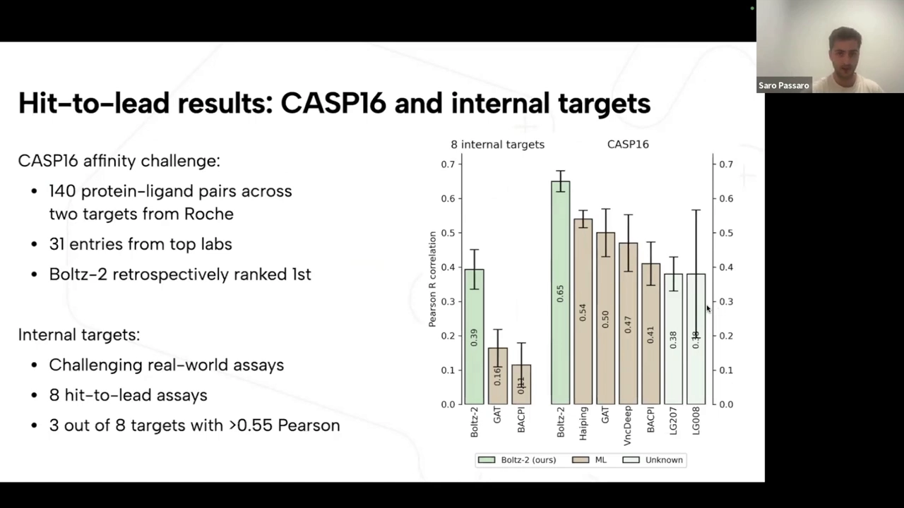

---

## 七、结果二：hit 发现与一次「前瞻性」虚拟筛选

**hit 发现**用 MF-PCBA 基准 [【跳转到 36:17】](https://www.youtube.com/watch?v=iHDauMATkr0&t=2177)：10 个高通量筛选的回顾性实验，顶部富集可达约 20 倍，在 0.5% 的位置上约为机器学习/对接基线的 **2 倍**。

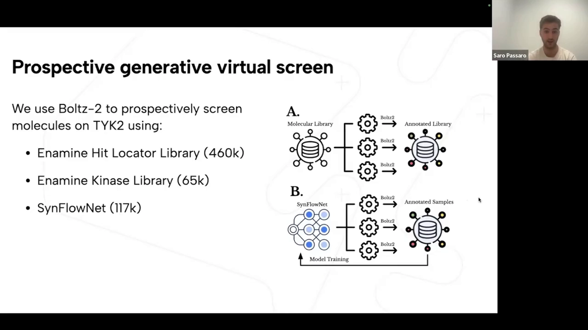

更有说服力的是**前瞻性实验** [【跳转到 37:07】](https://www.youtube.com/watch?v=iHDauMATkr0&t=2227)。他们选 TYK2 作靶点，理由有两条：一是这个靶点**不在训练集里**、也与训练集没有直接关联；二是用于校验的绝对自由能计算（ABFE）在这个靶点上足够可靠，可以先不花实验钱做交叉验证。

筛选用三个来源：

1. Enamine **Hit Locator Library**（约 46 万个化合物）；
2. Enamine **Kynase 库**（约 6.5 万个化合物）；
3. 一个**生成模型**（GFlowNet/「SynFlowNet」）直接从化学空间采样（约 11.7 万个），奖励由 Boltz-2 打分——即「用 Boltz-2 当打分函数去做生成式设计」。

验证方式：先在一个随机分子集上跑 ABFE，确认「随机挑的分子基本都被判为 decoy」（sanity check）；再对每个来源的 **top-10** 分子跑 ABFE。结果是 Boltz-2 的打分与 ABFE 相关性很好，**top-10 全部结合，且平均比已知的公开结合物更强**；同时这些分子与已知 binder 的相似度很低，说明模型确实在泛化，而不是在回忆训练集。

---

## 八、边界：作者自己划出的四条限制

这一页[【跳转到 39:12】](https://www.youtube.com/watch?v=iHDauMATkr0&t=2352)值得逐条抄下来，因为它比任何第三方评测都更可靠：

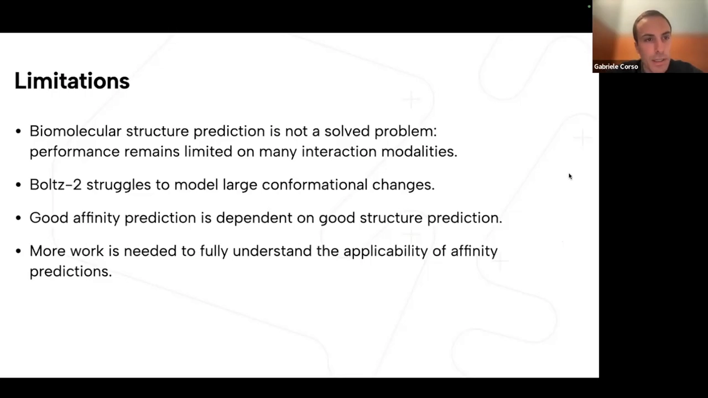

1. **生物分子结构预测不是已解决的问题**：很多相互作用模态上性能仍有限（抗体、RNA 等，见第三节）。
2. **Boltz-2 难以建模大构象变化**：能做的是 RMSF、B 因子这类**局部**柔性；折叠切换、开合状态这类**大尺度**构象变化，AF3 和之前的模型都还做不好。他们用的 MD 模拟本身就是短程的，没有真正尝试建模大型折叠切换。
3. **好的亲和力预测依赖好的结构预测**：如果结构预测不好，亲和力大概率也不好。实践建议是：先在你的靶点上把结构预测调好（用条件化、模板等手段），再去看亲和力输出。
4. **亲和力模型的适用边界还没摸清**：结构预测有可靠的置信度模型告诉你「什么时候该信」；**亲和力目前没有对应的东西**。

关于第 4 点，问答环节有一句非常重要的实话：**「结构很差 → 亲和力肯定也差」是可以判断的；但「结构很好 → 亲和力会不会准」，目前无法预知**，它可能不只取决于靶点，还取决于「靶点 × 化合物系列」这个组合。这正是作者请社区一起做基准的原因。

---

## 九、问答环节里的关键细节（都是实操会碰到的）

- **为什么输出 IC50 而不是 $K_d$？**[【跳转到 45:57】](https://www.youtube.com/watch?v=iHDauMATkr0&t=2757)试过不同输出头与条件化，最后发现**把所有数据一起训练**效果最好；数据绝大多数是 IC50，并用「同实验内取差」抵消 IC50 与 Ki 的差异，因此输出按 IC50 口径理解，相对 Ki 会略偏高。
- **扩散的随机性会让亲和力预测波动多大？**[【跳转到 47:12】](https://www.youtube.com/watch?v=iHDauMATkr0&t=2832)大部分信息封装在 trunk 的表示里，所以单次预测的波动预期不大；但作者给不出定量估计。
- **对单氨基酸变异的敏感性？**[【跳转到 48:52】](https://www.youtube.com/watch?v=iHDauMATkr0&t=2932)还没系统评测；已知这类模型对「单点突变导致的大构象变化」并不强，置信度输出与变异有某种相关性，也有人（Ben Fry 等）在网上报告过与亲和力模型的相关性，但这不是他们专门训练的能力。
- **训练/测试怎么切分？**[【跳转到 49:17】](https://www.youtube.com/watch?v=iHDauMATkr0&t=2957)用 90% 的产物相似度 + 0.5% 覆盖度过滤训练数据；配体侧没有显式去相似，但补充材料显示「配体的新颖程度」与模型表现没有太强相关。
- **一次亲和力预测要多久？**[【跳转到 49:42】](https://www.youtube.com/watch?v=iHDauMATkr0&t=2982)约 **20 秒**，前提是口袋已预计算（同一批 hit-to-lead/筛选里口袋通常不变）；只看口袋里最多 **256 个 token**，所以比全复合物结构预测快得多。大蛋白的结构预测则可能要几分钟。
- **为什么不在 Recursion 内部靶点上跑 FEP 做对比？**[【跳转到 51:47】](https://www.youtube.com/watch?v=iHDauMATkr0&t=3107)给每个配体跑完整绝对自由能计算非常贵——Boltz-2 一次预测对他们很便宜，FEP 则不是。这也是他们选 OpenFE 集合做 FEP 对比的原因（那边已有现成结果）。
- **为什么用 Pearson 而不是 $R^2$？**[【跳转到 53:27】](https://www.youtube.com/watch?v=iHDauMATkr0&t=3207)Pearson 与**排序能力**更相关，也更鲁棒；论文里其实有更多指标，模型与基线的预测后续也会放出。
- **怎么提升覆盖率？**[【跳转到 42:07】](https://www.youtube.com/watch?v=iHDauMATkr0&t=2527)下一步包括：蛋白-蛋白亲和力、把亲和力模型接进小分子与蛋白**设计**流水线、ADMET 与可开发性等性质预测、以及微调与迭代设计的工具。

---

## 小结

- **一句话定位**：Boltz-2 = 「Boltz-1 结构骨干 + 轻量亲和力头」+ 大量数据工程，是第一个把「亲和力」做到接近 FEP 精度、同时完全开源的共折叠模型。
- **结构侧的四个改进**都来自社区反馈：可条件化（方法/多聚体模板/任意接触）、局部动力学（MD 数据 + 距离分布 + B 因子）、物理质量（Feynman-Kac 引导势）、速度（NVIDIA kernel）。
- **物理质量与预测精度是两件事**：引导势让结构「物理上可用」，但不会让 RMSD 变好——评估模型时必须分开看这两类指标。
- **亲和力难在「信息密度」**：每个复合物只有一个数值、噪声大、还有分子量之类的伪偏倚；解法是「强结构表示 + 数据去噪 + 差分损失 + 针对活性跳变的采样」。
- **差分是关键技巧**：同实验内取差既抵消了实验间系统误差，也顺手消掉了 Cheng-Prusoff 的修正项，让 IC50 与 Ki 数据能混用。
- **结果口径**：FEP+ 四靶点平均 Pearson 0.66（FEP+ 0.78、OpenFE 0.66），20 秒 vs FEP 的数小时到一天（1000 倍以上）；CASP16 回顾性第一；Recursion 内部 8 个真实靶点有 3 个 >0.55。
- **边界要记住四条**：结构预测未解决（抗体仍有差距）、大构象变化做不好、亲和力依赖结构质量、**亲和力可信度目前无法预估**。

## 关键术语速查

| 术语 | 一句话解释 |
| --- | --- |
| Boltz-2 | MIT 团队（Corso / Wohlwend / Passaro 等）与 Recursion 合作的开源共折叠模型，同时输出结构与结合亲和力 |
| 共折叠（co-folding） | 把蛋白、配体、核酸等一起喂进模型，一次性预测它们的复合物结构 |
| trunk / Pairformer | 模型骨干：不断更新「任意两个 token 之间」的成对表示，三角运算在此进行 |
| 成对表示（pair representation） | 每个 token 对（如一个蛋白残基 + 一个配体原子）一个向量，用于编码相对几何关系 |
| 扩散结构模块 | 从随机坐标出发逐步去噪生成三维结构的生成模型 |
| 置信度头 / pTM / ipTM | 预测「结构有多可信」；ipTM 侧重**界面**的可信度，是亲和力数据过滤的阈值依据 |
| 亲和力 / IC50 / pIC50 / $K_i$ | 结合强弱的度量；IC50 是功能性半数抑制浓度，$K_i$ 是抑制常数，pIC50 = $-\log_{10}$(IC50) |
| Cheng-Prusoff 方程 | 把 IC50 换算为 $K_i$ 的经典关系式，修正量与底物浓度、$K_m$ 有关 |
| FEP / ABFE | 自由能扰动 / 绝对自由能扰动：基于物理模拟的高精度亲和力计算方法，极慢 |
| 帕累托前沿 | 「精度-成本」平面上不被其它方法同时超越的那条边界 |
| decoy（诱饵） | 已知不结合（或假阳性）的分子，用于训练二分类器 |
| Activity cliff | 结构只改一点、活性却变化一个数量级的一组分子，是先导优化最关心的情况 |
| Feynman-Kac 引导势 | 用可微势函数给扩散采样路径打分、重采样并微调 $x_0$ 的技术，用于保证结构物理合理性 |
| RMSF / B 因子 | 衡量原子位置抖动幅度（柔性）的指标，来自 MD 或晶体学 |
| MD（分子动力学模拟） | 提供构象柔性的训练信号：短程模拟得到的构象集合 |
