# GROMACS 入门 01：在 Linux 上从零编译安装 GROMACS 与 PLUMED

> 内容来源：B 站《分子动力学模拟（一）：安装模拟软件 GROMACS》（BV1MhoUYKEhF，约 28 分钟），UP 主「玄月只有无言」。本文依据视频演说逐字稿与幻灯片整理，文中时间戳可跳转到原视频。配套课件见 UP 主 GitHub：`Sept-naf/gromacs-tutorials`。

## 本讲要解决的核心问题（SCQA）

**背景**：GROMACS 是做生物分子动力学模拟最常用的开源软件之一，但几乎所有教程都默认你已经有一台装好 Linux、CUDA 和编译器的机器。

**冲突**：真实情况是，初学者拿到的往往只是一台裸机或学校集群的账号，`gmx` 命令根本不存在；从显卡驱动、CUDA、GCC、CMake 到 GROMACS 源码，中间任何一环版本不匹配都会导致编译失败。

**疑问**：一台 Linux 机器要从零开始装好 GROMACS，最小可用的步骤链是什么？哪些东西必须装、哪些可以后补？

**回答（中心思想）**：GROMACS 的安装可以拆成**四层依赖 + 三步验证**：先准备 Linux/GPU/CUDA，再用 Miniconda 隔离 GCC、G++、CMake 版本，然后编译 GROMACS，最后通过 `gmx` 命令和版本号确认成功；PLUMED 是可选的高阶插件，需要装好后重新编译一次 GROMACS。

---

## 一、GROMACS 是什么，为什么安装前要准备一整套环境

### 1.1 GROMACS 是开源的分子动力学引擎

GROMACS 全称是 *GROningen MAchine for Chemical Simulation*，是一款面向生物化学与生物体系模拟的分子动力学软件。它用数值方法求解牛顿运动方程，让蛋白质、核酸、膜、小分子在水或溶剂中“动起来”，从而研究构象变化、结合过程、输运性质等。[【跳转到 00:00】](https://www.bilibili.com/video/BV1MhoUYKEhF/?t=0)

它有两个对初学者很重要的特点：

- **开源**：软件本身免费，不需要购买 license。
- **可扩展**：支持 PLUMED 等插件，后续可以做元动力学、伞形采样等增强采样。

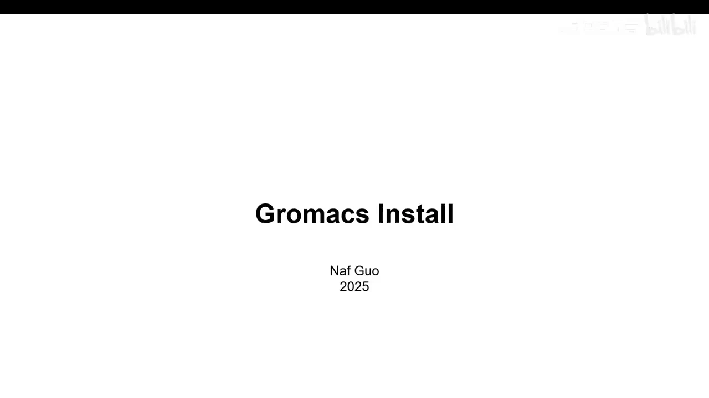

### 1.2 想跑得快，需要 Linux + NVIDIA GPU + CUDA

GROMACS 虽然也有其他平台的版本，但**官方和社区的主流运行环境是 Linux**。硬件上最好有一块合适的 NVIDIA 显卡；如果只用 CPU 跑，速度会慢很多，长体系往往“等不起”。[【跳转到 00:17】](https://www.bilibili.com/video/BV1MhoUYKEhF/?t=17)

要让 GPU 真正参与计算，还需要 NVIDIA 的 **CUDA** 工具包。可以把它理解成“GPU 的编程运行时”：GROMACS 的 GPU 加速代码是调用 CUDA 接口写的。

### 1.3 编译 GROMACS 还需要 C/C++/Fortran 编译器和 CMake

GROMACS 发布的是**源代码**，需要在你的机器上现场编译。涉及三类工具：

| 工具 | 作用 | 类比 |
| --- | --- | --- |
| `gcc` / `g++` | 分别编译 C 和 C++ 源码 | 把“图纸”翻译成机器能执行的程序 |
| `gfortran` | 编译部分 Fortran 数值代码 | 同上，只是语言不同 |
| `cmake` | 读取项目的构建配置，生成 Makefile | 施工总调度，告诉编译器先编译谁、链接谁 |

视频里之所以反复强调版本，是因为 **GCC 太老或太新都可能编译失败**：老版本可能不认识新语法，新版本又可能对旧代码报更严格的错误。UP 主的做法是用 Miniconda 建一个独立环境，把 GCC、G++、gfortran 固定到实测可用的 **9.5.0**，CMake 固定到 **3.31.2**。[【跳转到 01:07】](https://www.bilibili.com/video/BV1MhoUYKEhF/?t=67)

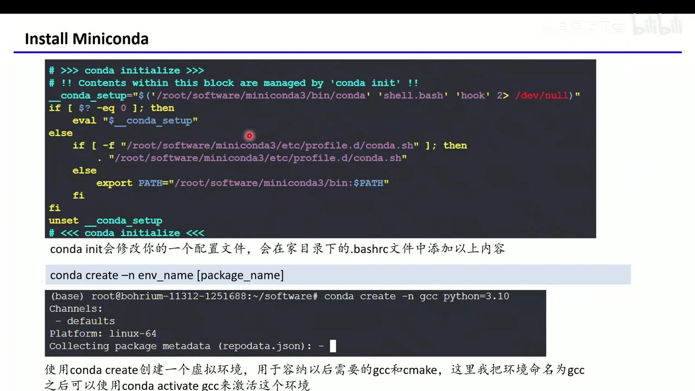

---

## 二、开工前先掌握 6 个 Linux 命令和 vim

视频用几分钟快速过了一遍安装过程真正会用到的命令。对完全没接触过 Linux 的读者，这一节是后面所有操作的“字母表”。[【跳转到 01:53】](https://www.bilibili.com/video/BV1MhoUYKEhF/?t=113)

| 命令 | 含义 | 例子 |
| --- | --- | --- |
| `pwd` | 打印当前所在路径 | `pwd` → `/home/guoy` |
| `ls` | 列出当前目录下的文件和文件夹 | `ls` |
| `mkdir 名字` | 创建文件夹 | `mkdir software` |
| `cd 路径` | 切换目录 | `cd software/` |
| `wget 链接` | 从网络下载文件，支持断点续传 | `wget https://...` |
| `tar -xzvf 包名` | 解压 `.tar.gz` 压缩包 | `tar -xzvf gromacs-2024.3.tar.gz` |

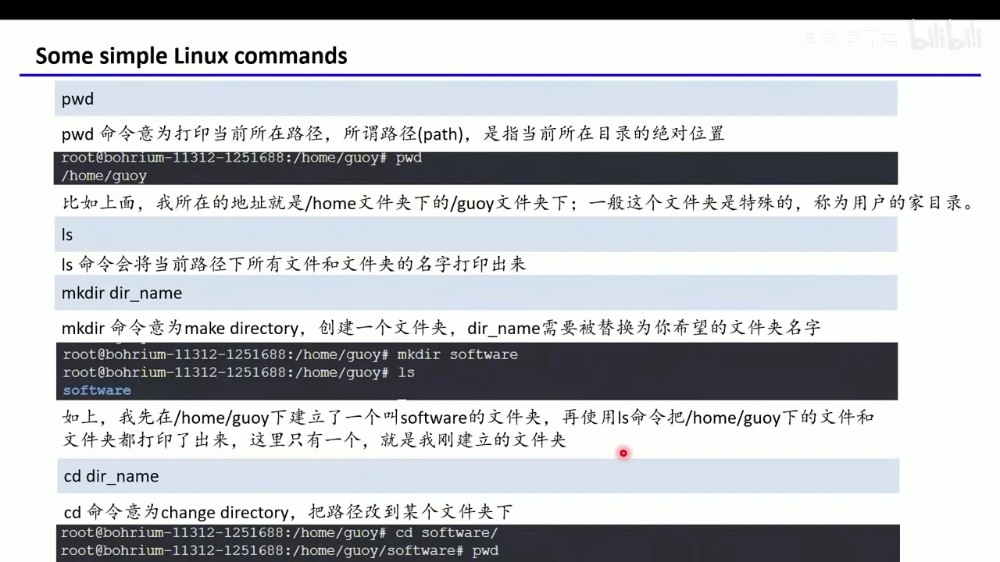

还需要一个文本编辑器。视频使用 **vim**：按 `i` 进入插入模式，改完按 `Esc`，输入 `:wq` 保存退出；`:q!` 表示不保存强制退出。[【跳转到 03:06】](https://www.bilibili.com/video/BV1MhoUYKEhF/?t=186)

> 小技巧：Linux 里 `~` 代表当前用户的家目录。你看到的 `/home/你的用户名` 和别人的 `/home/guoy` 只是用户名不同，后面配置路径时要换成自己的。

---

## 三、装显卡驱动和 CUDA：先确认，再安装

### 3.1 用 `nvidia-smi` 检查驱动与 CUDA 版本

拿到一台新机器，第一件事是运行：

```bash
nvidia-smi
```

输出里重点看两项：**Driver Version**（驱动版本）和 **CUDA Version**（该驱动最高支持的 CUDA 版本）。视频中的机器驱动是 525.85.12，最高支持 CUDA 12.1。[【跳转到 04:12】](https://www.bilibili.com/video/BV1MhoUYKEhF/?t=252)

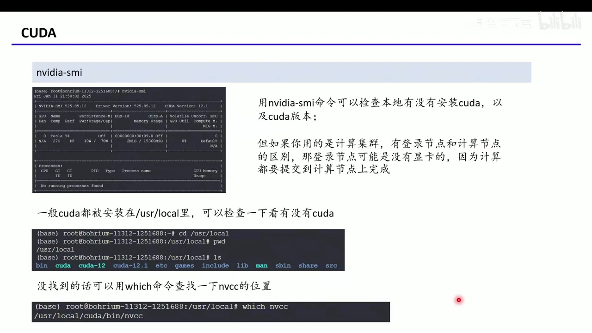

CUDA 一般装在 `/usr/local` 下，可以用 `cd /usr/local && ls` 查看有没有 `cuda`、`cuda-12` 这类目录；如果找不到，可以用 `which nvcc` 定位编译器位置。[【跳转到 04:37】](https://www.bilibili.com/video/BV1MhoUYKEhF/?t=277)

### 3.2 Ubuntu 24.02 的驱动安装示例

视频给了一个 Ubuntu 的示例（注意：装驱动有风险，集群环境最好请管理员操作）：

```bash
sudo ubuntu-drivers autoinstall
```

这条命令会自动检测并安装最适合当前显卡的驱动。装完再次运行 `nvidia-smi`，能看到驱动版本（示例为 550.120）和最高 CUDA 版本（12.4）就说明成功，然后**重启机器**让驱动生效。[【跳转到 05:23】](https://www.bilibili.com/video/BV1MhoUYKEhF/?t=323)

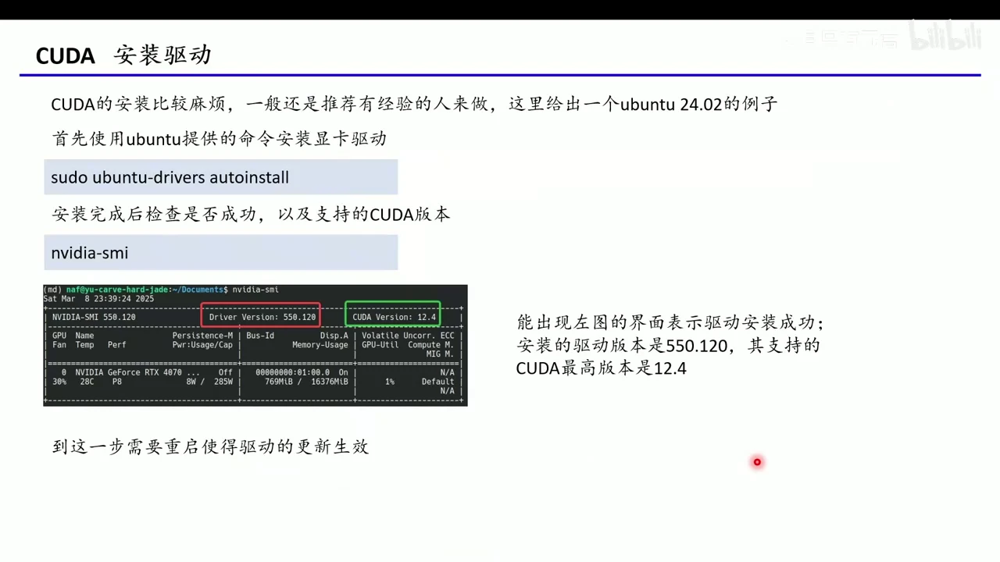

接着到 NVIDIA 官网下载 CUDA Toolkit。视频里选择 Linux x86_64、Ubuntu、版本 12.4；由于官网没有 24.04 的选项，UP 主实测用 22.04 的包也能装。运行 `.run` 安装包时，因为驱动已经装好，可以**取消勾选 Driver，只装 CUDA Toolkit**，避免覆盖现有驱动。[【跳转到 06:35】](https://www.bilibili.com/video/BV1MhoUYKEhF/?t=395)

---

## 四、用 Miniconda 搭一个干净的编译环境

### 4.1 为什么不直接用系统自带的 GCC

系统自带的 GCC 版本由发行版决定，可能恰好是 GROMACS 不兼容的版本；而用 `apt` 反复升降级又会污染系统。Miniconda 可以创建互相隔离的虚拟环境，每个环境里放一套独立的 GCC/CMake，互不影响。[【跳转到 07:57】](https://www.bilibili.com/video/BV1MhoUYKEhF/?t=477)

### 4.2 安装 Miniconda

从官网下载 Miniconda 安装脚本，用 `wget` 下载后执行：

```bash
wget <Miniconda 安装脚本链接>
chmod +x Miniconda3-latest-Linux-x86_64.sh
./Miniconda3-latest-Linux-x86_64.sh
```

安装位置建议统一放在 `~/software/miniconda3`，方便管理。安装程序问是否运行 `conda init` 时选 **yes**，它会自动修改 `~/.bashrc`，让每次打开终端都能使用 `conda` 命令。[【跳转到 09:12】](https://www.bilibili.com/video/BV1MhoUYKEhF/?t=552)


### 4.3 创建并激活 gcc 环境

```bash
conda create -n gcc python=3.10
conda activate gcc
conda install -c conda-forge gcc=9.5.0 gxx=9.5.0 gfortran=9.5.0
conda install -c conda-forge cmake
```

这里 `-n gcc` 是环境名，`python=3.10` 指定 Python 版本。C++ 编译器在 conda 里叫 `gxx`，Fortran 编译器叫 `gfortran`，一行装齐。[【跳转到 12:10】](https://www.bilibili.com/video/BV1MhoUYKEhF/?t=730)

装完用 `gcc -v`、`g++ -v`、`cmake --version` 检查版本；再用 `which gcc` 确认它来自 `miniconda3/envs/gcc/bin/gcc`，而不是系统路径。[【跳转到 13:00】](https://www.bilibili.com/video/BV1MhoUYKEhF/?t=780)

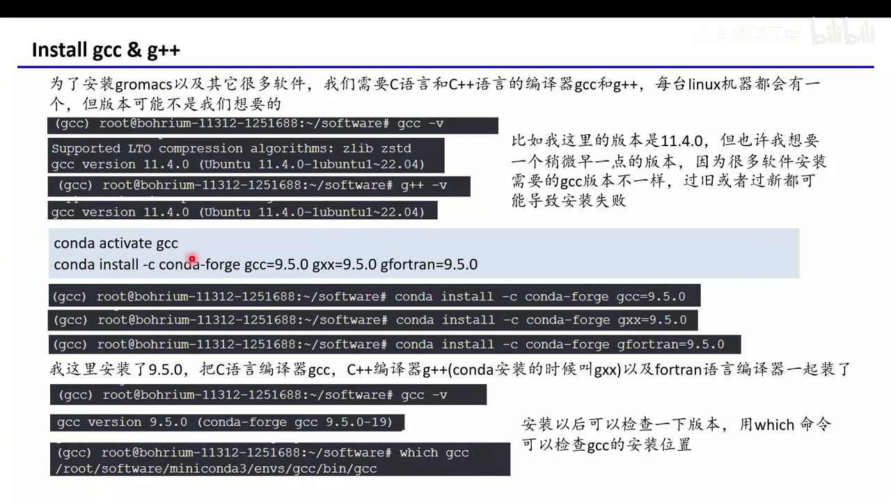

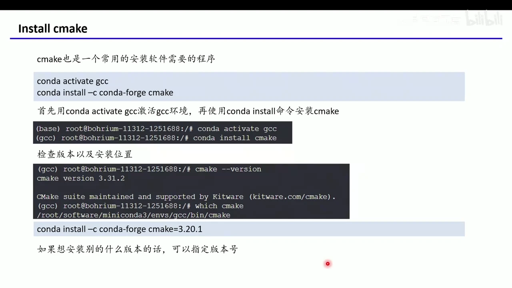

---

## 五、编译安装 GROMACS 2024.3

### 5.1 下载源码

到 GROMACS 官网下载源代码。视频没有选最新版，而是选 **2024.3**，原因是当时 PLUMED 2.9.3 支持的最新 GROMACS 版本就是 2024.3。官网提供 FTP 路径，可以直接 `wget`：[【跳转到 13:54】](https://www.bilibili.com/video/BV1MhoUYKEhF/?t=834)

```bash
wget <gromacs-2024.3.tar.gz 的地址>
tar -xzvf gromacs-2024.3.tar.gz
cd gromacs-2024.3
mkdir build
cd build
```

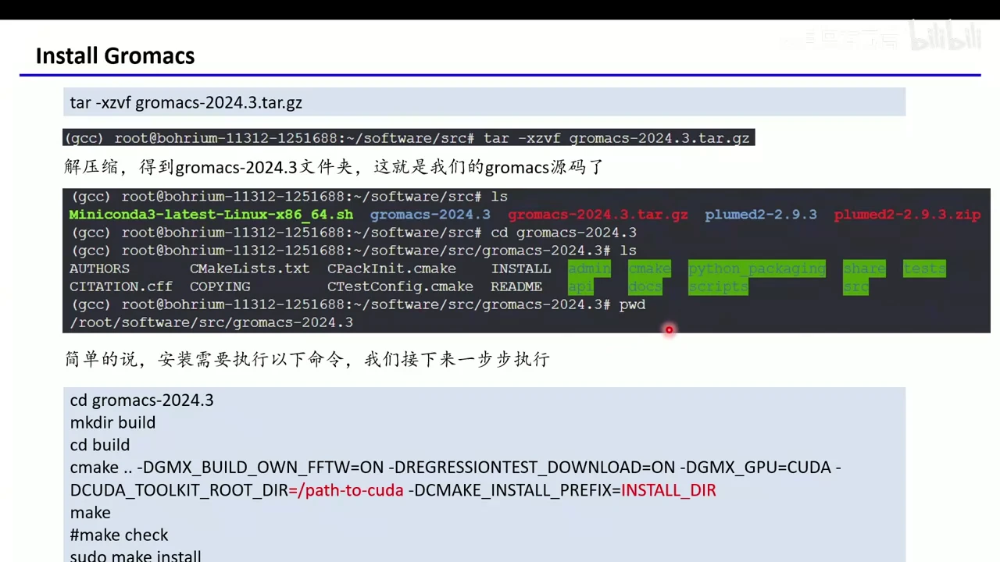

### 5.2 用 CMake 生成构建文件

核心配置命令如下（路径要换成你自己的）：

```bash
cmake .. \
  -DGMX_BUILD_OWN_FFTW=ON \
  -DREGRESSIONTEST_DOWNLOAD=ON \
  -DGMX_GPU=CUDA \
  -DCUDA_TOOLKIT_ROOT_DIR=/path/to/cuda \
  -DCMAKE_INSTALL_PREFIX=/path/to/install
```

各参数含义：

| 参数 | 作用 |
| --- | --- |
| `-DGMX_BUILD_OWN_FFTW=ON` | 让 GROMACS 自带并编译 FFTW（快速傅里叶变换库），省去手动装库 |
| `-DREGRESSIONTEST_DOWNLOAD=ON` | 下载回归测试，用于验证编译结果 |
| `-DGMX_GPU=CUDA` | 编译 GPU 加速版本 |
| `-DCUDA_TOOLKIT_ROOT_DIR` | CUDA 所在目录；若在 `/usr/local/cuda` 等标准路径可省略 |
| `-DCMAKE_INSTALL_PREFIX` | GROMACS 最终安装到哪里 |

视频里还额外装了线性代数库，用于提升动力学模拟速度。[【跳转到 15:45】](https://www.bilibili.com/video/BV1MhoUYKEhF/?t=945)

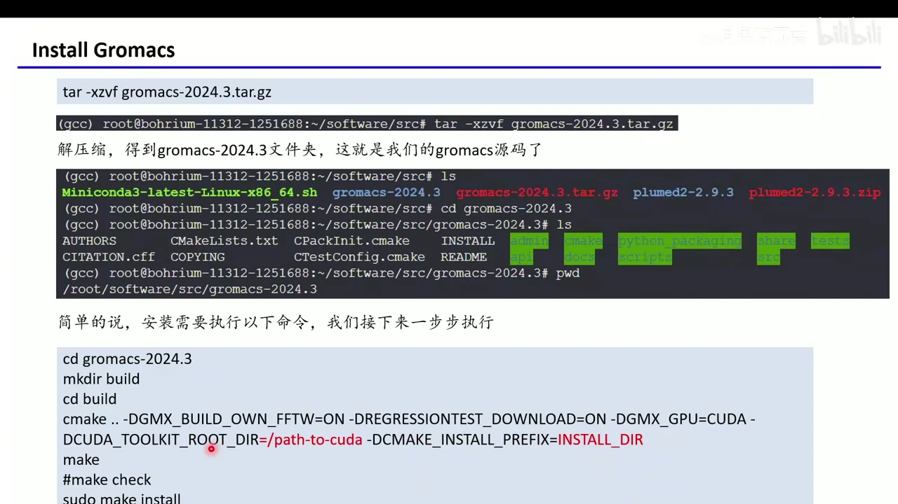

### 5.3 编译与安装

```bash
make -j 4        # 用 4 个核并行编译，数字可按机器调整
make install
```

`cmake` 只负责“生成施工方案”，`make` 才真正编译。编译时间取决于机器，可能十几分钟到更久。视频建议：**报错时把完整报错信息复制给大模型**，多数问题出在 GCC 版本、CMake 版本或 CUDA 路径不对。[【跳转到 18:07】](https://www.bilibili.com/video/BV1MhoUYKEhF/?t=1087)

### 5.4 配置环境变量，让 `gmx` 能被找到

安装完成后，把 GROMACS 的环境脚本写进 `~/.bashrc`：

```bash
vim ~/.bashrc
# 在文件末尾加入（路径换成你的安装目录）：
source /root/software/gromacs-2024.3/bin/GMXRC
```

保存后执行：

```bash
source ~/.bashrc
gmx
```

如果看到 `GROMACS - gmx, 2024.3` 的欢迎信息和命令列表，就说明安装成功。[【跳转到 19:41】](https://www.bilibili.com/video/BV1MhoUYKEhF/?t=1181)

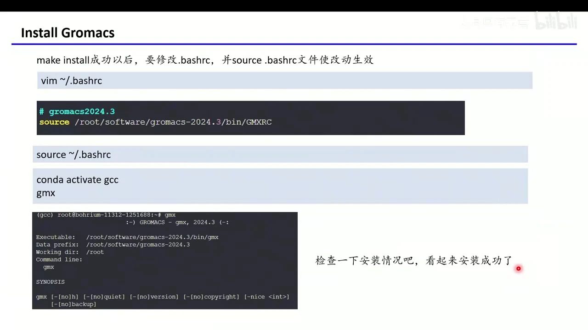

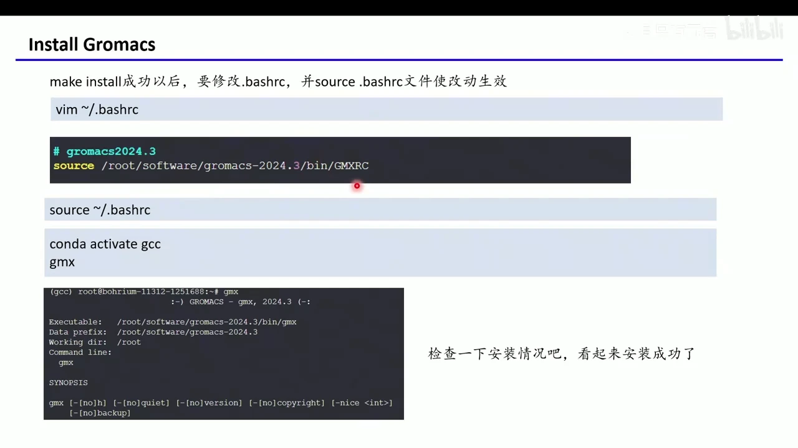

> 如果你的系统默认 shell 是 zsh，要改的是 `~/.zshrc` 而不是 `~/.bashrc`。

---

## 六、可选高阶：安装 PLUMED 并重新编译 GROMACS

PLUMED 是增强采样插件。初学者不装也能做常规动力学；只有后面要学元动力学、伞形采样等技巧时才需要。视频把它放在最后，是因为它必须和 GROMACS 一起编译。[【跳转到 21:56】](https://www.bilibili.com/video/BV1MhoUYKEhF/?t=1316)

### 6.1 编译安装 PLUMED 2.9.3

从 PLUMED 官网下载源码并解压，进入目录后：

```bash
./configure --prefix=/path/to/plumed2-2.9.3 --enable-modules=funnel
make -j 4
make install
```

`--prefix` 指定安装位置；`--enable-modules=funnel` 启用 funnel metabD 相关模块（不是必需）。[【跳转到 22:58】](https://www.bilibili.com/video/BV1MhoUYKEhF/?t=1378)

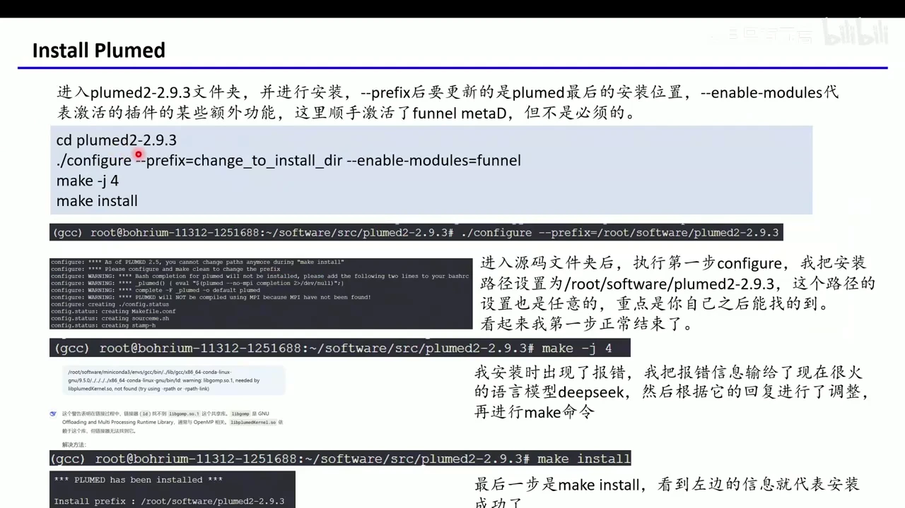

### 6.2 配置 PLUMED 环境变量

安装成功后会提示需要把 PLUMED 的 `bin`、`lib` 等路径加入环境变量。在 `~/.bashrc` 末尾加入类似内容：

```bash
# plumed2-2.9.3
export PATH=$PATH:/root/software/plumed2-2.9.3/bin
export LD_LIBRARY_PATH=$LD_LIBRARY_PATH:/root/software/plumed2-2.9.3/lib
export CPATH=$CPATH:/root/software/plumed2-2.9.3/include
export PKG_CONFIG_PATH=$PKG_CONFIG_PATH:/root/software/plumed2-2.9.3/lib/pkgconfig
export PLUMED_KERNEL=/root/software/plumed2-2.9.3/lib/libplumedKernel.so
```

然后 `source ~/.bashrc`，用 `plumed` 命令测试是否可执行。[【跳转到 24:03】](https://www.bilibili.com/video/BV1MhoUYKEhF/?t=1443)

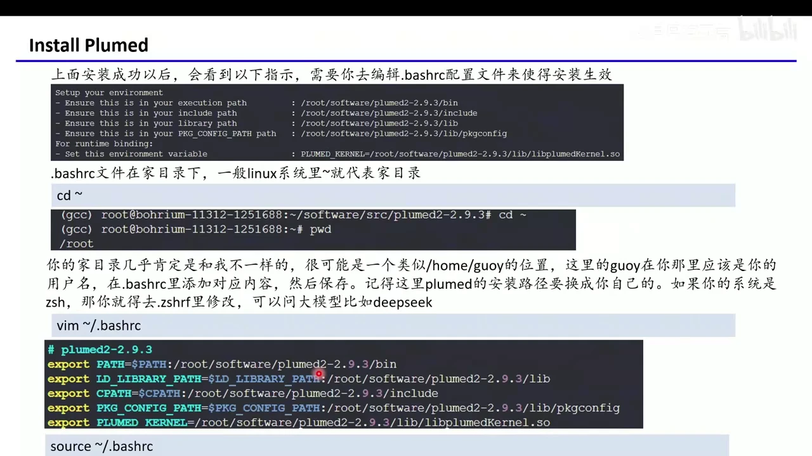

### 6.3 用 PLUMED 修补并重编 GROMACS

```bash
cd gromacs-2024.3
plumed patch -p        # 按提示选择 GROMACS 版本
rm -rf build           # 删除旧构建目录，避免残留
mkdir build && cd build
# 重新执行前面的 cmake、make、make install
```

`plumed patch -p` 会把 PLUMED 接口补丁打进 GROMACS 源码，之后再按普通 GROMACS 的流程编译一次，就得到带 PLUMED 的版本。[【跳转到 26:23】](https://www.bilibili.com/video/BV1MhoUYKEhF/?t=1583)

---

## 小结

1. **安装 GROMACS 本质是准备一条工具链**：Linux → NVIDIA 驱动/CUDA → GCC/G++/gfortran/CMake → GROMACS 源码。
2. **版本控制比“装最新”更重要**：用 Miniconda 建独立环境固定 GCC 9.5.0、CMake 3.31.2，避免系统升级把编译环境弄坏。
3. **`nvidia-smi` 是硬件体检入口**：先确认驱动和最高 CUDA 版本，再决定装哪个 CUDA Toolkit。
4. **编译三步走**：`cmake ..` 生成构建文件 → `make -j` 编译 → `make install` 安装。
5. **装完必须配置环境变量**：把 `GMXRC` 写进 `~/.bashrc`，`source` 后能用 `gmx` 才算成功。
6. **PLUMED 是可选插件**：先装 PLUMED，再用 `plumed patch` 修补 GROMACS 源码并重新编译。
7. **遇到报错先看版本和路径**：GCC/CMake 版本、CUDA 路径、缺失库是最常见的三类问题。

## 关键术语速查

| 术语 | 一句话解释 |
| --- | --- |
| GROMACS | 开源的分子动力学模拟软件，主要用于生物分子体系 |
| CUDA | NVIDIA 的 GPU 计算平台，GROMACS 用它做 GPU 加速 |
| `nvidia-smi` | 查看显卡驱动、GPU 占用和最高 CUDA 版本的命令 |
| GCC / G++ / gfortran | C / C++ / Fortran 编译器，负责把源码编译成程序 |
| CMake | 跨平台构建工具，根据项目配置生成 Makefile |
| Miniconda | 轻量的 conda 发行版，用来创建隔离的软件环境 |
| `~/.bashrc` | 当前用户的 shell 配置文件，每次打开终端会自动执行 |
| PLUMED | 增强采样插件，支持元动力学、伞形采样等 |
| `gmx` | GROMACS 的主命令入口，后面接不同子命令完成各种任务 |
