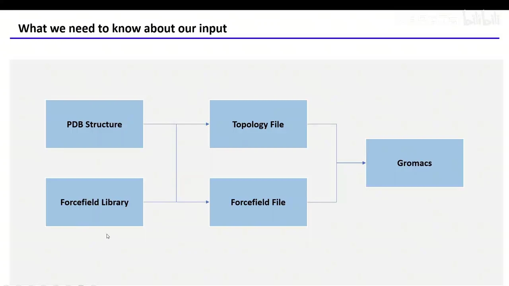
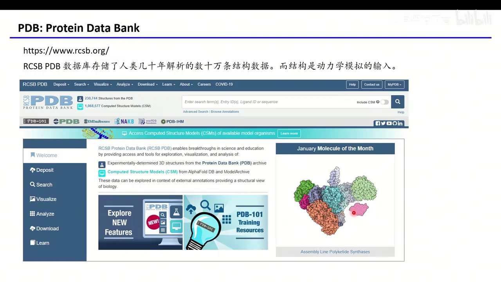
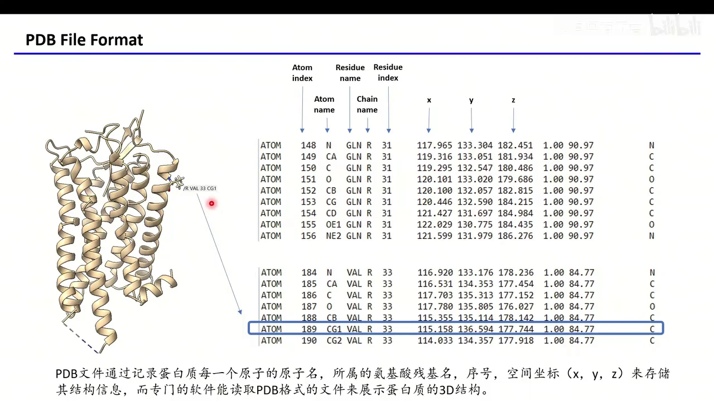
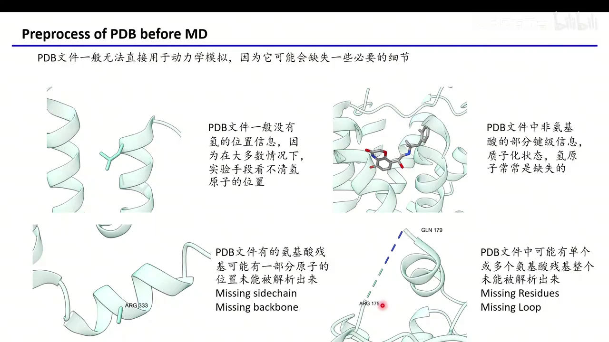
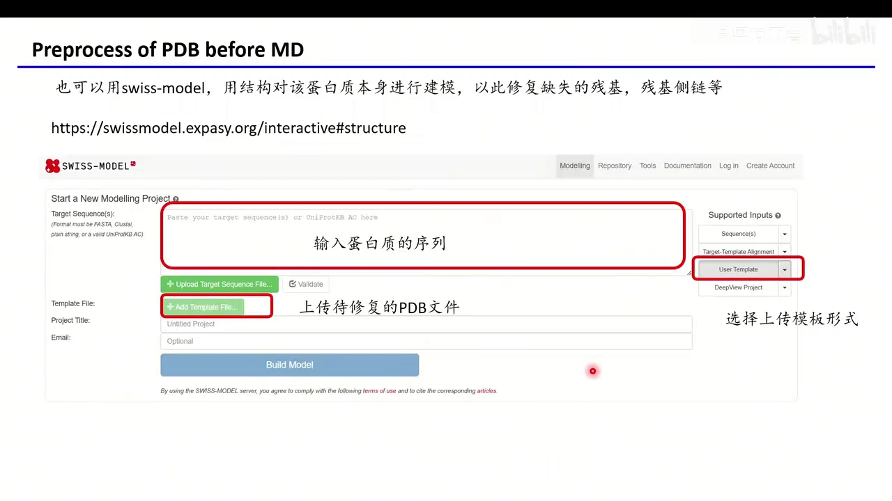
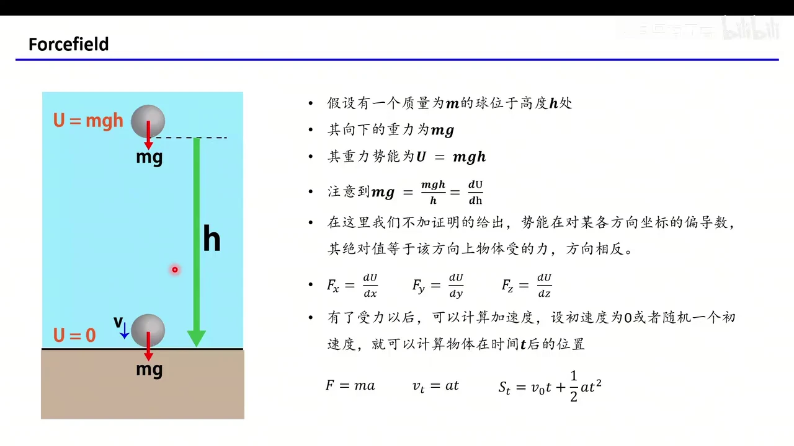
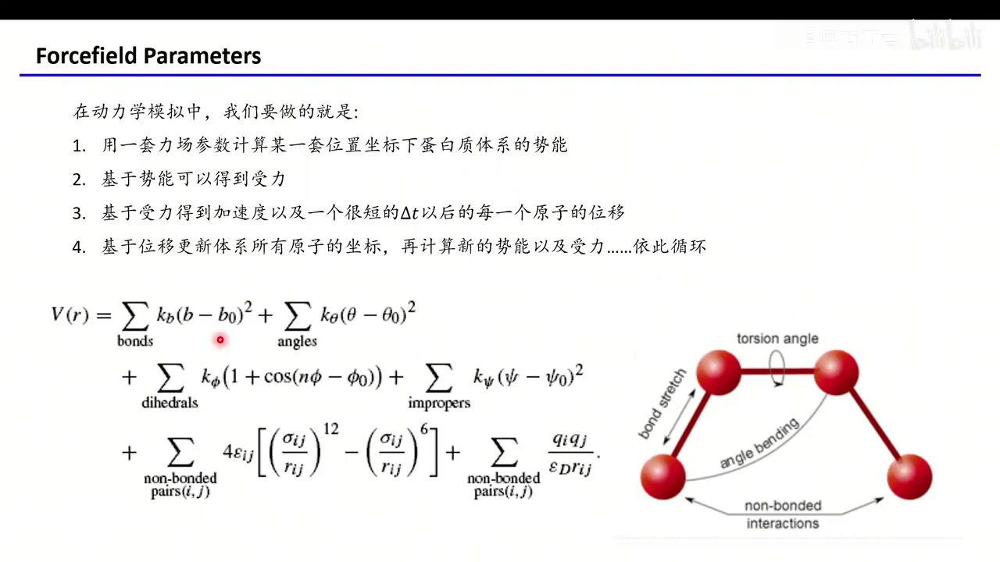
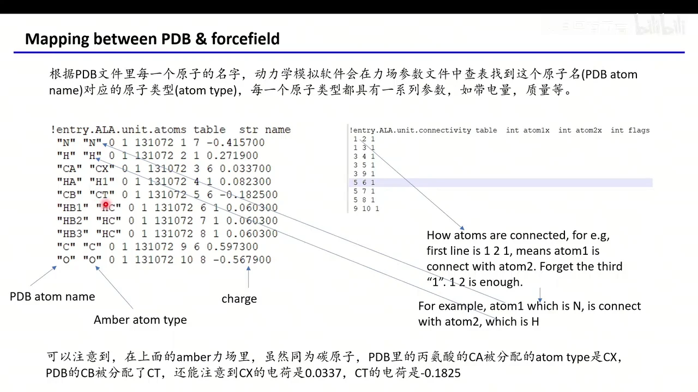
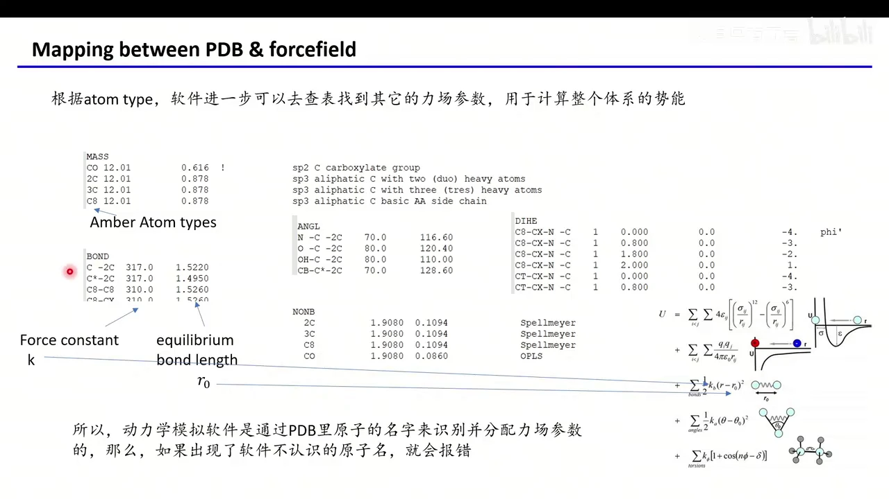
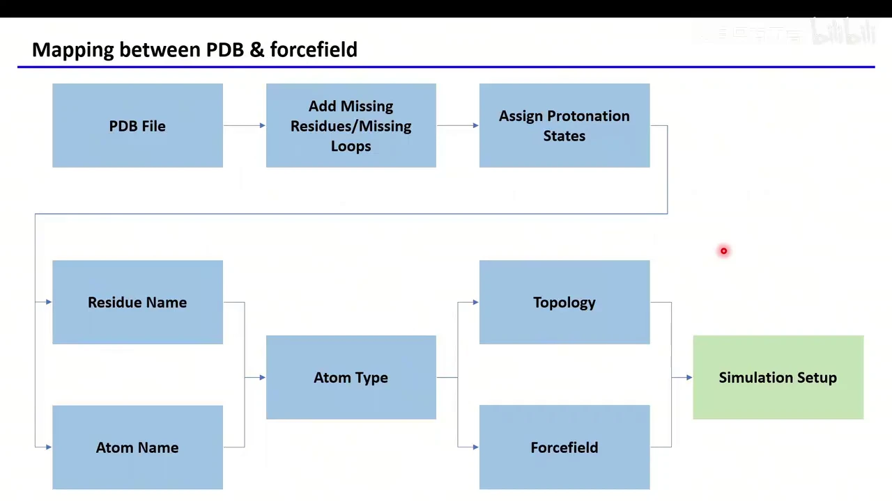

# GROMACS 入门 02：认识 PDB 文件与力场

## 本讲要解决的核心问题（SCQA）

**背景**：上一讲已经装好了 GROMACS。做分子动力学模拟，第一步总是拿到一个蛋白质的三维结构文件，最常见的就是 PDB 文件。

**冲突**：把从网上下载的 PDB 直接丢给 GROMACS，通常跑不起来：文件里没有氢原子，有些残基缺胳膊少腿，小分子配体也不在软件的"认识范围"内。而就算结构完整，软件又是凭什么把一堆原子坐标变成"原子该怎么动"的？

**疑问**：PDB 文件里到底存了什么？为什么它不能直接用于模拟？所谓"力场"又是什么，GROMACS 如何把 PDB 里的原子和力场参数对应起来？

**回答（中心思想）**：PDB 只是"原子坐标清单"，是模拟的起点而不是可用输入；必须先做蛋白质准备（补缺失、定质子化），再由力场按"原子名 → 原子类型 → 参数"的路径为体系算出势能，模拟才能在一轮轮"势能→受力→新坐标"的循环中跑起来。

[【跳转到 00:11】](https://www.bilibili.com/video/BV1MhoUYKEjY/?t=11)

---

## 一、PDB 是实验结构数据库，也是模拟的起点

**结论：PDB 既是全球蛋白质结构的"总仓库"，也是一种用纯文本记录原子坐标的文件格式。**

- **它是什么**：PDB 是 Protein Data Bank（蛋白质数据库）的缩写，官网是 `https://www.rcsb.org/`。它收录了人类几十年来通过实验手段解析的数十万条结构数据，页面上显示的条目数已超过 23 万条。这些结构是动力学模拟的输入。
- **怎么拿到文件**：在网站上搜索你感兴趣的蛋白，下载它的 PDB 格式结构文件即可。
- **两种打开方式**：用可视化软件（如 PyMOL）打开，看到的是三维折叠的蛋白质；用文本编辑器打开同一个文件，看到的则是一行行以 `ATOM` 开头的记录。

[【跳转到 00:50】](https://www.bilibili.com/video/BV1MhoUYKEjY/?t=50)

### 1.1 一行 ATOM 记录就是一颗原子的"身份证"

每一行 `ATOM` 记录包含这些字段，按顺序是：

1. **原子序号**（atom index）：这是文件里的第几个原子；
2. **原子名**（atom name）：如 N、CA、CG1；
3. **残基名**（residue name）：该原子属于哪种氨基酸；
4. **链名**（chain name）：如 R 链；
5. **残基编号**（residue index）：如第 33 号残基；
6. **x、y、z 坐标**：指定原子在三维空间中的位置；
7. **空间占有率**（occupancy）：如 1.00；
8. **B-factor**：反映原子位置的置信程度/热运动，如 84.77；
9. **元素类型**：如 C、N、O。

以文稿中的实际例子来说：`ATOM 189 CG1 VAL R 33` 表示第 189 号原子，名字叫 CG1，属于 R 链第 33 号残基缬氨酸（VAL），后面跟着它的坐标、占有率和元素碳。可视化软件里箭头指着的那个原子，正是这个 CG1。

[【跳转到 02:37】](https://www.bilibili.com/video/BV1MhoUYKEjY/?t=157)

正是因为把每个原子的名字、所属残基和坐标都写了下来，PDB 才能用一份文本保存整个三维结构，并让专门的软件读取和展示。

---

## 二、原始 PDB 通常不能直接模拟：四类缺陷

**结论：实验解析关心的是"看清重原子骨架"，而模拟需要完整、带电荷和连接关系的全原子体系，两者天然错位。**

[【跳转到 03:34】](https://www.bilibili.com/video/BV1MhoUYKEjY/?t=214)

- **缺氢原子**：几乎所有 PDB 文件都没有氢的位置。因为 X 射线晶体学、冷冻电镜等实验手段大多"看不清"氢；只有 NMR 解出的结构可能带氢，分辨率非常高的 X 射线结构偶尔也能看到氢。绝大多数下载来的文件没有氢坐标。好在 GROMACS 会自动补氢，这一点相对省心。
- **缺部分原子**：解析时某些原子没被解析出来，比如文稿中的 ARG 333 侧链少了一大块（missing sidechain），也可能缺主链原子（missing backbone）。这类空洞必须补上，否则无法模拟。
- **缺整段残基/loop**：有时会连续缺失多个残基，形成一段断掉的柔性环（missing residues / missing loop），例如图中 GLN 179 与 ARG 175 之间就断开了一截。如果缺失的残基不重要，可以接受；如果重要，就必须补。
- **非氨基酸组分信息不全**：结构里的小分子配体、离子、水等，其键级信息、质子化状态、氢原子常常缺失。GROMACS 只认识一些常见组分；如果放进一个它没见过的小分子，软件既不知道原子之间怎么连接，也不知道该用什么力场参数，需要额外准备。

[【跳转到 05:14】](https://www.bilibili.com/video/BV1MhoUYKEjY/?t=314)

---

## 三、蛋白质准备：先补全结构，再确定质子化

**结论：蛋白质准备没有唯一工具，但目标固定为两件事——把缺失的部分补回来，把每个可电离基团的质子化状态定下来。**

### 3.1 商业方案：Maestro 的 Protein Preparation

如果你有 Schrödinger 公司的 Maestro，它的 Protein Preparation 流程可以一次性修复上述绝大多数问题：补侧链、优化氢键网络、加氢、限制性最小化、删除多余水分子等。缺点是要收费，多数人可能没有。

[【跳转到 05:55】](https://www.bilibili.com/video/BV1MhoUYKEjY/?t=355)

### 3.2 免费方案：Swiss-Model 同源建模"照着自己补"

只需要修复蛋白质时，可以用开源的 Swiss-Model 网站（`https://swissmodel.expasy.org/interactive#structure`）。思路很巧妙：拿这个蛋白质自己当模板给自己建模，已有部分照抄、不变，缺失部分由建模算法尽量补齐。具体步骤：

1. 打开网站，把待模拟蛋白质的**序列**粘贴到 Target Sequence 输入框；
2. 在模板形式中选择 **User Template**（自己上传模板）；
3. 上传待修复的 **PDB 文件**；
4. 点击 Build Model，得到补全后的模型。

关键注意点：上传前先把不关心的蛋白质和其他组分全部删掉。建模一次只针对一个蛋白，输入的是什么序列，就只保留这个蛋白对应的部分。这样能修复缺失的残基和 loop。

[【跳转到 06:17】](https://www.bilibili.com/video/BV1MhoUYKEjY/?t=377)

### 3.3 其他可选工具

- **PDBFixer**：一个 Python 包，可自动修复 PDB 的常见问题；
- **Rosetta Common（RosettaCommons）**：也能做蛋白质修复。

这些工具的具体用法，文稿表示会在后续实际做蛋白质体系时再细致介绍；本讲只需建立"PDB 结构经常有问题、不能直接拿来用"的概念。

[【跳转到 07:57】](https://www.bilibili.com/video/BV1MhoUYKEjY/?t=477)

---

## 四、分子动力学的核心循环：从势能到新坐标

**结论：MD 并不神秘，它就是"算势能 → 求受力 → 算加速度 → 更新坐标"的不断重复；力场提供的正是第一步所需的势能函数。**

先用一个高中物理例子建立直觉：一个质量为 m 的球放在高度 h 处，重力势能是 U = mgh，受到的重力是 mg。注意 mg = mgh/h = dU/dh——力正好是势能对高度的导数（严格说是负梯度，方向相反）。这个关系在 MD 中同样成立。

[【跳转到 08:47】](https://www.bilibili.com/video/BV1MhoUYKEjY/?t=527)

### 4.1 一次迭代的四步

1. **算势能**：给定体系所有原子的坐标，用力场参数算出整个体系的势能；
2. **求受力**：对势能分别沿 x、y、z 求偏导，得到每个原子在三个方向上的受力；
3. **算加速度与位移**：由 F = ma 得加速度；给定初速度（0 或随机值），用 v = at、s = v₀t + ½at² 算出经过一个极短时间 Δt（飞秒量级）后每个原子的位移；
4. **更新坐标**：把所有原子挪到新位置，回到第 1 步，在新坐标下重新算势能。

[【跳转到 09:12】](https://www.bilibili.com/video/BV1MhoUYKEjY/?t=552)

如此循环：初始构象 → 2 飞秒后更新一次 → 再 2 飞秒再更新……体系就"跑"了起来。肉眼看到的蛋白质构象变化，背后就是无数次这样的坐标更新。

[【跳转到 10:15】](https://www.bilibili.com/video/BV1MhoUYKEjY/?t=615)

---

## 五、力场就是一套"算势能"的参数

**结论：力场（force field）不是某种力，而是一组函数形式加参数：它规定原子间如何相互作用，并给出每个具体原子对的平衡值、力常数、电荷等数值。**

体系总势能由键合项和非键项相加而成，对应五类相互作用。

[【跳转到 11:05】](https://www.bilibili.com/video/BV1MhoUYKEjY/?t=665)

### 5.1 键伸缩（bond stretch）

两个成键原子像用一根弹簧连着，键长不会完全固定，而是在平衡位置 b₀ 附近振动。势能写成 k_b(b − b₀)²：

- b₀ 是最优键长（查表得到）；
- b 是当前坐标下两原子的实际距离；
- k_b 是该键的力常数（也查表）。

把所有化学键的这项势能加起来，就是 bond term。

### 5.2 键角（angle）

三个成键原子之间有一个键角，同样在平衡键角 θ₀ 附近振动，势能为 k_θ(θ − θ₀)²。查表得到 θ₀ 与力常数，再由当前坐标算出实际键角 θ，代入方程即可。

[【跳转到 11:55】](https://www.bilibili.com/video/BV1MhoUYKEjY/?t=715)

### 5.3 二面角与异常二面角（dihedral / improper）

四个原子之间构成二面角，也有平衡位置与力常数，用周期函数 k_φ(1 + cos(nφ − φ₀)) 描述；异常二面角则用 k_ψ(ψ − ψ₀)² 约束，用来维持平面性或手性。这些参数同样来自查表。

[【跳转到 12:45】](https://www.bilibili.com/video/BV1MhoUYKEjY/?t=765)

### 5.4 非键项之一：库仑静电

非键相互作用（non-bonded）有两项。第一项是大家熟悉的库仑力：q_i、q_j 是两个原子的电荷，r_ij 是它们之间的距离，ε 是介电常数，势能为 q_iq_j / (ε r_ij)。把体系中所有带电原子对的这一项加起来即可。

[【跳转到 13:10】](https://www.bilibili.com/video/BV1MhoUYKEjY/?t=790)

### 5.5 非键项之二：Lennard-Jones 势

第二项是 Lennard-Jones（LJ）势，描述范德华式的非静电相互作用：4ε_ij[(σ_ij/r_ij)¹² − (σ_ij/r_ij)⁶]。其中 r_ij 仍是原子间距离，ε_ij 与 σ_ij 由原子类型查表得到。¹² 项代表近距离排斥，⁶ 项代表远距离吸引。

[【跳转到 13:35】](https://www.bilibili.com/video/BV1MhoUYKEjY/?t=815)

把所有键合项与非键项相加，就得到某一套坐标下整个体系的势能，再回到上一节的循环去更新坐标。**所以"选力场"本质上是选一套函数与参数；参数不同，同一结构算出的势能和受力就不同。**

---

## 六、力场如何落到具体分子：原子名 → 原子类型 → 参数

**结论：GROMACS 不是直接按元素找参数，而是先根据 PDB 中的原子名分配"原子类型"，再用原子类型去查键长、键角、电荷等参数。**

以 Amber 力场中的丙氨酸（ALA）为例，力场文件记录了三类信息：

1. **残基包含哪些原子**：ALA 在 PDB 中共有 N、H、CA、HA、CB、HB1、HB2、HB3、C、O 这些原子；
2. **每个原子对应的原子类型与电荷**：例如三个氢 HB1/HB2/HB3 都被归为 HC 类型；CA 被归为 CX，CB 被归为 CT。注意 CA 和 CB 虽然同为碳原子，原子类型不同，电荷也不同（CX 为 0.0337，CT 为 −0.1825）；
3. **原子之间的连接关系**：如 1-2 表示原子 1（N）与原子 2（H）相连，1-3 表示 N 与 CA 相连，3-4 表示 CA 与 HA 相连……由此重建出整个分子的键连接表。

[【跳转到 15:15】](https://www.bilibili.com/video/BV1MhoUYKEjY/?t=915)

有了原子类型，才能继续查具体参数。例如：

- 类型 C 与类型 2C 的原子形成一根键，平衡键长 r₀ = 1.5220 Å，力常数 k = 317；
- 类型 N、C、2C 三个原子形成的键角，平衡角度 θ₀ = 116.60°，力常数 k = 70。

[【跳转到 16:30】](https://www.bilibili.com/video/BV1MhoUYKEjY/?t=990)

软件正是通过 PDB 里的原子名识别并分配力场参数的。**这也解释了一个常见报错：如果 PDB 里出现软件不认识的原子名，它就查不到原子类型，进而无法分配参数，只能报错。** 这就是前面强调"蛋白质准备"和"命名规范"的根本原因。

---

## 七、残基名不是小事：质子化状态决定用哪套参数

**结论：同一氨基酸在不同质子化状态下，力场参数不同，因此 PDB 里的残基名必须改成对应"变体名"，否则软件会按错误状态处理。**

### 7.1 组氨酸的三种状态

普通 PDB 里组氨酸统一写作 HIS，但在 Amber 中它实际可能是三种残基：

- **HID**：氢在 δ 氮（ND1）上；
- **HIE**：氢在 ε 氮（NE2）上；
- **HIP**：两个氮上都带氢，整体带正电。

三者的力场参数是分开的。软件必须知道当前是哪种，才能正确分配电荷与键合参数。

[【跳转到 18:10】](https://www.bilibili.com/video/BV1MhoUYKEjY/?t=1090)

### 7.2 其他常见的"变体名"

- **酸性残基被质子化**：天冬氨酸、谷氨酸的中性形式分别叫 **ASH、GLH**；
- **碱性残基失去质子**：赖氨酸不带那个带电质子时叫 **LYN**（文稿说这种情况几乎没见过）；
- **半胱氨酸成二硫键**：游离半胱氨酸在 PDB 中叫 CYS，SH 上的氢叫 HG；若已知形成二硫键，残基名必须改成 **CYX**，否则软件会把它当游离态处理。

[【跳转到 19:21】](https://www.bilibili.com/video/BV1MhoUYKEjY/?t=1161)

这些命名规则本讲只需建立概念，后续实际处理体系时还会展开。

---

## 八、把流程串起来：从 PDB 到可模拟的起点

**结论：一条完整的预处理流水线是——PDB → 补缺失残基/loop → 指定质子化状态 → 由残基名和原子名确定原子类型 → 生成拓扑与力场参数 → 进入模拟设置。**

[【跳转到 19:39】](https://www.bilibili.com/video/BV1MhoUYKEjY/?t=1179)

- **补结构**：修复缺失的侧链、主链、整段残基或 loop；
- **定状态**：确定组氨酸、酸性/碱性残基、半胱氨酸的质子化形式，并改用正确的残基名；
- **做映射**：软件依据残基名与每个原子的名字分配原子类型，再按原子类型查力场参数；
- **出文件**：生成拓扑文件（topology）与力场参数文件，这两个文件才是动力学模拟真正的起点。

[【跳转到 20:04】](https://www.bilibili.com/video/BV1MhoUYKEjY/?t=1204)

---

## 小结

- **PDB 是结构仓库，也是坐标清单**：每行 `ATOM` 记录原子名、残基名、链、残基编号、xyz 坐标、占有率、B-factor 与元素。
- **PDB 不是模拟输入**：它常缺氢、缺侧链、缺整段残基，小分子的连接与参数也往往缺失。
- **蛋白质准备做两件事**：补全缺失结构（Maestro、Swiss-Model、PDBFixer、Rosetta），并确定质子化状态。
- **MD 是一个循环**：坐标 → 势能 → 受力 → 加速度 → Δt 后的新坐标 → 再算势能。
- **力场是势能函数加参数**：键伸缩、键角、二面角、异常二面角、LJ 与库仑六类项共同构成体系势能。
- **映射路径是"原子名 → 原子类型 → 参数"**：原子名不规范或残基状态不对，都会导致查表失败或参数错误。
- **最终产物是拓扑文件与力场参数文件**：它们与结构文件一起，构成 GROMACS 模拟的起点。

## 关键术语速查

| 术语 | 一句话解释 |
| --- | --- |
| PDB | Protein Data Bank，实验解析的蛋白质结构数据库，也指其文本结构格式 |
| ATOM 记录 | PDB 中描述单个原子名称、残基、链、编号、坐标等信息的行 |
| occupancy / B-factor | 原子位置的空间占有率与置信度（热运动）指标 |
| 蛋白质准备 | 模拟前补全缺失原子/残基、加氢并确定质子化状态的过程 |
| Swiss-Model | 可免费使用的同源建模网站，可用自身结构作模板补齐缺失部分 |
| PDBFixer | 自动修复 PDB 常见问题的 Python 包 |
| 力场（force field） | 描述原子间相互作用势能的函数形式及其参数集合 |
| 键伸缩项 | 用弹簧模型约束键长在平衡值 b₀ 附近的势能项 |
| 键角项 | 约束三个原子间键角在平衡值 θ₀ 附近的势能项 |
| 二面角项 | 描述四个原子相对扭转的周期势能项 |
| 非键相互作用 | 不直接成键的原子对之间的库仑静电与 Lennard-Jones 作用 |
| Lennard-Jones 势 | 用 1/r¹² 排斥与 1/r⁶ 吸引描述范德华作用的势函数 |
| 原子类型（atom type） | 力场中用于查参数的分组标签，如 Amber 的 CX、CT、HC |
| 拓扑文件（topology） | 记录体系原子、键连接与参数引用的文件，是模拟的必需输入 |
| HID / HIE / HIP | 组氨酸三种质子化状态，分别对应氢在 δ 氮、ε 氮、两个氮上 |
| ASH / GLH / LYN | 质子化天冬氨酸、质子化谷氨酸、去质子化赖氨酸的残基名 |
| CYX | 形成二硫键的半胱氨酸残基名 |
