# GROMACS 入门 03：蛋白质体系的完整动力学模拟流程

## 本讲要解决的核心问题（SCQA）

**背景**：前两讲已经装好 GROMACS，也认识了 PDB 结构文件、力场和拓扑这些概念。现在手里有一个从 PDB 数据库下载的蛋白质结构，想让它"动起来"。

**冲突**：但 PDB 文件只有原子坐标，没有化学键、没有力场参数、没有水、没有离子；直接把它丢给模拟程序，程序既不知道原子之间怎么连接，也不知道该用多大的盒子、多高的温度。更麻烦的是，刚加完水和离子的体系里，原子之间可能有严重重叠，一算力就会爆炸。

**疑问**：从一个静态的 PDB 文件，到一段可以拿去做分析的动力学轨迹，中间到底要经过哪些步骤？每一步又在解决什么问题？

**回答（中心思想）**：完整的蛋白质模拟是一条 **"拓扑 → 盒子与溶剂 → 离子 → 能量最小化 → NVT 平衡 → NPT 平衡 → 生产模拟"** 的七阶段流水线，对应 13 条命令。本讲用经典的"水中的溶菌酶"（PDB 编号 1AKI）走一遍，每一步都遵循同一个节奏：先用 `grompp` 把控制文件、坐标和拓扑打包成 `.tpr`，再用 `mdrun` 执行。

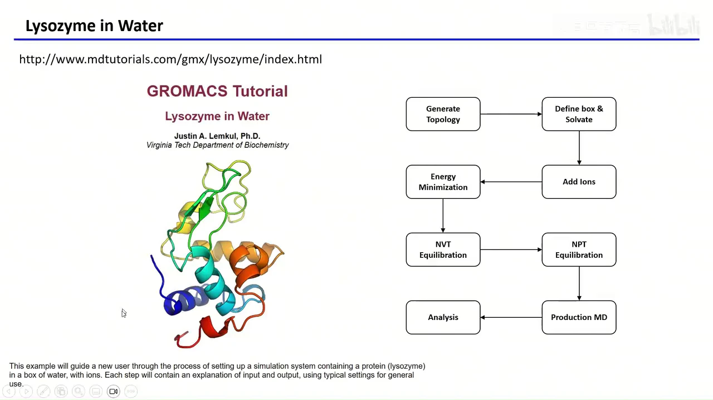

## 一、整体路线：七个阶段、十三条命令构成一条流水线

这条流水线的每一步都在为下一步准备"合法输入"，顺序不能随意调换：

1. **生成拓扑**：把 PDB 转成 GROMACS 的坐标文件 `.gro` 和拓扑文件 `.top`。
2. **定义盒子并加水**：确定模拟区域的形状和大小，再用预平衡的水填满。
3. **加离子**：中和蛋白质电荷，并把盐浓度调到生理条件。
4. **能量最小化**：消除原子重叠和不合理的几何结构。
5. **NVT 平衡**：粒子数、体积、温度不变，先把体系加热并稳定到目标温度。
6. **NPT 平衡**：粒子数、压力、温度不变，让盒子体积和体系密度稳定下来。
7. **生产模拟**：撤掉对蛋白质的位置约束，正式采集轨迹；之后才是分析。

[【跳转到 00:14】](https://www.bilibili.com/video/BV1MaoUYvEwD/?t=14)

理解这条流水线，关键要抓住一个反复出现的"两命令节奏"：

```bash
gmx grompp -f 控制文件.mdp -c 坐标.gro -p 拓扑.top -o 产物.tpr
gmx mdrun  -v -deffnm 前缀
```

`grompp` 是"预处理器"：它把 `.mdp`（模拟参数）、`.gro`（坐标）、`.top`（拓扑与力场）三者检查并合并，生成一个二进制的 `.tpr` 文件。`.tpr` 叫"便携式运行输入文件"（Portable Run Input File），里面已经包含拓扑、初始坐标、速度、力场参数和模拟参数，`mdrun` 只认它。也正因如此，不同 GROMACS 版本生成的 `.tpr` 往往不能混用。`-deffnm` 则统一指定输入输出文件的前缀，例如 `-deffnm em` 表示读 `em.tpr`，并把结果写成 `em.gro`、`em.log`、`em.edr` 等。

## 二、准备输入结构：选一个"不需要修补"的 PDB 能省掉大量麻烦

本讲使用 PDB 数据库里非常经典的 **1AKI**——鸡蛋清溶菌酶（hen egg white lysozyme）。它几乎没有缺失侧链或残基，因此不必先做补全，下载下来就能直接进入 `pdb2gmx`。

在 RCSB PDB 网站搜索 `1AKI`，下载 **PDB Format** 文件即可。用文本编辑器或可视化软件打开，会发现晶体结构里除了蛋白质，还带着许多水分子，它们的残基名是 `HOH`。这些水不是我们想要的——模拟要用的水会在后面由 `solvate` 统一添加，所以先把它们删掉。

[【跳转到 01:18】](https://www.bilibili.com/video/BV1MaoUYvEwD/?t=78)

最直接的办法是用记事本打开 PDB，把末尾所有 `HOH` 行删掉再保存。在 Linux 下可以用一行命令：

```bash
grep -v HOH 1aki.pdb > 1AKI_clean.pdb
```

`grep` 逐行读取，`-v` 表示反向匹配，只输出不含 `HOH` 的行；`>` 把结果写入新文件。

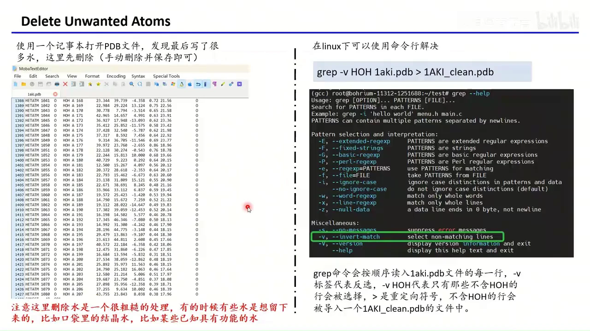

但要注意，**删水是一个很粗糙的处理**。真实项目里有些水是必须保留的：比如配体结合口袋里的水，可能直接参与氢键、决定结合模式；再比如某些通道内部的结构水。遇到这类体系，就不能无脑 `grep -v HOH`，而要结合结构生物学知识逐个判断。

## 三、pdb2gmx：一条命令同时生成坐标与拓扑

进入第一步，命令是：

```bash
gmx pdb2gmx -f 1AKI_clean.pdb -o 1AKI.gro -p 1AKI.top -ignh
```

它做的事，是把"只有坐标"的 PDB 变成 GROMACS 能算的体系：

- `-f`：输入结构文件，这里是删过水的 `1AKI_clean.pdb`。
- `-o`：输出的 GROMACS 坐标文件 `1AKI.gro`。
- `-p`：输出的拓扑文件 `1AKI.top`；不加 `-p` 时默认叫 `topol.top`。
- `-ignh`：忽略输入文件里已有的氢原子，由 GROMACS 按力场规则重新加氢。

为什么要 `-ignh`？不同软件对氢的命名并不统一，PDB 里的氢名字 GROMACS 可能不认识；与其费力匹配，不如全部丢掉、按力场重加。

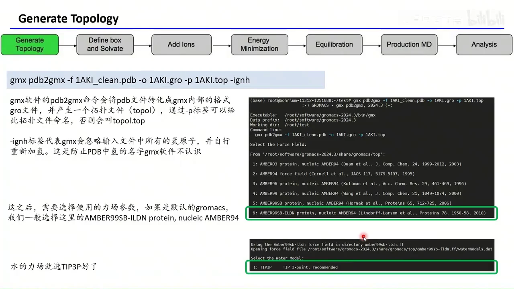

[【跳转到 03:15】](https://www.bilibili.com/video/BV1MaoUYvEwD/?t=195)

命令执行后会进入交互选择。首先是**力场**（force field）：它是一整套"原子类型 + 成键参数 + 非键参数"的规则库，决定原子之间怎么相互作用。默认安装的 GROMACS 里一般建议选 **AMBER99SB-ILDN**（界面中显示为 `AMBER99SB-ILDN protein, nucleic AMBER94`）。如果想用 AMBER14SB 或 CHARMM36，也可以自行把对应的力场目录加进来，但这需要一些额外技巧，初学者先把默认流程跑通。

接着选择**水的模型**，直接用它推荐的 **TIP3P** 即可。TIP3P 是常用的三点水模型，每个水分子用氧原子加两个氢原子表示，计算量和精度比较平衡。

[【跳转到 04:05】](https://www.bilibili.com/video/BV1MaoUYvEwD/?t=245)

成功时终端会打印 `successfully generated a topology`。此时目录里多出 `1AKI.gro`、`1AKI.top` 和 `posre.itp`。

## 四、三个新文件：gro 存坐标、posre 存约束、top 存"连接关系"

### 4.1 gro：GROMACS 版的坐标文件

`1AKI.gro` 的结构很简单：第一行是体系名字（PDB 里没有的话 GROMACS 会随便取一个，叫什么都不影响计算）；第二行是**整个文件里的原子总数**；之后每行一个原子，依次是残基编号、残基名、原子名、原子序号和 x、y、z 坐标。

第二行的原子数**必须和实际原子数严格一致**。如果手工编辑过 `.gro` 却忘了改这个数字，后续 `grompp` 或 `mdrun` 就会报错。所以它本质上就是一个"GROMACS 特供版 PDB"：同样存坐标，只是格式更紧凑、更适合程序读取。

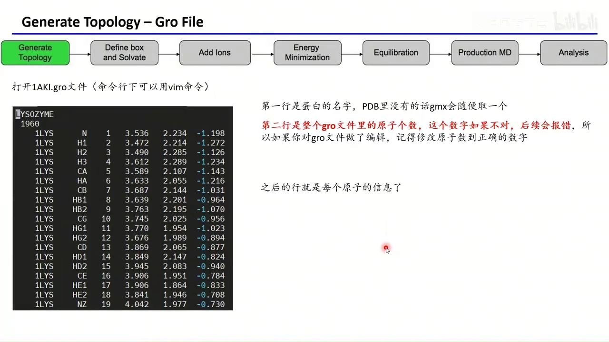

[【跳转到 05:08】](https://www.bilibili.com/video/BV1MaoUYvEwD/?t=308)

### 4.2 posre.itp：给蛋白质"拴上弹簧"的位置限制

`posre.itp` 里是 `[ position_restraints ]` 字段，对每个原子给出 x、y、z 三个方向的力常数，本例中都是 `1000`，单位是 kJ·mol⁻¹·nm⁻²。文件里有 1960 条记录，对应蛋白质的 1960 个原子。

平衡时它给蛋白质施加回到初始位置的弹簧力，让骨架基本不动，周围的水和离子先充分松弛。只有 `.mdp` 里写了 `define = -DPOSRES`，`#ifdef POSRES` 才成立，这个文件才真正启用。

[【跳转到 06:03】](https://www.bilibili.com/video/BV1MaoUYvEwD/?t=363)

### 4.3 top：描述"谁和谁相连、用什么参数"

`1AKI.top` 是最重要的拓扑文件。分号 `;` 开头的行是注释，GROMACS 不读取。开头注释记录了文件由哪个路径的 `gmx`、用什么命令生成；接着是：

```text
; Include forcefield parameters
#include "amber99sb-ildn.ff/forcefield.itp"
```

这一行把整套力场参数引入进来。

再往下是 `[ moleculetype ]`，定义体系里有哪些"物种"。当前只有一个 `Protein_chain_A`。随后是 `[ atoms ]`：每个原子的编号、原子类型、残基编号、残基名、原子名、电荷、质量等。**原子类型**很关键，GROMACS 正是拿它去力场表里查参数。

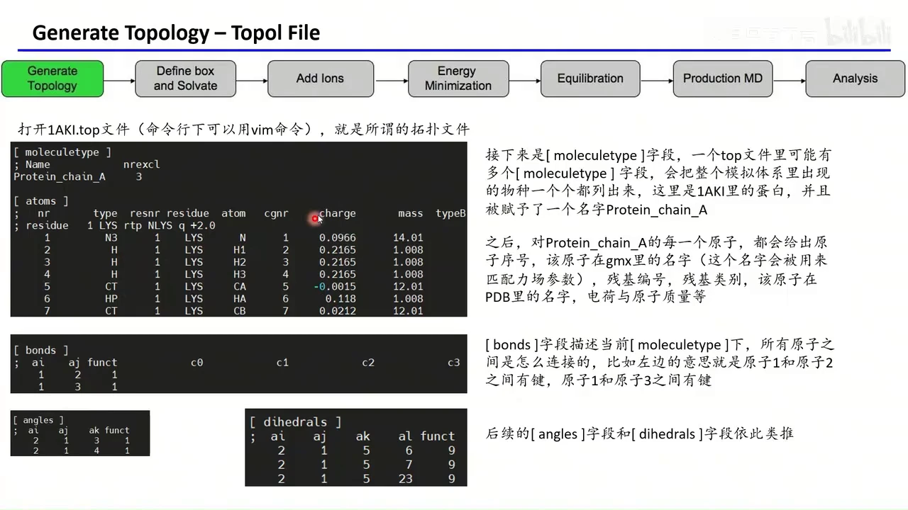

[【跳转到 06:58】](https://www.bilibili.com/video/BV1MaoUYvEwD/?t=418)

`[ bonds ]` 描述原子之间的键，例如 `1 2` 表示原子 1 和原子 2 成键；`[ angles ]` 描述三个原子形成的键角，例如 `2 1 3`；`[ dihedrals ]` 描述四个原子形成的二面角。这样，力场里的键长、键角、二面角项就落到了具体原子上。

继续往下，会看到位置限制文件被条件性地引入：

```text
#ifdef POSRES
#include "posre.itp"
#endif
```

然后是水的拓扑 `tip3p.itp`、可选的 `POSRES_WATER`（用于限制水的氧原子，本例不用），以及离子的拓扑 `ions.itp`。最后是 `[ system ]` 和 `[ molecules ]`：

```text
[ molecules ]
Protein_chain_A    1
```

此时体系里只有 1 个蛋白质。等加了水和离子，这里会多出 `SOL` 和离子的条目与数目。**`[ molecules ]` 里的名字必须和 `[ moleculetype ]` 里的名字一致**，否则 GROMACS 找不到对应拓扑。

[【跳转到 09:41】](https://www.bilibili.com/video/BV1MaoUYvEwD/?t=581)

## 五、力场参数藏在 forcefield.itp 里：非键与成键两套表

`top` 只是"引用"了力场，真正的数值在 GROMACS 安装目录的 `share/gromacs/top/amber99sb-ildn.ff/forcefield.itp` 里。打开会发现它又引入了两个文件：

- `ffnonbonded.itp`：非键参数表。按原子类型列出质量、电荷、σ（sigma）和 ε（epsilon）。这两个量就是上一讲介绍的 Lennard-Jones 势参数，决定范德华吸引与排斥。
- `ffbonded.itp`：成键参数表。包括键的平衡长度 `b0` 和力常数 `kb`、键角的平衡角度与力常数、二面角的相位与势垒等。例如两个碳原子之间的键，平衡键长约为 `0.1525 nm`。

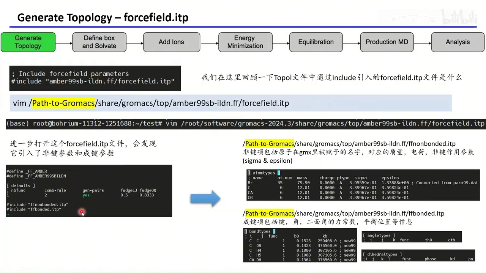

[【跳转到 11:22】](https://www.bilibili.com/video/BV1MaoUYvEwD/?t=682)

水的参数则在 `tip3p.itp` 中。它的 `[ moleculetype ]` 名字是 `SOL`——**`.gro` 里水的残基名必须也是 `SOL`**，否则无法匹配力场。文件里定义水原子的电荷、质量和类型；通过 `#ifndef FLEXIBLE` 和 `settles`，把 O—H 距离固定在 `0.09572 nm`，H—H 距离固定在 `0.15139 nm`。这样水分子被视为刚体，不必计算 O—H 键的振动。

为什么要这样做？因为水的快速振动对大多数生物过程并不重要，固定其几何形状可以允许更大的时间步长、节省大量计算资源。如果确实需要研究水的振动，可以在 `.mdp` 里定义 `FLEXIBLE`，那时 `[ bonds ]` 和 `[ angles ]` 里的参数才会生效。水拓扑里的 `[ exclusions ]` 还会排除分子内相隔两三个键的原子对，进一步节省计算。

[【跳转到 13:10】](https://www.bilibili.com/video/BV1MaoUYvEwD/?t=790)

## 六、定义盒子并加水：editconf 划范围，solvate 填水

有了拓扑，接下来要给蛋白质一个"容器"。命令是：

```bash
gmx editconf -f 1AKI.gro -o 1AKI_box.gro -c -d 1.2 -bt cubic
```

- `-f`：输入坐标，也可以是 PDB。
- `-o`：输出的带盒子坐标文件。
- `-c`：把蛋白质放到盒子的几何中心。
- `-d 1.2`：蛋白质原子到盒子边界的最小距离为 1.2 nm。
- `-bt cubic`：盒子形状为立方体。

`-d 1.2` 不建议改小：距离太近，蛋白质会通过周期性边界"看到"自己的镜像，产生虚假相互作用；改大则水更多、模拟更慢。1.2 nm 是兼顾安全与效率的常用值。

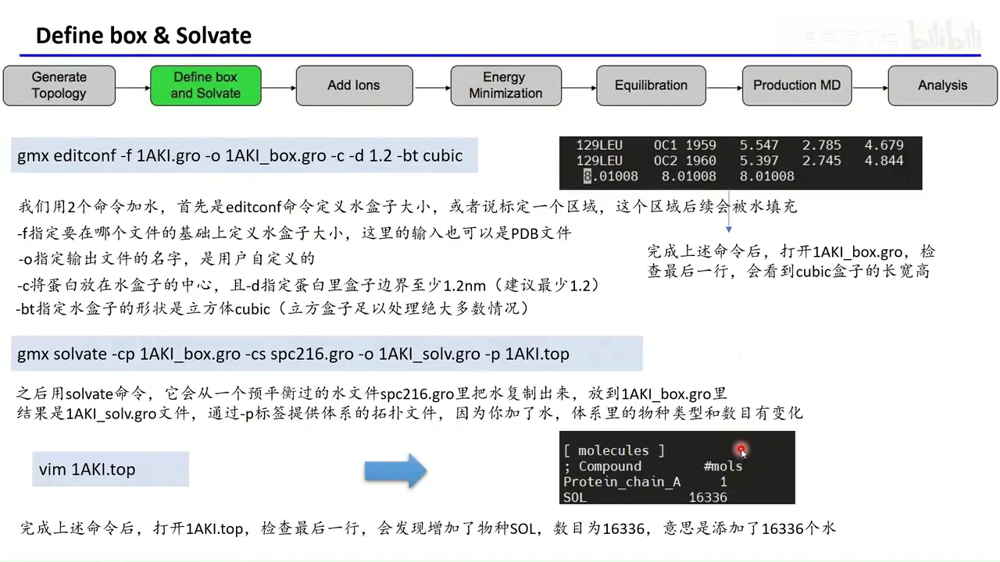

[【跳转到 15:05】](https://www.bilibili.com/video/BV1MaoUYvEwD/?t=905)

执行后打开 `1AKI_box.gro`，最后一行的三个数就是盒子的长、宽、高。本例是 `8.01008 8.01008 8.01008`，一个边长约 8 nm 的立方体。

盒子定好后加水：

```bash
gmx solvate -cp 1AKI_box.gro -cs spc216.gro -o 1AKI_solv.gro -p 1AKI.top
```

- `-cp`：要被溶剂化的体系，必须已经定义盒子，否则 GROMACS 不知道往哪加。
- `-cs`：水模板。`spc216.gro` 是 GROMACS 自带的、已经预平衡好的水盒子，程序把它复制、平移、裁切后填进蛋白质周围的空隙。
- `-o`：输出 `1AKI_solv.gro`。
- `-p`：让 GROMACS 同步修改拓扑。因为体系里多了水这种新物种，`[ molecules ]` 必须更新。

[【跳转到 15:55】](https://www.bilibili.com/video/BV1MaoUYvEwD/?t=955)

本例最终加入 **16336 个水分子**。打开 `1AKI.top` 最后会看到 `SOL 16336`。用可视化软件打开 `1AKI_solv.gro` 并显示所有原子，可以看到蛋白质被包在一个方方正正的水盒子里。

## 七、加离子：genion 中和电荷并把盐度调到生理水平

加水之后还要加离子，目的有两个：

1. **电中性**：蛋白质表面带有净电荷，模拟体系整体必须呈电中性，否则长程静电场会出现问题。
2. **生理盐度**：真实细胞环境约有 0.15 mol/L 的盐，因此加入 NaCl 使体系盐浓度达到 0.15 M。

这一步同样先 `grompp` 再 `genion`：

```bash
gmx grompp -f ions.mdp -c 1AKI_solv.gro -p 1AKI.top -o ions.tpr
gmx genion  -s ions.tpr -o ions.gro -p 1AKI.top \
            -pname NA -nname CL -conc 0.15 -neutral
```

`ions.mdp` 内容很随意，因为这一步不做动力学，只是借它生成 `.tpr` 供 `genion` 读取。

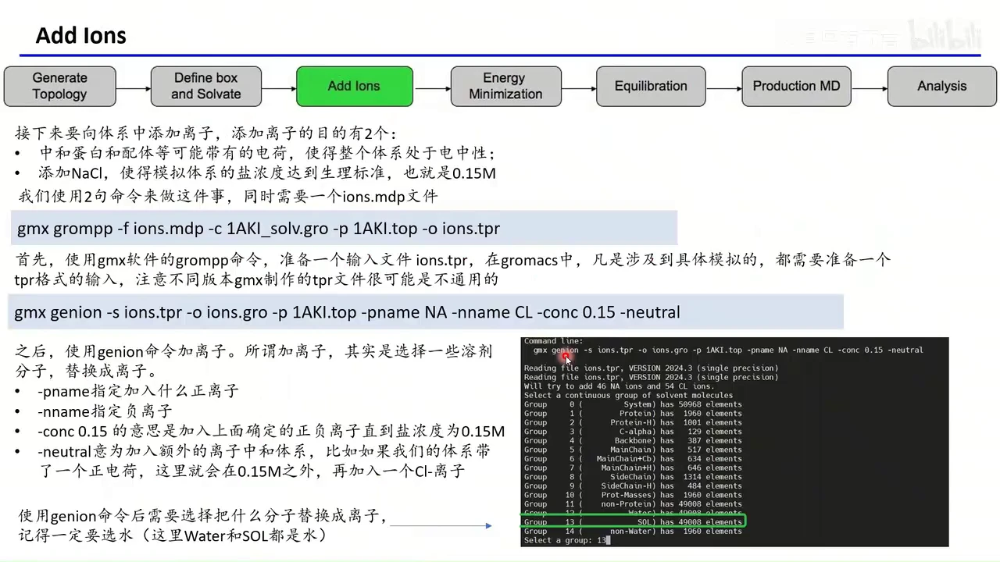

[【跳转到 17:39】](https://www.bilibili.com/video/BV1MaoUYvEwD/?t=1059)

`genion` 的参数含义：

- `-s`：上一步生成的 `ions.tpr`，提供体系信息。
- `-o`：输出的加离子坐标 `ions.gro`。
- `-p`：同步更新的拓扑。
- `-pname NA` / `-nname CL`：正离子叫 `NA`、负离子叫 `CL`。
- `-conc 0.15`：目标盐浓度 0.15 mol/L。
- `-neutral`：在 0.15 M 之外，额外加入反离子把净电荷中和掉。例如体系带一个正电荷，就会再补一个 Cl⁻。

执行时 GROMACS 会列出原子组，问把哪些分子替换成离子，**一定要选溶剂组**（`SOL`/`Water`）。

[【跳转到 18:54】](https://www.bilibili.com/video/BV1MaoUYvEwD/?t=1134)

完成后检查 `1AKI.top`：水从 16336 降到 16236，同时多出 `NA 46` 和 `CL 54`。水少了 100 个，正好对应 100 个离子。这里的 `46` 和 `54` 是程序按浓度和电荷自动算出的结果，不同体系、不同盒子大小会有不同数字。

[【跳转到 20:22】](https://www.bilibili.com/video/BV1MaoUYvEwD/?t=1222)

## 八、能量最小化：先消除原子"打架"，再让牛顿方程接管

现在体系里有了蛋白质、水、离子，但它们的摆放是"机械"的：`solvate` 只是把水分子塞进空隙，`genion` 只是把水换成离子，很可能出现原子距离过近、键长键角不合理的情况。距离一旦过近，Lennard-Jones 排斥力会趋于无穷大，直接跑动力学就会"炸掉"。

**能量最小化（Energy Minimization，EM）** 的目的，就是消除空间冲突和不合理的几何结构，把体系松弛到一个较低势能的初始构型，让后续动力学有一个稳定的起点。

```bash
gmx grompp -f em.mdp -c ions.gro -p 1AKI.top -o em.tpr
gmx mdrun  -v -deffnm em
```

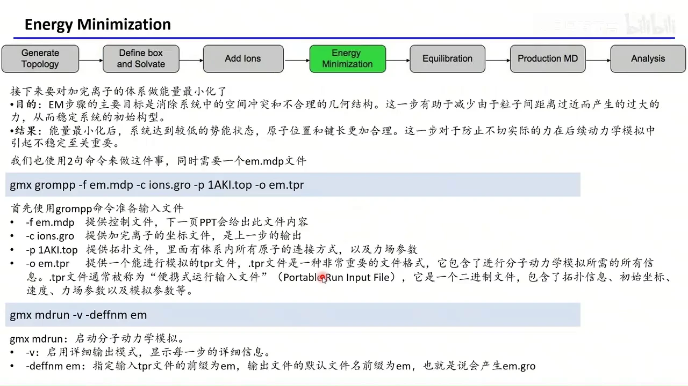

[【跳转到 20:43】](https://www.bilibili.com/video/BV1MaoUYvEwD/?t=1243)

`grompp` 的 `-f` 是控制文件，`-c` 是上一步的坐标，`-p` 是拓扑，`-o` 是输出的 `.tpr`。到了这一步，才真正需要力场参数，所以拓扑必须给全。`mdrun` 的 `-v` 让程序逐步打印进度，`-deffnm em` 表示输入输出前缀都用 `em`，最终会得到 `em.gro`（最小化后的坐标）、`em.log`（日志）和 `em.edr`（能量数据）。

`em.mdp` 的关键设置是：`integrator = steep`，即最速下降法；`emtol = 10`，最大力小于 10 kJ·mol⁻¹·nm⁻¹ 时停止；`nsteps = 10000`，最多迭代一万步；非键作用采用 Verlet 截断和 PME 静电；`constraints = h-bonds` 配合 LINCS 约束涉及氢的键。这个文件在大多数体系里可以直接复用。

[【跳转到 21:58】](https://www.bilibili.com/video/BV1MaoUYvEwD/?t=1318)

## 九、两步平衡：NVT 先控温，NPT 再控压

能量最小化只解决了明显冲突，体系还没达到目标温度和密度，因此分两步平衡；两步都继续约束蛋白质，先让水和离子适应环境。

### 9.1 NVT：先把温度稳住

NVT 指粒子数 N、体积 V、温度 T 保持不变。这一步把体系从最小化后的状态逐渐加热到生理温度附近（本例控制在约 300–310 K），并让动能分布达到稳定。

```bash
gmx grompp -f nvt.mdp -c em.gro -p 1AKI.top -r em.gro -o nvt.tpr
gmx mdrun  -v -deffnm nvt
```

多出的 `-r em.gro` 提供位置约束的**参考坐标**：`posre.itp` 只说明约束哪些原子、用多大力，`-r` 则说明约束到什么位置。

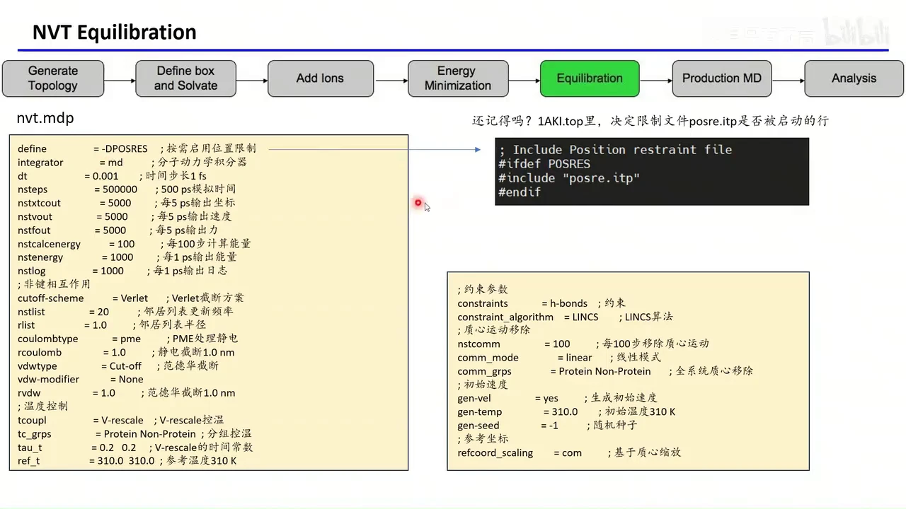

[【跳转到 23:06】](https://www.bilibili.com/video/BV1MaoUYvEwD/?t=1386)

`nvt.mdp` 的几个要点：

- `define = -DPOSRES`：打开位置限制，使 `top` 里的 `#ifdef POSRES` 生效。
- `integrator = md`：真正的动力学积分。
- `dt = 0.001`：时间步长 1 fs；`nsteps = 500000`，总时长 500 ps。
- `tcoupl = V-rescale`：用 V-rescale 恒温器控温；`tau_t = 0.2` 是耦合时间常数；`ref_t` 是参考温度。
- `constraints = h-bonds`、`constraint_algorithm = LINCS`：约束含氢的键，允许使用更大的步长。
- `gen-vel = yes`、`gen-temp`：按目标温度生成初始速度。
- `nstcomm`、`comm-mode`、`comm-grps`：定期移除体系质心运动，避免整个盒子"漂走"。

### 9.2 NPT：再让密度稳定

NPT 指粒子数 N、压力 P、温度 T 保持不变。此时盒子体积可以变化，体系会像真实液体一样"呼吸"，直到密度稳定在合理值（水约为 1 g/cm³）。

```bash
gmx grompp -f npt.mdp -c nvt.gro -p 1AKI.top -r nvt.gro -o npt.tpr
gmx mdrun  -v -deffnm npt
```

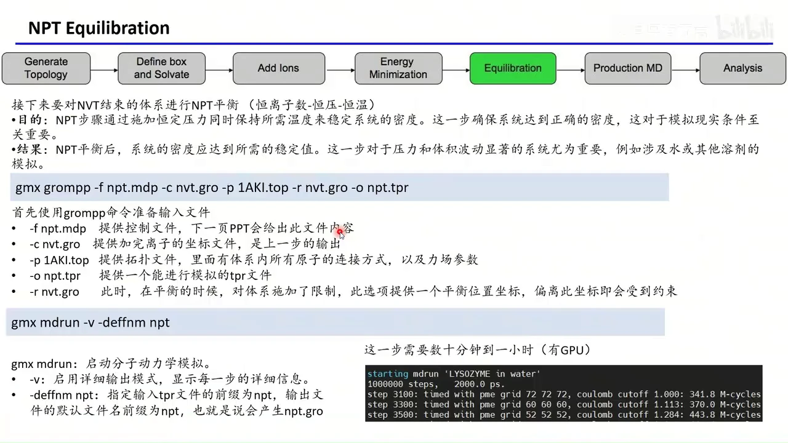

[【跳转到 25:22】](https://www.bilibili.com/video/BV1MaoUYvEwD/?t=1522)

`npt.mdp` 与 NVT 的主要区别是增加了压力控制：

- `pcoupl = C-rescale`：C-rescale 控压算法。
- `pcoupltype = isotropic`：各向同性，盒子三个方向同等缩放。
- `tau_p = 0.5`：压力耦合时间常数。
- `compressibility = 4.5e-5`：水的压缩率，单位 bar⁻¹。
- `ref_p = 1.0`：参考压力 1 bar。

同时 `dt = 0.002`（2 fs），`nsteps = 1000000`，总时长 2000 ps。因为盒子在不断调整，这一步通常比 NVT 更花时间。

[【跳转到 26:18】](https://www.bilibili.com/video/BV1MaoUYvEwD/?t=1578)

## 十、生产模拟：去掉位置约束，轨迹才是分析对象

NPT 平衡结束后，体系已经达到目标温度、压力和密度，终于可以进入**生产模拟（Production MD）**。这一步不再对蛋白质施加位置约束，让整个体系按力场自然演化，采集到的轨迹才是后续分析的对象。

```bash
gmx grompp -f md.mdp -c npt.gro -p 1AKI.top -o md.tpr
gmx mdrun  -v -deffnm md -nt 16
```

注意这里**没有 `-r`**：生产相不加约束，也就不需要参考坐标。`-nt 16` 指定使用 16 个 CPU 线程并行计算；如果不写，`mdrun` 会默认使用所有可用线程。物理核心不足时，盲目开超线程反而可能降低性能。

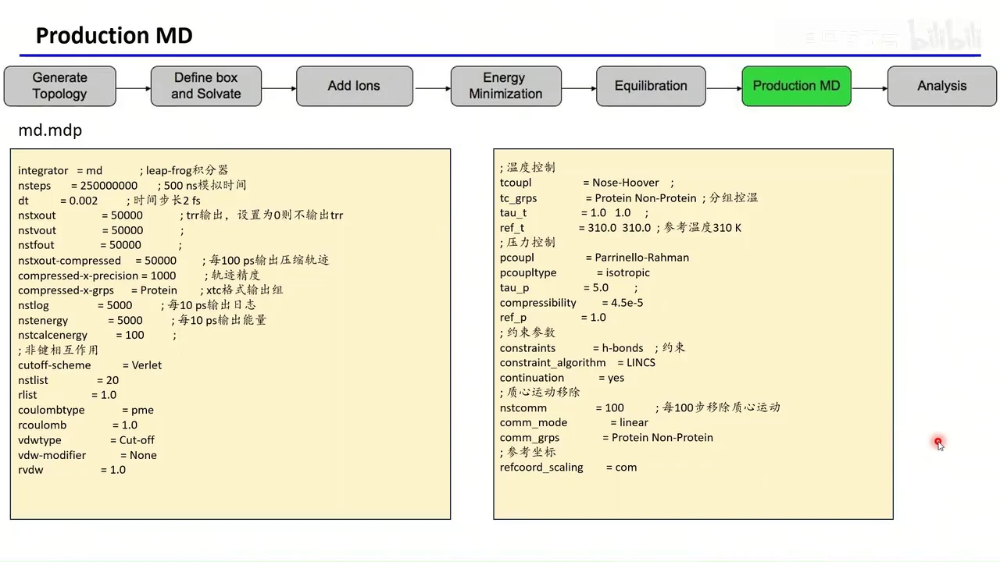

[【跳转到 26:43】](https://www.bilibili.com/video/BV1MaoUYvEwD/?t=1603)

`md.mdp` 中，积分器仍是 `md`（leap-frog），恒温器换成 `Nose-Hoover`，恒压器换成 `Parrinello-Rahman`，并设置 `continuation = yes` 表示接着平衡相继续跑。本例设置 `nsteps = 25000000`、`dt = 0.002`，实际研究要根据科学问题决定跑多长，而不是盲目追求步数。

需要提醒的是：**真正跑生产模拟最好有 GPU**。除非体系非常小，否则纯 CPU 的模拟时间会长到难以接受。跑完之后，`md.xtc` 轨迹、`md.edr` 能量、`md.log` 日志就是下一步分析的原料；如何做 RMSD、回旋半径、氢键等分析，下一讲继续。

[【跳转到 27:08】](https://www.bilibili.com/video/BV1MaoUYvEwD/?t=1628)

## 小结

- 完整流程是 **拓扑 → 盒子与溶剂 → 加离子 → 能量最小化 → NVT → NPT → 生产 MD**，本例共 13 条命令，顺序不可颠倒。
- `grompp` 负责把 `.mdp`、`.gro`、`.top` 打包成 `.tpr`，`mdrun` 负责执行；记住这个"两命令节奏"，后面每一步都一样。
- `pdb2gmx` 一次生成三个关键文件：`.gro` 存坐标，`.top` 存原子连接与力场引用，`posre.itp` 存平衡阶段的位置约束。
- 加水的本质是"划盒子 + 填预平衡水"，加离子的本质是"拿水换离子"；两者都会同步修改 `top` 末尾的 `[ molecules ]`。
- 能量最小化消除原子重叠，NVT 稳住温度，NPT 稳住密度；两步平衡都靠 `-DPOSRES` 和 `-r` 把蛋白质"按住"。
- 生产模拟去掉 `-r` 和位置约束，得到的轨迹才用于科学分析；没有 GPU 时，蛋白质体系的模拟会非常慢。

## 关键术语速查

| 术语 | 一句话解释 |
| --- | --- |
| GROMACS | 开源分子动力学模拟软件，用 `gmx` 命令调用各子程序。 |
| PDB | 蛋白质结构数据库及其文件格式，主要存原子坐标与残基信息。 |
| `pdb2gmx` | 把 PDB 转成 GROMACS 的 `.gro` 与 `.top`，并补氢、匹配力场。 |
| `.gro` | GROMACS 坐标文件；第二行是原子总数，必须与实际一致。 |
| `.top` | 拓扑文件，描述物种、原子、电荷、成键关系并引用力场参数。 |
| `.itp` | 可被拓扑引用的参数/片段文件，如 `posre.itp`、`tip3p.itp`、`ions.itp`。 |
| `.mdp` | 模拟控制文件，设定积分器、步长、温度、压力、截断等参数。 |
| `grompp` | 预处理命令，把 `.mdp`、`.gro`、`.top` 合并检查后生成 `.tpr`。 |
| `.tpr` | 便携式运行输入文件，二进制，含拓扑、坐标、速度与全部模拟参数。 |
| `mdrun` | 真正执行模拟的命令；`-deffnm` 统一输入输出前缀。 |
| 力场 | 原子类型与相互作用参数的规则库，如 AMBER99SB-ILDN、CHARMM36。 |
| TIP3P | 常用三点水模型，用 O 加两个 H 表示一个水分子。 |
| `editconf` | 定义模拟盒子的大小、形状，并可把溶质居中。 |
| `solvate` | 用预平衡水盒子填充体系空隙，同时更新拓扑中的水数目。 |
| `genion` | 用离子替换部分溶剂分子，实现电中性和目标盐浓度。 |
| 能量最小化 | 通过迭代降低势能，消除原子重叠和不合理几何结构。 |
| NVT | 粒子数、体积、温度恒定，用于加热并稳定温度。 |
| NPT | 粒子数、压力、温度恒定，盒子体积可变，用于稳定密度。 |
| 位置约束 | 用弹簧力把指定原子限制在参考坐标附近，常用于平衡阶段。 |
| PME | 粒子网格 Ewald 方法，用于高效计算长程静电作用。 |
| LINCS | 约束算法，用于固定含氢键的键长，允许较大的时间步长。 |
| `spc216.gro` | GROMACS 自带的预平衡水盒子，供 `solvate` 作为填充模板。 |
