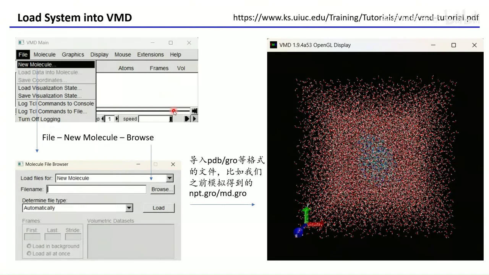
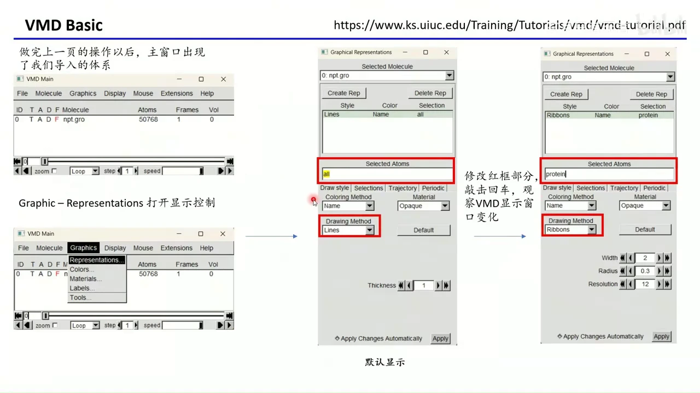
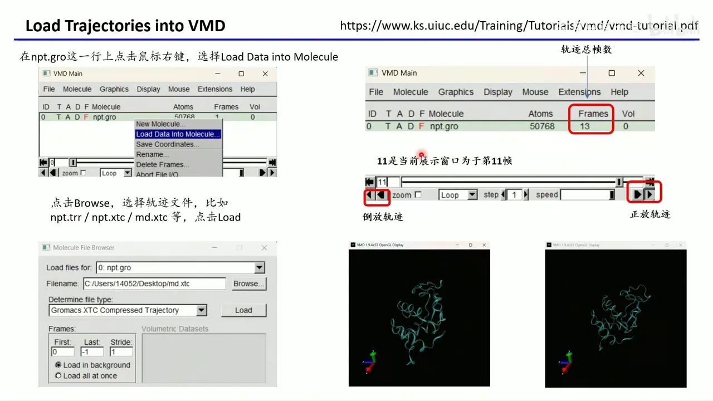
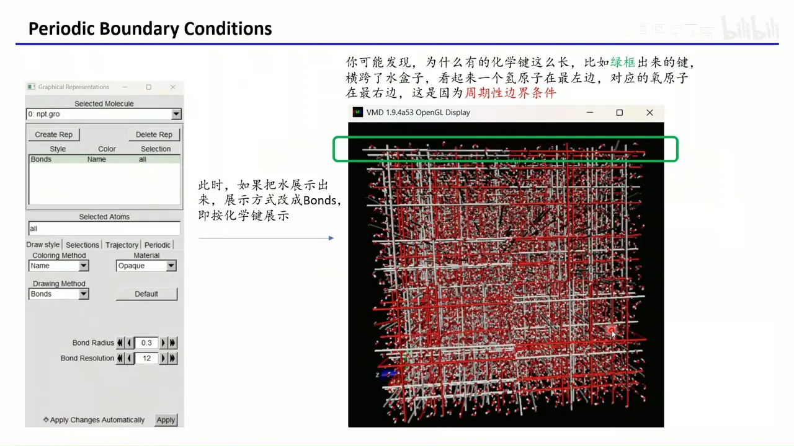
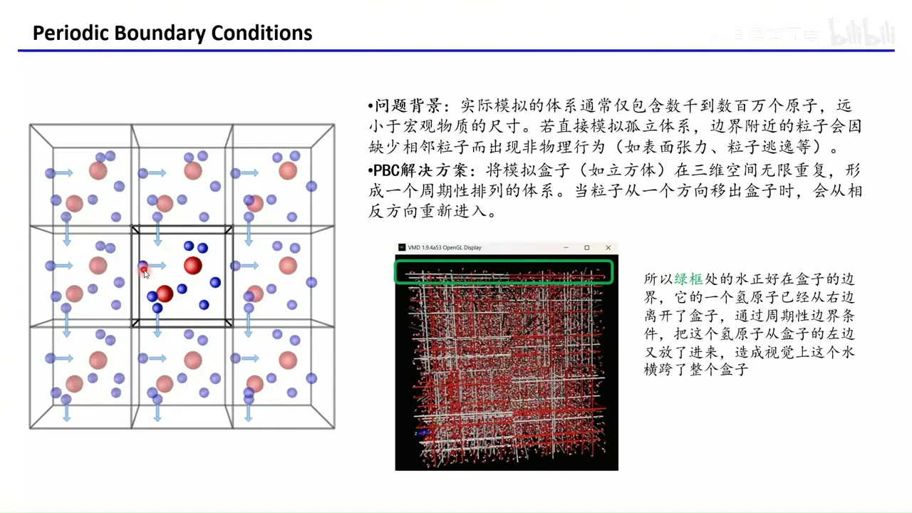
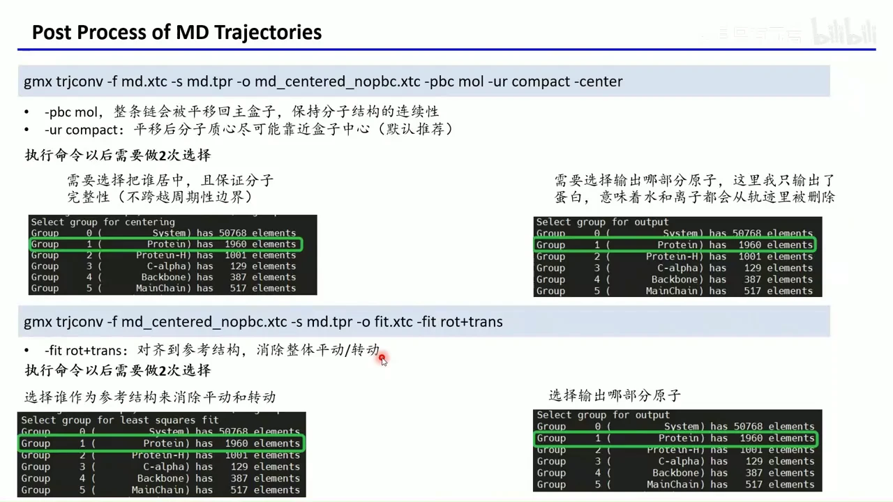
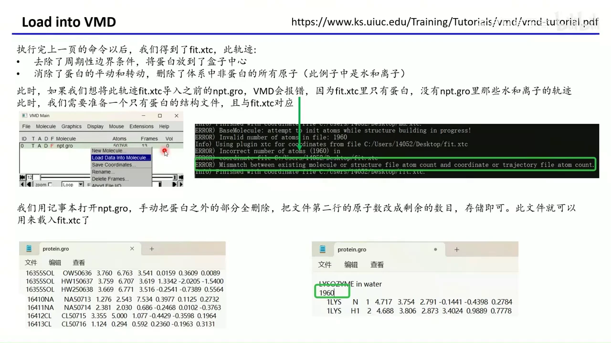
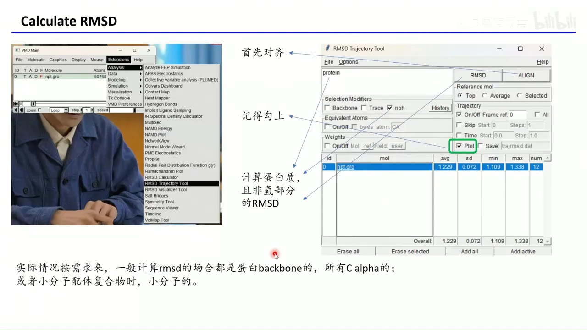
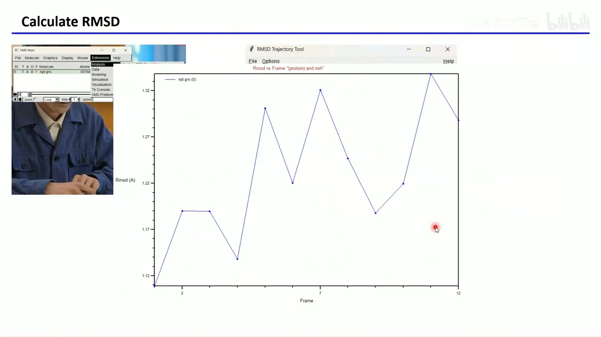
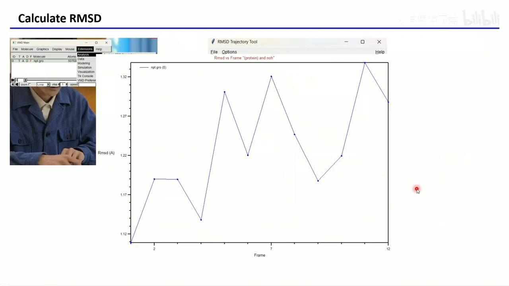

# GROMACS 入门 04：用 VMD 做轨迹可视化与 RMSD、氢键分析

## 本讲要解决的核心问题（SCQA）

**背景**：上一讲我们已经跑完了一段蛋白质的 NPT 分子动力学模拟，手里有了结构文件（如 `npt.gro`）和轨迹文件（如 `npt.xtc`）。轨迹记录的是每一帧里所有原子的坐标。

**冲突**：直接把轨迹拖进查看器，画面往往惨不忍睹——水和离子糊成一片，蛋白质被一堆横跨整个盒子的“超长化学键”穿过，而且蛋白整体在盒子里乱漂、乱转。这样既看不清结构变化，也没法做可靠的定量分析。

**疑问**：怎样把轨迹看清？那些长键是怎么来的？在计算 RMSD、氢键之前，轨迹需要做哪些后处理？

**回答（中心思想）**：用 VMD 查看轨迹，并先用 `gmx trjconv` 完成“去周期性边界、居中、消除整体平动/转动、裁掉无关原子”三步后处理；之后既可以在 VMD 里直接算 RMSD 与氢键，也可以导出数据自己作图。理解周期性边界条件（PBC）是理解这一切的前提。

> 本讲基于第三讲得到的蛋白质模拟轨迹。如果手里没有轨迹，视频作者在视频简介的 GitHub 链接里提供了一个很小的练习轨迹。 [【跳转到 00:17】](https://www.bilibili.com/video/BV1UJZNYmEyY/?t=17)

---

## 一、看大轨迹优先选 VMD，而不是“画面更漂亮”的软件

**结论：轨迹很长、体系很大时，流畅度比渲染效果重要，VMD 是更实用的选择。**

- **VMD 是什么**：Visual Molecular Dynamics，一款免费的可视化与轨迹分析软件，既能显示蛋白质、水、离子，也能做 RMSD、氢键等分析。 [【跳转到 01:39】](https://www.bilibili.com/video/BV1UJZNYmEyY/?t=99)
- **为什么选它**：它的性能好。有些软件把蛋白渲染得很精致，但几万、几十万原子的轨迹一导入就卡得动不了；即便是 Desmond 自带的轨迹查看器，实际用起来也可能很卡，所以很多人用 Desmond 跑完模拟，仍然拿 VMD 看轨迹。 [【跳转到 02:15】](https://www.bilibili.com/video/BV1UJZNYmEyY/?t=135)
- **怎么获得**：在 UIUC（伊利诺伊大学厄巴纳-香槟分校）的 VMD 官网下载，软件免费，通常需要简单注册或提供学术邮箱。官网还有非常详细的中文/英文教程，功能远不止“看动画”，配合脚本可以做大量分析。 [【跳转到 03:05】](https://www.bilibili.com/video/BV1UJZNYmEyY/?t=185)
- **安装**：Windows 下下载安装包，双击后一路“下一步”即可，不需要特殊配置。

> 顺带记住两个长期有用的资料：GROMACS 官方文档里有全部轨迹分析命令的输入、输出和原理；VMD 官方教程则把选择语句、分析工具讲得很全。**会查官方文档，比背命令更重要。**

---

## 二、先导入结构文件，再谈显示效果

**结论：VMD 必须先有一个“带原子信息的结构文件”打底，轨迹文件本身只有坐标，不能单独打开。**

原因很直接：`xtc` 轨迹里只有一系列坐标，没有原子名称、残基编号、原子类型等信息；而 `gro` / `pdb` 文件才描述“这个体系里有哪些原子”。所以正确顺序是：先导入 `npt.gro`（或 `pdb`），再往它上面挂轨迹。 [【跳转到 04:07】](https://www.bilibili.com/video/BV1UJZNYmEyY/?t=247)

操作路径是 **File → New Molecule → Browse**，选中 `npt.gro` 后加载。本讲示例体系共有 **50768 个原子**，包含蛋白质、水和离子，所以默认画面是一大团线，几乎看不出蛋白在哪。主窗口里会出现一行分子记录，显示名称、原子数和帧数。 [【跳转到 04:56】](https://www.bilibili.com/video/BV1UJZNYmEyY/?t=296)



### 2.1 用 Representations 把“毛线团”变成彩带蛋白

打开 **Graphics → Representations**，会看到默认表示：选中 `all`，画法是 `Lines`（线）。把选择框改成 `protein`，再把 Drawing Method 改成 `Ribbons`，就能只显示蛋白、并以彩带形式呈现二级结构。 [【跳转到 05:44】](https://www.bilibili.com/video/BV1UJZNYmEyY/?t=344)



- `protein` 是 VMD 选择语言里最简单的关键字之一；它还支持“某个残基周围若干埃以内的原子”“某个口袋周围若干埃以内的水”等写法，适合专门观察结合口袋。
- **Create Rep / Delete Rep** 相当于 Photoshop 的图层：复制一份表示，在新图层里换选择对象和画法，就能让蛋白、配体、口袋水同时以不同风格显示。 [【跳转到 07:19】](https://www.bilibili.com/video/BV1UJZNYmEyY/?t=439)

---

## 三、把轨迹挂到结构上，就能逐帧播放

**结论：轨迹通过“分子行的右键菜单”加载，加载后帧数、播放、步长都在主窗口控制。**

在 `npt.gro` 这一行上点右键，选择 **Load Data Into Molecule**，再 Browse 选择轨迹（如 `npt.xtc`）。VMD 通常会自动识别格式（本例识别为 Gromacs XTC Compressed Trajectory）；识别不出来时，手动在下拉框里指定即可。 [【跳转到 07:51】](https://www.bilibili.com/video/BV1UJZNYmEyY/?t=471)



- **Frames** 一栏：没加载轨迹时是 1，加载后变成总帧数。示例轨迹很小，只有 **13 帧**。
- 播放条两端是倒放/正放按钮；中间显示当前帧号（示例停在第 11 帧），还能调节播放速度和每步跳过多少帧（step）。
- 对比第 1 帧与第 11 帧，能看到蛋白确实发生了构象变化——这正是轨迹可视化的意义。 [【跳转到 08:41】](https://www.bilibili.com/video/BV1UJZNYmEyY/?t=521)

---

## 四、周期性边界条件，是“超长化学键”的根源

**结论：长键不是模拟出错，而是分子跨越了周期盒边界后被“折回”造成的视觉假象。**

把显示改回 `all`、画法改成 `Bonds`，会看到许多横跨整个盒子的键：一个氢原子在盒子最左边，与它相连的氧却在最右边。 [【跳转到 09:14】](https://www.bilibili.com/video/BV1UJZNYmEyY/?t=554)



### 4.1 PBC 是什么：把盒子在三维空间无限复制

- **问题背景**：真实宏观体系有极大数量的原子，而模拟盒子通常只有纳米级（上一讲约 **8 nm × 8 nm × 8 nm**）。如果只模拟一个孤立小盒，边界附近的原子会缺少邻居，产生表面张力、粒子逃逸等非物理行为。
- **解决方案**：**周期性边界条件（Periodic Boundary Conditions，PBC）** 把盒子在三维空间无限重复，形成周期性排列；当一个原子从盒子下边穿出，就从对面重新进入。这样每个原子都“以为”自己处在无限大的体系里。 [【跳转到 10:40】](https://www.bilibili.com/video/BV1UJZNYmEyY/?t=640)
- **长键如何产生**：某个水分子正好在边界上，氧还在盒内，氢已经越过边界从另一侧回来。VMD 把“盒内的氧”和“从对面回来的氢”直接连成键，视觉上就横跨了整个盒子。 [【跳转到 11:30】](https://www.bilibili.com/video/BV1UJZNYmEyY/?t=690)



蛋白质同样可能跨越边界：一半在盒子这边、一半在那边。这既不利于观察，也会影响后续分析，所以拿到轨迹后必须做后处理。

> 想直观看“镜像”：在 Representations 的 **Periodic** 选项卡里勾选 +X/−X、+Y/−Y、+Z/−Z 等，就能看到蛋白在空间中被复制成许多镜像。 [【跳转到 12:15】](https://www.bilibili.com/video/BV1UJZNYmEyY/?t=735)

---

## 五、PBC 不只影响画面，也决定了非键相互作用的算法

**结论：正因为盒子被无限复制，范德华作用用 1 nm 截断近似，静电作用则必须用 PME 处理长程部分。**

理论上，一个原子要和它所有镜像、所有其他原子计算非键相互作用，但“无限个原子对”不可能真的算完，只能折中： [【跳转到 12:33】](https://www.bilibili.com/video/BV1UJZNYmEyY/?t=753)

- **范德华作用**：随距离衰减很快，超过截断（cutoff，常见 **1 nm**）就直接不算。GROMACS 控制文件里对应 `vdwtype = Cut-off`、`rvdw = 1.0`。
- **静电作用**：直接截断会带来很大误差，因此采用 **PME（Particle Mesh Ewald）**：把静电拆成两部分——
  - **短程（实空间）**：截断范围内的原子对，直接用库仑公式计算，截断半径通常与范德华一致（如 1 nm）；
  - **长程（倒空间）**：截断之外的部分通过傅里叶变换转到倒易空间计算。 [【跳转到 13:23】](https://www.bilibili.com/video/BV1UJZNYmEyY/?t=803)

这些细节在 `.mdp` 控制文件里体现为 `cutoff-scheme = Verlet`、`nstlist`（邻居列表更新频率）、`rlist`（邻居列表截断）、`coulombtype = pme`、`rcoulomb` 等参数。PME 背后的数学比较复杂，视频给出了两份延伸阅读链接，此处不展开。

---

## 六、后处理要做三件事：去 PBC、去整体运动、删无关原子

**结论：只有先把蛋白“摆正、放回盒中、只留关心的部分”，轨迹才适合观察和定量分析。**

1. **解除周期性边界条件**：把跨边界的整条分子平移回主盒子，保持分子结构连续，不让蛋白一半在这边、一半在那边。
2. **消除整体平动和转动**：我们关心的是蛋白内部的构象变化，而不是它在盒子里整体漂移或翻滚；把每一帧对齐到参考结构，才能凸显内运动。
3. **删除不关心的原子**：水、离子、膜等常常占绝大多数原子。删掉它们能显著减小轨迹体积。**例外**：结合口袋里的水可能与配体有重要相互作用，这类水不能删。 [【跳转到 14:43】](https://www.bilibili.com/video/BV1UJZNYmEyY/?t=883)

---

## 七、用两条 `trjconv` 命令完成去 PBC 与对齐

**结论：第一条命令负责“回盒 + 居中 + 只输出蛋白”，第二条负责“按参考结构去平动/转动”。**

### 7.1 第一步：去 PBC、居中、裁剪

```bash
gmx trjconv -f md.xtc -s md.tpr -o md_centered_nopbc.xtc \
  -pbc mol -ur compact -center
```

（实际使用时把 `md.xtc`、`md.tpr` 换成自己的文件名，例如 `npt.xtc`、`npt.tpr`。）

- `-f`：待处理的轨迹；`-s`：提供体系信息的结构文件，`tpr` 或 `gro` 都可以——轨迹里只有坐标，必须靠它补上原子类型等信息；`-o`：输出轨迹名。 [【跳转到 16:09】](https://www.bilibili.com/video/BV1UJZNYmEyY/?t=969)
- `-pbc mol`：把整条分子平移回主盒子，保持分子结构连续。
- `-ur compact`：平移后让分子的质心尽量靠近盒子中心。
- `-center`：执行居中。

命令执行后会**连续问两次**：

1. **选择谁居中、并保证谁的完整性**——选 `Protein`（示例中蛋白有 **1960 个原子**）；
2. **选择输出哪部分原子**——仍选 `Protein`。这样水、离子都被删掉，输出轨迹只含蛋白。 [【跳转到 17:24】](https://www.bilibili.com/video/BV1UJZNYmEyY/?t=1044)

### 7.2 第二步：消除整体平动和转动

```bash
gmx trjconv -f md_centered_nopbc.xtc -s md.tpr -o fit.xtc \
  -fit rot+trans
```

- `-fit rot+trans`：把每一帧按最小二乘拟合到参考结构上，同时消除**转动（rotation）和平动（translation）**，只保留蛋白内部运动。 [【跳转到 17:49】](https://www.bilibili.com/video/BV1UJZNYmEyY/?t=1069)
- 同样有两次选择：第一次选“拿谁做拟合参考”（`Protein`），第二次选“输出哪部分”（仍是 `Protein`）。



---

## 八、轨迹裁到只剩蛋白后，必须配一个新的 `protein.gro`

**结论：VMD 要求结构文件与轨迹的原子数完全一致；原 `npt.gro` 有 50768 个原子，而 `fit.xtc` 只有 1960 个，直接加载会报错。**

报错信息大意是 `Invalid number of atoms ... 1960`、`Mismatch between ... structure file atom count and ... trajectory file atom count`。解决办法不是改轨迹，而是做一个“只有蛋白”的结构文件： [【跳转到 18:39】](https://www.bilibili.com/video/BV1UJZNYmEyY/?t=1119)

1. 用文本编辑器打开 `npt.gro`；
2. 删除蛋白之外的所有原子行（水、离子等）；
3. 把第二行的原子总数改成剩余的实际数目（示例为 **1960**）；
4. 另存为 `protein.gro`。

然后在 VMD 中先加载 `protein.gro`，再右键 **Load Data Into Molecule** 加载 `fit.xtc`，就能正常播放后处理后的轨迹，检查去 PBC 和对齐的效果。 [【跳转到 19:29】](https://www.bilibili.com/video/BV1UJZNYmEyY/?t=1169)



> 很多人跑模拟就是为了“看动画”，但后处理并不只是给眼睛看的：不先消除 PBC 和整体运动，后面算出的曲线会混入大量与构象无关的位移。

---

## 九、在 VMD 里计算 RMSD：先对齐，再比较

**结论：RMSD 衡量的是“每一帧相对参考结构差了多少”，计算前必须先做对齐，否则整体漂移会污染结果。**

**RMSD（Root Mean Square Deviation，均方根偏差）** 是把两组对应原子的坐标差平方、求平均、再开方，单位通常是埃（Å）。它回答的问题是：当前构象与参考构象的平均偏差有多大。

操作路径：**Extensions → Analysis → RMSD Trajectory Tool**。 [【跳转到 19:53】](https://www.bilibili.com/video/BV1UJZNYmEyY/?t=1193)

- 选择框填 `protein`，并勾选 `noh`（排除氢原子，只看重原子）；
- 点击 **ALIGN**，把所有帧先对齐到第 1 帧的蛋白重原子上；
- 参考结构选 `Top`，轨迹设为 `On`、`Frame ref 0`；
- 勾选 **Plot**，VMD 会自动计算并画图。 [【跳转到 20:43】](https://www.bilibili.com/video/BV1UJZNYmEyY/?t=1243)



- 结果表里能看到每帧的 avg、sd、min、max。示例 12 帧的 RMSD 在 **1.109–1.338 Å** 之间波动，平均约 **1.229 Å**；因为这只是一个很小的演示轨迹，数值没有实际科研意义。
- VMD 自带的图比较简陋，但可以把结果保存成 `trajmsd.dat`，用 Excel 或 Python 重绘。
- **实践建议**：真正做研究时，蛋白通常算主链（backbone）或所有 Cα 原子的 RMSD；蛋白-配体复合物则常单独算配体小分子的 RMSD。



---

## 十、在 VMD 里计算氢键：选残基、设几何判据、导出数据

**结论：氢键分析就是统计每一帧中满足“供体–受体距离 + 角度”判据的氢键数目，VMD 的判据比 GROMACS 更严格。**

**氢键（hydrogen bond）** 通常指供体（donor）上的氢与受体（acceptor）之间的非键吸引作用。计算时要指定两个选择：谁和谁之间找氢键。

操作路径：**Extensions → Analysis → Hydrogen Bonds**。以“第 30 号残基与第 40 号残基之间”为例： [【跳转到 21:29】](https://www.bilibili.com/video/BV1UJZNYmEyY/?t=1289)

- `Selection 1` 填 `resid 30`，`Selection 2` 填 `resid 40`；
- `Frames` 选 `all`，即逐帧统计；
- `Donor-Acceptor distance` 设为 **3.0 Å**，`Angle cutoff` 设为 **20°**；
- 勾选 **Plot the data with MultiPlot** 可直接作图，勾选 **Write output to files** 会输出 `hbonds.dat`，可拿去 Excel 画图。



**必须注意的坑**：VMD 与 GROMACS 对氢键的几何定义不完全一样。VMD 这里默认角度上限是 **20°**，而 GROMACS 的 `gmx hbond` 会把角度放宽到 **30°**。同一段轨迹，两边算出的氢键数目可能不同，比较或写论文时要说明用的是哪套判据。 [【跳转到 22:02】](https://www.bilibili.com/video/BV1UJZNYmEyY/?t=1322)

设置完成、点击运行后，VMD 会逐帧找出这对残基之间的氢键并作图；`hbonds.dat` 也方便你事后重绘。 [【跳转到 22:27】](https://www.bilibili.com/video/BV1UJZNYmEyY/?t=1347)

> 示例轨迹里这两个残基之间**一根氢键都没有**，所以画出来是一张干净的空图——这不是软件坏了，而是体系本身没有满足判据的氢键。换一个真正有相互作用的残基对，才能看到随帧数变化的曲线。

另外，视频也提到：即使不做前面的后处理，VMD 里同样可以直接做 RMSD、氢键这些分析；但要让结果干净、可解释，去 PBC 和对齐仍然是推荐的前置步骤。

---

## 小结

- 看大体系、长轨迹，优先用 VMD：免费、快、能分析；官方文档和教程是最可靠的命令手册。
- 轨迹必须挂在 `gro`/`pdb` 结构文件上才能打开，因为 `xtc` 只有坐标，没有原子信息。
- 超长化学键源于**周期性边界条件**：分子跨边界后被折回，看起来像横跨盒子；蛋白也会跨边界。
- PBC 同时决定了非键计算方式：范德华用约 1 nm 截断，静电用 PME 分成实空间短程与倒空间长程。
- 后处理三件事：去 PBC 并居中、消除整体平动/转动、删除水/离子等无关原子（结合口袋水除外）。
- 两条命令：`gmx trjconv ... -pbc mol -ur compact -center` 与 `gmx trjconv ... -fit rot+trans`；两次组选择都选 `Protein`。
- 裁剪后的轨迹只有 1960 个蛋白原子，必须配一个原子数一致的 `protein.gro` 才能重新导入 VMD。
- VMD 的 RMSD 工具要**先对齐再计算**；氢键工具要设置距离与角度判据，并留意它与 GROMACS 的 30° 定义差异。

## 关键术语速查

| 术语 | 一句话解释 |
| --- | --- |
| VMD | 免费的可视化与轨迹分析软件，适合查看大体系、长轨迹 |
| gro / pdb | 结构文件，记录原子名称、残基、类型等；轨迹必须靠它才能被正确解释 |
| xtc | GROMACS 的压缩轨迹文件，只存每一帧的坐标 |
| PBC（周期性边界条件） | 把模拟盒在三维空间无限复制，避免边界处出现非物理的“真空表面” |
| 镜像（periodic image） | 盒子复制后产生的副本；VMD 的 Periodic 选项卡可以显示它们 |
| PBC 长键 | 分子跨越盒子边界、被折回后造成的视觉假象，并非真实化学键 |
| cutoff（截断） | 超过该距离就不再计算某种非键作用，常见为 1 nm |
| PME | 处理长程静电的方法：短程在实空间算，长程经傅里叶变换到倒空间算 |
| trjconv | GROMACS 的轨迹转换/后处理命令，可去 PBC、居中、对齐、裁剪原子 |
| `-pbc mol` | 把整条分子平移回主盒子，保持分子完整 |
| `-ur compact` | 让分子质心尽量靠近盒子中心 |
| `-fit rot+trans` | 按参考结构对齐，消除整体转动和平动 |
| RMSD | 均方根偏差，衡量当前构象相对参考构象的平均坐标偏差，单位 Å |
| 氢键判据 | 供体–受体距离与角度阈值；VMD 示例为 3.0 Å / 20°，GROMACS 常用 30° |
| resid | VMD 选择语言中的残基编号关键字，如 `resid 30` |
| noh | 表示“不含氢原子”的选择修饰，常用于 RMSD 重原子计算 |
