# GROMACS 入门 05：蛋白质–配体复合物的动力学模拟

## 本讲要解决的核心问题（SCQA）

**背景**：前几讲已经跑通了纯蛋白质的完整流程——生成拓扑、定义盒子、加水加离子、能量最小化、NVT/NPT 平衡、成品模拟、轨迹分析。

**冲突**：真实的研究对象往往不是一个“干净”的蛋白，而是一个蛋白质–小分子配体复合物。以本讲使用的 PDB 结构 4B1Y 为例，它存在缺失的残基片段和侧链，还混有脂质、甘油、ATP、金属离子、结晶水；配体本身在 PDB 里也常常没有氢原子、没有正确的键级和质子化状态。更麻烦的是，蛋白质可以用 Amber 力场描述，小分子却必须单独生成一套与之力场兼容的参数。

**疑问**：怎样把一个“有毛病的真实结构”修成可模拟的复合物，并让蛋白质和小分子在同一套拓扑里协同工作？

**回答（中心思想）**：复合物模拟的主流程与纯蛋白完全一致，新增的关键工作只有三件——**修复蛋白结构、为配体参数化、把两套拓扑合并并用 index 组把蛋白与配体绑在一起**。把这三件事做对，后面的溶剂化、平衡、成品模拟和分析都可以沿用旧流程。

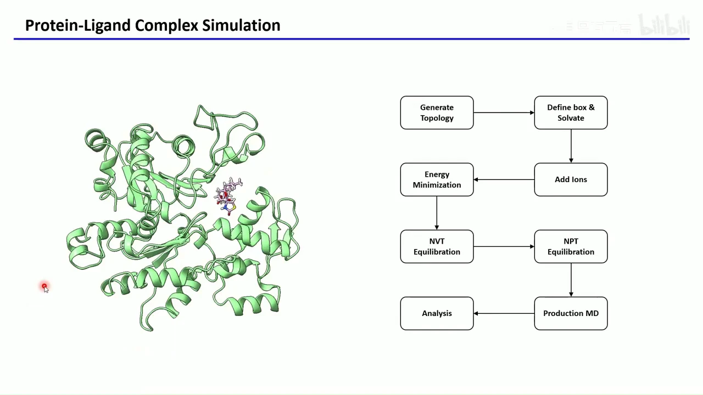

## 一、流程没有变，变的是真实结构“不干净”

本讲仍以八步为主线：生成拓扑 → 定义盒子并加水 → 加离子 → 能量最小化 → NVT 平衡 → NPT 平衡 → 成品 MD → 轨迹分析。与纯蛋白模拟相比，主要工作量集中在第一步“生成拓扑”，因为它现在要同时容纳蛋白质和配体两套参数；此外平衡阶段的控温分组也要相应调整。

选择 4B1Y 的原因是它更接近真实场景（real-world case）。这个结构有两处典型问题：

- **蛋白质不完整**：有一小段序列缺失，部分氨基酸的侧链也缺原子。
- **体系不纯**：除了目标蛋白，还含有大环配体 LAB（latrunculin B）、脂质、丙三醇（甘油）、ATP、水和一个金属离子。

处理原则是“只留想要的”。脂质和甘油通常与蛋白功能无关，可以删除；ATP 和金属离子在真实研究中往往重要，但为了简化，本讲也把它们删掉；结晶水同理先删。最终只保留**蛋白质 + 一个 LAB 配体**。这一步的取舍必须在动手前想清楚，因为它决定了后面拓扑里到底有哪些物种。[【跳转到 00:45】](https://www.bilibili.com/video/BV1haZVYrEAu/?t=45)

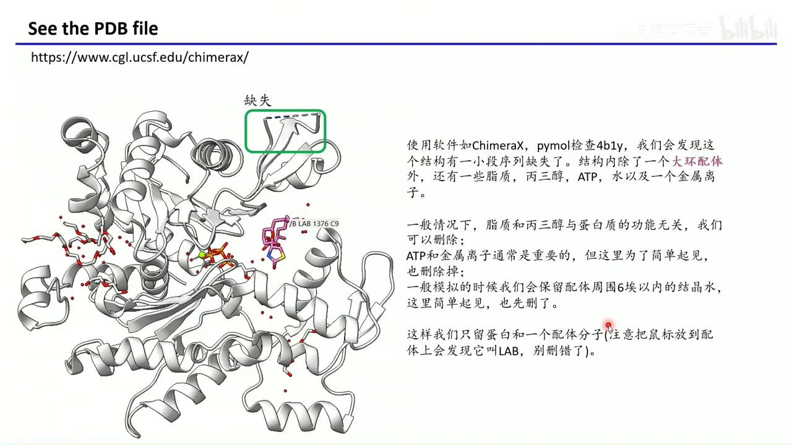

需要强调的是：**删除杂分子不是“偷懒”，而是明确模拟目标**。你要研究的是蛋白与 LAB 的结合，那么就把体系限定为这两者；如果研究依赖金属离子或 ATP，就应当保留并为它们准备参数。

## 二、蛋白修复：商业软件可一键完成，开源方案也能补齐

蛋白修复要解决三类缺陷：缺失的序列片段、缺失的侧链原子、缺失的氢。商业软件 Schrödinger Maestro 的 **Protein Preparation Workflow** 可以一次做完：勾选补侧链、补缺失 loop、按 pH 7.4 生成杂原子质子化状态等选项后运行，蛋白的缺失序列、侧链和氢都会被补上；配体的键级、pH 7.4 下的质子化状态和氢也会被识别并补全。做完后先按 Ligand、Water、Other 把 entry 拆开，再右键选择 Export → Structures，把蛋白导出为 PDB、配体导出为 SDF，就得到了后续要用的两个文件。[【跳转到 02:30】](https://www.bilibili.com/video/BV1haZVYrEAu/?t=150)

如果没有 Maestro，可以用免费开源的 **pdbfixer**。它是一个 Python 包，装在之前跑 GROMACS 的 `gcc` 环境里：

```bash
conda activate gcc
conda install -c conda-forge pdbfixer openmm
pdbfixer
```

运行 `pdbfixer` 后，用浏览器打开本地的 `http://localhost:8000/`，上传 PDB，勾选要补的缺失残基和侧链，顺着提示一路操作即可。若在远程环境没有图形界面，也可以用一行命令完成同样的修复：

```bash
pdbfixer 4b1y.pdb --output protein.pdb \
  --keep-heterogens=none --add-residues --verbose
```

其中 `--keep-heterogens=none` 表示不保留小分子等杂原子（配体我们后面单独处理），`--add-residues` 表示补缺失残基，`--verbose` 会打印中间过程——建议打开，否则终端长时间无输出会让人不确定程序是否在运行。[【跳转到 05:23】](https://www.bilibili.com/video/BV1haZVYrEAu/?t=323)

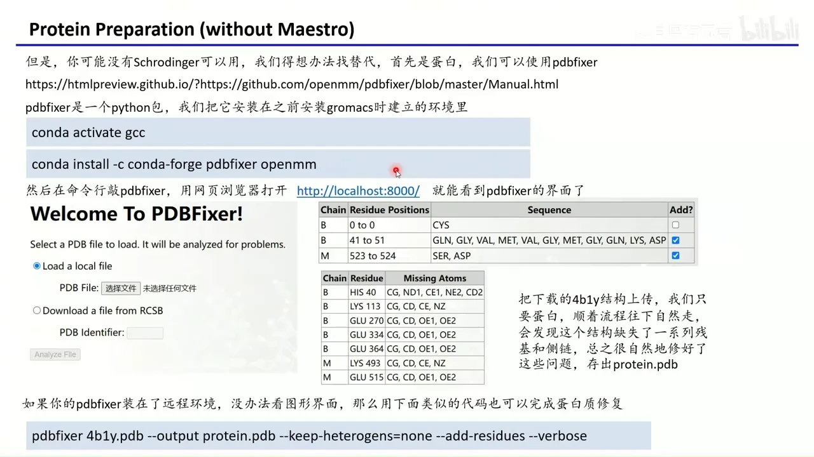

还有一条基于建模的思路：**Swiss-Model 的 User Template 模式**。先在 PDB 页面找到该蛋白的 UniProt 编号（本讲为 P68135，兔源骨骼肌 α-肌动蛋白），从 UniProt 下载 FASTA 序列；再把序列贴进 Swiss-Model，选择 User Template，并把待修复的 PDB 本身作为模板上传。这样相当于“用这个蛋白自己的结构给它自己建模”：结构里已有的部分照抄，缺失的部分由建模程序补。任务完成后下载模型，删掉蛋白质之外的部分即可。需要注意 UniProt 的更新可能略滞后于 PDB，最新结构不一定马上收录。[【跳转到 07:14】](https://www.bilibili.com/video/BV1haZVYrEAu/?t=434)

三条路线没有绝对优劣：有 Maestro 最省事；pdbfixer 适合批量、可脚本化；Swiss-Model 更像“建模补洞”，补出来的 loop 需要自己判断是否合理。

## 三、配体准备：补氢、定键级、定质子化，再把原子名对齐

配体在 PDB 里的常见问题是“三缺一错”：缺氢、缺键级、缺正确的质子化状态，原子命名还可能与蛋白文件不统一。处理流程是先用 Open Babel 补化学信息，再用 Xponge 统一原子名。

从 PDB 的配体页面下载 SDF 或 MOL2（本讲下载的是 `4b1y_C_LAB.mol2`），然后安装工具：

```bash
conda activate gcc
conda install -c conda-forge openbabel
pip install Xponge rdkite
```

用 Open Babel 按 pH 7.4 加氢并修正键级：

```bash
obabel 4b1y_C_LAB.mol2 -O LAB.mol2 -p 7.4
```

`-p 7.4` 让 Open Babel 按生理 pH 推断可电离基团的状态。接着用 Xponge 的 `name2name`，以原始 PDB 中配体的原子名为基准，重命名 MOL2 里的原子：

```bash
Xponge name2name -tformat pdb -tfile 4b1y.pdb -tres LAB \
  -fformat mol2 -ffile LAB.mol2 \
  -oformat mol2 -ofile LAB.mol2
```

这一步的意义是让配体的原子名与 PDB 中一一对应，后续检查、合并坐标和排查问题时不会“对不上号”。最终得到的 `LAB.mol2` 应当具备：氢已补齐、键级合理、质子化状态按 pH 7.4 分配、原子名与 PDB 一致。[【跳转到 08:50】](https://www.bilibili.com/video/BV1haZVYrEAu/?t=530)

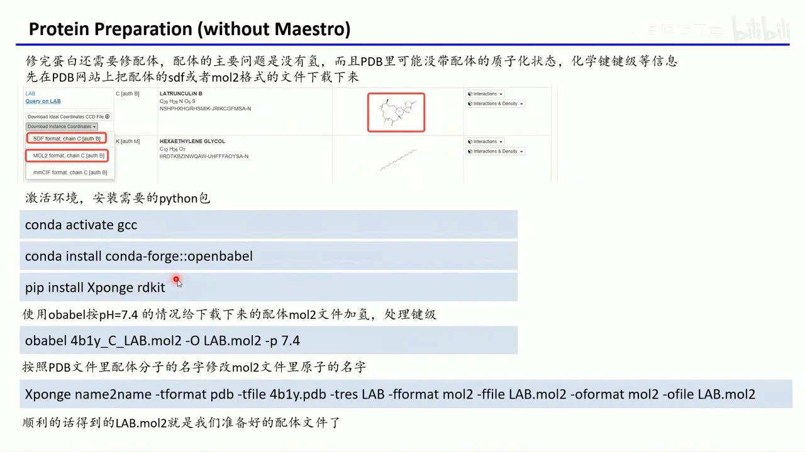

必须提醒：**自动推断的质子化状态不保证全对**。做完后要把蛋白和配体一起放进 ChimeraX 等可视化软件检查，确认缺失片段补上了、配体的氢和键级看起来合理，再进入下一步。视频里检查后认为该例的修复结果可用。[【跳转到 10:27】](https://www.bilibili.com/video/BV1haZVYrEAu/?t=627)

## 四、质子化状态必须写进残基名，GROMACS 才认

这是最容易被忽略、却直接决定模拟是否成立的一步。`pdb2gmx` 加 `-ignh` 时会忽略输入文件里的氢，按力场默认规则重新加氢。如果你辛苦用 Maestro 或 pdbfixer 处理了质子化状态，却仍然用 `-ignh`，GROMACS 就可能按默认状态重新分配，你之前的工作等于白做。[【跳转到 10:52】](https://www.bilibili.com/video/BV1haZVYrEAu/?t=652)

解决办法是让质子化状态体现在**残基名**上。GROMACS 通过残基名识别状态，常用的对应关系是：

| 残基 | 不同质子化状态下的名字 |
| --- | --- |
| 组氨酸 HIS | HIE（ε 氮质子化）、HID（δ 氮质子化）、HIP（双质子化，带正电） |
| 谷氨酸 GLU | 中性质子化时为 GLH |
| 天冬氨酸 ASP | 中性质子化时为 ASH |
| 半胱氨酸 CYS | 形成二硫键时为 CYX |

视频里第 6 号残基就被改成了 `HIE`，这正是“处理质子化状态”在文件层面的具体含义。[【跳转到 12:57】](https://www.bilibili.com/video/BV1haZVYrEAu/?t=777)

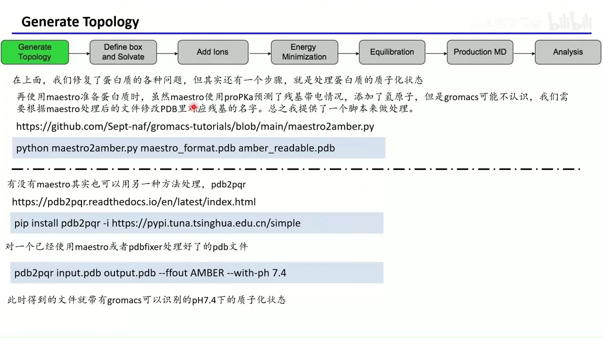

有两种自动改名的方案：

- 用 Maestro 准备蛋白时，用作者提供的 `maestro2amber.py` 脚本转换：`python maestro2amber.py maestro_format.pdb amber_readable.pdb`。
- 不论用 Maestro 还是 pdbfixer，都可以用 **pdb2pqr**：`pip install pdb2pqr`，然后执行 `pdb2pqr input.pdb output.pdb --ffout AMBER --with-ph 7.4`。

pdb2pqr 内部用 PROPKA 预测每个可电离残基的 pKa，再据此决定质子化状态并改写残基名，连氢的名字也会一并处理好。正因为残基名已经正确，后面 `pdb2gmx` 即使重新加氢，也会按残基名加上对应状态的氢；如果氢名能被 GROMACS 识别，甚至可以不写 `-ignh`。[【跳转到 11:42】](https://www.bilibili.com/video/BV1haZVYrEAu/?t=702)

如果自动工具的结果仍不符合你的判断，最后一招是**手动编辑 PDB 的残基名**。这虽然笨，但完全可控——质子化状态错了，模拟的电荷状态就错了，后果比多花几分钟严重得多。

## 五、蛋白拓扑：pdb2gmx 按链拆成多个 itp，再由 topol.top 汇总

蛋白准备好后，先单独生成蛋白拓扑：

```bash
gmx pdb2gmx -f protein.pdb -o protein.gro -p topol.top -ignh
```

因为 4B1Y 有 B、M 两条链，命令会产出：

- `protein.gro`：蛋白坐标；
- `topol.top`：总拓扑；
- `topol_Protein_chain_B.itp`、`topol_Protein_chain_M.itp`：两条链各自的力场参数与连接关系；
- `posre_Protein_chain_B.itp`、`posre_Protein_chain_M.itp`：两条链的位置限制文件。

`posre_*.itp` 的作用是对重原子施加位置限制，平衡阶段会用到；`topol_*.itp` 则是真正描述原子、键、角、二面角的力场文件。[【跳转到 15:34】](https://www.bilibili.com/video/BV1haZVYrEAu/?t=934)

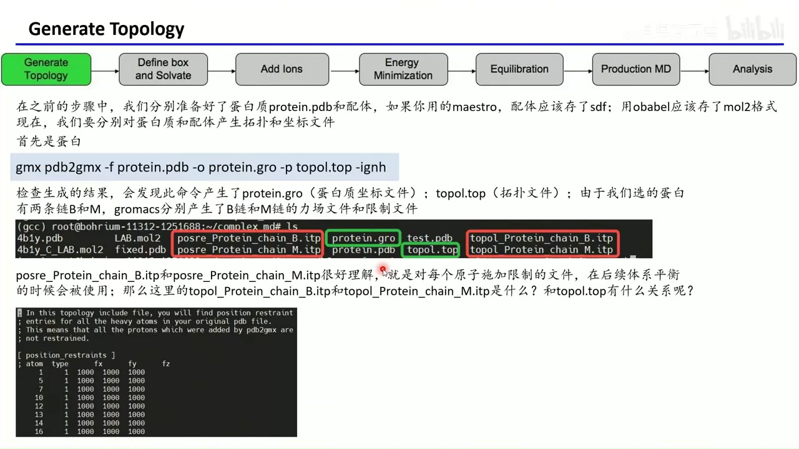

打开 `topol.top` 可以看到它的组织方式：

1. 先 `#include "amber99sb-ildn.ff/forcefield.itp"` 引入力场；
2. 紧接着引入 B 链、M 链的 `topol_*.itp`；
3. 再引入水的 `tip3p.itp` 和离子的 `ions.itp`；
4. `[ system ]` 写体系名；
5. `[ molecules ]` 列出物种与数目：`Protein_chain_B 1`、`Protein_chain_M 1`。

这个顺序不是随意排的：**先有力场参数，才能定义分子**。每个链 itp 里的 `[ moleculetype ]` 名字必须与 `topol.top` 中 `[ molecules ]` 的名字完全一致，否则 GROMACS 会报错。itp 内部则依次是 `[ atoms ]`（原子名、残基名、力场原子类型、电荷、质量）、`[ bonds ]`、`[ angles ]`、`[ dihedrals ]`，最后在 `#ifdef POSRES` 中引用对应的 `posre_*.itp`——只有 mdp 里出现 `-DPOSRES` 时，位置限制才会真正生效。[【跳转到 17:26】](https://www.bilibili.com/video/BV1haZVYrEAu/?t=1046)

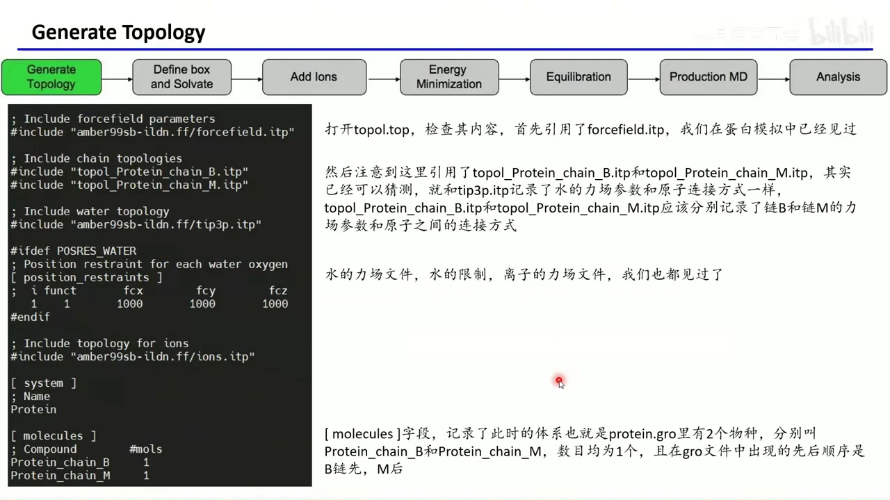

## 六、配体拓扑：acpype 生成 GAFF2 参数，坐标再并入蛋白 gro

蛋白用 Amber 力场，配体就必须用与 Amber 兼容的 **GAFF/GAFF2**（General AMBER Force Field）参数。生成工具是 **acpype**：

```bash
conda activate gcc
conda install -c conda-forge acpype
acpype -i LAB.mol2 -c bcc -a gaff2 -n 0 -b MOL
```

各选项含义如下：

- `-i LAB.mol2`：输入已经补好氢、修好键级和质子化状态的配体文件；
- `-c bcc`：用 AM1-BCC 方法计算每个原子的部分电荷，精度够用、速度快；现在很多人会改用更准的 RESP 电荷；
- `-a gaff2`：从与 Amber 力场匹配的 GAFF2 数据集取小分子参数；
- `-n 0`：小分子的净电荷。**必须按实际带电情况填写**，填错会直接报错或得到错误体系；
- `-b MOL`：输出文件的前缀，这里定为 `MOL`。

几分钟到十几分钟后，会得到一个 `MOL.acpype` 文件夹，里面有大量中间文件。真正需要的是三个：`MOL_GMX.gro`（配体坐标）、`MOL_GMX.itp`（配体力场参数）、`posre_MOL.itp`（配体位置限制）。[【跳转到 19:14】](https://www.bilibili.com/video/BV1haZVYrEAu/?t=1154)

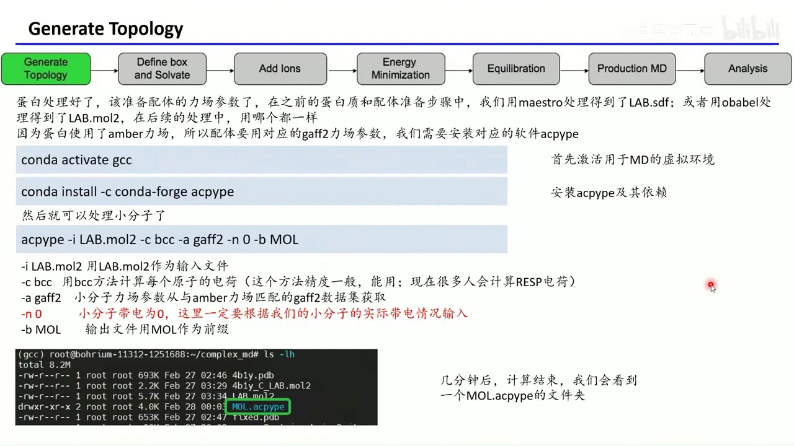

把三个文件移到蛋白拓扑所在目录：

```bash
mv MOL_GMX.gro ../
mv MOL_GMX.itp ../
mv posre_MOL.itp ../
```

然后手工把 `MOL_GMX.gro` 中配体的原子坐标**追加**到 `protein.gro` 的原子列表末尾。同时必须修改 `protein.gro` 第二行的原子总数：视频里蛋白有 6443 个原子，配体有 56 个，合并后应为 **6499**。数字对不上，GROMACS 读取坐标就会出错。改完后用可视化软件打开合并后的 gro，确认配体确实位于蛋白的结合口袋、相对位置没有跑偏。[【跳转到 21:07】](https://www.bilibili.com/video/BV1haZVYrEAu/?t=1267)

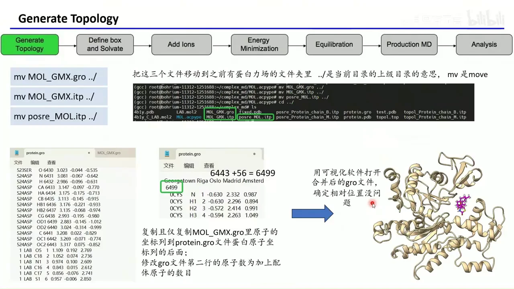

## 七、合并拓扑：三处修改，顺序和名字都不能错

坐标合并只是“形”，拓扑合并才是“神”。打开 `topol.top`，需要做三处修改：

1. **引入配体力场**：在 `#include "amber99sb-ildn.ff/forcefield.itp"` 之后、其它 itp 之前，加入 `#include "MOL_GMX.itp"`。配体参数必须紧跟在力场定义之后，保证参数在使用前已经读入。
2. **引入配体位置限制**：加入 `#ifdef POSRES` / `#include "posre_MOL.itp"` / `#endif`，让平衡阶段可以对配体施加限制。
3. **登记物种**：在 `[ molecules ]` 末尾加一行 `MOL 1`。这里的 `MOL` 必须与 `MOL_GMX.itp` 中 `[ moleculetype ]` 的名字完全一致，否则拓扑解析会失败。

这三处看起来简单，但名字、位置、顺序任何一个出错，`grompp` 都会在后续步骤报错。做完后建议再通读一遍拓扑，确认没有重复引入或遗漏。[【跳转到 21:37】](https://www.bilibili.com/video/BV1haZVYrEAu/?t=1297)

## 八、溶剂化、加离子、能量最小化：流程照旧

拓扑合并完成后，体系终于可以“泡进水里”：

```bash
gmx editconf -f protein.gro -o protein_box.gro -c -d 1.2 -bt cubic
gmx solvate -cp protein_box.gro -cs spc216.gro -o solv.gro -p topol.top
```

`-d 1.2` 表示溶质到盒子边缘至少留 1.2 nm，`-bt cubic` 是立方盒子。加水后 `topol.top` 会自动多出 `SOL` 条目。视频里加了 32887 个水分子，作者也感叹“有点多”——盒子大小直接决定体系规模和计算成本，1.2 nm 是常见起点，但不是唯一答案。[【跳转到 22:53】](https://www.bilibili.com/video/BV1haZVYrEAu/?t=1373)

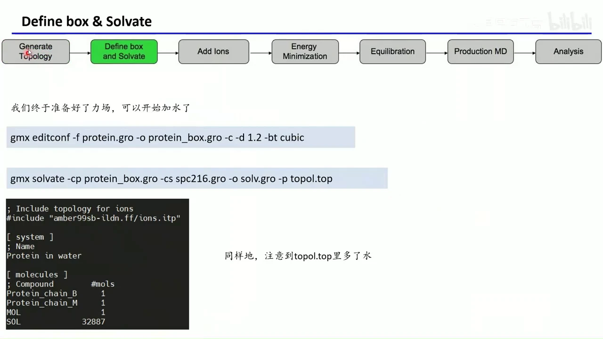

加离子与纯蛋白流程相同（视频口述按之前做法加钾离子，幻灯片示例命令用 Na⁺/Cl⁻，只是离子种类不同）：

```bash
gmx grompp -f ions.mdp -c solv.gro -p topol.top -o ions.tpr
gmx genion -s ions.tpr -o ions.gro -p topol.top \
  -pname NA -nname CL -conc 0.15 -neutral
```

`-conc 0.15` 是 0.15 mol/L 的生理盐浓度，`-neutral` 让体系整体电中性。随后做能量最小化，和之前完全一样：

```bash
gmx grompp -f em.mdp -c ions.gro -p topol.top -o em.tpr
gmx mdrun -v -deffnm em
```

`em.mdp` 可用与纯蛋白模拟相同的控制文件；区别只在于这一次的 `topol.top` 里已经包含配体，`grompp` 会把配体的参数一起读进去。能量最小化的目的是消除加水、加离子后产生的原子重叠和过大受力，为平衡阶段提供一个不发散的起点。

## 九、平衡与生产：唯一实质变化是新增 Protein_MOL 组

到了 NVT 平衡，控制文件开始与纯蛋白模拟出现差别，差别集中在**控温分组**和**质心运动移除分组**。纯蛋白时通常分为 `Protein` 和 `Non-Protein`；现在有了配体，一般把配体和蛋白放在同一组，作为一个整体控温、整体移除质心运动：

```text
tc_grps   = Protein_MOL Water_and_ions
comm_grps = Protein_MOL Water_and_ions
```

问题在于，GROMACS 的默认分组里已经有 `Protein`、`LAB`、`Water_and_ions`，却没有把两者合在一起的 `Protein_MOL`。所以需要先用 `make_ndx` 造一个索引文件：

```bash
gmx make_ndx -f em.gro
```

在交互界面中，视频里的体系是：组 1 `Protein` 有 6443 个原子，组 13 `LAB` 有 56 个原子，组 20 `Water_and_ions` 有 98261 个原子。输入 `1 | 13` 把蛋白和配体合并，新组自动编号为 21；再用 `name 21 Protein_MOL` 命名，最后 `q` 保存退出，得到 `index.ndx`。[【跳转到 25:58】](https://www.bilibili.com/video/BV1haZVYrEAu/?t=1558)

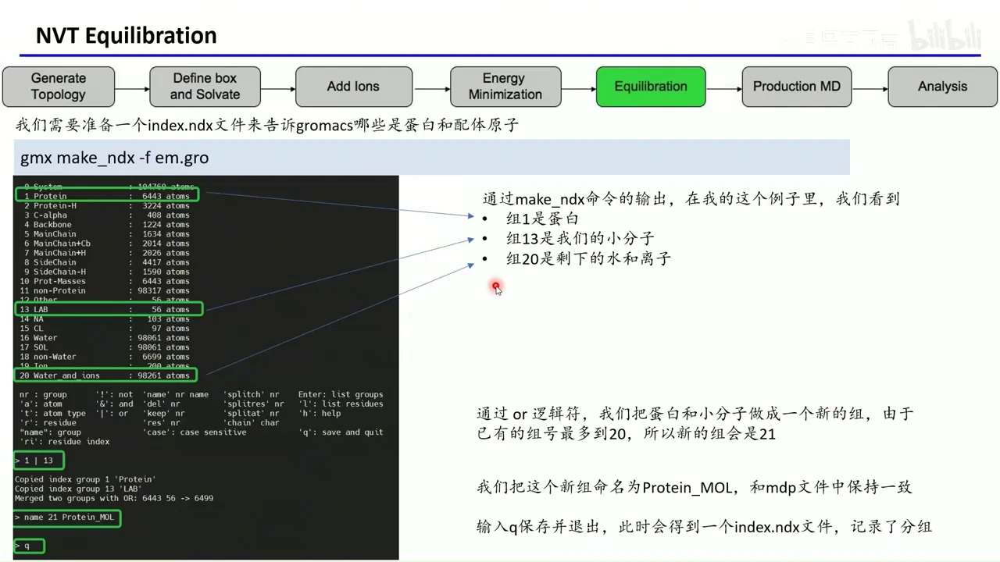

为什么不在 mdp 里直接把组名改成 `LAB` 了事？因为 NVT、NPT、成品 MD 都要用到这个组，至少六处需要同步修改；而在 index 文件里改一次，后面所有步骤都能复用。这是“把变化收敛到一个地方”的典型做法。

之后生成 tpr 时必须把 index 文件交给 GROMACS：

```bash
gmx grompp -f nvt.mdp -c em.gro -p topol.top -r em.gro -o nvt.tpr -n index.ndx
gmx mdrun -v -deffnm nvt
```

视频中的 NVT 平衡跑 500 ps，步长 1 fs，并开启位置限制让蛋白和配体在升温时不过度移动；这些参数来自 `nvt.mdp`，与纯蛋白模拟的差别只在于组名。NPT 平衡同理，只是把 mdp 换成 `npt.mdp`、输出换成 `npt.tpr`，仍然带 `-n index.ndx`。到了成品 MD，仍然使用同一套分组；视频建议把模拟时间设为 500 ns（`dt = 0.002` ps，即 2 fs，共 2.5 亿步），并且**至少跑 2–3 条独立重复**，避免把一条轨迹的偶然结果当成结论。[【跳转到 28:13】](https://www.bilibili.com/video/BV1haZVYrEAu/?t=1693)

## 十、分析：始终围绕 Protein_MOL 组，配体 RMSD 是必做图

成品 MD 跑完后，轨迹处理与纯蛋白类似，但因为体系里有配体，去除周期性边界条件、消除整体平动转动时都必须针对 `Protein_MOL` 这个复合组：

```bash
gmx trjconv -f md.xtc -s md.tpr -o md_nopbc.xtc \
  -pbc mol -ur compact -center -n index.ndx
```

选择输出组时选 `Protein_MOL`。`-pbc mol` 保证分子不被周期边界拆断，`-ur compact` 让盒子更紧凑，`-center` 把复合物居中。接着消除整体平动和转动：

```bash
gmx trjconv -f md_nopbc.xtc -s md.tpr -o fit.xtc \
  -fit rot+trans -n index.ndx
```

参考组同样选 `Protein_MOL`。[【跳转到 30:15】](https://www.bilibili.com/video/BV1haZVYrEAu/?t=1815)

计算配体 RMSD 时，用蛋白做叠合、用配体做统计：

```bash
gmx rms -s md.tpr -f md_nopbc.xtc -o rmsd.xvg \
  -tu ns -n index.ndx
```

在交互提示中，**拟合组选 `Protein`，RMSD 计算组选 `LAB`**。这样得到的是“把每一帧按蛋白对齐后，配体相对于参考结构的偏移”。输出 `rmsd.xvg` 记录了配体 RMSD 随时间的变化，可用 `xmgrace`/`grace` 打开，也可以用 Python 的 matplotlib 画图。[【跳转到 31:24】](https://www.bilibili.com/video/BV1haZVYrEAu/?t=1884)

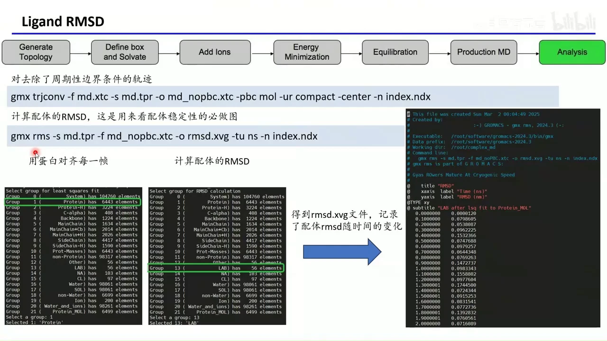

这张图几乎是蛋白–配体复合物模拟的“必做图”：如果配体在 500 ns 内 RMSD 保持较小且没有持续漂移，说明它在结合口袋里比较稳定；如果 RMSD 不断增大，就要怀疑配体是否跑出口袋。判断结合稳定性时，仍应结合 2–3 条 500 ns 的重复轨迹一起看。

蛋白本身也可以照旧分析：以蛋白对齐后计算 Cα 或 backbone（主链）的 RMSD，用来判断蛋白整体是否稳定；也可以算所有重原子的 RMSD，具体选哪一组取决于你想回答的问题。

## 小结

- 复合物模拟的主流程与纯蛋白相同，新增的核心是**修结构、配体参数化、拓扑合流**。
- 真实 PDB 结构要先做减法：删掉与目标无关的脂质、甘油、ATP、离子和水，只保留蛋白与目标配体。
- 蛋白修复可用 Maestro 一键完成，也可用 pdbfixer 或 Swiss-Model 的 User Template 模式补齐缺失片段与侧链。
- 配体必须补氢、修键级、按 pH 定质子化状态，并把原子名对齐；自动结果要人工复核。
- 质子化状态要落实为残基名（HIE/HID/HIP、GLH、ASH、CYX），否则 `pdb2gmx` 会按默认规则重新加氢。
- 蛋白拓扑按链拆成多个 itp，由 `topol.top` 统一引入；配体用 acpype 生成 GAFF2 参数，坐标并入 gro 后还要改原子总数。
- 合并拓扑的三处修改是：引入 `MOL_GMX.itp`、引入 `posre_MOL.itp`、在 `[molecules]` 中登记 `MOL 1`。
- 平衡与生产的实质变化是用 `make_ndx` 建立 `Protein_MOL` 组，并在所有 `grompp` 步骤提供 `index.ndx`。
- 分析时 PBC 处理、叠合与 RMSD 都要围绕 `Protein_MOL` 组；配体 RMSD 是判断结合稳定性的必做分析。

## 关键术语速查

| 术语 | 一句话解释 |
| --- | --- |
| 配体（ligand） | 与蛋白质特异性结合的小分子，本讲为 LAB（latrunculin B）。 |
| PDB | 蛋白质结构数据库，也指其使用的结构文件格式；本讲结构为 4B1Y。 |
| 质子化状态 | 可电离基团是否结合氢、带何种电荷的状态，随 pH 改变。 |
| pKa | 酸解离常数，决定某基团在给定 pH 下主要以质子化还是去质子化形式存在。 |
| PROPKA | 预测蛋白质残基 pKa 的工具，pdb2pqr 内部会调用它。 |
| pdbfixer | 开源蛋白修复工具，可补缺失残基、侧链和氢。 |
| Swiss-Model | 同源建模服务，User Template 模式可用自身结构作模板补缺失片段。 |
| Open Babel | 化学文件转换与处理工具，本讲用于按 pH 加氢、修键级。 |
| pdb2pqr | 按 pH 预测质子化状态并改写残基名/加氢的工具。 |
| 力场 | 描述原子间相互作用势的函数与参数集合，如 Amber99SB-ILDN。 |
| GAFF/GAFF2 | 与 Amber 力场配套的通用小分子力场。 |
| acpype | 为小分子生成 Amber/GAFF 拓扑的工具，可输出 GROMACS 格式。 |
| itp | GROMACS 的拓扑片段文件，记录分子类型、原子、键、角、二面角等参数。 |
| topol.top | 体系总拓扑，负责引入力场与各 itp，并登记物种和数目。 |
| gro | GROMACS 的坐标文件，第二行是原子总数。 |
| index.ndx | 自定义原子分组文件，本讲用于定义 `Protein_MOL` 组。 |
| NVT / NPT | 恒定粒子数–体积–温度 / 恒定粒子数–压力–温度系综，分别用于控温和控压平衡。 |
| RMSD | 均方根偏差，衡量结构相对参考态的偏移；配体 RMSD 常用于判断结合稳定性。 |
| PBC | 周期性边界条件；分析前需用 `trjconv` 去除其对分子的拆分效应。 |
