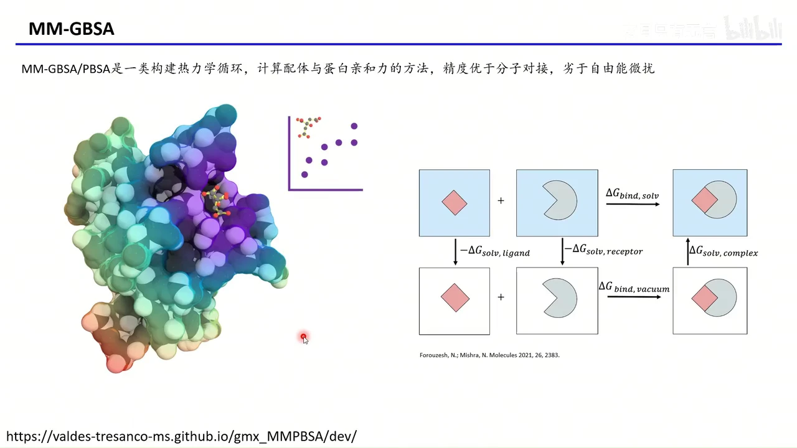
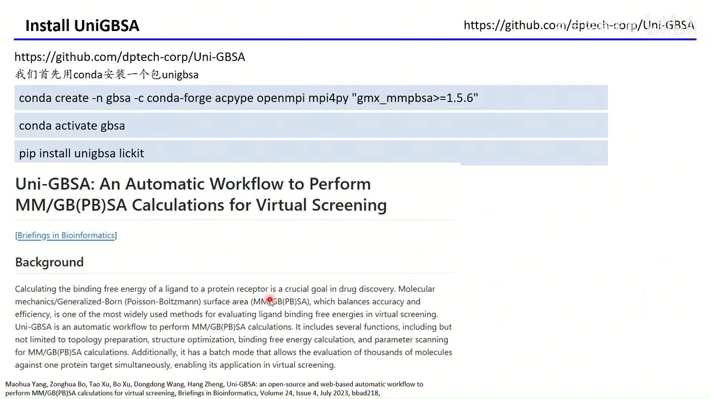
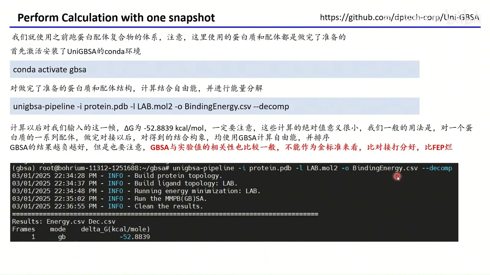
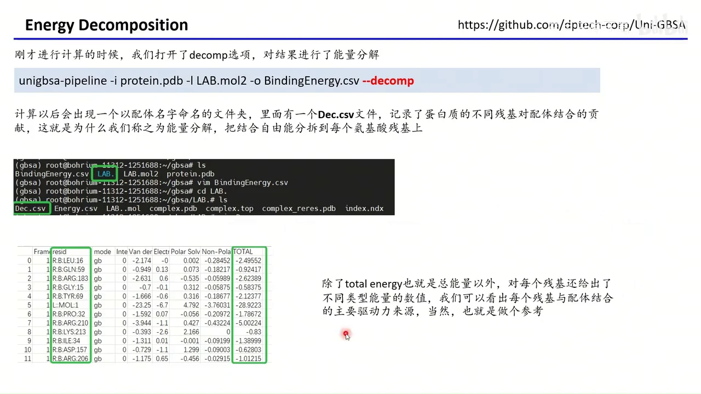
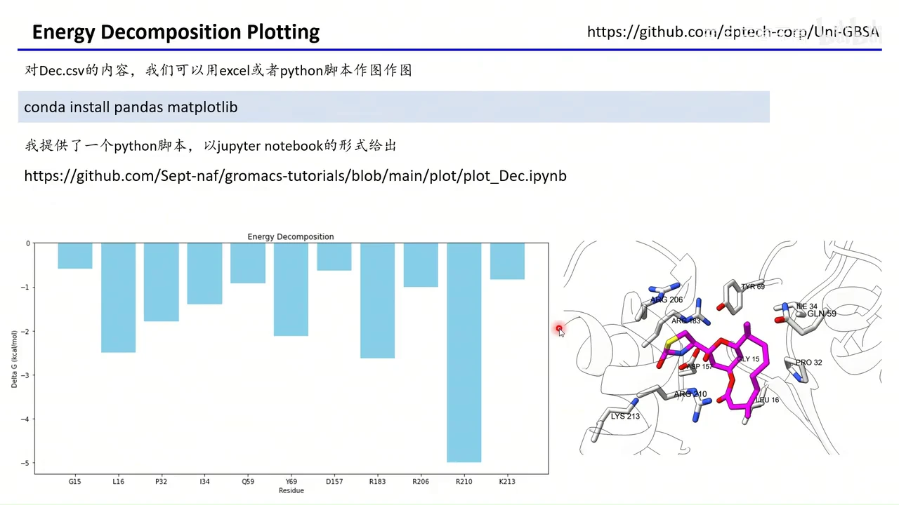
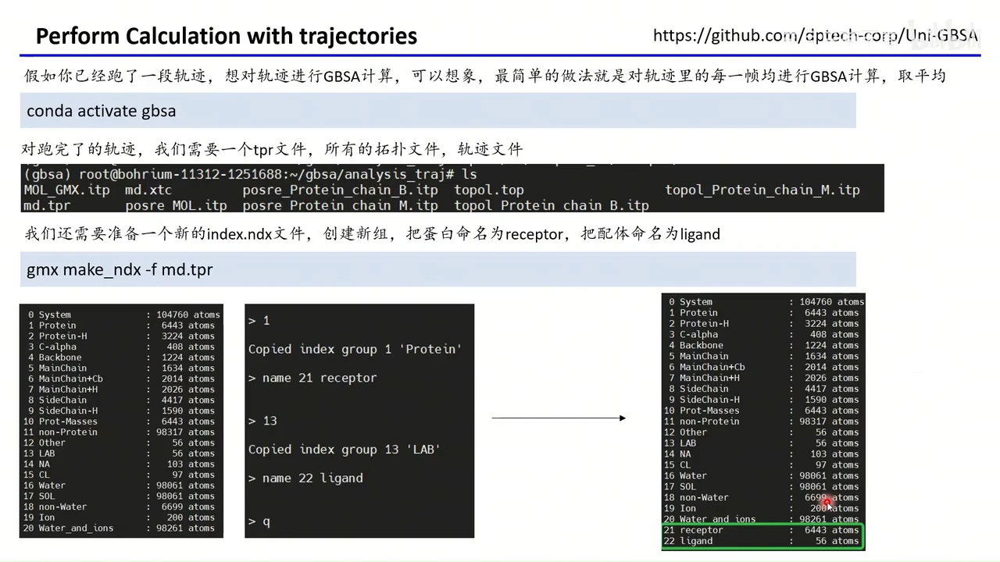
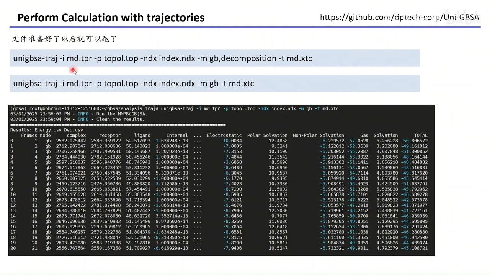
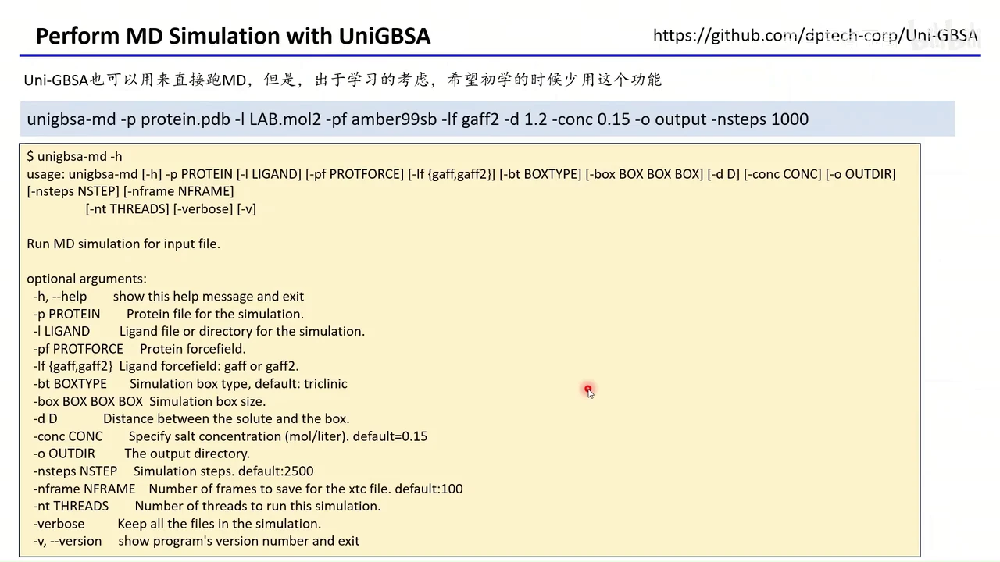

# GROMACS 入门 06：用 Uni-GBSA 一行命令计算结合自由能

## 本讲要解决的核心问题（SCQA）

**背景**：前五讲已经能跑完蛋白质–配体复合物的完整分子动力学（MD）模拟，得到一条记录原子随时间运动的轨迹。

**冲突**：轨迹只告诉我们“原子怎么动”，却回答不了研究者最关心的问题——这个小分子到底和蛋白质结合得有多紧？做实验测亲和力既慢又贵，而分子对接的打分又太粗糙。

**疑问**：能不能直接用模拟得到的结构或轨迹，算出结合自由能，并进一步指出是哪些残基在“抓住”配体？

**回答（中心思想）**：可以。**MM-GBSA** 通过一个热力学循环把结合自由能拆成几项可计算的能量，**Uni-GBSA** 则把它封装成一行命令：`unigbsa-pipeline` 算单帧、`unigbsa-traj` 算整条轨迹、`--decomp` 把结果分解到每个残基。但要记住它的定位——**绝对值只作参考，相对排序才有意义**；它比对接准，比自由能微扰差，最终仍需实验验证。

## 一、MM-GBSA 用热力学循环“绕开”直接计算结合过程

**MM-GBSA**（Molecular Mechanics / Generalized Born Surface Area，分子力学/广义玻恩表面积法）是一类通过构建热力学循环来计算配体与蛋白质亲和力的方法。它之所以流行，是因为直接模拟“两个分子从分开到结合”的自由能变化代价太高，而热力学循环允许我们绕道计算。



循环的写法很直观。设配体为 L、受体（蛋白质）为 R：

- 溶液中直接结合：L + R → LR，自由能变化为 ΔG_bind,solv；
- 绕道气相：先把 L、R 分别“脱溶剂”进入真空，在真空中结合，再把复合物“放回”溶剂。

于是有：

```
ΔG_bind,solv = ΔG_bind,vacuum
             + ΔG_solv,complex − ΔG_solv,ligand − ΔG_solv,receptor
```

名字里的三部分正好对应三项计算：

- **MM（分子力学）**：用经典力场算真空中的相互作用能，包括范德华项和静电项；
- **GB（广义玻恩）**：用隐式溶剂模型估算极性溶剂化自由能，避免在体系里显式放成千上万个水分子；
- **SA（表面积）**：用溶剂可及表面积估算非极性溶剂化自由能，即“把水推开”的代价。

它的精度定位也很清楚：**优于分子对接，劣于自由能微扰（FEP）**。这已经是科研发表中非常常见的一类方法。[【跳转到 00:13】](https://www.bilibili.com/video/BV1MdZGYTEYP/?t=13)

## 二、先装好 Uni-GBSA：一条 conda 命令搭起计算环境

Uni-GBSA 是 dptech-corp 开源的自动化工作流，把拓扑准备、结构优化、结合自由能计算和参数扫描串了起来，论文发表在 *Briefings in Bioinformatics* 上，使用后应当引用。

安装分两步。第一步创建并进入名为 `gbsa` 的虚拟环境，同时装好 `gmx_MMPBSA` 及其依赖：

```bash
conda create -n gbsa -c conda-forge acpype openmpi mpi4py "gmx_mmpbsa>=1.5.6"
conda activate gbsa
pip install unigbsa lickit
```



几个包各司其职：

- **gmx_MMPBSA**：真正执行 MM/GB(PB)SA 计算的核心程序；
- **acpype**：为小分子生成拓扑与参数；
- **openmpi + mpi4py**：提供并行能力，让计算跑得更快；
- **unigbsa**：本讲使用的一行命令封装；
- **lickit**：配体参数化所用的辅助工具。

需要注意，`gmx_MMPBSA` 依赖 **GROMACS**，但它不会替你安装 GROMACS。如果你是顺着本系列一路看下来的，GROMACS 在前几讲已经装好，所以这里不再重复。[【跳转到 01:03】](https://www.bilibili.com/video/BV1MdZGYTEYP/?t=63)

## 三、单帧计算：一行命令得到 ΔG

环境就绪后，对“一个蛋白质 + 一个配体”的单个构象计算结合自由能，只需要一行命令：

```bash
conda activate gbsa
unigbsa-pipeline -i protein.pdb -l LAB.mol2 -o BindingEnergy.csv --decomp
```



参数含义如下：

- `-i`：蛋白质的 PDB 文件；
- `-l`：配体文件，SDF 或 MOL2 均可；
- `-o`：结合自由能结果写入的 CSV 文件；
- `--decomp`（或 `--decomposition`）：要求做能量分解。

**最容易出错的地方在输入文件**：蛋白和配体都必须是**已经做完准备**的结构——蛋白补全缺失原子与氢、配体有正确的键级和质子化状态。这些工作在上一讲已经完成，直接把那份成果拿来用即可。[【跳转到 01:58】](https://www.bilibili.com/video/BV1MdZGYTEYP/?t=118)

运行后约两分多钟结束，终端给出 `ΔG = −52.8839 kcal/mol`。[【跳转到 02:23】](https://www.bilibili.com/video/BV1MdZGYTEYP/?t=143)

## 四、结果要这样读：绝对值没有意义，相对排序才有意义

看到 −52.88 这个数字，初学者最容易犯的错误是把它当成“结合很强”的绝对证据。作者反复强调：**这个绝对值本身意义很小，只有相对值有意义**。

正确的用法是：拿同一个蛋白质，对一系列候选配体分别做对接、得到各自的结合构象，再用 GBSA 逐一计算并排序。**结果越负，结合越有利**；我们关心的是“A 比 B 更负多少”，而不是“−52.88 这个数到底算不算强”。

同时要清醒认识它的可靠性：GBSA 比对接打分好不少，但与实验值的相关性也比较一般，**不能当作金标准**——它比对接好，比 FEP 差。所以它适合做筛选和趋势判断，有条件的话最终仍要靠实验验证。[【跳转到 03:13】](https://www.bilibili.com/video/BV1MdZGYTEYP/?t=193)

## 五、能量分解：把 ΔG 摊到每一个残基上

计算完成后会生成一个以配体名字命名的文件夹（本例为 `LAB`），里面有两个关键文件：

- `BindingEnergy.csv`：总的结合自由能，就是前面那个 −52.88；
- `Dec.csv`：能量分解结果，记录蛋白质不同残基对配体结合的贡献。



所谓**能量分解**（decomposition），就是把总结合自由能拆开，分配到蛋白质的每一个氨基酸残基上，回答“哪些残基贡献最大”。表中除了 `TOTAL`（该残基的总贡献），还按能量类型分列：

- **Van der Waals（范德华）**：形状互补、疏水贴合带来的吸引；
- **Electrostatic（静电）**：带电与极性基团之间的相互作用；
- **Polar Solvation（极性溶剂化）**：极性基团与水作用带来的去溶剂化代价，通常是正值，会抵消部分静电吸引；
- **Non-Polar Solvation（非极性溶剂化）**：疏水表面积的贡献。

由此不仅能找出“热点残基”，还能看出每个残基主要靠哪种作用力结合，对解释结合机制、指导突变实验都很有价值。作者也提醒：这些分项同样是**参考性质**的。[【跳转到 04:05】](https://www.bilibili.com/video/BV1MdZGYTEYP/?t=245)

## 六、把分解结果画成图：一眼看出谁在“抓住”配体

`Dec.csv` 可以直接用 Excel 打开，也可以用 Python 脚本作图。先补两个绘图包：

```bash
conda install pandas matplotlib
```

作者提供了一个 Jupyter Notebook 形式的脚本（`plot_Dec.ipynb`），读取 `Dec.csv` 后自动画出柱状图。



读图方式很直接：

- **横轴**：与小分子有相互作用的具体残基；
- **纵轴**：该残基对结合自由能的贡献，越负表示贡献越大；
- 作者把能量分解显示有相互作用的残基全部画了出来，本例中 **R210 的贡献最大**（约 −5 kcal/mol）。

右侧的结构图把同一批残基标注在结合口袋上，柱状图与三维结构对照，就能迅速定位关键结合位点。这仍然是“单帧”场景——只有一个蛋白和一个配体。[【跳转到 05:05】](https://www.bilibili.com/video/BV1MdZGYTEYP/?t=305)

## 七、整条轨迹的平均：给每一帧算一次，再取平均

单帧结果强烈依赖你选的那一个构象。跑完 MD 之后，更常见的需求是对**整条轨迹**做 GBSA：对轨迹里的每一帧都算一次，再取平均，结果更稳健。

这一步需要额外准备一个 index 文件，把蛋白和配体分别选成两个新组。用 `gmx make_ndx` 打开 `md.tpr`，复制 `Protein` 组并命名为 `receptor`，复制配体组（本例为 `LAB`）并命名为 `ligand`：

```bash
gmx make_ndx -f md.tpr
```



这个思路并不局限于蛋白–配体：如果做的是蛋白–蛋白模拟，比如想看 A 链与 B 链的结合自由能，就把 A 链命名为 `receptor`、B 链命名为 `ligand`，同样适用。

文件齐备后运行：

```bash
unigbsa-traj -i md.tpr -p topol.top -ndx index.ndx -m gb -t md.xtc
```



参数含义：

- `-i`：体系的 `tpr` 文件；
- `-p`：拓扑文件；
- `-ndx`：刚才生成的 index 文件，指定谁是 receptor、谁是 ligand；
- `-m`：计算模式，这里用 `gb`；
- `-t`：输入轨迹（如 `md.xtc`）。

如果加上 `--decomposition` 做能量分解，**可能会报错**；不做分解、直接跑则确认可行。所以稳妥的做法是先拿到整条轨迹的平均结合自由能，再按需对代表性帧单独做分解。[【跳转到 06:33】](https://www.bilibili.com/video/BV1MdZGYTEYP/?t=393)

## 八、一键跑完复合物模拟：方便，但初学别当“拐棍”

Uni-GBSA 还提供 `unigbsa-md`，可以直接从蛋白 PDB 和配体文件一路跑到 MD：

```bash
unigbsa-md -p protein.pdb -l LAB.mol2 -pf amber99sb -lf gaff2 \
           -d 1.2 -conc 0.15 -o output -nsteps 1000
```



主要参数：

- `-p` / `-l`：准备好的蛋白质 PDB 与配体文件；
- `-pf`：蛋白质使用的力场，如 `amber99sb`；
- `-lf`：小分子使用的力场，如 `gaff2`；
- `-d`：溶质到盒子边界的距离，决定模拟盒子大小；
- `-conc`：离子浓度；
- `-o`：输出文件夹；
- `-nsteps`：模拟步数，默认步长为 2 飞秒。

它确实非常方便，一条命令就能完成蛋白质–配体复合物的动力学模拟。但作者明确建议：**初学阶段不要用这个“拐棍”**，而应老老实实按上一讲的步骤，一步一步亲手做一遍，理解每一步在干什么；等你熟悉流程、需要大批量处理体系时，再用它提效就没有问题了。[【跳转到 08:18】](https://www.bilibili.com/video/BV1MdZGYTEYP/?t=498)

## 小结

- **MM-GBSA 的本质**是用热力学循环绕开直接模拟结合过程，把 ΔG 拆成分子力学相互作用与溶剂化项，精度介于分子对接与 FEP 之间。
- **安装只需两步**：conda 建 `gbsa` 环境装 `gmx_MMPBSA`，再 `pip install unigbsa lickit`；GROMACS 需另行装好。
- **单帧计算一行命令**：`unigbsa-pipeline -i protein.pdb -l LAB.mol2 -o BindingEnergy.csv --decomp`，输入必须是已完成准备的结构。
- **读结果的关键**是相对排序而非绝对值；GBSA 与实验相关性一般，只能作参考。
- **能量分解**把 ΔG 分摊到每个残基并区分范德华、静电、极性/非极性溶剂化，配合柱状图可快速定位热点残基。
- **整条轨迹**需要 `receptor` / `ligand` 两个 index 组，用 `unigbsa-traj` 逐帧计算再平均；分解选项可能报错。
- **`unigbsa-md` 可一键跑 MD**，但初学阶段应亲手走完整流程，熟悉后再用于批量任务。

## 关键术语速查

| 术语 | 一句话解释 |
| --- | --- |
| MM-GBSA | 分子力学 + 广义玻恩表面积法，用热力学循环估算结合自由能 |
| 结合自由能 ΔG | 配体与蛋白质结合时体系的自由能变化，越负表示结合越有利 |
| 热力学循环 | 用几条可计算路径首尾相接，间接求出难算的那条路径的能量变化 |
| 广义玻恩（GB）模型 | 用连续介质近似水环境的隐式溶剂模型，省去显式水分子 |
| 溶剂化自由能 | 分子从真空进入溶剂时自由能的变化，分极性与非极性两部分 |
| 自由能微扰（FEP） | 更严格、更昂贵的自由能计算方法，精度高于 MM-GBSA |
| 能量分解 | 把总结合自由能拆分到每个氨基酸残基及各类相互作用上 |
| 残基（residue） | 蛋白质链上的一个氨基酸单元，能量分解的最小统计单位 |
| Uni-GBSA | 把 MM/GB(PB)SA 流程自动化的开源工具，提供 pipeline/traj/md 三条命令 |
| `Dec.csv` | 能量分解结果表，每行一个残基，含各类能量分项与总计 |
| index 文件（.ndx） | 把原子分组的索引文件，这里用于指定 receptor 与 ligand |
| `unigbsa-traj` | 对整条轨迹逐帧计算 GBSA 并取平均的命令 |
| `unigbsa-md` | 从结构文件直接一键完成复合物 MD 模拟的命令 |
