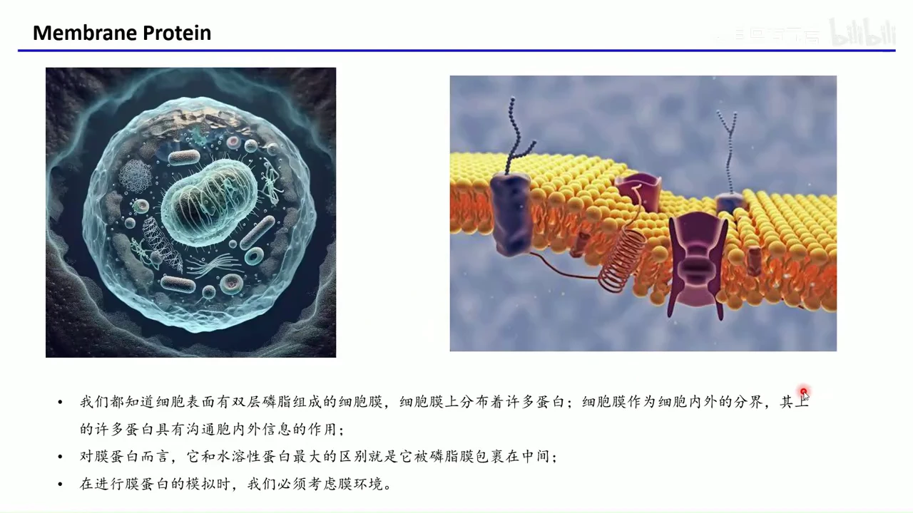
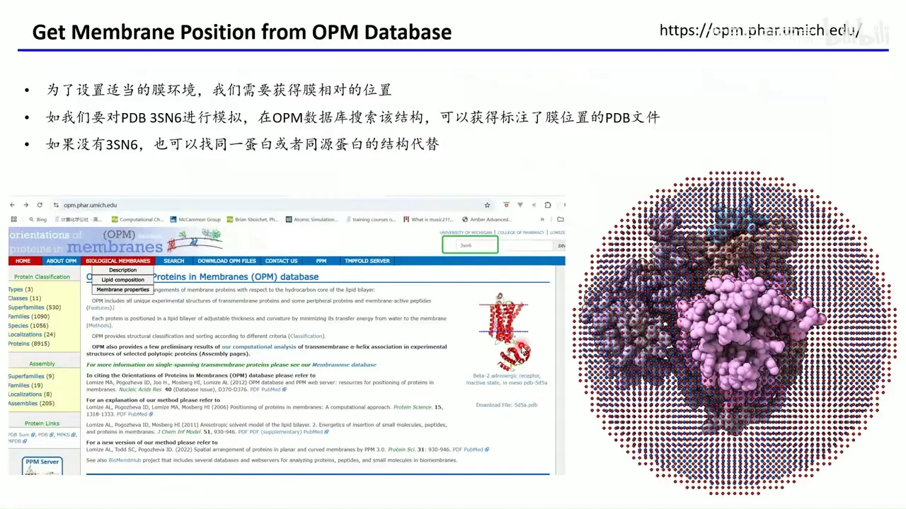
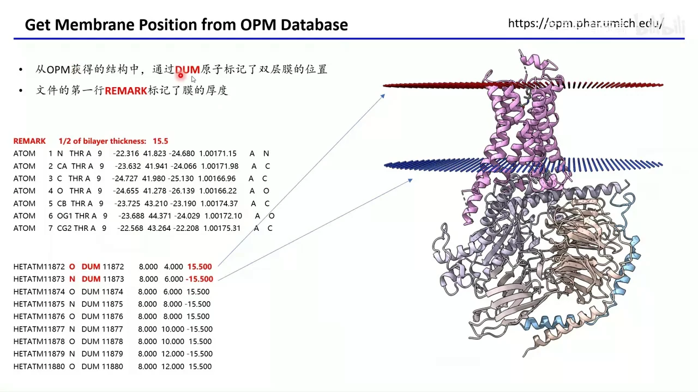
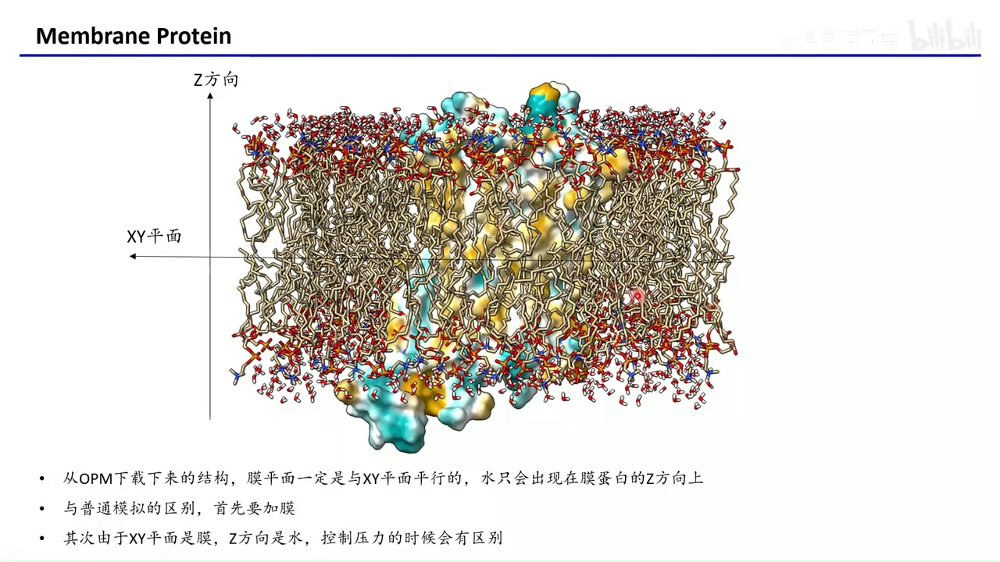
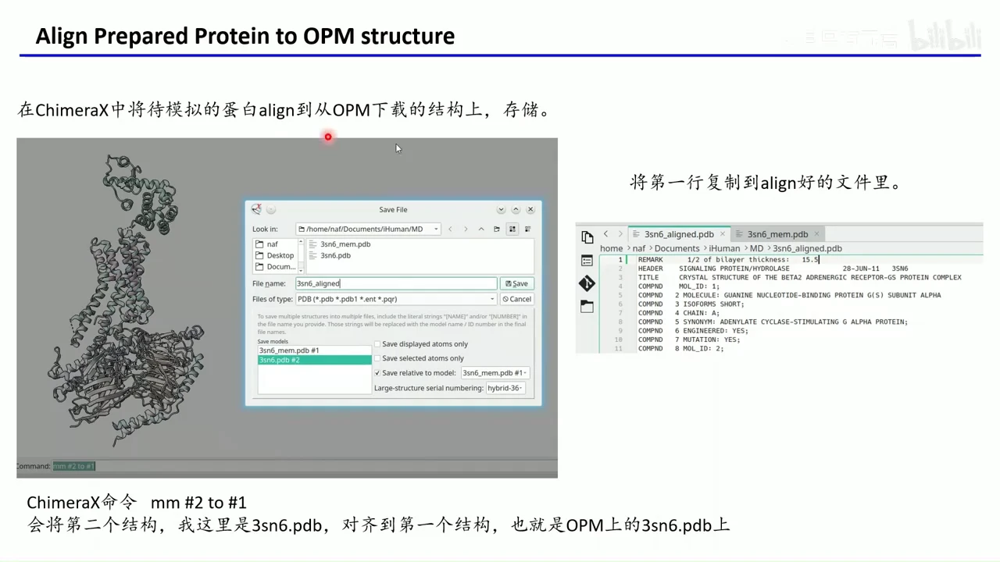
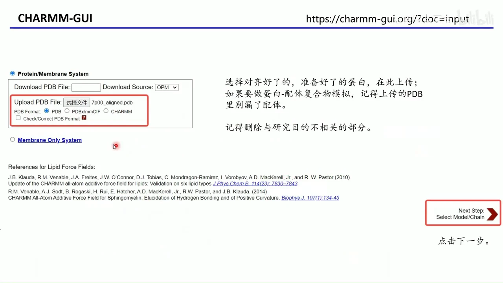
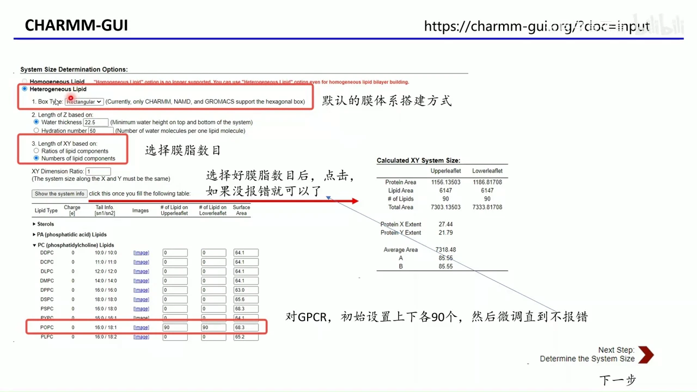
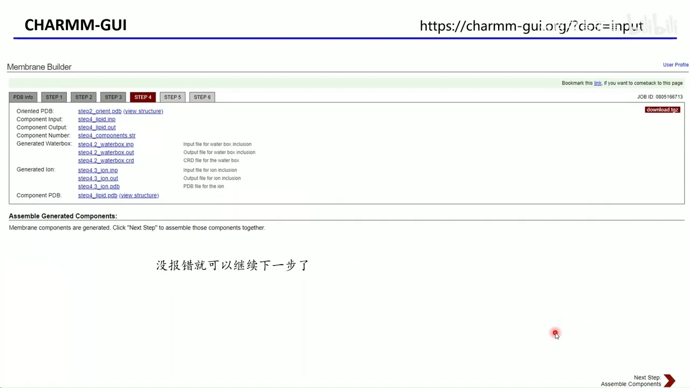
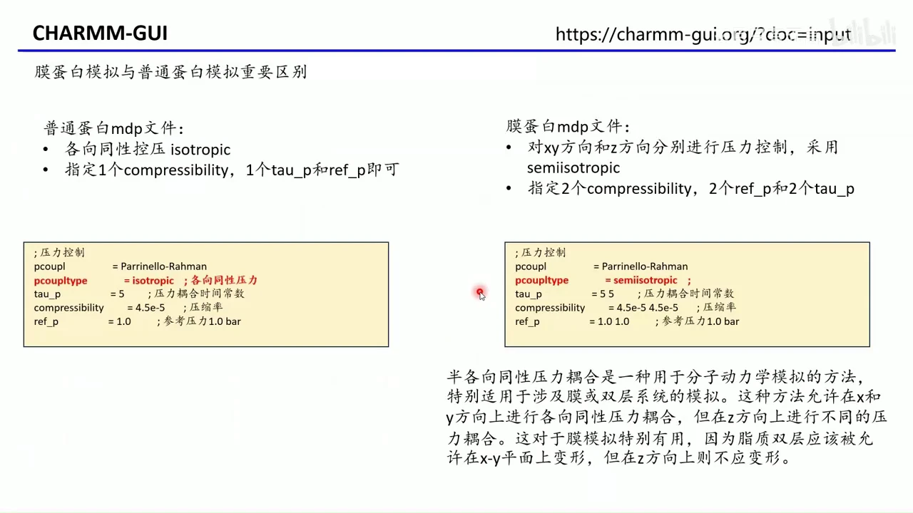

# GROMACS 入门 07：用 CHARMM-GUI 搭建膜蛋白模拟体系

## 本讲要解决的核心问题（SCQA）

**背景**：前几讲我们已经会用 GROMACS 模拟水溶性蛋白和蛋白-配体复合物，流程大致是准备结构、加溶剂、加离子、能量最小化与平衡。

**冲突**：膜蛋白不是泡在水里的。它的跨膜区要和疏水的脂质尾巴结合，性质偏疏水；如果照搬水溶性蛋白的做法，直接用水把整条蛋白溶起来，跨膜区会处于不真实、甚至不稳定的环境。

**疑问**：怎样才能把磷脂双分子层“正确地”加到蛋白周围，并让 GROMACS 认得膜的位置？

**回答（中心思想）**：膜蛋白模拟的关键不是写更复杂的命令，而是**先把膜的位置和方向确定对**——用 OPM 数据库取得膜平面，用 ChimeraX 把准备好的蛋白对齐过去，再交给 CHARMM-GUI 的 Membrane Builder 组装磷脂、水、离子并生成 GROMACS 输入文件，最后回到本地按 README 跑平衡与生产模拟。方向、脂质数目、力场兼容性和半各向同性控压，是这条流程里最容易出错的四件事。



## 一、膜蛋白不能只泡在水里：跨膜区疏水，必须显式加膜

膜蛋白顾名思义是位于细胞膜上的蛋白。细胞膜由磷脂双分子层构成：亲水的胆碱头分别朝向细胞外和细胞内的水环境，疏水的脂质尾巴则相互聚集在中间，形成一层疏水带。[【跳转到 00:13】](https://www.bilibili.com/video/BV1piocY4Etj/?t=13)

膜蛋白插入这层膜里，跨膜段的残基要与疏水脂质结合，因此性质更偏疏水。这带来两个直接后果：

- **不能只用水盒子**：把疏水的跨膜区直接暴露在水里，相当于强行改变它的环境，模拟结果不可信。
- **必须显式建膜**：要把磷脂双分子层按正确的位置和方向摆在蛋白周围，再在膜两侧加水。

所以膜蛋白模拟与普通蛋白模拟的第一个区别就是“先加膜”；第二个区别随后会看到——膜平面与 Z 方向的力学环境不同，控压方式也要改。[【跳转到 01:03】](https://www.bilibili.com/video/BV1piocY4Etj/?t=63)

## 二、先用 OPM 数据库确定膜的位置

要把膜加对，首先要知道膜“在哪里”。视频里使用的是 **OPM 数据库**（Orientations of Proteins in Membranes，膜中蛋白取向数据库），由密歇根大学维护，收录了绝大多数膜蛋白的膜位置信息。[【跳转到 01:26】](https://www.bilibili.com/video/BV1piocY4Etj/?t=86)

使用步骤很直接：

1. 打开 OPM 网站，在搜索框输入 PDB 编号，例如视频中的 **3SN6**（β2 肾上腺素受体与 G 蛋白的复合物结构）。
2. 下载 OPM 版本的结构文件。它和直接从 PDB 数据库下载的文件不是同一个文件。
3. 如果搜不到目标 PDB，可以尝试同一蛋白的其他 PDB 条目；再不行就找同源蛋白（例如 β1 受体或同家族受体）的结构，借用它标注出的膜位置。



这里要理解一个关键点：**OPM 文件的价值在于“膜的位置”，而不只是原子坐标**。视频中下载的结构里，有些组分（例如 G 蛋白）如果不在研究范围内，可以删掉，只保留真正要模拟的部分。[【跳转到 04:01】](https://www.bilibili.com/video/BV1piocY4Etj/?t=241)

## 三、OPM 结构与普通 PDB 的差别：DUM 原子和 REMARK 膜厚

OPM 下载的文件和普通 PDB 主要有三处不同，它们共同把“膜在哪里”编码进了文件。[【跳转到 02:46】](https://www.bilibili.com/video/BV1piocY4Etj/?t=166)

- **第一行 REMARK 标记膜厚**：例如 `REMARK 1/2 of bilayer thickness: 15.5`，表示半层膜厚约 15.5 Å。视频作者提到绝大多数条目都是这个数值。
- **整体坐标被重新取向**：原子坐标与 PDB 原文件差别可能很大，因为 OPM 已经把蛋白旋转到统一朝向——膜平面平行于 XY 平面，膜法线沿 Z 轴。
- **文件末尾有 DUM 原子**：这些“哑原子”成对出现，XY 坐标大量重复，Z 坐标约为 ±15.5，正好对应膜的上下两个界面。它们不参与真实化学，只用来告诉后续软件膜的位置。



这种统一朝向对建模非常重要：所有磷脂会顺着 XY 平面铺展，胆碱头沿 Z 方向竖立，水只出现在 Z 方向。后面 CHARMM-GUI 之所以能直接读入并使用膜位置，靠的就是这套坐标约定。[【跳转到 04:31】](https://www.bilibili.com/video/BV1piocY4Etj/?t=271)



## 四、上传前必须完成蛋白质准备并对齐到 OPM 坐标

无论膜蛋白还是普通蛋白，模拟前都要做蛋白质准备。视频列出的事项包括：[【跳转到 05:33】](https://www.bilibili.com/video/BV1piocY4Etj/?t=333)

- 补齐缺失的残基和缺失的侧链；
- 把解析结构时人为引入的突变复原；
- 删除与研究目的无关的组分（例如只研究受体时删掉 G 蛋白）；
- 修正质子化状态与键级；
- 如果体系里有配体，配体的质子化状态、键级和电荷也要处理好。

准备完成后要保存两类文件：一个**同时含蛋白和配体的 PDB**，以及一个**只含配体的 SDF 文件**，并记下配体带多少电荷。后面在 CHARMM-GUI 里生成配体力场参数时，SDF 和电荷都会用到。[【跳转到 05:58】](https://www.bilibili.com/video/BV1piocY4Etj/?t=358)

但还有一个容易被忽略的步骤：**做准备的 PDB 通常直接来自 PDB 数据库，它的坐标与 OPM 版本不同，必须重新对齐**。视频使用 ChimeraX 的 `matchmaker` 命令：[【跳转到 06:42】](https://www.bilibili.com/video/BV1piocY4Etj/?t=402)

```text
mm #2 to #1
```

其中 `#1` 是从 OPM 下载、带 `_mem` 后缀的正确膜坐标结构，`#2` 是已经做好蛋白质准备的结构。命令把 `#2` 对齐到 `#1`，再以相对 `#1` 的方式保存。最后把 OPM 文件第一行的 REMARK 膜厚复制到对齐后的文件里，后续软件就知道膜的位置了。[【跳转到 07:32】](https://www.bilibili.com/video/BV1piocY4Etj/?t=452)



## 五、CHARMM-GUI 的入口是 Membrane Builder 的 Bilayer Builder

体系搭建使用 **CHARMM-GUI**（一个在线生成分子模拟输入文件的平台）。使用前需要注册账号，并且通常要求学术邮箱。视频作者提醒：录制时用中国高校邮箱申请会进入人工审核，速度慢且未必通过；有条件的话可以借用非中国高校的学术邮箱。这是平台审核策略，不是技术限制。[【跳转到 08:11】](https://www.bilibili.com/video/BV1piocY4Etj/?t=491)

登录后依次进入 **Input Generator → Membrane Builder → Bilayer Builder**，也就是“双层膜搭建器”。第一步是上传 PDB 文件：[【跳转到 09:01】](https://www.bilibili.com/video/BV1piocY4Etj/?t=541)

- 上传已经做好蛋白质准备、并且对齐到 OPM 坐标的 PDB；
- 如果做蛋白-配体复合物，注意上传的 PDB 里不要漏掉配体；
- 在随后的组分选择页，勾选要保留的蛋白链和配体。视频示例中蛋白残基范围是 19–385，另有一个名为 CMF 的小分子配体；不需要的组分（例如 G 蛋白）把勾去掉。[【跳转到 09:11】](https://www.bilibili.com/video/BV1piocY4Etj/?t=551)



页面右上角会给出 **Job ID**。把它记下来，后面万一网页失去响应，可以用 Job ID 或任务链接找回这次作业。

## 六、配体、质子化与二硫键要在网页上逐项确认

上传后的 PDB Manipulation 页面负责体系“化学状态”的确认，系统 pH 一般设为 7.0。这里最需要小心的是配体。[【跳转到 10:01】](https://www.bilibili.com/video/BV1piocY4Etj/?t=601)

如果使用 Amber 力场，配体力场参数由 **Antechamber** 生成，因此需要上传前面保存的配体 SDF 文件；如果配体是用 Open Babel 准备的，上传 MOL2 文件也可以。上传后还要**手动输入配体带多少电荷**。CHARMM-GUI 不会替你判断配体该带几个电子，所以配体的质子化状态、键级、电荷必须在准备阶段就做对。[【跳转到 10:51】](https://www.bilibili.com/video/BV1piocY4Etj/?t=651)

其余选项按需确认：

- **末端封端**：默认设置通常没问题；
- **残基质子化状态**：在网页上手动选择可带电残基的状态。此前用 PDB2PQR、Maestro 或 PROPKA 等工具确定的状态要在这里选对；为了 GROMACS 识别，残基名也可能需要相应修改。[【跳转到 11:41】](https://www.bilibili.com/video/BV1piocY4Etj/?t=701)
- **二硫键**：手动把正确的半胱氨酸配对连上；
- **修饰**：磷酸化、泛素化等修饰以及非标准残基，网页都提供了选项，有需要就逐项添加。[【跳转到 12:06】](https://www.bilibili.com/video/BV1piocY4Etj/?t=726)

## 七、蛋白方向选 “Use PDB orientation”，不要依赖自动预测

下一步是确定膜的方向。因为我们上传前已经把蛋白对齐到 OPM 结构，这里应选择 **Use PDB orientation**——直接采用 PDB 文件中的朝向，网页也注明这适用于已按 OPM 对齐的结构。[【跳转到 12:56】](https://www.bilibili.com/video/BV1piocY4Etj/?t=776)

页面还有 **Run PPM 2.0** 等自动预测膜位置的选项，但视频作者不建议依赖它：预测结果相对不可控。自己先对齐再上传，则每一步发生了什么、膜为什么在这个位置，都清清楚楚。[【跳转到 13:21】](https://www.bilibili.com/video/BV1piocY4Etj/?t=801)

## 八、体系大小：先定脂质数目，再用面积检查微调

接下来确定模拟体系大小。盒子类型选矩形（rectangular），搭建方式选择“固定每种脂质的数目”，而不是按比例混合。视频以 GPCR 为例：[【跳转到 13:46】](https://www.bilibili.com/video/BV1piocY4Etj/?t=826)

- 脂质类型选 **POPC**（一种常见的磷脂酰胆碱）；
- 上层 90 个、下层 90 个，作为初始值；[【跳转到 14:11】](https://www.bilibili.com/video/BV1piocY4Etj/?t=851)
- 点击 **Show the system info**，让网页计算膜厚、蛋白占地和脂质面积；
- 如果提示上下层膜面积不匹配等 warning，就微调某一层的脂质数目，直到面积落在可接受范围。[【跳转到 14:36】](https://www.bilibili.com/video/BV1piocY4Etj/?t=876)



“90/90”不是通用答案。如果你的蛋白大小、形状与示例不同，应去文献里查同类体系常用的脂质数目，先设一个合理初值，再根据网页的面积检查微调。这样比盲目试数更可靠。[【跳转到 15:26】](https://www.bilibili.com/video/BV1piocY4Etj/?t=926)

## 九、离子、力场与输出软件：GROMACS 用不了 Amber19SB

膜搭好后要加离子。网页默认可能是 KCl，视频中把它删掉，改为 **NaCl**，浓度保持默认的 0.15 mol/L，并勾选中和体系电荷。点击计算后，网页会给出需要的 Na⁺ 与 Cl⁻ 数目，使体系既电中性又达到目标盐浓度。[【跳转到 15:51】](https://www.bilibili.com/video/BV1piocY4Etj/?t=951)

组装完成后进入力场选择。视频的结论很明确：

- **CHARMM36m 与 Amber14SB 都可以用**；
- 如果选 Amber，最新的 **Amber19SB 不能用于 GROMACS**，因为它包含只有 Amber 支持的 cmap 项，GROMACS 会报错；用 GROMACS 时最高只能用 **Amber14SB**。[【跳转到 17:06】](https://www.bilibili.com/video/BV1piocY4Etj/?t=1026)



输出软件可以同时勾选 AMBER、GROMACS、OpenMM。视频作者建议都勾上，因为 CHARMM-GUI 会为每个软件生成完整的控制文件（mdp）和运行脚本，正好可以对照学习不同软件怎么写模拟输入。[【跳转到 17:56】](https://www.bilibili.com/video/BV1piocY4Etj/?t=1076)

温度默认约 298 K，可按需求改成 303 K（室温）或 310 K（体温）。平衡阶段默认使用 NPT 系综。提交后网页需要较长时间生成文件。[【跳转到 18:21】](https://www.bilibili.com/video/BV1piocY4Etj/?t=1101)

## 十、回到本地：改 README、改时长、用半各向同性控压

生成完成后，在 Step 6 页面下载压缩包。下载前务必把任务链接或 Job ID 保存下来：生成过程可能很久，网页也可能暂时无响应，有了链接就能随时回到任务，不必从头再做。[【跳转到 18:46】](https://www.bilibili.com/video/BV1piocY4Etj/?t=1126)

解压后可以看到 `gromacs` 文件夹和一份 `README`。README 里已经写好跑完整个流程的命令，包括能量最小化、多步平衡和生产模拟。使用方法：

1. 给 README 加可执行权限并直接运行；
2. 如果本机没有安装双精度版的 `gmx_d`，把 README 里的 `gmx_d` 改成普通的 `gmx`；
3. 按需要修改生产模拟的时长和循环次数。[【跳转到 19:36】](https://www.bilibili.com/video/BV1piocY4Etj/?t=1176)

```bash
chmod +x README
./README
```

视频中提到，默认生产段约为 100 ns，并且会循环多段、后一段接着前一段继续跑。要改总时长，既要改 `step7_production.mdp` 里的单段步数，也要改 README 里的循环次数。[【跳转到 20:26】](https://www.bilibili.com/video/BV1piocY4Etj/?t=1226)

最后是膜蛋白 mdp 与普通蛋白 mdp 的核心差别——**控压方式**。普通水溶性蛋白用各向同性（isotropic）控压，只需一组 `compressibility`、`tau_p` 和 `ref_p`；膜蛋白则用**半各向同性（semiisotropic）控压**，XY 平面与 Z 方向分别控制，因此这些参数各要两组。[【跳转到 21:23】](https://www.bilibili.com/video/BV1piocY4Etj/?t=1283)

原因是两个方向的“内容物”不同：XY 平面是脂质膜，Z 方向是水，它们对压力的响应和形变能力不一样。半各向同性允许脂质双层在 XY 平面内变形，而 Z 方向单独控压，这对膜体系才合理。[【跳转到 21:48】](https://www.bilibili.com/video/BV1piocY4Etj/?t=1308)



CHARMM-GUI 生成的控制文件和 README 本身就是很好的学习材料。视频作者建议逐行读一遍，再到官网查每个参数的含义——既能看到一套完整模拟是怎么组织的，也能真正弄懂自己跑的每一步在做什么。[【跳转到 22:28】](https://www.bilibili.com/video/BV1piocY4Etj/?t=1348)

## 小结

- 膜蛋白的跨膜区疏水，不能照搬水溶性蛋白的“水盒子”做法，必须显式加入磷脂双分子层。
- 膜的位置来自 **OPM 数据库**：OPM 文件用统一朝向、DUM 原子和 REMARK 膜厚把膜平面编码进去。
- 上传 CHARMM-GUI 前，先完成蛋白质准备，再用 ChimeraX `matchmaker` 把结构对齐到 OPM 版本，并复制 REMARK 行。
- CHARMM-GUI 走 **Membrane Builder → Bilayer Builder**：上传 PDB、选组分、确认配体电荷与质子化、选 “Use PDB orientation”。
- 脂质数目没有万能值：以文献为初值，用网页的面积检查微调；视频示例为 POPC 上下层各 90 个。
- 加 0.15 mol/L NaCl 并中和电荷；力场可选 CHARMM36m 或 Amber14SB，但 **GROMACS 不支持 Amber19SB**。
- 下载后运行 README 即可完成最小化、平衡和生产模拟；记得把 `gmx_d` 改成 `gmx`，并按需修改时长与循环次数。
- 膜蛋白必须用 **semiisotropic** 控压，让 XY 膜平面与 Z 水相分别响应压力。

## 关键术语速查

| 术语 | 一句话解释 |
| --- | --- |
| 膜蛋白 | 嵌在细胞膜中的蛋白，跨膜区通常偏疏水，模拟时必须显式加膜。 |
| 磷脂双分子层 | 亲水头朝外、疏水尾朝内排列成的双层结构，是细胞膜的基本骨架。 |
| OPM | 膜中蛋白取向数据库，提供蛋白在膜中的位置与朝向，文件含 DUM 原子和膜厚 REMARK。 |
| DUM 原子 | OPM 文件末尾的哑原子，成对标记双层膜上下界面的位置，不参与化学成键。 |
| CHARMM-GUI | 在线生成分子模拟输入文件的平台，Membrane Builder 用于搭建膜蛋白体系。 |
| Bilayer Builder | CHARMM-GUI 中搭建双层膜体系的模块，负责上传结构、选脂质、加水和离子。 |
| POPC | 一种常用的磷脂酰胆碱，常作为膜模拟的脂质组分。 |
| PPM / OPM 取向 | 预测或记录蛋白相对膜平面的朝向；视频建议用已对齐的 PDB 取向而非自动预测。 |
| Antechamber | Amber 工具链中为小分子配体生成力场参数的程序，CHARMM-GUI 可调用。 |
| Amber19SB | Amber 的新版力场，含 GROMACS 不支持的 cmap 项，GROMACS 最高用 Amber14SB。 |
| isotropic 控压 | 各向同性控压，三个方向一起缩放，适用于普通水溶液蛋白体系。 |
| semiisotropic 控压 | 半各向同性控压，XY 平面与 Z 方向分别控压，适用于膜/双层体系。 |
| mdp 文件 | GROMACS 的模拟参数控制文件，规定步数、温度、压力耦合等设置。 |
| gmx_d | GROMACS 的双精度可执行文件；未安装时把脚本里的 `gmx_d` 改为 `gmx`。 |
