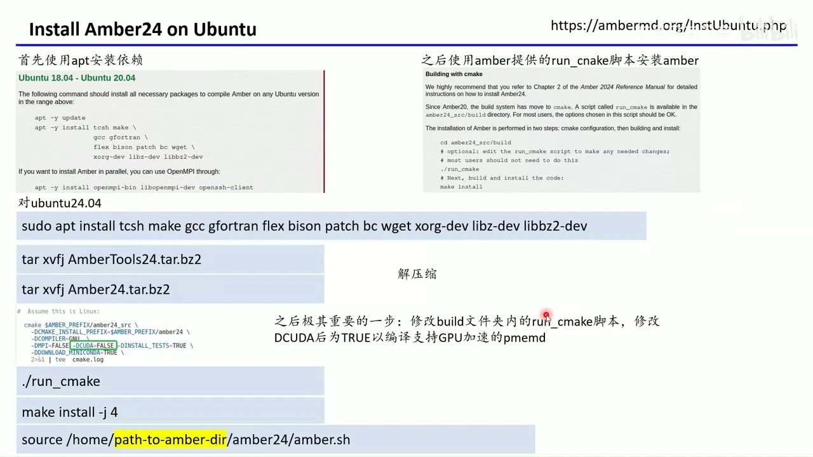
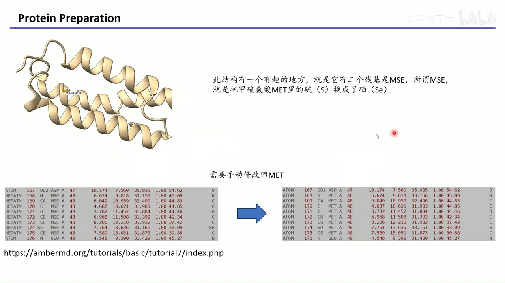
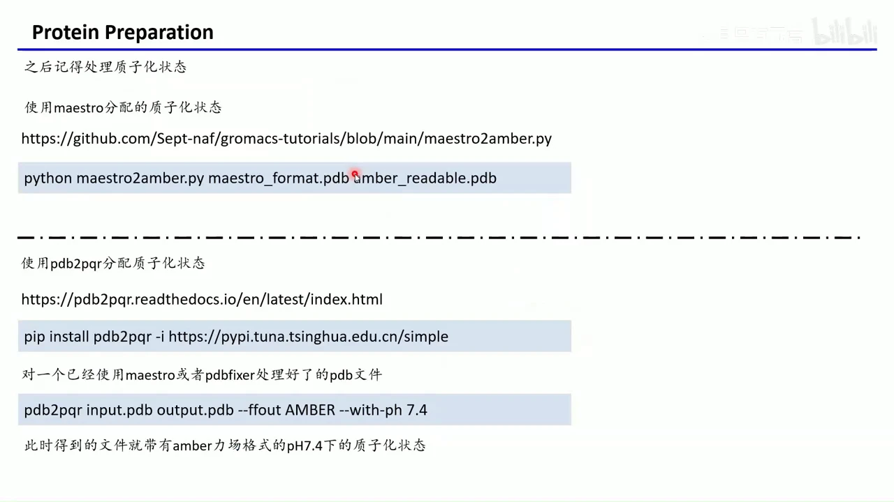
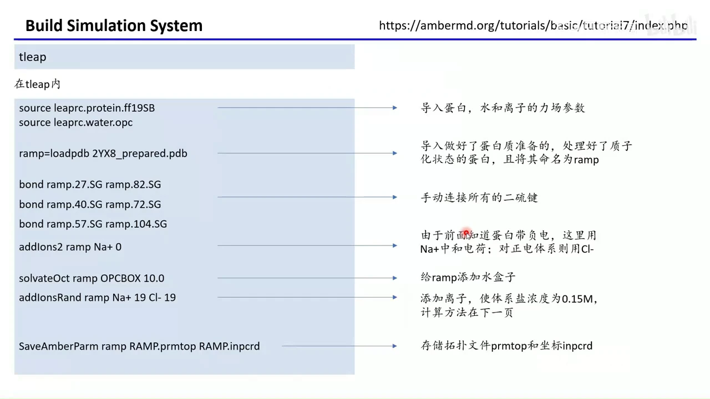
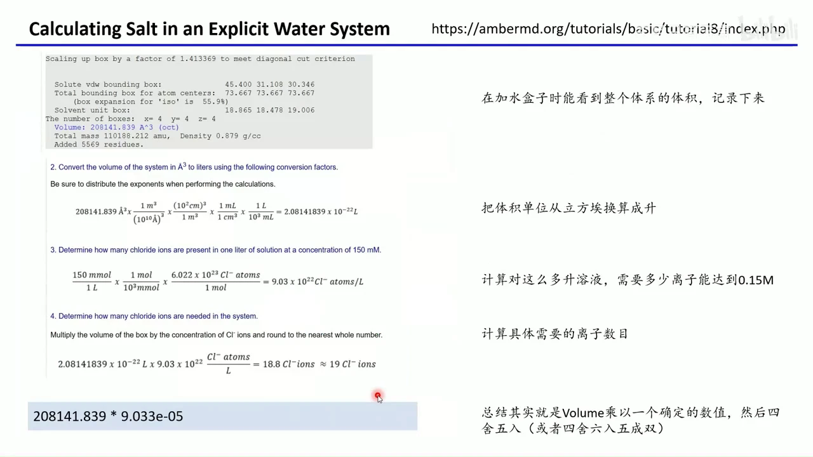
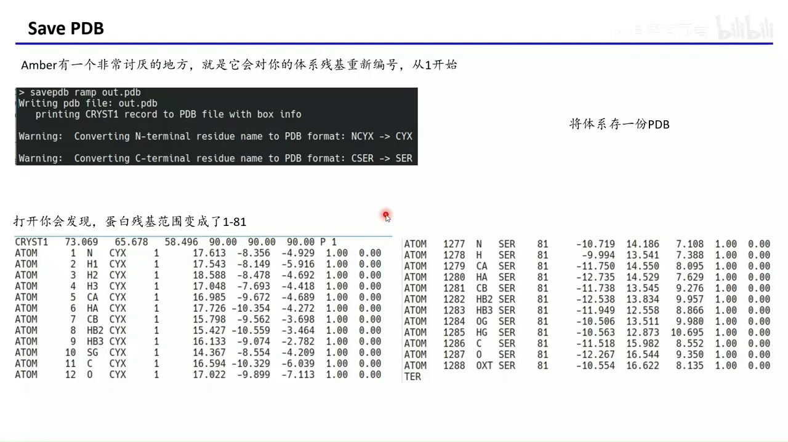
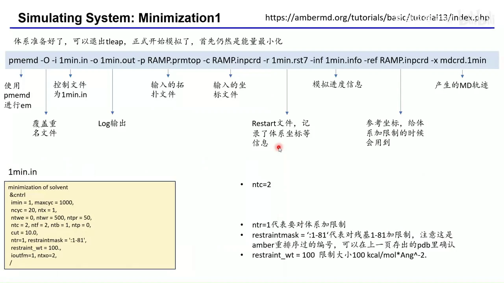
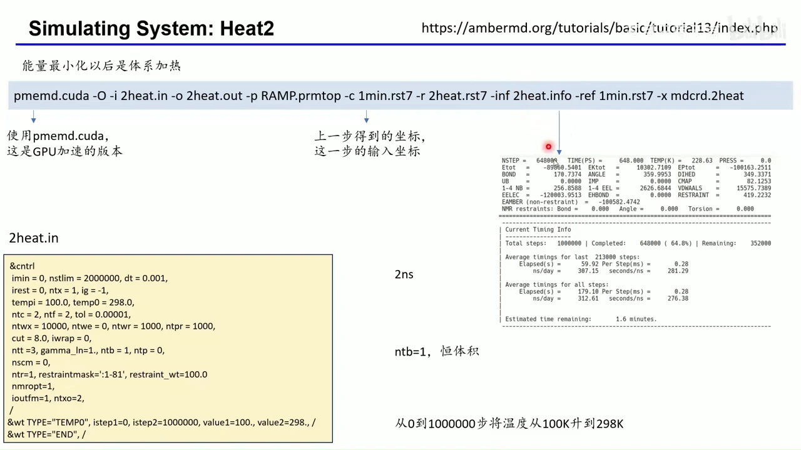
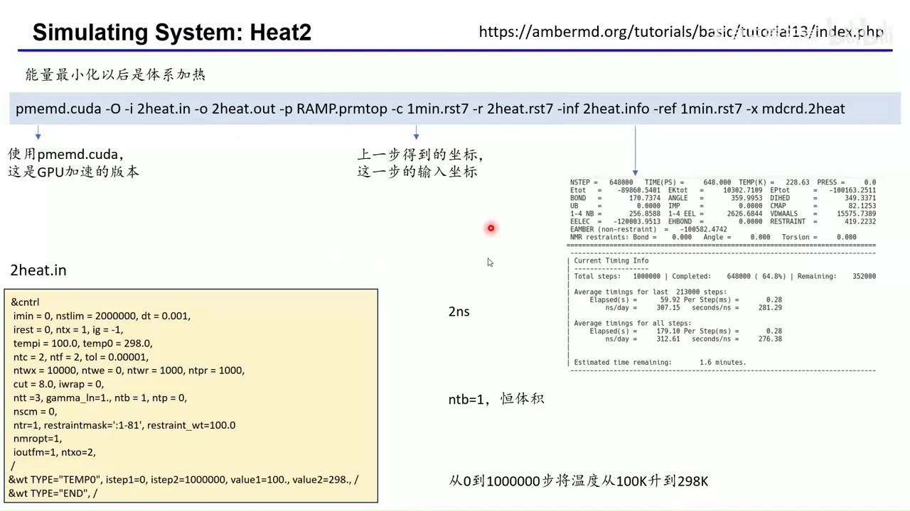
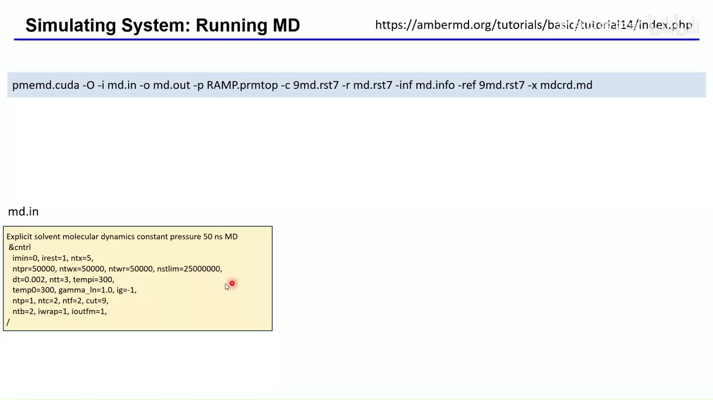

# GROMACS 入门 08：换用 AMBER 跑同一套蛋白质模拟

## 本讲要解决的核心问题（SCQA）

**背景**：前几集已经用 GROMACS 走完了蛋白质模拟的完整链路——准备结构、生成拓扑、能量最小化、加热、平衡、生产模拟。读者对“先准备、再建体系、最后分阶段跑”的骨架已经熟悉。

**冲突**：AMBER 是生物体系分子动力学模拟的另一大软件。它过去因为收费而普及率不如 GROMACS，但从 2024 年的某一天开始对学术用户免费。于是同一个蛋白、同一套物理模型，完全可以用另一套工具再跑一遍；麻烦在于命令、文件格式和默认流程几乎全变了。

**疑问**：换用 AMBER 时，哪些步骤可以照搬经验，哪些必须重学？同一套蛋白怎样才能跑出可比的模拟？

**回答（中心思想）**：流程骨架不变，变的只是“谁来做”。GROMACS 的 `pdb2gmx → grompp → mdrun`，在 AMBER 里对应“PDB 预处理 → `tleap` → `pmemd`”。只要守住四条底线——**残基与质子化正确、净电荷中和、二硫键显式连接、力场与水模型匹配**——同一套蛋白就能顺利迁移。

[【跳转到 00:00】](https://www.bilibili.com/video/BV1iMocY1Eef/?t=0)

## 一、AMBER 与 GROMACS 解决同一个问题，差别在生态与许可

**结论：两者不是两种模拟，而是同一套牛顿力学的两套工程实现；真正的迁移成本在文件格式和工具链。**

1. **定位相同**：AMBER 是生物体系动力学模拟的两大软件之一，另一个就是 GROMACS。二者都在解同一组运动方程，差别主要在力场生态、输入组织方式和性能实现。
2. **许可曾是分水岭**：AMBER 长期收费，所以普及率不如 GROMACS；从 2024 年起学术用户免费，非商业用户填姓名和机构即可下载，商业用户仍需购买 license。这是本集值得单独讲一遍的前提。[【跳转到 00:10】](https://www.bilibili.com/video/BV1iMocY1Eef/?t=10)
3. **概念可以一对一映射**：把两套工具放在同一张表里，迁移时就不会迷路。

| 环节 | GROMACS | AMBER |
| --- | --- | --- |
| 结构预处理 | `pdb2gmx` 等 | PDB 修复 + 质子化 + `tleap` |
| 拓扑与坐标 | `.top` + `.gro` | `.prmtop` + `.inpcrd` |
| 运行控制 | `.mdp` | `.in` 中的 `&cntrl` 段 |
| 运行程序 | `grompp` + `mdrun` | `pmemd` / `pmemd.cuda` |
| 轨迹 | `.xtc` / `.trr` | `mdcrd` |
| 轨迹分析 | `gmx` 系列工具 | `cpptraj` |

4. **学习路径不同**：GROMACS 把很多步骤拆成独立命令，AMBER 更倾向用一个 `tleap` 会话把力场、连接关系、溶剂和离子一次配齐。理解这一点，后面的命令就不会显得零散。

## 二、安装 AMBER24：学术免费，但必须手动打开 CUDA 开关

**结论：AMBER 的安装不复杂，最容易踩的坑是默认编译出一个不支持 GPU 的版本。**

1. **下载两个包**：进入 `ambermd.org/GetAmber.php`，非商业用户填写姓名与机构后，分别下载 `AmberTools24` 和 `Amber24`。前者是工具集，后者是主程序，两者缺一不可。[【跳转到 00:35】](https://www.bilibili.com/video/BV1iMocY1Eef/?t=35)
2. **先装依赖、再解压**：Ubuntu 上用 `apt` 安装编译依赖；把两个压缩包解压到同一个目录（幻灯片里进入的是 `amber24_src/build`）。官方文档对每个操作系统都有对应教程，照做即可。[【跳转到 01:22】](https://www.bilibili.com/video/BV1iMocY1Eef/?t=82)
3. **改 `run_cmake` 是全场最关键的一步**：脚本里的 `CUDA` 默认是 `FALSE`，直接编译只能得到 CPU 版。做分子动力学当然要 GPU 加速，所以把它改成 `TRUE`，才能编译出 `pmemd.cuda`。[【跳转到 01:47】](https://www.bilibili.com/video/BV1iMocY1Eef/?t=107)
4. **编译只差两条命令**：依次执行 `./run_cmake`、`make install -j 4`。绝大多数情况下会顺利装好；报错时可以把错误信息拿去搜索或贴给大语言模型，也可以发在评论区。[【跳转到 02:12】](https://www.bilibili.com/video/BV1iMocY1Eef/?t=132)
5. **别忘了 `source`**：安装后要 `source .../amber24/amber.sh` 才能使用命令；把这一行加进 `~/.bashrc`，就不必每次开机重新输入。这个文件和 GROMACS 的 `GMXRC` 是同一类东西。[【跳转到 03:02】](https://www.bilibili.com/video/BV1iMocY1Eef/?t=182)



安装完成后，官方还提供了非常丰富的教程和文档。与本次模拟最相关的是 tutorial 7（搭建体系）、tutorial 13（能量最小化与平衡）和 tutorial 14（生产模拟）。[【跳转到 03:42】](https://www.bilibili.com/video/BV1iMocY1Eef/?t=222)

## 三、蛋白质预处理：先把 MSE 改回 MET，再定质子化与净电荷

**结论：AMBER 对残基名和原子名比 GROMACS 更“挑剔”，预处理阶段必须把非生理修饰改回标准残基，并明确质子化状态。**

1. **选一个真实体系**：本集沿用官方 tutorial 7 的 2YX8 蛋白，共 81 个残基，含三对二硫键。选它不是因为特殊，而是因为它刚好覆盖了预处理里最典型的几个坑。[【跳转到 04:32】](https://www.bilibili.com/video/BV1iMocY1Eef/?t=272)
2. **MSE 必须改回 MET**：晶体结构里有两个 MSE（硒代甲硫氨酸）——甲硫氨酸的硫原子（S）被替换成了硒原子（Se），这是解结构时故意引入的“重原子”，用来做相位参考，生理条件下并不存在。手工把残基名 `MSE` 改成 `MET`、原子名 `SE` 改成 `SD`、记录从 `HETATM` 改回 `ATOM`，才是力场认识的标准甲硫氨酸。[【跳转到 04:46】](https://www.bilibili.com/video/BV1iMocY1Eef/?t=286)
3. **蛋白修复二选一**：有 Maestro 就用 Maestro 的蛋白准备流程；没有就用 PDBFixer 补缺失原子、补残基。AMBER 官方教程里对应的工具是 `pdb4amber`，作用相同——把实验结构整理成力场可读的形式。[【跳转到 05:41】](https://www.bilibili.com/video/BV1iMocY1Eef/?t=341)
4. **质子化状态单独处理**：用 `maestro2amber.py` 把 Maestro 分配的质子化状态转成 AMBER 可读的 PDB；或者用 `pdb2pqr --ffout AMBER --with-ph 7.4` 按 pH 7.4 重新分配。组氨酸、天冬氨酸、谷氨酸、半胱氨酸的质子化不同，残基名就必须跟着改，否则 `tleap` 会找不到参数。[【跳转到 06:18】](https://www.bilibili.com/video/BV1iMocY1Eef/?t=378)
5. **记下净电荷**：准备完蛋白后要确认它带多少电（视频示例为 −3）。这个数字后面用来决定加多少反离子，忘了就得回头重查。





## 四、tleap 搭建体系：一条命令流同时解决力场、二硫键、电荷、水和盐

**结论：`tleap` 是 AMBER 的“建体系总台”，它把 PDB、力场库和参数文件组装成模拟所需的拓扑与坐标。**

1. **先理解它在做什么**：`tleap` 读取结构文件（PDB）、残基库和参数库，补齐原子类型、电荷、键连关系，最后输出 `prmtop`（拓扑）和 `inpcrd`（坐标）。可以把它想成 GROMACS 里 `pdb2gmx + editconf + solvate + genion` 的合体。[【跳转到 06:40】](https://www.bilibili.com/video/BV1iMocY1Eef/?t=400)
2. **选力场和水模型**：蛋白用 `ff19SB`，水用 OPC。视频作者指出，`ff19SB` 含 CMAP 项，只有 AMBER 支持；GROMACS 最高只能用到 `ff14SB`。水也与 GROMACS 常用的 TIP3P 不同，这里为与官方教程一致改用 OPC。普通可溶蛋白下两者性能差别不大。[【跳转到 07:36】](https://www.bilibili.com/video/BV1iMocY1Eef/?t=456)
3. **载入结构并手动连二硫键**：`ramp = loadpdb 2YX8_prepared.pdb` 把处理好的蛋白读进来并命名为 `ramp`。AMBER 不会自动判断二硫键，必须用 `bond` 显式连接三个 SG–SG 对：27–82、40–72、57–104。不知道哪几对成键时，就在可视化软件里把所有半胱氨酸显示出来逐个确认。[【跳转到 08:51】](https://www.bilibili.com/video/BV1iMocY1Eef/?t=531)
4. **先中和、再加盐、最后存盘**：`addIons2 ramp Na+ 0` 用钠离子把负电中和到总电荷为零；`solvateOct ramp OPCBOX 10.0` 加八面体水盒，溶质到盒边最短距离 10 Å；`addIonsRand ramp Na+ 19 Cl- 19` 再加入 19 对钠氯离子，把盐浓度做到 0.15 mol/L；`SaveAmberParm` 输出 `RAMP.prmtop` 与 `RAMP.inpcrd`。[【跳转到 09:27】](https://www.bilibili.com/video/BV1iMocY1Eef/?t=567)
5. **为什么用八面体盒子**：与立方体盒子相比，八面体在同样溶质—盒边距离下所需的水更少，体系更小，模拟更快。这是官方教程的选择，也是常规可溶蛋白的常用做法。[【跳转到 09:32】](https://www.bilibili.com/video/BV1iMocY1Eef/?t=572)



## 五、盐浓度不是拍脑袋：用盒子体积算出 19 个离子

**结论：0.15 mol/L 的盐不是“看着加”，而是由水盒体积乘以一个固定系数得到，再四舍五入。**

1. **从 `solvateOct` 的输出里抄体积**：加水盒时程序会打印体系体积，本例是 208141.839 ų。这个数字是后面所有计算的起点。[【跳转到 10:52】](https://www.bilibili.com/video/BV1iMocY1Eef/?t=652)
2. **把 ų 换算成升**：1 Å = 10⁻¹⁰ m，所以 1 ų = 10⁻²⁷ L。208141.839 ų 约等于 2.0814 × 10⁻²² L。
3. **算出每升需要多少离子**：150 mmol/L 即 0.15 mol/L，乘以阿伏伽德罗常数 6.022 × 10²³，得到约 9.03 × 10²² 个离子/L。
4. **体积乘浓度**：2.0814 × 10⁻²² L × 9.03 × 10²² 个/L ≈ 18.8 个，取整为 19。实际使用时可以记成一条快捷公式：**离子数 ≈ 盒子体积（ų）× 9.033 × 10⁻⁵**，再四舍五入（四舍六入五成双也可以）。[【跳转到 11:13】](https://www.bilibili.com/video/BV1iMocY1Eef/?t=673)
5. **中和与加盐是两件事**：前面的 `addIons2` 负责把蛋白净电荷补到零，这里的 19 对离子负责把盐浓度做到 0.15 mol/L。两步不要合并，也不要用加盐的数目去“顺便”中和。[【跳转到 11:51】](https://www.bilibili.com/video/BV1iMocY1Eef/?t=711)



## 六、建模后先自检：`charge`、`desc`、`check` 三关，还要记住残基被重编号

**结论：存盘前花一分钟自检，能避免把“看起来正常、实际上缺参数”的体系带进模拟。**

1. **`charge ramp` 查总电荷**：输出 `Total unperturbed charge: 0.000000`，说明中和成功。若不为零，说明反离子数目或质子化状态有问题。[【跳转到 12:32】](https://www.bilibili.com/video/BV1iMocY1Eef/?t=752)
2. **`desc ramp.27.SG` 查局部连接**：输出显示 27 号残基的 SG 同时连着本残基的 CB 和 82 号残基的 SG，说明这根二硫键确实建上了。三根键都可以这样逐个核对。
3. **`check ramp` 查力场完整性**：程序会检查键、角、二面角参数是否齐全，最后给出 `Unit is OK`。中间出现“原子靠得太近”之类的 warning 很常见，不影响继续；关键是不要出现 missing parameter。
4. **残基编号会被重排**：AMBER 会把体系残基从 1 开始重新编号（原始 PDB 可能从 20 开始），所以后面 `.in` 文件里的 `restraintmask` 必须用新编号。`savepdb ramp out.pdb` 存一份 PDB，打开确认范围是 1–81，就不会选错限制对象。[【跳转到 13:17】](https://www.bilibili.com/video/BV1iMocY1Eef/?t=797)



## 七、能量最小化：一行 `pmemd` 命令，九个参数各管一件事

**结论：AMBER 的运行命令看起来很长，但每个参数都只对应一个明确的输入或输出；理解一次就能套用到后续所有阶段。**

以最小化为例：

```bash
pmemd -O -i 1min.in -o 1min.out -p RAMP.prmtop -c RAMP.inpcrd \
      -r 1min.rst7 -inf 1min.info -ref RAMP.inpcrd -x mdcrd.1min
```

1. **输入输出配对**：`-O` 允许覆盖旧文件；`-i` 是控制文件；`-o` 是日志；`-p` 是拓扑；`-c` 是起始坐标；`-r` 是重启文件；`-inf` 记录进度；`-ref` 提供限制所需的参考坐标；`-x` 是轨迹。[【跳转到 14:48】](https://www.bilibili.com/video/BV1iMocY1Eef/?t=888)
2. **控制文件决定“做什么”**：`imin = 1` 表示做能量最小化，`maxcyc = 1000` 是最大步数，`ncyc = 20` 是前 20 步用最速下降、之后切共轭梯度；`ntb = 1`、`ntp = 0` 表示恒体积、不做压浴。[【跳转到 15:38】](https://www.bilibili.com/video/BV1iMocY1Eef/?t=938)
3. **约束让蛋白别乱跑**：`ntr = 1` 打开位置限制，`restraintmask = ':1-81'` 选中全部 81 个残基，`restraint_wt = 100` 是 100 kcal/mol/Ų 的力常数。注意这里的编号是 AMBER 重排后的编号。[【跳转到 16:03】](https://www.bilibili.com/video/BV1iMocY1Eef/?t=963)
4. **`ntc = 2` 约束含氢键长**：用 SHAKE 固定与氢原子相连的键，允许更大的时间步长，这是 MD 里的常规操作。
5. **GPU 报错就退回 `sander`**：`pmemd.cuda` 做能量最小化偶尔会出问题，把命令开头的 `pmemd.cuda` 换成 `sander` 再试即可；后续加热和平衡再切回 GPU 版。[【跳转到 14:23】](https://www.bilibili.com/video/BV1iMocY1Eef/?t=863)



## 八、加热用 NVT，平衡用 NPT，限制力按 100→10→1→0.1→0 逐级放松

**结论：AMBER 官方教程的平衡阶段比常见 GROMACS 流程更“慢工出细活”，核心是让约束一点点松开，避免结构突变。**

1. **加热是 2 ns 的 NVT**：`2heat.in` 里 `imin = 0`、`nstlim = 2000000`、`dt = 0.001`，即 2 ns；`tempi = 100`、`temp0 = 298`，从 100 K 升到 298 K；`ntb = 1`、`ntp = 0` 对应恒体积 NVT；`ntt = 3` 是 Langevin 热浴。[【跳转到 16:28】](https://www.bilibili.com/video/BV1iMocY1Eef/?t=988)
2. **升温只发生在第一段**：`&wt TYPE='TEMPO'` 把第 0 到第 1,000,000 步的温度从 100 K 线性拉到 298 K，剩下 1 ns 保持在 298 K。也就是说“2 ns 加热”里，前 1 ns 升温、后 1 ns 恒温。[【跳转到 17:43】](https://www.bilibili.com/video/BV1iMocY1Eef/?t=1063)
3. **NPT 平衡的关键开关**：`ntb = 2` 表示恒压，`ntp = 1` 表示各向同性压浴，`barostat = 2` 是蒙特卡洛压浴。普通可溶蛋白用各向同性即可；膜蛋白则要考虑半各向异性或表面张力。[【跳转到 18:08】](https://www.bilibili.com/video/BV1iMocY1Eef/?t=1088)
4. **限制力阶梯**：先用 100 约束全部蛋白原子，再降到 10；随后把 `restraintmask` 改成 `'@CA,N,C'`，只约束主链，力常数从 10 降到 1、再降到 0.1；最后不加约束跑一段短平衡。每一阶段约 1 ns。[【跳转到 19:48】](https://www.bilibili.com/video/BV1iMocY1Eef/?t=1188)
5. **与 GROMACS 的差别只是“粗细”**：视频作者坦言，自己做 GROMACS 时通常一套同样大小的限制力用到底，问题也不大；AMBER 教程这套逐级放松更细致、更稳，但步骤更多。两种做法都不是错，差别在谨慎程度。[【跳转到 19:23】](https://www.bilibili.com/video/BV1iMocY1Eef/?t=1163)





## 九、生产模拟产出 50 ns 轨迹，结果分析从这条轨迹开始

**结论：平衡完成后，去掉所有限制跑生产模拟；之后的全部分析对象都是这条生产轨迹，而不是平衡阶段的轨迹。**

1. **生产参数**：`md.in` 里 `imin = 0`、`nstlim = 25000000`、`dt = 0.002`，即 25,000,000 × 2 fs = 50 ns；`ntp = 1`、`ntb = 2` 保持恒压；`ntt = 3`、`temp0 = 300` 控制温度；`cut = 9.0` 是截断半径。[【跳转到 21:03】](https://www.bilibili.com/video/BV1iMocY1Eef/?t=1263)
2. **不再有 `ntr`**：生产阶段删掉了位置限制，蛋白可以自由运动，这才是真正的动力学采样。
3. **命令只换输入输出**：`pmemd.cuda -O -i md.in -o md.out -p RAMP.prmtop -c 9md.rst7 -r md.rst7 -inf md.info -ref 9md.rst7 -x mdcrd.md`。`-c` 接上一步平衡的 restart，`-x` 输出生产轨迹。
4. **分析对象是 `mdcrd.md`**：RMSD、RMSF、回旋半径、氢键等都应基于这条轨迹。视频没有展开分析命令；在 AMBER 生态里对应的工具是 `cpptraj`，它读取 `prmtop` 加轨迹，角色相当于 GROMACS 的 `gmx` 分析工具。[【跳转到 21:28】](https://www.bilibili.com/video/BV1iMocY1Eef/?t=1288)
5. **长模拟要善用 restart**：`-r` 和 `-inf` 记录检查点与进度，任务中断后可以从检查点续跑，不必从头开始。



## 十、膜蛋白不必从零搭：Charmm-GUI 直接导出 AMBER 输入

**结论：膜蛋白的物理流程与可溶蛋白相同，但“把蛋白放进膜里”这一步更适合交给 Charmm-GUI。**

1. **难点在体系搭建，不在模拟本身**：膜蛋白需要确定取向、嵌入脂双层、加膜两侧的水和离子。手工做既繁琐又容易出错。
2. **Charmm-GUI 可以直接选 AMBER**：在力场选项里选 AMBER、`FF14SB`，再选脂质、水和配体的参数；Input Generation 勾选 AMBER，就能生成 AMBER 格式的拓扑、坐标和输入文件。温度、NPT 系综等也在界面上设置。[【跳转到 21:53】](https://www.bilibili.com/video/BV1iMocY1Eef/?t=1313)
3. **生成之后仍然用 `pmemd` 跑**：Charmm-GUI 只负责“搭”，能量最小化、平衡、生产模拟依旧由 AMBER 完成。这与可溶蛋白的差别只是体系里多了膜。
4. **作者的做法**：本集作者说膜蛋白体系“统统是用 Charmm-GUI 来做的”，不会用的话可以回看系列第七集。

## 小结

- **流程同构**：GROMACS 与 AMBER 都在做同一件事，迁移时抓住“预处理 → 建体系 → 最小化 → 加热 → 平衡 → 生产 → 分析”这条主线即可。
- **AMBER 的门槛在细节**：残基名、原子名、质子化状态、二硫键、净电荷，任何一项不对，`tleap` 或 `pmemd` 都会立刻报错。
- **`tleap` 是建体系核心**：力场（`ff19SB` + OPC）、`loadpdb`、`bond`、`addIons2`、`solvateOct`、`addIonsRand`、`SaveAmberParm` 一次完成。
- **盐浓度可计算**：盒子体积（ų）× 9.033 × 10⁻⁵，四舍五入即得离子数；本例 208141.839 ų 对应 19 对离子。
- **约束要逐级放松**：100 → 10 → 主链 10 → 主链 1 → 主链 0.1 → 无约束，比“一套力用到底”更稳。
- **生产模拟才是成品**：50 ns、2 fs 步长、恒压、无限制；后续分析都基于这条轨迹。

## 关键术语速查

| 术语 | 一句话解释 |
| --- | --- |
| AMBER | 生物体系分子动力学模拟的主流软件套件，2024 年起对学术用户免费。 |
| AmberTools | AMBER 的工具集，含 `tleap`、`cpptraj`、`pdb4amber` 等。 |
| `tleap` | AMBER 的建体系工具，把 PDB 与力场库组装成拓扑和坐标。 |
| `pdb4amber` | 把实验 PDB 整理成 AMBER 可读格式的预处理工具。 |
| `pmemd` / `pmemd.cuda` | AMBER 的动力学引擎，后者为 GPU 加速版。 |
| `sander` | AMBER 的经典引擎，GPU 版报错时可作为退路。 |
| `ff19SB` | AMBER 的蛋白质力场，含 CMAP 修正项。 |
| CMAP | 对主链二面角的交叉修正项，视频称 GROMACS 不支持。 |
| OPC | 本集使用的显式水模型，GROMACS 流程里常用 TIP3P。 |
| MSE | 硒代甲硫氨酸，结构解析用的重原子修饰，模拟前要改回 MET。 |
| `prmtop` | AMBER 拓扑文件，记录原子类型、电荷、键连与参数。 |
| `inpcrd` | AMBER 坐标文件，记录体系所有原子的初始位置。 |
| `mdin` / `.in` | AMBER 的控制文件，用 `&cntrl` 段描述模拟参数。 |
| `imin = 1` | 表示执行能量最小化；`imin = 0` 表示做动力学。 |
| `ntb` | 边界条件开关：`1` 恒体积，`2` 恒压。 |
| NVT / NPT | 恒体积恒温 / 恒压恒温系综。 |
| `igb` | 隐式溶剂（广义 Born）开关；本集用显式水，未启用。 |
| `cut` | 非键相互作用的截断半径，单位 Å。 |
| SHAKE / `ntc = 2` | 约束含氢键长，允许使用更大的时间步长。 |
| `ntr` / `restraintmask` | 打开位置限制并指定受限原子，`restraint_wt` 是力常数。 |
| `cpptraj` | AMBER 的轨迹分析工具，读取 `prmtop` 与轨迹文件。 |
| Charmm-GUI | 在线体系搭建工具，可为膜蛋白生成 AMBER 格式输入。 |
