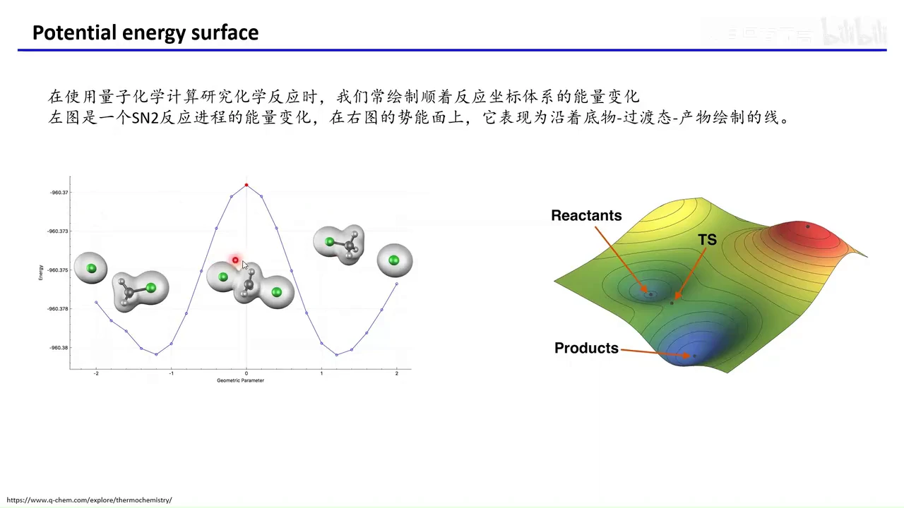
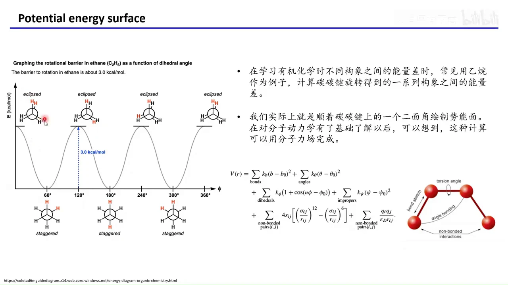
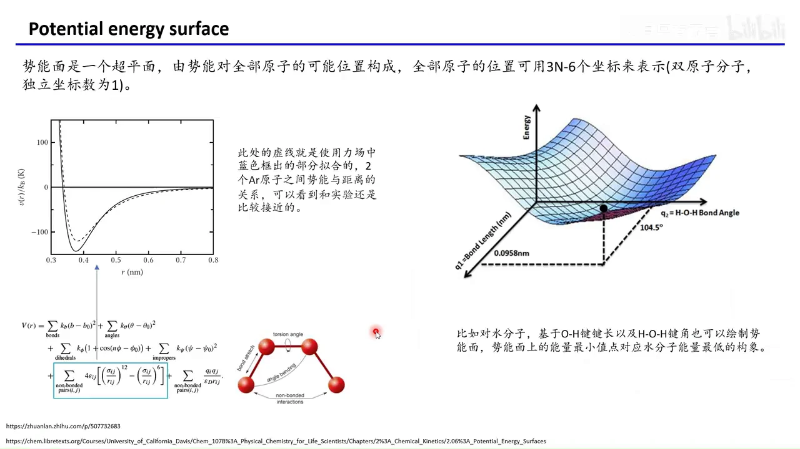
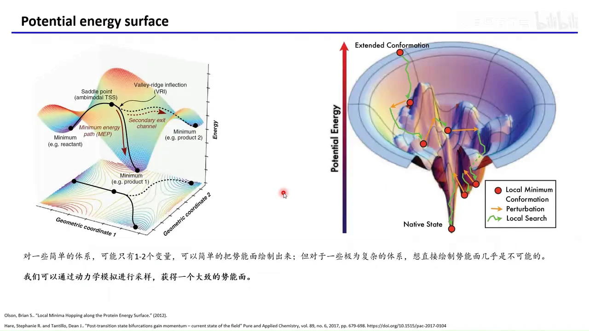
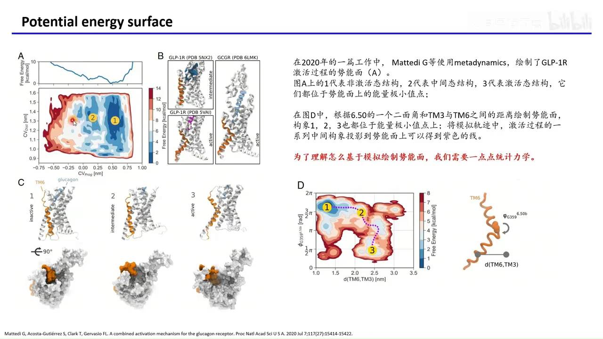
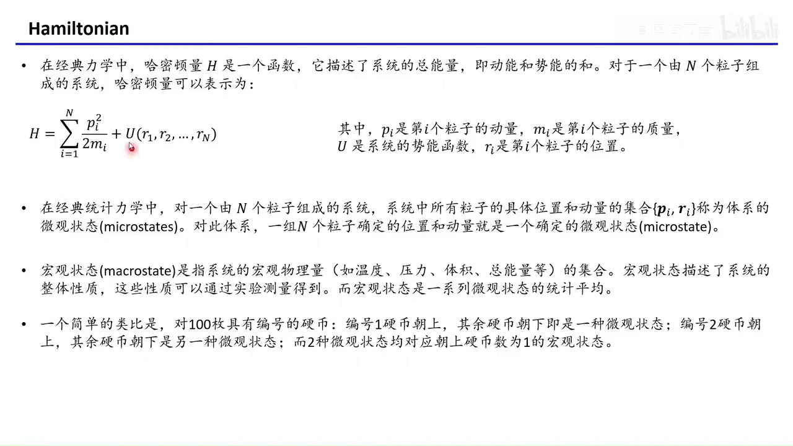
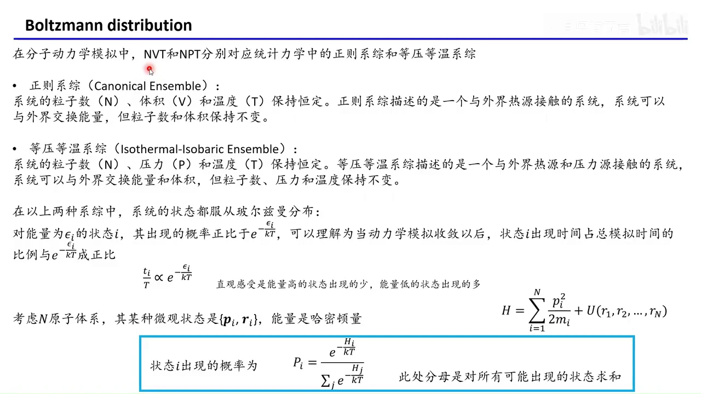
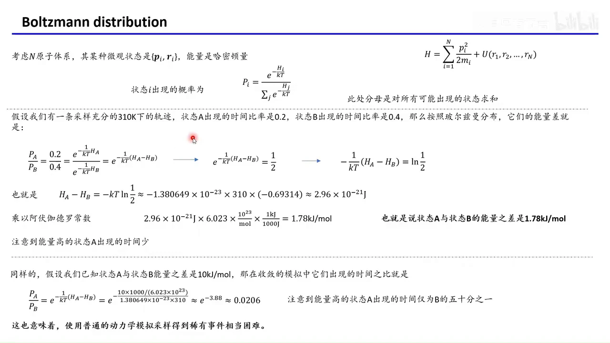
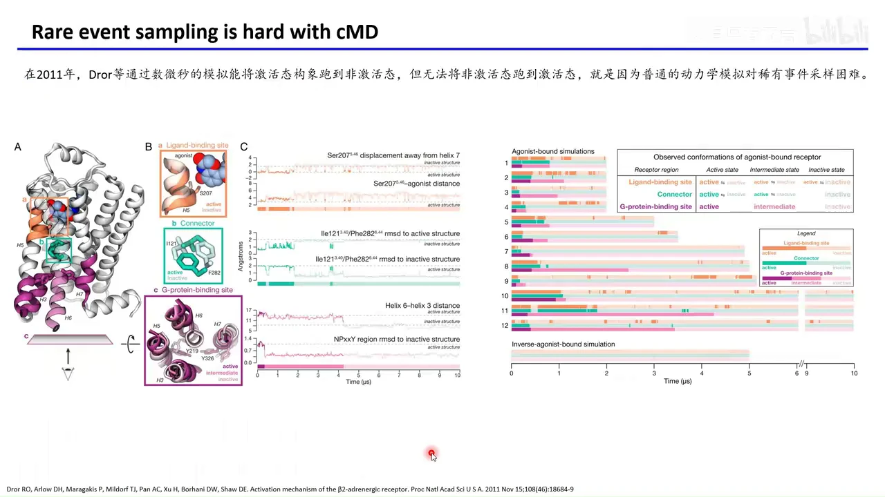
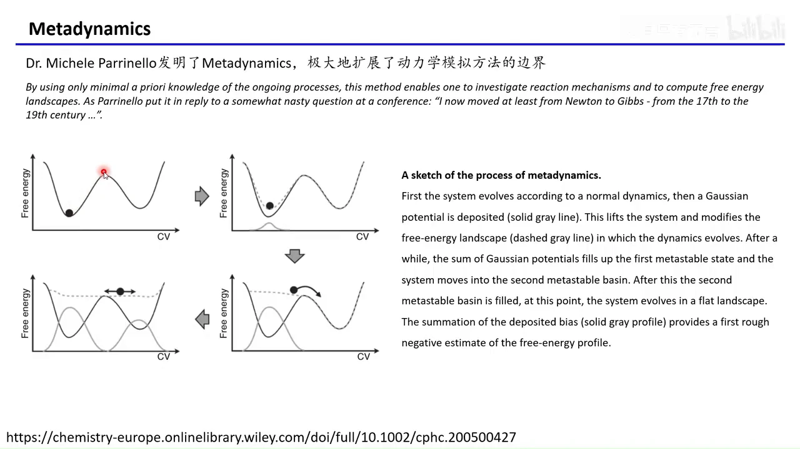

# GROMACS 入门 09：势能面、玻尔兹曼分布与增强采样的动机

## 本讲要解决的核心问题（SCQA）

**背景**：前八讲里，你已经能让蛋白在水里跑起来，会看轨迹、算 RMSD、数氢键。你知道分子动力学（MD）是一帧一帧地积分牛顿方程，得到构象随时间的变化。

**冲突**：但一条轨迹只是一次"历险记录"。跑了 1 微秒，蛋白可能还在起始构象附近抖动；你想问"另一个构象比它高多少能量""它是怎么变过去的"，普通 MD 往往答不上来——因为它压根没去过那里。

**疑问**：构象和能量之间到底是什么关系？为什么模拟总是困在一个"坑"里出不来？我们又凭什么从"某个构象出现了多久"算出能量差？

**回答（中心思想）**：把全部构象和它们的能量画成一张"地形图"，就是**势能面**；在恒温系综里，构象出现的概率服从**玻尔兹曼分布**，能量越低出现得越多。于是"跑了多久"可以翻译成"自由能差多少"。而跨越势垒是稀有事件，概率随势垒高度指数衰减，这正是普通 MD 采样不全的根源，也是**元动力学（Metadynamics）**等增强采样方法要解决的问题。

---

## 一、势能面把"构象"变成一张能量地形图

**势能面（Potential Energy Surface, PES）就是"每个可能的构象对应一个能量"所构成的高维曲面。** 把它画出来，是为了让"构象之间谁高谁低、怎么相连"一眼可见。

### 1.1 从化学反应曲线认识势能面

先用你最熟悉的量子化学图像入门。以 SN2 反应为例：体系从反应物出发，经过一个过渡态，最后变成产物。

- **反应物和产物**位于能量的**极小值点**——它们稳定，能待得住。
- **过渡态**位于能量曲线上最高的那个点，是"过去"必须翻过的山口。
- 反应物与过渡态之间的能量差，就是**活化能**（势垒高度）。

如果只沿一条反应路径画能量，得到的是二维曲线；把反应物、过渡态、产物放到一张三维能量曲面上，就得到了势能面的雏形。图中右下方那条沿"底物—过渡态—产物"画出的线，正是左图曲线在曲面上的投影。[【跳转到 00:32】](https://www.bilibili.com/video/BV18i5bzHEEC/?t=32)

**关键一句**：势能面上每一个点都代表体系的一个确定构象，不同构象有不同能量；画势能面的目的，就是把"构象"和"能量"的对应关系表现出来。[【跳转到 01:22】](https://www.bilibili.com/video/BV18i5bzHEEC/?t=82)

### 1.2 乙烷旋转：最简单的构象—能量关系

有机化学课上常见的乙烷（C₂H₆）例子，是理解"构象在势能面上运动"的最好模型。

沿碳碳单键旋转，两个碳上的氢会呈现不同的相对位置：

- **重叠式（eclipsed）**：氢与氢正面相对，空间位阻最大，能量最高。
- **交叉式（staggered）**：氢错开排列，位阻最小，能量最低。

把二面角从 0° 转到 360°，能量就形成一条周期曲线，相邻两个低点之间隔着约 **3.0 kcal/mol** 的势垒。也就是说，乙烷并不是"自由旋转"，而是一直在几个低点之间来回翻越小山包。

更重要的是：这种曲线不需要量子化学，用**分子力场**就能算。键长伸缩、键角弯曲、二面角扭转、非键相互作用（范德华与静电）逐项求和，就得到任一构象的势能。[【跳转到 02:42】](https://www.bilibili.com/video/BV18i5bzHEEC/?t=162)

既然乙烷能算，蛋白是不是也能算？能——但"算得出"和"画得出"是两回事，下一节就卡在这里。

---

## 二、小体系能画出势能面，大体系只能靠采样

**势能面在数学上是一个超曲面：由势能对全部原子可能位置的取值构成，位置可用 3N−6 个独立坐标表示（N 为原子数，双原子分子只剩 1 个）。** 维度一高，人眼就画不出来了。

### 2.1 两三个自由度：可以解析地画出来

- **两个氩原子**：只有一个变量——原子间距离 r。用 Lennard-Jones（LJ）势描述，得到一条先陡升、再出现一个低点、最后趋于 0 的曲线；虚线（力场拟合）与实验数据相当接近，因为力场参数本来就是对着实验拟合的。
- **一个水分子**：取 O—H 键长和 H—O—H 键角作为两个坐标，可以画出一张二维势能面。面上唯一的全局最低点位于键角 **104.5°**、键长 **0.0958 nm**，这就是水分子能量最低的构象；其他键长/键角组合的能量都更高。[【跳转到 03:57】](https://www.bilibili.com/video/BV18i5bzHEEC/?t=237)

### 2.2 上千个原子：维度爆炸，只能"采样"出局部地形

一个典型蛋白有上千个原子，坐标数就是数千维。**没有人能把这样的势能面完整画出来**，甚至谈不上"看全"。

但我们其实也不需要看全。以蛋白质折叠为例，我们关心的不是所有可能的构象，而是：

1. 最稳定的那几个构象（天然态等）；
2. 折叠过程中的**亚稳态**与**中间态**。

它们都对应势能面上的能量低点。真正要回答的问题是：这些低点之间差多少能量？它们之间又是怎么互相转化的？[【跳转到 05:12】](https://www.bilibili.com/video/BV18i5bzHEEC/?t=312)

**做法**：不去解析地画出全图，而是让动力学模拟在势能面上"走"，把走过的构象记录下来，再投影到两三个我们关心的坐标上，拼出一张近似的**自由能面（Free Energy Surface, FES）**。

下面这张 2020 年的工作就是范例：作者用元动力学研究 GLP-1R 受体的激活过程，图中 1、2、3 分别代表**非激活态、中间态、激活态**，三者都是势能面上的能量极小点；右图以"6.50 位点的二面角"和"TM3 与 TM6 之间的距离"为坐标画出自由能面，把轨迹里的中间构象投影上去，就得到一条 1→2→3 的紫色转化路径。[【跳转到 06:21】](https://www.bilibili.com/video/BV18i5bzHEEC/?t=381)

这里的两个坐标（二面角、距离）有一个专门的名字：**集合变量（Collective Variable, CV）**，也叫反应坐标。它是我们人为挑选的、能概括某段慢过程的少数几个自由度。选得好，自由能面才讲得通；这也是增强采样里最考验功力的一步。

---

## 三、要读懂采样，先分清微观状态与宏观状态

**MD 的一帧，就是一个微观状态；而实验测到的是宏观量。玻尔兹曼分布连接的正是这两层。**

### 3.1 哈密顿量：体系的总能量

经典力学中，**哈密顿量 H 是描述系统总能量的函数**，等于动能加势能：

$$H=\sum_{i=1}^{N}\frac{p_i^2}{2m_i}+U(r_1,r_2,\dots,r_N)$$

其中 $p_i$ 是第 i 个粒子的动量（质量×速度），$m_i$ 是质量，$U$ 是势能，$r_i$ 是第 i 个粒子的位置。

- 势能只是坐标的函数，质量是常数；
- 所以只要**所有粒子的位置和动量都确定**，体系的状态就确定了。

这组 $\{p_i, r_i\}$ 的集合，就叫**微观状态（microstate）**。在 MD 里，它就是轨迹文件中的一帧。[【跳转到 08:15】](https://www.bilibili.com/video/BV18i5bzHEEC/?t=495)

### 3.2 微观状态与宏观状态：100 枚硬币的类比

**宏观状态（macrostate）**是温度、压力、体积、总能量这些宏观物理量的集合，是实验能测到的整体性质；它是**大量微观状态的统计平均**。

100 枚编号硬币的类比很好用：

- "1 号硬币朝上、其余朝下"是一种微观状态；
- "2 号硬币朝上、其余朝下"是另一种微观状态；
- 但两者都对应"朝上的硬币数为 1"这同一个宏观状态。

宏观状态不关心"是哪一枚"，只关心"有几枚"。同理，MD 里我们往往不关心某一个具体构象的成败，而关心某类构象占了多少时间比例。[【跳转到 10:20】](https://www.bilibili.com/video/BV18i5bzHEEC/?t=620)

---

## 四、恒温系综里，低能构象出现得更多

**在 NVT 与 NPT 系综中，微观状态出现的概率正比于 $e^{-H_i/kT}$——这就是玻尔兹曼分布。**

### 4.1 NVT 与 NPT 对应哪两个系综

MD 里常用的两种平衡方式，在统计力学中各有一个名字：

| MD 系综 | 统计力学名称 | 固定的量 | 与外界交换 |
| --- | --- | --- | --- |
| NVT | 正则系综（Canonical） | 粒子数 N、体积 V、温度 T | 能量（与热源接触） |
| NPT | 等温等压系综（Isothermal-Isobaric） | 粒子数 N、压力 P、温度 T | 能量与体积（热源+压力源） |

两者都是"泡在热浴里"的体系，区别只在于 NPT 的体积可变。[【跳转到 11:15】](https://www.bilibili.com/video/BV18i5bzHEEC/?t=675)

### 4.2 玻尔兹曼分布：公式与直觉

对能量为 $H_i$ 的状态 i，其出现概率为：

$$P_i=\frac{e^{-H_i/kT}}{\sum_j e^{-H_j/kT}}$$

- **分子**是"这个状态的权重"：能量越低，指数越不负，权重越大。
- **分母**是"所有可能状态的权重之和"，作用是归一化，让所有概率加起来等于 1。
- $k$ 是玻尔兹曼常数（$1.380649\times10^{-23}$ J/K），$T$ 是绝对温度。

直观感受只有一句：**能量高的状态出现得少，能量低的状态出现得多。** 温度 T 在分母上，T 越高，指数差别被"抹平"，高能状态也有机会出现；T 越低，体系越"死守"低能构象。

相应地，一条收敛轨迹里，状态 i 出现的时间占总模拟时间的比例，也正比于 $e^{-H_i/kT}$。[【跳转到 11:40】](https://www.bilibili.com/video/BV18i5bzHEEC/?t=700)

### 4.3 一个容易被忽略的前提

统计力学的基本假设是：**孤立体系中，各个可及微观状态出现的概率相同**。既然相同，为什么这里会随能量变化？

原因是：**我们的体系不是孤立体系，而是与外界热源接触的恒温体系。** 能量可以在体系和热源之间交换，"等概率"被热浴改写成"按能量加权"。这一点视频特意强调，是为了避免你日后学统计力学时把两个前提混在一起。[【跳转到 12:16】](https://www.bilibili.com/video/BV18i5bzHEEC/?t=736)

---

## 五、把"出现概率"翻译成"自由能差"

**只要轨迹采样充分，两个状态的出现概率之比就能反推出它们的自由能差：$\Delta G=-kT\ln(P_A/P_B)$。**

### 5.1 从概率比到数值：一个完整的算例

假设 310 K 下有一条**采样充分**的轨迹，状态 A 出现的时间占 0.2，状态 B 占 0.4：

$$\frac{P_A}{P_B}=\frac{0.2}{0.4}=\frac{e^{-H_A/kT}}{e^{-H_B/kT}}=e^{-\frac{1}{kT}(H_A-H_B)}=\frac{1}{2}$$

两边取自然对数：

$$-\frac{1}{kT}(H_A-H_B)=\ln\frac{1}{2}\;\Longrightarrow\;H_A-H_B=-kT\ln\frac{1}{2}\approx 2.96\times10^{-21}\ \text{J}$$

再乘阿伏伽德罗常数换算成每摩尔：$2.96\times10^{-21}\times6.023\times10^{23}\approx1.78$ kJ/mol。

结论：**A 与 B 的能量差约 1.78 kJ/mol，且出现更少的 A 能量更高。** [【跳转到 17:11】](https://www.bilibili.com/video/BV18i5bzHEEC/?t=1031)

### 5.2 为什么不能直接用势能算，非要靠采样

这里的能量其实是**自由能**，不只是势能。自由能里除了"焓"的部分，还有**熵**的贡献：

- 势能可以由力场逐项算出，是坐标的确定函数；
- 熵衡量的是"同一能量下有多少种构象"，只能通过**采样**统计出来——你走了多少构象、在每个区域待了多久，才决定了熵。

所以，"能量差可以直接代公式算"是错觉：公式里的 $H_i$ 你写不出来（维度太高），能观测的只有"出现了多久"。这正是 MD 不可替代的地方。[【跳转到 19:19】](https://www.bilibili.com/video/BV18i5bzHEEC/?t=1159)

### 5.3 反过来算：10 kJ/mol 意味着什么

把问题反过来：若已知 A 比 B 高 10 kJ/mol，在收敛轨迹里它们的出现时间比是多少？

$$\frac{P_A}{P_B}=e^{-\frac{10000}{RT}}\approx e^{-3.88}\approx0.0206\approx\frac{1}{50}$$

也就是说，A 出现的时间只有 B 的五十分之一。10 kJ/mol 约合 2.4 kcal/mol，其实不算大——常见实验精度就在 1 kcal/mol 量级。可即便如此，跑 1000 ns 轨迹，A 也只能被采到几十纳秒；能量差再大一点，A 就几乎绝迹。[【跳转到 20:34】](https://www.bilibili.com/video/BV18i5bzHEEC/?t=1234)

### 5.4 "采样充分"到底怎么判断

同一套概率，只有轨迹**收敛**后才有意义。视频给了一个直观检验：

- 跑 1 微秒：得到 0.19 与 0.41，随机性很大；
- 加到 10 微秒：变成 0.20 与 0.40；
- 再加到 20 微秒：仍是 0.20 与 0.40。

数值稳定了，才叫收敛。问题是：普通 MD 要跑到这个程度，时间成本高得难以承受。[【跳转到 16:21】](https://www.bilibili.com/video/BV18i5bzHEEC/?t=981)

---

## 六、普通 MD 的困境：跨势垒是稀有事件

**普通 MD 之所以困在局部极小，是因为跨过势垒需要"碰巧"获得足够能量，而这个概率随势垒高度指数下降。**

把前面的结论串起来：

1. **构象被"坑"住了**：一个亚稳态对应势能面上的一个坑，四周是比自己高的势垒。
2. **跨坑靠涨落**：体系要沿某条路径翻过山口，才有机会进入另一个坑。势垒每高几 kJ/mol，概率就掉一个数量级。
3. **时间尺度被拉爆**：所以轨迹会在一个坑里反复抖动，另一个坑几乎采不到。

一个经典案例是 2011 年 Dror 等人对 β₂ 肾上腺素受体的研究：他们用当时最强的专用机器 Anton，跑了几十条 10 微秒量级的轨迹，能把**激活态跑到非激活态**，却始终无法从**非激活态跑到激活态**。原因就是后者要翻的势垒更高，属于典型的稀有事件。[【跳转到 22:08】](https://www.bilibili.com/video/BV18i5bzHEEC/?t=1328)

成本有多夸张？按视频里的估算：1 微秒大约要一张显卡跑 10 天，10 微秒就是 100 天；几十条这样的轨迹，计算量难以想象。

**普通 MD 对稀有事件的采样效率极低**——这不是代码写得不好，而是方法本身的性质。

---

## 七、元动力学：用偏置势把势能面"填平"

**增强采样的思路不是硬等，而是主动"垫高"已经去过的地方，把坑填平，让体系自己走向没去过的区域。元动力学（Metadynamics）就是最直观的一种。**

### 7.1 算法三步走

元动力学由 Michele Parrinello 提出，核心操作只有三步：

1. **正常跑一段动力学**：体系先在当前亚稳态里演化，记录它在集合变量（CV）上的位置。
2. **在去过的地方加一个小高斯"沙堆"**：在 CV 空间该位置叠加一个正的高斯偏置势，把这一小块地形的能量抬高。
3. **重复**：体系被"顶"出原来的坑，翻过势垒进入下一个亚稳态；继续加沙堆，直到整个自由能面被填平。

当所有坑都被填到同一高度，体系就能在整张面上自由移动，不再被困住。[【跳转到 24:36】](https://www.bilibili.com/video/BV18i5bzHEEC/?t=1476)

### 7.2 为什么填平之后能得到自由能面

**你往地上倒了多少沙，地原来就有多深。** 累计加入的偏置势，正好补偿了原来的自由能地形；因此把累计偏置取相反数，就得到自由能面（FES）的形状。

更妙的是，元动力学有一个明确的**收敛判据**：当偏置势不再明显增长、地形被填得差不多时，就说明采样充分了。这比"跑够 20 微秒再看看数值稳不稳"要实际得多。[【跳转到 25:26】](https://www.bilibili.com/video/BV18i5bzHEEC/?t=1526)

### 7.3 它解决了什么，又留下了什么

- **解决**：普通 MD 到不了的高势垒区域，元动力学能"抬"过去，从而采到原本采不到的构象，画出完整的自由能面。
- **前提**：你得先选对 CV。CV 选得不好，填平的方向就不是你想研究的慢过程。
- **代价**：偏置会改变动力学，得到的轨迹不再是严格的玻尔兹曼分布；需要用重加权等后处理还原真实概率。视频没有展开这些细节，只说明后续进阶课程会专门讲怎么在 GROMACS 里做元动力学。

---

## 小结

- **势能面**是"构象 → 能量"的高维地形图：极小点是稳定/亚稳态，鞍点是过渡态，两点高差是势垒。
- 小体系（双原子、水分子、乙烷）能解析地画出势能面；上千原子的蛋白有数千维，只能靠**采样**拼出投影到 CV 上的自由能面。
- **微观状态**是一组 $\{p_i,r_i\}$（MD 的一帧），**宏观状态**是温度、压力等可测量，后者是前者的统计平均。
- 恒温系综（NVT 正则、NPT 等温等压）中，状态出现概率服从**玻尔兹曼分布** $P_i\propto e^{-H_i/kT}$：低能构象更常见，温度越高差别越小。
- 采样收敛后，**概率比可以反推自由能差**：310 K 下 0.2 : 0.4 对应 1.78 kJ/mol；10 kJ/mol 的差距就会让高能态只剩 1/50 的时间。
- 势垒导致**稀有事件**：普通 MD 会长时间困在局部极小，跨势垒的概率随势垒高度指数衰减。
- **元动力学**通过不断叠加高斯偏置把已访问区域"垫高"，最终填平自由能面，并以偏置的相反数给出 FES，同时提供了收敛判据。

---

## 关键术语速查

| 术语 | 一句话解释 |
| --- | --- |
| 势能面（PES） | 由势能对全部原子可能位置的取值构成的超曲面，每个点对应一个构象 |
| 构象 | 同一分子在不破坏化学键的前提下，原子空间排布的一种具体方式 |
| 极小值 / 亚稳态 | 势能面上的"坑"，局部稳定、能停留一段时间的状态 |
| 过渡态 / 鞍点 | 连接两个极小点的能量最高点，是转化必经的"山口" |
| 势垒 / 活化能 | 过渡态与起点极小点之间的能量差，决定跨越的难易 |
| 集合变量（CV）/ 反应坐标 | 概括某段慢过程的少数几个自由度，如距离、二面角、RMSD |
| 自由能面（FES） | 自由能对 CV 的投影，低处为稳定态，颜色越冷能量越低 |
| 哈密顿量 H | 体系总能量，等于所有粒子动能之和加势能 U |
| 微观状态 | 一组确定的位置与动量 $\{p_i,r_i\}$，对应 MD 的一帧 |
| 宏观状态 | 温度、压力、体积等可测宏观量的集合，是微观状态的统计平均 |
| 正则系综（NVT） | 粒子数、体积、温度恒定，与热源交换能量的系综 |
| 等温等压系综（NPT） | 粒子数、压力、温度恒定，与热源、压力源交换能量与体积 |
| 玻尔兹曼分布 | $P_i\propto e^{-H_i/kT}$，能量越低的状态出现概率越大 |
| 玻尔兹曼常数 k | $1.380649\times10^{-23}$ J/K，把能量与温度联系起来的常数 |
| 采样充分 / 收敛 | 继续延长轨迹，状态出现比例不再明显变化 |
| 稀有事件 | 势垒高、发生概率极低的过程，如蛋白构象翻转、配体解离 |
| 增强采样 | 通过外加偏置或改变势能面，加速跨越势垒的一类方法的总称 |
| 元动力学（Metadynamics） | 不断在已访问区域叠加高斯偏置势、填平自由能面的增强采样方法 |
| 偏置势（Bias） | 人为加在势能面上的额外势能，用于把体系"推"出局部极小 |
