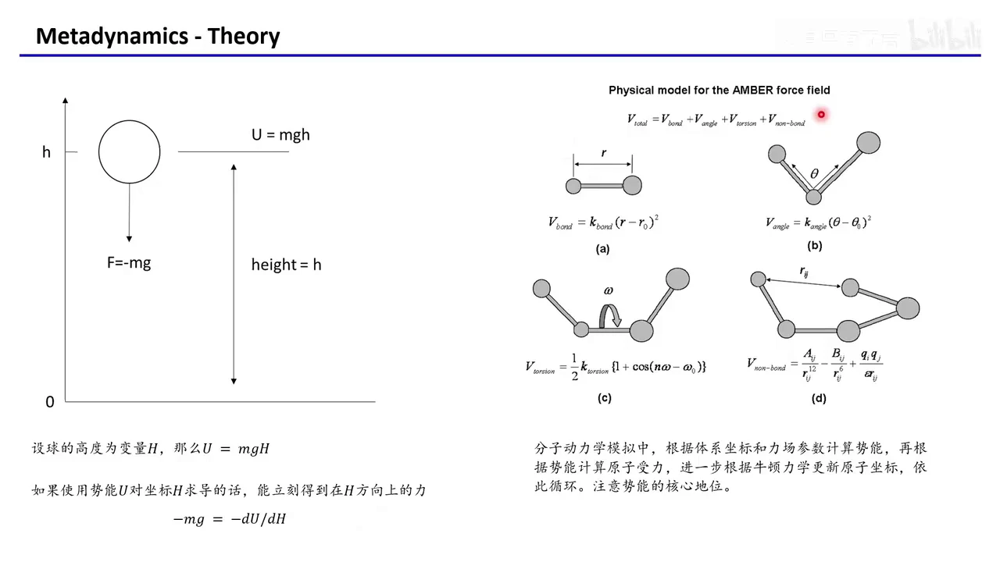
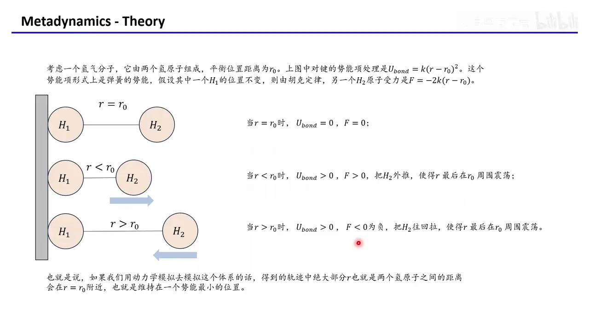
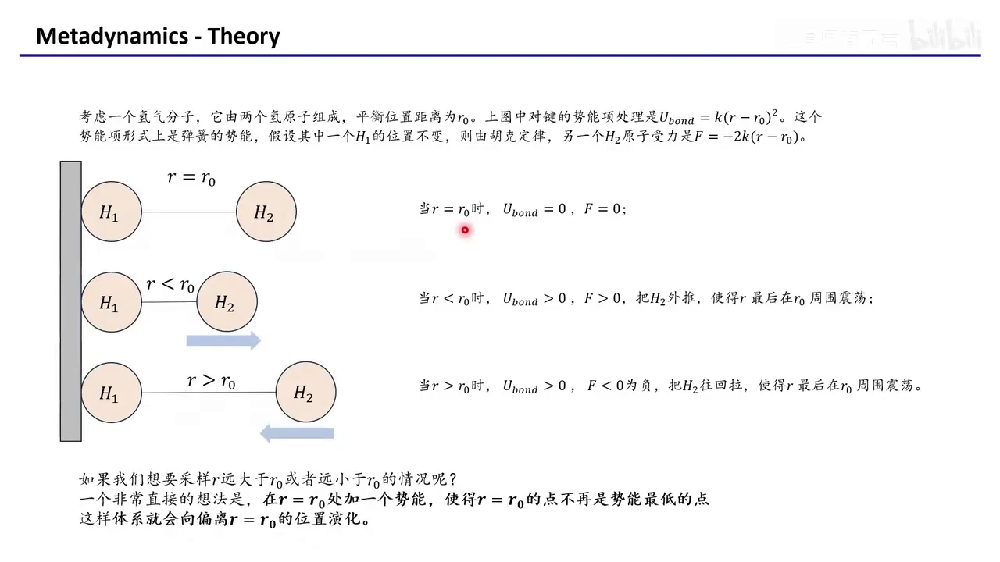
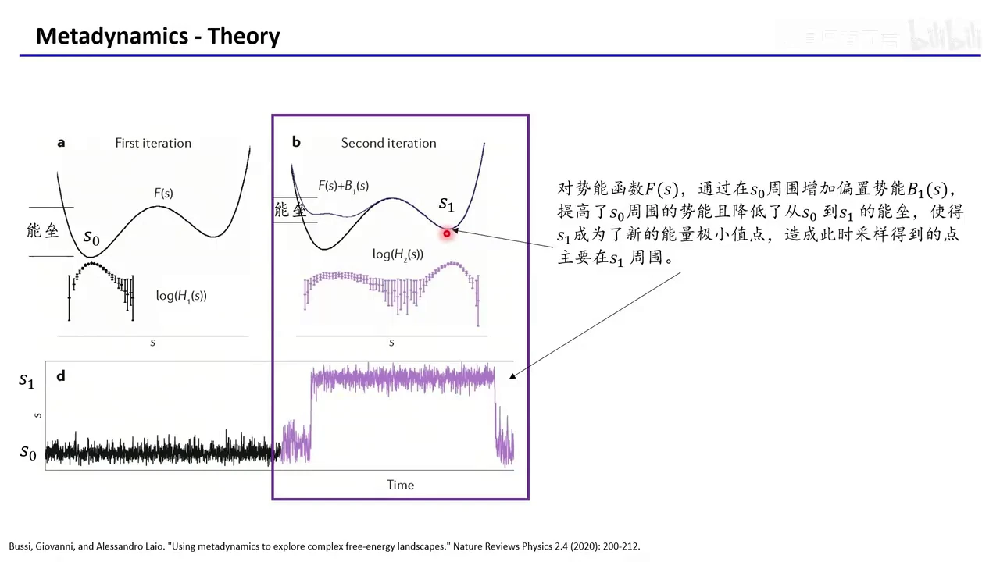
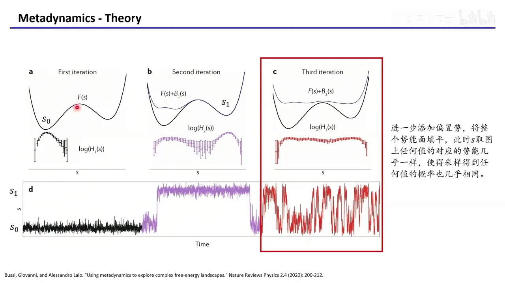
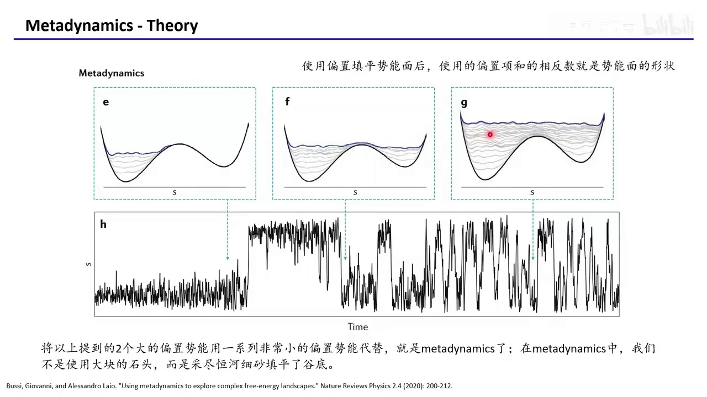
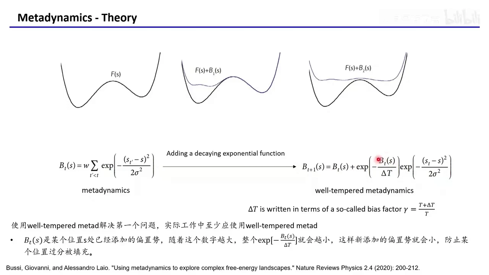
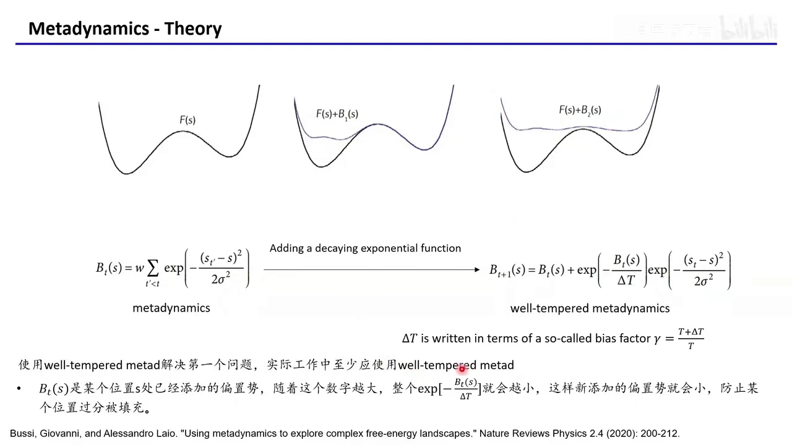

# GROMACS 入门 10：元动力学（Metadynamics）理论

## 本讲要解决的核心问题（SCQA）

**背景**：前面几讲已经把分子动力学（MD）的流程走通了——根据力场算出体系势能，对坐标求导得到每个原子受力，再用牛顿力学一步步更新坐标和速度。

**冲突**：这样跑出来的轨迹有个天生的偏向：体系绝大多数时间都待在势能最低的坑底。像蛋白质结构域之间的构象转变这类需要翻越能垒的"稀有事件"，在常规 MD 里几乎等不到。

**疑问**：能不能给体系一点"外力"，逼它主动走过那些高能区域？而且走完之后，还能不能顺便把整张自由能面画出来？

**回答（中心思想）**：能。**元动力学（Metadynamics）就是沿着选定的集合变量（CV）不断累加小的偏置势，一点点把势能坑"填平"，让体系自己走出去；当填平收敛后，累加的偏置势之和取相反数，就近似还原了自由能面。** 不过最原始的版本有过度填充的毛病，实际工作应使用 well-tempered 版本，而 CV 与高斯宽度只能靠经验确定。

## 一、分子动力学的一切都从势能面出发

**结论：MD 的骨架只有一句话——势能决定力，力决定轨迹。** 理解元动力学之前，先把这条链条复习清楚。

视频先用一个中学物理的例子开场：一个质量为 $m$ 的球放在高度 $h$ 处，取向上为正方向，重力与 $h$ 方向相反，所以受力是 $-mg$，重力势能是 $U = mgh$。把势能对坐标 $h$ 求偏导再取负号，立刻得到力：

$$-mg = -\frac{dU}{dh}$$

也就是说，**只要知道势能函数，就能知道每个位置上的受力**。MD 把这个逻辑搬到了分子体系上：用一个经验函数（力场）描述整个体系的势能，再对每个原子的坐标求导得到受力。[【跳转到 00:50】](https://www.bilibili.com/video/BV1iURJBXEm3/?t=50)

总势能被拆成四类项（以 AMBER 力场为例）：

- **键长项**：$V_{bond} = k_{bond}(r-r_0)^2$，描述一对成键原子之间的距离伸缩；
- **键角项**：$V_{angle} = k_{angle}(\theta-\theta_0)^2$，描述三个原子形成的夹角弯曲；
- **二面角项**：$V_{torsion}$，描述四个原子绕中间键旋转时的能量起伏；
- **非键项**：$V_{nonbond}$，包含范德华作用与静电作用，覆盖所有不成键原子对。

其中键长项、键角项都写成"偏离平衡值就付出能量"的平方形式，这正是后面氢气例子要用的形式。拿到势能后，对每个原子坐标求导得到受力，再根据牛顿力学求加速度、由初速度求速度、算出 $\Delta t$ 后的位移；在成千上万个极短的时间步里反复更新坐标，体系就"动"起来了。[【跳转到 02:05】](https://www.bilibili.com/video/BV1iURJBXEm3/?t=125)

## 二、常规 MD 只会待在坑底，因为偏离平衡就有人把你拉回来

**结论：势能面越深的坑，被采样到的概率越高；高能区不是"算不出来"，而是"等不到"。**

以氢分子为例：两个氢原子 $H_1$、$H_2$ 的平衡距离为 $r_0$，键长项取 $U_{bond} = k(r-r_0)^2$，形式上和弹簧一样。假设 $H_1$ 固定不动，对 $r$ 求导取负号，得到 $H_2$ 受到的力 $F = -2k(r-r_0)$。[【跳转到 04:44】](https://www.bilibili.com/video/BV1iURJBXEm3/?t=284)

分三种情况看：

1. **$r = r_0$**：$U_{bond}=0$，$F=0$，体系处在能量最低点，什么都不发生；
2. **$r < r_0$（被压短）**：$U_{bond}>0$，$F>0$，力把 $H_2$ 往外推，回到 $r_0$；
3. **$r > r_0$（被拉长）**：$U_{bond}>0$，$F<0$，力把 $H_2$ 往回拉，同样回到 $r_0$。

所以只要偏离平衡位置，就会有一股力把你推回去或拉回来。用 MD 对这个体系采样，轨迹里绝大多数 $r$ 都在 $r_0$ 附近。[【跳转到 06:24】](https://www.bilibili.com/video/BV1iURJBXEm3/?t=384) 这背后是玻尔兹曼分布：能量越低的构象出现概率越高，能量高的构象出现时间很短。想要采到"远大于 $r_0$"或"远小于 $r_0$"的极端构象，靠常规采样基本是空等。

## 三、元动力学的基本思想：往 CV 上加偏置势，把坑垫高

**结论：既然体系总往低处走，那就人为地把当前所在的低处垫高，逼它去找新的低处。**

最直接的想法是：在 $r=r_0$ 处强行加一个势能，把这一点"轻微抬高"，使 $r_0$ 不再是势能面的最低点。体系自然会去寻找新的最低点——$r$ 小于或大于 $r_0$ 的某个位置——于是非平衡构象就被采到了。[【跳转到 06:49】](https://www.bilibili.com/video/BV1iURJBXEm3/?t=409)

这个额外加上去的势能叫**偏置势（bias potential）**，而"我们感兴趣、并往里加势能的那个方向"叫**集合变量（Collective Variable，CV）**。CV 是一个能把复杂构象压缩成一个（或几个）数字的函数，比如两个结构域质心之间的距离。选定 CV 后，我们就在 CV 上加偏置势，强迫体系沿着它演化，从而研究想看的构象变化。[【跳转到 07:39】](https://www.bilibili.com/video/BV1iURJBXEm3/?t=459)

用一个抽象模型说明。设势能面 $F(s)$ 有两个坑：当前采样停在 $s_0$ 的低谷里，另一个更浅的坑在 $s_1$，两者之间隔着一道能垒。常规 MD 会在 $s_0$ 周围来回震荡，因为翻越能垒很难发生——玻尔兹曼分布告诉我们，这种"往高处走"的事件概率很低。[【跳转到 08:29】](https://www.bilibili.com/video/BV1iURJBXEm3/?t=509)

## 四、先在理想情况下看懂：把当前的坑垫高，体系就搬到下一个坑

**结论：偏置势加在体系当前所在的位置；当前坑被垫高，体系就被"赶"到下一个坑，两边都垫平，采样就均匀了。**

先看理想化的做法。在 $s_0$ 周围加一个较大的偏置势 $B_1(s)$，把 $s_0$ 附近的势能抬高，同时降低了从 $s_0$ 到 $s_1$ 的能垒。结果是 $s_1$ 变成了新的能量极小值点，采样点主要跑到 $s_1$ 附近。[【跳转到 09:19】](https://www.bilibili.com/video/BV1iURJBXEm3/?t=559)

接着在 $s_1$ 处再加一个偏置势，把这一边也垫高。此时整个势能面上每个 $s$ 对应的总势能都差不多了，意味着体系取到每个 $s$ 值的概率都非常接近，采样变得均匀。[【跳转到 10:09】](https://www.bilibili.com/video/BV1iURJBXEm3/?t=609)

这就是元动力学的主要思想：**不是硬推体系翻墙，而是把墙两边的地面一起垫高，直到没有墙。** 但上面用的是两个"预先设计好位置和大小"的大偏置，而真实研究中我们并不知道势能面长什么样，也就不可能一开始就设计出 $B_1$、$B_2$。[【跳转到 11:23】](https://www.bilibili.com/video/BV1iURJBXEm3/?t=683)

## 五、不知道地形也能填：每隔若干步在当前 CV 位置丢一个小高斯

**结论：把"一次性大偏置"换成"一路撒小高斯"，就能在未知地形上自动完成填平。**

具体做法是：每隔一定的模拟步数，就在当前采样到的 CV 位置 $s_t'$ 加一个很小的高斯函数形式的偏置，宽度为 $\sigma$，高度由 $w$ 控制。$t$ 时刻累计的偏置势为：

$$B_t(s) = w \sum_{t'<t} \exp\left[-\frac{(s_{t'}-s)^2}{2\sigma^2}\right]$$

一开始体系待在能量最低点，所以偏置都堆在这一小片区域；堆了几层后这里不再是唯一的最低点，模拟就会往周围探索，探索到新地方再加新的偏置。如此反复，"一点一点"地把整个能量坑填平。[【跳转到 13:13】](https://www.bilibili.com/video/BV1iURJBXEm3/?t=793)

## 六、填平之后，偏置势之和的相反数就是自由能面

**结论：自由能面之所以能"免费"得到，是因为"填平"这个动作本身记录了原来的高低。**

设想填平已经收敛：每个位置的总势能（原本的势能 + 累加的偏置）都变得一样高。那么原先能量低的地方，必然被加上了更多的偏置；原先能量高的地方，加得少。换句话说，**偏置势的大小正好补偿了原地形的高低差**。

因此，把累加的偏置势取相反数，就还原出了原来的势能面形状：

$$F(s) \approx -B_t(s) + \text{常数}$$

这里的 $F(s)$ 就是沿 CV 的**自由能面（Free Energy Surface，FES）**——它把体系在某个 CV 取值上的相对稳定性画成一条曲线，谷越深表示该状态越稳定。[【跳转到 12:53】](https://www.bilibili.com/video/BV1iURJBXEm3/?t=773)

注意两个限定：一是只能还原到相差一个常数，因为我们只关心相对高低，不关心绝对零点；二是这个等式成立的前提是"已经填平"，也就是模拟收敛。

## 七、原始 metadynamics 的两个硬伤：填过头与选 CV

**结论：最简单的版本在实践中不好用，问题不在"填平"这个想法，而在"每次加一样大"和"CV 靠猜"。**

第一个问题是收敛性。固定高度的偏置会**不断往同一个地方加**，导致该区域被过度填充（overfill），体系被推向 CV 空间的高能边缘；同时"什么时候该停"也很难判断——偏置之和不会稳定收敛到自由能，而是在其附近振荡。[【跳转到 13:38】](https://www.bilibili.com/video/BV1iURJBXEm3/?t=818)

第二个问题是 CV 的选取。视频明确说：这没有自动化办法，只能凭经验和对体系的理解。建议的做法是——先想清楚你要研究什么现象（例如两个结构域之间的相对构象变化），去文献里看别人研究类似问题时用了什么 CV，然后拿来试；实在找不到，就只能自己设计 CV 反复尝试。[【跳转到 14:28】](https://www.bilibili.com/video/BV1iURJBXEm3/?t=868)

## 八、well-tempered metadynamics：填得越多，新加的偏置就越小

**结论：给偏置加一个"随已填高度衰减"的因子，就能既填平又不填过头。**

解决办法是在新加的高斯前乘一个衰减项 $\exp[-B_t(s)/\Delta T]$：

$$B_{t+1}(s) = B_t(s) + \exp\left[-\frac{B_t(s)}{\Delta T}\right]\exp\left[-\frac{(s_t-s)^2}{2\sigma^2}\right]$$

其中 $\Delta T$ 通过**偏置因子（bias factor）** $\gamma = \dfrac{T+\Delta T}{T}$ 来设定。含义很直观：某个位置已经积累的偏置 $B_t(s)$ 越大，$\exp[-B_t(s)/\Delta T]$ 就越小，新加的高斯高度也越小。于是经常被访问的区域不会无限堆高，势能面被温和地填到一个平衡高度，收敛性明显改善。[【跳转到 15:43】](https://www.bilibili.com/video/BV1iURJBXEm3/?t=943)

视频的建议很直接：**实际工作中至少应该使用 well-tempered metadynamics，不要用最原始的版本。**

## 九、三个参数怎么定：高度、偏置因子、高斯宽度

**结论：前两个参数有现成经验值，真正麻烦的是 $\sigma$，它要由一次无偏模拟来估。**

- **高度（height，即 $w$）**：视频给出的经验值是取 $\tfrac{1}{2}k_BT$ 左右即可。
- **偏置因子（bias factor，$\gamma$）**：生物体系常用 5–10。它与 $\Delta T$ 一起决定衰减项的强弱，从而控制填充的力度。
- **高斯宽度（sigma，$\sigma$）**：这是最需要花心思的。做法是先跑一次**不加偏置**的普通 MD，把想用的 CV 记录下来，看它在无偏模拟里的涨落方差有多大；你选的 $\sigma$ 应该在同一个数量级，可以比它大一些，但不该大太多。[【跳转到 16:33】](https://www.bilibili.com/video/BV1iURJBXEm3/?t=993)

在数量级合适的前提下，$\sigma$ 选大一点会让填平更快；选得太小则填充效率低、收敛慢。[【跳转到 17:23】](https://www.bilibili.com/video/BV1iURJBXEm3/?t=1043)

## 小结

- **元动力学解决的问题**：常规 MD 被困在势能坑底，采不到需要翻越能垒的稀有事件。
- **核心机制**：沿 CV 不断累加偏置势，把当前所在的低处垫高，逼体系探索新区域，直到整张势能面被填平、CV 上可以自由移动。
- **能还原自由能的原因**：填平意味着"原势能 + 偏置"处处相等，所以偏置之和的相反数就是原自由能面（差一个常数）。
- **实现方式**：每隔固定步数在当前 CV 位置沉积一个小高斯，而不是一次性加大偏置。
- **原始版本的两个硬伤**：固定高度会过度填充且难以判断停止；CV 的选择没有自动化方法，只能靠文献与经验。
- **实践建议**：至少使用 well-tempered 版本，让新加偏置随已填高度衰减；参数取 height ≈ ½kT、bias factor 5–10，$\sigma$ 参考无偏模拟中 CV 的涨落。

## 关键术语速查

| 术语 | 一句话解释 |
| --- | --- |
| 势能面 / 自由能面（FES） | 体系能量随构象（或 CV）变化的"地形图"，谷底代表稳定状态 |
| 力场（force field） | 用经验函数描述体系势能的一套公式与参数，如 AMBER |
| 集合变量（CV） | 把复杂构象压缩成一两个数字的描述量，如两个结构域质心距离 |
| 反应坐标 | CV 的一种，用来刻画沿某条路径推进到什么程度 |
| 偏置势（bias potential） | 人为加到体系势能上的额外势，用来垫高当前区域、逼体系离开 |
| 高斯函数 | 钟形曲线，元动力学每次沉积的偏置形状，由高度 $w$ 和宽度 $\sigma$ 决定 |
| 填平（flooding） | 偏置不断累加，使整个势能面趋于平坦的过程 |
| well-tempered metadynamics | 在偏置前乘衰减因子，使已填区域的新增偏置自动变小，避免过度填充 |
| 偏置因子 $\gamma$ | $\gamma=(T+\Delta T)/T$，控制 well-tempered 版本的填充强度，常用 5–10 |
| 收敛 | 偏置之和趋于稳定、CV 能自由往返的状态，此时才能可靠地读出自由能面 |
