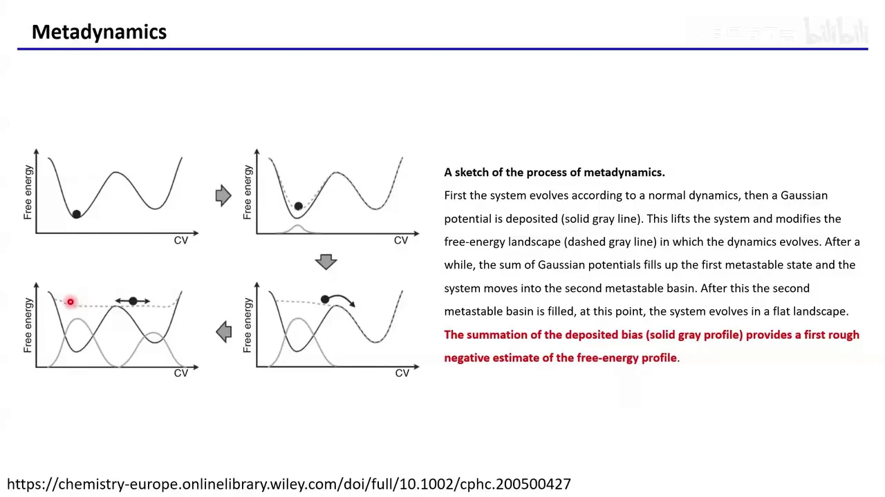
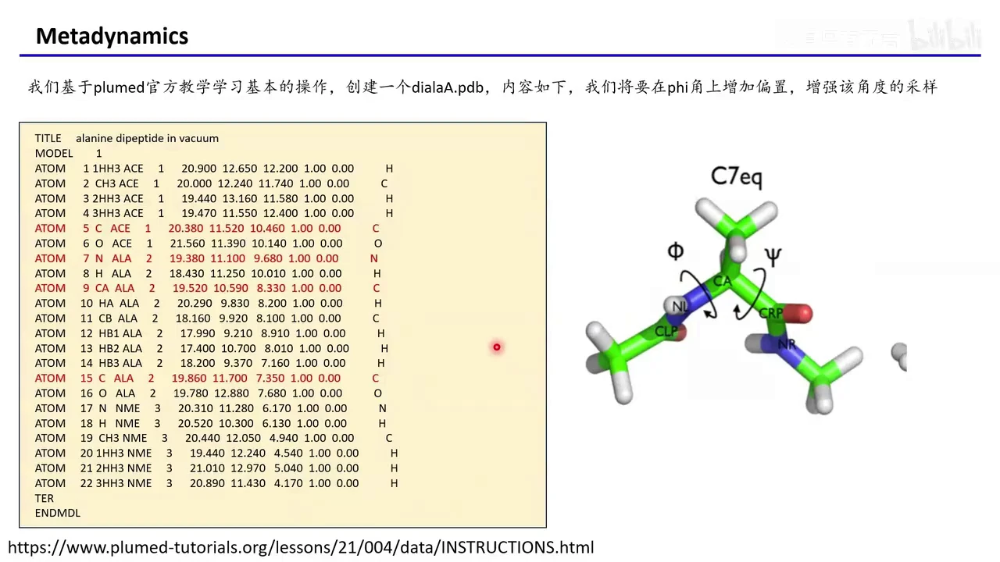
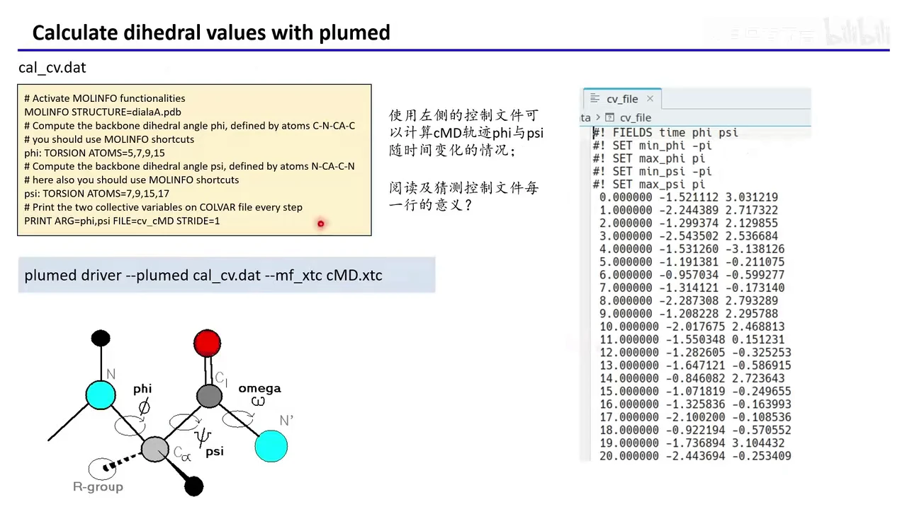
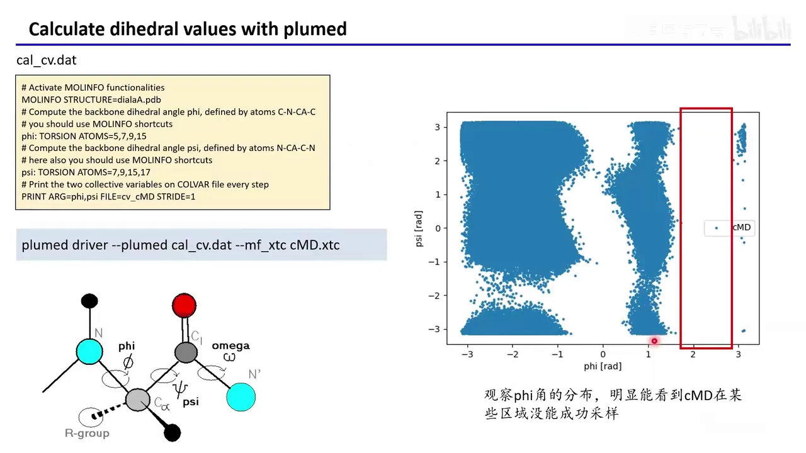
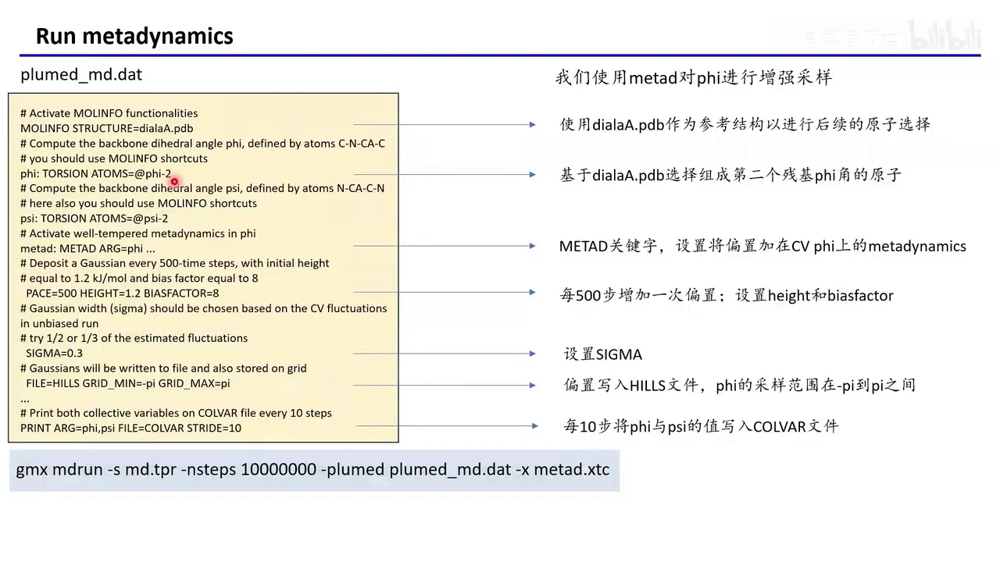
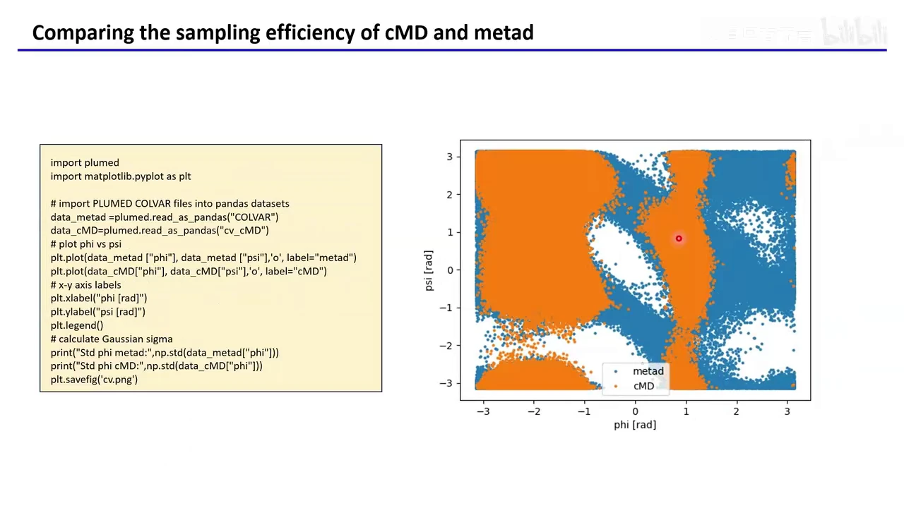
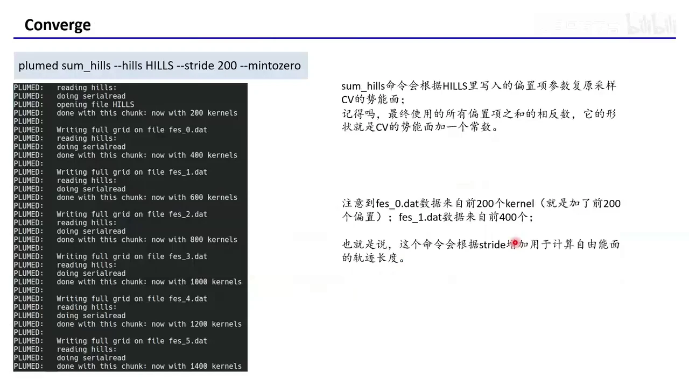
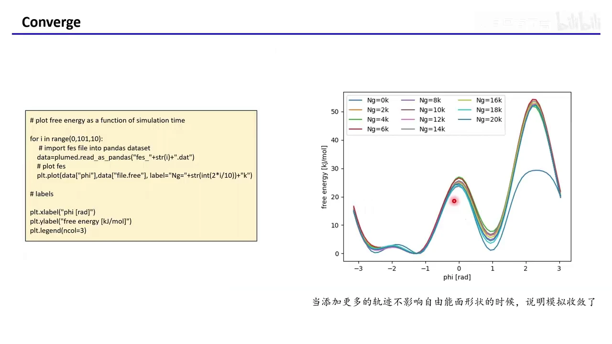
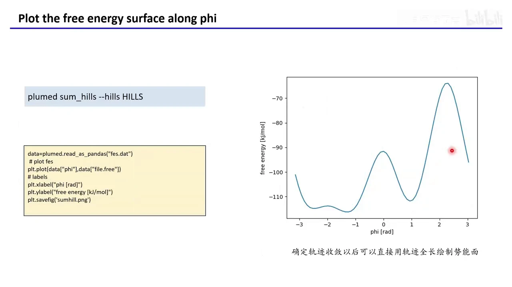

# GROMACS 入门 11：元动力学实战——用 PLUMED 跑一个案例

## 本讲要解决的核心问题（SCQA）

**背景**：上一讲已经说明，元动力学（metadynamics）的做法是往体系里不断添加小的偏置势，把原本高低不平的势能面“填平”，让分子动力学模拟能够沿着选定的 CV（collective variable，集体变量）自由移动。

**冲突**：道理不难，但真正上手要写 `plumed.dat`，里面每个字段各管什么、怎么和 `gmx mdrun` 联用、跑完又怎么判断收敛并画出自由能面，都是第一次做时容易卡住的地方。

**疑问**：有没有一个最小但完整的案例，能把“普通 MD → 增强采样 → 自由能面”这条链路走通？

**回答（中心思想）**：用丙氨酸二肽的 φ 角作 CV，先跑一版普通 MD 找到采样盲区，再用 PLUMED 的 METAD 把盲区补上，最后用 `sum_hills` 从 HILLS 还原自由能面，并用“增加偏置后曲线是否还变”判断收敛。



## 一、案例目标：在丙氨酸二肽的 φ 角上做增强采样

这一讲用一个足够小、又能暴露问题的体系：真空中的丙氨酸二肽（alanine dipeptide），参考结构为 `dialaA.pdb`。[【跳转到 01:03】](https://www.bilibili.com/video/BV1vURJBXEzX/?t=63)

- **CV 是什么**：CV 是我们希望模拟重点探索的“进度变量”。这里选多肽骨架的二面角 φ；它只有一个数，方便画图，也方便判断采样是否充分。
- **φ 角由哪些原子定义**：φ 由 5、7、9、15 号原子组成，顺序是 C—N—Cα—C；另一个二面角 ψ 由 7、9、15、17 号原子组成，顺序是 N—Cα—C—N。
- **为什么选它**：φ、ψ 是蛋白质主链最经典的二面角，维度低、意义直观；先跑通小体系，再迁移到真实蛋白更稳。



整个流程分三步：先跑普通经典 MD（cMD）作对照；再用 metad 只对 φ 加偏置；最后比较采样范围，并从 HILLS 文件还原自由能面。

## 二、先跑一版普通 MD，得到可对比的基线

增强采样不是凭空开始，而是要和普通 MD 比，才知道“多采到了什么”。所以第一步是跑一版经典动力学，脚本里把建模、溶剂化、加离子、能量最小化、NVT、NPT 和成品模拟串了起来。[【跳转到 01:47】](https://www.bilibili.com/video/BV1vURJBXEzX/?t=107)

- **建模与溶剂化**：`gmx pdb2gmx` 生成拓扑，`gmx editconf` 建盒子，`gmx solvate` 加水，`gmx grompp` 生成运行输入文件。
- **`echo` 的作用**：`pdb2gmx` 和 `genion` 会弹出交互式菜单，`echo -e "6\n1"`、`echo -e "13\n"` 只是把菜单选项提前“喂”给命令，省去手动输入；6、1、13 是菜单序号。
- **成品模拟**：最后一行 `gmx mdrun -s md.tpr -nsteps 10000000 -x cMD.xtc` 跑一千万步，轨迹写到 `cMD.xtc`。
- **一个刻意的设置**：`md.mdp` 沿用之前蛋白质模拟的参数，但把 xtc 轨迹改成每 10 步输出一次。这样画图点更密，代价是极大拖慢模拟速度，视频也不建议日常这么做。

这版 cMD 就是后续比较的基线；它采不到的区域，才是 metad 要补的目标。

## 三、用 plumed driver 复算 φ/ψ，找出普通 MD 的采样盲区

有了 cMD 轨迹，下一步不是直接加偏置，而是先用 PLUMED 把每一帧的 φ、ψ 算出来，看看普通 MD 到底采到了哪些区域。[【跳转到 02:12】](https://www.bilibili.com/video/BV1vURJBXEzX/?t=132)

控制文件 `cal_cv.dat` 只有四类内容：

```text
MOLINFO STRUCTURE=dialaA.pdb
phi: TORSION ATOMS=5,7,9,15
psi: TORSION ATOMS=7,9,15,17
PRINT ARG=phi,psi FILE=cv_cMD STRIDE=1
```

- **`MOLINFO`**：注册参考结构。`dialaA.pdb` 必须放在当前目录，且与轨迹体系一致，否则 PLUMED 找不到原子。
- **`TORSION`**：定义一个二面角，`ATOMS=` 按顺序给出四个原子。`phi`、`psi` 是 CV 名。
- **`PRINT`**：把 `phi`、`psi` 写进 `cv_cMD`；`STRIDE=1` 表示每帧都输出。

运行命令是：

```bash
plumed driver --plumed cal_cv.dat --mf_xtc cMD.xtc
```

`plumed driver` 只做分析、不跑动力学：读控制文件和 xtc，逐帧算 CV。得到的 `cv_cMD` 有三列——时间、φ、ψ。



把 φ 对 ψ 画成散点图后：φ 在约 2–3 rad 的一段几乎是空白。不是绘图漏了，而是普通 MD 很少走到那里——那里的能量太高，热涨落翻不过去。[【跳转到 04:18】](https://www.bilibili.com/video/BV1vURJBXEzX/?t=258)



这正是 metad 要解决的问题：在这个“高能垒、难跨越”的 φ 区域上加偏置，强迫体系去探索它。

## 四、`plumed_md.dat` 的每个字段，决定了偏置怎么加

metad 的控制文件 `plumed_md.dat` 和前面的分析文件结构相似，但多了真正“加偏置”的部分。可以把它拆成四组：参考结构、CV 定义、METAD 参数、输出控制。[【跳转到 04:59】](https://www.bilibili.com/video/BV1vURJBXEzX/?t=299)

**第一组：参考结构与 CV 定义**

```text
MOLINFO STRUCTURE=dialaA.pdb
phi: TORSION ATOMS=@phi-2
psi: TORSION ATOMS=@psi-2
```

这里没有手写 5、7、9、15，而是用 `@phi-2`、`@psi-2` 这种 MOLINFO 快捷方式，表示“第二个残基的 φ / ψ”。两种写法都能定义角度；快捷方式更不容易写错原子序号，但前提是残基编号与体系对得上。

**第二组：METAD 本体与加偏置的节奏**

```text
metad: METAD ARG=phi ...
PACE=500 HEIGHT=1.2 BIASFACTOR=8
```

- **`METAD`**：声明元动力学动作，`metad` 是动作名，`ARG=phi` 表示偏置只加在 φ 上。
- **`PACE=500`**：每 500 步放一个高斯偏置，间隔决定“填坑”速度。
- **`HEIGHT=1.2`**：每个高斯的高度，单位 kJ/mol，视频说一般在 1.2–1.5 取。
- **`BIASFACTOR=8`**：偏置因子，控制填平力度；上一讲建议取 5–10。

**第三组：高斯的宽度与取值范围**

```text
SIGMA=0.3
FILE=HILLS GRID_MIN=-pi GRID_MAX=pi
```

- **`SIGMA=0.3`**：高斯在 CV 方向的宽度，应根据 cMD 中 φ 的标准差来选，取到同一数量级；幻灯片还提示可试估计涨落的 1/2 或 1/3。太窄填得慢，太宽会抹平邻近细节。
- **`FILE=HILLS`**：每加一个偏置就把参数追加进 `HILLS`，后面 `sum_hills` 靠它还原自由能面。
- **`GRID_MIN=-pi`、`GRID_MAX=pi`**：把 φ 限制在 −π 到 π。角度天然在此区间，问题不大；但键长、距离这类 CV 没有天然上下界，一旦跳出网格，模拟可能直接报错退出，通常要加 wall 把 CV 约束在网格内。[【跳转到 06:39】](https://www.bilibili.com/video/BV1vURJBXEzX/?t=399)

**第四组：把 CV 写到 COLVAR**

```text
PRINT ARG=phi,psi FILE=COLVAR STRIDE=10
```

每 10 步把 φ 和 ψ 写进 `COLVAR`，用于事后画分布图和做对比。它和 `HILLS` 的分工不同：`HILLS` 记录“加了哪些偏置”，`COLVAR` 记录“体系实际走到了哪里”。



如果不知道怎么配参数，可以去 PLUMED 的 Nest 网站搜相近体系，参考别人分享的设置；官方教程的例子往往非常简化，只能建立概念，不能直接照搬。[【跳转到 07:04】](https://www.bilibili.com/video/BV1vURJBXEzX/?t=424)

## 五、用 `gmx mdrun` 接入 PLUMED，跑出 metad 轨迹

控制文件写好后，运行方式和你熟悉的 `gmx mdrun` 几乎一样，只是多了一个 `-plumed` 选项：

```bash
gmx mdrun -s md.tpr -nsteps 10000000 -plumed plumed_md.dat -x metad.xtc
```

- **`-s md.tpr`**：直接用普通动力学生成的 `md.tpr`，不必重新 `grompp` 一套 metad 专用 tpr。
- **`-plumed plumed_md.dat`**：把控制文件交给 PLUMED，这一步才是“开启 metad”的开关。
- **`-x metad.xtc`**：增强采样的轨迹单独输出，方便和 `cMD.xtc` 对照。

前提是 GROMACS 已经用 PLUMED 插件 patch 过，否则它不认识 `-plumed`。视频提到最新版可能已自带 PLUMED，但讲者没试过，建议自己确认。[【跳转到 09:09】](https://www.bilibili.com/video/BV1vURJBXEzX/?t=549)

跑起来会得到 `HILLS`（偏置记录）、`COLVAR`（CV 随时间变化）、`metad.xtc`（轨迹），后面的分析与作图都围绕它们展开。

## 六、对比两条轨迹：metad 把 cMD 的盲区补上了

分析 metad 轨迹的方法和前面一样：写一个 `cal_cv2.dat`，用 `plumed driver` 读 `metad.xtc`，输出 `cv_metad`。这里仍用显式原子序号定义 φ、ψ，只改输出文件名。

讲者特别说明：metad 运行时 `COLVAR` 里已经有 φ、ψ，再跑一遍 driver 得到的 `cv_metad` 应当和它一样。[【跳转到 09:31】](https://www.bilibili.com/video/BV1vURJBXEzX/?t=571)

把 cMD 和 metad 的 φ-ψ 分布叠在一起，差别非常明显：

- cMD 只在低能区域密集，φ 约 2–3 rad 几乎是空白。
- metad 在偏置推动下进入了这片区域，采样范围明显更宽。
- 这是偏置把高能垒暂时填低，让体系有机会翻过去。



视频里还用一段 Python 把两张图叠起来，并顺便计算两个 CV 的标准差：

```python
data_metad = plumed.read_as_pandas("COLVAR")
data_cMD = plumed.read_as_pandas("cv_cMD")
```

`plumed.read_as_pandas` 直接把 PLUMED 的输出读成表格；随后用 matplotlib 画 φ-ψ 散点，用 `np.std` 打印 φ 的标准差。这个标准差不是摆设——它正是前面选 `SIGMA` 的依据。

## 七、用 `sum_hills` 还原自由能面，并用多条曲线判断收敛

metad 跑完不等于结束，还要回答两个问题：模拟什么时候算收敛？自由能面长什么样？这两个问题都可以从 `HILLS` 入手。[【跳转到 10:07】](https://www.bilibili.com/video/BV1vURJBXEzX/?t=607)

原理上一讲已讲过：metad 不断加高斯偏置，收敛时把原来的自由能面“填平”；把所有偏置加起来再取相反数，就是自由能面（相差一个常数）。`sum_hills` 做的就是这件事。

先看收敛趋势，命令是：

```bash
plumed sum_hills --hills HILLS --stride 200 --mintozero
```

- **`--hills HILLS`**：指定偏置记录文件。
- **`--stride 200`**：每累加 200 个高斯，就输出一个自由能面文件。
- **输出文件**：`fes_0.dat`、`fes_1.dat`、`fes_2.dat`……其中 `fes_0.dat` 只用前 200 个偏置，`fes_1.dat` 用前 400 个，依此类推。



把这一系列 `fes_*.dat` 画在同一张图上，就得到“自由能随模拟时间如何变化”的曲线。视频里的脚本用 `for i in range(0,101,10)` 依次读取文件，并用 `Ng=0k、2k、…、20k` 标注不同阶段。

判断标准很直接：继续加偏置，曲线形状基本不再变化，就说明收敛了。图中早期曲线与后来的明显不重合，说明还没填平；到 `Ng=4k` 左右已经叠得比较好，讲者据此判断从 `Ng=2k` 往后基本收敛。[【跳转到 11:25】](https://www.bilibili.com/video/BV1vURJBXEzX/?t=685)



收敛的物理含义是：偏置加够后，每个 φ 值对应的总势能（本体 + 偏置）被填得差不多一样，体系能在各角度间自由移动；再把偏置取反，原来的高能垒就重新显现。

## 八、收敛后画最终自由能面，并避开几个常见坑

确认收敛后，就不再分段，而是直接用全部 HILLS 生成一张最终的自由能面：

```bash
plumed sum_hills --hills HILLS
```

输出 `fes.dat`，里面通常有两列：φ 和对应的自由能。用 Python 读入后画 `phi` 对 `file.free` 的曲线，就得到本讲的最终结果。[【跳转到 12:40】](https://www.bilibili.com/video/BV1vURJBXEzX/?t=760)



这张图把前面的现象串了起来：φ 在约 2.3 rad 附近有一个很高的自由能垒，普通 MD 靠热涨落很难翻过去，所以 cMD 在那里是空的；metad 持续加偏置把这座“山”暂时填低，体系才得以过去。等偏置收敛、取反，这座山又完整地出现在自由能面上。

视频最后强调的几个坑：[【跳转到 13:22】](https://www.bilibili.com/video/BV1vURJBXEzX/?t=802)

- **参考结构要在当前目录且与轨迹对应**：`MOLINFO` 找不到 pdb，或 pdb 与轨迹原子顺序不一致，CV 就全错了。
- **注意 CV 的网格边界**：角度问题不大；键长、距离等 CV 可能跳出 `GRID_MIN/GRID_MAX` 导致报错，需要 wall 约束。
- **确认 GROMACS 支持 PLUMED**：装 patch 过的版本或确认新版已内置，否则 `-plumed` 不生效。
- **参数不能照抄**：`HEIGHT`、`BIASFACTOR`、`SIGMA`、`PACE` 要结合体系与 cMD 涨落来定。
- **收敛判断不能省**：只看最终一张图不够，最好按 stride 输出多条曲线，确认后段重合。
- **真实体系远比案例复杂**：需要自己查文献、教程和 PLUMED Nest 上的类似案例，反复尝试；视频最后还留了 reweighting（重加权）的官方教程作进阶方向。

## 小结

- 元动力学的核心是“加偏置把势能面填平”，收敛后偏置之和的相反数就是自由能面。
- 实战顺序是：普通 MD 建基线 → `plumed driver` 算 CV 找盲区 → `METAD` 增强采样 → `sum_hills` 还原自由能面。
- `plumed_md.dat` 的关键字段是 `ARG`、`PACE`、`HEIGHT`、`BIASFACTOR`、`SIGMA`、`FILE`、`GRID_MIN/MAX` 和 `PRINT`。
- 与 GROMACS 联用只需加 `-plumed`，但版本必须支持 PLUMED。
- 收敛的判断标准是“继续加偏置，自由能曲线不再明显变化”，本案例大约从 `Ng=2k` 起基本重合。
- `SIGMA` 参考 cMD 中 CV 的标准差；`HEIGHT` 常取 1.2–1.5 kJ/mol，`BIASFACTOR` 常取 5–10；长度类 CV 要防止跳出网格。

## 关键术语速查

| 术语 | 一句话解释 |
| --- | --- |
| 元动力学（metadynamics） | 通过不断添加高斯偏置把自由能面填平，从而增强 CV 采样的方法。 |
| CV（collective variable） | 用来描述体系状态、并希望重点采样的变量，如二面角 φ、ψ。 |
| φ / ψ 二面角 | 蛋白质主链的两个骨架二面角；本案例 φ 由原子 5、7、9、15 定义。 |
| `MOLINFO` | PLUMED 中注册参考结构、提供原子与残基信息的指令。 |
| `TORSION` | 定义一个二面角 CV，`ATOMS=` 按顺序给出四个原子。 |
| `METAD` | 开启元动力学的动作，`ARG=` 指定在哪个 CV 上加偏置。 |
| `PACE` | 每隔多少步加一个高斯偏置。 |
| `HEIGHT` | 每个高斯偏置的高度，单位 kJ/mol。 |
| `BIASFACTOR` | 控制偏置填平力度的偏置因子，常用 5–10。 |
| `SIGMA` | 高斯偏置在 CV 方向上的宽度，应参考 CV 的涨落。 |
| `HILLS` | 记录每个已添加偏置的参数文件，是 `sum_hills` 的输入。 |
| `COLVAR` | 记录 CV 随模拟时间变化的输出文件。 |
| `sum_hills` | 把 HILLS 中的偏置累加并取反，生成自由能面的 PLUMED 工具。 |
| FES | free energy surface，自由能面；本案例是自由能随 φ 变化的曲线。 |
| reweighting | 重加权，用偏置模拟的数据恢复无偏分布/自由能的一类后处理方法。 |
