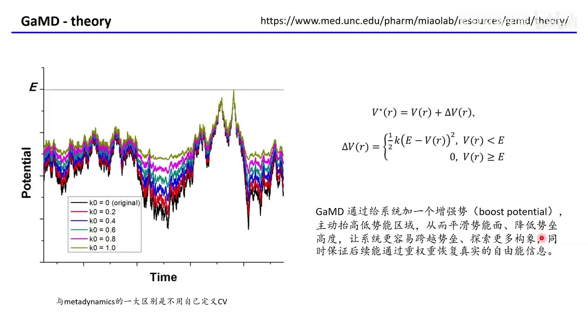
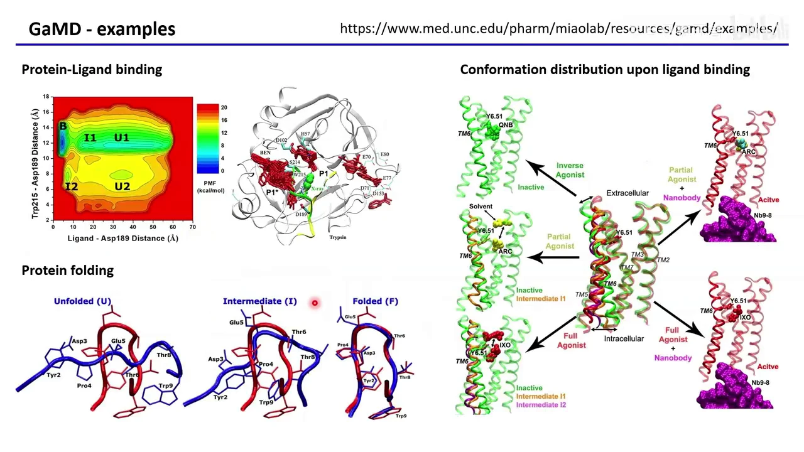
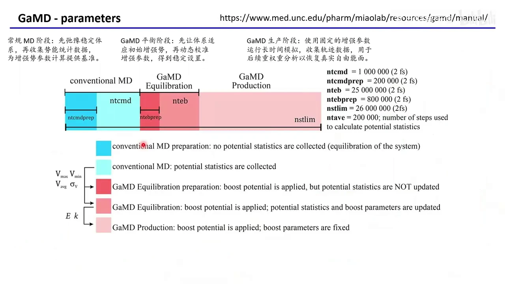
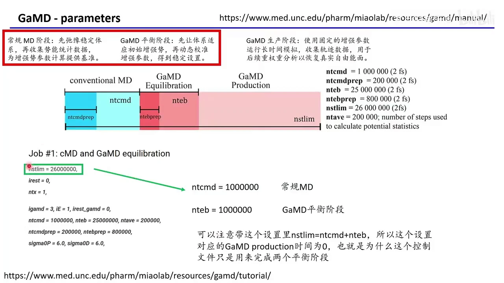
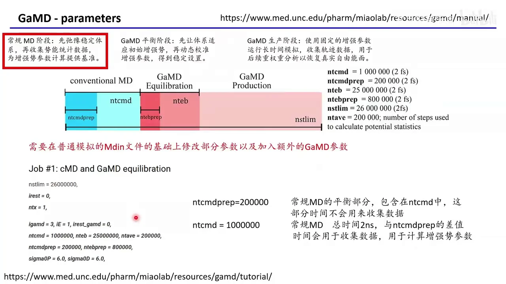
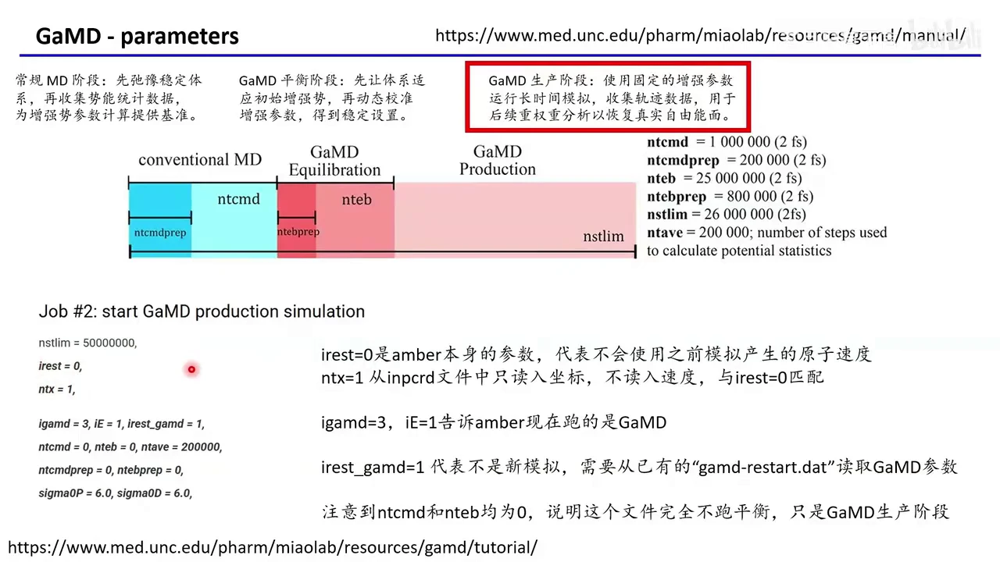
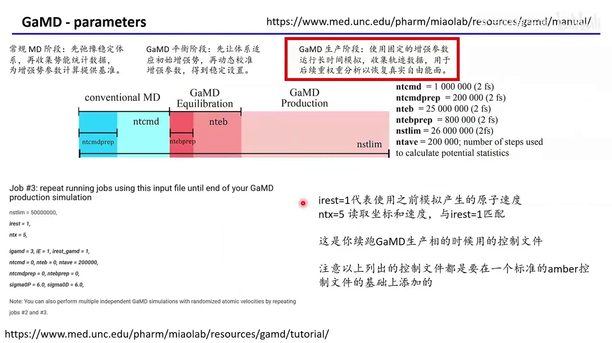
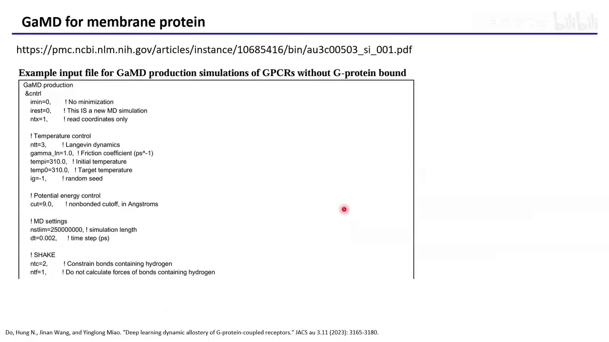
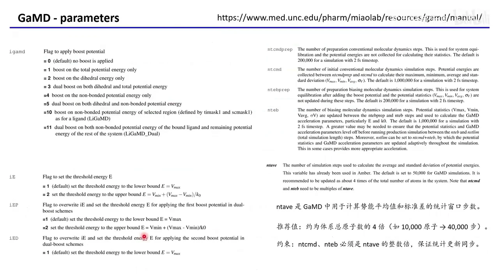

# GROMACS 入门 12：用 AMBER 做高斯加速动力学（GaMD）

## 本讲要解决的核心问题（SCQA）

**背景**：前几讲你已经能让蛋白在 AMBER 里跑普通分子动力学（MD），也知道元动力学可以帮体系翻过势垒。

**冲突**：普通 MD 容易长时间困在能量深坑里；元动力学虽能加速，却要求事先选好**集合变量（Collective Variable, CV）**——用距离、二面角等坐标概括要观察的过程。CV 选错，力气就花在错方向上。

**疑问**：有没有一种方法，不需要定义 CV，又能让整个体系更容易翻越势垒，还能把加速后的轨迹还原成真实自由能？

**回答（中心思想）**：有，这就是**高斯加速动力学（Gaussian accelerated Molecular Dynamics, GaMD）**。它给整个势能面加二次型增强势，抬高谷底、基本不动山峰；流程分“普通 MD → GaMD 平衡 → GaMD 生产”三段，跑完再用**重加权**恢复自由能。本讲把它落到 AMBER 的 `mdin` 参数上。[【跳转到 00:00】](https://www.bilibili.com/video/BV1iJVT6SEmY/?t=0)

---

## 一、GaMD 用“全域抬升势能面”换采样效率

**结论：GaMD 的核心不是挑一个坐标去推，而是给整个体系的势能面整体“垫高谷底”，让所有低能构象之间的往返都变容易。**

### 1.1 普通 MD 卡在坑里，元动力学卡在 CV 上

- **普通 MD**：体系沿势能面自然演化，遇到高势垒只能等；势垒越高，翻越概率越小。
- **元动力学**：先选 CV，再沿 CV 不断“填沙袋”，把走过的低能区域垫高。CV 必须事先选对，而且只作用于选定方向。
- **GaMD**：不定义 CV，直接对总势能（以及二面角等分量）加偏置，让整个势能面变浅，体系自然更容易探索。[【跳转到 00:09】](https://www.bilibili.com/video/BV1iJVT6SEmY/?t=9)


### 1.2 二次型增强势：谷底抬高，山峰基本不动

GaMD 的增强势写起来并不复杂：

$$
V^*(r)=V(r)+\Delta V(r)
$$

$$
\Delta V(r)=
\begin{cases}
\frac{1}{2}k\,[E-V(r)]^2, & V(r)<E\\
0, & V(r)\ge E
\end{cases}
$$

其中 $V(r)$ 是原始势能，$V^*(r)$ 是增强后的势能，$E$ 是阈值能量，$k$ 控制增强的强度。

- **只抬高低于阈值的部分**：$V(r)<E$ 时加正偏置，$V(r)\ge E$ 时偏置为 0。谷底被抬起，山峰基本保持原样。
- **落差变小**：深坑被填浅，从坑底爬到高处的难度下降，更容易跨越势垒。
- **偏置是二次型的**：能量越低抬得越多。增强后的势能分布更接近**高斯分布**，这既是“Gaussian”名字的由来，也为重加权提供了统计基础。
- **加速不是免费的**：轨迹来自被修改过的势能面，构象频率已经失真，最后必须重加权。



黑线是原始势能，彩色是不同 $k_0$ 下的增强势能：谷底抬高，高峰基本不变。[【跳转到 00:34】](https://www.bilibili.com/video/BV1iJVT6SEmY/?t=34)

---

## 二、GaMD 不只算“构象长什么样”，还能算结合自由能

**结论：GaMD 的用途覆盖配体结合、蛋白折叠、受体构象分布等多个场景，配套的 LiGaMD 还能专门加速配体与蛋白的结合过程。**

- **配体结合**：采样不同配体对蛋白构象分布的影响，回答“配体把蛋白推向了哪种构象”。
- **蛋白折叠**：采样从去折叠态、中间态到折叠态的转变，观察路径上的中间构象。
- **膜受体构象分布**：例如 GPCR 在激动剂、反向激动剂、纳米抗体等条件下的构象分布，把平时很少出现的中间态采出来。
- **LiGaMD**：面向配体—蛋白结合的加速版本，还能进一步计算结合自由能。[【跳转到 00:51】](https://www.bilibili.com/video/BV1iJVT6SEmY/?t=51)



---

## 三、完整的 GaMD 分三个阶段、五个色块

**结论：GaMD 不是一上来就加速，而是先跑普通 MD 收集势能统计，再让体系在增强势能下平衡并校准参数，最后才用固定参数做长时间生产。**

- **普通 MD（蓝色）**：先让体系在原始势能面上平衡。深蓝段只平衡、不收集数据；浅蓝段开始收集势能的最大值、最小值、平均值和标准差，用来计算增强参数。
- **GaMD 平衡（红色）**：深红段把初始增强势应用到体系上，让蛋白、水、离子适应新势能，但**不更新**统计；浅红段一边跑一边微调参数，直到稳定。
- **GaMD 生产（粉色）**：增强参数固定，只做长时间采样并保存轨迹，这一段才是重加权的对象。
- **颜色对应参数**：`ntcmdprep` 对齐深蓝，`ntcmd` 是整段浅蓝；`ntebprep` 对齐深红，`nteb` 是整段浅红；`nstlim` 是总步数。[【跳转到 01:41】](https://www.bilibili.com/video/BV1iJVT6SEmY/?t=101)



关键是：**`ntcmdprep` 包含在 `ntcmd` 里，`ntebprep` 包含在 `nteb` 里**，准备段只是整段的前一部分。[【跳转到 02:23】](https://www.bilibili.com/video/BV1iJVT6SEmY/?t=143)

---

## 四、参数落在 mdin：在普通 AMBER 控制文件上追加 GaMD 段

**结论：GaMD 仍用 AMBER 的 `mdin` 控制文件；先按普通 MD 跑完平衡，再在生产步加上 GaMD 参数。**

做法是：保留能正常跑普通 MD 的 AMBER 控制文件中的常规参数，再在上面追加 GaMD 设置。提交仍用 `pmemd` 或 `pmemd.cuda`；AMBER、NAMD、OpenMM 都能跑 GaMD，本讲以 AMBER 为例。[【跳转到 03:19】](https://www.bilibili.com/video/BV1iJVT6SEmY/?t=199)

### 4.1 Job #1：把常规 MD 和 GaMD 平衡放在同一次运行里

这一段的控制文件可以写成：

```text
nstlim = 2600000,
irest = 0,
ntx = 1,

igamd = 3, iE = 1, irest_gamd = 0,
ntcmd = 1000000, nteb = 1000000, ntave = 200000,
ntcmdprep = 200000, ntebprep = 200000,
sigma0P = 6.0, sigma0D = 6.0,
```

各参数的含义如下：

- **`igamd = 3`、`iE = 1`**：告知 AMBER 要跑 GaMD；`3` 表示对二面角和总势能做 dual-boost，`iE = 1` 表示阈值能量取默认下界 $V_{\max}$。
- **`irest_gamd = 0`**：这是新的 GaMD 模拟，需要从头产生增强参数，写入 `gamd-restart.dat`。
- **`ntcmdprep` / `ntcmd` 与 `ntebprep` / `nteb`**：前两组是常规 MD 的准备/总步数，后两组是 GaMD 平衡的准备/总步数；准备段只平衡或适应，不收集/更新统计，之后才收集或校准。
- **`ntave`**：每隔多少步收集统计、更新参数。推荐取**总原子数的约 4 倍**（10,000 个原子对应 40,000 步），示例取 200,000。**`ntcmd`、`nteb` 必须是 `ntave` 的整数倍**，这是强制要求。
- **`sigma0P` / `sigma0D`**：控制总势能与二面角势能的统计波动，示例取 6.0，初学照抄默认值即可。

示例把 `nstlim` 设为 2,600,000，按“总步数 = 常规 MD + GaMD 平衡”分配，所以跑完两个平衡阶段就结束，**生产段长度为 0**。[【跳转到 04:34】](https://www.bilibili.com/video/BV1iJVT6SEmY/?t=274)



### 4.2 Job #2：正式开始 GaMD 生产

平衡跑完后，换一个控制文件做生产：

```text
nstlim = 50000000,
irest = 0,
ntx = 1,

igamd = 3, iE = 1, irest_gamd = 1,
ntcmd = 0, nteb = 0, ntave = 200000,
ntcmdprep = 0, ntebprep = 0,
sigma0P = 6.0, sigma0D = 6.0,
```

- **`irest_gamd = 1`**：从已有的 `gamd-restart.dat` 读取上一阶段的 GaMD 参数，不是新模拟。
- **`ntcmd = 0`、`nteb = 0`**：两段平衡步数都为 0，说明这个文件**完全不跑平衡**，整段都是生产采样。
- **`irest = 0`、`ntx = 1`**：不使用旧速度，只读入坐标，速度重新从麦克斯韦分布采样；两者要成对使用。

生产阶段就是“**继承 GaMD 参数，但不继承原子速度**”。[【跳转到 06:39】](https://www.bilibili.com/video/BV1iJVT6SEmY/?t=399)



### 4.3 Job #3：续跑，或者做多条独立重复

如果生产跑完还嫌不够，可以接着续跑：

- **`irest = 1`、`ntx = 5`**：读取上一段的坐标和速度，从最后一帧接着跑。
- **`irest_gamd = 1`**：继续继承 GaMD 增强参数，不需要重新计算。

想做多条**相互独立**的轨迹，就重复提交 Job #2：每次 `irest = 0`、`ntx = 1` 都会重新采样速度，不同 run 自然不同。[【跳转到 07:29】](https://www.bilibili.com/video/BV1iJVT6SEmY/?t=449)



如果还不会跑普通 AMBER MD，建议先补这一课，再来加 GaMD 参数。[【跳转到 08:49】](https://www.bilibili.com/video/BV1iJVT6SEmY/?t=529)

---

## 五、体系类型决定细节：优先用 NPT，膜蛋白直接参考补充材料

**结论：GaMD 的输入文件不是一套参数走天下；溶剂、膜蛋白等不同体系要在标准 AMBER 参数的基础上做相应调整。**

- **优先 NPT 系综**：教程为简化用了 NVT（`ntb = 1`），但明确建议实际跑 GaMD 最好用 **NPT**，尤其平衡阶段；对应参数是 `ntb = 2`、`ntp = 1`、`barostat = 1`。
- **膜蛋白有现成模板**：Miao 实验室把膜蛋白（如 GPCR）的生产输入文件放在论文补充材料里，可照着自己体系改。
- **不要丢掉 AMBER 原有参数**：`ntt`、`gamma_ln`、`tempi`、`cut`、`ntc`、`ntf` 等都是普通 MD 本来就需要的；GaMD 参数是在它们之上**追加**，不是替换。
- **`ig = -1` 可随机化速度**：膜蛋白示例用它让每次运行不同，方便做独立重复。[【跳转到 09:26】](https://www.bilibili.com/video/BV1iJVT6SEmY/?t=566)



---

## 六、跑完不等于结束：必须重加权才能得到真实自由能

**结论：GaMD 改变了自由能面的形状，生产轨迹不能直接拿来画自由能；只有重加权之后，才能得到有物理意义的 PMF。**

- **为什么必须重加权**：GaMD 故意抬高低能区，轨迹里高能构象出现得比真实情况多，直接统计得到的是“被偏置过的分布”。
- **重加权做什么**：按玻尔兹曼因子给每帧重新计算权重，扣掉偏置带来的频率变化，还原原始势能面下的分布。
- **用什么工具**：Miao 实验室提供了 **PyReweighting**（`github.com/MiaoLab20/pyreweighting`），教程里也有配套作图和数据分析代码。
- **怎么读结果**：重加权后通常画成二维 **PMF（Potential of Mean Force，平均力势）** 图，颜色越冷自由能越低；盆地对应亚稳态，盆地间的颜色过渡对应跨越势垒的路径。[【跳转到 10:46】](https://www.bilibili.com/video/BV1iJVT6SEmY/?t=646)



---

## 七、四个最容易踩坑的细节

**结论：GaMD 的参数不多，但 `ntave`、步数整除关系、AMBER 原有参数和重复策略这四件事，任何一件做错都会让结果不可靠。**

- **`ntave` 是强制约束**：`ntcmd`、`nteb` 必须是它的整数倍，否则统计和更新会对不齐。
- **`ntave` 取总原子数的约 4 倍**：体系越大，统计窗口越大。
- **不要覆盖普通 AMBER 参数**：GaMD 参数是追加的，力场、截断、约束、温控等设置仍要保留。
- **续跑和重复不是一回事**：续跑用 `irest = 1`、`ntx = 5`；独立重复则重复 Job #2，用 `irest = 0`、`ntx = 1` 重新采样速度。

---

## 八、从 igamd 看 GaMD 家族：不同编号对应不同加速模式

**结论：`igamd` 的取值决定加速作用在总势能、二面角还是非键相互作用上；配体体系还要用 LiGaMD 的专用编号。**

- **`0 / 1 / 2`**：分别是普通 MD、只加速总势能、只加速二面角。
- **`3`**：同时对二面角和总势能做 dual-boost，本讲示例用的就是这一种。
- **`4 / 5`**：加速非键势能，或对二面角与非键势能做 dual-boost。
- **`10 / 11`**：LiGaMD 专用，加速配体区域或配体加体系其余部分；需要 `timask1`、`scmask1` 等参数指定配体原子。



Miao 实验室的 workshop 还提供 GaMD、LiGaMD3、PPI-GaMD 教程，可自行下载；LiGaMD 的新参数只是告诉程序“哪些原子是配体”，照着填即可。[【跳转到 11:48】](https://www.bilibili.com/video/BV1iJVT6SEmY/?t=708)

---

## 小结

- **定位**：不用定义 CV，靠抬高势能面谷底降低势垒，让体系更容易探索构象。
- **原理**：$V^*=V+\Delta V$，只在 $V<E$ 时加二次型偏置；谷底抬高，山峰基本保留。
- **流程**：普通 MD 收集统计 → GaMD 平衡并校准参数 → GaMD 生产固定参数采样。
- **三个控制文件**：Job #1 跑平衡，Job #2 用 `irest_gamd=1` 做生产，Job #3 用 `irest=1, ntx=5` 续跑。
- **两条约束**：`ntcmd`、`nteb` 是 `ntave` 的整数倍；`ntave` 约为总原子数的 4 倍。
- **收尾**：用 PyReweighting 重加权得到真实 PMF；体系优先 NPT，膜蛋白参考补充材料，配体考虑 LiGaMD。

---

## 关键术语速查

| 术语 | 一句话解释 |
| --- | --- |
| GaMD | 给整个势能面加二次型增强势的增强采样方法 |
| CV | 概括过程的坐标，如距离、二面角；GaMD 不需要 |
| dual-boost | 同时加速二面角和总势能，对应 `igamd = 3` |
| `ntcmd` | 常规 MD 总步数，前 `ntcmdprep` 步只平衡 |
| `nteb` | GaMD 平衡总步数，前 `ntebprep` 步只适应、不更新统计 |
| `ntave` | 收集统计和更新参数的间隔，约为总原子数的 4 倍 |
| `igamd` | GaMD 类型：1 总势能、2 二面角、3 dual-boost、10/11 LiGaMD |
| `irest_gamd` | 0 新建参数，1 从 `gamd-restart.dat` 继承 |
| 重加权 | 按玻尔兹曼因子给轨迹帧加权，还原真实分布 |
| PMF | 平均力势，沿某坐标的自由能曲线或曲面 |
| LiGaMD | 面向配体—蛋白结合的 GaMD 变体，需指定配体原子 |
