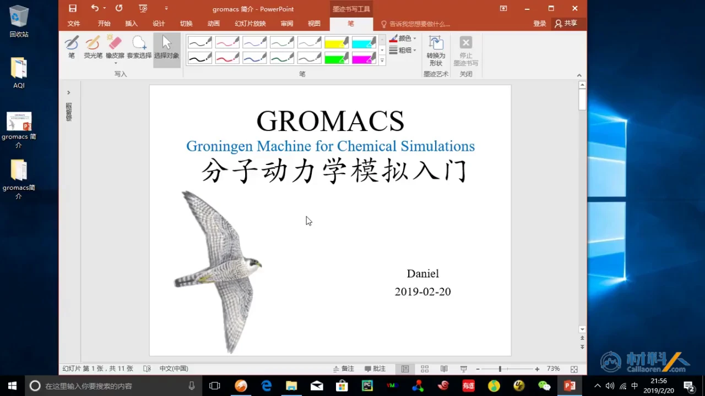
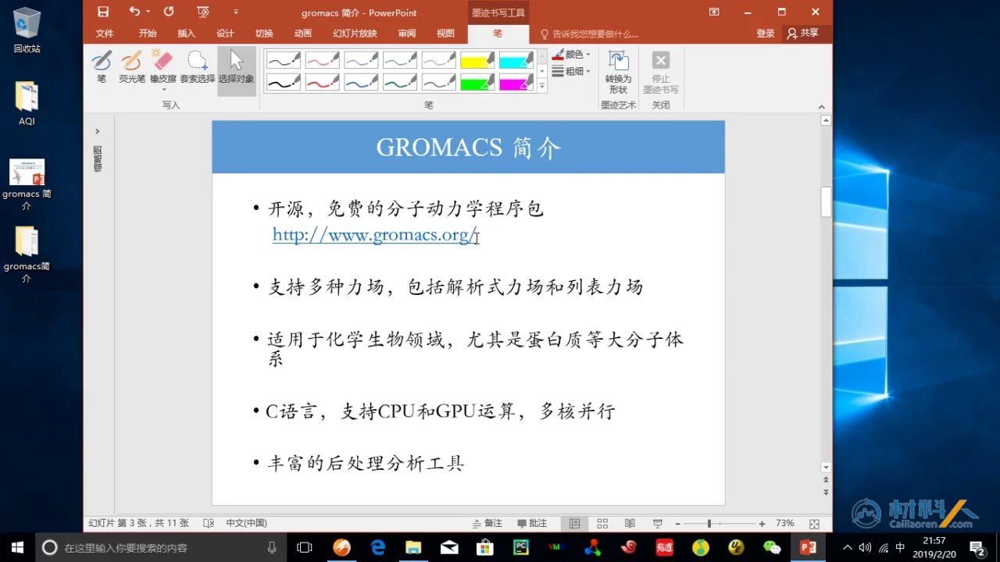
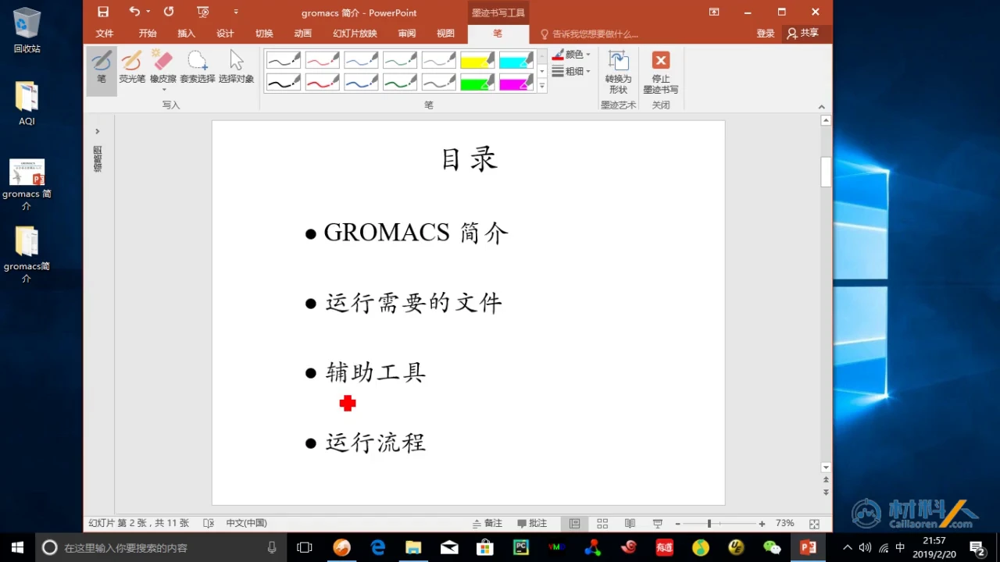
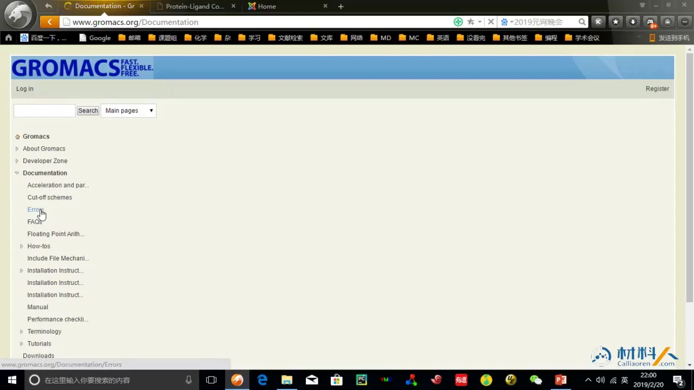
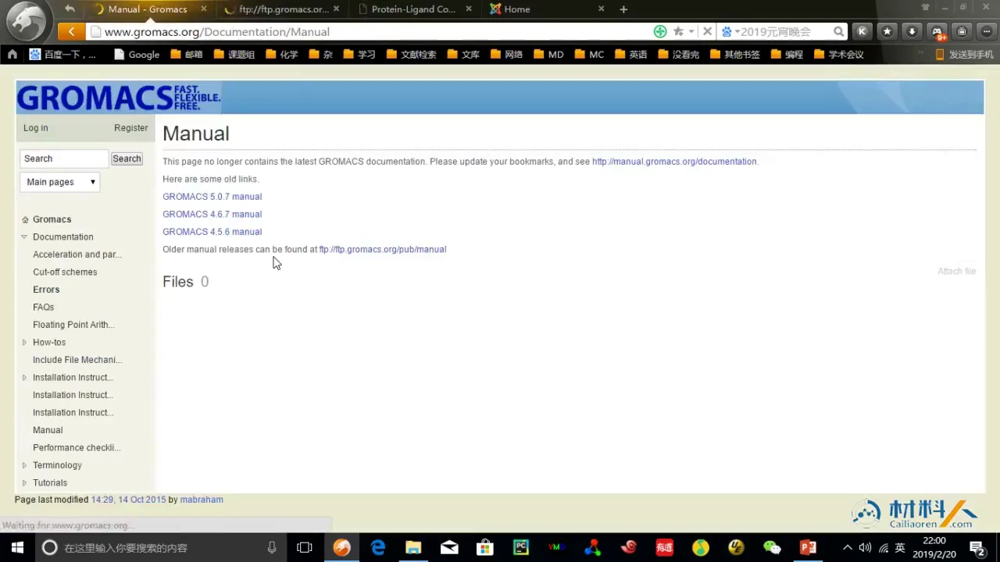
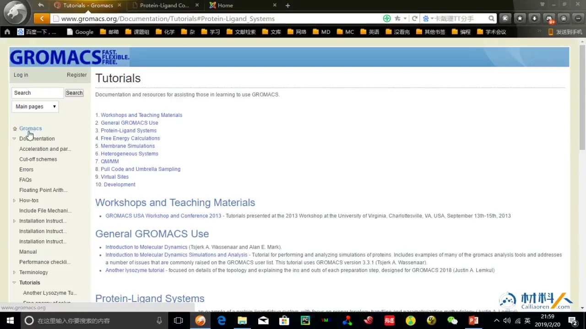

# GROMACS 系统课 01：GROMACS 是什么，为什么适合初学者

> 内容来源：B 站「LadPhile」转载的材料人 GROMACS 课程第 1 集《1. GROMACS 简单介绍》（BV1k5411V7eW，约 5 分钟），视频来自 cailiaoren.com。本文依据视频演说稿与幻灯片整理，文中时间戳可跳转到原视频。

## 本讲要解决的核心问题（SCQA）

**背景**：分子动力学（MD）是研究蛋白质等生物大分子的重要手段，GROMACS 是常用开源软件之一。

**冲突**：但初学者容易把 GROMACS 当成一个“黑箱软件”，既不知道它能算什么，也不清楚它和别的分子动力学软件有什么不同；第 1 集只有约 5 分钟，只能交代定位和课程路线。

**疑问**：GROMACS 到底是什么、能算什么？它支持哪些力场，又为什么常被推荐给初学者？

**回答（中心思想）**：GROMACS 是免费开源、支持解析力场与列表力场、面向生物化学体系的分子动力学软件包；它用 C 编写、支持 CPU/GPU 与多核并行，且自带丰富的后处理工具。本集只讲定位与官网文档，文件与运行流程留到后续。

---

## 一、GROMACS 是一台“化学模拟机”：免费、开源、面向生物体系

GROMACS 的全称是 **Groningen Machine for Chemical Simulations**，直译是“格罗宁根化学模拟机”。Groningen 是荷兰的格罗宁根大学；Machine 不是真实机器，而是一套用计算机做化学与生物体系模拟的程序。[【跳转到 00:00】](https://www.bilibili.com/video/BV1k5411V7eW/?p=1&t=0)

它做的“分子动力学”可以拆成三步：

- **是什么**：让原子按牛顿运动方程逐步演化，记录不同时刻的位置和速度。
- **为什么需要**：实验很难直接看到纳秒到微秒尺度上原子怎么动。
- **怎么做**：给定初始位置，规定原子之间如何相互作用（力场），再让时间一小步一小步往前走。

它的两个特点是：**免费开源**——软件不收费、源代码公开、不需要购买 license；**面向生物化学与生物体系**，尤其适用于蛋白质这类大分子。[【跳转到 00:50】](https://www.bilibili.com/video/BV1k5411V7eW/?p=1&t=50)

---

## 二、它能算什么：让大分子“动起来”，再算出可分析的性质

**第一，它能处理生物大分子体系。** 讲者明确说，GROMACS 比较适合化学、生物领域，尤其适用于蛋白质等大分子体系。[【跳转到 02:30】](https://www.bilibili.com/video/BV1k5411V7eW/?p=1&t=150) 模拟让体系持续演化，得到每个时刻的坐标；后续统计这些坐标，研究结构是否稳定。

**第二，它的力场覆盖范围广。** GROMACS 同时支持解析力场和列表力场，能处理的分子类型更多，遇到特殊体系也更有办法。

**第三，它跑得快、跑得大。** GROMACS 由 C 语言编写，支持 CPU 与 GPU 运算，并支持多核并行。GPU 擅长同时做大量重复的力的计算；多核并行则把体系拆给多个核心同时算。

---

## 三、力场是“原子之间怎么相互作用”的规则，GROMACS 两类都支持

**力场（force field）** 回答的是：两个原子靠近时，是吸引还是排斥？键长偏离平衡值要付出多少能量？这些能量又怎样变成每个原子受到的力？它像规则手册，规定势能函数形式，也给出每种原子、每种键的参数；没有力场，程序就不知道原子之间该怎么相互作用。

### 3.1 解析力场：用固定公式算

解析力场有明确的公式形式。讲者举了两个例子：**Lennard-Jones 12-6** 和 **CHARMM**。[【跳转到 01:15】](https://www.bilibili.com/video/BV1k5411V7eW/?p=1&t=75) Lennard-Jones 12-6 描述非键相互作用：距离很近时以 \(r^{-12}\) 急剧排斥，稍远时以 \(r^{-6}\) 吸引；CHARMM 则是面向生物大分子的一整套力场参数。

“解析”的好处是：知道距离就能代入公式算出能量和力，不必存大量数据；缺点是公式固定，遇到特殊体系时未必有合适参数。

### 3.2 列表力场：把“距离—力/能量”做成表来查

列表力场（tabulated force field）没有固定解析式，而是事先准备一张表，记录**力与能量随位置变化**的数值；计算时先量出两个位置之间的距离，再到表里检索、匹配，得到对应的力和能量。[【跳转到 01:40】](https://www.bilibili.com/video/BV1k5411V7eW/?p=1&t=100)

查表多一步检索，但换来了灵活性——某些体系没有现成解析力场可用时，只要能把相互作用做成表，就能纳入模拟。[【跳转到 02:05】](https://www.bilibili.com/video/BV1k5411V7eW/?p=1&t=125) 讲者特别强调，列表力场对“没有固定力场”的体系比较适用，大大扩展了 GROMACS 的计算领域。**解析力场保证通用性，列表力场补上特殊性**。

---

## 四、为什么它常被推荐给初学者：开源、跑得快、工具齐全

1. **门槛低**：免费开源，不用先解决授权问题；官网、手册、教程都公开。
2. **性能好**：C 语言实现，支持 CPU/GPU 与多核并行，同样的机器能跑更大的体系。
3. **生态完整**：讲者特别提到，GROMACS 拥有非常丰富的后处理程序，因此更适合初学者上手。[【跳转到 02:55】](https://www.bilibili.com/video/BV1k5411V7eW/?p=1&t=175)

第三点容易被低估。模拟本身只是“算出轨迹”，研究价值来自之后的统计与分析：体系有没有平衡、某个残基的涨落有多大。若分析全靠自己写脚本，初学者容易卡住；GROMACS 自带分析工具，把“算完之后怎么办”也准备了一部分。当然，文件、命令和报错排查仍需要系统学习。

---

## 五、课程把一套模拟拆成四块，本集只讲第一块

课程路线分为四部分：**GROMACS 简介、运行需要的文件、辅助工具、运行流程**；口头展开时，讲者又把“文件”拆成“运行需要什么软件”和“怎么样得到运行所需的文件”。[【跳转到 00:25】](https://www.bilibili.com/video/BV1k5411V7eW/?p=1&t=25)

| 课程部分 | 回答的问题 |
| --- | --- |
| GROMACS 简介 | 它是什么、能算什么、为什么用它 |
| 运行需要的文件 | 开跑之前要准备哪些输入 |
| 辅助工具 | 建模、可视化、分析用什么 |
| 运行流程 | 这些文件按什么顺序交给程序 |

本集实际展开的是第一块“简介”和官网文档；文件、辅助工具和运行流程留到后续。

---

## 六、官网不会用等于少一半：Documentation 是初学者的主入口

讲完简介后，讲者打开 GROMACS 官网，重点带看 **Documentation（文档）**。[【跳转到 03:16】](https://www.bilibili.com/video/BV1k5411V7eW/?p=1&t=196) 初学者先抓住四类内容即可。

**Manual（手册）** 按版本组织，例如 GROMACS 5.x 的手册；命令选项、参数含义都要回到手册查。[【跳转到 03:41】](https://www.bilibili.com/video/BV1k5411V7eW/?p=1&t=221) 手册篇幅大，不建议从头读到尾，正确用法是“遇到哪个命令就查哪一节”。

**Errors（报错合集）** 是社区收集的常见错误列表。运行 GROMACS 报错时，可以先把错误信息丢进去检索，看看前面的人是否遇到过、怎么解决。[【跳转到 03:54】](https://www.bilibili.com/video/BV1k5411V7eW/?p=1&t=234) 从幻灯片看，错误按 `pdb2gmx`、`grompp`、`mdrun` 等阶段分类，正好对应模拟流程的不同环节。

**FAQ 与 How-to** 分别回答“为什么”和“怎么做”，适合动手前快速确认做法。

**Tutorials（教程案例）** 最值得跟着做：官方案例覆盖不同体系，跑一遍就能熟悉常见命令和文件组织方式。[【跳转到 04:24】](https://www.bilibili.com/video/BV1k5411V7eW/?p=1&t=264) 页面上有溶菌酶、蛋白—配体、膜蛋白等案例；先完整跑通一个，比零散记命令有效。

---

## 小结

- GROMACS 全称 **Groningen Machine for Chemical Simulations**，是免费开源、面向生物化学体系的分子动力学软件包，尤其适合蛋白质等大分子，支持 CPU/GPU 与多核并行。
- 力场决定原子之间如何相互作用；GROMACS 支持**解析力场**（固定公式，如 Lennard-Jones 12-6、CHARMM）和**列表力场**（查距离—力/能量表，适合特殊体系）。
- 课程分四块：GROMACS 简介、运行需要的文件、辅助工具、运行流程；本集只展开简介与官网文档。
- 官网 Documentation 是自学主入口：Manual 查命令，Errors 查报错，Tutorials 跟着做案例。

## 关键术语速查

| 术语 | 一句话解释 |
| --- | --- |
| GROMACS | Groningen Machine for Chemical Simulations，免费开源的分子动力学软件包 |
| 分子动力学（MD） | 让原子按相互作用随时间逐步演化，得到运动轨迹的模拟方法 |
| 力场 | 规定原子间势能函数形式与参数的一套规则 |
| 解析力场 | 用固定公式计算相互作用，如 Lennard-Jones 12-6、CHARMM |
| 列表力场 | 用“距离—力/能量”数值表检索相互作用，适合特殊体系 |
