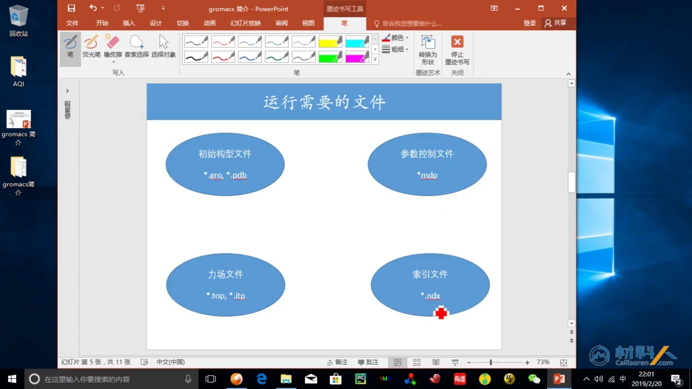
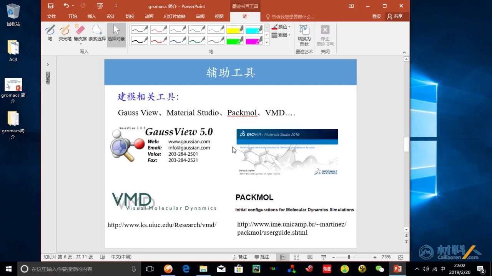
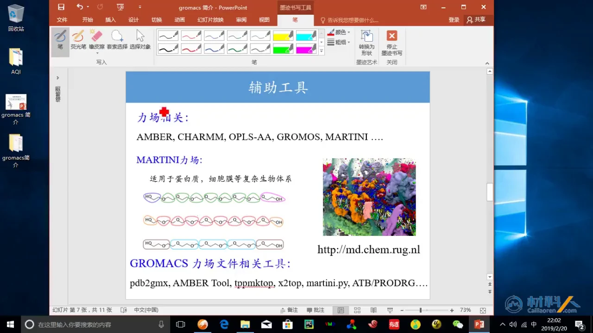
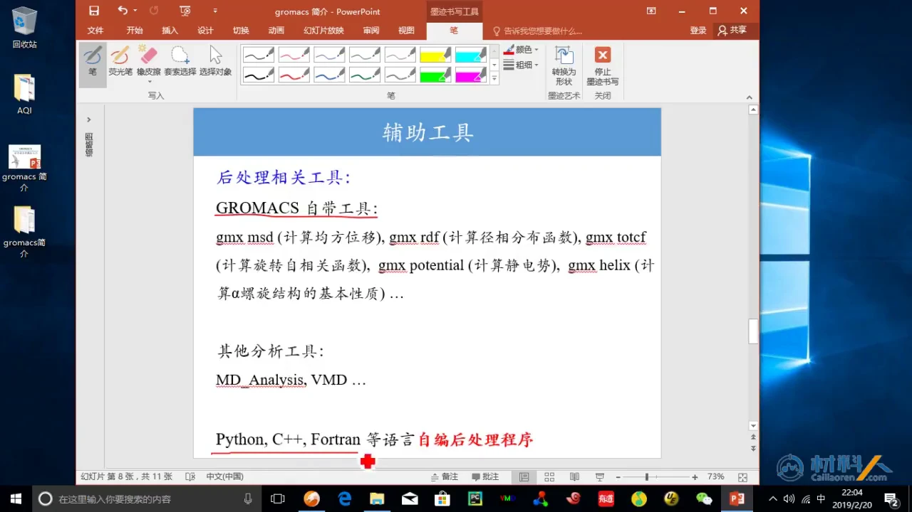
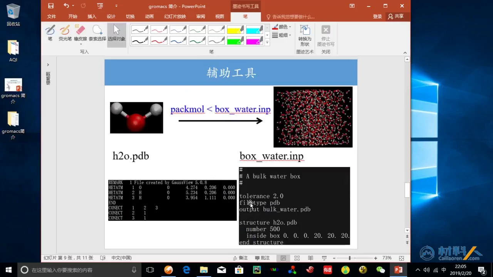
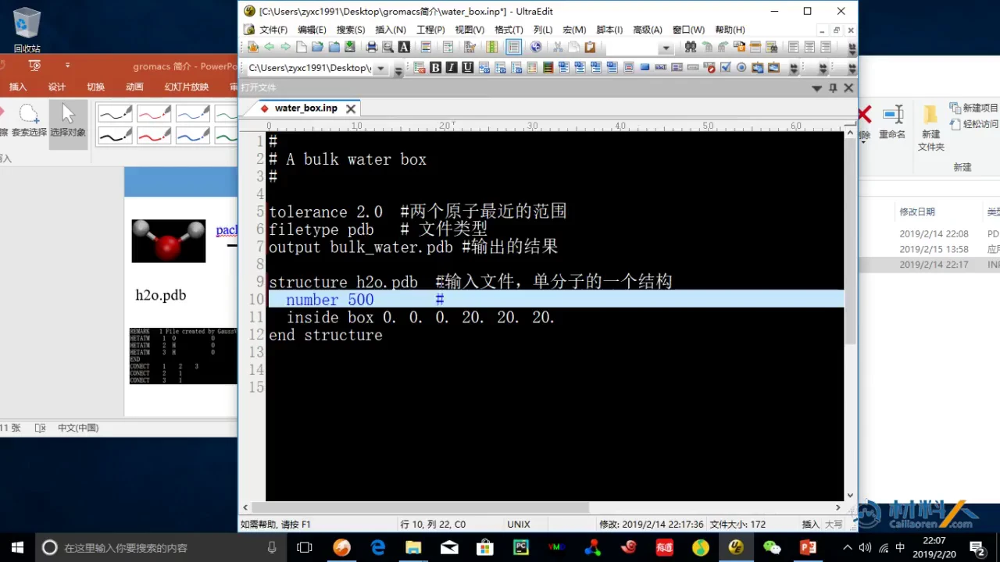
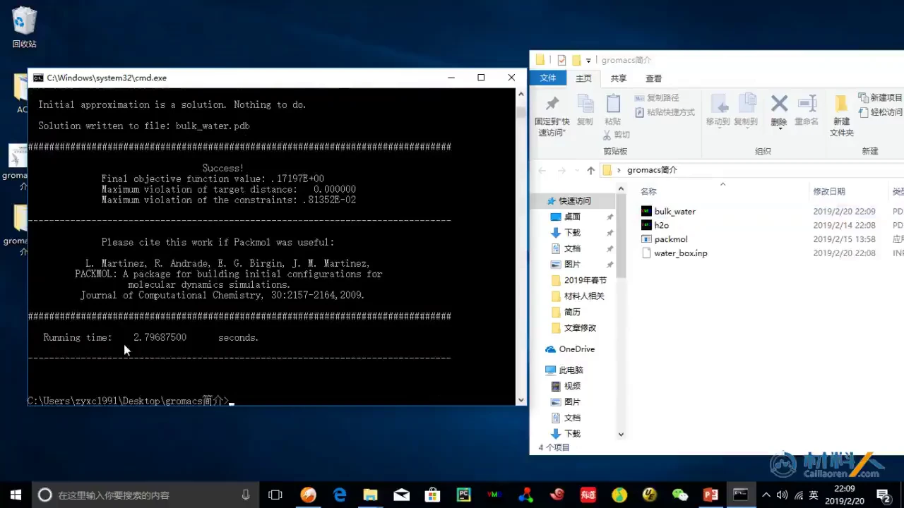
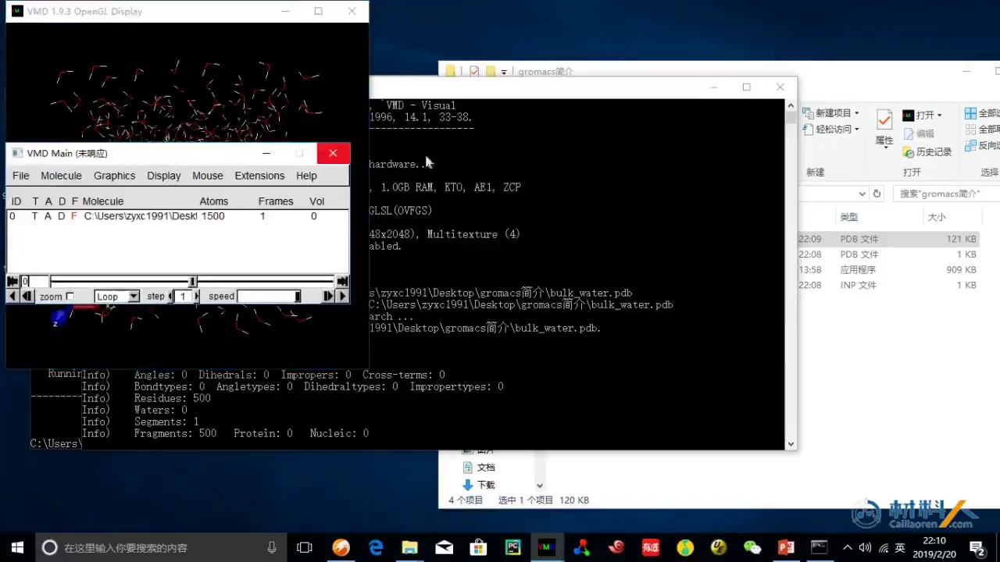
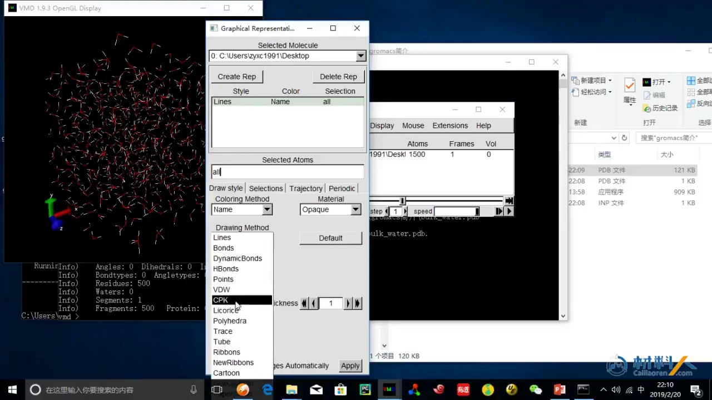
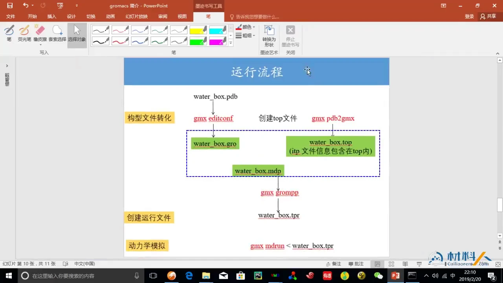

# GROMACS 系统课 02：运行文件、辅助工具与计算流程

> 内容来源：B 站「LadPhile」转载的材料人 GROMACS 课程第 2 集《2. GROMACS运行文件、辅助工具、计算流程》（BV1k5411V7eW，第 2 P，约 11 分钟），视频来自 cailiaoren.com。本文依据视频演说稿与幻灯片整理，文中时间戳可跳转到原视频。

## 本讲要解决的核心问题（SCQA）

**背景**：上一讲已经认识 GROMACS 的定位、官网和文档入口，知道它是一套免费开源、面向生物体系的分子动力学软件。

**冲突**：真正动手时，摆在面前的却是一堆陌生后缀——`pdb`、`gro`、`top`、`itp`、`mdp`、`ndx`；还要选建模软件、选力场、找分析工具。文件各管什么、谁先谁后，初学者很容易乱。

**疑问**：跑一次 GROMACS 模拟，究竟需要哪些文件、借助哪些辅助工具、按什么顺序把它们串起来？

**回答（中心思想）**：一次运行只需要四类输入文件——**初始构型、参数控制、力场、索引**；辅助工具则分为**建模、力场相关、后处理**三类；把这些文件依次交给 `editconf → pdb2gmx → grompp → mdrun`，就构成从结构到轨迹的主线。本讲用“1 个水分子 → 500 个水分子的盒子”走通准备阶段，为后续完整模拟打底。

---

## 一、一次运行只需四类输入文件，先弄清各自分工

GROMACS 不是“把结构文件丢进去就能算”，而是四类文件配合工作。幻灯片把运行所需文件归纳为四个圈：[【跳转到 00:05】](https://www.bilibili.com/video/BV1k5411V7eW/?p=2&t=5)



1. **初始构型文件（`*.gro`、`*.pdb`）**：记录体系里每个原子的种类与三维坐标，相当于给模拟一个“起始画面”。没有坐标，程序不知道原子在哪里，也就无从计算距离和作用力。
2. **参数控制文件（`*.mdp`）**：规定“这次要怎么算”——步长、总步数、温度、压力等。同一套结构，改 `mdp` 就能从能量最小化切换到升温或正式采样。
3. **力场文件（`*.top`、`*.itp`）**：规定“原子之间怎么相互作用”，包括势能函数形式和具体参数。`top` 是总拓扑，`itp` 是可以被引用的参数片段。
4. **索引文件（`*.ndx`）**：把原子按组标号，例如蛋白质、水、离子各成一组。讲者特别强调，它对后面分析程序“找到目标物质”非常重要——否则程序面对上万个原子，不知道该统计哪一群。

除文件外，讲者提醒优先看官网 **Documentation** 菜单下的三块内容：**Errors（常见报错）、Manual（手册）、Tutorials（教程）**。Errors 帮你判断报错含义，Manual 解释参数与用法，Tutorials 则给出可以照着做的完整例子；遇到问题先在这三处找答案。

---

## 二、初始结构是本讲重点，建模工具要按体系规模选

四类文件里，讲者把**初始构型**作为本讲重点：它涉及“建模”，也是初学者最容易卡住的一步。[【跳转到 00:30】](https://www.bilibili.com/video/BV1k5411V7eW/?p=2&t=30)



幻灯片列出四款常用工具，选择时可先看两点：**建什么体系**、**是否收费**。

- **GaussView**：适合搭建单个分子的构型，例如画出一个水分子或一个小配体。讲者说明它和 **Materials Studio** 都是收费软件。
- **Materials Studio**：同样用于建模，功能更偏向材料与分子体系的可视化搭建。
- **Packmol**：免费，专长不是“画一个分子”，而是把大量分子按指定区域堆积成初始盒子，例如给水盒子填满水分子。
- **VMD**：免费，既能显示结构，也能做后续可视化与分析；本讲后面会用它检查 Packmol 生成的盒子。

一句话概括分工：**小分子靠画，大体系靠堆，检查靠看**。先用 GaussView 之类工具得到单分子结构，再用 Packmol 复制、堆积成溶剂盒，最后用 VMD 打开确认。

---

## 三、GROMACS 的力场生态很全，转换工具把结构接上参数

有了结构还不够，必须告诉程序原子之间如何作用，这就是**力场**。讲者把 GROMACS 的一大优势归结为“支持多种力场”，尤其是针对生物大分子体系。[【跳转到 01:20】](https://www.bilibili.com/video/BV1k5411V7eW/?p=2&t=80)



幻灯片列出的力场包括 **AMBER、CHARMM、OPLS-AA、GROMOS、MARTINI**。它们是不同研究社区积累的参数体系，选择哪一个通常取决于体系类型和文献惯例。GROMACS 不绑定单一力场，因此同一套软件可以处理蛋白质、膜、小分子等多种对象。

结构文件与力场之间需要“接头”，幻灯片给出了一组工具：

- **`pdb2gmx`**：GROMACS 自带的拓扑生成工具，读入 `pdb`，按选定力场生成 `top`（以及 `gro`），是最常用的一环；
- **AMBER Tool、`tppmktop`、`x2top`、`martini.py`、ATB/PRODRG**：分别面向 AMBER 参数、特定力场拓扑、粗粒化建模等场景的转换或辅助工具。

讲者明确说这些工具“这里不详细介绍”，本讲只需建立一张地图：**结构来自建模工具，参数来自力场，二者靠转换工具对接**。真正使用时再按体系查对应教程。

---

## 四、Martini 用粗粒化把计算量降一个量级

在众多力场中，讲者单独展开 **MARTINI**，因为它的思路与全原子模拟不同。[【跳转到 01:45】](https://www.bilibili.com/video/BV1k5411V7eW/?p=2&t=105)

**是什么**：Martini 是粗粒化（coarse-grained）力场。它把原来 3 个或 4 个原子“拟合”成一个珠子（bead），用珠子代替原子参与计算。

**为什么需要**：分子动力学的主要开销来自逐个计算粒子之间的相互作用。把多个原子合并成一个珠子后，粒子数大幅减少，每一步要算的相互作用随之减少，计算量就降下来了，于是能模拟更大的体系。

**怎么做**：先由全原子结构生成对应的粗粒化模型，再套用 Martini 的参数。讲者指出它适用于蛋白质、细胞膜等复杂生物体系，并给出官网 `md.chem.rug.nl` 供查阅。幻灯片右侧的膜蛋白插图，就是粗粒化体系的一个直观例子。

需要记住的是取舍：**粗粒化换来速度与尺度，代价是原子级细节**。要不要用，取决于你想回答的问题需要多细的分辨率。

---

## 五、后处理先用自带工具，进阶再自己写脚本

模拟跑完只是得到轨迹，研究结论来自后处理。讲者把后处理工具分成三档：[【跳转到 02:51】](https://www.bilibili.com/video/BV1k5411V7eW/?p=2&t=171)

1. **GROMACS 自带分析工具**：这是最直接的起点，常用命令包括 `gmx msd`（均方位移）、`gmx rdf`（径向分布函数）、`gmx rotacf`（旋转自相关函数，幻灯片上写作 `gmx tocf`）、`gmx potential`（静电场）和 `gmx helix`（α 螺旋结构的基本性质）等。
2. **第三方工具**：如 **VMD**、**MDAnalysis**。前者擅长可视化与结构检查，后者是 Python 生态中常用的轨迹分析库。
3. **自己编写程序**：讲者认为这是“比较理想”的方式，并提到可用 **Python、C++、Fortran** 等语言。现成工具覆盖的是通用需求，真正研究时往往要计算特定的性质，只有自己写才能精确得到想要的结果。



他的建议很务实：如果对编程比较熟悉，**建议采用自己编写程序处理数据的方式**。这并不意味着跳过自带工具，而是先用它们把流程跑通、确认数据没问题，再把特殊分析交给自己写的脚本。

---

## 六、Packmol 用“模板 + 数量 + 盒子”把单分子扩成溶剂盒

从这一节开始进入实操：怎样从一个水分子得到一盒水。讲者把目标说得很清楚——**由单个水分子得到一个水盒子**。[【跳转到 03:52】](https://www.bilibili.com/video/BV1k5411V7eW/?p=2&t=232)



**第一步，准备单分子结构。** 讲者事先准备了一个水分子的 `pdb` 文件。PDB 是文本格式，`ATOM`/`HETATM` 行记录原子名称与坐标（本例中的水分子用 `HETATM` 记录），`CONECT` 行记录原子间的连接关系，因此人和程序都能读，也方便在不同软件之间交换。[【跳转到 04:25】](https://www.bilibili.com/video/BV1k5411V7eW/?p=2&t=265)

**第二步，写一个输入脚本。** 它不描述分子本身，而是告诉 Packmol：用哪个模板、复制多少个、放在多大的盒子里、输出成什么文件。

**第三步，运行 Packmol 得到新结构。** 幻灯片把整个过程压缩成一行命令：

```text
packmol < water_box.inp
```

左边是单个 `h2o.pdb`，右边是填满水分子的 `bulk_water.pdb`。这就是“建模”在溶剂盒场景下的具体含义：**不是逐个摆 500 个分子，而是用规则让程序自动填满**。幻灯片上的命令写作 `box_water.inp`，视频里实际使用的文件名是 `water_box.inp`，以后者为准。

---

## 七、输入脚本的几行决定盒子怎么长

Packmol 的输入文件很短，但每一行都影响结果。讲者在编辑器里逐行注释：[【跳转到 04:30】](https://www.bilibili.com/video/BV1k5411V7eW/?p=2&t=270)



```text
#
# A bulk water box
#
tolerance 2.0          # 两个原子最近的范围
filetype pdb           # 文件类型
output bulk_water.pdb  # 输出的结果

structure h2o.pdb      # 输入文件，单分子的一个结构
  number 500
  inside box 0. 0. 0. 20. 20. 20.
end structure
```

逐项解释可以归为三组：

1. **全局设置**：`tolerance 2.0` 规定任意两个原子允许的最小距离，数值太小分子会挤在一起甚至重叠，数值太大盒子又填不满，相当于给分子之间留出“安全间距”；`filetype pdb` 声明输入、输出都用 PDB 格式；`output bulk_water.pdb` 指定结果写到哪里，命名清楚后面接 GROMACS 时不容易拿错文件。[【跳转到 05:00】](https://www.bilibili.com/video/BV1k5411V7eW/?p=2&t=300)
2. **模板与数量**：`structure h2o.pdb` 指定以哪个文件作为重复单元，也就是“模板”；`number 500` 表示复制 500 个这样的分子。[【跳转到 05:52】](https://www.bilibili.com/video/BV1k5411V7eW/?p=2&t=352)
3. **填充区域与结束**：`inside box 0. 0. 0. 20. 20. 20.` 限定填充区域，即一个 20×20×20 的立方盒子，前三个数是起点、后三个数是终点；`end structure` 结束当前分子的定义，允许继续写下一个 `structure` 块。[【跳转到 06:22】](https://www.bilibili.com/video/BV1k5411V7eW/?p=2&t=382)

脚本写好后，讲者从官网下载 Packmol（有 Windows 和 Linux 版本，演示用 Windows），打开命令提示符进入文件所在目录，执行 `packmol < water_box.inp`。[【跳转到 07:17】](https://www.bilibili.com/video/BV1k5411V7eW/?p=2&t=437)



终端先打印 `Initial approximation is a solution. Nothing to do.`，随后给出 **Success**、目标函数值、最大约束违背量，以及引用信息；本次运行耗时约 **2.8 秒**。右侧文件夹里出现了新的 `bulk_water.pdb`（约 121 KB）。[【跳转到 08:34】](https://www.bilibili.com/video/BV1k5411V7eW/?p=2&t=514) 这说明 500 个水分子已经按约束摆进了盒子。

---

## 八、VMD 负责“看见并检查”结构

生成文件不等于结果正确，下一步是把 `bulk_water.pdb` 打开检查。讲者用 VMD 载入后，窗口里显示 **1500 个原子、500 个残基**，正好对应 500 个水分子（每个水分子 3 个原子）。[【跳转到 09:06】](https://www.bilibili.com/video/BV1k5411V7eW/?p=2&t=546)



他发现默认显示方式与幻灯片里的效果不一样：VMD 默认用细线画键，看起来像一团乱线。于是打开 **Graphical Representations**，把 **Drawing Method** 从 `Lines` 改成 `CPK`，原子就变成按元素着色的球棍模型，和课件里的水盒子一致。[【跳转到 09:16】](https://www.bilibili.com/video/BV1k5411V7eW/?p=2&t=556)



除了绘制方式，球的精细程度、键的宽度和显示与否都可以调。讲者评价“这还是很强大的”。对初学者来说，这一步的实际价值是：**用肉眼确认分子数量、分布和盒子边界是否合理**，避免把明显错误的结构带进 GROMACS。

---

## 九、从 pdb 到轨迹，几条命令串起完整流程

结构检查无误后，就进入 GROMACS 的主线。讲者用一张流程图收尾：[【跳转到 09:43】](https://www.bilibili.com/video/BV1k5411V7eW/?p=2&t=583)



图中每个箭头对应一条命令、一类文件：

1. **构型文件转化**：`gmx editconf` 把 `water_box.pdb` 转成 `water_box.gro`。`gro` 是 GROMACS 的原生格式，后续命令读起来更顺；`editconf` 也常用来设置盒子边界。
2. **创建拓扑**：`gmx pdb2gmx` 依据所选力场生成 `water_box.top`。幻灯片特别注明“**itp 文件信息包含在 top 内**”，所以小体系里不一定单独看到 `itp`。
3. **准备控制参数**：写好 `water_box.mdp`，规定这一步算什么、算多久。
4. **创建运行文件**：`gmx grompp` 把 `gro`、`top`、`mdp` 组装并做一致性检查，输出 `water_box.tpr`。`tpr` 是二进制运行输入，`mdrun` 只认它。
5. **动力学模拟**：`gmx mdrun` 读取 `tpr` 开始计算，产出轨迹与日志。

流程图之外，一次完整的分子动力学研究通常分为五个阶段。它们共用同一套“文件 → `grompp` → `tpr` → `mdrun`”机制，区别主要在 `mdp` 里设定的目标：

| 阶段 | 要解决的问题 | 典型做法 |
| --- | --- | --- |
| 准备 | 体系长什么样、盒子多大、溶剂和离子够不够 | 建模、建盒、补溶剂、加离子，得到 `gro` 与 `top` |
| 能量最小化 | 初始结构可能有原子重叠，直接跑会“炸” | 用 `mdp` 设定能量最小化，让结构先松弛 |
| 平衡 | 体系需要适应目标温度和压力 | 通常在恒温（NVT）、恒压（NPT）下分步平衡 |
| 生产 | 正式采集用于分析的数据 | 设定步数跑 `mdrun`，得到轨迹（`xtc` 为压缩轨迹、`trr` 为全精度轨迹）、能量（`edr`）和日志（`log`） |
| 分析 | 从轨迹中提取可解释的性质 | 用 GROMACS 自带工具、VMD、MDAnalysis 或自写脚本统计 |

需要说明的是，本讲只演示到“准备”阶段的第一步——把单分子堆成水盒子，并用 VMD 检查；能量最小化、平衡、生产和分析的具体命令，讲者明确留到后面详细介绍。[【跳转到 10:13】](https://www.bilibili.com/video/BV1k5411V7eW/?p=2&t=613)

---

## 小结

- 一次 GROMACS 运行只需要四类输入：**初始构型（`gro`/`pdb`）、参数控制（`mdp`）、力场（`top`/`itp`）、索引（`ndx`）**；`ndx` 的作用是让分析程序准确定位目标原子组。
- 建模工具按任务选：**GaussView/Materials Studio** 画单分子（收费），**Packmol** 堆大体系，**VMD** 免费做显示与检查。
- GROMACS 支持 **AMBER、CHARMM、OPLS-AA、GROMOS、MARTINI** 等多种力场，`pdb2gmx` 等工具负责把结构接到参数上。
- **Martini 粗粒化**把 3–4 个原子合成一个珠子，用细节换速度与尺度，适合蛋白质、膜等大体系。
- Packmol 的核心是“**模板 + 数量 + 盒子**”：`structure` 指定模板，`number` 指定数量，`inside box` 指定区域，`tolerance` 防止原子重叠。
- 主线流程是 **`editconf` → `pdb2gmx` → `grompp` → `mdrun`**：先把 `pdb` 转成 `gro`、生成 `top`，再由 `grompp` 打包成 `tpr`，最后交给 `mdrun`。
- 完整模拟分为**准备、能量最小化、平衡、生产、分析**五段；本讲只走通准备阶段的第一步，其余留待后续。

## 关键术语速查

| 术语 | 一句话解释 |
| --- | --- |
| 初始构型文件 | 记录原子种类与坐标的起点文件，常见格式为 `pdb`、`gro` |
| `pdb` | 通用文本结构格式，用 `ATOM`、`CONECT` 等记录原子坐标与连接 |
| `gro` | GROMACS 原生结构格式，后续命令常用 |
| `mdp` | 参数控制文件，规定步长、步数、温度、压力等计算设置 |
| `top` | 拓扑文件，汇总力场参数与分子连接关系 |
| `itp` | 可被 `top` 引用的参数片段，常用于分子或力场模块 |
| `ndx` | 索引文件，把原子分组，便于分析程序定位目标 |
| 力场 | 规定原子间势能函数形式与参数的一套规则 |
| Martini / 粗粒化 | 把多个原子合并成一个珠子的简化模型，用精度换计算速度 |
| Packmol | 按数量和区域把分子堆积成初始盒子的建模工具 |
| `pdb2gmx` | 依据力场把 `pdb` 转成 `top`（及 `gro`）的 GROMACS 工具 |
| `editconf` | 转换构型格式、设置盒子边界的 GROMACS 工具 |
| `grompp` | 把 `gro`、`top`、`mdp` 组装并检查，生成 `tpr` |
| `tpr` | 二进制运行输入文件，`mdrun` 直接读取 |
| `mdrun` | 执行分子动力学计算的 GROMACS 主程序 |
| VMD | 免费的可视化软件，用于查看结构、轨迹与调整显示方式 |
