# GROMACS 系统课 03：源码编译安装 GROMACS 的完整过程

## 本讲要解决的核心问题（SCQA）

**背景**：你已经知道 GROMACS 是做什么的，也从官网下载好了源码压缩包。和 Windows 上双击安装的软件不同，Linux 下的科学计算程序常常只提供源码，需要自己在机器上编译。

**冲突**：GROMACS 并不是一个孤立的程序，它依赖三个辅助软件——CMake、FFTW、OpenMPI。少装一个、版本对不上，或者编译选项写错，`make` 就会在几百行输出之后报错退出；而编译输出又长又密，初学者很难判断问题出在哪一步。

**疑问**：这四个软件应该按什么顺序装？每一行命令和每一个 `-D` 选项到底在说什么？装完之后怎样让系统认识 `gmx` 命令，又怎样确认安装真的成功？

**回答（中心思想）**：源码编译安装可以归纳为一条固定流水线——**先装三个依赖，再登记路径，最后编译 GROMACS**；每一步都遵循「解压 → 配置安装路径 → make → make install」；成败的关键只有三点：**依赖版本相互匹配、配置时路径写对、编译选项与依赖实际编译出的精度和并行能力一致**。

> 本讲演示的是一台 Linux 服务器上的完整操作，安装的版本为 CMake 2.8.7、FFTW 3.3.1、OpenMPI 2.1.1 和 GROMACS 4.5.4。版本会变，流程与选项含义不变。

## 一、先看清全局：安装 GROMACS 要配齐四个软件，版本必须相互匹配

**GROMACS 的编译不是装一个软件，而是配齐一套相互兼容的工具链。** 这张关系图决定了后面所有步骤的顺序。

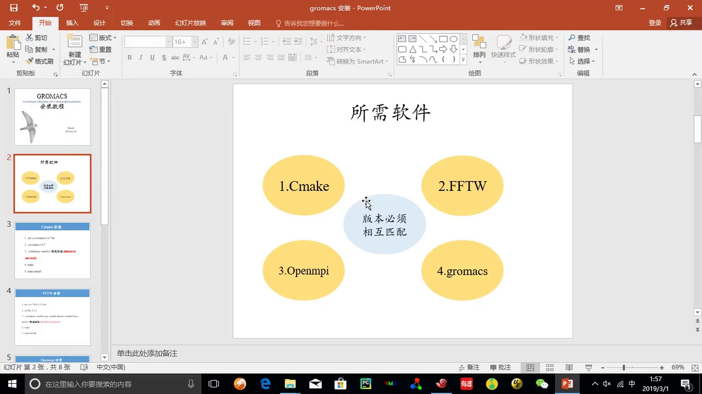

四者角色分别是：

- **CMake**：辅助编译的工具。GROMACS 由 C 语言写成，源码本身只是一堆文本文件，需要编译器把它翻译成机器能执行的程序；CMake 负责根据源码里的描述，生成真正指挥编译的规则文件（Makefile）。
- **FFTW**：快速傅里叶变换（Fastest Fourier Transform in the West）数值库。分子模拟涉及大量数据处理，需要它来加速。
- **OpenMPI**：多核并行模拟中的数据交换工具。GROMACS 实际使用时往往是多核并行处理，进程之间要不断交换边界信息，MPI 就是这套通信标准。
- **GROMACS**：最终要安装的主体，前三个都是为它服务的。

[【跳转到 00:25】](https://www.bilibili.com/video/BV1k5411V7eW/?p=3&t=25)

这里最重要的提醒是幻灯片中央那句话：**版本必须相互匹配**。先选定一个 GROMACS 版本，另外三个辅助软件的版本就要落在与之兼容的范围内，而不是各自装最新版。

**为什么不是越新越好？** 讲者在等待编译时专门解释：GROMACS 每年都在更新，但新版本、新依赖往往对计算机要求更高。如果只是计算某些特定性质，找到能满足需求的版本就够了，不必追新，还要兼顾自己机器的性能。

[【跳转到 14:43】](https://www.bilibili.com/video/BV1k5411V7eW/?p=3&t=883)

本讲选择 GROMACS 4.5.4，原因很实际：它的版本要求低，对 FFTW 等依赖的版本要求也低；而已经装好的 FFTW 3.3.1 与 OpenMPI 2.1.1，同一套依赖既能编译 4.5.4，也能编译 4.5.6。这就是「版本匹配」在操作层面的样子。

## 二、三个依赖共享同一套五步安装法

**所有源码包的安装流程完全同构，记住一遍就能套用四次。** 讲者把 CMake 的安装拆成五步，后面的 FFTW、OpenMPI 和 GROMACS 只是在第三步的配置参数上有所不同。

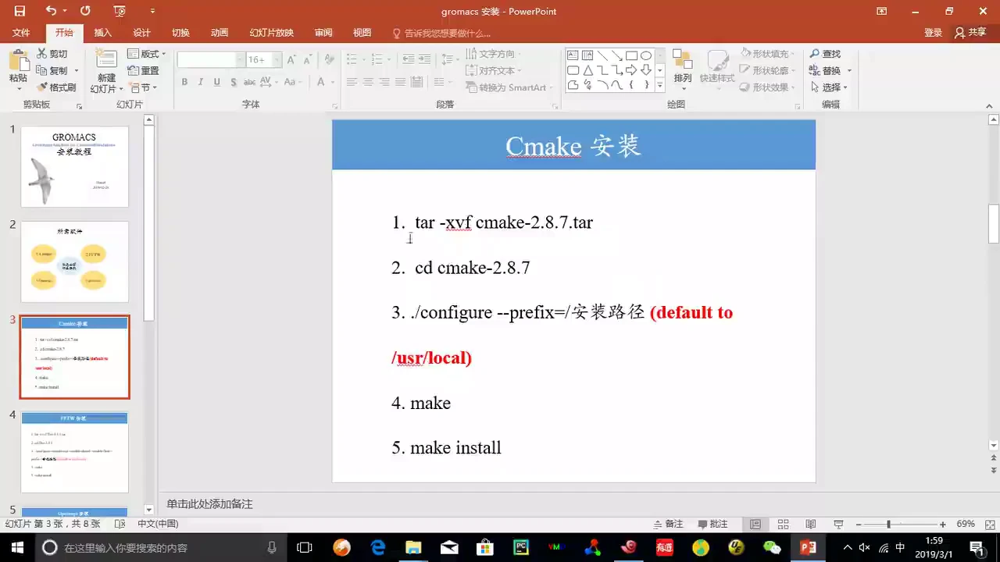

通用流程是：

1. **解压**：`.tar` 包用 `tar -xvf`，`.tar.gz` 包用 `tar -zxvf`。多出来的 `z` 表示先调用 gzip 解压，`x` 是提取，`v` 是显示过程，`f` 表示操作对象是文件。
2. **进入解压出的源码目录**：`cd 软件名-版本号`。注意目录名通常带版本号，不能只写软件名。
3. **配置**：`./configure --prefix=/安装路径`，指定这个软件最终装到哪里。`--prefix` 不写时默认装到 `/usr/local`。
4. **编译**：`make`，把源码翻译成可执行文件和库。
5. **安装**：`make install`，把编译好的东西复制到第 3 步指定的目录。

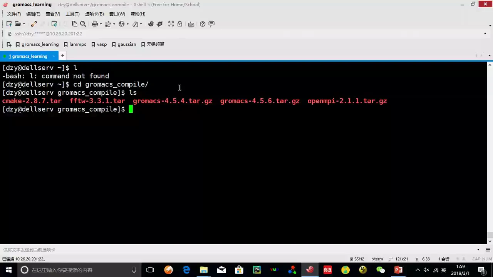

讲者提前把四个包下载到 `gromacs_compile`，视频省去下载环节。图中还能看到一个很真实的细节：他先误输入了 `l`，终端返回 `-bash: l: command not found`。这类手误在命令行里非常常见，重新输入正确命令即可。

**为什么要先装 CMake？** 后面编译 FFTW 和 GROMACS 都可能用到它生成的构建规则，依赖必须按「被依赖者先装」的顺序来。CMake 自身稍特殊：源码里自带 `configure` 脚本，先自举（bootstrap），再由生成的 Makefile 编译本体。

## 三、安装 CMake：先让机器学会“读构建说明书”

**CMake 是整个工具链的翻译官，它把源码作者写的构建描述翻译成 make 能执行的规则。** 在 CMake 之前，人们直接手写 Makefile；项目一大，Makefile 就难以维护。CMake 用更高层的 `CMakeLists.txt` 描述「要编译哪些源文件、依赖哪些库」，再针对当前机器生成对应的 Makefile。

具体操作是：

```bash
tar -xvf cmake-2.8.7.tar
cd cmake-2.8.7
./configure --prefix=/home/dzy/gromacs_compile/cmake
make
make install
```

[【跳转到 02:49】](https://www.bilibili.com/video/BV1k5411V7eW/?p=3&t=169)

`--prefix` 后面写的是自己规划好的安装根目录。讲者强调，安装路径没有统一答案，但要和后面环境变量、编译选项里引用的路径保持一致。

执行 `make` 之后，屏幕上会滚动大量 `g++ ... -c ... -o xxx.o` 的命令。`.o` 是**目标文件**（object file），可以理解为「已经翻译成机器码、但还没拼装成最终程序」的半成品；最后链接器会把这些 `.o` 拼成 `cmake`、`ccmake`、`ctest` 等可执行文件。

[【跳转到 03:59】](https://www.bilibili.com/video/BV1k5411V7eW/?p=3&t=239)

**怎么判断安装成功？** 进入 `--prefix` 指定的目录，会看到 `bin`、`doc`、`man`、`share` 四个子目录：`bin` 放可执行程序，`doc` 放文档，`man` 放手册页（用 `less ccmake.1` 可以翻阅），`share` 放共享数据。讲者还展示了 `bin` 里的 `ccmake`、`cmake`、`cpack`、`ctest`，这就是「安装完成」的直观证据。

**一个省时间的技巧**：`make -j` 可以并行编译。`-j` 后面跟数字表示同时开几个任务，只写 `-j` 则尽可能用满所有核心。多核机器上它能显著缩短编译时间；单核机器上则没有意义。

[【跳转到 08:46】](https://www.bilibili.com/video/BV1k5411V7eW/?p=3&t=526)

另外，按**向上方向键**可以调出之前输入过的命令，输入路径时按 **Tab** 会自动补全，反复编译时能省下大量时间。

## 四、安装 FFTW：为数值计算准备一个“加速库”

**FFTW 是一个做快速傅里叶变换的库，GROMACS 在编译时需要链接它。** 可以把它想成一个已经写好、经过高度优化的数学函数集合：你不必自己实现傅里叶变换，只要在编译时告诉程序「库的头文件和二进制文件在哪里」。

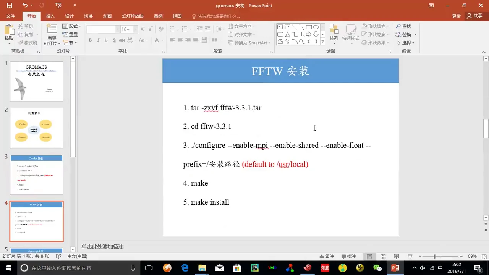

FFTW 的安装步骤与 CMake 相同，但配置参数更多：

```bash
tar -zxvf fftw-3.3.1.tar.gz
cd fftw-3.3.1
./configure --enable-mpi --enable-shared --enable-float --prefix=/安装路径
make
make install
```

三个 `--enable-*` 各自解决一个问题：

- `--enable-mpi`：让 FFTW 支持 MPI，这样并行版的 GROMACS 才能使用并行 FFT。
- `--enable-shared`：同时生成动态库（`.so`），方便多个程序共享；静态库（`.a`）也会一并生成。
- `--enable-float`：编译**单精度**版本。浮点数用更少的位数存储，速度快、内存占用小，但精度较低；不加这个选项时默认是双精度。这个名字里带 `f` 的库就是后面 GROMACS 选项里 `FFTW3F` 的来源。

**精度为什么必须两边一致？** FFTW 编译成单精度、GROMACS 却按双精度链接时，函数符号对不上，编译或链接就会失败。精度不是孤立的选项，而是依赖库与主程序之间必须对齐的契约。

[【跳转到 06:02】](https://www.bilibili.com/video/BV1k5411V7eW/?p=3&t=362)

编译时同样会生成大量 `.o` 文件，过程比 CMake 长一些；讲者让它在后台跑，自己切到另一个窗口继续讲。安装完成后进入 `fftw` 目录，会看到 `bin`、`include`、`lib`、`share`；其中 `lib` 里最关键的是 `libfftw3.a` 和 `libfftw3.la` 这类库文件，`include` 里则是 `fftw3.h` 等头文件。

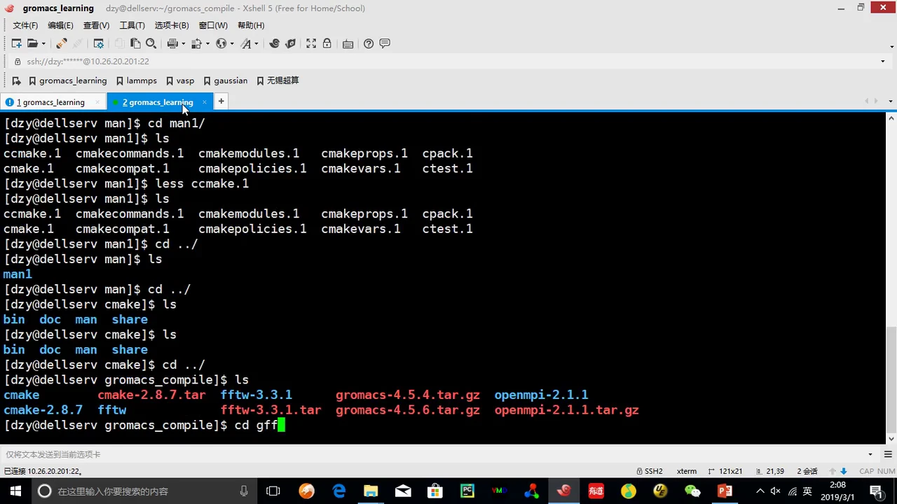

这里顺便纠正一个容易听错的地方：字幕里的「library3」指的是 **libfftw3** 系列库。头文件（`.h`）负责告诉编译器「函数长什么样、参数怎么传」，库文件负责提供函数的真正实现，两者缺一不可——这也是后面 CMake 要分别指定 `INCLUDE_DIR` 和 `LIBRARIES` 的原因。

## 五、安装 OpenMPI：让多个进程能互相“对话”

**OpenMPI 是 MPI 标准的一种实现，负责并行计算时进程间的数据交换。** MPI（Message Passing Interface）是一套通信规范：多个进程各自算一部分，再通过收发消息把结果拼起来。OpenMPI 把它做成了可直接调用的库和命令。

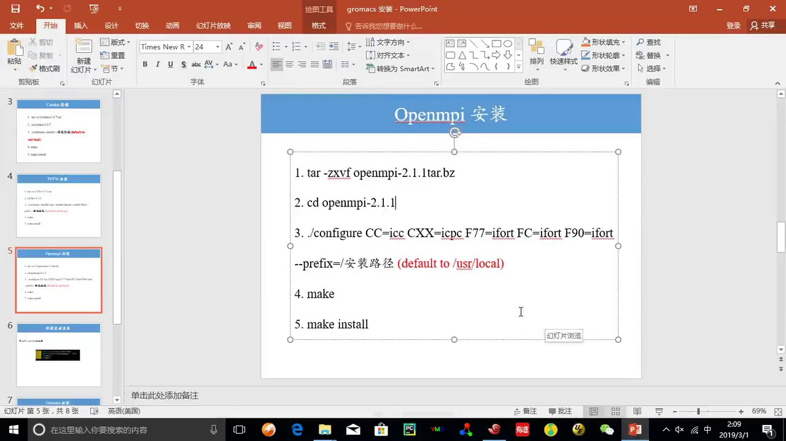

安装流程仍是解压、配置、编译、安装：

```bash
tar -zxvf openmpi-2.1.1.tar.gz
cd openmpi-2.1.1
./configure CC=icc CXX=icpc F77=ifort FC=ifort F90=ifort \
            --prefix=/安装路径
make
make install
```

幻灯片上多出的一组 `CC/CXX/F77/FC/F90` 是在指定各类语言的编译器：C 用 `icc`、C++ 用 `icpc`、Fortran 用 `ifort`，这是 Intel 编译器套件的写法。如果你机器上只有 GCC，就换成 `gcc`、`g++`、`gfortran`，或者干脆不写，让 `configure` 使用系统默认值。**关键不是照抄字母，而是理解「这里在指定用什么编译器」**。

[【跳转到 09:46】](https://www.bilibili.com/video/BV1k5411V7eW/?p=3&t=586)

OpenMPI 的编译时间明显比前两个软件长，讲者多次提醒耐心等待。安装完成后，`bin` 里会出现 `mpicc`、`mpic++`、`mpirun`、`mpiexec`、`ompi_info` 等命令：`mpicc`/`mpic++` 是「包装过的编译器」，编译时自动加上 MPI 的头文件和库；`mpirun` 负责按指定进程数启动并行程序。

**为什么先装 OpenMPI 再装 GROMACS？** 因为 GROMACS 的 `-DGMX_MPI=ON` 会让 CMake 去寻找 MPI 编译器。如果 MPI 还没装，CMake 就找不到 `mpic++`，配置阶段直接失败。依赖顺序不是习惯问题，而是配置脚本的硬性要求。

## 六、设置环境变量：把三个依赖的路径“登记”给系统

**编译 GROMACS 前必须先设环境变量，否则每写一次命令都要带一长串绝对路径。** 环境变量可以理解为系统随身携带的一张便签：程序启动时读这张便签，就知道去哪里找命令、去哪里找库。

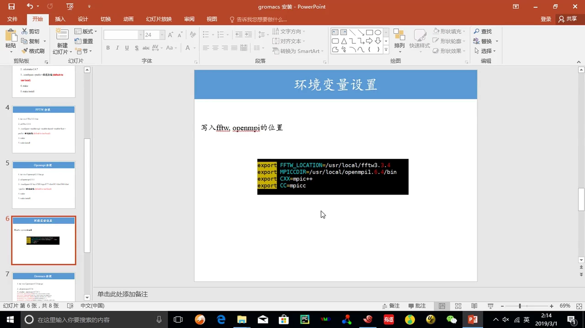

需要登记的内容分三类：

- **PATH**：系统查找命令的目录清单。把某个软件的 `bin` 加进去，之后就能直接敲 `cmake`，而不用写 `/home/dzy/.../bin/cmake`。
- **FFTW_LOCATION**：FFTW 的安装根目录，供后面 CMake 拼接 `include` 与 `lib` 路径。
- **MPICCDIR 以及 `CC`/`CXX`**：MPI 编译器所在目录，以及指定 C/C++ 编译器的名字（`mpicc`、`mpic++`）。

[【跳转到 17:28】](https://www.bilibili.com/video/BV1k5411V7eW/?p=3&t=1048)

**写在哪里？** 讲者建议不要直接改系统级的环境变量文件，而是自己新建一个文件（演示中叫 `~/source`），把 `export` 语句写进去，再在主目录的 `~/.bashrc` 里用一行 `source /export/home/dzy/source` 把它引入。这样做的好处是：一旦写错，只影响这一个文件，把 source 那行注释掉就能恢复，不会把系统原有功能弄坏。

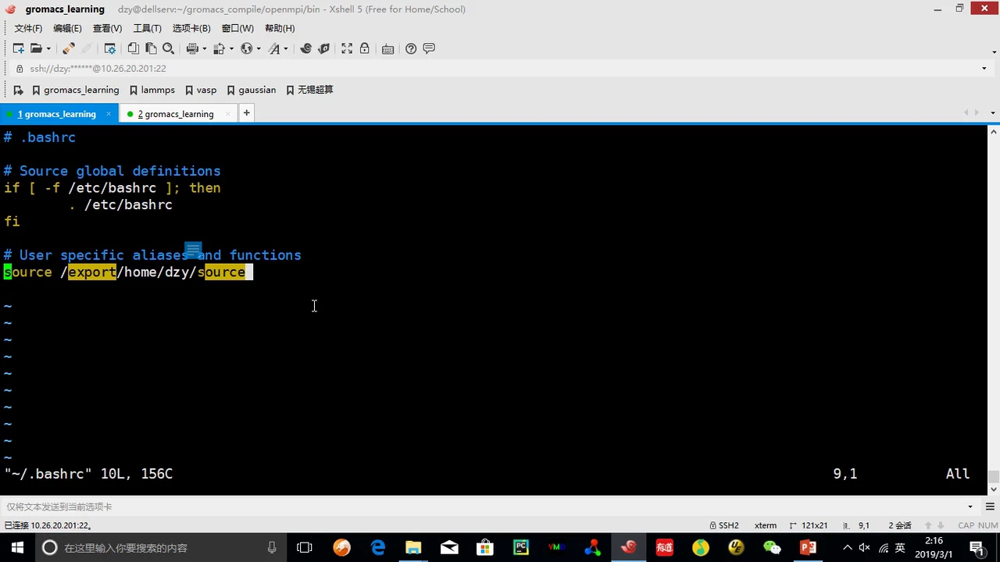

演示机上 `~/source` 的内容大致如下（路径已简化）：

```bash
export PATH=/export/home/dzy/program/packmol/:...:/export/home/dzy/gromacs_compile/cmake/bin/:$PATH
export FFTW_LOCATION=/usr/local/fftw3.3.4
export MPICCDIR=/usr/local/openmpi1.6.4/bin
export CXX=mpic++
export CC=mpicc
```

注意图中的版本号是 `fftw3.3.4` 和 `openmpi1.6.4`，与本次新编译的 3.3.1、2.1.1 并不相同。讲者在视频里说明过：这台机器之前已经装好了一套 FFTW，这次重装只是给大家演示流程，所以环境变量里仍指向旧路径。**自己操作时，务必把路径换成你本次实际安装的目录。**

**`$PATH` 前面的美元符号不能丢。** 这是本节最容易出错、也最值得讲清的一处：

- `export PATH=/新路径:$PATH` 表示「把新路径放在原有 PATH 前面」，原来的目录仍然保留，只是新路径优先被搜索。
- 如果写成 `export PATH=/新路径`，就等于把整张便签覆盖掉，系统再也找不到 `ls`、`vim` 等基本命令。
- 同理，对 `FFTW_LOCATION` 这类自定义变量，如果你之前已经定义过同名变量，直接赋值会覆盖旧值；用 `$FFTW_LOCATION` 引用旧值才是追加。

[【跳转到 21:38】](https://www.bilibili.com/video/BV1k5411V7eW/?p=3&t=1298)

**改完必须让配置生效。** 执行 `source ~/.bashrc`（或重新登录），新的 PATH 才会进入当前终端。之后用 `which cmake` 之类的命令验证：如果返回的是你安装目录下的路径，而不是 `/usr/bin/cmake`，说明登记成功，以后不必再写全路径。

## 七、配置 GROMACS：一条 cmake 命令交代清楚四件事

**到了主体这一步，核心工作变成「用一条 cmake 命令告诉构建系统：依赖在哪、装到哪、用什么编译器、开启哪些能力」。** 前面的三个依赖和环境变量，都是为这一条命令做准备。

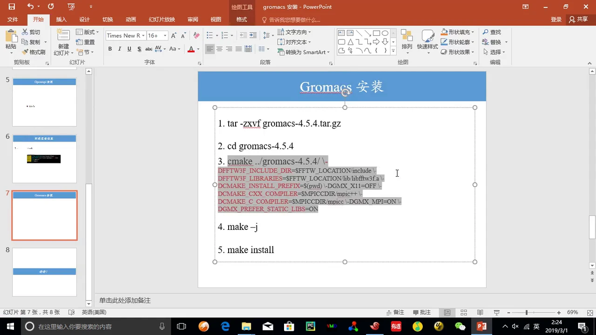

讲者先解压 GROMACS 4.5.4，然后**单独新建一个 `gromacs` 目录作为构建目录**，再在里面执行 cmake：

```bash
tar -zxvf gromacs-4.5.4.tar.gz
cd gromacs_compile
mkdir -p gromacs
cd gromacs
cmake ../gromacs-4.5.4/ \
  -DFFTW3F_INCLUDE_DIR=$FFTW_LOCATION/include \
  -DFFTW3F_LIBRARIES=$FFTW_LOCATION/lib/libfftw3f.a \
  -DCMAKE_INSTALL_PREFIX=$(pwd) \
  -DGMX_X11=OFF \
  -DCMAKE_CXX_COMPILER=$MPICCDIR/mpic++ \
  -DCMAKE_C_COMPILER=$MPICCDIR/mpicc \
  -DGMX_MPI=ON \
  -DGMX_PREFER_STATIC_LIBS=ON
make -j
make install
```

[【跳转到 24:39】](https://www.bilibili.com/video/BV1k5411V7eW/?p=3&t=1479)

**为什么在源码目录外新建构建目录？** 这叫「out-of-source build」：源码保持干净，编译中间文件和安装结果都放在别处，失败时删掉构建目录重来即可，同一份源码还能用不同选项生成多套构建。`../gromacs-4.5.4/` 是「源码在哪里」，`$(pwd)` 表示当前目录。

下面把七个选项逐一拆开：

| 选项 | 含义 | 为什么这么写 |
| --- | --- | --- |
| `-DFFTW3F_INCLUDE_DIR` | 单精度 FFTW 的头文件目录 | 告诉编译器去哪里找 `fftw3.h` 等声明 |
| `-DFFTW3F_LIBRARIES` | 单精度 FFTW 的库文件路径 | 链接时用 `libfftw3f.a` 提供真正实现 |
| `-DCMAKE_INSTALL_PREFIX` | 安装根目录 | 这里用当前构建目录，装完就在 `gromacs/bin` 下 |
| `-DGMX_X11=OFF` | 关闭 X11 图形查看器 | 服务器通常没有图形界面，关掉可少一层依赖 |
| `-DCMAKE_CXX_COMPILER` | 指定 C++ 编译器为 `mpic++` | 让编译出的程序自带 MPI 能力 |
| `-DCMAKE_C_COMPILER` | 指定 C 编译器为 `mpicc` | C 源码同样需要走 MPI 包装器 |
| `-DGMX_MPI=ON` | 开启 MPI 并行支持 | 大体系计算必须用并行版 |
| `-DGMX_PREFER_STATIC_LIBS=ON` | 优先链接静态库 | 减少运行时的动态库依赖，便于移植 |

**关于并行与精度，还有两点需要说清：**

- **MPI 与 OpenMP 是两种不同的并行方式。** MPI 让多个进程跨节点通信，OpenMP 让同一进程内的多个线程共享内存。本讲用的是 MPI 路线（`GMX_MPI=ON` + `mpicc/mpic++`），幻灯片里没有出现 OpenMP 开关；在新版本 GROMACS 中，OpenMP 一般由 `-DGMX_OPENMP=ON` 控制，默认通常是开启的。两者可以同时使用。
- **CUDA/GPU 在本讲中没有启用。** 4.5 时代的 GPU 支持与现在不同，幻灯片里也没有 GPU 选项；新版本用 `-DGMX_GPU=ON`（或 `-DGMX_GPU=CUDA`）告诉 CMake 使用显卡。**共同逻辑是一样的：源码编译不会自动猜你的硬件，必须显式告诉它「用哪种并行后端、有没有 GPU」。** 没有相应硬件却强行打开，配置或运行就会失败。

**精度的对应关系**不是靠 GROMACS 单方面决定：FFTW 用 `--enable-float` 编出单精度库，GROMACS 就链接 `FFTW3F` 系列；如果 FFTW 用默认双精度，则应改链 `FFTW3` 系列。名字里的 `F` 就是 single **f**loat 的标记。

## 八、make 与 make install：把源码变成可执行程序

**`make` 负责「编译」，`make install` 负责「搬运」，两者不能混为一谈。** 很多初学者以为敲完 `make` 就装好了，其实程序还散落在构建目录里，并没有进入你规划的安装路径。

执行 `make -j` 后，屏幕会持续滚动编译进度：进入一个子目录、编译一批 `.o`、再离开进入下一个目录，直到出现 `[100%] Built target ...` 和 `Linking C executable ...`。讲者特别指出，这种「进目录—编译—出目录」的节奏是正常的，说明 make 正在按依赖关系逐个构建目标。

[【跳转到 14:10】](https://www.bilibili.com/video/BV1k5411V7eW/?p=3&t=850)

编译过程中可能出现一些**警告**，例如图中 Intel 编译器反复提示 `command line warning #10159: invalid argument for option '-m'`。警告不等于失败：只要最后看到 `Built target` 和链接成功，就可以继续。真正需要处理的是 `error`，尤其是第一条 error——后面的报错往往是第一条引发的连锁反应。

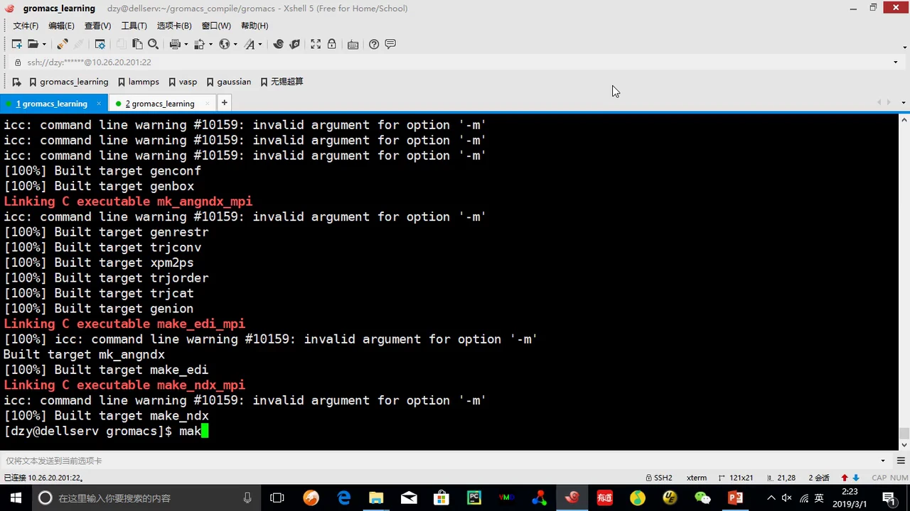

`make install` 的输出完全不同：它逐行列出 `Installing: .../share/gromacs/top/...`，把力场参数、`*.itp`、`*.ff`、`*.dat` 等数据文件复制到安装目录。这些文件是 GROMACS 运行时的「字典」，力场、水模型、离子参数都在其中，缺了它们即使能启动也算不出正确结果。

[【跳转到 26:10】](https://www.bilibili.com/video/BV1k5411V7eW/?p=3&t=1570)

看到安装结束、命令提示符重新出现，才说明 GROMACS 真正装完。此时进入安装目录的 `bin`，会看到 `gmx_mpi`、`mdrun_mpi` 以及大量 `g_*` 分析工具和补全脚本——这些就是后续建模、模拟、分析要用的命令。

## 九、验证安装：让 `gmx` 命令在任何目录都能用

**安装成功的标志不是「编译没报错」，而是「系统能找到并运行这个程序」。** 最后一步是在 `bin` 目录里用 `pwd` 取得绝对路径，追加进 `~/source` 的 PATH，再 `source ~/.bashrc` 刷新。

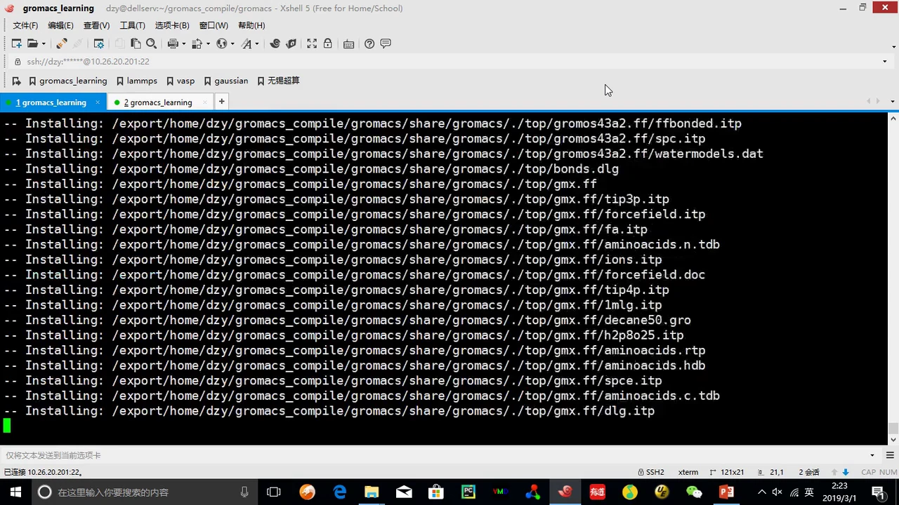

这个目录里有三类值得认识的文件：

- **`gmx_mpi`**：并行版的主命令入口；4.5 时代更常用一组独立的 `g_*` 命令，图中两者并存。
- **`mdrun_mpi`**：真正执行分子动力学模拟的主程序，后续所有跑模拟的命令最终都落到它身上。
- **`GMXRC`**：一个环境配置脚本，运行它可以把 GROMACS 需要的库路径、数据目录一次性设好，是官方推荐的另一种「登记」方式。

[【跳转到 27:24】](https://www.bilibili.com/video/BV1k5411V7eW/?p=3&t=1644)

刷新环境后，讲者用 `which` 来检查命令实际解析到哪个路径：

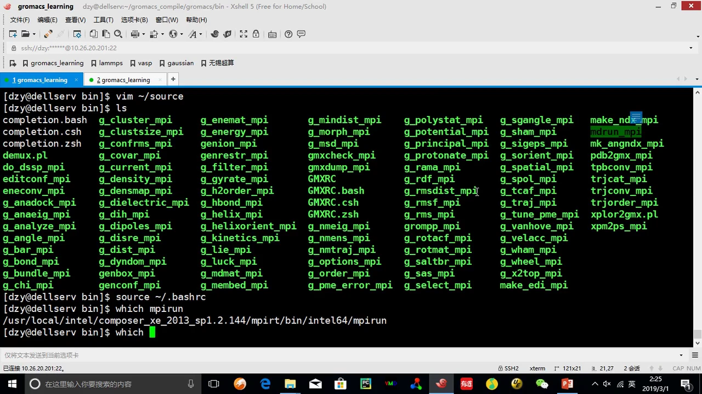

注意一个细节：`which mpirun` 返回的是 `/usr/local/intel/composer_xe_.../mpirun`，而不是本次编译的 OpenMPI，因为 PATH 中 Intel 编译器目录排在前面。**这说明 `which` 的价值：它不保证「你装的版本被使用」，只告诉你「当前实际会用哪个」。** 指向不对时，调整 PATH 中目录的先后顺序。

同理，验证 GROMACS 时先用 `which gmx_mpi`（或 4.5 的 `which mdrun_mpi`）确认路径，再运行一次；能正常打印帮助或版本信息，就说明可执行文件、动态库和数据目录都就位了。

## 十、常见报错与排查：按“路径—版本—选项”的顺序找原因

**编译报错看似千头万绪，实际绝大多数落在三类：路径没写对、版本不匹配、选项与依赖不一致。** 讲者在结尾也强调，GROMACS 这类软件的编译问题很多，遇到问题一定要多上网查，社区通常有整理好的问题列表。

结合视频中出现的情况，可以按下面的顺序排查：

1. **先看命令本身有没有手误。** 视频里出现过 `l: command not found`（把 `ls` 少打一个字符）和 `cd: ls: No such file or directory`（把 `ls` 当成目录名）。这类信息很直白，重敲即可；多用 Tab 补全能避免大半。
2. **再看第一条 error，而不是最后一条。** 编译输出很长，最后几行往往只是「某个目标构建失败」的总结，真正的根因在更上面。把终端往上翻，找到第一个 `error:`。
3. **检查路径是否与安装时一致。** `FFTW_LOCATION` 指向的目录里是否真的有 `include` 和 `lib/libfftw3f.a`？`MPICCDIR` 下是否真的有 `mpic++`？`--prefix` 写的是 A 目录，编译选项却引用 B 目录，是最常见的错误。
4. **检查版本与精度是否匹配。** GROMACS 版本、FFTW 版本、OpenMPI 版本要落在兼容范围内；FFTW 编的是单精度还是双精度，要和 `FFTW3F`/`FFTW3` 的选项对上。链接阶段报 `undefined reference`，通常就是库名、库路径或精度不匹配。
5. **检查环境变量是否真的生效。** 改完文件必须 `source`；PATH 覆盖写会弄丢系统命令；`which` 看到的可能不是你以为的那个版本。
6. **最后再上网搜。** 把第一条 error 的关键句连同软件版本一起搜索，往往能找到相同案例；讲者说 GROMACS 有一份常见的编译问题列表，按图索骥比盲目重装高效。

[【跳转到 29:25】](https://www.bilibili.com/video/BV1k5411V7eW/?p=3&t=1765)

## 小结

- **顺序**：CMake → FFTW → OpenMPI → 环境变量 → GROMACS，被依赖者先装，配置阶段才不会找不到工具。
- **套路**：四个软件都是「解压 → `./configure --prefix` 或 `cmake` → `make` → `make install`」，区别只在配置参数。
- **版本**：先定 GROMACS 版本，再选兼容的依赖；新版本未必更好，要匹配自己的计算需求与机器性能。
- **路径**：`--prefix`、`FFTW_LOCATION`、`MPICCDIR`、PATH、cmake 的 `-D` 选项必须指向同一套目录。
- **选项**：`GMX_MPI=ON` 开并行、`GMX_X11=OFF` 关图形、`FFTW3F` 对应单精度、`CMAKE_INSTALL_PREFIX` 决定装到哪；没有硬件就不要开 GPU。
- **验证**：`make install` 后用 `which` 和实际运行确认命令来源，注意 PATH 优先级可能让你用到旧版本。
- **排错**：先看第一条 error，按「路径 → 版本 → 选项 → 环境变量」排查，再带着版本号上网搜索。

## 关键术语速查

| 术语 | 一句话解释 |
| --- | --- |
| 源码编译 | 把人类可读的源代码翻译成机器可执行程序的过程 |
| CMake | 跨平台的构建工具，根据 `CMakeLists.txt` 生成 Makefile |
| Makefile | 告诉 `make` 先编译什么、后链接什么、依赖哪些文件的规则表 |
| `make` | 按 Makefile 执行编译与链接 |
| `make install` | 把编译产物复制到 `--prefix` 指定的安装目录 |
| `make -j` | 并行编译，`-j` 后数字为并发任务数，只写 `-j` 用满所有核心 |
| `--prefix` | 安装根目录，不指定时默认为 `/usr/local` |
| FFTW | 快速傅里叶变换库，GROMACS 数值计算依赖它 |
| `libfftw3f.a` | 单精度 FFTW 静态库，`f` 表示 float |
| OpenMPI | MPI 标准的一种实现，提供并行通信库与 `mpirun` 等命令 |
| MPI | 消息传递接口，多进程之间交换数据的通信规范 |
| OpenMP | 单进程内多线程共享内存的并行方式，与 MPI 互补 |
| `mpicc` / `mpic++` | 包装过的 C/C++ 编译器，自动加入 MPI 头文件与库 |
| `GMX_MPI` | CMake 选项，`ON` 表示编译 MPI 并行版 GROMACS |
| GROMACS 精度 | 单精度快而省内存，双精度准而慢；依赖库与主程序必须一致 |
| 环境变量 | 系统或程序启动时读取的键值配置，如 PATH、FFTW_LOCATION |
| PATH | 系统查找可执行命令的目录列表，顺序决定优先级 |
| `~/.bashrc` | 当前用户每次打开 bash 时自动执行的配置文件 |
| `source` | 在当前 shell 中执行脚本，使环境变量立即生效 |
| GMXRC | GROMACS 自带的环境配置脚本，可一次性设好运行所需变量 |
| `mdrun` | GROMACS 执行分子动力学模拟的主程序，并行版为 `mdrun_mpi` |
| out-of-source build | 在源码目录之外另建构建目录，保持源码干净、便于重编 |
