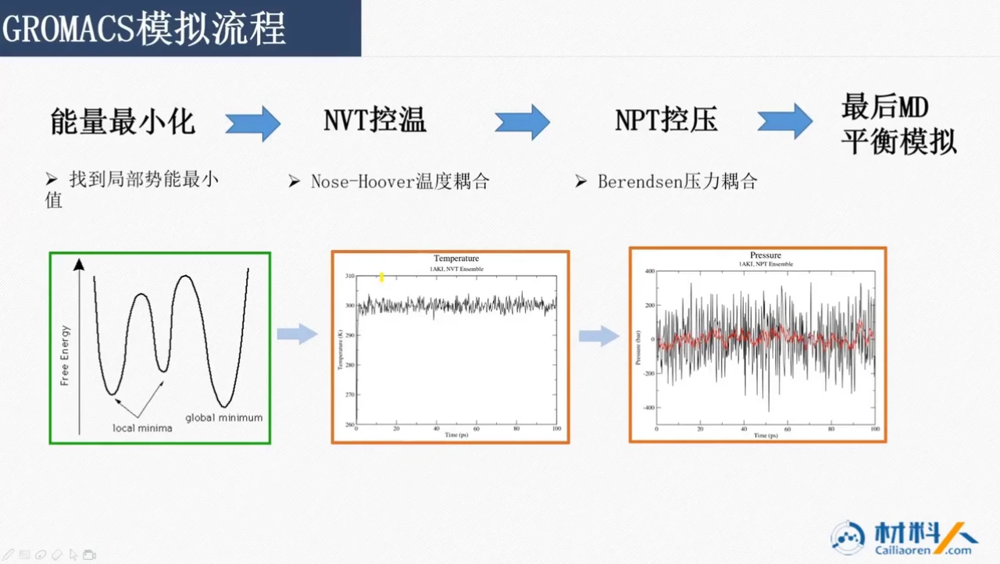
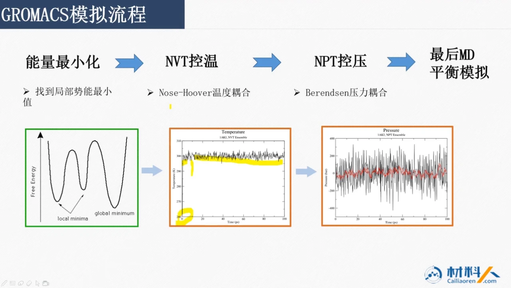
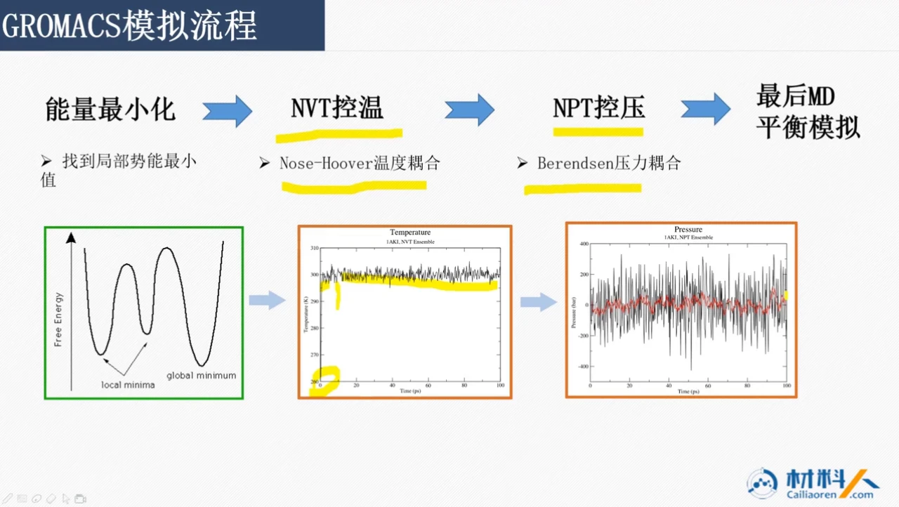
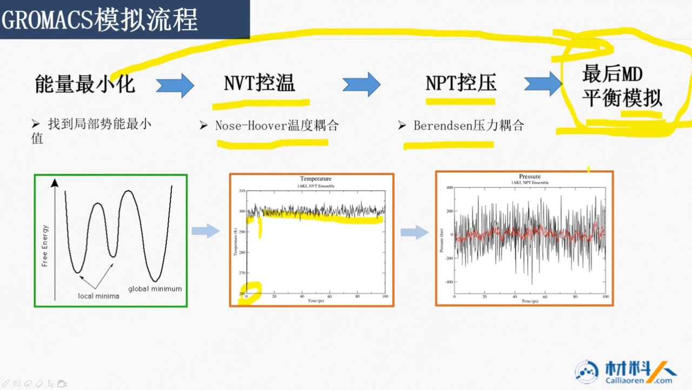
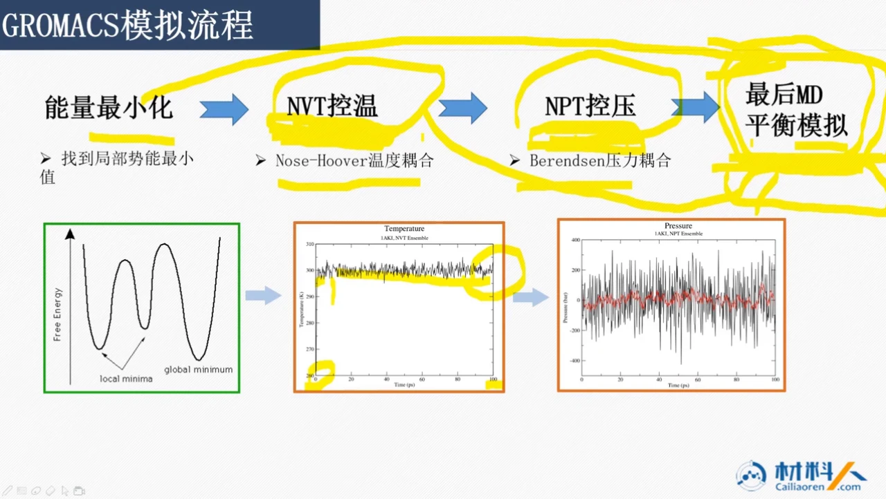

# GROMACS 系统课 04：一次模拟的流程——能量最小化、NVT、NPT 与生产

## 本讲要解决的核心问题（SCQA）

**背景**：结构文件和拓扑准备好之后，体系里已经摆好了成千上万个原子，接下来要让它们在计算机里按力学规律运动起来。

**冲突**：刚建好的结构未必“干净”——手工搭建或用其他软件转换时，两个原子可能占据同一个位置；此时体系势能极高，直接开跑很可能一步就崩。另一方面，温度、压力如果一拥而上地耦合，出错时也很难判断是谁的问题。

**疑问**：一次规范的 GROMACS 模拟到底要经过哪几步？每一步在解决什么，体系又会发生什么变化？

**回答（中心思想）**：标准流程是四步——**能量最小化 → NVT 控温 → NPT 控压 → 生产 MD**。它本质上是一条“逐级释放风险”的流水线：先消除结构里的高能隐患，再分别把温度和压力调到目标值，确认体系稳定后，才进入正式采集数据的生产模拟。对初学者来说，记住这条链条以及“为什么不能跳步”，比记住具体命令更重要。

## 一、完整流程是四步：能量最小化 → NVT → NPT → 生产 MD

课程用一张流程图把整次模拟串了起来，箭头方向就是执行顺序：

1. **能量最小化**：找到局部势能最小值，把不合理的高能结构“救”回可用的起点。
2. **NVT 控温**：用 Nose-Hoover 温度耦合，把体系温度带到设定值。
3. **NPT 控压**：用 Berendsen 压力耦合，再把压力带到设定值。
4. **最后 MD 平衡模拟**：也就是生产模拟，在温度、压力都到位后正式开始动力学采样。

图中三张曲线分别对应三个阶段：左边是自由能随构型变化的势能面，中间是 NVT 阶段的温度—时间曲线，右边是 NPT 阶段的压力—时间曲线。先看全局，再逐段拆开，就不会把“控温”和“控压”混在一起。

[【跳转到 00:00】](https://www.bilibili.com/video/BV1k5411V7eW/?p=4&t=0)

## 二、能量最小化：先把原子重叠造成的势能尖峰削掉

能量最小化（energy minimization）是流程的第一道关口，目的只有一个：**让体系的总势能降下来，至少落到一个局部最低点**。

**问题从哪来？** 最初的坐标往往不是自然界“长”出来的，而是人手工摆的，或者由其他软件建模、转换得到的。只要有两个原子的 XYZ 坐标重叠在一起，它们之间的相互排斥力就会非常大，整个体系的总势能随之被推到很高的位置。

**为什么要先处理？** 模拟要观察的是体系在平衡态附近的运动。如果带着这种“能量炸弹”直接做动力学，巨大的排斥力会让原子瞬间被弹飞，后续结果没有意义，甚至直接报错。因此课程强调：**做模拟之前一定要先做能量最小化**，把能量降到最低，至少要降到一个局部的最低点，使体系能以平衡的状态进入模拟。

**降到什么程度算够？** 幻灯片画出了自由能曲线的多个低谷：有局部极小值（local minima），也有全局最低点（global minimum）。实际流程追求的是先落入一个稳定的低谷，让结构不再含有夸张的排斥；这正是“至少局部最低”的含义。

[【跳转到 00:25】](https://www.bilibili.com/video/BV1k5411V7eW/?p=4&t=25)

## 三、默认单位先记牢：ps、K、kJ/mol、nm

在进入控温之前，课程特意插了一段单位说明，因为它是后面读曲线、抄参数时最容易踩的坑。GROMACS 的默认单位是：

- **时间**：皮秒（ps）；
- **温度**：开尔文（K）；
- **能量**：千焦（kJ），或千焦每摩尔（kJ/mol）；
- **距离**：纳米（nm）。

**为什么必须在意？** 除了 GROMACS，很多分子模拟软件和量化软件习惯用埃（Å）作距离单位（1 nm = 10 Å）。如果从其他软件或文献里搬参数，却没有做单位换算，模拟往往仍然能跑下去，但得到的结果不符合真实物理情况。课程的原话很直接：单位不对，虽然模拟可以做下去，但结果是不符合实际的。

因此，从外部找参数时，第一件事不是复制粘贴，而是先核对单位制，再决定是否换算。这也是后面温度、压力曲线能否正确解读的前提。

[【跳转到 01:40】](https://www.bilibili.com/video/BV1k5411V7eW/?p=4&t=100)

## 四、NVT 控温：让温度从初值爬到目标值并稳定波动

能量最小化完成后，体系只是一个“能量上合理”的结构，还没有被赋予目标温度。**NVT 控温**就是给体系一个初始温度，让它慢慢平衡到设定温度附近。

**NVT 是什么？** 它固定粒子数（N）、体积（V）和温度（T），属于一种系综。直观理解：盒子大小先不动，只通过恒温器与体系交换能量，把温度维持在目标值。

**温度曲线怎么读？** 幻灯片给出的例子里，模拟刚开始时温度明显偏低，随后很快上升，在这段时间里继续爬升，之后才进入围绕 300 K 的持续波动。也就是说，设定 300 K 不等于第一帧就是 300 K，体系需要一段平衡时间。课程允许温度有小幅波动，并指出**温度波动一般在 1～2 K 上下就可以接受**。

**具体怎么实现？** 不需要自己写算法。控温、控压算法都是前人提出的成熟方法，使用时只要在调用参数文件（mdp 文件）里写明选用哪一种即可。本讲示例中，NVT 用的是 **Nose-Hoover 温度耦合**。

判断控温是否完成，不能只看“我设了 300 K”，而要看温度曲线是否已经走平、平均值是否落在目标值附近。

[【跳转到 00:50】](https://www.bilibili.com/video/BV1k5411V7eW/?p=4&t=50)

## 五、NPT 控压：瞬时压力很吵，只看平均趋势

温度稳定之后，才进入 **NPT 控压**。这一步在控温的基础上再加入压力耦合，让体系同时达到目标温度和目标压力；NPT 固定的是粒子数（N）、压力（P）和温度（T）。

**压力曲线为什么这么“炸”？** 幻灯片上的压力曲线在 +200 到 −200 之间大幅抖动，看起来远比温度曲线夸张。课程特别提醒：不要被瞬时值吓到，要看**平均趋势**——红线所代表的平均水平，基本围绕你设定的压力值波动。只要平均压力落在设定范围内，这种大幅波动就被认为是合理的。

**波动大小由什么决定？** 温度波动和压力波动的幅度，后面都有相应参数可以控制。也就是说，曲线的“毛刺”不是随机失控，而是由耦合参数决定的；调参数时要在“响应够快”和“波动够小”之间取平衡。

**实现方式同样只是选算法**：本例中 NPT 使用 **Berendsen 压力耦合**，在 mdp 文件里指定即可。

**顺序不能反**：课程明确说，一般都要**先控制温度，再控制压力**。温度是分子运动剧烈程度的基础，先把温度稳住，再去调整盒子承受的压力，体系更容易平稳过渡。

[【跳转到 02:30】](https://www.bilibili.com/video/BV1k5411V7eW/?p=4&t=150)

## 六、分步执行不是繁琐，而是为了崩溃时能找到原因

看到这里自然会问：既然生产 MD 本身也能带温度和压力参数，为什么不从能量最小化直接跳到生产模拟？

**小体系确实可以抄近路。** 对较小的体系，生产模拟里已经包含了温度和压力这些参数，直接从能量最小化跳到生产模拟是可行的。但代价是：**前面那段平衡过程的数据必须全部舍弃**。课程举了一个具体例子：如果体系花了 100 ps 才达到 300 K，那么这 100 ps 的数据就不能用，只能从后面开始取。所以即使抄近路，也必须先看清体系究竟在哪一段时间完成平衡。

**大体系则不建议冒险。** 对稍大一些的体系，如果直接把温度、压力全部耦合加进去，两个粒子高速撞击时作用力可能非常大，体系一下子就崩溃了。分成几小步慢慢走，正是为了避免这种崩溃和报错。

**更重要的是错误定位。** 假设控温阶段就报错，你可以在控温这一步集中排查；如果一开始就把控温和控压合在一起做 MD，报错之后根本不知道是温度耦合的问题还是压力耦合的问题。分步执行相当于给流程加了“检查点”，让每一类问题都能在各自的阶段被隔离和解决。

因此默认策略是：**先控温，确认无误，再控压，最后进入生产模拟**。

[【跳转到 04:10】](https://www.bilibili.com/video/BV1k5411V7eW/?p=4&t=250)

## 七、不控压的体系可以跳过 NPT，但别忘了删参数

流程并不是死板的四步。有些体系根本不需要压力控制，这时 NPT 可以省掉。

**典型场景：真空中的分子体系。** 如果你只想模拟一个分子体系在真空中的运动状态，就不能做控压。原因很直观：一旦把压力耦合加进去，真空部分会被“压没”，盒子最后只剩下分子所在的那一小块，原本想保留的空间消失了。

**正确做法**：控温完成、温度达到目标且没有报错后，直接进入生产 MD；但必须把生产 MD 输入里的**压力耦合参数删除**。只删掉 NPT 这一步、却把压力耦合参数留在生产模拟里，等于换个地方继续控压，同样会把真空压掉。课程反复强调的“只关心温度”，对应的就是这套裁剪方式。

另外，NVT、NPT 也常被统称为**系综**（ensemble），指的是对体系宏观状态的一组约束条件。理解了这个称呼，看到文献里写“NVT 系综”“NPT 系综”就不会陌生。

[【跳转到 06:15】](https://www.bilibili.com/video/BV1k5411V7eW/?p=4&t=375)

## 小结

- 一次常规 GROMACS 模拟按 **能量最小化 → NVT 控温 → NPT 控压 → 生产 MD** 推进，核心思想是逐级释放风险。
- 能量最小化针对的是建模造成的原子重叠：重叠带来巨大排斥和总势能升高，必须先降到局部最低点，体系才能平衡地开始模拟。
- NVT 给体系初始温度并维持目标温度，温度曲线会经历“偏低—上升—平台波动”，1～2 K 的波动可接受。
- NPT 的压力瞬时波动远大于温度，判据是平均压力是否稳定在设定值附近，而不是单个瞬时点。
- 小体系可跳过平衡步骤直达生产模拟，但要舍弃达到平衡前的数据；大体系分步走，才能在报错时判断问题出在控温还是控压。
- 真空等不需要压力的体系可跳过 NPT，但生产 MD 中必须删除压力耦合参数，否则盒子会被压塌。
- 使用外部参数前先核对单位：GROMACS 默认时间 ps、温度 K、能量 kJ 或 kJ/mol、距离 nm。

## 关键术语速查

| 术语 | 一句话解释 |
| --- | --- |
| 能量最小化 | 调整结构使体系总势能降到局部最低点，消除原子重叠带来的巨大排斥。 |
| NVT | 固定粒子数、体积和温度的系综，用于给体系控温。 |
| NPT | 固定粒子数、压力和温度的系综，用于在控温基础上控压。 |
| 系综 | 对体系宏观状态的一组约束条件，如 NVT、NPT。 |
| Nose-Hoover 温度耦合 | 本讲 NVT 阶段使用的恒温算法，在 mdp 文件中选用。 |
| Berendsen 压力耦合 | 本讲 NPT 阶段使用的控压算法，在 mdp 文件中选用。 |
| 生产 MD | 温度和压力平衡完成后正式采集数据的动力学模拟。 |
| 局部极小值 | 势能面上一个局部低谷，体系落入后不再有夸张的排斥力。 |
| mdp 文件 | GROMACS 的调用参数文件，用来指定控温、控压算法及各项参数。 |
