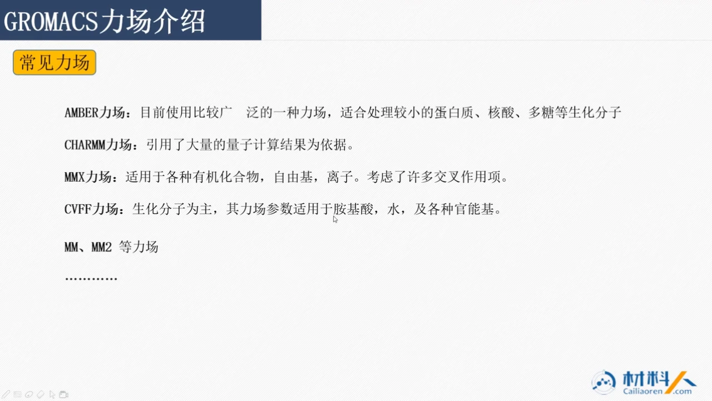
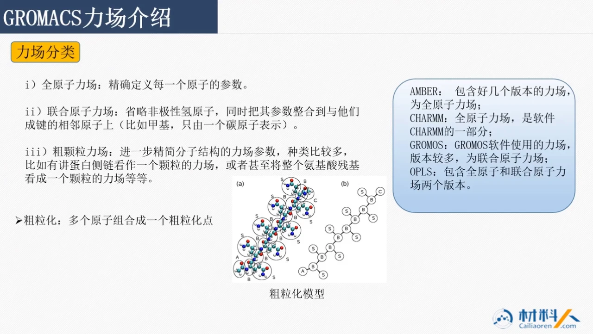
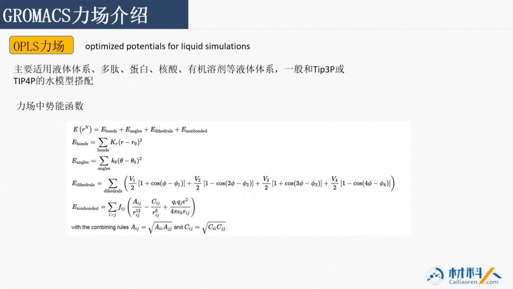
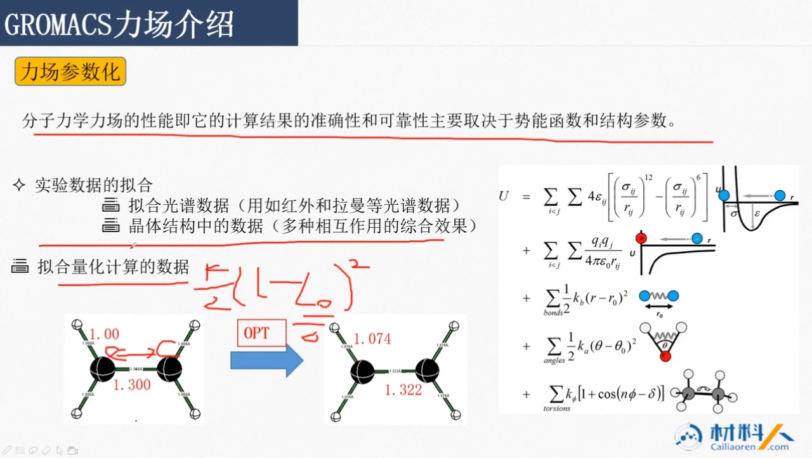
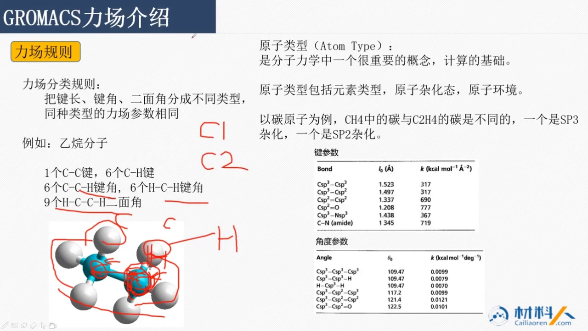
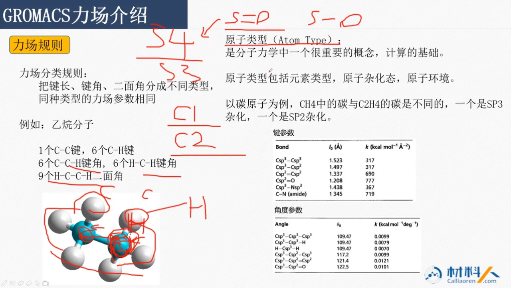
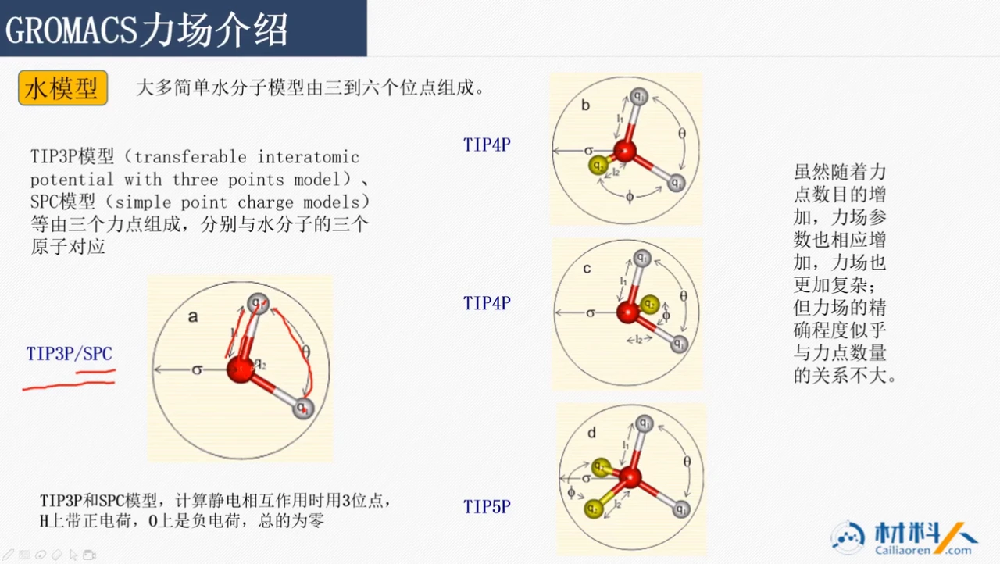
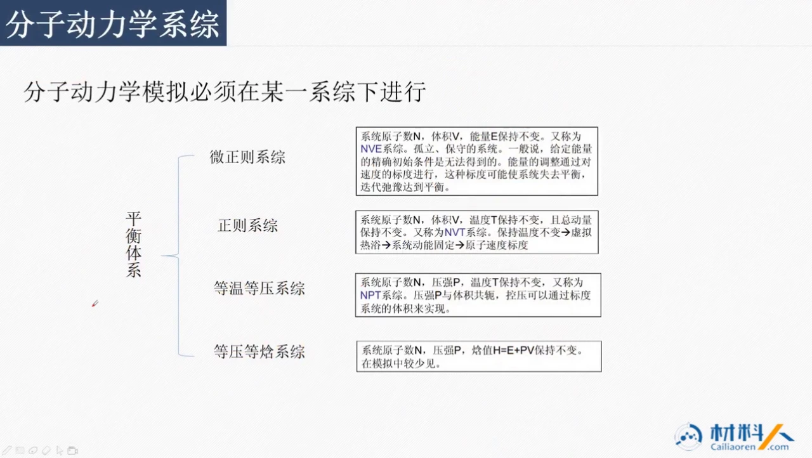

# GROMACS 系统课 05：力场是什么，GROMACS 里怎么选

## 本讲要解决的核心问题（SCQA）

**背景**：做分子动力学（MD）模拟时，分子结构已经建好，接下来要让原子按牛顿力学运动。但原子之间受多大的力、键长偏离平衡位置要花多少能量，并不是 GROMACS 自己“猜”出来的，而是由力场规定。

**冲突**：可选的力场很多——AMBER、CHARMM、MMX、CVFF、GROMOS、OPLS……它们有的面向蛋白，有的面向有机小分子；有的保留每个原子，有的把几个原子合并成一个珠子。更麻烦的是，不同力场即使描述同一根键，公式里的系数写法也可能差一个 2 倍。

**疑问**：力场到底由什么组成？常见力场各自适合什么体系？全原子、联合原子、粗粒化该怎么选？参数怎样落到具体原子上？水模型和系综又该怎么配？

**回答（中心思想）**：力场就是“势能函数 + 一整套参数”。选力场本质上是选**研究尺度**和**参数体系**：要看清楚每个原子的细节，就用全原子力场；要跑更长时间、更大体系，就用联合原子或粗粒化力场；不同力场的公式与参数不能混着套用。水模型按“水是溶剂还是研究对象”来选，系综按“实验保持哪些量不变”来选。

## 一、力场 = 势能函数 + 一套参数，先会用再深究

力场（force field）可以理解成一套“原子间如何相互作用”的规则书。它包含两部分：

1. **势能函数**：规定键、角、二面角、非键相互作用分别用什么数学形式描述；
2. **参数**：规定每一种原子类型对应的平衡键长、力常数、电荷、Lennard-Jones 半径等具体数值。

总势能通常拆成两大块：

- **成键项**：键长伸缩、键角弯曲、二面角扭转；
- **非键项**：范德华相互作用（常用 Lennard-Jones 势）和静电相互作用（库仑势）。

课程特别说明，具体函数形式初学者**不必逐项推导**，直接拿来用即可；但必须知道“不同力场的公式和参数不一样”，不能把 AMBER 的数字直接填进 OPLS 的表格里。后面讲 OPLS 时就会看到一个具体的例子：同样是键长项，系数前有没有 `1/2`，会让数值差两倍。[【跳转到 06:13】](https://www.bilibili.com/video/BV1k5411V7eW/?p=5&t=373)

## 二、常见力场各有主场，AMBER 也能算材料

课程列出的常见力场，可以先按“主要服务对象”来理解：

| 力场家族 | 主要适用体系 | 课程中的关键提醒 |
| --- | --- | --- |
| AMBER | 较小的蛋白质、核酸、多糖等生化分子 | 使用非常广泛，也能处理小分子和材料体系，前提是参数正确；有多个版本，属于全原子力场 |
| CHARMM | 生物分子 | 引用了大量量子计算结果作为依据；是 CHARMM 软件的一部分，属于全原子力场 |
| MMX | 各种有机化合物、自由基、离子 | 考虑了许多交叉作用项，例如键长与键角之间的耦合 |
| CVFF | 以生化分子为主 | 参数适用于氨基酸、水及各种官能基，现在在材料体系中也用得很多 |
| MM、MM2 等 | 幻灯片仅列名 | 本讲没有展开 |
| GROMOS | GROMOS 软件使用的力场 | 版本较多，属于联合原子力场 |
| OPLS | 液体体系、多肽、蛋白、核酸、有机溶剂等 | 有全原子和联合原子两个版本，常与 TIP3P 或 TIP4P 水模型搭配 |

这里最值得注意的是 **AMBER**。课程提到，不要因为 AMBER 常被用来处理蛋白，就认为它只能算生物分子；它同样可以处理小分子和材料体系，只要把参数弄对。AMBER 本身还有配套的 AMBER 软件，软件里用的就是 AMBER 力场。GROMACS 现在也支持 AMBER 力场——做法是把 AMBER 的参数改写成 GROMACS 的 `.top` 或 `.itp` 形式，相当于“移植”过来使用。[【跳转到 00:35】](https://www.bilibili.com/video/BV1k5411V7eW/?p=5&t=35)

CHARMM、MMX、CVFF 的定位也类似：名字和历史用途只是入口，真正决定能不能用的是**参数是否覆盖你的原子和化学环境**。[【跳转到 00:10】](https://www.bilibili.com/video/BV1k5411V7eW/?p=5&t=10)

## 三、按精度分三类，按“要回答的问题”选一类

课程把力场按分子结构的精细程度分成三类。这个分类不是“哪个更高级”，而是“哪个更适合你的问题”。

### 3.1 全原子力场：每个原子都保留

全原子力场（all-atom）精确定义每一个原子的参数。它适合关心**局部细节**的问题，例如吸附位点究竟落在哪个官能团、由哪个原子主导。课程后面演示的案例，主要也采用全原子或联合原子力场。[【跳转到 01:25】](https://www.bilibili.com/video/BV1k5411V7eW/?p=5&t=85)

### 3.2 联合原子力场：省略非极性氢

联合原子力场（united-atom）会把**非极性氢原子**省略，把它的参数整合到相邻重原子上。最典型的例子是甲基：甲基上的三个氢不单独出现，整个甲基用一个碳原子表示。

要注意两点：

- 只省略**非极性氢**。像 O–H 这样的极性氢不能省，因为它的电荷和取向对氢键很关键；
- 省略的原子数其实不多，所以全原子和联合原子的计算量**并没有差很多**。联合原子里那个“甲基碳”的参数，也不等于全原子力场中同一个碳的参数，两者不能直接互换。[【跳转到 02:15】](https://www.bilibili.com/video/BV1k5411V7eW/?p=5&t=135)

### 3.3 粗粒化力场：把一组原子变成一个珠子

粗粒化力场（coarse-grained）进一步精简结构：把若干原子、甚至整个侧链或整个氨基酸残基，看成一个粗粒化点（bead）。幻灯片里的示意就是把分子中一圈原子合并成一个“大珠子”，珠子之间只保留连接关系和有效相互作用；讲课中还用高分子举例，把一个官能团或主链上的若干原子合成一个珠子。

这样做的好处是计算量按数量级下降；代价是失去了原子级细节。课程明确指出，全原子力场能跑的模拟时间大约到 100 纳秒已经是很高的水平，而粗粒化可以把模拟时间或空间尺度大幅提高，进入介观尺度。很多材料的宏观性质在微观尺度上体现不出来，只能在更大尺度上出现，这正是粗粒化的用武之地。[【跳转到 04:45】](https://www.bilibili.com/video/BV1k5411V7eW/?p=5&t=285)

### 3.4 选择规则：细节优先，还是尺度优先

把三类放在一起，选择逻辑就很清楚：

- 关心“哪个原子、哪个官能团在起作用”→ 全原子；
- 只关心分子整体形态，非极性氢不影响结论 → 联合原子；
- 关心介观尺度、长时间演化、宏观性质 → 粗粒化。

课程用一句话总结：**选哪种力场，取决于你研究的体系和你想知道的细节**。[【跳转到 05:35】](https://www.bilibili.com/video/BV1k5411V7eW/?p=5&t=335)

## 四、真正的差别在函数形式：同一根键可能差一个 2 倍

课程以 OPLS 力场为例，展示了力场势能函数的典型结构。OPLS 的全称是“optimized potentials for liquid simulations”，主要面向液体体系，也适用于多肽、蛋白、核酸、有机溶剂等，通常与 TIP3P 或 TIP4P 水模型搭配。[【跳转到 06:13】](https://www.bilibili.com/video/BV1k5411V7eW/?p=5&t=373)

它的总能量可以拆成：

- **键长项**：`E_bonds = Σ K_r (r - r0)^2`；
- **键角项**：`E_angles = Σ k_θ (θ - θ0)^2`；
- **二面角项**：用 `V1`、`V2`、`V3`、`V4` 四个余弦项叠加，分别对应不同周期的扭转；
- **非键项**：Lennard-Jones 的 `A/r^12 - C/r^6` 形式，再加库仑静电项；
- **组合规则**：不同原子之间的 LJ 参数由各自参数相乘再开根号得到，即 `A_ij = √(A_ii A_jj)`、`C_ij = √(C_ii C_jj)`。

关键坑在这里：**AMBER 的键长项写成 `1/2 k (r - r0)^2`，OPLS 写成 `k (r - r0)^2`**。如果直接把 AMBER 的 `k` 搬到 OPLS 里，力的强弱就会差两倍；反过来也要乘 2 或除以 2 做转换。课程的原话是“不要直接拿过去用”。[【跳转到 08:18】](https://www.bilibili.com/video/BV1k5411V7eW/?p=5&t=498)

除了系数，表达形式也可能不同：OPLS 的 LJ 项用 `A`、`C` 形式，而 AMBER 用 `σ`、`ε` 形式。看着“都是 12-6 势”，参数却不能直接通用。课程还提到，如果现有函数不足以描述范德华或静电作用，研究者会修改这些非键项，发展新的极化力场等——**力场的个性化，主要就改在这些函数形式上**。[【跳转到 07:53】](https://www.bilibili.com/video/BV1k5411V7eW/?p=5&t=473)

## 五、参数从实验和量化计算来，单位要先换

幻灯片的说法是：分子力学力场的性能，也就是计算结果的准确性和可靠性，主要取决于**势能函数**和**结构参数**。参数不是随手填的，常见来源有两类：

1. **实验数据拟合**：例如用红外、拉曼等光谱数据拟合；也用晶体结构中的数据，因为晶体结构是多种相互作用的综合效果；
2. **量化计算数据**：对实验给不出的局部参数，用量子化学方法算。

课程举了一个乙烷的例子：初始建模时 C–C 键长写成 1.300 Å，用量化工具做几何优化（OPT）后得到 1.322 Å，这个优化后的平衡键长就可以放进力场参数里。

但放进去之前必须换单位：**1.322 Å = 0.1322 nm**，也就是要除以 10。GROMACS 的长度单位是纳米，能量和力常数常用 kJ·mol⁻¹·nm⁻²；而幻灯片表格里的键长是 Å、力常数是 kcal·mol⁻¹·Å⁻²。课程反复提醒，这些数不能直接抄进 GROMACS，必须自己做单位转换。[【跳转到 09:58】](https://www.bilibili.com/video/BV1k5411V7eW/?p=5&t=598)

## 六、原子类型是查表索引：同环境同参数，不同环境必须分开

力场分配参数的基本规则是：**同样化学环境的原子，共用一套参数；环境不同，就必须用不同的原子类型**。幻灯片把它概括为“把键长、键角、二面角分成不同类型，同种类型的力场参数相同”。

以乙烷为例，可以数出：

- 1 个 C–C 键；
- 6 个 C–H 键；
- 6 个 C–C–H 键角；
- 6 个 H–C–H 键角；
- 9 个 H–C–C–H 二面角。

两个碳的环境相同，六个氢的环境也相同，所以它们各自只用一套参数。可一旦把其中一个氢换成羟基，变成乙醇，那个碳的环境就变了，两个碳的参数必须分开，不能继续共用一个“碳”参数。[【跳转到 10:11】](https://www.bilibili.com/video/BV1k5411V7eW/?p=5&t=611)

程序怎么知道两个碳“环境不同”？靠**原子类型（atom type）**。幻灯片说得很明确：原子类型包括元素类型、原子杂化态和原子环境三个层面。以碳为例，CH4 中的碳是 sp3 杂化，C2H4 中的碳是 sp2 杂化，两者不是同一个类型。于是可以把它记为 C1、C2 等，分别对应不同的参数。

同样是“硫”，也要看它连了什么：**S4 表示硫与双键氧（S=O）相连，S3 表示硫与单键氧（S–O）相连**。所以 C1、C2、S4、S3 这些标签就是原子的“类型名”；每个原子类型指定了对应的 `ε` 和 `σ`，程序在 `.top` 里识别到某个原子是 S4，就去参数表里找 S4 对应的 `ε`、`σ` 以及其它参数。[【跳转到 11:26】](https://www.bilibili.com/video/BV1k5411V7eW/?p=5&t=686)

幻灯片表格里的数字很能说明问题：

| 键类型 | 平衡键长 r0（Å） | 力常数 k（kcal·mol⁻¹·Å⁻²） |
| --- | --- | --- |
| Csp3–Csp3 | 1.523 | 317 |
| Csp3–Csp2 | 1.497 | 317 |
| Csp2=Csp2 | 1.337 | 690 |

同样是单键，Csp3–Csp3 和 Csp3–Csp2 的力常数都写着 317，但平衡键长分别是 1.523 Å 和 1.497 Å；到了双键 Csp2=Csp2，力常数变成 690。表中还有 Csp2=O、Csp3–Nsp3、酰胺 C–N 等类型，角度参数也按类型分别列出。这正是原子类型的作用：**把“都是碳”拆成“不同环境下的碳”，分别给参数**，否则整个体系只用一个碳参数，结果就会和实际偏差很大。[【跳转到 13:06】](https://www.bilibili.com/video/BV1k5411V7eW/?p=5&t=786)

如果某个基团的参数实在找不到，课程给出的临时办法是：用一个化学环境相近的已有参数替代；力场在识别不到时也可能给出类似提示。但这是“实在找不到”时的权宜之计，不是常规做法。[【跳转到 11:01】](https://www.bilibili.com/video/BV1k5411V7eW/?p=5&t=661)

## 七、换力场不是改一个开关，而是换一套原子类型和参数表

把上面的概念落到 GROMACS 的文件层面，可以概括为三件事：

1. **原子类型是索引**：每个原子在拓扑里被赋予一个类型，例如 S4；
2. **参数表按类型存放**：程序看到 S4，就去参数表里找 S4 对应的 `ε`、`σ`，以及电荷、键长、键角等参数；
3. **拓扑文件负责组织**：GROMACS 用 `.top` / `.itp` 这样的文件描述分子由哪些原子、键、角、二面角组成，并保存对应的参数。

所以“换力场”不是改一个开关，而是换一整套**原子类型定义 + 参数表 + 拓扑约定**。这也解释了为什么 AMBER 移植到 GROMACS 时，要把参数改写成 GROMACS 的 `.top` / `.itp` 形式，而不是只改几个数字。[【跳转到 01:00】](https://www.bilibili.com/video/BV1k5411V7eW/?p=5&t=60)

## 八、水模型：3 点够当溶剂，4/5 点是为了更准的水结构

不管做什么体系，水几乎都会出现：要么是溶剂，要么是研究对象本身。水虽然只有三个原子，却有很多种模型，原因是**电荷和范德华作用放在哪里、放几个点**可以有不同做法。幻灯片说，大多简单水分子模型由 3 到 6 个位点组成；本讲重点看 3 位点、4 位点和 5 位点。[【跳转到 14:12】](https://www.bilibili.com/video/BV1k5411V7eW/?p=5&t=852)

### 8.1 三位点模型：TIP3P、SPC、SPC/E

三位点模型把水看成三个相互作用位点：氧原子上放负电荷和质量中心，两个氢原子上放正电荷，总电荷为零。需要描述的参数不多：O–H 键长、H–O–H 键角，以及氧的 Lennard-Jones 半径 `σ` 和能量参数 `ε`。TIP3P、SPC、SPC/E 都属于这一类，适合把水当溶剂、重点研究溶质的情况。

### 8.2 四位点模型：TIP4P

TIP4P 多出一个**虚拟位点**：把氧上的负电荷挪到氧附近的一个无质量点上（图中的 q2），这个点只带电荷、不带质量。这样做是因为水分子两侧氢的电荷会把电子云“拽偏”，负电荷中心并不正好落在氧核上；把负电荷移到偏离氧的位置，可以更真实地描述水分子的静电分布，对冰、水团簇等结构更敏感。[【跳转到 15:27】](https://www.bilibili.com/video/BV1k5411V7eW/?p=5&t=927)

### 8.3 五位点模型：TIP5P

TIP5P 更进一步，把负电荷分到两个无质量的虚拟位点，用来模拟氧原子的两对孤对电子方向；每个虚拟位点的电荷与氢上的正电荷等量相反，这样整个水分子仍然保持电中性。位点更多、参数更多，描述更复杂；但幻灯片也提醒：**位点数增加会让参数和力场更复杂，精确程度却似乎与位点数量关系不大**。[【跳转到 16:42】](https://www.bilibili.com/video/BV1k5411V7eW/?p=5&t=1002)

### 8.4 材料体系怎么选

如果水只是溶剂，研究重点是溶质分子，课程的建议很直接：**TIP3P 或 SPC 就够了**。只有当你关心水本身的结构，比如冰晶、水的相变或特殊氢键网络，才需要考虑 TIP4P、TIP5P 这类更复杂的模型；课程还提到，模拟冰晶时 SPC 可能描述不好，所以有些课题组会开发更复杂的模型。另外，OPLS 力场通常与 TIP3P 或 TIP4P 搭配，选力场时也要把水模型一起考虑。[【跳转到 17:32】](https://www.bilibili.com/video/BV1k5411V7eW/?p=5&t=1052)

## 九、系综决定“哪些量不变”：常温常压实验对应 NPT

分子动力学模拟必须在某一个**系综（ensemble）**下进行。系综可以理解为“固定住哪些宏观量，让其余量涨落”的约定：[【跳转到 17:57】](https://www.bilibili.com/video/BV1k5411V7eW/?p=5&t=1077)

| 系综 | 固定的量 | 含义 |
| --- | --- | --- |
| 微正则系综 NVE | 原子数 N、体积 V、能量 E | 孤立、保守的系统；能量不交换 |
| 正则系综 NVT | 原子数 N、体积 V、温度 T | 体积和温度固定，通过虚拟热浴等方式控温 |
| 等温等压系综 NPT | 原子数 N、压强 P、温度 T | 同时控温控压，压强与体积共轭，控压通过标度体积实现 |
| 等压等焓系综 NPH | 原子数 N、压强 P、焓 H=E+PV | 模拟中较少见 |

课程说，实际做实验通常是在**压强和温度都不变**的条件下进行的，所以 NPT 是现在最常用的系综。NVT 则常用于固定体积下让体系平衡、控温。选系综之前要先想清楚：你的实验对应的是固定体积，还是固定压强？[【跳转到 18:22】](https://www.bilibili.com/video/BV1k5411V7eW/?p=5&t=1102)

## 小结

- **力场 = 势能函数 + 参数**。成键项管键长、键角、二面角，非键项管范德华和静电；函数形式可以先拿来用，但参数不能跨力场硬套。
- **常见力场各有主场**：AMBER 适用范围广，也能算材料；CHARMM 有大量量化依据；MMX 面向有机物、自由基、离子；CVFF 从生化分子扩展到材料；GROMOS 是联合原子力场；OPLS 面向液体体系，有全原子和联合原子两个版本。
- **按精度选三类**：全原子看局部细节，联合原子省非极性氢但省得不多，粗粒化把基团变成珠子、换取更大的时间和空间尺度。
- **公式差异会直接改变数值**：AMBER 的 `1/2 k` 与 OPLS 的 `k` 差两倍；`σ/ε` 与 `A/C` 只是写法不同，但不能直接通用。
- **参数来自实验和量化计算**，使用前先换单位：Å → nm 除以 10，kcal·mol⁻¹·Å⁻² → kJ·mol⁻¹·nm⁻² 不能直接抄。
- **原子类型是参数的索引**：同环境同参数，不同杂化、不同官能团必须分开；参数缺失时只能用相近环境临时替代。
- **水模型按目的选**：水当溶剂，TIP3P/SPC 足够；研究水本身的结构，再考虑 TIP4P/TIP5P；OPLS 常配 TIP3P/TIP4P。
- **系综按实验条件选**：常温常压实验对应 NPT，固定体积控温对应 NVT。

## 关键术语速查

| 术语 | 一句话解释 |
| --- | --- |
| 力场（force field） | 描述原子间相互作用的势能函数及其全套参数 |
| 成键相互作用 | 键长伸缩、键角弯曲、二面角扭转等与分子内连接有关的能量项 |
| 非键相互作用 | 不直接成键的原子间的范德华力和静电力 |
| Lennard-Jones 势 | 用 `1/r^12` 排斥、`1/r^6` 吸引描述范德华作用的经典形式 |
| 库仑势 | 描述电荷之间静电吸引或排斥的势能项 |
| 组合规则（combining rule） | 由同种原子参数推算异种原子间 LJ 参数的规则，如几何平均 |
| 全原子力场 | 每个原子都显式保留并单独给参数的力场 |
| 联合原子力场 | 省略非极性氢、把其作用并入相邻重原子的力场 |
| 粗粒化力场 | 把多个原子合并成一个珠子、牺牲细节换取尺度的力场 |
| 原子类型（atom type） | 由元素、杂化态和化学环境共同决定的参数索引标签，如 C1、C2、S4、S3 |
| 参数化 | 用实验数据或量化计算确定力场参数的过程 |
| 几何优化（OPT） | 用量子化学等方法调整结构，找到能量最低的平衡构型 |
| TIP3P / SPC | 三位点水模型，氧上放负电荷、氢上放正电荷 |
| TIP4P | 四位点水模型，负电荷放在偏离氧的无质量虚拟位点 |
| TIP5P | 五位点水模型，用两个虚拟位点表示氧的孤对电子方向 |
| 系综（ensemble） | 固定某些宏观量（如 N、V、T、P）的模拟统计集合 |
| NVT | 正则系综，原子数、体积、温度固定 |
| NPT | 等温等压系综，原子数、压强、温度固定，最接近常规实验 |
