# GROMACS 系统课 06：LAMMPS 搭 KCl 水溶液，GROMACS 做分析（上）

## 本讲要解决的核心问题（SCQA）

**背景**：GROMACS 是生物分子模拟的常用工具，建水盒子、加离子、跑 NVT/NPT、算 MSD 都有成熟命令；LAMMPS 则在材料、无机体系和多种力场方面更灵活。

**冲突**：如果某个体系只有 LAMMPS 接口的力场，或者手上已经有 LAMMPS/从头算跑出的轨迹，直接在 GROMACS 里重搭体系并不方便；但 LAMMPS 的后处理和 GROMACS 相比，又没有那么“开箱即用”。

**疑问**：能不能让 LAMMPS 负责“搭结构、跑动力学”，再让 GROMACS 负责“读轨迹、算扩散系数”？

**回答（中心思想）**：可以。本讲以 0.5 mol/L KCl 水溶液为例，从零手写单个水分子的坐标和 LAMMPS `data` 文件，复制成 1000 个水分子，按密度回归确定 KCl 数目，再加离子、设力场、做 NVT 平衡；下一讲再把 LAMMPS 轨迹转成 GROMACS 格式，用 `gmx msd` 计算 K⁺ 的扩散系数。这一集的重点不是“算出一个数”，而是把两条工具链之间的每个文件、每个单位、每个编号都打通。

## 一、联用不是炫技：LAMMPS 补力场，GROMACS 补分析

**结论：这套流程的价值在于“各用所长”，而不是证明 GROMACS 不能做 KCl。**

- **LAMMPS 的优势是力场覆盖广。** LAMMPS 全称 Large-scale Atomic/Molecular Massively Parallel Simulator，是一个面向原子/分子尺度的大型并行模拟器。它支持的势函数和力场比 GROMACS 多，尤其是一些新材料、无机体系，以及以 DeePMD 为代表的机器学习势，常常优先提供 LAMMPS 接口。[【跳转到 00:28】](https://www.bilibili.com/video/BV1k5411V7eW/?p=6&t=28)
- **GROMACS 的优势是分析工具成熟。** 轨迹检查、去周期性、建索引组、算径向分布函数、算 MSD，都有现成命令；对初学者来说，`gmx msd` 这类工具比自己写分析脚本省事。
- **工作流可以迁移到从头算轨迹。** 作者提到，掌握“LAMMPS 产出轨迹 → GROMACS 分析”的流程后，也可以把同样的分析思路用到 VASP 等从头算分子动力学（AIMD）轨迹上。[【跳转到 00:47】](https://www.bilibili.com/video/BV1k5411V7eW/?p=6&t=47)
- **选简单体系是为了暴露细节。** 0.5 mol/L KCl 水溶液并不复杂，但正好包含水模型、离子参数、`data` 文件、单位换算、NVT/NPT 这些关键环节；把简单体系走通，才不容易在复杂体系里“知其然不知其所以然”。

## 二、路线对了，单个水分子只是第一块砖

**结论：整个构建过程可以概括为“单水 → 水盒子 → 加盐 → 设参数 → 跑动力学”五步。**

作者给出的路线是：

1. 用 SPC/E 水模型搭建一个水分子的结构；
2. 建立水分子的拓扑，也就是哪些原子相连、形成什么键和角；
3. 用 LAMMPS 的 `replicate` 在 x、y、z 三个方向各复制 10 次，得到一个大的水盒子；
4. 按 0.5 mol/L 的目标浓度算出水、K⁺、Cl⁻ 的比例，把离子加进 `data` 文件；
5. 补上离子溶液的力场参数，得到可以运行的模拟体系。[【跳转到 01:17】](https://www.bilibili.com/video/BV1k5411V7eW/?p=6&t=77)

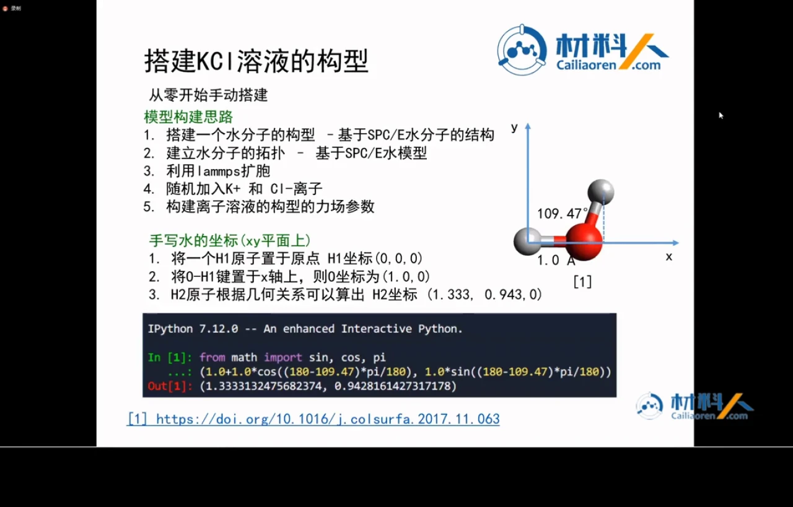

**SPC/E 是一个三点刚性水模型。** 它把水分子简化为一个带负电的氧原子和两个带正电的氢原子，O–H 键长 0.1 nm（1 Å），H–O–H 键角 109.47°；氧原子电荷 −0.8476e，每个氢原子 +0.4238e。所谓“刚性”，是指后面的 SHAKE 算法会把键长和键角固定住，不让它们像弹簧一样振动。[【跳转到 02:38】](https://www.bilibili.com/video/BV1k5411V7eW/?p=6&t=158) 文献同时讨论了 TIP4P/2005 与 SPC/E 两套水模型，本讲选用 SPC/E；两者的建模流程相似，但参数和水的几何定义不同。

**坐标可以手算，不必依赖建模软件。** 为了让后面的复制和拼接方便，作者把第一个氢 H1 放在原点 (0, 0, 0)，把 O–H1 键放在 x 轴上，于是氧原子 O 的坐标是 (1.0, 0, 0) Å；第二个氢 H2 根据 109.47° 的键角算出，坐标为 (1.333, 0.943, 0) Å。这个结果也可以用一个简单的 Python 三角函数式得到。[【跳转到 04:08】](https://www.bilibili.com/video/BV1k5411V7eW/?p=6&t=248)

```python
from math import sin, cos, pi
(1.0 + 1.0 * cos((180 - 109.47) * pi / 180),
 1.0 * sin((180 - 109.47) * pi / 180))
```

它输出 `(1.333, 0.943)`，与幻灯片上的 H2 坐标一致。把这三个原子写进一个最基础的 `.xyz` 文件，第一行写原子数 3，第二行写描述，后面三行写元素符号和坐标，就得到了单个水分子的结构。

## 三、盒子边长：用水的密度反推 3.104 Å

**结论：单个水分子先装进一个边长 3.104 Å 的小立方盒；它不是真实液态水，只是后续复制的“瓷砖”。**

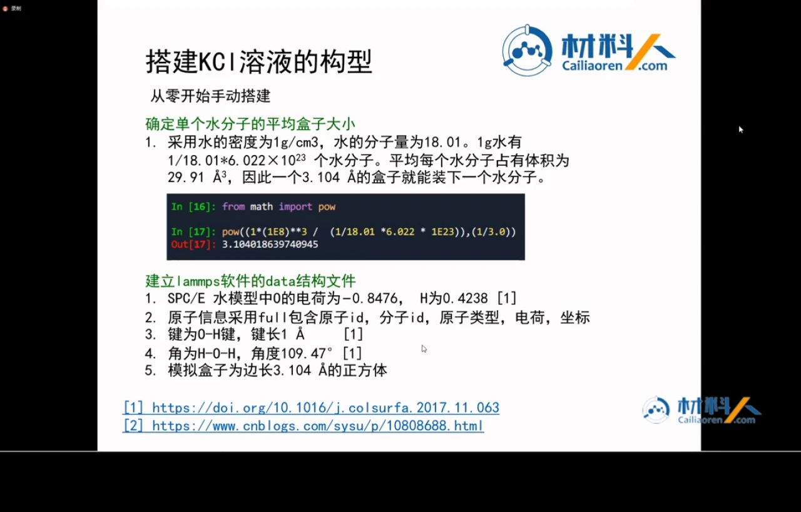

计算过程分三步：

- **先算 1 g 水有多少个分子。** 水的摩尔质量取 18.01 g/mol，1 g 水就是 \(1/18.01\) mol，再乘以阿伏伽德罗常数 \(6.022\times10^{23}\)，得到约 \(3.34\times10^{22}\) 个水分子。
- **再算每个分子平均占多大体积。** 1 cm³ 等于 \(10^{24}\) ų；把 \(10^{24}\) ų 除以分子数，得到每个水分子约 29.91 ų。
- **最后开立方。** \(29.91^{1/3}\approx3.104\) Å，所以边长 3.104 Å 的立方盒平均装一个水分子。[【跳转到 06:25】](https://www.bilibili.com/video/BV1k5411V7eW/?p=6&t=385)

这个盒子只有 3.104 Å，水分子本身又横跨盒子边界，所以单看一个盒子并不像真实的水。它的作用是作为一个周期性重复单元：复制 10×10×10 之后，得到边长 31.04 Å、体积约 29906 ų 的大盒子，里面正好有 1000 个水分子。对分子模拟来说，初始结构不需要“长得像水”，只需要原子之间不重叠、能量不爆炸；后续的 NVT/NPT 会让它慢慢松弛成液态结构。

## 四、`data` 文件不是坐标表，而是结构与拓扑的总清单

**结论：LAMMPS 的 `data` 文件不只存坐标，还存原子类型、电荷、质量、键、角等拓扑信息；各个 section 之间的空行不是装饰，而是格式的一部分。**

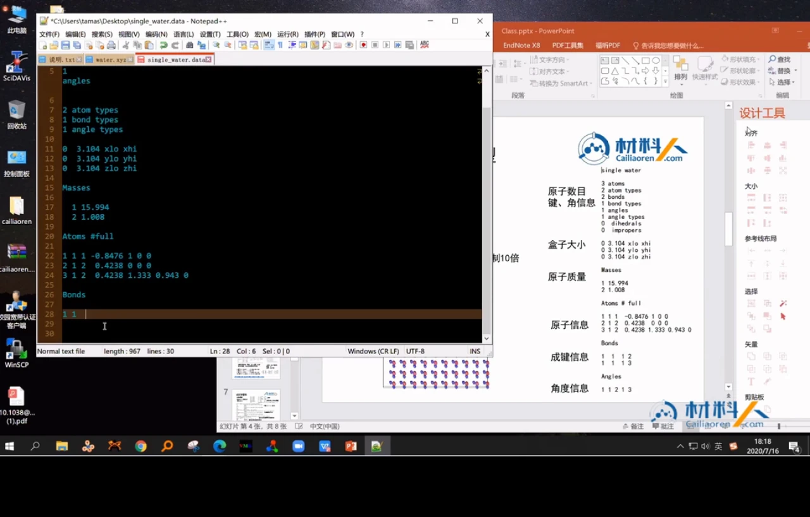

一个最小可用的水 `data` 文件大致如下（这是本讲 `single_water.data` 的核心内容）：

```text
single_water

3 atoms
2 bonds
1 angles

2 atom types
1 bond types
1 angle types

0 3.104 xlo xhi
0 3.104 ylo yhi
0 3.104 zlo zhi

Masses

1 15.994
2 1.008

Atoms # full

1 1 1 -0.8476 1.000 0.000 0.000 0 0 0
2 1 2 0.4238 0.000 0.000 0.000 0 0 0
3 1 2 0.4238 1.333 0.943 0.000 0 0 0

Bonds

1 1 1 2
2 1 1 3

Angles

1 1 2 1 3
```

逐块理解：

- **文件头**：第一行是标题；接着写原子、键、角、二面角、非正常二面角的总数，以及原子类型、键类型、角类型等类型的数量。水没有二面角，所以这些数目可以删掉或写 0。
- **盒子**：`xlo xhi`、`ylo yhi`、`zlo zhi` 给出周期性盒子的范围；这里三个方向都是 0 到 3.104 Å。
- **Masses**：按原子类型列出质量。类型 1 是氧 15.994，类型 2 是氢 1.008。
- **Atoms # full**：`atom_style full` 下每行依次是原子 id、分子 id、原子类型、电荷、x、y、z，最后三个 0 是周期性镜像标志（image flags）。水分子只有一个，所以三个原子的分子 id 都是 1；氧带 −0.8476e，两个氢各带 +0.4238e，整体中性。
- **Bonds / Angles**：两个 O–H 键分别是 1–2 和 1–3，属于同一种键类型；一个 H–O–H 角由 2–1–3 组成，属于同一种角类型。[【跳转到 07:37】](https://www.bilibili.com/video/BV1k5411V7eW/?p=6&t=457)

**LJ 参数放哪里都可以，但要统一。** 作者的习惯是把 Lennard-Jones 参数写在 LAMMPS 输入文件里，而不是 `data` 文件的 `Pair Coeffs` 段；两种做法 LAMMPS 都支持，关键是后续输入文件里的 `pair_coeff` 要和 `data` 中的原子类型编号对得上。[【跳转到 09:40】](https://www.bilibili.com/video/BV1k5411V7eW/?p=6&t=580)

## 五、`replicate` 复制的不只是坐标，还有完整拓扑

**结论：`replicate 10 10 10` 会同时复制坐标和拓扑，得到 1000 个水分子、3000 个原子、2000 个键和 1000 个角。**

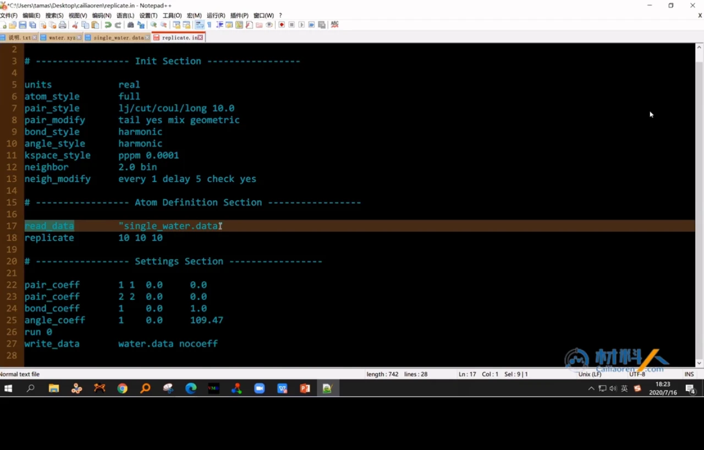

复制用的输入文件可以简化为：

```text
units real
atom_style full
pair_style lj/cut/coul/long 10.0
pair_modify tail yes mix geometric
bond_style harmonic
angle_style harmonic
kspace_style pppm 0.0001
neighbor 2.0 bin
neigh_modify every 1 delay 5 check yes

read_data "single_water.data"
replicate 10 10 10

pair_coeff 1 1 0.0 0.0
pair_coeff 2 2 0.0 0.0
bond_coeff 1 0.0 1.0
angle_coeff 1 0.0 109.47
run 0
write_data water.data nocoeff
```

这段输入里有几个容易忽略的点：

- **`units real` 决定了整套单位。** 在 LAMMPS 的 `real` 单位制下，质量是 g/mol，距离是 Å，时间是 fs，能量是 kcal/mol，温度是 K。后面所有参数都要按这套单位来。
- **`atom_style full` 与 `data` 文件对应。** 它表示原子带有分子 id 和电荷，正好匹配我们手写的 `Atoms # full`。
- **`pair_style lj/cut/coul/long 10.0` 同时处理短程和长程。** 10.0 Å 是实空间截断；范德华作用在截断内用 LJ 计算，库仑作用的长程部分交给 `kspace_style pppm`。
- **`run 0` 不积分。** 这里只是让 LAMMPS 读结构、执行复制、做一次初始化，不真正跑动力学；`write_data ... nocoeff` 把复制后的结构写出来，并省略掉那些临时设成 0 的系数。
- **零参数是故意的。** 复制阶段只关心坐标和拓扑，不需要这些参数产生真实的能量和力，所以把 LJ、键、角系数临时设为 0 不会影响结果；真正模拟时再在输入文件里给正确参数。

运行 `lmp_serial -i replicate.in` 后，会得到 `water.data`。打开可以看到 3000 个原子、2000 个键、1000 个角；盒子三个方向都是 31.04 Å，正好是 3.104 Å 的 10 倍。[【跳转到 17:49】](https://www.bilibili.com/video/BV1k5411V7eW/?p=6&t=1069) 另外，LAMMPS 写出时可能把同一个分子的原子放在连续块里，原子 id 看起来会跳跃；只要类型和拓扑对得上，就不影响模拟。

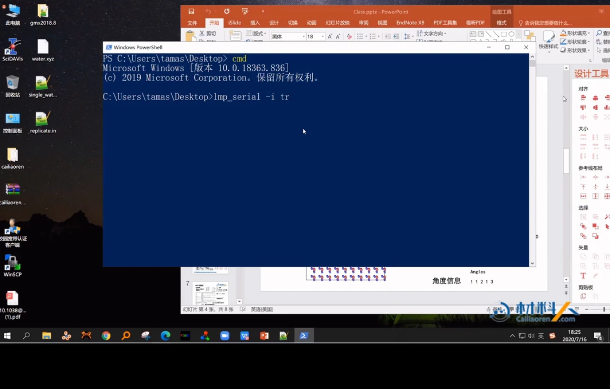

它看起来像晶体，所有水分子都朝同一个方向排列。真实的水当然不是这样，但这种初始结构有两个好处：第一，所有原子都被拉开，不会出现严重的重叠；第二，复制后的拓扑完整，键和角都跟着分子一起复制了。后面的升温会打破这种规则排列，让水分子形成氢键网络。

## 六、0.5 mol/L 不能直接数分子：先回归密度，再做质量衡算

**结论：加盐不能直接按“0.5 mol/L”数分子，因为加盐会改变溶液密度；作者先用经验公式回归密度，再用质量衡算求 KCl 数目。**


这里有两个浓度概念，必须先分清：

- **体积摩尔浓度（molarity）**：每升溶液中有多少摩尔溶质，单位 mol/L；配制 0.5 mol/L 指的就是它。
- **质量摩尔浓度（molality）**：每千克溶剂中有多少摩尔溶质，单位 mol/kg；经验密度公式通常用温度和 molality 作自变量，所以要先在两者之间换算。

作者引用的中文文献给出了一套盐类水溶液的密度回归式，把密度与温度、每千克水中 KCl 的摩尔数关联起来，并给出了 KCl 对应的回归系数。[【跳转到 25:10】](https://www.bilibili.com/video/BV1k5411V7eW/?p=6&t=1510) 因为密度本身又出现在“体积 ↔ 质量 ↔ molality”的换算里，所以不能一步算完，而是用 Excel 做迭代：

1. 先猜一个 molality；
2. 用回归式算出对应密度；
3. 用密度把目标 0.5 mol/L 换算成新的 molality；
4. 重复上述步骤，直到浓度收敛。

迭代结果是在 25 ℃ 下，0.5 mol/L KCl 溶液的密度约为 **1.0202 g/cm³**。[【跳转到 26:58】](https://www.bilibili.com/video/BV1k5411V7eW/?p=6&t=1618)

接下来是质量衡算。水盒子体积为 29906.4688 ų，即 \(2.9906\times10^{-20}\) cm³；乘以密度得到盒子内总质量约 \(3.0511\times10^{-20}\) g。1000 个水分子的质量是：

\[
m_{\text{water}}=\frac{1000\times18.01}{6.022\times10^{23}}
\approx2.9907\times10^{-20}\ \text{g}
\]

两者相减，得到 KCl 的质量约 \(6.0395\times10^{-22}\) g；再除以 KCl 的相对分子质量 74.551，并乘以阿伏伽德罗常数，得到约 **4.88 个 KCl**，取整为 **5 个 KCl**，也就是 5 个 K⁺ 和 5 个 Cl⁻。[【跳转到 28:08】](https://www.bilibili.com/video/BV1k5411V7eW/?p=6&t=1688)

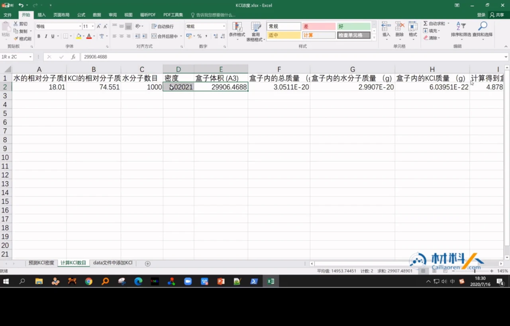

取整会带来一点浓度偏差，但在“教学演示 + 1000 个水”的小体系里可以接受；如果要做定量比较，应该放大体系，让取整误差相对变小，或者在 NPT 后回算实际浓度。

## 七、加离子：编号、电荷、位置和计数都要改

**结论：加 5 个 KCl 不是简单粘贴 10 行坐标，`data` 文件的原子数、类型数、质量、电荷、分子编号和速度段都要同步更新。**

作者把 5 个 K⁺ 和 5 个 Cl⁻ 分别当作 10 个“单原子分子”加入：

- **原子 id 接着原来的 3000 往下排。** K⁺ 用 3001–3005，Cl⁻ 用 3006–3010；分子 id 从 1001 开始，每个离子单独占一个分子 id。
- **新增两种原子类型。** 类型 3 是 K⁺，类型 4 是 Cl⁻；电荷分别是 +1 和 −1。
- **质量要补在 `Masses` 段。** K 的相对原子质量是 39.098，Cl 是 35.453。
- **键和角的数目不变。** 离子是单原子，不和任何原子成键；所以 `bonds`、`angles` 的计数保持 2000 和 1000，只改原子数和原子类型数。
- **位置放在若干小格的中心。** 小盒边长是 3.104 Å，所以第一个中心在 1.552 Å（即 3.104/2）；沿 x、y、z 以 3.104 Å 为间隔，取 4.656、7.76 等位置。这样离子不会和周围的水分子重叠，也不会和周期性镜像重叠。
- **image flags 先都写 0。** 这表示原子当前就在主盒子内；如果原子因周期性跑出盒子，才需要用镜像标志记录它在哪个方向上的复制盒里。


最容易出错的是**速度段**。原来的 `water.data` 只有 3000 行速度；加了 10 个原子后，要么补上 10 行零速度，要么把整个 `Velocities` 段删掉，让后面的 `velocity` 命令重新生成。作者选择删除速度段，因为初始速度本来就要重新给。

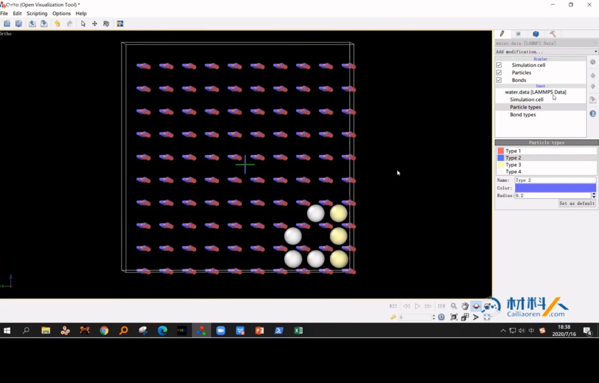

从 OVITO 里看，10 个离子挤在盒子一角，看起来很不自然。这是正常的：初始构型的目标不是“好看”，而是“不重叠、能启动”。真正让离子散开、让水形成氢键网络的，是后续的 NVT/NPT 平衡。

## 八、力场换算：单位错了，结果一定错

**结论：文献表格常用 nm 和 kJ/mol，LAMMPS `real` 单位用 Å 和 kcal/mol；同一个数不能直接抄。**

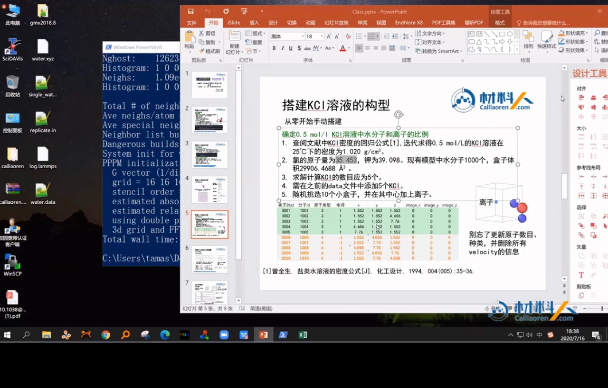

本讲用到的参数如下：

| 粒子 | σ | ε | 电荷 |
| --- | ---: | ---: | ---: |
| O（水） | 3.166 Å | 0.1554 kcal/mol | −0.8476e |
| H（水） | 0 | 0 | +0.4238e |
| K⁺ | 4.930 Å | 0.0003 kcal/mol | +1e |
| Cl⁻ | 4.420 Å | 0.1177 kcal/mol | −1e |

换算关系是：

- 长度：1 nm = 10 Å，所以 0.3166 nm = 3.166 Å；
- 能量：1 kJ/mol ≈ 0.2390 kcal/mol，所以 0.6502 kJ/mol ≈ 0.1554 kcal/mol；
- K⁺ 的 0.0014 kJ/mol 约等于 0.0003 kcal/mol，Cl⁻ 的 0.4930 kJ/mol 约等于 0.1177 kcal/mol。[【跳转到 37:27】](https://www.bilibili.com/video/BV1k5411V7eW/?p=6&t=2247)

**为什么氢的 σ 和 ε 都是 0？** SPC/E 把水分子的非键相互作用主要放在氧上，氢只保留电荷；氢–氢、氢–氧的 LJ 参数通过几何混合得到，结果也接近 0。水分子内部的 O–H 键和 H–O–H 角不靠弹簧力维持，而是靠 SHAKE 约束固定。

**交叉项怎么来？** 输入文件里的 `pair_modify mix geometric` 表示不同原子类型之间的 σ 和 ε 用几何平均计算。因此只需要给出 O–O、K–K、Cl–Cl 等同类项，LAMMPS 会自动算出 O–K、O–Cl、K–Cl 等交叉项。

## 九、正式输入：`real` 单位、PPPM 与 SHAKE 各司其职

**结论：正式模拟的输入文件在复制输入的基础上，补上真实 LJ 参数、分组和 SHAKE 约束；同时把邻居列表扩大到 3.0 Å，避免约束算法导致“dangerous builds”。**

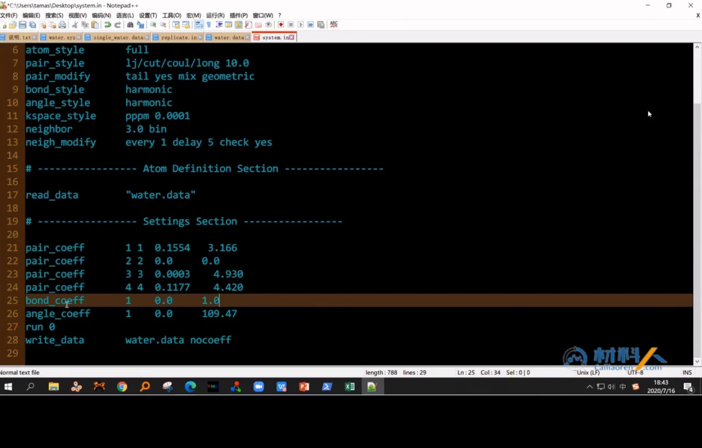

核心代码如下：

```text
units real
atom_style full
pair_style lj/cut/coul/long 10.0
pair_modify tail yes mix geometric
bond_style harmonic
angle_style harmonic
kspace_style pppm 0.0001
neighbor 3.0 bin
neigh_modify every 1 delay 5 check yes

read_data water.data

pair_coeff 1 1 0.1554 3.166
pair_coeff 2 2 0.0 0.0
pair_coeff 3 3 0.0003 4.930
pair_coeff 4 4 0.1177 4.420
bond_coeff 1 0.0 1.0
angle_coeff 1 0.0 109.47

group water type 1 2
group K type 3
group Cl type 4
fix 1 water shake 0.0001 10 100 b 1 a 1
```

逐项解释：

- **`pair_coeff` 的顺序是 ε 再 σ。** 这和文献表格里“σ、ε”的列顺序相反，是最容易抄错的地方之一。例如氧的 `0.1554 3.166` 对应 ε = 0.1554 kcal/mol、σ = 3.166 Å。
- **`pair_modify` 负责修正和混合。** `tail yes` 对截断外的 LJ 作用做长程修正；`mix geometric` 用几何平均生成不同原子类型之间的交叉项。
- **`kspace_style pppm 0.0001` 负责长程库仑。** PPPM 是 Particle-Particle Particle-Mesh 的缩写，把短程库仑在实空间算、长程部分转到倒空间用 FFT 算；`0.0001` 是相对精度。
- **`neighbor 3.0 bin` 比复制阶段的 2.0 Å 更大。** SHAKE 约束会改变原子位置，邻居列表如果太薄，重新建表时可能出现原子突然进入截断半径的 “dangerous builds”；把 skin 加大到 3.0 Å 可以减少这种风险。[【跳转到 39:00】](https://www.bilibili.com/video/BV1k5411V7eW/?p=6&t=2340)
- **`fix shake` 只作用于 `water` 组。** `b 1` 表示约束第 1 种键，`a 1` 表示约束第 1 种角；K⁺ 和 Cl⁻ 是单原子，不需要约束。容差设为 0.0001，后面是迭代和输出控制参数。
- **键和角的力常数设为 0，不是忘了写。** 因为水的几何由 SHAKE 固定，不需要谐振弹簧；`bond_coeff` 和 `angle_coeff` 里的平衡值只是占位，真正起作用的是约束算法。

### 为什么这套流程刻意不做能量最小化？

**结论：在这套“刚性水 + 零键角力常数 + 零氢 LJ”的参数下，作者选择跳过能量最小化，直接用低温 NVT 起步。**

原因有三点：

1. **SHAKE 是动力学约束，不是最小化算法。** 能量最小化要找势能面上的局部极小点，和带约束的 MD 积分不是一回事；作者说这套流程不能直接套用常规的能量最小化。
2. **去掉 SHAKE 后，水分子没有内部恢复力。** 氢的 σ、ε 都是 0，O–H 的键和 H–O–H 的角力常数又是 0；一旦没有 SHAKE，键长和键角就失去约束，最小化可能把水分子拉坏或造成重叠。
3. **初始格点已经足够安全。** 复制出来的水分子彼此拉开，原子间没有严重重叠；与其冒险做一次不兼容的最小化，不如直接给一个小初速度，让结构在 NVT 中慢慢松弛。[【跳转到 41:50】](https://www.bilibili.com/video/BV1k5411V7eW/?p=6&t=2510)

这不是说“所有 LAMMPS 模拟都不做最小化”，而是说：**在这套刚性水模型和这套参数下**，最小化与 SHAKE 的组合不划算，作者用“合理初始结构 + 低温起步”替代了它。

## 十、NVT 平衡要先低温起步，再升温到 300 K

**结论：先用 10 K 的低速起步，再在 NVT 中把温度升到 300 K，随后恒温采样；温度稳定后再转 NPT 调密度。**

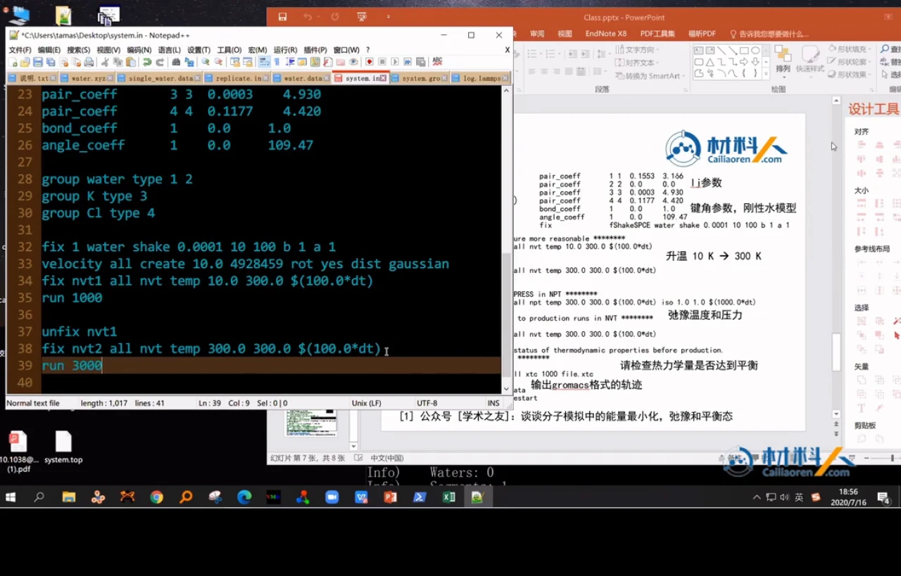

NVT 的输入可以写成：

```text
velocity all create 10.0 4928459 rot yes dist gaussian
fix nvt1 all nvt temp 10.0 300.0 $(100.0*dt)
run 1000
unfix nvt1
fix nvt2 all nvt temp 300.0 300.0 $(100.0*dt)
run 3000
unfix nvt2
```

这段命令做了四件事：

- **给初速度。** `velocity all create 10.0 4928459 ... dist gaussian` 表示按高斯分布给所有原子一个对应 10 K 的初速度，`4928459` 是随机数种子，便于复现；`rot yes` 去掉体系的整体转动，避免盒子整体旋转。初始结构是规则排列的“水晶体”，直接给 300 K 的速度会让受力太大，所以先从 10 K 起步。[【跳转到 44:24】](https://www.bilibili.com/video/BV1k5411V7eW/?p=6&t=2664)
- **第一段 NVT 是升温。** `temp 10.0 300.0` 表示在这段运行中把目标温度从 10 K 线性升到 300 K；`run 1000` 在默认 1 fs 时间步下只有 1 ps，纯粹是演示，真正平衡应跑得更长。
- **第二段 NVT 是恒温。** `temp 300.0 300.0` 把温度固定在 300 K，`run 3000` 让体系在 300 K 下继续松弛。此时水分子会逐渐脱离初始的规则排列，形成更接近液态水的结构。
- **`$(100.0*dt)` 是恒温器的阻尼参数。** LAMMPS 文档建议 Nose–Hoover 恒温器的 `Tdamp` 约为 100 个时间步；`dt` 是当前时间步长，乘 100 就得到与单位制无关的推荐值。`real` 单位默认 `dt = 1 fs`，因此这里约为 100 fs。[【跳转到 45:48】](https://www.bilibili.com/video/BV1k5411V7eW/?p=6&t=2748)

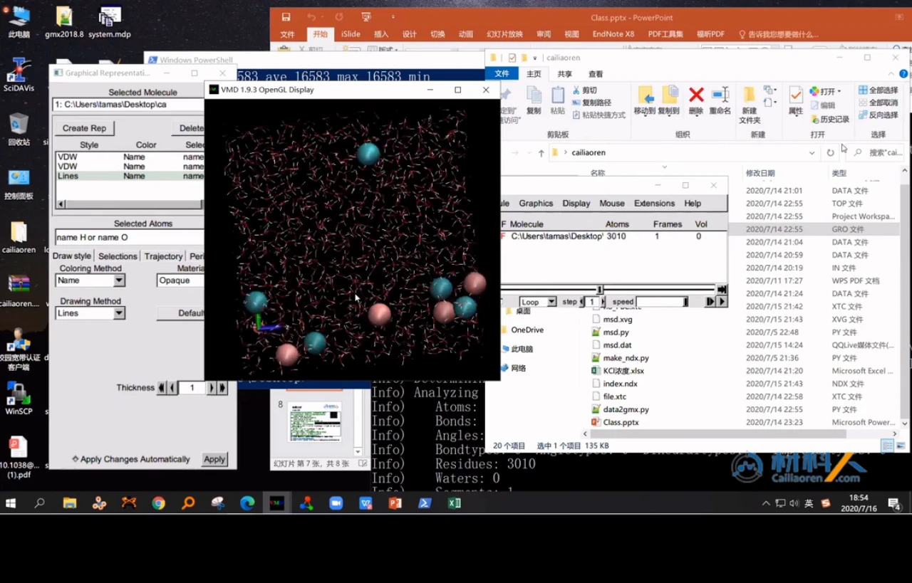

作者在 VMD 中检查了平衡后的结构：水不再是初始的“晶体”，离子也已经分开。NVT 之后还应检查密度是否接近实验值；不过 NVT 固定体积，密度不会自己变到实验值，接下来应该在 NPT 中把压力控制在 1 atm 附近，让盒子体积和密度继续调整。作者也提醒，温度比压力更容易控制，所以先 NVT 稳住温度，再 NPT 调密度。[【跳转到 53:59】](https://www.bilibili.com/video/BV1k5411V7eW/?p=6&t=3239)

这一集在写 NPT 之前结束。换句话说，**上集完成的是“从零搭体系 + NVT 平衡”，NPT、产出轨迹和 MSD 计算留到下集。**

## 十一、交棒 GROMACS：先去周期性，再算 MSD 与扩散系数

**结论：LAMMPS 的 `data` 文件缺少元素名，先用脚本转成 GROMACS 的 `.gro`，再用 `gmx trjconv` 去周期性、`gmx msd` 算扩散系数。**

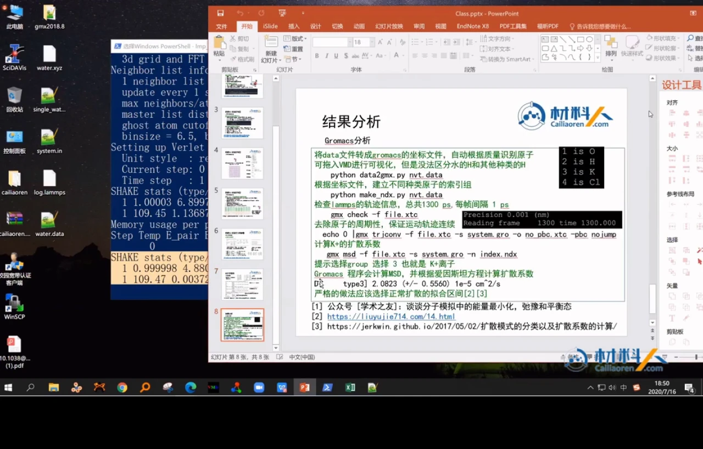

转换的原因是：LAMMPS 的 `data` 文件只记录原子类型和质量，不记录“这是氧还是氢”的元素名；VMD 直接拖入 `data` 文件时，往往无法正确判断元素和成键。作者的 Python 脚本 `data2gmx.py` 根据质量自动识别原子：15.994 → O，1.008 → H，39.098 → K，35.453 → Cl，然后写出 GROMACS 的 `.gro` 坐标文件。[【跳转到 48:25】](https://www.bilibili.com/video/BV1k5411V7eW/?p=6&t=2905)

```text
python data2gmx.py nvt.data
python make_ndx.py nvt.data
gmx check -f file.xtc
echo 0 | gmx trjconv -f file.xtc -s system.gro -o no_PBC.xtc -pbc nojump
gmx msd -f no_PBC.xtc -s system.gro -n index.ndx
```

> 幻灯片里的 `gmx msd` 示例写的是 `file.xtc`；实际分析应使用上一步去周期性后的 `no_PBC.xtc`，否则周期性跳变会污染 MSD。

每一步的作用：

- **`data2gmx.py`**：把 LAMMPS 的坐标、盒子、原子类型转成 GROMACS 能读的 `.gro`；脚本按质量识别元素，所以在这个只含 O、H、K、Cl 的体系里够用。它的局限是“无法区分水的 H 和其他种类的 H”，复杂体系要另行处理。
- **`make_ndx.py`**：根据坐标建立不同原子的索引组，方便后面选择 K⁺ 组。
- **`gmx check`**：检查轨迹帧数、时间间隔和盒子信息。幻灯片示例中轨迹共 1300 帧，每帧间隔 1 ps。
- **`gmx trjconv -pbc nojump`**：去掉周期性边界造成的“瞬移”。如果原子从盒子一边出去、另一边进来，MSD 会出现虚假的大跳变；`nojump` 保证轨迹连续。
- **`gmx msd`**：选择 K⁺ 组（示例中是组 3），计算均方位移 MSD，再用爱因斯坦关系 \(D=\lim_{t\to\infty}\langle|\mathbf r(t)-\mathbf r(0)|^2\rangle/(6t)\) 拟合扩散系数。

幻灯片给出的示例结果是：

\[
D_{\mathrm{K^+}} = 2.0823 \pm 0.5560 \times 10^{-5}\ \mathrm{cm^2/s}
\]

这个数只是作者示例轨迹的结果，不是本集这段 4 ps 演示 NVT 的最终答案。作者也提醒：严格做法是只选“正常扩散”区间拟合，避开最初的弹道段和后面统计噪声大的段；否则拟合出的 D 会偏。[【跳转到 52:42】](https://www.bilibili.com/video/BV1k5411V7eW/?p=6&t=3162)

## 小结

- **联用的核心是分工**：LAMMPS 负责它更擅长的力场和动力学，GROMACS 负责成熟的轨迹分析；简单体系只是教学载体。
- **单水搭建的关键是几何与电荷**：SPC/E 的 O–H 键长 1 Å、键角 109.47°，氧 −0.8476e、氢 +0.4238e；坐标可以手算。
- **盒子来自密度**：1 g/cm³、18.01 g/mol 推出每个水分子约 29.91 ų，立方盒边长 3.104 Å；复制 10 次得到 31.04 Å、1000 个水分子。
- **`data` 文件是结构与拓扑的清单**：原子、键、角、类型、质量、电荷、盒子、镜像标志缺一不可，section 之间的空行也要保留。
- **加盐要先算密度**：用经验回归和迭代得到 1.0202 g/cm³，再由质量衡算得到约 4.88 个 KCl，取整为 5 个；加离子后要同步改原子数、类型数、质量和速度段。
- **单位换算和参数顺序是高频错误点**：文献的 nm/kJ·mol⁻¹ 要换成 Å/kcal·mol⁻¹，`pair_coeff` 的顺序是 ε 再 σ。
- **刚性水用 SHAKE，不用弹簧**：键角力常数为 0，水分子几何由约束维持；在这套参数下作者跳过能量最小化，用 10 K 起步的 NVT 缓慢升温。
- **上集做到 NVT，下集才做 NPT 和 MSD**：NVT 固定体积，密度要靠 NPT 调整；GROMACS 分析前要转格式、建索引、去 PBC。

## 关键术语速查

| 术语 | 一句话解释 |
| --- | --- |
| LAMMPS | 大型原子/分子并行模拟器，力场和势函数覆盖广，常用于材料与无机体系。 |
| GROMACS | 面向生物分子和凝聚态体系的 MD 软件，分析工具链成熟。 |
| SPC/E | 三点刚性水模型，氧带负电、氢带正电，键长 1 Å、键角 109.47°。 |
| `data` 文件 | LAMMPS 的结构与拓扑文件，包含盒子、原子、质量、键、角等信息。 |
| `atom_style full` | LAMMPS 原子风格，原子行包含分子 id、类型、电荷和坐标。 |
| 拓扑 | 原子之间的连接关系，例如哪些原子成键、哪些原子构成角。 |
| `replicate` | LAMMPS 命令，把已有结构沿指定方向复制若干次。 |
| PPPM | 长程库仑算法，把库仑作用拆成实空间短程和倒空间长程两部分。 |
| SHAKE | 约束算法，用迭代方式把指定键长、键角固定在目标值。 |
| NVT | 粒子数、体积、温度恒定的系综，常用于控温平衡。 |
| NPT | 粒子数、压力、温度恒定的系综，常用于调盒子体积和密度。 |
| MSD | 均方位移，描述粒子位移平方的平均值，是计算扩散系数的核心量。 |
| 扩散系数 | 用 MSD 对时间线性拟合得到的斜率除以 6（三维），单位常用 cm²/s。 |
| 密度回归 | 用经验公式把溶液密度表示为温度和浓度的函数，用于配制目标浓度。 |
| image flag | LAMMPS 中记录原子位于哪个周期性镜像盒子的标志。 |
