# GROMACS 系统课 07：LAMMPS 搭 KCl 水溶液，GROMACS 做分析（下）

## 本讲要解决的核心问题（SCQA）

**背景**：上一集已经用 LAMMPS 搭好了 KCl 水溶液，做完能量最小化，并用 NVT 把体系从 10 K 升到 300 K、做了初步弛豫。此时盒子里的水、钾离子和氯离子都已经动起来了。

**冲突**：但 NVT 固定体积，体系密度不一定和实验值对得上；而 LAMMPS 写出的轨迹 GROMACS 又不一定直接识别。更麻烦的是，LAMMPS 记录的是“折回盒子”的周期性坐标，直接拿它算均方位移，会得到一段一段的阶梯，扩散系数根本不可信。

**疑问**：怎样把密度校准到实验值、跑出一段可靠的采样轨迹，再交给 GROMACS 算出扩散系数和结构性质？

**回答（中心思想）**：按一条固定流水线走——**NPT 调密度 → NVT 平衡 → NVT 生产采样并输出 xtc → 转成 GROMACS 的 gro 与 ndx → 去掉周期性边界 → 用 gmx msd 算扩散系数、用 gmx distance / gmx rdf 做结构分析**。每一步都要用可观测的量（密度、温度、势能、MSD 曲线）确认上一步真的收敛了，而不是“跑完步数就算完成”。

---

## 一、NPT 控压的目的不是“跑得更久”，而是把密度校准到实验值

### 1.1 为什么 NVT 之后还要接一段 NPT

NVT（恒定粒子数、体积、温度）只控制温度，盒子体积是钉死的。真实溶液在 1 atm 下有确定密度；盒子体积偏大或偏小，压强就会偏离，密度也对不上。NPT（恒定粒子数、压强、温度）让盒子体积可以伸缩，体系会自己调整到“内部压强 = 外部设定压强”的体积，密度随之落到合理值。

所以这一段 NPT 的验收标准不是“跑够多少步”，而是**跑完后检查密度是否接近实验值**。只有密度对了，后面固定体积做扩散系数才有物理意义。[【跳转到 03:07】](https://www.bilibili.com/video/BV1k5411V7eW/?p=7&t=187)

### 1.2 控压、控温参数怎么填

课程里的做法是先把前面 NVT 的 fix 去掉，再加 NPT：

```lammps
unfix nvt2
fix npt1 all npt temp 300.0 300.0 $(100.0*dt) iso 1.0 1.0 $(1000.0*dt)
timestep 2.0
run 100000
```

这行 `fix npt` 同时管温度和压强，几个参数的含义是：

- `temp 300.0 300.0 $(100.0*dt)`：目标温度 300 K，控温弛豫时间取 100 个时间步；
- `iso 1.0 1.0 $(1000.0*dt)`：各向同性控压，目标压强 1.0 atm，控压弛豫时间取 1000 个时间步；
- `iso` 表示 x、y、z 三个方向一起缩放，适合水溶液这种各向同性体系，不需要像膜体系那样分方向控压。

课程特别提醒：LAMMPS 官方文档对 Nose–Hoover 控压器推荐 `Pdamp` 取 **1000 个时间步**左右。太小，压强和体积会剧烈振荡；太大，压强要很久才能平衡。注意 `Pdamp` 的单位是时间，不是“步数”；代码里写 `$(1000.0*dt)`，就是把“1000 个时间步”换算成实际时间。[【跳转到 01:11】](https://www.bilibili.com/video/BV1k5411V7eW/?p=7&t=71)

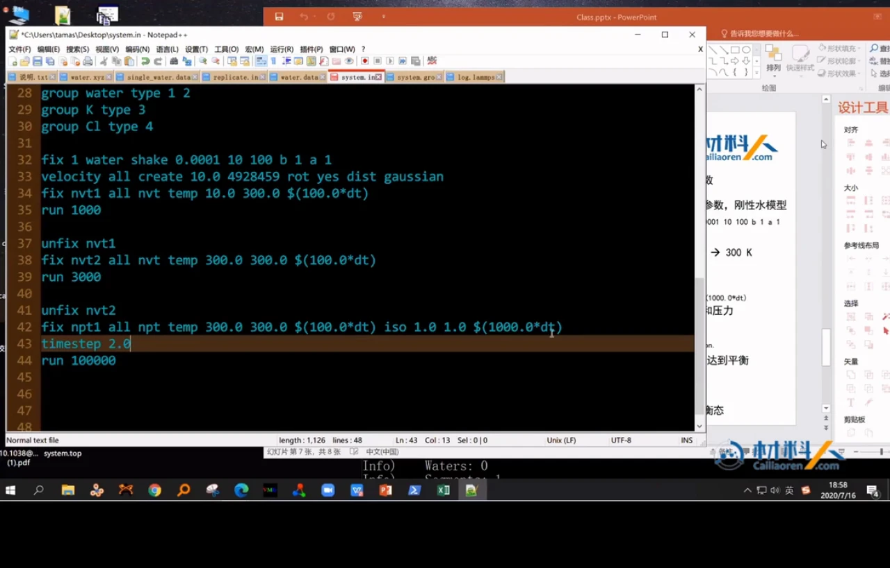

### 1.3 时间步长可以放大到 2 fs

LAMMPS 在 `real` 单位下默认时间步长是 1 fs。课程因为对水使用了 SHAKE 约束（固定 O–H 键长和 H–O–H 键角），把 `timestep` 调到了 2.0 fs，这样同样步数能覆盖更长的物理时间。这是用约束换步长：刚性水模型压住了最高频的键振动，才允许 2 fs 稳定运行。

---

## 二、NPT 结束后必须回到 NVT，平衡是否完成要看曲线而不是看步数

密度校准完，课程先把 NPT 的 fix 去掉，再切回 NVT：

```lammps
unfix npt1
fix nvt2 all nvt temp 300.0 300.0 $(100.0*dt)
run 自己确定 直到进入平衡态
```

这一步不是再次改变密度，而是让体系在**固定体积**下松弛到平衡态。为什么非要回到 NVT？因为后面算扩散系数时，我们希望盒子体积固定、只观察粒子在盒子里的运动；如果继续 NPT，盒子一直在涨缩，MSD 里会混入盒子变形带来的额外位移。

判断是否平衡，课程给了三个观察量：

1. **温度**：是否稳定在 300 K 附近，而不是持续漂移；
2. **势能**：是否在一个平台附近小幅涨落；
3. **MSD**：是否已经收敛到稳定数值，而不是还在单调变化。

`run` 的时间“不应该由自己确定”，而应该由这些量是否收敛决定。课程的经验是：纯水体系大约需要 100 ps 量级的平衡时间，KCl 溶液还要更长一些，具体多长需要自己测。[【跳转到 04:27】](https://www.bilibili.com/video/BV1k5411V7eW/?p=7&t=267)

这里的原则是：**平衡段和生产段要分开**，否则还没松弛的构象会被算进 MSD，曲线开头会明显弯曲。

---

## 三、生产采样要一次跑够，并把轨迹写成 GROMACS 能读的 xtc

进入生产段后，控温和平衡段保持一致，仍然用同一个恒温器；区别是要开始**输出动力学轨迹**。课程选用 LAMMPS 的 `dump` 命令：

```lammps
dump 1 all xtc 1000 file.xtc
run 10000000
write_data final.data
write_restart final.restart
```

**第一，`dump` 支持很多轨迹格式。** LAMMPS 可以写自己的 `lammps` 格式，也可以写 `xtc`、`dcd`、`cfg` 等。课程说得很直白：为了后续用 GROMACS 分析，直接输出 `xtc` 最省事；`xtc` 是 GROMACS 使用的压缩轨迹格式，VMD 也能直接识别。如果之前已经用自定义 `dump` 格式写了轨迹，也可以用作者 GitHub 上的 `lammps_trj2xtc.py` 转成 xtc。[【跳转到 06:43】](https://www.bilibili.com/video/BV1k5411V7eW/?p=7&t=403)

**第二，采样间隔要保证帧与帧之间“去相关”。** `1000` 是每隔多少步写一帧，这个数不能随便拍脑袋：间隔太密，相邻帧几乎一样，统计上是重复信息；间隔太稀，又会丢掉快速运动的细节。课程的原则是看采样点之间是否还存在明显关联，再结合体系的时间尺度来定。

**第三，生产段要一次跑够。** 示例里 `run 10000000`，最后用 `write_data` 写出最终结构 `final.data`，用 `write_restart` 写出重启文件。课程还建议用 `thermo 100` 每隔 100 步输出一次热力学量，方便随时检查温度和压强有没有异常。

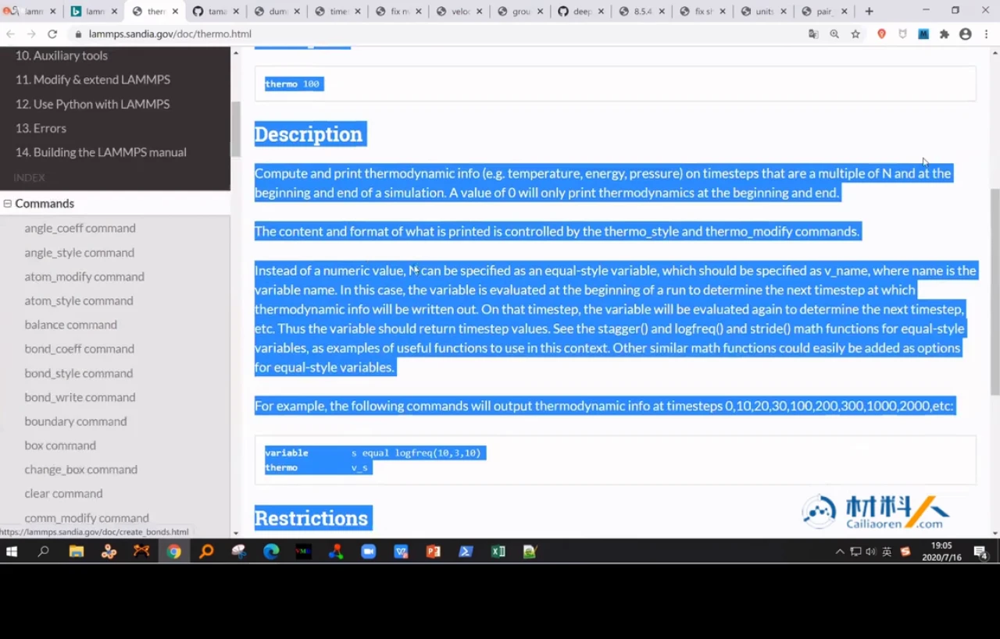


---

## 四、data 文件补原子类型，xtc 提供坐标：两者缺一不可

### 4.1 为什么不能只拿 xtc 去分析

`xtc` 是压缩轨迹，里面只存每一帧的坐标（以及盒子信息），**不存原子类型、原子名、质量这些拓扑信息**。GROMACS 要计算 MSD 或 RDF，必须知道“哪些原子是氧、哪些是氢、哪些是 K、哪些是 Cl”。所以还要一个结构文件作为参考。

课程拿前面某一步得到的 `data` 文件来生成结构文件。这个 `data` 文件具体来自哪一步并不重要，因为这里只需要它里面的原子类型信息；真正提供坐标的是 `file.xtc`。[【跳转到 10:22】](https://www.bilibili.com/video/BV1k5411V7eW/?p=7&t=622)

### 4.2 两个脚本：data2gmx.py 与 make_ndx.py

课程作者在 GitHub 上提供了 `Lammps_tools`，其中两个脚本正好解决“格式转换 + 分组”：

```bash
python data2gmx.py nvt.data
python make_ndx.py nvt.data
```

- `data2gmx.py`：把 LAMMPS 的 `data` 文件转成 GROMACS 的 `gro` 坐标文件，按质量自动识别元素，生成可视化可用的结构；
- `make_ndx.py`：根据 LAMMPS 的原子类型，生成 GROMACS 的索引文件 `index.ndx`，把 `type1`、`type2`、`type3`、`type4` 分别定义成组。

### 4.3 旧脚本的局限：只按元素识别，会合并同种元素

`data2gmx.py` 的不足是：只按元素（质量）区分原子，不区分 LAMMPS 的 `type`。如果体系里同时有水的氢和甲烷的氢，两者质量都是 1.008，脚本就会把它们合并成同一类，之后你就没法单独选中“甲烷的氢”。

`make_ndx.py` 正是为弥补这一点：它按 LAMMPS 的 `type` 建组。打开生成的 `index.ndx` 可以看到：

- `system`：1 到 3010 号原子，包含整个体系；
- `type1`：氧原子，编号每隔 3 个出现一次；
- `type2`：氢原子；
- `type3`：钾离子；
- `type4`：氯离子。

这样即使不同分子含有同种元素，只要 LAMMPS 里给了不同的 `type`，就能在 GROMACS 里精确选中。[【跳转到 16:12】](https://www.bilibili.com/video/BV1k5411V7eW/?p=7&t=972)

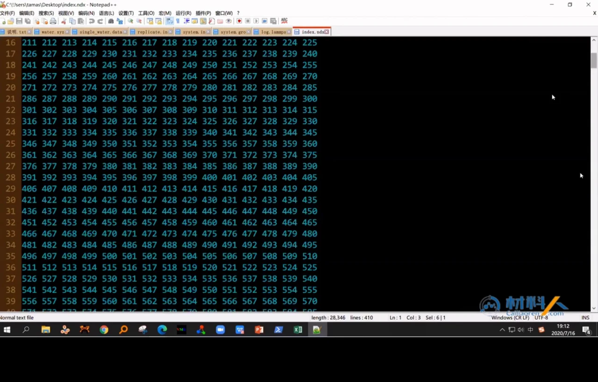

---

## 五、先用 VMD 验收轨迹，确认水、钾离子和氯离子都在正常运动

在 VMD 之前，课程先用 `gmx check -f file.xtc` 检查轨迹：它会报告帧数、总时长、帧间隔和坐标精度。示例中这份轨迹约 1300 帧、总长 1300 ps，精度 0.001 nm。先确认文件能读、帧数对得上，再用 VMD 做“肉眼验收”：

1. 先把 `data` 文件转成 `gro`，用 VMD 打开；
2. 在 VMD 里删掉当前这一帧（`Delete frames`），因为接下来的 xtc 会自带坐标；
3. 把 `file.xtc` 加载到这个分子上，VMD 会自动识别为 GROMACS 轨迹；
4. 用 `Dynamic Bonds` 显示动态键，再把氧、氢、钾、氯分别用 VDW 球显示。

刚开始播放时可能会看到大量“乱键”横跨盒子，这不是轨迹坏了，而是 VMD 按周期性边界显示时的正常现象：相邻帧里原子跨过盒子边界，VMD 把两端的原子连在了一起。把显示方式改成动态键、并注意周期性显示设置后，就能看到真实的水分子形状。

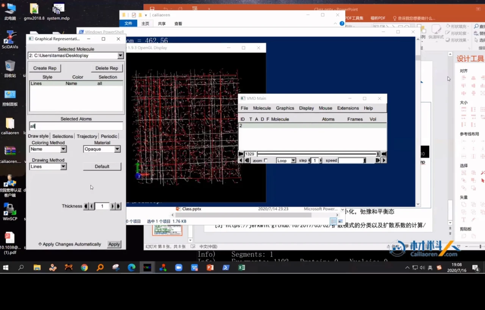

播放轨迹时可以看到，钾离子和氯离子在水盒子里做布朗扩散。这一步虽不产生数据，却能提前发现空轨迹、原子类型错误、盒子异常形变。VMD 也能做 RDF 和氢键，但没有现成的扩散系数计算，所以扩散系数还是交给 GROMACS。

---

## 六、算扩散系数前必须先去掉周期性边界，否则 MSD 会出现阶梯

### 6.1 问题出在“折回盒子”的坐标

LAMMPS 默认记录的是原子在周期性盒子里的**包裹坐标**：原子从盒子右边出去，会从左边重新出现。假设一个原子这一帧在盒子左边界附近，下一帧跨到了右边界，记录下来的坐标会突然跳过一个盒子长度。两帧相减，位移看起来像是“瞬移了一个盒子”，这显然不是真实的运动。

如果直接拿这种轨迹算 MSD，曲线会呈现一级一级的台阶；用它拟合扩散系数，结果没有意义。所以必须先做**去周期性（unwrap）**，把每一帧的坐标还原成从初始位置连续演化出来的“真实坐标”。[【跳转到 18:42】](https://www.bilibili.com/video/BV1k5411V7eW/?p=7&t=1122)

### 6.2 判断与还原的规则

课程的实现思路很朴素：

- 如果相邻两帧的位移超过盒子边长的一半，就认为原子跨过了周期性边界；
- 跨过之后，把坐标加上（或减去）对应的盒子边长，把它“接”回连续轨迹；
- 对每一帧、每一个原子重复这个判断，保证整条轨迹都是从第一帧连续演化出来的。

这里用“半个盒子”作为阈值，是因为在正常时间步内，原子不可能真的在一个步长里跑过半个盒子；一旦超过，几乎一定是周期性折返造成的假位移。

### 6.3 用 gmx trjconv 完成转换

GROMACS 的 `gmx trjconv` 就是做轨迹格式转换和周期性处理的工具：

```bash
gmx trjconv -f file.xtc -s system.gro -o no_PBC.xtc -pbc nojump
```

几个关键选项要分清：

- `-f`：输入轨迹，这里是 `file.xtc`；
- `-s`：结构文件，告诉程序原子数、盒子等信息，这里是 `system.gro`；
- `-n`（可选）：索引文件，指定要处理哪些组；不写就用默认分组；
- `-pbc nojump`：不对跨边界的原子做“跳回”，而是保持其连续位移，从而去掉周期性跳变。

执行时程序会让你选择输出组，课程选择 `System`（第 0 组），也就是对所有原子都做去周期性。全部转一遍更省事，后面换组分析不用重来。[【跳转到 20:44】](https://www.bilibili.com/video/BV1k5411V7eW/?p=7&t=1244)

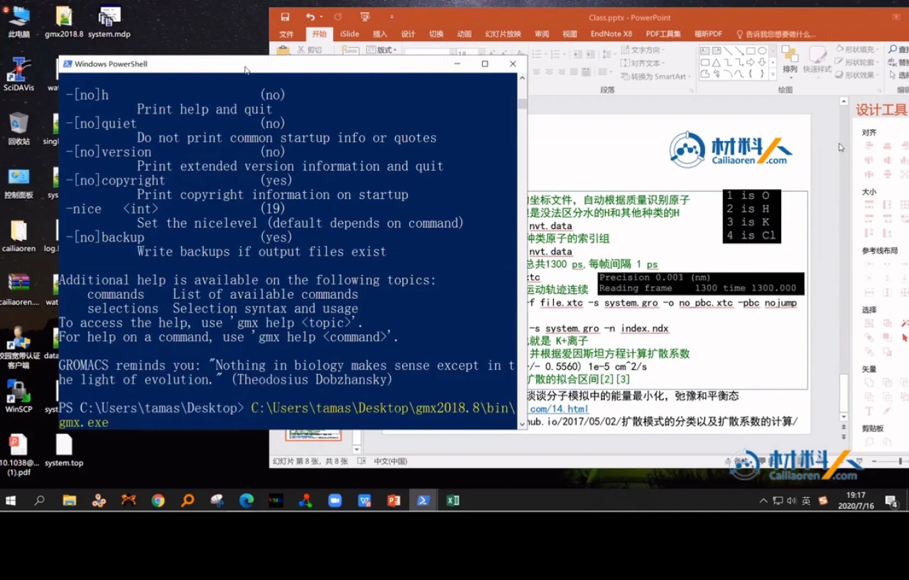

---

## 七、gmx msd 一次给出 MSD 曲线和扩散系数，但默认拟合区间未必可用

### 7.1 MSD 与爱因斯坦关系

均方位移（Mean Squared Displacement，MSD）衡量的是：经过时间 t 后，粒子离它出发点多远。定义是

\[
\mathrm{MSD}(t)=\left\langle |\mathbf r_i(t)-\mathbf r_i(0)|^2 \right\rangle
\]

对三维各向同性扩散，长时间下满足爱因斯坦关系：

\[
\mathrm{MSD}(t)=6Dt
\]

其中 D 就是扩散系数。也就是说，**MSD–t 曲线进入线性区后，斜率除以 6 就是 D**。这就是“跑一段轨迹、算 MSD、拟合直线”的完整逻辑。[【跳转到 23:26】](https://www.bilibili.com/video/BV1k5411V7eW/?p=7&t=1406)

### 7.2 命令与分组

课程用的是：

```bash
gmx msd -f no_PBC.xtc -s system.gro -n index.ndx
```

注意 `-f` 必须指向**去过周期性的** `no_PBC.xtc`，而不是原始的 `file.xtc`。程序会列出可选组：

```
Group 0 (System) has 3010 elements
Group 1 (type1) has 1000 elements
Group 2 (type2) has 2000 elements
Group 3 (type3) has 5 elements
Group 4 (type4) has 5 elements
```

这里要算的是钾离子，所以选第 3 组 `type3`。程序随后给出：

```
D[ type3 ] 2.0823 (+/- 0.5560) 1e-5 cm^2/s
```

即钾离子的扩散系数约为 **2.0823×10⁻⁵ cm²/s**，括号里是拟合的统计误差。换算成更直观的单位，约等于 2.08 nm²/ns。[【跳转到 24:43】](https://www.bilibili.com/video/BV1k5411V7eW/?p=7&t=1483)

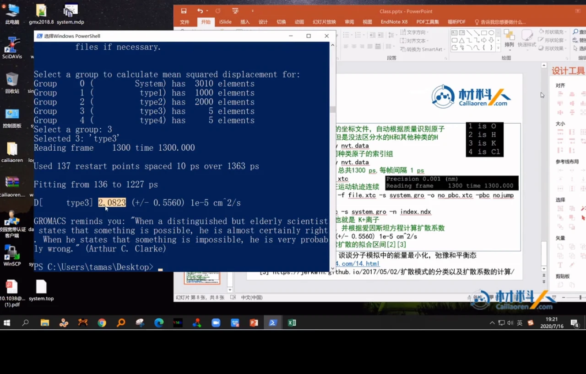

### 7.3 默认拟合区间只是“能用”，不一定是“正确”

`gmx msd` 默认会从轨迹里挑一段做线性拟合，并输出一个 D 值。但课程强调：**这个默认值只能作为估算**。严格的做法是先画出 MSD 曲线，确认哪一段真正处于线性扩散区，再让程序只拟合那一段。否则如果把弹道区或统计很差的尾部也算进去，D 会偏。

课程幻灯片也把整条分析链总结得很清楚：`data2gmx.py` 转坐标、`make_ndx.py` 建组、`gmx check` 检查轨迹、`gmx trjconv` 去周期性、`gmx msd` 算扩散系数。

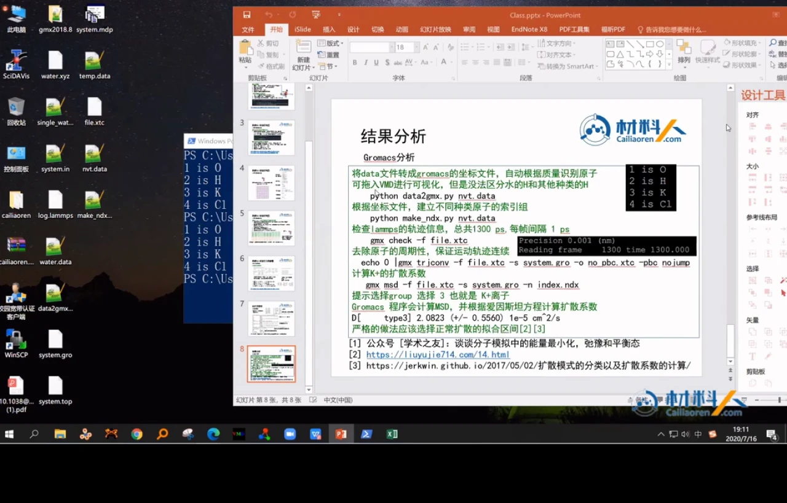

---

## 八、把 MSD 除以 6t 作图，才能客观找出真正的线性扩散区间

### 8.1 先看 MSD 曲线

`gmx msd` 除了在终端打印 D，还会输出一个 `msd.xvg`。文件前面有很多以 `#`、`@` 开头的注释行，真正用于画图的是后面的两列数据：第一列时间（ps），第二列 MSD（nm²）。

课程把注释行删掉，用开源画图软件 SciDAVis 导入。导入时有两个关键设置：

- 分隔符选 **Space**（空格）；
- 勾选 **简化空白**，否则连续多个空格会被当成多个空列，数据就错位了。

导入后得到两列数据，横轴时间、纵轴 MSD，画出曲线。

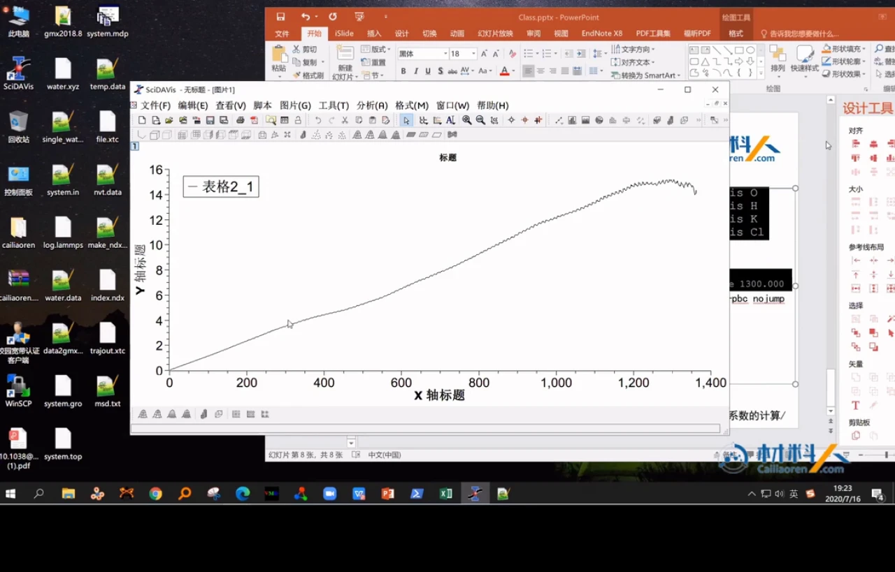

### 8.2 为什么直接看 MSD 不够

MSD 开头受弹道运动影响，结尾因统计样本变少而波动，肉眼很难判断哪段是直线。课程推荐的做法是：**把 MSD 除以 6t，再对 t 作图**。

如果体系处于正常扩散区，MSD ≈ 6Dt，那么 MSD/(6t) ≈ D，曲线会呈现一条近似水平的平台；平台对应的就是扩散系数。哪一段是平台，哪一段就适合做线性拟合。这个技巧来自课程引用的一篇数据分析博客，里面还给出了用 `awk` 把 `msd.xvg` 转成 `msd_6t.xvg` 的脚本。

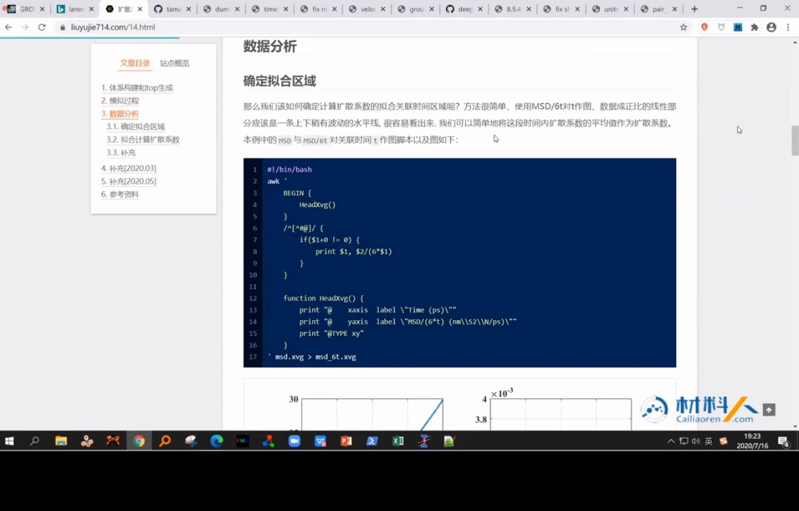

### 8.3 确认区间后再回到 gmx msd

找到线性区之后，回到 `gmx msd`，用参数把拟合限制在这段区间内，D 才和爱因斯坦关系的前提一致。课程的原话是：默认拟合只是估算，准确计算要自己选直线扩散区间。[【跳转到 24:56】](https://www.bilibili.com/video/BV1k5411V7eW/?p=7&t=1496)

---

## 九、用 -b/-e 与 -beginfit/-endfit 精确控制“用哪段轨迹、拟合哪一段”

`gmx msd` 有两组容易混淆的时间参数，课程专门做了区分。

### 9.1 -b 与 -e：从轨迹里截取哪一段

- `-b <time>`：从轨迹的哪个时间开始读；
- `-e <time>`：读到哪个时间为止；
- 默认单位是 ps，可用 `-tu` 改成 fs、ns 等。

它们决定的是“参与计算的轨迹范围”，不是拟合范围。课程举了一个常见场景：如果采样时没有把时间归零，xtc 的起始时间可能接着前面的平衡段，比如从 1 ns 开始。这时可以加 `-b 1000 -e 9000`，丢掉前面 1 ns，只用 1–9 ns 的数据。

更根本的解决办法是在采样前加一行：

```lammps
reset_timestep 0
```

把输出 xtc 的时间重新从 0 开始，这样后面选时间段会清爽很多。[【跳转到 28:48】](https://www.bilibili.com/video/BV1k5411V7eW/?p=7&t=1728)

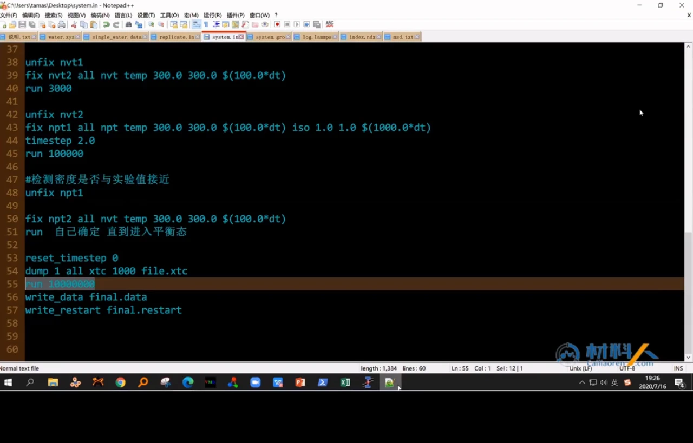

### 9.2 -beginfit 与 -endfit：在选定轨迹里拟合哪一段

- `-beginfit <time>`：从哪个时间开始拟合；
- `-endfit <time>`：拟合到哪个时间结束；
- `-1` 表示自动取轨迹的 10% 和 90%。

关键点：**`-beginfit` 是相对于 `-b` 之后的时间起点的**。如果你用了 `-b 1000`，那么 `-beginfit 500` 指的是“从 1.5 ns 开始拟合”，而不是从绝对时间 0.5 ns 开始。这一点课程反复强调，因为很容易在这里把区间选错。[【跳转到 30:28】](https://www.bilibili.com/video/BV1k5411V7eW/?p=7&t=1828)

把这两组参数用对，才能做到“轨迹截取”和“拟合区间”互不干扰。

---

## 十、同一套轨迹还能算离子间距、径向分布函数与氢键

扩散系数只是动力学性质。课程最后演示了如何用同一份 `trajout.xtc` 做结构分析，并推荐了一个整理 GROMACS 全部程序用途的博客（作者李老师），里面按“分析轨迹、创建拓扑、运行模拟、处理能量、转换文件”等类别列出了每个程序的用法。[【跳转到 31:22】](https://www.bilibili.com/video/BV1k5411V7eW/?p=7&t=1882)

### 10.1 用 gmx distance 算 K⁺ 与 Cl⁻ 的平均距离

命令是：

```bash
gmx distance -s system.gro -f trajout.xtc \
  -select 'com of name K plus com of name Cl' -oav -oall
```

`-select` 用的是 GROMACS 的选区语法：`com of name K` 表示所有名为 K 的原子的质心，`plus com of name Cl` 表示再把 Cl 的质心加进来，于是计算的是这两个质心之间的距离。

课程运行后得到：

```
Average distance: 0.72541 nm
Standard deviation: 0.29183 nm
```

也就是 K⁺ 与 Cl⁻ 的平均距离约 **0.725 nm**，与口头说的“0.72”一致。[【跳转到 34:31】](https://www.bilibili.com/video/BV1k5411V7eW/?p=7&t=2071)

### 10.2 用 gmx rdf 算径向分布函数

径向分布函数（Radial Distribution Function，RDF）回答的是：“以一个氧原子为中心，距离它 r 的地方出现另一个原子的概率密度，相对于均匀分布高多少。”它是判断溶液局部结构、配位数、氢键网络的基本工具。

命令是：

```bash
gmx rdf -f trajout.xtc -s system.gro -n index.ndx
```

程序会让你选参考组（`ref`）和计算组（`sel`）。课程选第 1 组 `type1`（水的氧）作为参考，再选第 1 组作为计算组，得到 O–O 的径向分布函数。曲线第一个峰大约在 **3 Å** 附近，对应水分子之间最近邻的氧–氧距离。换不同的组，还可以看 K–Cl、K–O 等不同 pair 的局部结构。[【跳转到 35:19】](https://www.bilibili.com/video/BV1k5411V7eW/?p=7&t=2119)

课程还遇到一个实际问题：Windows 版 GROMACS 在选择组时用 Ctrl+D 结束输入会出问题，最后切到 Linux 服务器才跑完。这不是命令写错，而是 Windows 版的兼容性 bug。[【跳转到 37:54】](https://www.bilibili.com/video/BV1k5411V7eW/?p=7&t=2274)

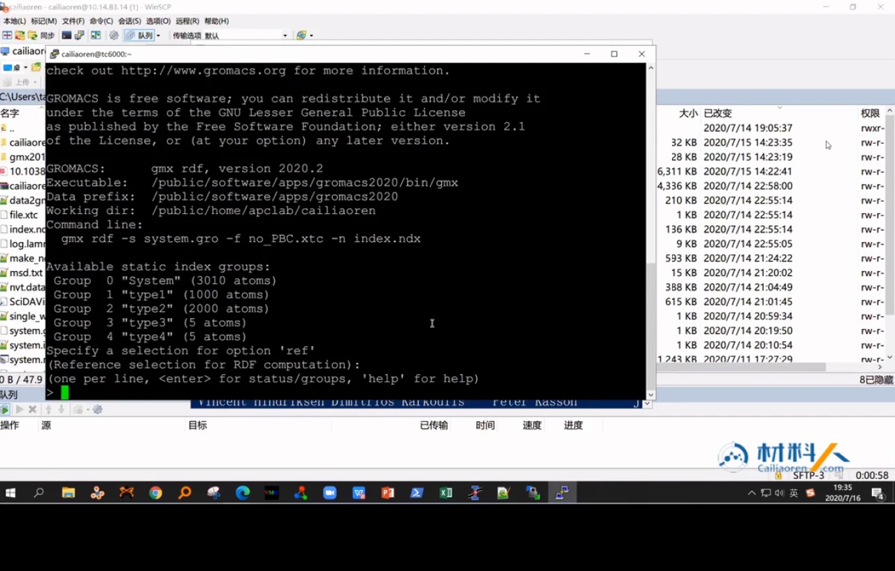

### 10.3 还能算氢键

算完 RDF 后，课程顺带提到 `gmx hbond` 可以统计氢键。因为前面的 `index.ndx` 已经把水、K、Cl 分好了组，做氢键分析时直接选组即可，不需要再手工数原子编号。[【跳转到 39:36】](https://www.bilibili.com/video/BV1k5411V7eW/?p=7&t=2376)

---

## 十一、这条流水线可以迁移到其他轨迹格式和更复杂的体系

课程最后说明这条流水线可迁移，并不限于“LAMMPS + KCl 水溶液”。

**第一，其他轨迹格式也能转换。** DCD 等格式也能转成 GROMACS 支持的 trr；课程强调，已经有 dump 轨迹不必重跑。

**第二，其他软件的轨迹也能接进来。** 课程展示了 GitHub 上的 `VASP2GRO`、`XDATCAR_toolkit` 等工具，可以把 VASP 的 `XDATCAR` 转成 GROMACS 的 gro。这样 GROMACS 就不只是“自己跑自己分析”，而是一个统一的分析后端。[【跳转到 40:29】](https://www.bilibili.com/video/BV1k5411V7eW/?p=7&t=2429)

**第三，神经网络势的轨迹同样适用。** 课程提到他们最近的工作：用 LAMMPS 跑神经网络势，得到轨迹后再交给 GROMACS 分析扩散系数、RDF 等，并与其他分子动力学软件跑出的轨迹做比较。方法本身与“轨迹由谁产生”无关，只要坐标连续、拓扑清楚，就能套用同一条分析链。[【跳转到 39:57】](https://www.bilibili.com/video/BV1k5411V7eW/?p=7&t=2397)

**第四，Windows 也能跑。** 课程演示了 GROMACS 2018.8 的 Windows 版本，原生支持 GPU 加速，一块 RTX 2080 也能跑；遇到 Ctrl+D 这类兼容性问题时转到 Linux 更省心。

---

## 小结

1. **NPT 是为了校准密度，不是为了凑步数。** 控压参数 `Pdamp` 取 1000 个时间步左右，跑完必须检查密度是否接近实验值。
2. **NPT 之后要回到 NVT 平衡。** 用温度、势能、MSD 三条曲线判断收敛，平衡段和生产段分开，平衡时间由体系决定而不是拍脑袋。
3. **生产段用 NVT 采样并直接输出 xtc。** 采样间隔要保证帧间去相关，最后写出 `final.data` 和重启文件；`thermo 100` 用来随时监控温度、压强。
4. **xtc 只有坐标，没有原子类型。** 必须用 data 文件配合 `data2gmx.py` 生成 gro，用 `make_ndx.py` 按 LAMMPS type 生成 ndx；按元素识别的旧脚本会合并同种元素，这是它的局限。
5. **分析前先用 VMD 验收轨迹。** 看水分子、K⁺、Cl⁻ 是否正常运动，能提前发现空轨迹、类型错误和盒子异常。
6. **扩散系数必须先去掉周期性边界。** 用 `gmx trjconv -pbc nojump` 把折回盒子的坐标还原成连续轨迹，否则 MSD 会出现阶梯。
7. **MSD 进入线性区后满足 MSD = 6Dt。** `gmx msd` 选对组（K⁺ 是 `type3`）可得到 D ≈ 2.0823×10⁻⁵ cm²/s，但默认拟合区间只是估算。
8. **用 MSD/(6t) 找平台，再决定拟合区间。** `-b/-e` 控制用哪段轨迹，`-beginfit/-endfit` 控制拟合哪段，后者相对于 `-b` 的起点。
9. **同一套轨迹还能算距离、RDF 和氢键。** K⁺–Cl⁻ 平均距离约 0.725 nm，O–O 的 RDF 第一峰约在 3 Å。
10. **方法可迁移。** dump、DCD、XDATCAR 等轨迹都能转到 GROMACS，神经网络势的轨迹同样适用。

---

## 关键术语速查

| 术语 | 一句话解释 |
| --- | --- |
| NPT | 恒定粒子数、压强、温度，让盒子体积自由涨缩，用来把密度调到实验值。 |
| NVT | 恒定粒子数、体积、温度，盒子固定，用于平衡和生产采样。 |
| `fix npt` | LAMMPS 中同时控温控压的命令，`iso` 表示三个方向各向同性控压。 |
| `Pdamp` | 控压器的弛豫时间，太小压强振荡、太大平衡慢，官方推荐约 1000 个时间步。 |
| `timestep` | 分子动力学的时间步长；`real` 单位默认 1 fs，配合 SHAKE 可用 2 fs。 |
| `dump` | LAMMPS 输出轨迹的命令，可按步数间隔写 xtc、dcd、cfg 等格式。 |
| xtc | GROMACS 的压缩轨迹格式，只存坐标和盒子，不存原子类型。 |
| gro | GROMACS 的结构/坐标文件，记录原子名、编号和坐标。 |
| ndx | GROMACS 的索引文件，把一个体系划分成若干原子组。 |
| PBC | 周期性边界条件；原子跨边界后坐标会折回盒子，产生假位移。 |
| `gmx trjconv` | GROMACS 的轨迹转换工具，`-pbc nojump` 用于去周期性。 |
| MSD | 均方位移，粒子相对初始位置的位移平方的平均值。 |
| 爱因斯坦关系 | 三维正常扩散下 MSD = 6Dt，斜率除以 6 即扩散系数。 |
| `gmx msd` | 计算 MSD 和扩散系数的 GROMACS 工具。 |
| RDF | 径向分布函数，描述以某原子为中心、距离 r 处出现另一种原子的概率。 |
| `gmx distance` | 计算两个选区（如 K 的质心与 Cl 的质心）之间距离随时间的工具。 |
| `gmx hbond` | 统计氢键数量与寿命的工具。 |
| `reset_timestep` | 把 LAMMPS 的时间步计数归零，便于后续按时间截取轨迹。 |
