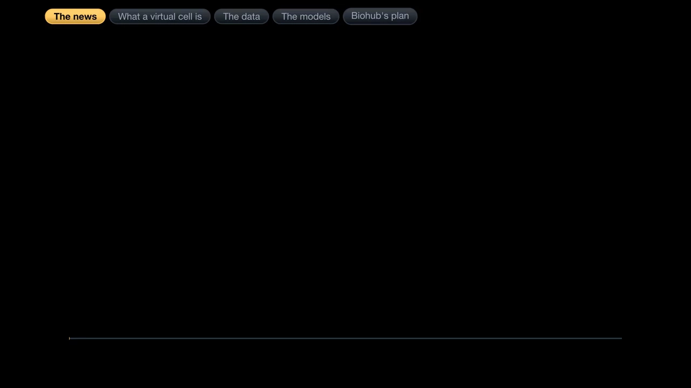
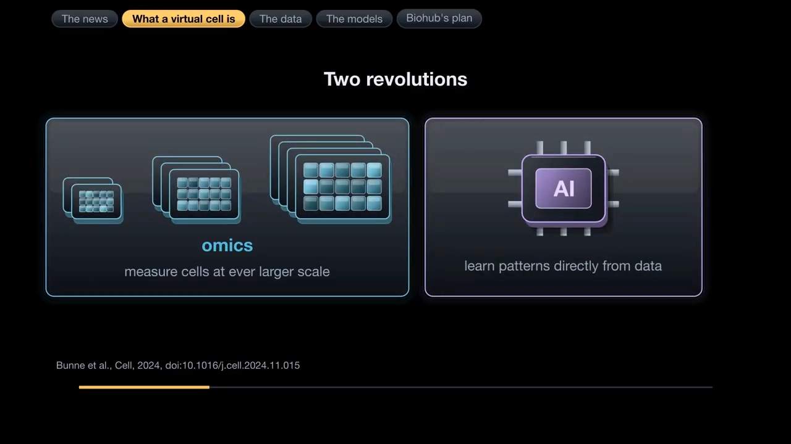
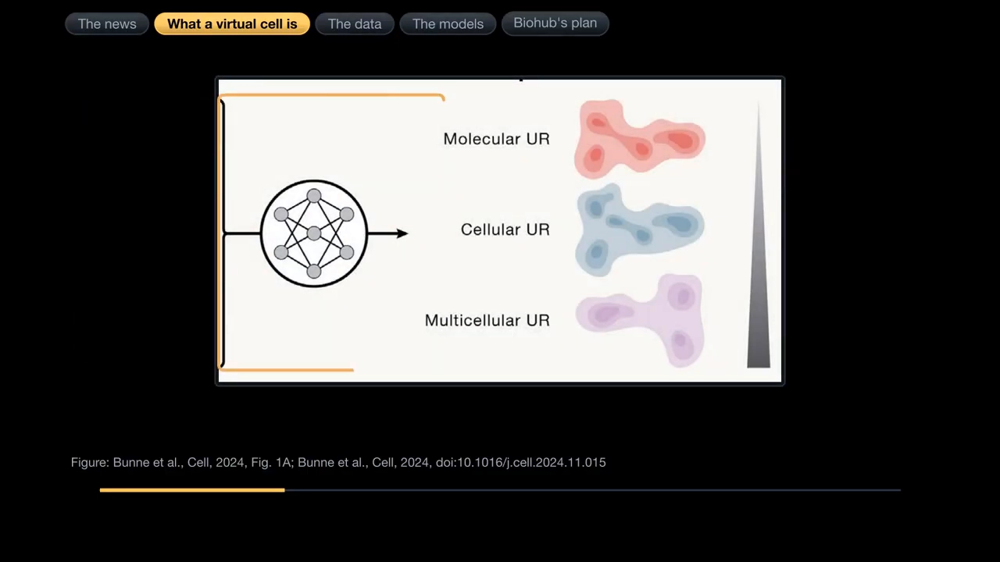
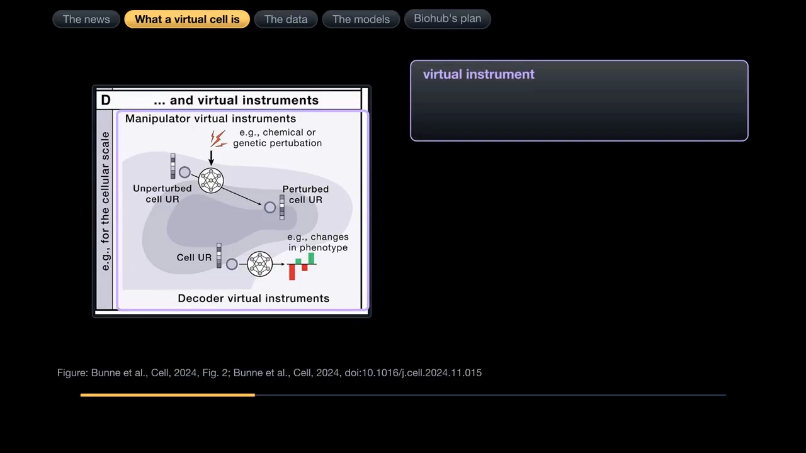
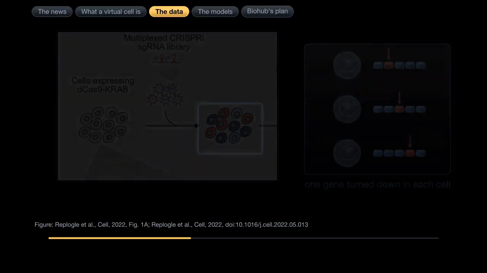
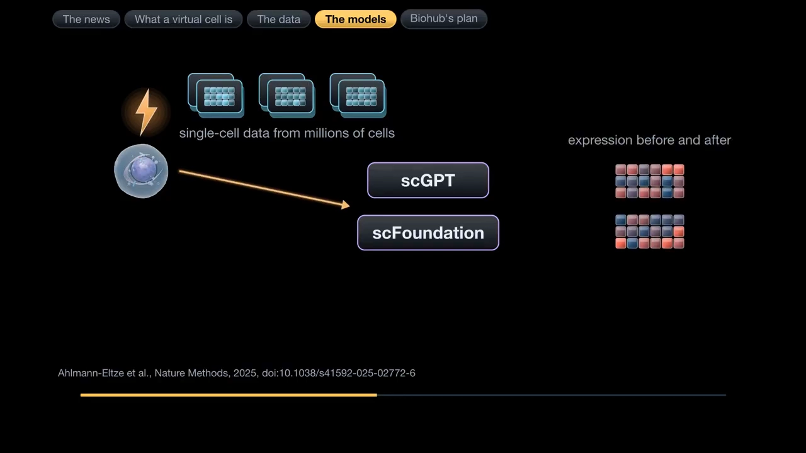
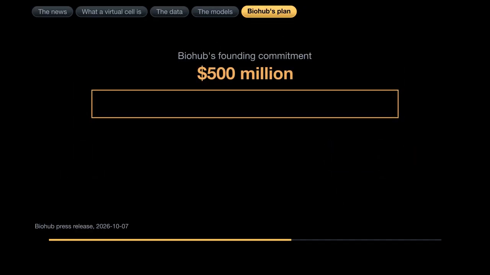
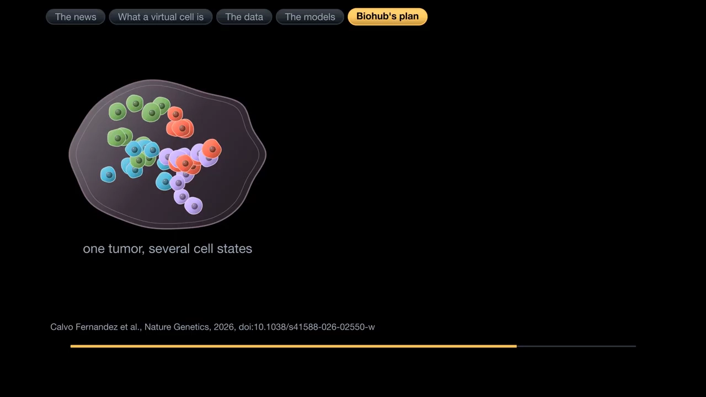
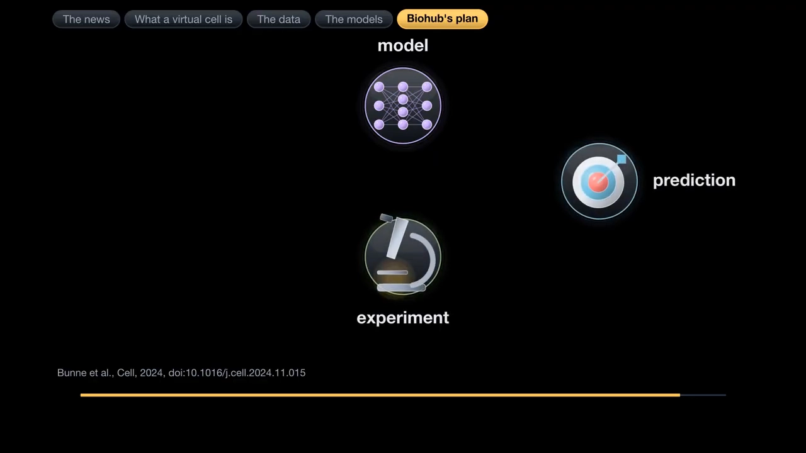

# 01 虚拟细胞是什么：从扰动数据到可计算的细胞模拟器

> 本文基于 [What is a virtual cell? Biohub's $1.8 billion data push, and the AI models it is for](https://www.youtube.com/watch?v=2-Ou1BLkpQQ)（20:47）整理。原片为英文，使用 YouTube 中文自动字幕，本文对术语和专名做了校正。

## 本讲要解决的核心问题（SCQA）

**背景**：单细胞组学让我们能在越来越大的规模上测量细胞，人工智能又擅长直接从数据里学规律。两场技术革命叠加，让「在计算机里模拟细胞」第一次看起来可行。

**冲突**：细胞又是一个极难建模的对象——它跨越原子到组织多个尺度，包含数量庞大的相互作用分子，而且大量过程是非线性的。更麻烦的是，现有基础模型在预测「没做过的扰动」时，并不稳定地赢过简单基线。

**疑问**：那虚拟细胞到底是什么？它能做什么、又需要什么？现在走到哪一步了？

**回答（中心思想）**：虚拟细胞是一个**从数据中学习出来的细胞模拟器**：它能表示细胞状态、预测细胞对扰动的响应，并在计算机里做实验来指导真实实验。它需要**扰动数据、足够广的生物学覆盖，以及跟得上模型进展的基准测试**；目前仍处于「方向明确、能力有限」的早期阶段。

## 一、一句话定义：不是「画一个细胞」，而是「学一个可计算的细胞」

视频引用 Bunne 等人在 *Cell*（2024）的综述，把虚拟细胞定义为一种**计算模型**，用来模拟细胞的生物功能与相互作用（[00:02:11](https://www.youtube.com/watch?v=2-Ou1BLkpQQ&t=131)）。

更具体地说，他们提出的 **AI 虚拟细胞**是一个多尺度、多模态的大型神经网络：输入基因组序列、单细胞 RNA、分子在细胞内的位置、细胞在组织中的位置等测量数据，输出分子、细胞、多细胞三个尺度的**通用表示**（embedding），再在这些表示之上接「虚拟仪器」来完成具体任务（[00:04:16](https://www.youtube.com/watch?v=2-Ou1BLkpQQ&t=256)）。

这里的关键词是**表示（representation）**：模型把高维、嘈杂的生物测量压成一串有意义的数字，让「相似的状态」在数字空间里也接近。表示之上才是解码器和操纵器——前者把表示变成人能看懂的东西（细胞类型标签、合成显微图像），后者把一种表示变成另一种（比如扰动后的细胞状态）（[00:05:38](https://www.youtube.com/watch?v=2-Ou1BLkpQQ&t=338)）。

## 二、为什么难：多尺度、组分多、非线性

传统细胞模型大多是**基于规则**的：把对机制的假设写成微分方程、随机模拟或代理人基模型，再用数据拟合参数。这条路在细菌等相对简单的系统上取得过成功——2012 年出现了第一个涵盖细菌全部 482 个基因与分子功能的全细胞模型。

但作者指出三个根本困难（[00:02:51](https://www.youtube.com/watch?v=2-Ou1BLkpQQ&t=171)）：

1. **多尺度**：细胞过程从原子、分子、细胞器一直跨到组织和群体，单一模型很难同时覆盖。
2. **组分数量庞大**：细胞里有大量彼此交互的分子，手工写规则写不完。
3. **非线性**：输入的一点小变化，可能通过非线性相互作用放大成复杂的输出变化。

AI 虚拟细胞的思路是绕开「手工写规则」：不要求模型显式写出每个机制，而是让神经网络从大规模测量数据中学习规律。代价是模型更像一个「黑箱模拟器」，需要大量数据和对齐良好的表示。

## 三、它应该做到的三件事

视频把 AI 虚拟细胞的能力拆成三条（[00:06:03](https://www.youtube.com/watch?v=2-Ou1BLkpQQ&t=363)）：

- **表示**：表示不同物种、不同条件下的生物状态；
- **预测**：预测细胞的行为与反应，包括实验室还没测试过的扰动；
- **模拟实验**：在计算机里做实验，指导下一步该收集什么数据。

第三点常被忽略。虚拟细胞不一定要一次预测得完全准确；它的价值在于**缩小假设空间**——先从成千上万个候选里挑出最有希望的虚拟结果，再用真实实验验证，从而降低实验成本（[00:06:21](https://www.youtube.com/watch?v=2-Ou1BLkpQQ&t=381)）。

这也解释了为什么它必须同时学习两类数据：**刻意施加扰动的数据**（知道「改变了什么」）和**没有扰动的观测数据**（知道细胞本来长什么样）。前者提供因果线索，后者提供背景分布。

## 四、数据从哪来：Perturb-seq 是核心燃料

要预测「细胞被改变后会发生什么」，模型必须先看过大量「被改变过的细胞」。目前最重要的数据来源之一是 **Perturb-seq**：用 CRISPR 干扰工具在细胞里逐个敲低基因，再对每个细胞做单细胞 RNA 测序，同时捕获向导 RNA（sgRNA），从而把「表达谱」和「被敲低的基因」对应起来（[00:07:18](https://www.youtube.com/watch?v=2-Ou1BLkpQQ&t=438)）。

视频重点介绍了 Replogle 等人 2022 年发表的第一批全基因组规模 Perturb-seq 筛选：一组在 K562 白血病细胞里覆盖所有有表达的基因，另一组在 K562 和 RPE1 细胞里覆盖常见必需基因；过滤后保留超过 250 万个细胞，每个扰动的细胞数中位数超过 100 个（[00:08:04](https://www.youtube.com/watch?v=2-Ou1BLkpQQ&t=484)）。

为什么要做到全基因组规模？因为**实验成本随扰动数目线性增长，但两两比较的数目随扰动数目的平方增长**。扰动越多，能推断出的基因功能关系就越丰富（[00:08:31](https://www.youtube.com/watch?v=2-Ou1BLkpQQ&t=511)）。

## 五、现实检验：基础模型还没有稳定赢过简单基线

这是全片最重要、也最容易被忽略的一段。

2025 年发表在 *Nature Methods* 的一项基准研究，把 5 个单细胞基础模型和另外 2 个深度学习模型，与两个刻意设计得很简单的基线做比较（[00:09:32](https://www.youtube.com/watch?v=2-Ou1BLkpQQ&t=572)）：

- **「不变」基线**：永远预测处理后的表达和未处理对照组一样；
- **「相加」基线**：把两个扰动各自单独的效果加起来，作为组合扰动的预测。

结果并不乐观：

- 在 K562 细胞的**双基因组合扰动**测试中，所有模型的预测误差都明显高于「相加」基线；在**基因交互作用**预测上，没有任何模型比「不变」基线更好（[00:10:03](https://www.youtube.com/watch?v=2-Ou1BLkpQQ&t=603)）。
- 在**没见过的单基因扰动**上，没有任何深度学习模型能稳定胜过简单的平均预测或线性模型（[00:10:51](https://www.youtube.com/watch?v=2-Ou1BLkpQQ&t=651)）。
- 唯一稳定胜出的方法，是一个**线性模型**：它使用在 Replogle 扰动数据上预训练的扰动表示，并做跨细胞系预测。作者发现，用单细胞图谱数据预训练只比随机嵌入好一点点；用**扰动数据**预训练才有明显改善（[00:11:02](https://www.youtube.com/watch?v=2-Ou1BLkpQQ&t=662)）。

作者也说明了自己的限制：只用了四组数据。但结论很清楚——**「能预测」和「预测得比简单方法好」是两回事**。这为整套小册子定下基调：评估虚拟细胞时，必须盯住基线和泛化设定，而不是只看模型规模。

## 六、Biohub 在建造什么：18 亿美元买的是「数据 + 工具 + 标准」

视频后半段讲了一个产业级动作。2026 年 10 月，Biohub 宣布大幅扩大一项国际合作，目标是产生并开放训练预测式 AI 生物模型所需的数据；合作方包括美国能源部、美国国家卫生研究院，以及 Google DeepMind、Isomorphic Labs、Meta 等（[00:00:00](https://www.youtube.com/watch?v=2-Ou1BLkpQQ&t=0)）。

几个数字（[00:00:25](https://www.youtube.com/watch?v=2-Ou1BLkpQQ&t=25)、[00:12:27](https://www.youtube.com/watch?v=2-Ou1BLkpQQ&t=747)）：

- 合计投入 **18 亿美元**，用于经费、数据和计算；
- 能源部五年投入超过 **5 亿美元**；
- 国家卫生研究院整合此前超过 **5 亿美元**的数据集与知识库；
- Google DeepMind、Isomorphic Labs、Meta 合计投入 **3 亿美元**；
- Biohub 自己的初始承诺是 **5 亿美元**，其中 4 亿用于新技术，1 亿资助外部研究。

钱主要花在三类测量技术上：**低温电子断层摄影**（近原子级解析细胞内细节）、**显微成像**（对活组织中数百万到数十亿细胞成像）、**工程工具**（在分子、细胞、组织、整体层面构建并扰动生物系统）。此外还有开放标准、统一标识符和单一数据入口（[00:14:42](https://www.youtube.com/watch?v=2-Ou1BLkpQQ&t=882)）。

## 七、一个已经跑通的例子：肿瘤细胞状态与药物组合

虚拟细胞不只是一个远期愿景。视频举了 Biohub 与哥伦比亚大学合作的两篇 *Nature Genetics* 论文（2026）：它们没有直接叫「虚拟细胞」，但用的是同一套思路——用计算预测细胞行为，再在实验里验证（[00:15:55](https://www.youtube.com/watch?v=2-Ou1BLkpQQ&t=955)）。

研究发现，一个肿瘤里可以同时存在多种分子特性不同的**细胞状态**，不同状态对药物的敏感性可能不重叠，从而造成耐药。团队用 ARACNe 和 VIPER 估计每个细胞中超过 1800 个调节蛋白的活性，找出主导某个状态的「主调节因子」；在胶质瘤中测了 372 种已获批或后期肿瘤药物，预测哪些药能逆转特定状态的主调节因子活性（[00:16:25](https://www.youtube.com/watch?v=2-Ou1BLkpQQ&t=985)）。

结果：9 种预测药物在小鼠模型中测试，8 种获得验证；把针对互补状态的药物配成组合，6 组里有 4 组显著延长生存期。其中 avapritinib + ruxolitinib 把中位生存期延长到对照组的近 3 倍，比单用 avapritinib 延长 1.5 倍（[00:18:34](https://www.youtube.com/watch?v=2-Ou1BLkpQQ&t=1114)）。

这个例子说明虚拟细胞的价值不一定是「一次预测出正确答案」，而是**把实验候选从几百个缩小到几个**，让后续验证更便宜、更快。

## 小结

- 虚拟细胞是**从数据中学习的细胞模拟器**：表示状态、预测扰动响应、在计算机里做实验。
- AI 虚拟细胞 = 多尺度多模态表示 + 虚拟仪器（解码器 / 操纵器），不是一张静态的细胞图。
- 三大难点：多尺度、组分多、非线性；AI 的解法是用数据学习规律，而不是手工写机制。
- 核心数据是 **Perturb-seq**：把「扰动身份」和「单细胞表达谱」对应起来；全基因组筛选的价值在于能推断大量基因关系。
- 2025 年的基准提醒我们：**基础模型还没有稳定赢过「不变 / 相加 / 线性」这些简单基线**，评估必须看泛化设定和基线。
- Biohub 的 18 亿美元计划主要买「数据 + 测量工具 + 开放标准」，说明瓶颈不只在模型，也在数据和评测。
- 已经落地的案例（肿瘤细胞状态 + 药物组合）说明它的现实价值是**缩小实验搜索空间**。

**下一节**：虚拟细胞具体要预测哪些任务？基因、药物、剂量、组合、跨细胞系，难度差别在哪里？
