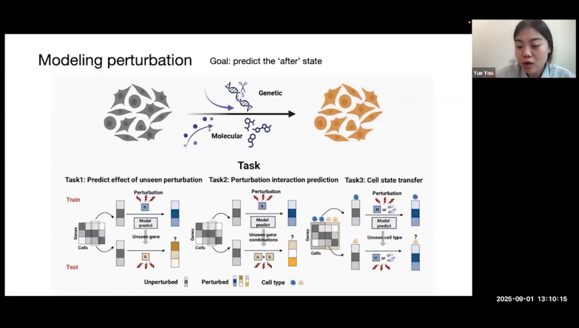
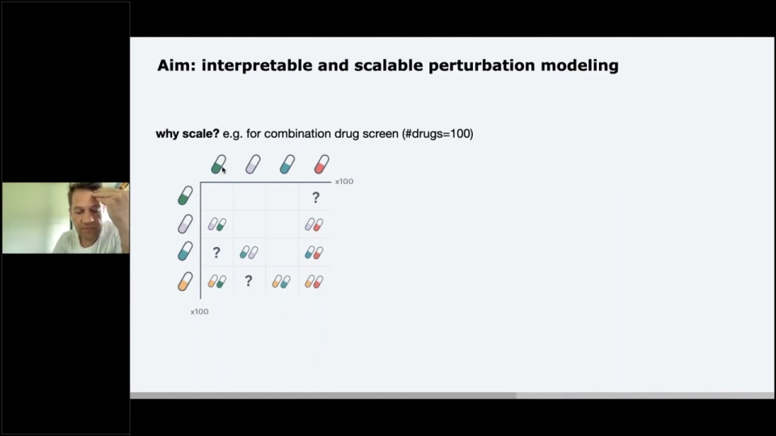
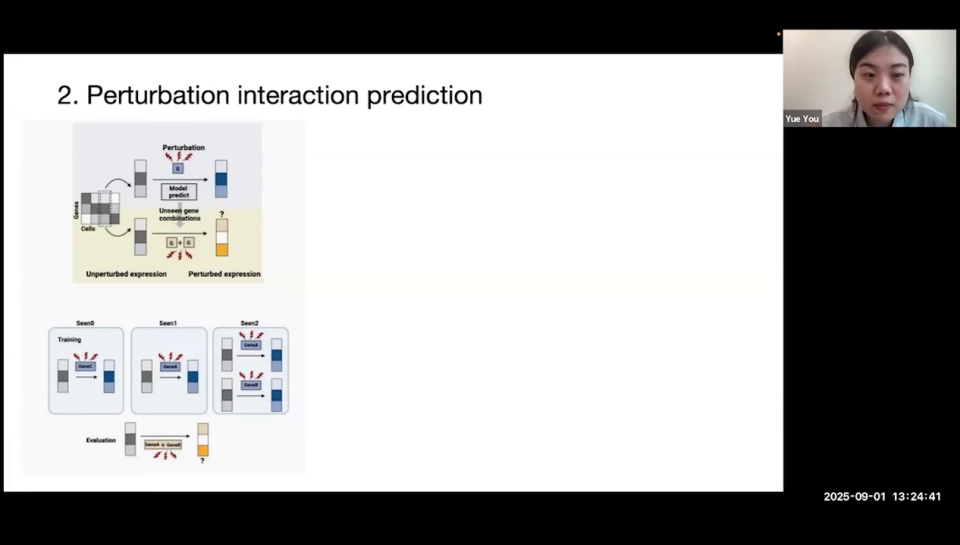
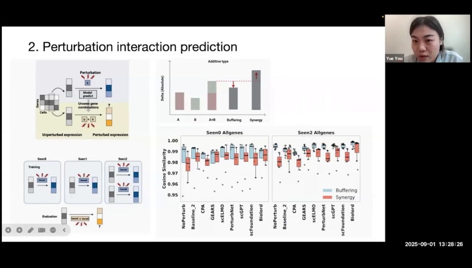
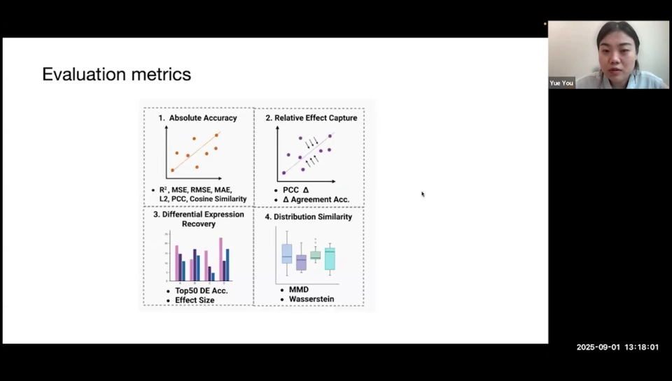
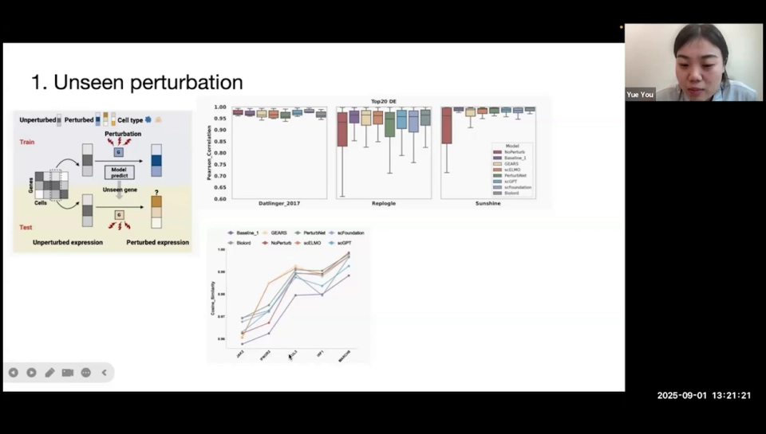
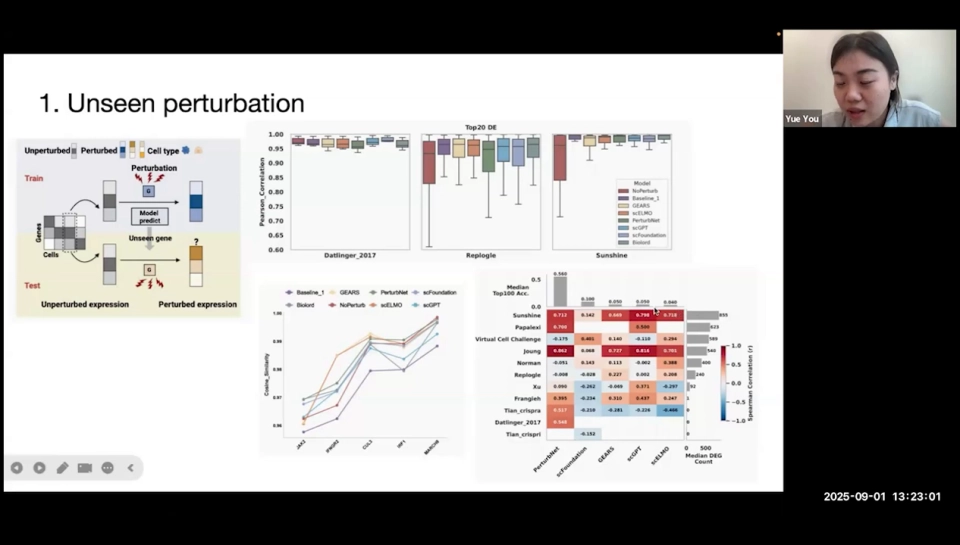

# 02 预测任务有哪几种：一张「扰动 × 泛化」的难度地图

> 本文基于以下视频整理：[A Systematic Comparison of Single-Cell Perturbation Response Prediction Models](https://www.youtube.com/watch?v=pFRuCfn6pFE)（报告人 Yue You，广州国家实验室，介绍 PerturbArena 基准，26:47）与 [Interpretable Machine Learning to Model Drug Perturbations in Single Cell Genomics](https://www.youtube.com/watch?v=blbmQJtutJg)（Fabian Theis，36:00，讲解 CPA 与药物扰动建模）。两者均为英文报告，本文按上下文校正了自动字幕里的模型名与术语（如 PerturbNet、sci-Plex3、CPA）。

## 本讲要解决的核心问题（SCQA）

**背景**：上一篇我们把虚拟细胞定义成「输入细胞状态和扰动，预测扰动后的状态」。听起来只是一个回归任务：给模型一张表达谱，再告诉它「敲掉这个基因」或「加这个药」，让它输出新的表达谱。

**冲突**：真实的研究里，这个任务被拆成了很多种。扰动可以是基因、药物、剂量或组合；测试集可以只换扰动、只换细胞系，也可以两者都换。不同论文各做各的设定，指标也各算各的，导致「我的模型更好」这句话经常无法比较。

**疑问**：虚拟细胞到底要预测哪几种任务？哪些设定只是「见过的扰动换个样本」，哪些才是真正的零样本？为什么组合扰动和跨细胞系特别难？

**回答（中心思想）**：预测任务不是一条清单，而是一张**「扰动类型 × 泛化难度」的二维地图**。扰动类型决定模型要学什么生物学知识，泛化设定决定模型要跨越多大的分布差距；评价时必须同时说清这两件事，否则数字没有意义。

## 一、任务定义：给细胞状态加一个扰动，预测「之后」

一次单细胞扰动实验可以写成：

> 输入：扰动前的细胞群（未处理对照组）+ 扰动描述（敲哪个基因、用哪个药、什么剂量）
>
> 输出：扰动后的表达谱，最好是一个**分布**，而不只是一个平均值

报告人用一张图定义任务：左边是未扰动细胞，中间是 CRISPR 或药物，右边是扰动后细胞；模型要预测这个「after state」（[04:10](https://www.youtube.com/watch?v=pFRuCfn6pFE&t=250)）。

有两个容易被忽略的细节。第一，**输出应该是分布**。同一群细胞即使基因型相同，表达也会因细胞周期、转录噪声而不同。只预测一个平均表达谱，会丢掉方差；而差异表达分析恰恰依赖方差。后面我们会看到，很多模型「均值很准、生物学结论很错」，根源就在这里。

第二，**输入不是「同一个细胞的前后照片」**。单细胞测序是破坏性的，测完这个细胞就没了，不可能再测它扰动后的样子。训练数据永远是「一群对照细胞」和「另一群扰动细胞」，模型学的是群体对应关系，而不是单个细胞的因果轨迹。

## 二、扰动类型不止基因：药物、剂量、组合、跨细胞系

很多人一提「扰动预测」就想到 CRISPR 敲基因。实际上至少有五类任务，它们需要的先验知识完全不同。

**基因扰动**：用 CRISPR 敲除（KO）、干扰（KD）或激活（CRISPRa）某个基因，观察表达变化。这类数据里，扰动的「身份」是一个基因，模型可以利用基因网络、通路注释等先验。代表性数据是 Replogle 的全基因组 Perturb-seq（把 CRISPR 扰动和单细胞测序结合）、Norman 的组合扰动数据；代表性方法是 GEARS、PerturbNet 等（[05:05](https://www.youtube.com/watch?v=pFRuCfn6pFE&t=305)）。

**药物扰动**：给小分子化合物，观察转录组响应。这里的扰动不是基因，而是一个化学结构。模型要么把药物当成离散 ID（查表），要么从 SMILES（用文本表示分子结构的写法）学习结构表示。前者无法预测新药，后者才有泛化可能。代表性数据是 L1000（bulk，把一群细胞混在一起测）和 sci-Plex3（单细胞）。

**剂量**：同一个药在不同浓度下效果可能完全相反：低剂量只引起轻微应激，高剂量可能杀死细胞。剂量不是线性缩放，是独立的预测维度。Theis 说，只做单剂量筛选、把剂量加几档，实验复杂度就上升一个数量级（[23:40](https://www.youtube.com/watch?v=blbmQJtutJg&t=1420)）。

**组合扰动**：同时敲两个基因，或同时加两种药。组合效果往往不等于两个单扰动效果相加：可能互相增强（协同，synergy），也可能互相抵消（缓冲，buffering）。

**跨细胞系迁移**：在易做的癌细胞系上训练，迁移到 PBMC、成纤维细胞或类器官。报告人叫它「cell state transfer」：扰动可能见过、细胞类型没见过，模型要预测同一扰动在新背景下的效果（[06:20](https://www.youtube.com/watch?v=pFRuCfn6pFE&t=380)）。

## 三、真正决定难度的是泛化设定：从已见到零样本

### 3.1 四种基本设定

同样是「预测药物响应」，下面四种设定难度差了一个数量级。

1. **已见扰动，已见细胞系**：训练集里既有药也有细胞系，只是没测过这个组合；本质是插值，模型学会「药物效应 × 细胞背景」即可。
2. **未见扰动，已见细胞系**：训练集里没有这个基因或药，但有同细胞系的其他扰动；模型要把扰动身份泛化出去，基因靠网络，药物靠结构相似性。
3. **已见扰动，未见细胞系**：药见过、细胞类型没见过；模型要把药物效应迁移到新背景，难点是基线状态、增殖速度、通路活性都不同。
4. **零样本（两者都未见）**：扰动和细胞系都没有，最接近真实药物发现，也最难。报告人的 **Seen0** 设置就是两个单扰动都没出现，模型既要预测新扰动，又要推断交互（[16:45](https://www.youtube.com/watch?v=pFRuCfn6pFE&t=1005)）。

这四个设定必须分开报告。一个模型在「已见扰动、已见细胞系」上 R²（拟合优度）很高，不代表它能做零样本药物筛选；反过来，一个模型在零样本上只比基线好一点，也可能已经在生物学上很有价值。**脱离泛化设定谈性能，等于没说。**

### 3.2 组合扰动有三种设置，Seen0 最难

组合扰动是这张地图上最复杂的一格。报告人把它拆成三个子场景（[16:20](https://www.youtube.com/watch?v=pFRuCfn6pFE&t=980)）：

- **Seen2**：两个单扰动都在训练集里见过，只测它们的组合。模型只需要学「交互项」，难度最低。
- **Seen1**：见过其中一个单扰动，另一个没见过。模型要同时做「新扰动泛化」和「交互推断」。
- **Seen0**：两个单扰动都没见过。模型要先分别预测两个新扰动的效果，再预测它们叠加后会怎样，难度最高。

结果很一致：**Seen2 通常比 Seen0 好，但提升幅度取决于交互类型**。对 buffering（缓冲）效应，Seen0 和 Seen2 差别不大；对 synergy（协同）效应，Seen2 因为见过两个单扰动，会稍好一些（[20:05](https://www.youtube.com/watch?v=pFRuCfn6pFE&t=1205)）。

更值得注意的是，面对协同效应，模型普遍**偏保守**，预测的组合效果小于真实效果。也就是说，它们倾向于把组合当成「两个单扰动的温和叠加」，不敢预测超加性。这解释了为什么很多模型在平均指标上不难看，却抓不到真正有价值的协同组合（[19:15](https://www.youtube.com/watch?v=pFRuCfn6pFE&t=1155)）。

## 四、为什么难：组合爆炸、上下文依赖、没有前后配对、噪声

**第一，组合爆炸。** 100 个药做两两组合就是上百乘上百的网格；再叠加几个剂量、几条细胞系，实验数量会迅速超出任何实验室的承受能力。Theis 的幻灯片直接画了这张网格：行是药、列是药，格子里是「没测过」的问号（[24:05](https://www.youtube.com/watch?v=blbmQJtutJg&t=1445)）。计算模型的价值，正是把这些问号填上，再用少量实验验证。

**第二，上下文依赖。** 同一个扰动在不同细胞系里的效果可能不同，甚至方向相反。报告人发现，细胞类型之间的 E-distance（一种分布距离）越大，迁移预测越差（[21:45](https://www.youtube.com/watch?v=pFRuCfn6pFE&t=1305)）。难点不是「模型不够大」，而是**领域偏移**：源细胞和目标细胞的基线分布差太远，药物效应搬不过去。

**第三，没有前后配对。** 测序是破坏性的，只有「对照群体」和「扰动群体」，没有同一个细胞扰动前后的样本；模型只能学群体统计量，无法直接做单细胞因果推断。

**第四，噪声与稀疏。** dropout（测序时部分基因读数随机丢失）严重，很多基因在单个细胞里读数接近 0；扰动效应又弱，信噪比低，模型容易把噪声当信号。

## 五、评估：均值好看，不等于生物学对

PerturbArena 把评估拆成四个层面（[09:40](https://www.youtube.com/watch?v=pFRuCfn6pFE&t=580)）：

1. **绝对精度**：R²、MSE、RMSE、MAE、L2、Pearson、余弦相似度。看重建得像不像。
2. **相对效应**：Pearson Δ（预测的变化量 vs 真实变化量的相关）、方向一致率。看有没有抓住「扰动让哪些基因升、哪些降」。
3. **差异表达恢复**：Top50 DE 准确率、effect size。看能不能找回真正的差异基因，以及效应量是否被压缩。
4. **分布相似度**：MMD、Wasserstein 距离（两种分布距离）。看预测的分布形状对不对，而不只是均值。

只看第一层会很乐观：在整体表达上算 Pearson 相关，几乎所有方法都在 0.95 以上，连简单基线也不差，方法间看不出明显差距（[12:10](https://www.youtube.com/watch?v=pFRuCfn6pFE&t=730)）。但把镜头拉近到**差异表达最明显的前 20 个基因**，相关性立刻掉到 0.6–0.9，方差也变得很大（[13:00](https://www.youtube.com/watch?v=pFRuCfn6pFE&t=780)）。

再严格一层，用预测数据和控制组做差异表达分析，看能不能找回真实的 DE 基因：只有 PerturbNet 达到约 0.56 的 Top50 DE 准确率，其余方法大多在 0.1–0.17，有的接近 0，有的甚至把 80% 的基因都判成 DE，导致排序完全失真（[14:40](https://www.youtube.com/watch?v=pFRuCfn6pFE&t=880)）。

机制在**方差**：AE/VAE 和微调过的基础模型会系统性地压缩方差；而 PerturbNet 这类 flow-based 方法学习完整分布，才能把真正的 DE 基因和噪声分开（[23:00](https://www.youtube.com/watch?v=pFRuCfn6pFE&t=1380)）。**均值预测得准，不代表分布预测得对；分布不对，DE 分析就会产生大量假阳性。**

另一个稳定规律是：**效应越大，越容易预测**。把扰动按 effect size 排序，效应最大的那一档，各方法的分数都明显更高；效应最小的那一档，连基线都很难拉开差距（[13:25](https://www.youtube.com/watch?v=pFRuCfn6pFE&t=805)）。强扰动上的好成绩不能外推到弱扰动。

## 六、一张表：扰动类型 × 泛化设定 × 数据与模型

| 扰动类型 | 典型输入 → 输出 | 常见泛化设定 | 典型数据 | 代表方法 | 主要难点 |
| --- | --- | --- | --- | --- | --- |
| 基因单扰动 | 对照表达 + 基因 ID → 扰动后表达 | 未见基因、未见细胞系 | Replogle、Norman、Dixit 等 | GEARS、PerturbNet、scGPT、scFoundation | 基因功能先验怎么用；弱效应难 |
| 药物单扰动 | 对照表达 + 药物 ID/SMILES → 扰动后表达 | 未见药物、未见细胞系 | L1000、sci-Plex3、Tahoe | CPA、chemCPA、scGen | 化学结构到转录效应的映射 |
| 剂量响应 | 对照表达 + 药物 + 浓度 → 扰动后表达 | 插值剂量、外推剂量 | sci-Plex3（多剂量） | chemCPA 的剂量缩放器 | 非线性、毒性、剂量 confounding |
| 组合扰动 | 对照表达 + 两个扰动 → 组合后表达 | Seen2 / Seen1 / Seen0 | Norman 双基因、组合药物筛选 | GEARS、CPA 及组合扩展 | 组合爆炸；协同效应被低估 |
| 跨细胞系迁移 | 源细胞系扰动数据 → 目标细胞系扰动后表达 | 未见细胞系（扰动可见/不可见） | PBMC、成纤维细胞、癌细胞系 | scGen、CPA、chemCPA | 领域偏移；基线分布差异 |

用法是：**先定位你的问题落在哪一行、哪一列，再找对应的数据和基线。** 不要拿「药物单扰动、已见细胞系」的结果，去声称自己能做「组合扰动、零样本」。

## 小结

- 预测任务的核心形式是「对照细胞群 + 扰动 → 扰动后的表达分布」，输出分布而不只是均值。
- 扰动类型有五类：基因、药物、剂量、组合、跨细胞系，各自需要不同的先验知识。
- 真正决定难度的是泛化设定：已见扰动、未见扰动、未见细胞系、零样本，必须分开报告。
- 组合扰动分 Seen2 / Seen1 / Seen0；Seen0 最难，模型对 synergy 普遍偏保守。
- 四大难点：组合爆炸、上下文依赖、没有同一细胞前后配对、噪声与稀疏；大效应更容易预测，弱效应和协同效应才是真正的试金石。
- 评估要看四层：绝对精度、相对效应、DE 恢复、分布相似度；均值 Pearson 高不代表生物学对。

**下一节**：这些任务需要什么数据？Perturb-seq、sci-Plex3、Tahoe-100M、DepMap 各自能回答什么问题？

## 关键术语速查

| 术语 | 一句话解释 |
| --- | --- |
| 扰动（perturbation） | 对细胞施加的外部改变，如敲基因、加药、改变剂量 |
| Perturb-seq | 把 CRISPR 扰动和单细胞 RNA 测序结合，读出每个细胞的扰动身份与表达 |
| Pearson Δ | 预测的变化量与真实变化量之间的相关，扣掉基线表达的影响 |
| DE 基因 | 在扰动组和对照组之间显著差异表达的基因 |
| effect size | 扰动造成的效应大小，常用标准化均值差等衡量 |
| buffering / synergy | 组合效果小于 / 大于两个单扰动效果之和 |
| Seen0 / Seen1 / Seen2 | 组合任务中，两个单扰动都没见过 / 见过一个 / 两个都见过 |
| E-distance | 衡量两个细胞群分布差异的距离，可用于量化领域偏移 |
| 零样本 | 扰动和细胞系都没在训练集出现的最难设定 |
