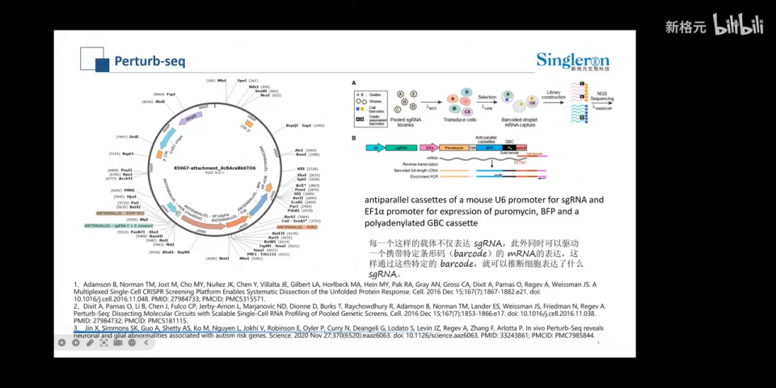
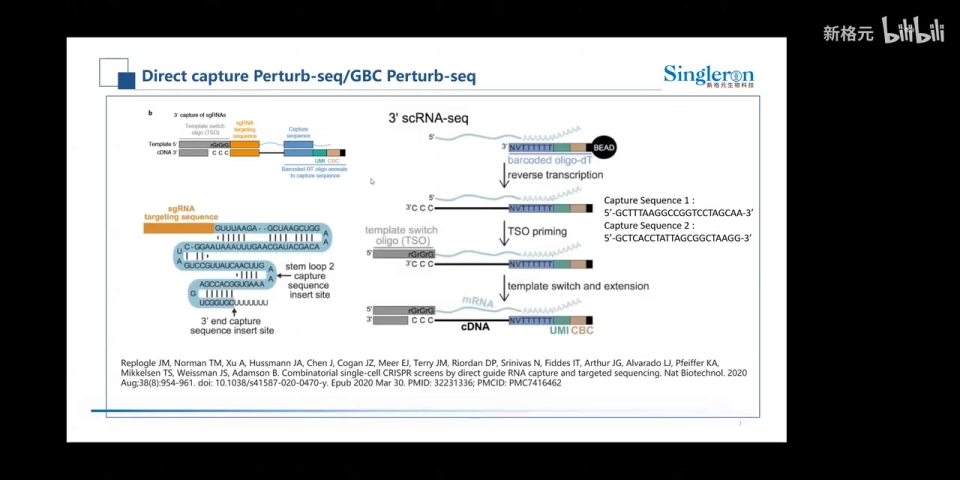
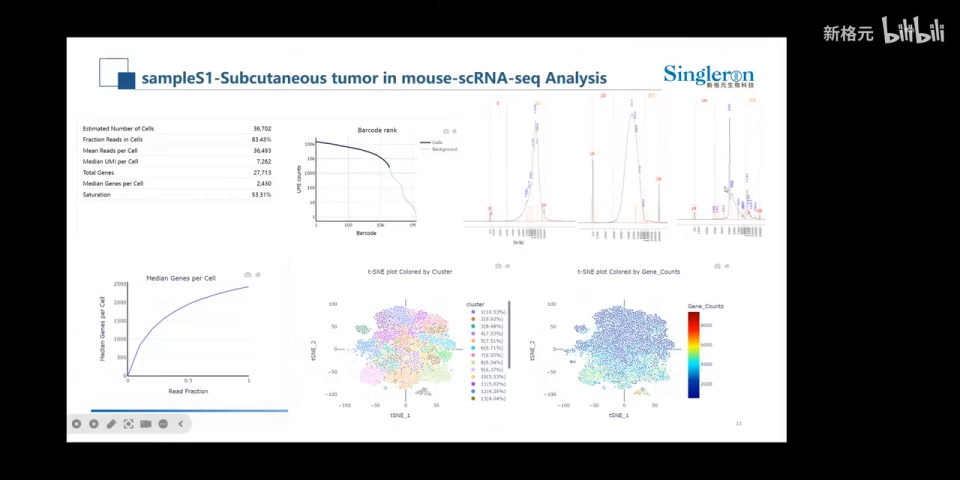
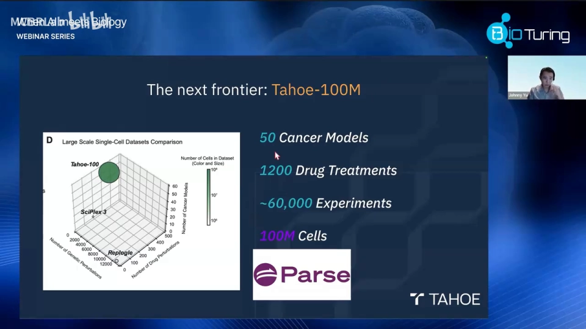
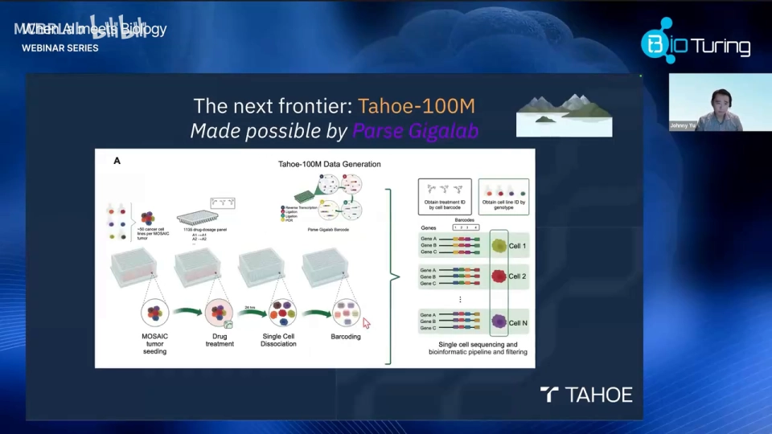
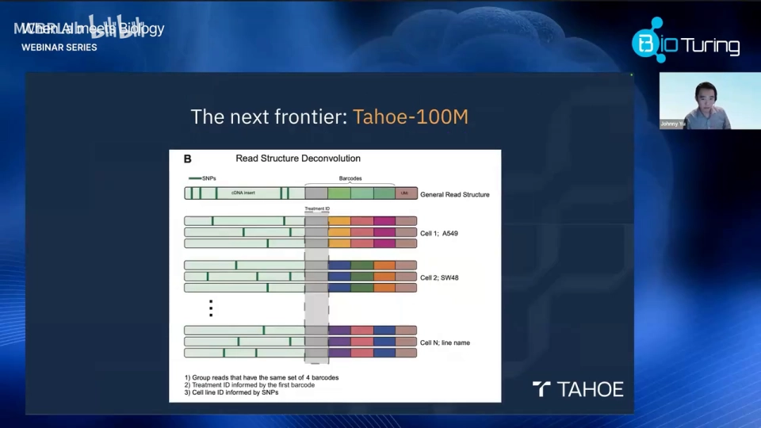
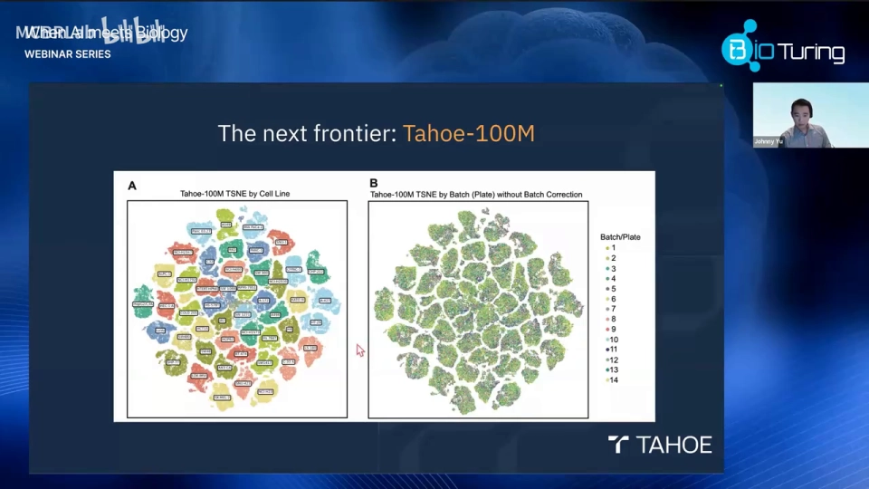
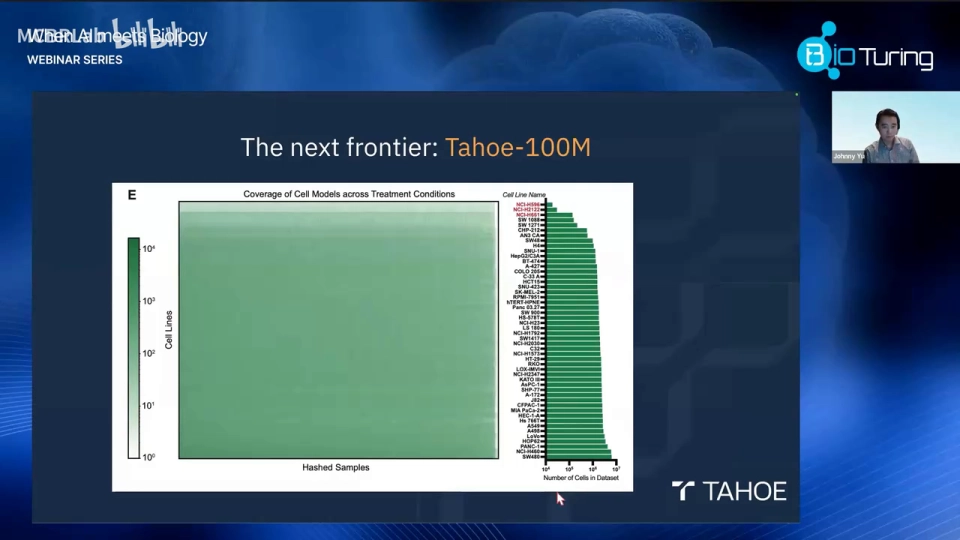

# 03 数据从哪里来：三类数据，决定虚拟细胞能学什么

> **本文基于哪些视频整理**：[Perturb-seq 技术直播](https://www.bilibili.com/video/BV1o5iQBhEaw/)（13:25）与 [Tahoe-100M：千兆级单细胞扰动图谱](https://www.bilibili.com/video/BV1khg5z9EpZ/)（62:58）。字幕来自 B 站 AI 字幕，专名错拼较多（如把 Perturb-seq 识别成“PTSC”、把 Tahoe-100M 识别成“太浩一百万”），本文按幻灯片和上下文校正；数字保留作者报告口径。

## 本讲要解决的核心问题（SCQA）

**背景**：上一节说，虚拟细胞要学习“细胞状态 + 扰动 → 扰动后状态”的映射。要学这个映射，模型必须先看过大量真实的“扰动—表达谱”配对。

**冲突**：扰动数据并不是一种东西。基因敲低是扰动，加药也是扰动，不施加干预、只观察组织里有哪些细胞，同样能提供信息。它们的因果强度、标签方式和噪声结构完全不同；把观测数据当成扰动数据，或把不同批次、不同剂量混在一起，模型学到的可能只是实验设计。

**疑问**：虚拟细胞的数据到底从哪里来？一份 Perturb-seq 或药物图谱怎样生成？拿到数据最该检查什么？

**回答（中心思想）**：主要来源有三类——**基因扰动（Perturb-seq）、化学扰动（药物筛选）和观测图谱**，分别回答“因果”“药物”“背景”。一份数据能不能用，关键不在细胞数，而在**对照、剂量、细胞系、批次、扰动标签**这五件事。

## 一、三类数据来源：因果、药物与背景

按扰动类型划分，三类数据基本互不重叠、合起来覆盖当前主流资源。

**基因扰动数据（Perturb-seq 及其变体）**：用 CRISPR（基因编辑工具）压低或敲除某个基因，再对每个细胞做单细胞 RNA 测序，同时读出“改了哪个基因”和“表达谱变成什么样”。它的价值是**因果性**：扰动由实验者主动施加，“基因 A 被抑制 → 基因 B 上升”比单纯相关更接近机制。代价是通量低、成本高，通常一次只改一个基因。

**化学扰动数据（药物筛选）**：用不同浓度的小分子处理细胞，再测表达谱。它更接近药物发现的实际问题，优势是**可比较**——同一套流程、同一批细胞系、统一的剂量和对照；弱点是药物常同时打多个靶点，机制不如单基因扰动“干净”。Tahoe-100M 是这一类的大规模代表。

**观测图谱**：不施加人为扰动，只采集正常组织、发育或疾病样本的单细胞表达谱。它回答“细胞本来有哪些类型和状态”，是虚拟细胞的**背景知识**；但观测数据本身不能证明因果。

还有一类常被放在一起、但不属于上述三类的资源：**DepMap**。它测量不同癌细胞系对各个基因的依赖性，适合挑细胞系、判断必需基因；它不直接提供“扰动后的转录组”。Norman、sci-Plex3、DepMap 会在第四节表中标明哪些是视频直接讲到的、哪些是背景补充。

## 二、Perturb-seq：把“扰动身份”和“表达谱”对上

Perturb-seq 的本质，是把 **pooled CRISPR 筛选**（一次转染很多条 sgRNA、同时测试很多基因）和**微滴单细胞 RNA 测序**（给每个细胞打身份条码）接在一起。难点不在测序，而在“怎么知道这个细胞挨了哪一刀”。

讲者把技术演进概括为：从 CROP-seq 演进而来；细胞数从几百个发展到几万甚至几十万个，sgRNA 种类从个位数发展到上千种（[00:00](https://www.bilibili.com/video/BV1o5iQBhEaw/?t=0)、[00:30](https://www.bilibili.com/video/BV1o5iQBhEaw/?t=30)）。

### 2.1 一次实验的五个环节

1. **设计 sgRNA 文库**。sgRNA 是约 20 个碱基的向导 RNA，把 Cas 蛋白带到目标基因。一个基因通常设计多条 sgRNA 互相验证，同时放入**对照 sgRNA**（不靶向任何基因），用来定义“没有扰动时细胞长什么样”。
2. **递送进细胞**。常用慢病毒载体。感染复数（MOI）控制平均每个细胞进入几条 sgRNA；理想是一细胞一条，实际总会有零条、两条甚至更多（[00:03:00](https://www.bilibili.com/video/BV1o5iQBhEaw/?t=180)）。
3. **筛选与扩增**。只保留成功整合 sgRNA 的细胞，扩增到足够数量。
4. **微滴单细胞捕获**。细胞和带条形码的凝胶珠一起被包进油滴；珠上的寡核苷酸含**细胞条形码**（哪个细胞）、**UMI**（哪条 mRNA，用于去重）和 **polyT**（抓 mRNA 的 polyA 尾巴）。
5. **同时捕获 sgRNA**。测序文库要同时包含细胞的 mRNA 和 sgRNA 身份，才能把表达谱与扰动标签一一对应。

CRISPRi 是常用的实现方式：把 Cas9 的两个切割位点失活，再融合一个抑制域（如 KRAB），让目标基因的转录被“压低”而不是彻底删除。这样既能研究必需基因，也能避免双链断裂应激。

### 2.2 sgRNA 捕获的两条路线

**路线一：CROP-seq 的双启动子设计。** 载体上放两个启动子：U6 负责转录有编辑活性的 sgRNA；EF1a 负责转录一条更长的 RNA，包含 U6 固定序列、sgRNA 序列和 polyA 尾巴（[00:01:30](https://www.bilibili.com/video/BV1o5iQBhEaw/?t=130)）。这样 sgRNA 就“顺便”带上 polyA，能被单细胞流程的 polyT 引物捕获。双启动子在部分细胞或部分 sgRNA 上可能编辑效率不理想，需要按体系评估（[00:03:00](https://www.bilibili.com/video/BV1o5iQBhEaw/?t=180)）。

**路线二：直接捕获。** 不做双启动子，而是改造 sgRNA 本身：在环区或 3′ 端插入一段 **capture sequence**（可被探针识别的捕获序列），再用靶向探针拉下来；讲者提到，插在环区或尾端对编辑效率影响相对小（[00:02:30](https://www.bilibili.com/video/BV1o5iQBhEaw/?t=230)）。如果用的是最普通的 sgRNA 载体（没有 polyA，也没有固定捕获序列），就要设计特异性探针，再经模板转换、环化和多轮 PCR 扩增，流程更复杂（[00:09:13](https://www.bilibili.com/video/BV1o5iQBhEaw/?t=553)）。

### 2.3 质控看什么

两个项目案例来自厂商，数字不是领域统一标准，但能说明质控重点（[00:07:33](https://www.bilibili.com/video/BV1o5iQBhEaw/?t=453)）：

- 双启动子方案：高密度芯片捕获 **36,702 个细胞**，中位基因数 **2,430**，测序饱和度约 **53%**；**0.98%** 的细胞没检测到 sgRNA，99% 以上能检测到；多条 sgRNA 的比例与转染效率有关（[00:07:33](https://www.bilibili.com/video/BV1o5iQBhEaw/?t=453)、[00:08:23](https://www.bilibili.com/video/BV1o5iQBhEaw/?t=503)）。
- 直接捕获方案：捕获 **1.2 万多个细胞**，约 49K 测序深度下中位基因数 3,200 多，覆盖 **3,000 多种 sgRNA**；未检测到 sgRNA 的细胞约 **0.07%**，但多 sgRNA 比例更高（[00:10:53](https://www.bilibili.com/video/BV1o5iQBhEaw/?t=653)、[00:11:18](https://www.bilibili.com/video/BV1o5iQBhEaw/?t=678)）。

**“测到 sgRNA”不等于“扰动成功”**：细胞可能带着 sgRNA 却没被有效编辑（escaped cell），也可能一个液滴装了两个细胞、带了两条 sgRNA。后续分析必须识别这些情况，否则“扰动—表达”的对应会被稀释。

## 三、Tahoe-100M：把“一种药”变成“一张可比较的图谱”

Perturb-seq 是“一次改一个基因”，Tahoe-100M 是“一次测很多药”。它的目标不是解释单一机制，而是建一张**统一条件下的大规模药物—转录组参照图**，让不同药物、细胞系、剂量之间可以横向比较。

作者报告的口径是（[00:19:18](https://www.bilibili.com/video/BV1khg5z9EpZ/?t=1158)）：**50 个癌细胞模型**（不同来源，覆盖约 80% 的相关癌症驱动基因）、约 **1,200 个药物处理条件**（现场解释为约 **400 种药物 × 3 个剂量**）、约 **6 万次实验**、**1 亿个细胞**。

口径上需要特别注意：论文过滤后的正式统计是 **47 个细胞系、379 种药物、1,135 个药物—剂量组合**，对外常概括为“约 1,100 个药物—剂量条件”。**“药物种类”和“药物—剂量条件”不是同一个计数单位**；视频里的 1,200/400 是现场口径，论文里的 1,135/379 是过滤后口径。读数据集文档时，以字段定义为准。

实验流程可拆成五步（[00:22:13](https://www.bilibili.com/video/BV1khg5z9EpZ/?t=1333)）：

1. **构建 50 个癌细胞模型**，按高通量方式接种到 96 孔板；每孔是一个独立肿瘤样本，并做重复。
2. **加药 2–4 小时**。太短看不到转录响应，太长会混入死亡、增殖停滞等次级效应；作者要测的是药物直接引起的转录状态变化。
3. **设 DMSO 对照**。DMSO 是溶解药物的溶剂，本身不加药，用来定义“同样流程下、没有药物时”的基线（[00:12:19](https://www.bilibili.com/video/BV1khg5z9EpZ/?t=739)）。
4. **混养设计（biological multiplexing）**。把多个癌细胞模型放在同一孔里一起加药、一起测序，一次实验就能观察多种遗传背景对同一药物的反应，并减少孔间批次差异（[00:18:53](https://www.bilibili.com/video/BV1khg5z9EpZ/?t=1133)）。
5. **单细胞建库与拆分**。用 Parse 的高通量组合索引给药物处理打条码，再结合 SNP（单核苷酸多态性）基因型把细胞分配到具体细胞系（[00:23:03](https://www.bilibili.com/video/BV1khg5z9EpZ/?t=1383)、[00:23:28](https://www.bilibili.com/video/BV1khg5z9EpZ/?t=1408)）。

**批次控制**是这套设计的亮点。作者展示了一张按批次着色的 t-SNE 降维图：**14 个批次**的细胞均匀混合，几乎没有批次分离，且**未做批次校正**（[00:25:31](https://www.bilibili.com/video/BV1khg5z9EpZ/?t=1531)）。覆盖热图也显示，每个细胞系、每种处理都有细胞，没有被系统性漏掉（[00:26:16](https://www.bilibili.com/video/BV1khg5z9EpZ/?t=1576)）。这提示：**批次控制最好在实验设计阶段完成**——统一流程、随机化、混养、足够重复——而不是事后靠算法“抹平”。

统一的图谱还能直接用于发现。比如把已撤市的 HIV 蛋白酶抑制剂 saquinavir（沙奎那韦）放进图谱，最相似的药物不是其他抗 HIV 药，而是去甲肾上腺素和缬沙坦——正好对应它后来被发现的心脏副作用（[00:30:02](https://www.bilibili.com/video/BV1khg5z9EpZ/?t=1802)）。这类分析说明：**数据价值不只在于“大”，更在于“可比”**。

## 四、四个数据集：各自补哪块拼图

| 数据集 | 类型 | 大致规模 / 特点 | 视频覆盖情况 |
| --- | --- | --- | --- |
| **Norman** | 基因扰动（CRISPRa Perturb-seq） | K562，单基因与双基因组合扰动；常用于组合效应和泛化评测 | **本视频未展开**，后续 GEARS 小节会用到（背景补充） |
| **sci-Plex3** | 化学扰动（单细胞药物筛选） | 多细胞系、多化合物的单细胞药物图谱；Tahoe 报告中作为规模对比出现 | 只在规模对比页被提到（[00:19:43](https://www.bilibili.com/video/BV1khg5z9EpZ/?t=1183)），**未展开细节**（背景补充） |
| **Tahoe-100M** | 化学扰动（大规模药物图谱） | 50 个模型、约 1,100–1,200 个药物—剂量条件（论文过滤后 379 种药物、1,135 个组合），约 6 万次实验、1 亿细胞 | **视频主线**，从设计到应用都有讲（直接讲到） |
| **DepMap** | 依赖图谱（非转录组扰动） | 大量癌细胞系的基因依赖性/必需性，配套多组学；用于选细胞系、判断必需基因 | **本视频未展开**（背景补充） |

关键是**类型**：Norman 和 Perturb-seq 提供“基因→表达”的因果样本；sci-Plex3 和 Tahoe 提供“药物→表达”的化学样本；DepMap 提供“这个基因能不能动”的先验。它们不能互相替代：想预测“未见基因扰动”，Tahoe 的药物数据帮不上直接忙；想做药物重定位，只有基因扰动数据也不够。

## 五、数据设计的五个关键点

**对照**：基因扰动要有 control guide（不靶向任何基因），药物扰动要有 DMSO 或溶剂对照；对照必须与实验组同批、同细胞系、同处理时间。

**剂量**：药物尤其需要多剂量。Tahoe 每种药 3 个剂量，才能看出剂量—响应关系，而不是只得到“高浓度下的强效应”。

**细胞系**：同一扰动在不同遗传背景下的效果可能完全不同。Tahoe 用 50 个模型覆盖不同器官和驱动基因；忽略细胞系，模型会把“细胞系差异”误学成“扰动效应”。

**批次**：批次是最容易被低估的混淆因素。至少要检查 `obs` 里有没有批次字段、批次与扰动是否高度共线；如果每个批次只做一种药，任何模型都无法把两者分开。

**扰动标签**：包括 sgRNA 身份、MOI、是否多 sgRNA、是否 escaped cell；药物数据则包括药物 ID、剂量、溶剂、处理时间。标签错一位，整行训练样本就错了。**在虚拟细胞里，标签质量往往比模型结构更决定上限。**

## 小结

- 数据分三类：**基因扰动、化学扰动、观测图谱**，分别提供因果、药物响应和背景分布。
- Perturb-seq 的关键不是测序，而是**同时捕获 sgRNA 和 mRNA**：CROP-seq 用双启动子给 sgRNA 加 polyA，直接捕获法则改造 sgRNA 加 capture sequence。
- Tahoe-100M 用 **50 个模型、约 1,100–1,200 个药物—剂量条件（论文过滤后 379 种药物、1,135 个组合）**、DMSO 对照、混养和组合索引，把“药物—转录组”做成可横向比较的图谱。
- 数据价值取决于设计：**对照、剂量、细胞系、批次、扰动标签**，缺一项就可能让模型学错东西。
- Norman、sci-Plex3、DepMap 是后续会用到的背景资源；本视频只直接展开了 Perturb-seq 与 Tahoe-100M。

## 关键术语速查

| 术语 | 一句话解释 |
| --- | --- |
| Perturb-seq | 把 pooled CRISPR 扰动和单细胞 RNA 测序结合，读出“哪个基因被改 + 表达谱怎么变” |
| CRISPRi | 用失活 Cas9 融合抑制域（如 KRAB）压低基因表达，而不是彻底删除基因 |
| sgRNA | 向导 RNA，约 20 个碱基，把 Cas 蛋白带到目标基因位点 |
| MOI | 感染复数，控制平均每个细胞进入几条 sgRNA/病毒 |
| CROP-seq | 用双启动子让 sgRNA 带上 polyA 尾巴，从而被单细胞 polyT 引物捕获 |
| capture sequence | 人为加到 sgRNA 上的捕获序列，用探针把它从文库中富集出来 |
| DMSO 对照 | 只加溶剂、不加药的对照组，用来定义药物处理前的基线 |
| 混养 / biological multiplexing | 多个细胞系或样本放在同一孔里一起处理、一起测序，再用条码拆开 |
| 组合索引 | 用多轮条码给细胞和处理条件编码，从而低成本地测大量样本 |
| DepMap | 癌细胞系基因依赖性图谱，用来判断哪些基因是必需的 |
