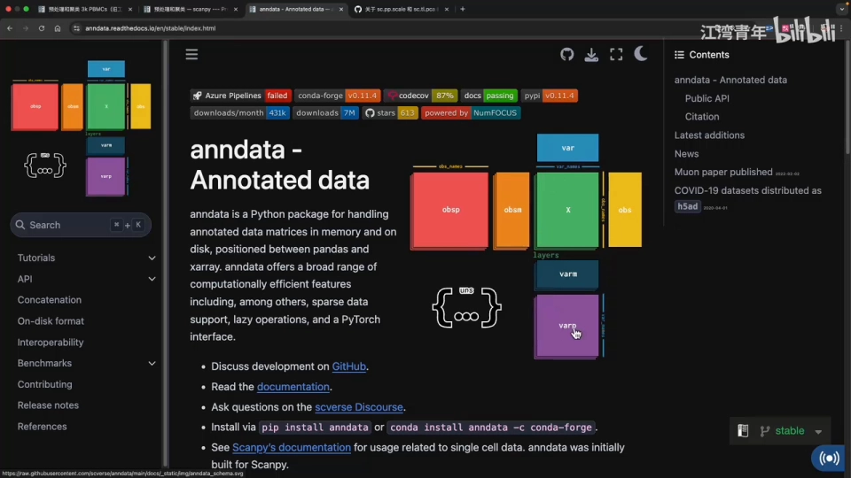
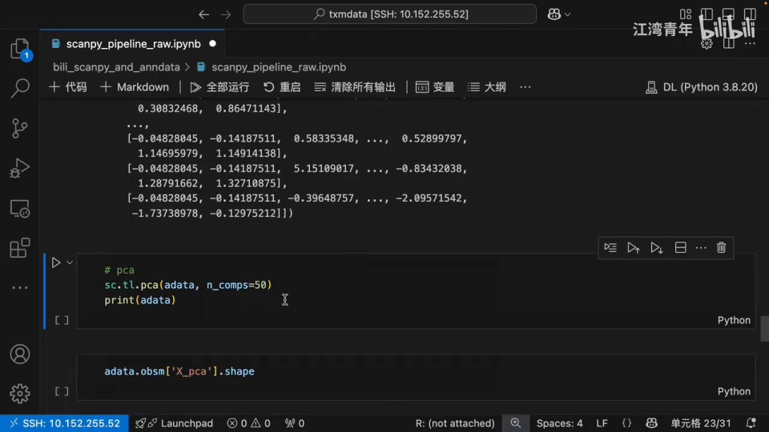
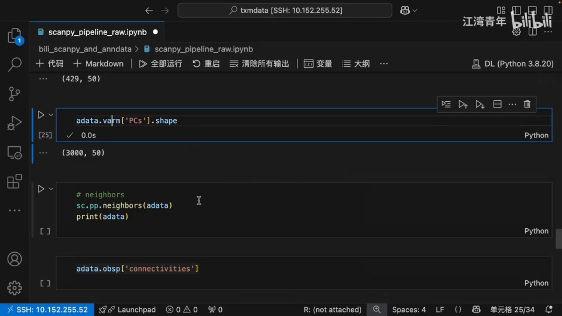
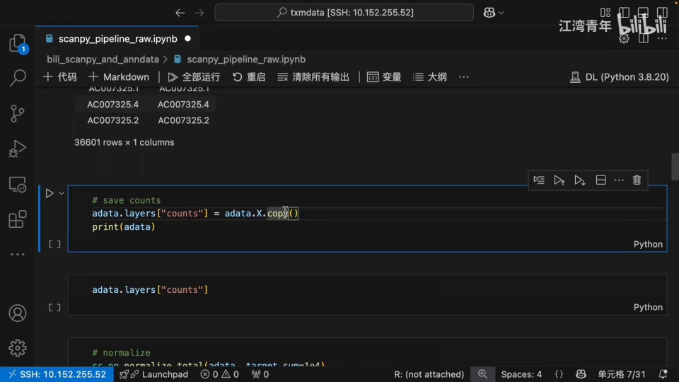
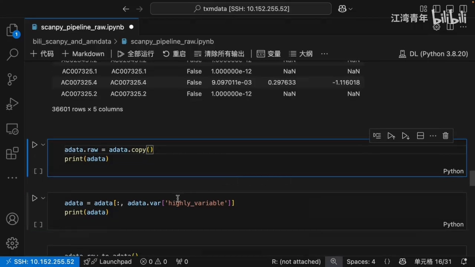
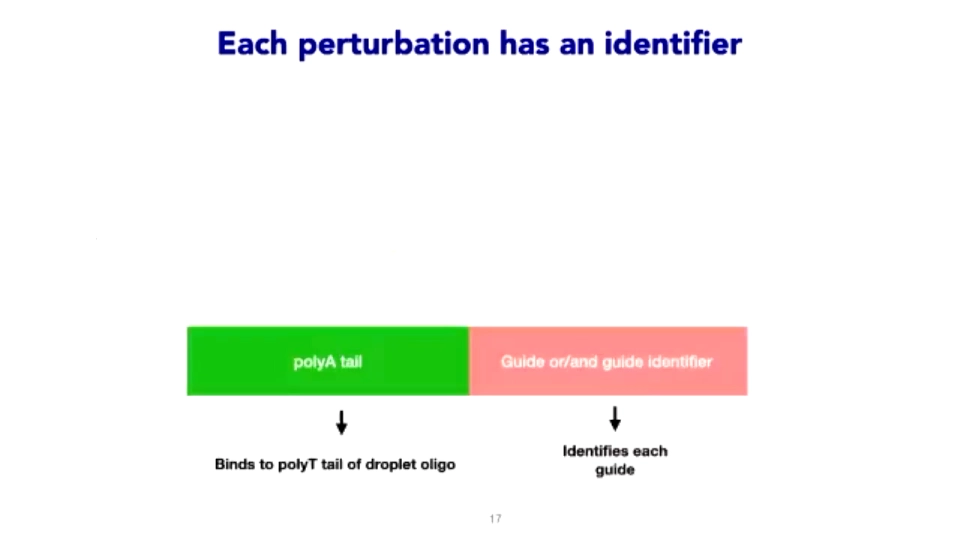
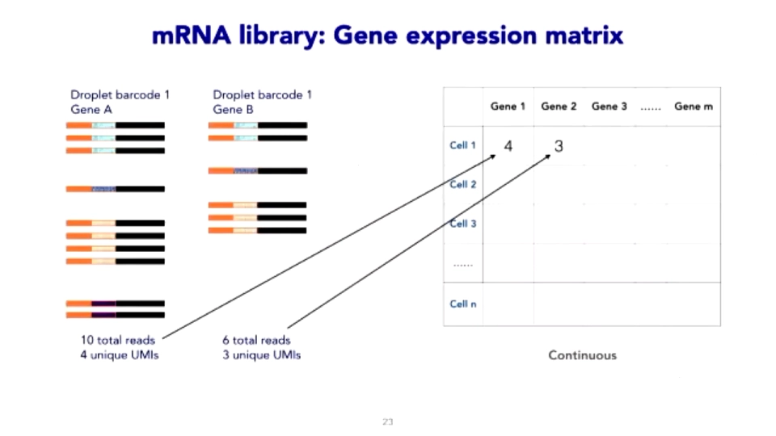
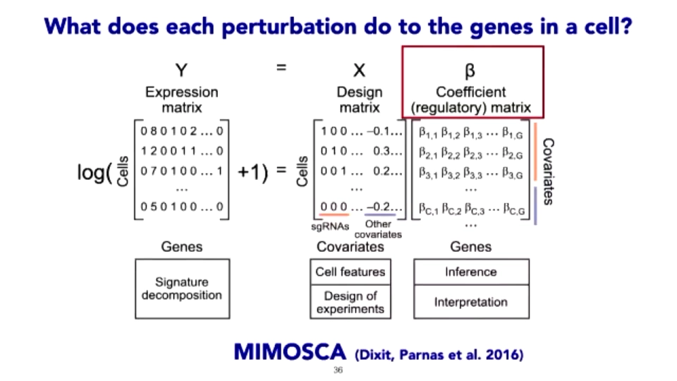

# 04 一份数据怎么用：从 h5ad 到可训练样本

> **本文基于哪些视频整理**：[通过 scanpy 标准流程理解 anndata 数据结构](https://www.bilibili.com/video/BV1WGZSYwEZ2/)（21:47，B 站 AI 中文字幕）与 [MPG Primer: Introduction to Perturb-seq analysis](https://www.youtube.com/watch?v=K73VyTp5eXE)（43:50，YouTube 自动字幕）。前者讲数据结构，后者讲 Perturb-seq 的分析逻辑；英文术语按字幕与幻灯片校正。

## 本讲要解决的核心问题（SCQA）

**背景**：上一节说，虚拟细胞的数据来自 Perturb-seq、药物筛选和观测图谱。下载到的文件，通常是一个 `.h5ad`——单细胞领域的“Excel 工作簿”。

**冲突**：很多人拿到 h5ad 的第一反应是“把矩阵喂给模型”。但同一份数据里往往同时躺着原始 counts、归一化值、对数化值、降维坐标和几十列细胞注释；基因 ID 可能一半是 Ensembl、一半是 symbol；对照细胞和扰动细胞可能被随机打乱。任何一步处理错，模型都能在训练集上“学得很好”，换一批数据就崩。

**疑问**：一份 h5ad 里到底有什么？该先看什么、先动什么？怎样划分数据、怎样避免信息泄漏？

**回答（中心思想）**：把 h5ad 当成**带注释的矩阵容器**，按“看结构 → 对齐基因 → 归一化 → 确认标签 → 划分 → 再拟合预处理”的顺序走。**预处理必须在划分之后、只用训练集拟合**；否则模型评估的是“你有没有偷看测试集”，而不是预测能力。

## 一、先读懂容器：h5ad 是一个矩阵加六种“挂件”

AnnData 是 Python 单细胞框架 scanpy 的核心数据结构，可以理解成“一张细胞 × 基因的表达矩阵 + 一排排注释 + 若干张派生表”。官方示意图把最中心的位置留给表达矩阵，其余字段都挂在它旁边（[00:00:33](https://www.bilibili.com/video/BV1WGZSYwEZ2/?t=33)）。



- **X**：主表达矩阵，形状是“细胞 × 基因”。每一行是一个细胞，每一列是一个基因，元素是该基因在该细胞里的表达量。单细胞数据非常稀疏（大部分是 0），所以常以稀疏矩阵存储（[00:04:35](https://www.bilibili.com/video/BV1WGZSYwEZ2/?t=275)）。
- **obs**：行注释，`pandas.DataFrame`，每行一个细胞。可存细胞来源、批次、病人、细胞类型、`n_counts`、`n_genes` 等（[00:01:23](https://www.bilibili.com/video/BV1WGZSYwEZ2/?t=83)）。
- **var**：列注释，每行一个基因。可存 gene symbol、Ensembl ID、染色体、基因类型、是否高变基因、均值/离散度等（[00:01:23](https://www.bilibili.com/video/BV1WGZSYwEZ2/?t=83)）。
- **layers**：与 X 同形状的“备用矩阵”。最典型的是把原始 counts 存进 `layers["counts"]`，这样后续归一化改了 X，原始值仍可随时取回（[00:03:03](https://www.bilibili.com/video/BV1WGZSYwEZ2/?t=183)、[00:05:25](https://www.bilibili.com/video/BV1WGZSYwEZ2/?t=325)）。
- **obsm / varm**：细胞或基因的“多列派生表”。`obsm["X_pca"]` 是每个细胞的 50 维 PCA 坐标（细胞 × 50）；`varm["PCs"]` 是每个基因在 50 个主成分上的载荷（基因 × 50）（[00:12:05](https://www.bilibili.com/video/BV1WGZSYwEZ2/?t=725)、[00:12:30](https://www.bilibili.com/video/BV1WGZSYwEZ2/?t=750)）。


- **obsp / varp**：细胞 × 细胞或基因 × 基因的“成对矩阵”。比如邻居图里每个细胞到其他细胞的连接强度，形状是 429 × 429（[00:13:58](https://www.bilibili.com/video/BV1WGZSYwEZ2/?t=838)）。


- **uns**：非结构化字典，既不按细胞也不按基因组织。比如 `uns["log1p"]` 记录对数化的底数（[00:02:13](https://www.bilibili.com/video/BV1WGZSYwEZ2/?t=133)、[00:06:40](https://www.bilibili.com/video/BV1WGZSYwEZ2/?t=400)）。

还有一个容易忽略的 **raw**：旧版 scanpy 流程先把完整对象复制到 `adata.raw`，再只保留高变基因做 PCA。这样可视化或差异分析时还能回到全部基因。新版流程不再需要这一步（[00:08:45](https://www.bilibili.com/video/BV1WGZSYwEZ2/?t=525)、[00:16:34](https://www.bilibili.com/video/BV1WGZSYwEZ2/?t=994)）。



## 二、基因 ID 不对齐，模型学的就是假关系

单细胞矩阵的列不是“基因名”，而是某种**基因标识符**。常见两种：

- **gene symbol**：如 `TP53`、`CD4`，人可读，但会变名、会有别名，不同数据集可能用不同版本。
- **Ensembl ID**：如 `ENSG00000141510`，稳定、唯一，但人不可读；带版本号时（`ENSG00000141510.17`）还要决定是否去掉后缀。

为什么必须对齐？假设数据集 A 用 symbol、数据集 B 用 Ensembl，直接按列拼接会得到两套完全错位的基因；更隐蔽的情况是同一 symbol 对应多个 Ensembl ID，或一个 Ensembl ID 对应多个 symbol。**基因对不齐，模型学到的“基因 A 调控基因 B”就是假的。**

实用做法是：选一个主键（推荐 Ensembl ID），把另一个 ID 作为 `var` 里的注释保留；合并前检查重复、缺失和版本号；把对照数据和新数据映射到同一套基因顺序。做完这一步，再讨论归一化。

## 三、三种数值代表三种问题，不能混用

三个概念经常被混为一谈，其实它们解决的是不同问题。

**raw counts** 是测序读段计数，整数，受测序深度影响：同一个细胞测得越深，所有基因的计数都越大。视频里 `adata.X` 的最大值是 5,000 多、且为整数，说明它还是原始 counts（[00:04:35](https://www.bilibili.com/video/BV1WGZSYwEZ2/?t=275)）。

**归一化（normalize_total）** 把每个细胞的总计数缩放到同一水平（常用每万计数，CP10K），消除测序深度差异。视频里归一化后最大值从 5,000 多变成 3,000 多的小数（[00:06:15](https://www.bilibili.com/video/BV1WGZSYwEZ2/?t=375)）。

**对数化（log1p）** 对归一化值取 `log(1+x)`，压住高表达基因的长尾，让分布更平滑。视频里 log 后最大值降到 8 点多（[00:06:40](https://www.bilibili.com/video/BV1WGZSYwEZ2/?t=400)）。

**缩放（scale）** 把每个基因做成均值 0、标准差 1。它会改变分布、产生负值，适合 PCA 等线性降维，但**不适合直接拿去做差异表达**——差异分析需要保留原来的均值结构（[00:11:15](https://www.bilibili.com/video/BV1WGZSYwEZ2/?t=675)）。

**高变基因（HVG）与 PCA 的位置**：先选表达变化最大的 3,000 个基因，再在主成分分析前做中心化；旧版流程还会先 scale，并用 `raw` 保存全基因矩阵（[00:07:30](https://www.bilibili.com/video/BV1WGZSYwEZ2/?t=450)、[00:11:40](https://www.bilibili.com/video/BV1WGZSYwEZ2/?t=700)）。视频作者对比新旧教程后指出：scale 与否在领域内没有共识，但 PCA 内部都会做零中心化；新版流程不再裁剪矩阵，而是让 PCA 只使用高变基因（[00:19:39](https://www.bilibili.com/video/BV1WGZSYwEZ2/?t=1179)、[00:20:39](https://www.bilibili.com/video/BV1WGZSYwEZ2/?t=1239)）。



给虚拟细胞建模时，通常保留两份矩阵：**counts** 用于需要计数分布的方法（如某些差异分析、负二项模型），**log-normalized** 用于神经网络输入。不要把 scale 后的负值当成“表达量”去算倍数变化。

## 四、标签决定监督信号：对照、扰动与设计矩阵

### 4.1 对照与扰动标签

Perturb-seq 数据有两个矩阵：**基因表达矩阵**（细胞 × 基因）和**扰动矩阵**（细胞 × guide，或其二元版本）。后者告诉模型每个细胞带了哪条 sgRNA（[00:12:59](https://www.youtube.com/watch?v=K73VyTp5eXE&t=779)）。



构建扰动矩阵前，先把对照分清楚：不靶向任何基因的 **control guide**、**未扰动细胞**（untreated），以及同批的**溶剂/DMSO 对照**。它们分别回答“guide 本身有没有影响”“细胞原本长什么样”“溶剂和操作有没有影响”。

构建扰动矩阵时要注意三件事：

1. **从计数到二元**。原始 guide 矩阵是“每个细胞检测到几条 guide 的 UMI（分子标签，用来去重）”，连续值。通常要先估计背景分布（液滴里可能混入环境 RNA），再定阈值，把“检测到”变成 0/1（[00:13:04](https://www.youtube.com/watch?v=K73VyTp5eXE&t=784)、[00:13:54](https://www.youtube.com/watch?v=K73VyTp5eXE&t=834)）。
2. **escaped cell**。带了 guide 不代表被编辑。一个细胞可能带 guide 却没被真正编辑（escaped cell），分析时要识别或至少标注（[00:22:35](https://www.youtube.com/watch?v=K73VyTp5eXE&t=1355)）。
3. **一个细胞多条 guide**。MOI（感染复数）高了会出现多 guide 细胞；它们既可能是组合扰动的信号，也可能是双细胞污染。视频建议先看 guide 分布、每 guide 细胞数、双细胞比例，再决定保留还是剔除（[00:14:33](https://www.youtube.com/watch?v=K73VyTp5eXE&t=873)、[00:15:23](https://www.youtube.com/watch?v=K73VyTp5eXE&t=923)）。



药物数据同理：标签至少包含药物 ID、剂量、溶剂对照和处理时间。Tahoe-100M 则用 SNP 把细胞分回原始细胞系——这提醒我们，**标签本身可能由多条信息拼成**，不能只看一列 `perturbation`。

### 4.2 把扰动标签变成设计矩阵

有了二元扰动矩阵，就可以把它当作回归的**设计矩阵**：行是细胞，列是“是否带某条 sgRNA”，再加上批次、细胞周期、测序质量等协变量；输出是表达矩阵。模型要估计的是系数矩阵 β——每个扰动对每个基因的效应大小（[00:21:34](https://www.youtube.com/watch?v=K73VyTp5eXE&t=1294)）。



这个框架的好处是：可以显式加入批次、质量等协变量，而不是让它们混进扰动效应；得到的 β 可以直接画成“扰动 × 基因”的热图，也可以做聚类，找功能相似的扰动模块（[00:23:26](https://www.youtube.com/watch?v=K73VyTp5eXE&t=1406)、[00:24:15](https://www.youtube.com/watch?v=K73VyTp5eXE&t=1455)）。对虚拟细胞来说，这提供了一个重要的思路：**模型输出的不应该只是“表达谱”，还应该能分解出“哪个扰动、通过哪些基因、产生了多大效应”**。

## 五、划分在预处理之前，否则评估会被泄漏抬高

虚拟细胞的评估至少要区分三种设定：

- **随机划分**：所有细胞混在一起随机分训练/测试。最简单，但测试集里的扰动和细胞系训练时都见过，容易高估。
- **未见扰动**：留出一部分基因或药物完全不在训练集出现。考的是“能不能泛化到新扰动”。
- **未见细胞系**：留出整个细胞系。考的是“能不能迁移到新遗传背景”。

关键在于：**任何“从数据中学习参数”的预处理，都只能在训练集上 fit，再 transform 到测试集**。这包括高变基因选择、标准化、PCA、批次校正、插补，甚至基因 ID 过滤。一个常见的泄漏是：先用全部数据选 HVG、做 scale，再划分——测试集的分布信息已经漏进训练。正确顺序是：先按扰动/细胞系划分，再在训练集上选基因、算均值方差、拟合 PCA，最后把同样的变换应用到测试集。

视频没有系统讲数据划分，这一节是按预测任务补充的通用原则；但它的分析框架（设计矩阵 + 协变量）正好说明：**划分时要把“扰动”和“协变量”一起考虑**，不能只随机切细胞。

## 六、最小工作流：六步走完一份 h5ad

```text
读 h5ad
  → 看 obs/var：细胞数、基因数、标签列、批次列
  → 对齐基因 ID，固定基因顺序
  → 取 layers["counts"]，归一化 + log1p
  → 选 HVG（只在训练集上选）
  → 按扰动/细胞系划分训练、验证、测试
  → 在训练集上 fit scale/PCA，transform 其余
  → 训练模型，在测试集上评估
```

对应到 scanpy，核心对象操作就是：`sc.read_h5ad()` 读入；`adata.obs` / `adata.var` 看注释；`adata.layers["counts"] = adata.X.copy()` 备份 counts；`sc.pp.normalize_total()`、`sc.pp.log1p()`、`sc.pp.highly_variable_genes()`、`sc.tl.pca()` 做预处理；`adata.obsm["X_pca"]` 取降维结果。视频里这套流程跑在 429 个细胞、3 万多个基因的小数据上，但对象结构和真实数据完全一样（[00:03:45](https://www.bilibili.com/video/BV1WGZSYwEZ2/?t=225)）。

### 拿到一份 h5ad 先检查什么

1. **形状**：`X.shape` 是不是“细胞 × 基因”？行和列有没有反？
2. **X 的类型**：整数 counts、归一化小数，还是已经 scale 过的负值？
3. **layers**：有没有 `counts`？没有的话，X 是不是还能当 counts 用？
4. **obs 关键列**：扰动标签、对照标签、细胞系、批次、剂量、时间、细胞类型是否齐全？
5. **var 关键列**：基因 ID 是 Ensembl 还是 symbol？有没有重复、缺失、版本号？
6. **对照**：control guide / DMSO / 未扰动细胞各有多少？是否与实验组同批？
7. **标签分布**：每个扰动多少细胞？有没有只有 1–2 个细胞的扰动？多 guide 比例多少？
8. **批次**：批次与扰动是否共线？有没有“一个批次只做一种药”？
9. **raw / obsm**：有没有旧的 `raw`、PCA/UMAP 坐标？它们是基于全部数据还是训练数据算的？
10. **划分**：现有划分是按细胞随机，还是按扰动/细胞系留出？预处理是在划分前还是划分后做的？

## 小结

- h5ad/AnnData 是“矩阵 + 注释 + 派生表”：X 存表达，obs/var 存行列注释，layers 存不同处理版本，obsm/varm/obsp/varp 存降维与成对关系，uns 存杂项。
- 基因 ID 必须先对齐；Ensembl 稳定、symbol 可读，混用会让列错位。
- counts、log-normalized、scaled 是三件不同的事：前者保留计数，中者用于建模输入，后者只适合特定降维，不要拿去做倍数变化。
- 对照与扰动标签决定监督信号；control guide、DMSO、escaped cell、多 guide 都要在建模前处理。
- 划分要在预处理之前；HVG、scale、PCA 等只能在训练集上 fit，否则评估会被泄漏抬高。

## 关键术语速查

| 术语 | 一句话解释 |
| --- | --- |
| h5ad | AnnData 对象的磁盘格式，一个文件装下矩阵、注释和派生结果 |
| X | 主表达矩阵，形状为细胞 × 基因 |
| obs / var | 细胞（行）与基因（列）的注释表 |
| layers | 与 X 同形状的备用矩阵，如原始 counts |
| obsm / varm | 细胞 × k 或基因 × k 的派生矩阵，如 PCA 坐标与载荷 |
| obsp / varp | 细胞 × 细胞或基因 × 基因的成对矩阵，如邻居图 |
| uns | 非结构化字典，存 log 底数等杂项 |
| HVG | 高变基因，表达变化最大的一批基因，常用于降维 |
| 设计矩阵 | 行是细胞、列是扰动/协变量的矩阵，回归时用来解释表达 |
| escaped cell | 带了 sgRNA 却没被有效编辑、因而没有扰动表型的细胞 |
| 数据泄漏 | 测试集信息在训练阶段被用到，导致评估虚高 |
