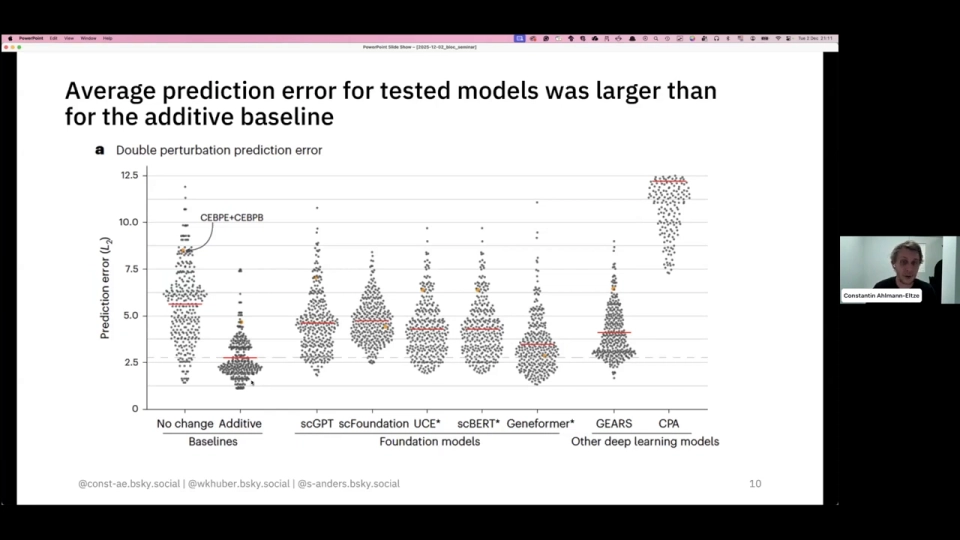

# 05 主流做法有哪几类：从一条基线到细胞底座

> 本文综合以下三场报告整理：[GEARS 作者讲解](https://www.youtube.com/watch?v=maUpBKEBXmw)（31:35）、[chemCPA 作者讲解](https://www.youtube.com/watch?v=nsL_NOwYf1c)（58:17）、[Tahoe-x1 速览](https://www.youtube.com/watch?v=BoGYADxG_ys)（14:10）。细节分别见第 07、08、09 节；本节只做方法地图。

## 本讲要解决的核心问题（SCQA）

**背景**：前四节已经说清了任务、数据与评价。现在的问题是：面对同一张「细胞状态 + 扰动 → 扰动后状态」的考卷，研究者到底有哪些解法？

**冲突**：方法名字很多——CPA、chemCPA、GEARS、scGPT、Tahoe-x1、State——但它们并不在同一层：有的在建模扰动表示，有的在借外部知识，有的只是先学一个细胞表征。把它们混在一起比较，很容易得出「谁更强」的错误结论。

**疑问**：主流做法可以分成哪几类？每一类的核心假设是什么、适合什么任务、又容易在哪里失效？

**回答（中心思想）**：可以把它们看成一套**四层主栈 + 旁支**：先有简单基线，再有潜变量模型（CPA/chemCPA），再有图先验模型（GEARS），最后是基础模型（Tahoe-x1）；生成模型、外部知识模型是旁支。越往上，先验或数据规模越强，但成本和不确定性也越高；**基线永远是第一层，不能跳过**。

## 一、统一框架：所有方法都在回答两个问题

任何扰动预测模型都可以写成：

```text
输入：细胞状态 x（对照表达）+ 扰动描述 p
输出：扰动后的表达分布 P(y | x, p)
```

差别在于两个设计选择：

1. **扰动怎么表示**：离散 ID（查表）、属性向量（药物结构/剂量）、图上的节点（基因关系）、还是预训练 token；
2. **响应怎么建模**：直接回归、潜空间相加、图消息传递、还是大规模预训练后接下游头。

把这两个问题想清楚，模型名字就不再吓人。



## 二、第 0 层：简单基线，先跑再谈模型

在任何人写新模型之前，都应该先跑四条基线：

| 基线 | 预测方式 | 隐含假设 |
| --- | --- | --- |
| **no-change（不变）** | 预测扰动后 = 对照组 | 大多数基因变化不大 |
| **mean（均值）** | 预测所有已见扰动的平均效果 | 扰动效应共享一个共同成分 |
| **additive（加性）** | ΔA + ΔB | 组合效应近似两个单扰动相加 |
| **linear（线性）** | 用线性映射把扰动表示变成表达变化 | 响应在扰动表示上是线性的 |

它们不是「稻草人」。第 06 节会看到，在 Norman 双扰动等设定下，加性基线常常不输甚至优于深度模型；一个只喂细胞系、不看扰动的 covariate-only 模型，也能在余弦相似度上「看起来不错」。原因是单细胞噪声大、扰动效应弱，**「少动」往往比「乱动」更接近真值**。

所以方法栈的第一条规则是：**新模型必须说明自己在哪个划分上、比哪条基线好多少**。否则「比 SOTA 高 2%」可能只是换了一个更容易的测试集。

## 三、第 1 层：潜变量模型，把扰动拆成可加的方向

代表是 **CPA** 和它的化学扩展 **chemCPA**。核心假设是：细胞状态和扰动效应可以在一个低维潜空间里**解耦**，然后像向量加法一样组合。

CPA 的做法分三步：编码器把表达谱压成基底状态；对抗分类器强迫这个状态里不含药物/细胞系信息；解码器再把「基底状态 + 细胞系向量 + 药物向量 × 剂量」还原成表达。chemCPA 把「药物查表」换成「分子结构编码器 + 剂量缩放器」，于是能处理没见过的药物（[chemCPA 讲解 11:34](https://www.youtube.com/watch?v=nsL_NOwYf1c&t=694)）。


- **强在**：可解释、可组合；药物结构和剂量可以显式进入模型；适合「未见药物 / 未见剂量」。
- **弱在**：依赖「属性可加」的假设；组合扰动仍难；潜空间的对抗训练不稳定；数据覆盖不足时容易退化成均值。
- **一句话**：把「扰动是什么」变成「扰动在潜空间里往哪走」。

## 四、第 2 层：图先验模型，让未见扰动借邻居的表示

代表是 **GEARS**。核心假设是：基因不是孤立的，功能相近的基因被扰动后，效果也相似；所以可以把这种相似性做成图，让没实验过的基因从邻居那里「借」一个合理的表示。

GEARS 用两张图：**基因共表达图**约束基因本身的嵌入，**GO 图**约束扰动嵌入；两张图各跑一个图卷积网络，再做跨基因协调和基因特异解码（[GEARS 讲解 15:20](https://www.youtube.com/watch?v=maUpBKEBXmw&t=920)）。


- **强在**：能把预测外推到「没见过的单基因」和「没见过的组合」；小数据下比纯查表模型更有优势。
- **弱在**：图覆盖不到的目标基因先验失效；图的质量决定上限；在强加性数据上仍可能输给加性基线。
- **一句话**：把「生物学知识」变成图上的消息传递。

## 五、第 3 层：基础模型，先学一个通用细胞表征

代表是 **Tahoe-x1**，同类还有 scGPT、Geneformer、STATE 等。核心假设是：如果能在大规模单细胞数据上预训练出一个好的细胞/基因表示，下游任务只需要少量标注或简单头部。

Tahoe-x1 在约 2.66 亿个细胞（Tahoe-100M + 公开图谱）上做掩码重建；输入是「基因 token + 表达分箱」，用 CLS 向量表示整个细胞，再用基因解码器和细胞解码器迫使 CLS 总结全局信息（[Tahoe-x1 速览 02:30](https://www.youtube.com/watch?v=BoGYADxG_ys&t=150)）。


- **强在**：一个底座服务多个任务；细胞嵌入可用于基因必需性、细胞类型注释、零样本迁移；数据规模越大越有潜力。
- **弱在**：它主要提供**表征**，不是端到端扰动预测器；零样本仍接近基线；训练成本高；预训练目标不一定对齐扰动预测。
- **一句话**：把「每个任务单独训模型」变成「先学一个细胞底座，再微调」。

## 六、第 4 层：生成模型与其他路线

除了上面三类，还有两条常见路线，本书不展开，但需要知道它们的位置：

- **生成模型**：VAE、扩散模型、流匹配、最优传输。它们直接建模**分布**，而不是只预测均值；在细胞异质性和组合响应上更有潜力，但训练和评估都更难。
- **利用外部知识的模型**：把基因文本描述、蛋白互作、通路数据库、最优传输等先验接进来；它们常常不是「更大的网络」，而是「更好的先验」。

方法没有高下，只有**假设是否匹配数据**。如果数据里组合效应强加性，复杂模型很难赢；如果目标基因完全没见过、又没有图覆盖，基础模型的零样本也很吃力。

## 七、一张表：四层方法怎么选

| 方法层 | 扰动表示 | 核心先验 | 输出 | 适合任务 | 主要风险 | 代表 |
| --- | --- | --- | --- | --- | --- | --- |
| 基线 | 无 / 离散 | 变化小、可加 | 表达 | 任何任务的 sanity check | 抓不到互作 | no-change / additive / linear |
| 潜变量 | 属性向量 | 扰动可解耦、可组合 | 表达 | 药物、剂量、未见药物 | 可加假设过强 | CPA / chemCPA |
| 图先验 | 图节点 | 功能相近→响应相近 | 表达 | 基因、组合、未见基因 | 图覆盖不足 | GEARS |
| 基础模型 | token / 嵌入 | 大规模预训练可迁移 | 嵌入 / 下游预测 | 通用表征、多任务 | 零样本弱、成本高 | Tahoe-x1 / scGPT / STATE |
| 生成模型 | 分布参数 | 响应是分布 | 分布 | 异质性、组合 | 难训练、难评估 | VAE / flow / diffusion |

**选型顺序**：

1. 先跑四条基线，记录它们在目标划分上的分数；
2. 看数据：基因扰动优先图先验，药物/剂量优先潜变量，通用表征/多任务优先基础模型；
3. 看泛化：未见药物→chemCPA，未见基因/组合→GEARS，未见细胞系→基础模型或迁移方法；
4. 看成本：数据少、算力少时，基线和简单模型往往更划算；
5. 最后才比较「新模型比基线高多少」，并且要按划分分层报告。

## 小结

- 方法主栈可以分成四层：**基线 → 潜变量 → 图先验 → 基础模型**；生成模型、外部知识模型是旁支。
- CPA/chemCPA 的核心是「扰动可解耦、可相加」，适合药物与剂量。
- GEARS 的核心是「功能相近的基因，扰动效果也相近」，适合基因与组合。
- Tahoe-x1 的核心是「先学通用细胞表征，再下游微调」，不是端到端扰动预测器。
- 无论哪一层，**先跑 no-change / mean / additive / linear 四条基线**，再谈提升。
- 选型不是选「最强」，而是选「假设与数据最匹配、成本可接受」的那一层。

**接下来**：第 06 节把「怎么判断预测得准」讲透；第 07–09 节分别拆开 GEARS、chemCPA、Tahoe-x1；第 10 节给出面向任务的选型建议。
