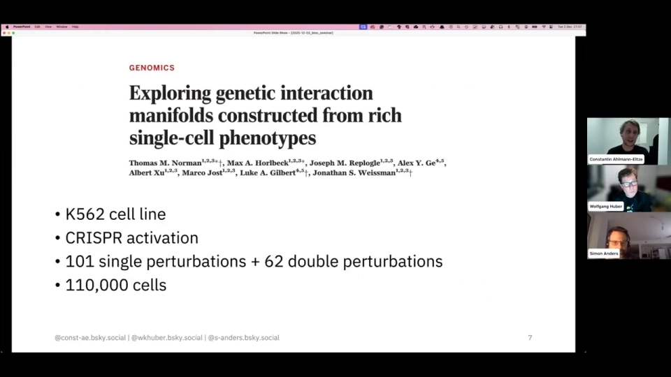
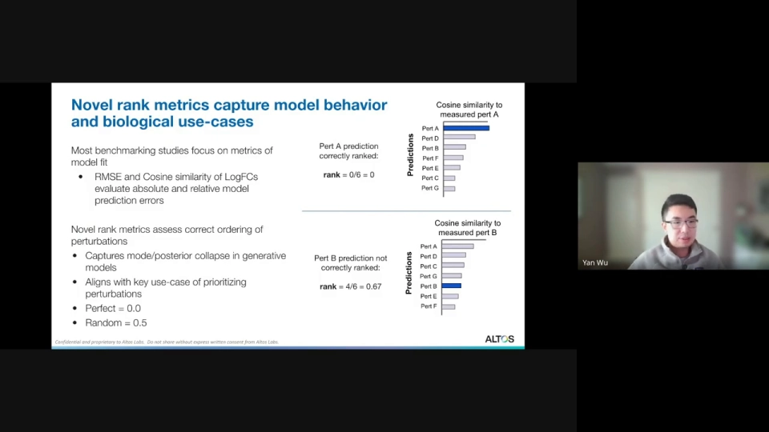
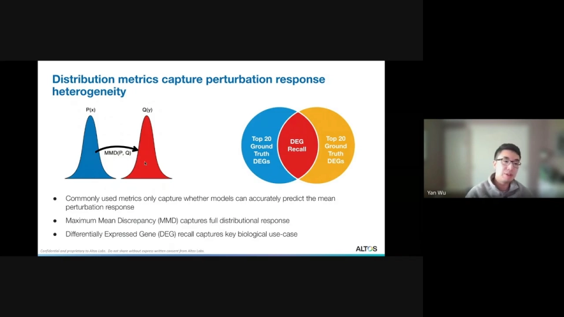
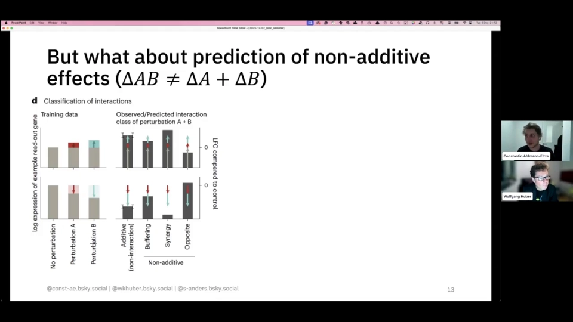
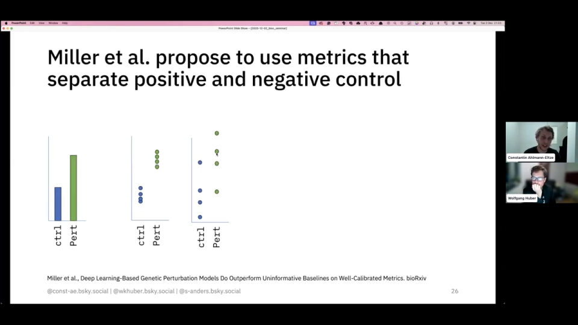
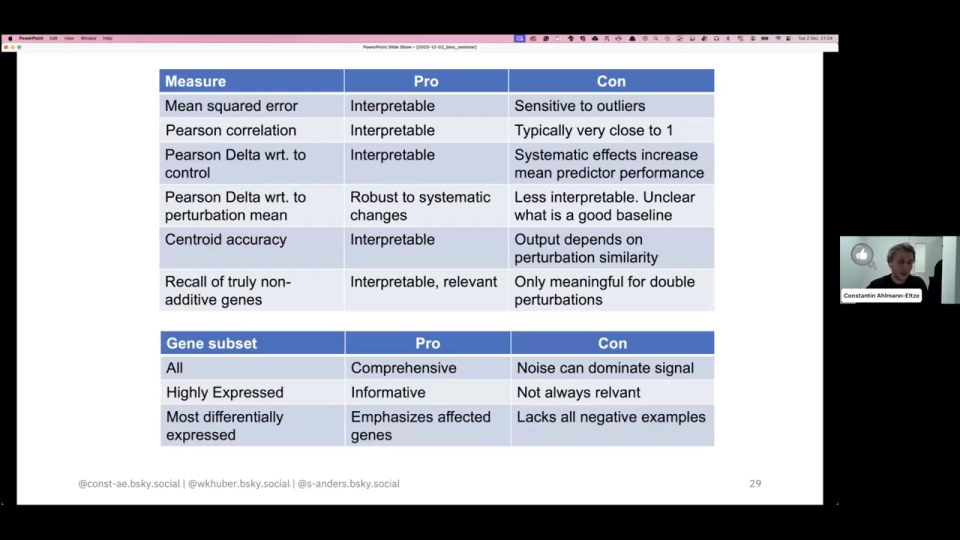

# 06 怎么判断预测得准：别用一个数字给虚拟细胞打分

> 本文基于以下视频整理：
> - [Deep-learning-based Gene Perturbation Effect Prediction Does Not Yet Outperform Linear Baselines](https://www.youtube.com/watch?v=ldYJ703CPBA)（Bioconductor seminar，58:22）
> - [PerturBench: Benchmarking Machine Learning Models for Cellular Perturbation Analysis](https://www.youtube.com/watch?v=5M0HWIjmEhQ)（Multiomics Reading Group，55:52）
>
> 原片为英文，字幕来自 YouTube 自动字幕；本文对模型名、术语和明显听错的地方做了校正。两场报告都提醒同一件事：**评估方法本身，可能比模型架构更能决定结论**。

## 本讲要解决的核心问题（SCQA）

**背景**：虚拟细胞模型输入「细胞状态 + 扰动」，输出「扰动后的细胞状态」。研究者自然会用均方误差（MSE）、R² 这类回归指标打分：预测表达谱越接近真实，模型就越好。

**冲突**：但这些指标会奖励「预测平均值」。一个模型如果干脆预测「细胞没变」，或预测「所有已见扰动的平均效果」，MSE 可能很好看，却没学会扰动具体改变了哪些基因。同一个模型在随机划分下可能赢，在未见扰动、组合或细胞系下却可能输给一条直线。

**疑问**：那到底该怎么判断模型准不准？哪些指标能拆穿「只会预测平均」的模型？

**回答（中心思想）**：评估至少要分四层——**表达误差、差异表达、扰动判别性、分布形态**——再补上**生物意义**，并且永远和 no-change、mean、additive、linear 四类基线、明确的泛化划分一起报告。只看 MSE，等于只检查「平均像不像」。

## 一、先看一个反直觉结果：加性基线赢过了大多数深度模型

Constantine Ahlmann-Eltze 等人做了一件很不「性感」的事：把最有名的几个扰动预测模型，和一条刻意设计得很笨的基线放在同一张桌子上比。

数据是 **Norman 2019**：K562 细胞系，用 CRISPR 激活（CRISPRa，把目标基因过量表达，而非敲除）制造扰动，含 101 个单扰动、62 个双扰动，约 11 万个细胞（[【跳转到 06:42】](https://www.youtube.com/watch?v=ldYJ703CPBA&t=402)）。训练用**全部单扰动 + 一半双扰动**，测试另一半——模型见过 A、见过 B，但没见过 A+B。

参赛者包括 scGPT、scFoundation、UCE、Geneformer 等基础模型，以及 GEARS、CPA 等专用模型；对手是两个基线：

- **no-change（不变）**：预测扰动后表达和对照组一样；
- **additive（加性）**：把 A、B 单独造成的表达变化直接相加，当作 A+B 的预测。

结果很直接：预测误差上，**加性基线比所有深度模型都低**；换成 Pearson delta（减去对照均值再算相关）后结论几乎不变（[【跳转到 09:37】](https://www.youtube.com/watch?v=ldYJ703CPBA&t=577)）。换基因子集，排名也没翻盘（[【跳转到 10:27】](https://www.youtube.com/watch?v=ldYJ703CPBA&t=627)）。

这不是说深度学习一无是处，而是说：**在这个强加性、单细胞系、双扰动占少数的设定里，深度模型没有表现出「学到了额外生物学」的证据**。报告人承认数据覆盖有限，但作为压力测试已足够警惕。

## 二、为什么只看 MSE 会奖励「预测均值」和「预测不变」

先看 MSE 在优化什么。对每个基因，MSE 最小的预测值是**条件平均值**。大多数基因在扰动后变化不大，「预测对照平均值」就能拿到很低误差；预测「所有已见扰动的平均效果」，误差还能更低。

更隐蔽的是 R²。直接拿全部表达值算，几乎所有方法都接近 1；因为基因间的基线差异远大于扰动差异。**减掉对照均值**，R² 才会拉开（[【跳转到 08:22】](https://www.youtube.com/watch?v=ldYJ703CPBA&t=502)）。高 R² 可能只是在夸模型「记住了哪些基因本来就高表达」。

PerturBench 给了更极端的例子：一个 **covariate-only** 模型只喂细胞系、批次，不看扰动身份，也不看基因表达。它在余弦相似度上「还不错」，在扰动排序上却接近随机（[【跳转到 23:22】](https://www.youtube.com/watch?v=5M0HWIjmEhQ&t=1402)）。这是典型的**模式坍塌**：输出一团「所有扰动都差不多」的平均细胞，误差不大，却没有扰动特异性。

所以第一原则是：**任何单一指标都可能被「预测平均」刷分**。MSE 低，不代表模型知道 A 和 B 的区别。

## 三、评估要分四层：表达、差异表达、判别性、分布

把两场报告放在一起，可以整理出一张「四层 + 生物意义」的评估表。每一层回答的问题不同，缺一层就会留下一个盲区。

| 评价层面 | 常用指标 | 回答的问题 | 主要陷阱 |
| --- | --- | --- | --- |
| **表达层** | MSE / RMSE、R²、Pearson delta、logFC 余弦 | 整体表达谱像不像？位移方向对不对？ | 高表达基因主导误差；全表达 R² 虚高 |
| **差异表达层** | DE 召回率 / 精确率、Top-k 重叠、DE 加权 MSE | 有没有找到真正变化的基因？ | 只看 Top DE 会缺少负样本；类别极不平衡 |
| **扰动判别层** | rank metric、centroid accuracy（中心准确率） | 能不能把 A 的预测和 B 的预测分开？ | 平均预测余弦不错，但排序接近随机 |
| **分布层** | MMD、能量距离、Wasserstein、DEG recall | 群体异质性、尾部、响应比例像不像？ | 只看均值会忽略「少数细胞强烈响应」 |
| **生物意义层** | 非加性基因召回、buffering / synergy / opposite、通路富集 | 有没有抓到互作和机制，而不是只会加法？ | 非加性「真值」依赖统计阈值；噪声大 |

**表达层**最直觉：MSE 衡量逐基因平方误差；R² 衡量「比猜均值好多少」；Pearson delta 先减对照均值再算相关，关心位移方向。报告提醒，减谁的均值会显著改变结论（[【跳转到 10:02】](https://www.youtube.com/watch?v=ldYJ703CPBA&t=602)）。

**差异表达层**看的是：扰动后哪些基因上调、下调？DE 召回率问「真实变化基因找回多少」，精确率问「报出的有多少是真的」。只在前 100 个差异基因上算指标，会**丢掉所有「没变化」的负样本**，让乱报差异表达的模型占便宜（[【跳转到 24:10】](https://www.youtube.com/watch?v=ldYJ703CPBA&t=1450)）。

**扰动判别层**是 PerturBench 重点补的一层。rank metric 拿真实扰动 A 的表达谱，和模型预测的所有扰动比余弦相似度，看「预测的 A」能否排第一；完美 0，随机 0.5（[【跳转到 16:00】](https://www.youtube.com/watch?v=5M0HWIjmEhQ&t=960)）。Systema 的 **centroid accuracy** 类似：预测中心是否离自己扰动的真实中心最近（[【跳转到 20:03】](https://www.youtube.com/watch?v=ldYJ703CPBA&t=1203)）。这类指标专抓「所有扰动都预测成同一个平均」的模型。

**分布层**关心「一群细胞」而非「一个平均细胞」。MMD（最大均值差异）和能量距离比较两团点云的整体形状：重心、方差、尾部、双峰都算。PerturBench 用 MMD 加 DEG recall 评估分布，发现自编码器在分布指标上比基线好，但所有模型 DEG recall 都低（[【跳转到 25:02】](https://www.youtube.com/watch?v=5M0HWIjmEhQ&t=1502)）。

**生物意义层**是最后一关。双扰动的加性预测是 ΔA + ΔB；真实值明显低于它叫 **buffering（缓冲）**，明显高于叫 **synergy（协同）**，方向反过来叫 **opposite（相反）**（[【跳转到 11:17】](https://www.youtube.com/watch?v=ldYJ703CPBA&t=677)）。好模型不该只会「A+B = A 加 B」，而要能找到非加性基因。

## 四、简单基线不是稻草人：它们编码了很强的先验

很多论文把基线当陪跑，但这两场报告都在说：**基线强，是因为它们恰好符合数据的结构**。

- **no-change（不变）**：预测扰动后和对照一样。绝大多数基因变化不大，单细胞噪声又大，乱动反而更错。它天然偏向「缓冲」，从不预测协同；可即便如此，识别非加性基因时它仍比 scGPT 有效（[【跳转到 15:02】](https://www.youtube.com/watch?v=ldYJ703CPBA&t=902)）。
- **mean（均值）**：预测所有已见扰动的平均效果。在未见单扰动任务里，它和深度模型有来有回（[【跳转到 17:07】](https://www.youtube.com/watch?v=ldYJ703CPBA&t=1027)）。因为扰动效应常共享一个低维「共同成分」。
- **additive（加性）**：ΔA + ΔB。很多组合效应确实近似相加；PerturBench 在 Norman 2019 上也说「大多数效应线性可加」（[【跳转到 27:07】](https://www.youtube.com/watch?v=5M0HWIjmEhQ&t=1627)）。
- **linear（线性）**：把扰动表示线性映射到表达变化。报告里唯一稳定超过 mean 的，是在**扰动数据**上预训练、再做跨细胞系预测的线性模型（[【跳转到 18:22】](https://www.youtube.com/watch?v=ldYJ703CPBA&t=1102)）。这提示：**预训练数据是否「对题」，可能比模型是不是深度网络更重要**。

所以看到新模型，第一句不该问「比上一个 SOTA 高多少」，而该问「比 no-change、mean、additive、linear 高多少，在哪个划分上高」。

## 五、数据划分决定难度：同一模型可以从「很强」变成「很弱」

评估结论的一半，藏在数据怎么切分里。至少要区分：

1. **随机划分（IID）**：训练和测试来自同一批扰动、细胞系、批次，模型能记住扰动身份、细胞系基线甚至批次效应。分数最好看，却最不代表泛化。
2. **未见扰动**：测试没出现过的单基因或单药物，但细胞系相同；模型必须从基因/药物属性迁移，不能查表。
3. **未见组合**：A、B 都见过，但 A+B 没出现过。这是 Norman 双扰动任务的标准设定，也是「组合爆炸」最现实的场景。
4. **未见细胞系 / 背景**：扰动见过，但换了细胞系或状态，即 **cell state transfer（细胞状态迁移）**。差得越远越接近分布外（OOD）。
5. **零样本（zero-shot）**：目标细胞系没有匹配的扰动训练数据，只给对照状态和扰动身份，直接预测扰动后状态，第 10 节专门讲。

同一个模型，随机划分上可能接近完美，未见组合上可能输给加性基线，未见细胞系上可能输给 mean。**不写清划分，模型比较就没有意义**。要按「已见 / 未见」「单 / 双扰动」「近邻 / 远邻细胞系」分层报告。

## 六、把评估做成习惯：四件套、基线、分层与校准

把思路落成清单，可以按下面几步走。

**第一，四层指标同时报告。** 表达层给整体误差，差异表达层给 DE 召回/精确率，判别层给 rank 或 centroid accuracy，分布层给 MMD 或能量距离。不必样样最好，但不能只报一层。

**第二，永远带基线。** 四个基线成本很低，却能立刻告诉你「任务有多难」。深度模型连 mean 都赢不了，复杂结构就缺乏数据支持。

**第三，按效应量和表达量分层。** 扰动越强、基因表达越高越好预测；弱效应和低表达基因更容易被噪声淹没。报告人更偏好「在高表达基因上算 MSE」（[【跳转到 25:00】](https://www.youtube.com/watch?v=ldYJ703CPBA&t=1500)）。PerturBench 也提到，化学扰动通常比遗传扰动效应更强、更好识别（[【跳转到 20:52】](https://www.youtube.com/watch?v=5M0HWIjmEhQ&t=1252)）。

**第四，检查指标校准。** Miller 等人把细胞随机分一半，用一半预测另一半构造正样本，再把对照和扰动混在一起构造负样本。好指标应能明显分开两者（[【跳转到 22:07】](https://www.youtube.com/watch?v=ldYJ703CPBA&t=1327)）。他们发现按差异表达加权的 MSE 校准较好。

**第五，小心「让基线必输」的指标。** 比如「相对扰动均值的 Pearson delta」：已经减掉所有扰动的平均，再拿 mean 基线算相关，它当然只能得 0。这不是模型差，是指标把基线写死了（[【跳转到 23:45】](https://www.youtube.com/watch?v=ldYJ703CPBA&t=1425)）。指标和基线必须配套设计。

**第六，报告不确定性和调参。** 多随机种子、多划分、合理超参搜索是底线。PerturBench 也承认复现可能漏细节；结论只属于「这个框架、这个预算」。

## 小结

- **只看 MSE 会奖励「预测均值 / 不变」**：MSE 的最优解就是条件均值，而多数基因本来就不怎么变。
- **评估要分四层**：表达误差、差异表达、扰动判别性、分布形态；再加非加性/通路等生物意义。
- **简单基线很强**：no-change、mean、additive、linear 编码了「多数基因不变」「效应低维」「组合近似相加」等先验。
- **Norman 双扰动等设定下，深度模型并不稳定赢过加性/线性基线**；未见单扰动上，mean 也常打平深度模型。
- **DE 检测普遍难**：PerturBench 里所有模型 DEG recall 都低；报告人那边，no-change 甚至比 scGPT 更能找回非加性基因。
- **效应量越大越容易预测**：强扰动、高表达基因更可靠；弱扰动、低表达基因更容易被噪声吞掉。
- **划分决定难度**：随机、未见扰动、未见组合、未见细胞系、零样本，不能混比。
- **最低配置**：四层指标 + 四个基线 + 明确划分 + 分层报告 + 指标校准。

**下一节**：知道了怎么评估，再看 GEARS、chemCPA、Tahoe-x1 各自怎么做、各自强在哪。

## 关键术语速查

| 术语 | 一句话解释 |
| --- | --- |
| MSE | 均方误差，逐基因误差的平方平均；会被「预测均值」刷低。 |
| R² | 决定系数，衡量比猜均值好多少；容易被高表达基因撑高。 |
| Pearson delta | 先减对照均值再算相关，看扰动位移方向。 |
| DE 基因 | 差异表达基因，扰动后显著上调或下调的基因。 |
| MMD | 最大均值差异，比较两团细胞分布的整体形状。 |
| 能量距离 | 另一类分布距离，同样关注整个分布而非重心。 |
| 加性基线 | 把两个单扰动的变化相加，作为组合预测。 |
| buffering / synergy / opposite | 双扰动真实效应低于 / 高于 / 反向于加性预测。 |
| rank metric | 预测的 A 是否在所有预测中最像真实 A；0 完美，0.5 随机。 |
| centroid accuracy | 预测中心是否离自己扰动的真实中心最近。 |
| zero-shot | 目标细胞系无匹配扰动训练数据，仍要预测。 |
