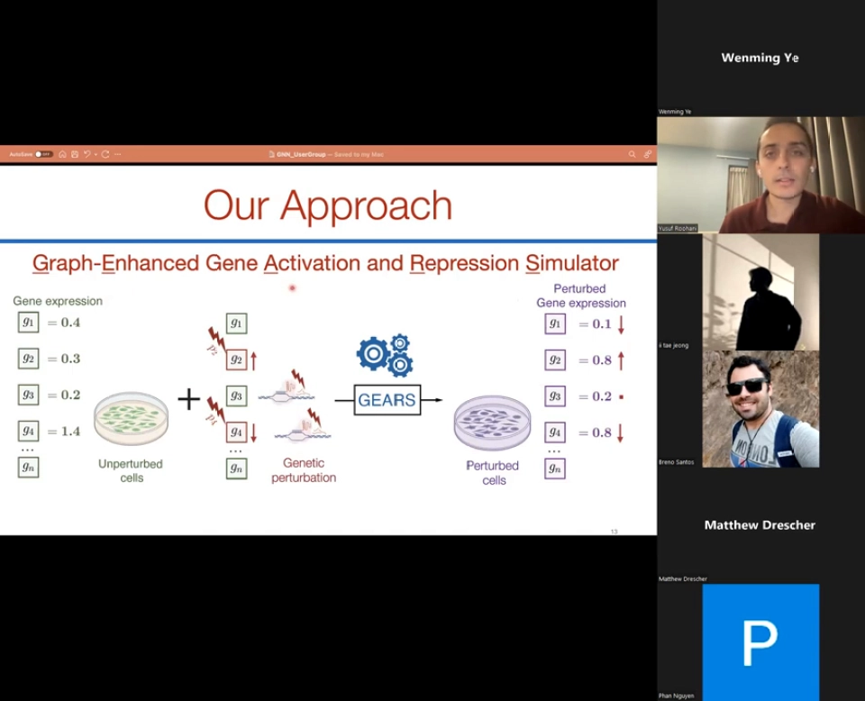
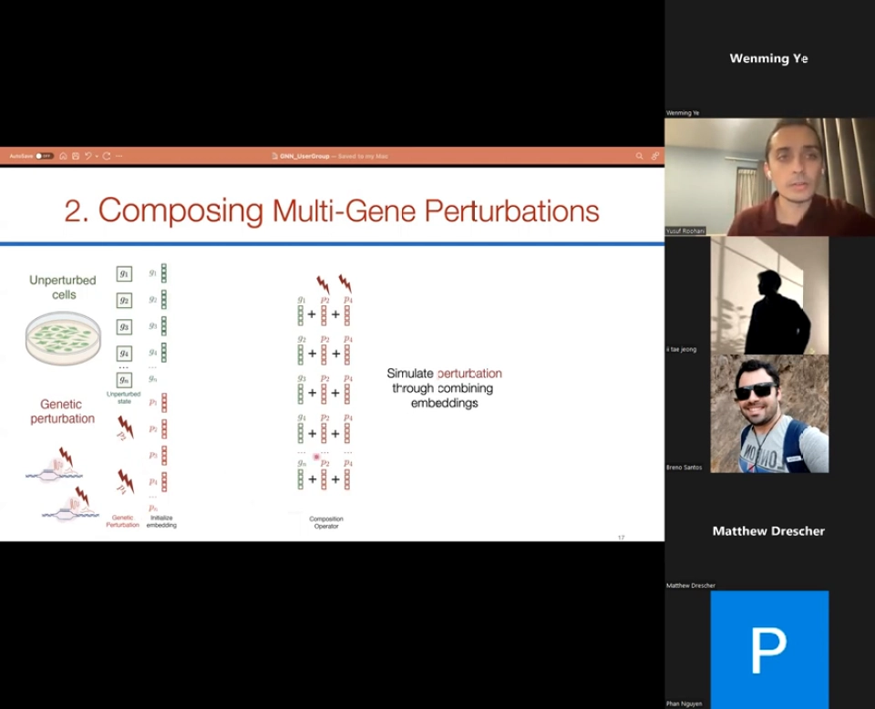
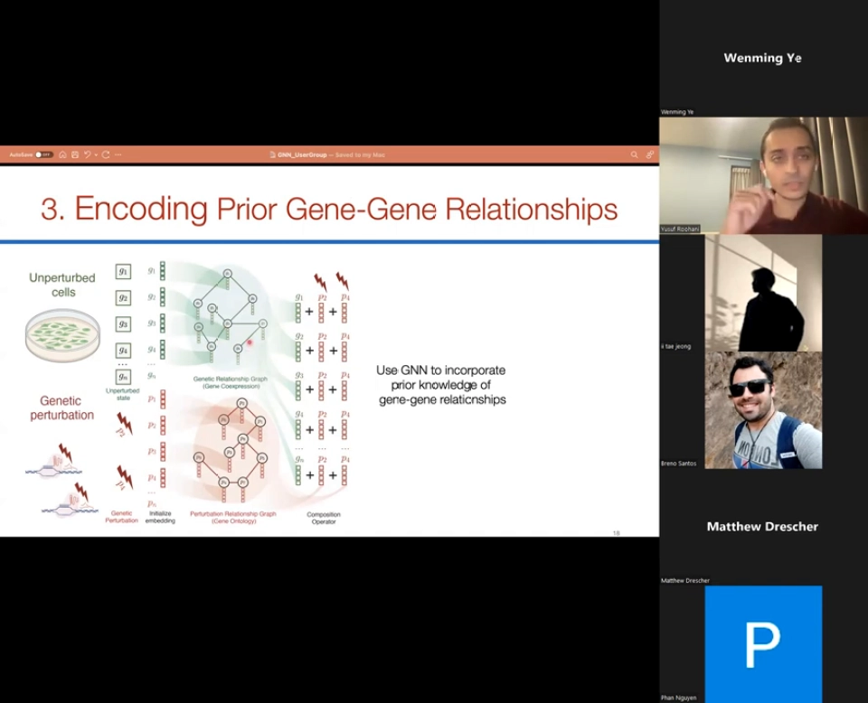
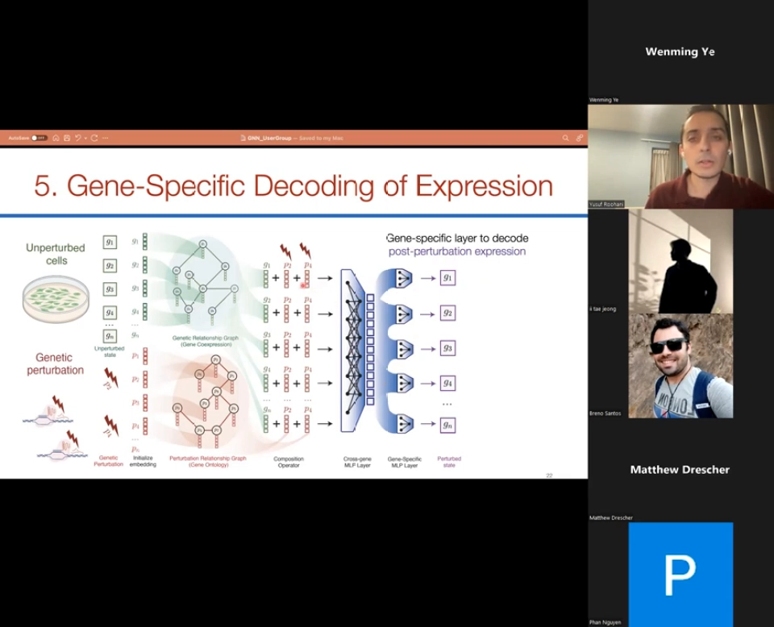
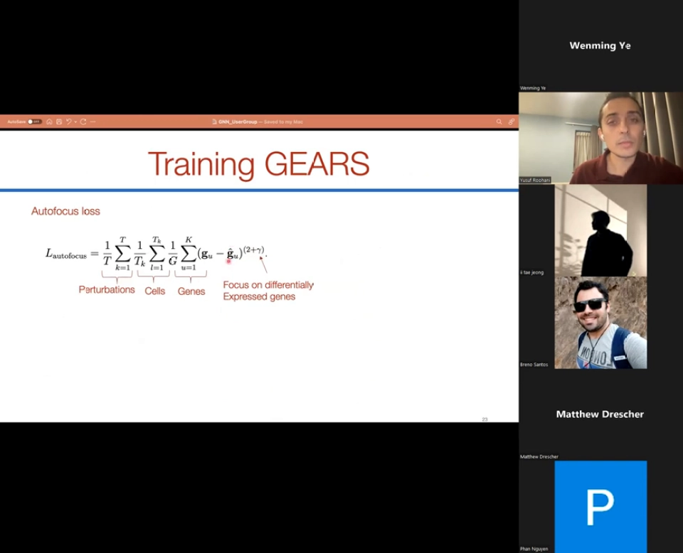
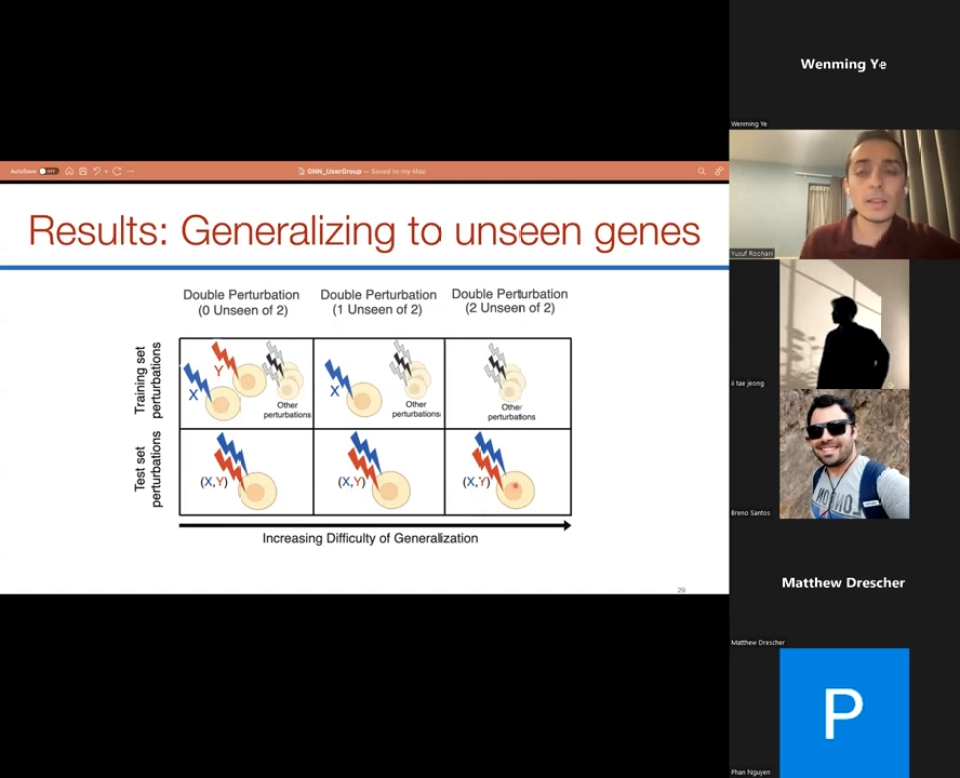
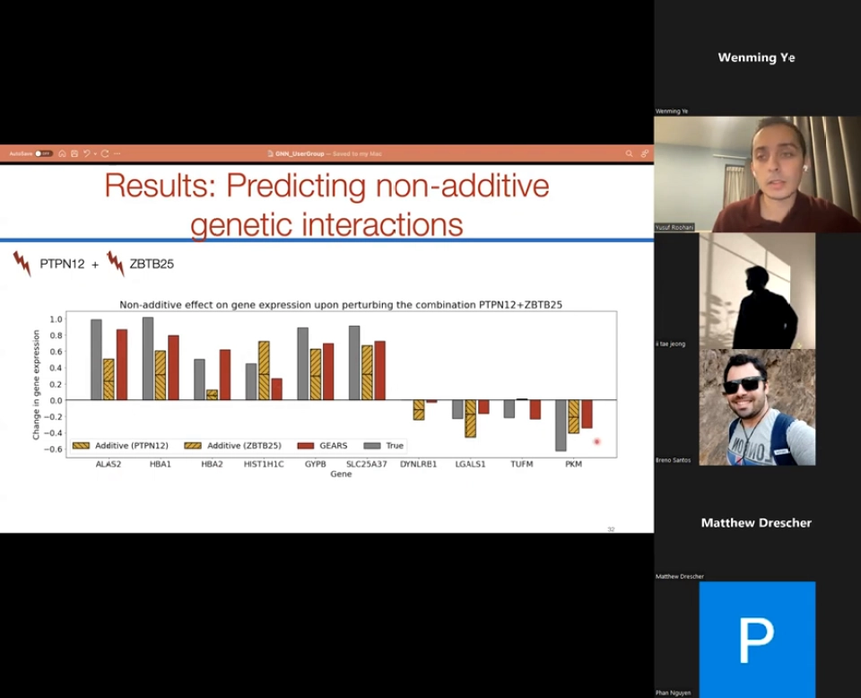
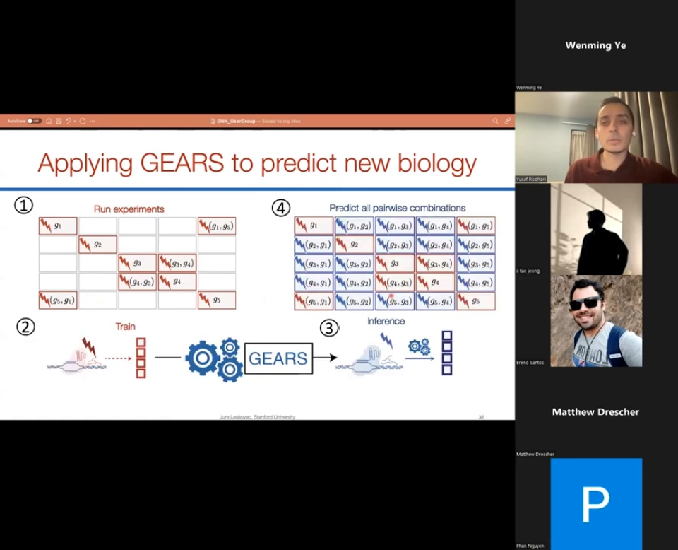

# 07 GEARS 怎么做：用两张基因关系图，把扰动预测外推到没做过的组合

> 本文基于 [GEARS: Predicting transcriptional outcomes of novel multi-gene perturbations（作者讲解）](https://www.youtube.com/watch?v=maUpBKEBXmw)（31:35）整理。原片为英文，使用 YouTube 自动字幕，本文对术语与专名做了校正。

## 本讲要解决的核心问题（SCQA）

**背景**：单细胞扰动实验已经能测出「敲掉某个基因之后，细胞里哪些基因的表达变了」。如果能从这些数据里学出规律，就可以在计算机里先做实验，再挑最有希望的候选回到实验台。

**冲突**：能做的实验远远少于想做的组合。人类有约两万个蛋白编码基因，只考虑两两组合就是亿级规模，而一次实验通常只能覆盖几千个扰动；更麻烦的是，用 one-hot 编码表示扰动的模型，遇到训练集中没出现过的基因就完全无从下手（[00:09:42](https://www.youtube.com/watch?v=maUpBKEBXmw&t=582)、[00:12:00](https://www.youtube.com/watch?v=maUpBKEBXmw&t=720)）。

**疑问**：能不能让模型在「没见过某个基因被扰动」的情况下，仍然推断出它和别的基因组合后会发生什么？

**回答（中心思想）**：GEARS 的做法是**把生物学先验做成两张基因关系图**：用基因共表达图约束「基因本身」的表示，用 GO（基因本体）图约束「扰动」的表示，再让图神经网络把邻居的信息传播过来。这样，一个没实验过的扰动可以借由它在 GO 图上的位置获得合理表示，从而把预测外推到新的单基因和双基因组合。



## 一、组合爆炸让「只做实验」走不通

作者先回到中心法则：DNA → RNA → 蛋白质，其中 RNA 的多少就是**基因表达**。把每个细胞里约两万个基因的转录本数出来，就得到一个高维向量；很多细胞拼起来，就是「细胞 × 基因」的表达矩阵（[00:03:25](https://www.youtube.com/watch?v=maUpBKEBXmw&t=205)）。

这个矩阵有两个关键性质：第一，它几乎决定了细胞当前的身份和功能；第二，基因之间并不独立——改变一个基因的表达，往往会牵动一大批其他基因（[00:04:40](https://www.youtube.com/watch?v=maUpBKEBXmw&t=280)）。

问题在于组合数量。作者引用教科书里的一句话：「我们对宇宙结构的理解，在很多方面超过了对活细胞运作的理解；如果突变一个此前没研究过的基因，我们仍无法预测细胞会怎样表现。」（[00:05:41](https://www.youtube.com/watch?v=maUpBKEBXmw&t=341)）两两组合已经让实验通量捉襟见肘，三基因、四基因组合更是再往上跳几个数量级。于是必须用计算去填补实验做不完的空间。

GEARS 是 **G**raph-**E**nhanced **G**ene **A**ctivation and **R**epression **S**imulator（图增强的基因激活/抑制模拟器）的缩写，一句话就是「用基因关系先验约束的深度学习」（[00:13:15](https://www.youtube.com/watch?v=maUpBKEBXmw&t=795)）。

## 二、先给每个基因准备两套「坐标」

GEARS 的输入有两个（[00:06:39](https://www.youtube.com/watch?v=maUpBKEBXmw&t=399)）：

- **未扰动表达向量 x**：一个细胞在扰动前的表达谱；
- **扰动向量 p**：一个二值向量，标出哪些基因被人为上调或下调。

模型为每个基因学一个多维 **gene embedding**，又为每个基因的「被扰动状态」学一个多维 **perturbation embedding**，于是有 n 个基因嵌入和 n 个扰动嵌入（[00:13:40](https://www.youtube.com/watch?v=maUpBKEBXmw&t=820)）。为什么不用一个标量？作者给出的经验理由是：不同基因对扰动的响应差异很大，用多维向量才能容纳这种异质性（[00:14:30](https://www.youtube.com/watch?v=maUpBKEBXmw&t=870)）。

第二步是**在嵌入空间里「做加法」**。作者用了 NLP 里经典的类比：`king` 的向量减去 `man` 再加上 `woman`，会靠近 `queen`。GEARS 类似地把扰动嵌入加到每个基因嵌入上：如果同时扰动基因 2 和基因 4，就把 p₂、p₄ 加到所有基因的表示上（[00:14:55](https://www.youtube.com/watch?v=maUpBKEBXmw&t=895)、[00:15:20](https://www.youtube.com/watch?v=maUpBKEBXmw&t=920)）。



这一步让 GEARS 能处理**组合**：即使没见过「基因 2 + 基因 4」，也可先叠加两个扰动嵌入再预测；它也为后文三种泛化场景埋下伏笔。

## 三、两张图把「生物学相似」变成可传播的约束

只有嵌入还不够：随机初始化的向量没有生物学含义，没见过的基因也拿不到靠谱的表示。GEARS 的解法是引入两张图（[00:15:20](https://www.youtube.com/watch?v=maUpBKEBXmw&t=920)）：

1. **基因共表达图（gene co-expression graph）**：节点是基因，用来约束 **gene embedding**。如果两个基因在数据里经常一起变化，就让它们的表示靠近。
2. **基因本体图（GO graph）**：节点还是基因，用来约束 **perturbation embedding**。功能相近、属于同一 GO 条目的基因，其「被扰动后的影响」也应该相似。

两张图上的节点特征，就是随机初始化的嵌入向量。GEARS 对两张图分别跑一个**图卷积网络（GCN，graph convolutional network）**，让每个节点聚合邻居的信息（[00:15:45](https://www.youtube.com/watch?v=maUpBKEBXmw&t=945)、[00:16:10](https://www.youtube.com/watch?v=maUpBKEBXmw&t=970)）。效果是：如果一个基因的扰动从没做过，模型仍可以顺着 GO 图找到功能相近、做过扰动的邻居，借它们的表示来「猜」这个新扰动应该是什么样。



> **术语纠正**：视频里说的是 graph convolutional network（图卷积网络）。GEARS 官方实现中常用的是 **SGC（Simplified Graph Convolution，简化图卷积）**——它去掉了非线性、把多层传播简化为一次线性聚合，本质上仍是「按图做邻居平均」。它不是 GAT（Graph Attention Network，图注意力网络），两者不要混为一谈。

作者还展示了支持这个设计的现象：在真实扰动数据里，许多扰动会产生相似的表达响应，形成**共功能模块**；许多基因也会对不同扰动做出相似响应，形成**共调控程序**（[00:17:00](https://www.youtube.com/watch?v=maUpBKEBXmw&t=1020)）。图先验并不是硬塞进来的假设，而是数据里本来就存在的结构。

## 四、跨基因层与基因特异解码器：从「各自为政」到「全局协调」

到上一步为止，每个基因还是各算各的。但扰动常常有**次级效应**：比如扰动基因 4 会间接影响基因 9，而基因 9 并不在被扰动的列表里。为此 GEARS 加了一个 **cross-gene MLP 层**（跨基因层）：它把所有基因扰动后的嵌入汇总成一个全局状态，再让每个基因参考这个全局状态更新自己（[00:17:50](https://www.youtube.com/watch?v=maUpBKEBXmw&t=1070)）。

这里有个容易误解的细节：GEARS **不是自编码器**。每个基因的输出都直接连到最终解码器，同时又接受全局状态的调制，而不是被迫先从全局状态重建所有嵌入（[00:18:40](https://www.youtube.com/watch?v=maUpBKEBXmw&t=1120)）。这样既保留了每个基因自己的信息，又减轻了学习负担。

最后是**基因特异解码器（gene-specific decoder）**：每个基因有自己的解码参数，把该基因的最终嵌入映射回表达值。这再次呼应了前面的观察——不同基因的响应幅度和模式差别很大，共享一个解码器会抹平这种差异（[00:19:05](https://www.youtube.com/watch?v=maUpBKEBXmw&t=1145)）。



把整个前向过程串起来，就是下面这条链：

```text
未扰动表达 x ──→ 基因嵌入 g_i ──→ 基因共表达图 ──→ GCN ─┐
                                                      ├─→ 逐基因相加 ─→ 跨基因 MLP ─→ 基因特异解码 ─→ 扰动后表达
扰动向量 p   ──→ 扰动嵌入 p_j ──→ GO 图       ──→ GCN ─┘
```

读法：输入是「细胞状态 + 扰动」，中间两张图各自传播，输出是每个基因扰动后的表达；两个 GCN 把先验灌进表示，跨基因层负责协调，解码器回到表达空间。

## 五、损失函数：别被大量「没变化」的基因淹没

训练数据是「若干细胞 + 真实扰动 + 扰动后表达」，最直接的损失就是均方误差（MSE）（[00:19:30](https://www.youtube.com/watch?v=maUpBKEBXmw&t=1170)）。但直接用它有两个偏差，GEARS 各加了一项修正。

**第一，绝大多数基因在扰动后并不变化。** 作者估计，真正有明显响应的往往只有几百个基因。如果对全部基因一视同仁，损失会被大量「零」稀释，模型倾向于什么都不改。GEARS 的 **autofocus loss** 给变化大的基因更高权重，把注意力集中到差异表达基因上（[00:20:20](https://www.youtube.com/watch?v=maUpBKEBXmw&t=1220)）。



**第二，方向有时比幅度更重要。** 两个预测可以有相同的 MSE，但一个把基因上调、另一个把基因下调；对生物学家来说，前者显然更有用。GEARS 因此额外加了一项**方向性损失（directionality loss）**，约束预测的变化方向与真实方向一致（[00:21:10](https://www.youtube.com/watch?v=maUpBKEBXmw&t=1270)）。

两项设计都指向同一个判断：**扰动预测不是普通回归题，评价标准要贴近生物学真正关心的东西**。

## 六、三类泛化：越难，越能看出图先验的价值

作者把「预测双基因组合」按训练集见过什么分成三档（[00:24:05](https://www.youtube.com/watch?v=maUpBKEBXmw&t=1445)）：

- **0 unseen of 2**：两个基因都单独扰动过，只是没做过组合。这是最简单的场景，模型主要学「两个已知效应怎么叠加」。
- **1 unseen of 2**：其中一个基因从未被扰动过。
- **2 unseen of 2**：两个基因都没被扰动过，却要预测它们的组合。这是最难的场景。



作者展示的是单基因与双基因组合扰动（社区常称 Norman Perturb-seq）。在其上，GEARS 在三档设定中都优于两个基线——一个线性模型和一个不使用先验的神经网络 CPA——**预测误差平均降低 45%**（[00:25:20](https://www.youtube.com/watch?v=maUpBKEBXmw&t=1520)）。

更关键的是**非加性效应**。如果两个基因各自的效果是 X 和 Y，最偷懒的预测是 X + Y；但真实细胞里常见协同（组合效果大于相加）、抑制（小于相加），以及新形态、冗余、上位等更复杂的交互。作者把双基因交互按与「相加」的偏离方式分成五类：**协同（synergy）、抑制（suppression）、新形态（neomorphism）、冗余（redundancy）、上位（epistasis）**。GEARS 能捕捉到这些非线性效应，而不是简单把两个单基因效应加起来（[00:26:10](https://www.youtube.com/watch?v=maUpBKEBXmw&t=1570)）。



在「找出最强的遗传交互」这个排序任务上，作者用 precision@10 衡量：预测得分最高的 10 个组合里，有多少真的属于该类交互。GEARS 比基线**约提升 50%**（[00:28:15](https://www.youtube.com/watch?v=maUpBKEBXmw&t=1695)）。

最后是一个有说服力的外推实验：只用 **236 个基因扰动**训练，然后预测 **5000 个没做过的扰动**，并从中发现了此前没观察到的表型（[00:28:40](https://www.youtube.com/watch?v=maUpBKEBXmw&t=1720)）。这正是 GEARS 的定位：不替代实验，而是把有限实验扩展到更大的组合空间，再挑出值得验证的假设。



## 七、边界：图先验不是万能药

视频本身没有系统列局限，下面几条是从方法设计推出的必要提醒：

- **依赖 GO 图的覆盖与质量。** 如果某个基因邻居很少、注释过时，或功能关系不在 GO 里，模型就失去了外推依据；图先验帮得了「可类比的基因」，帮不了完全意外的机制。
- **主要在单一细胞类型上验证。** 作者展示的数据以一种细胞背景为主，跨细胞系、跨组织的泛化也未被证明。换一种细胞背景，基因关系图仍然可用，但表达分布和扰动响应可能已经变了。
- **组合预测仍然很难。** 45% 是相对基线的误差下降，不等于「已经能准确预测任意组合」；在 2 unseen of 2 场景里，误差依然明显高于前两档。
- **预测的是群体平均趋势。** MSE 式目标让模型更擅长给出「平均扰动后表达」，而非重现单细胞异质性。
- **简单基线并不弱。** 第 06 节会看到，很多复杂模型在严格基准上未必赢过线性/相加基线；GEARS 的价值是「在特定数据和泛化设定下用图先验换来更好的外推」，而非「深度模型碾压简单方法」。

## 小结

- GEARS 解决的是**组合扰动的外推**问题：实验做不完所有组合，模型必须填补空白。
- 它的核心表示是**两套嵌入**：gene embedding 描述基因本身，perturbation embedding 描述「这个基因被扰动」；两者相加即可组合多个扰动。
- 两套嵌入分别被**基因共表达图**和 **GO 图**约束，再用 **GCN/SGC** 做邻居消息传递，使没见过的扰动也能借功能邻居获得表示。
- **跨基因层**负责次级效应，**基因特异解码器**负责保留基因间异质性；损失函数用 autofocus 和方向性两项修正，让优化目标贴近生物学关注点。
- 结果上，GEARS 在 0/1/2 个未见基因三档设定中均优于线性与 CPA 基线，能预测非加性交互，并展示了「236 个扰动训练 → 约 5000 个扰动外推」的实用路径；但它仍受图覆盖、细胞类型和组合难度限制。

## 关键术语速查

| 术语 | 一句话解释 |
| --- | --- |
| Perturb-seq | 把 CRISPR 扰动与单细胞 RNA 测序结合，测出「敲低某基因后细胞表达如何变化」的技术。 |
| gene embedding | 每个基因学到的多维向量，表示它在模型里的「身份坐标」。 |
| perturbation embedding | 每个基因「被扰动」这件事学到的向量，可与 gene embedding 相加来组合扰动。 |
| GO 图 | 基因本体（Gene Ontology）构成的关系图，把功能相近的基因连在一起。 |
| GCN / SGC | 图卷积网络；SGC 是去掉非线性的简化版本，GEARS 官方实现常用它。 |
| 非加性效应 | 组合扰动的效果不等于两个单基因效果之和，如协同、抑制、新形态、冗余、上位。 |
| autofocus loss | 给差异表达基因更高权重的损失设计，避免模型被大量「没变化」的基因带偏。 |
| precision@10 | 预测得分最高的 10 个结果中，真正正确的比例，常用于评估交互排序。 |
