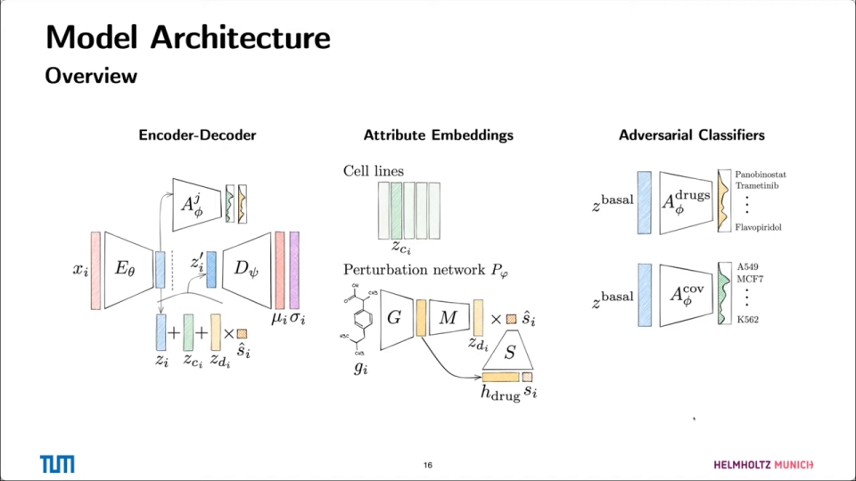
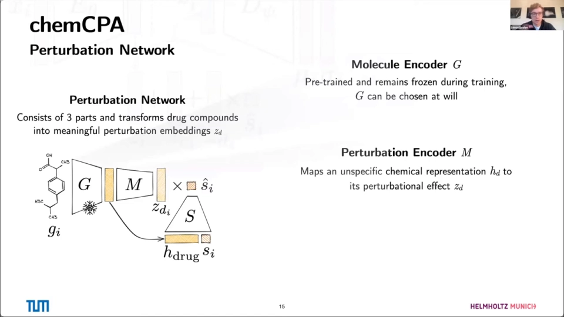
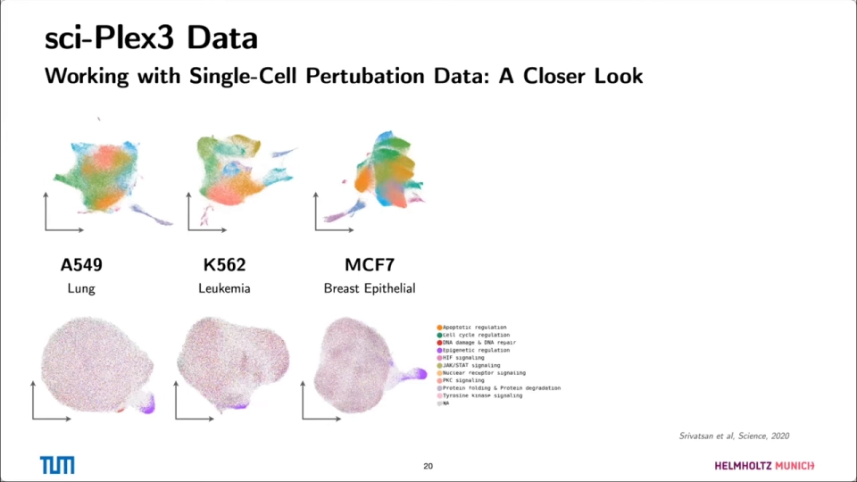
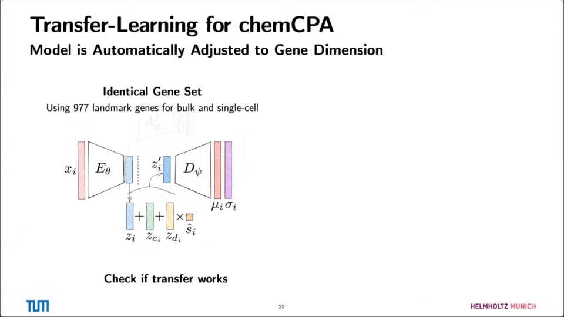
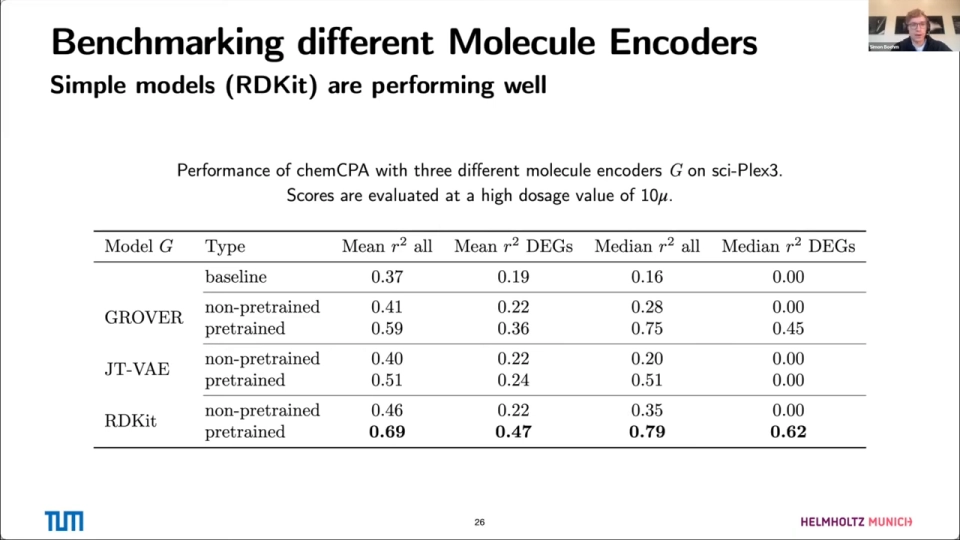
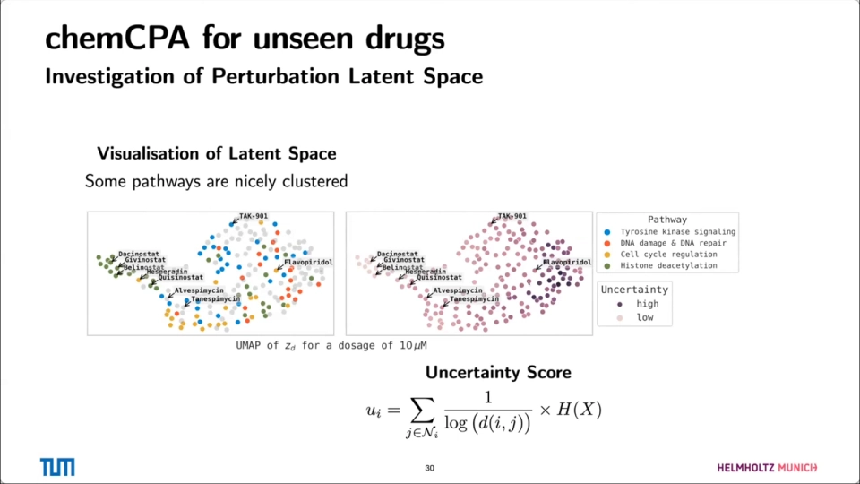
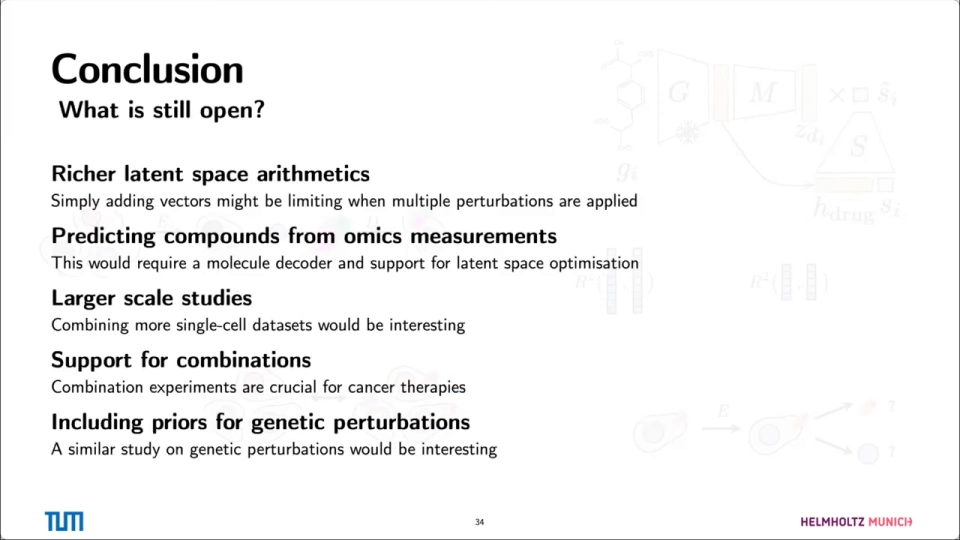

# 08 chemCPA 怎么做：让模型预测「没见过的药」

> 本文基于以下视频整理：[Predicting Single-Cell Perturbation Responses For Unseen Drugs](https://www.youtube.com/watch?v=nsL_NOwYf1c)（Leon Hetzel、Simon Böhm 讲解 chemCPA，58:17）与 [Interpretable Machine Learning to Model Drug Perturbations in Single Cell Genomics](https://www.youtube.com/watch?v=blbmQJtutJg)（Fabian Theis 讲解 CPA 基础，36:00）。自动字幕把 chemCPA 写成了“Camp CPA”、把 RDKit 写成了“a decade”，本文按上下文校正。

## 本讲要解决的核心问题（SCQA）

**背景**：CPA（Compositional Perturbation Autoencoder，组合扰动自编码器）已经能在一个潜空间（latent space，模型内部学出来的低维表示）里把「细胞状态」「细胞系」「药物」拆成可相加的向量，从而用见过的单扰动组合出没测过的组合。

**冲突**：CPA 有一个硬限制——它把每种药当成一个**查表 ID**。训练集里没有的药，模型根本没有对应的向量，所以它无法预测新药。而药物发现最想做的，恰恰是给一个还没上过实验的新分子，先猜它会怎样影响细胞。

**疑问**：能不能把「药物 ID」换成「化学结构」，让模型从结构推断扰动效果？换了之后，剂量怎么办？只靠单细胞数据训练不够，能不能把 L1000 这种大规模 bulk 数据也用上？

**回答（中心思想）**：chemCPA 在 CPA 的潜空间算术上加了两个部件——**分子结构编码器**和**剂量缩放器**，并用「L1000 bulk 预训练 + sci-Plex3 单细胞微调」的迁移学习补数据。它把「预测未见药物」从不可能变成可行，但天花板仍然由数据决定。

## 一、CPA 回顾：把扰动拆成潜空间里可加的方向

CPA 是一个自编码器（autoencoder，先把表达谱压到低维、再还原的网络）。它的出发点很朴素：如果「药物效应」和「细胞背景」能在潜空间里分开，换药、换细胞系就可以像做向量加法一样组合。结构分三步。

**第一步，编码。** 表达谱 $x_i$（维度大约 1 千到 5 千以上个基因）经过编码器 $E_\theta$，压成一个 32 维的潜向量 $z_i$（[13:04](https://www.youtube.com/watch?v=nsL_NOwYf1c&t=784)）。

**第二步，对抗解耦。** 如果放任编码器自由发挥，它会把「这是什么药」「这是什么细胞系」的信息全塞进 $z_i$，那后面再手动加属性就没有意义了。所以 CPA 接了两个对抗分类器：一个尝试从 $z_i$ 预测药物，一个尝试预测细胞系；编码器的损失里加入「让分类器猜不准」的惩罚。训练稳定后，$z_i$ 变成一个**不含扰动和细胞系信息的基底状态**（basal state）（[13:54](https://www.youtube.com/watch?v=nsL_NOwYf1c&t=834)）。

Theis 强调：不对抗的话，潜空间会把信息混在一起，无法归因到药物或细胞类型（[27:00](https://www.youtube.com/watch?v=blbmQJtutJg&t=1620)）。

**第三步，加回属性并解码。** 把基底状态、细胞系嵌入、药物嵌入加起来：

$$z'_i = z_{\text{basal}} + z_{\text{cell line}} + s_d \cdot z_{\text{drug}}$$

其中 $s_d$ 是药物强度（剂量）标量。解码器 $D_\psi$ 再把 $z'_i$ 还原成表达谱。因为药物是以「方向 + 强度」的形式加进去的，所以**没测过的药物组合**可以通过把两个方向相加来预测，不需要为每个组合单独建一个 ID。

这套设计可解释、可组合；缺点是药物必须是离散 ID，查找表里没有的药，模型无法给出向量。

## 二、chemCPA 的两个增量：分子结构编码器与剂量缩放器

### 2.1 第一个增量：用分子结构替换药物查表

chemCPA 把 CPA 里的「药物查找表」换成了一个**扰动网络**，由三个部件组成（[11:34](https://www.youtube.com/watch?v=nsL_NOwYf1c&t=694)）：

1. **分子编码器 $G$**：输入药物的 SMILES 字符串（一种用文本表示分子结构的写法），输出一个固定长度的化学表示 $h_{\text{drug}}$。$G$ 是预训练好的，训练 chemCPA 时**冻结不动**。
2. **扰动编码器 $M$**：把化学表示 $h_{\text{drug}}$ 映射到 CPA 的 32 维潜空间，得到药物扰动向量 $z_{d_i}$。
3. **剂量缩放器 $S$**：把实验里加的浓度 $s_i$ 变成一个「有效剂量」$\hat{s}_i$，再与 $z_{d_i}$ 相乘。

为什么要单独留一个 $M$？因为不同的分子编码器输出维度差别很大：RDKit 的指纹可能几百维，GROVER 这类 Transformer 可能几千维。$M$ 的作用是把它们统一压到 32 维，这样你可以随时换编码器，而不用改整个模型（[18:04](https://www.youtube.com/watch?v=nsL_NOwYf1c&t=1084)）。

为什么 $G$ 要冻结？大模型预训练成本高；冻结后每个分子只需前向一次，结果存表反复查，也让 chemCPA 能直接借用 GROVER 这类大 Transformer（[39:33](https://www.youtube.com/watch?v=nsL_NOwYf1c&t=2373)）。

三种 $G$：

- **RDKit**：基于手写规则计算分子指纹，不需要训练，最简单；
- **JT-VAE**：用分子片段组合的编码器-解码器；
- **GROVER**：大规模 Transformer，预训练过很多分子性质预测任务。

### 2.2 第二个增量：剂量缩放器把浓度变成「有效剂量」

CPA 里也有一个强度标量，但它更像是「每种药一个固定的强度」。$S$ 的作用有两个。chemCPA 的 $S$ 是一个小型神经网络，输入浓度，输出有效剂量，可以表达非线性关系（[18:29](https://www.youtube.com/watch?v=nsL_NOwYf1c&t=1109)）。

第一，**非线性剂量响应**。药物在高浓度下可能产生毒性、沉淀或脱靶效应，效果不是随浓度线性增长的。一个固定的标量乘上去，无法表达「低剂量没反应、高剂量突然起效」这种曲线。

第二，**无关药物可以被压到零**。sci-Plex3 里有很多药在某条细胞系上几乎没有效果；如果没有 $S$，模型只能靠 $z_{d_i}$ 本身接近零来表达「没效果」，但这会干扰其他细胞系上的预测。有了 $S$，模型可以把「这个药在这个浓度下无效」单独学出来，把有效剂量缩到 0（[21:12](https://www.youtube.com/watch?v=nsL_NOwYf1c&t=1272)）。

## 三、从 L1000 到 sci-Plex3：architecture surgery 与迁移学习

chemCPA 的训练数据有两个来源。

**源域：L1000。** Broad Institute 的大规模连接图谱，用 bulk（把一群细胞混在一起测，只得到平均值）方式测了约 978 个 landmark 基因（一组精选的代表性基因），覆盖大量化合物和基因扰动，观测数超过百万（[22:27](https://www.youtube.com/watch?v=nsL_NOwYf1c&t=1347)）。它的优点是规模大、药物多；缺点是：

- 它是 **bulk**，不是单细胞，看不到细胞间异质性；
- 基于杂交荧光，需要反卷积（从混合信号里推算各基因贡献），和 RNA-seq 不是同一套测量；
- 只有 978 个基因，很多化合物效应很弱甚至没有（[24:32](https://www.youtube.com/watch?v=nsL_NOwYf1c&t=1472)）。

**目标域：sci-Plex3。** 单细胞药物扰动数据，包含 3 条癌细胞系（A549 肺癌、K562 白血病、MCF7 乳腺癌）、188 种药、约 65 万个细胞、7561 个基因，剂量覆盖 0.01–10 µM（[28:33](https://www.youtube.com/watch?v=nsL_NOwYf1c&t=1713)）。

两个数据域基因集不同，怎么迁移？作者的做法是：

1. 用基因注释找出两边的交集，得到 **977 个 landmark 基因**；
2. 把源域和目标域都限制在这 977 个基因上，先验证「迁移能不能工作」；
3. 然后做 **architecture surgery**：在编码器和解码器上各加一层，把基因维度从 977 扩展到「977 + 1000 多个高变基因」，再用单细胞数据微调（[31:28](https://www.youtube.com/watch?v=nsL_NOwYf1c&t=1888)）。

关键是**加层而不是重训**：主体权重来自 L1000，新层只负责对齐维度，既保住 bulk 学到的药物效应，又能利用单细胞里的额外基因。作者分开报告两种设定：

- **相同基因集（977 genes）**：源域和目标域完全对齐，用来验证迁移本身；
- **扩展基因集（977 + HVGs，高变基因）**：更接近真实使用，但也更难，因为新增的基因在预训练时没见过。

## 四、结果：预训练有用，但最简单的 RDKit 反而最好

先看分子编码器对比。作者在 sci-Plex3 上、10 µM 高剂量下评估（低剂量效应太弱，方法间拉不开差距），指标是 R²（拟合优度，越接近 1 越好）（[41:01](https://www.youtube.com/watch?v=nsL_NOwYf1c&t=2461)）：

| 分子编码器 | 预训练 | 全部基因平均 R² | DE 基因平均 R² | 全部基因中位 R² | DE 基因中位 R² |
| --- | --- | --- | --- | --- | --- |
| 基线（不含药物信息） | — | 0.37 | 0.19 | 0.16 | 0.00 |
| GROVER | 否 | 0.41 | 0.22 | 0.28 | 0.00 |
| GROVER | 是 | 0.59 | 0.36 | 0.75 | 0.45 |
| JT-VAE | 否 | 0.40 | 0.22 | 0.20 | 0.00 |
| JT-VAE | 是 | 0.51 | 0.24 | 0.51 | 0.00 |
| RDKit | 否 | 0.46 | 0.22 | 0.35 | 0.00 |
| **RDKit** | **是** | **0.69** | **0.47** | **0.79** | **0.62** |

结论有两条：**预训练几乎在所有编码器上都有帮助**，尤其是 DE 基因；**RDKit 这个「不用训练」的指纹反而最好**。作者的解释是：瓶颈不在编码器多复杂，而在数据能支持多细的区分；GROVER 预训练的分子性质任务和「药物如何扰动转录组」并不是一回事（[57:31](https://www.youtube.com/watch?v=nsL_NOwYf1c&t=3451)）。

再看和 CPA、scGen 的对比。三个模型的能力边界不同，比较必须小心：

- **scGen**（另一种用潜空间算术做扰动预测的自编码器）不能显式建模剂量；
- **CPA** 不能预测未见药物（查表）；
- **chemCPA** 两者都可以。

为了公平，作者只在**一个固定剂量**、**一个未见过的「药物 × 细胞系」组合**上比较。评估时只编码对照细胞，再加上药物/细胞系属性；基线完全丢弃药物信息，超过它的部分才归因于药物知识（[33:08](https://www.youtube.com/watch?v=nsL_NOwYf1c&t=1988)）。在这个设定下，chemCPA 已经优于 CPA 和其他基线；加上 L1000 预训练后，DE 基因上的提升更明显（[43:31](https://www.youtube.com/watch?v=nsL_NOwYf1c&t=2611)）。

真正体现 chemCPA 价值的是**完全未见药物**实验。作者从 sci-Plex3 挑了 **9 个 OOD 药物**（分布外，训练中完全没见过），标准是「效应足够强、覆盖多条通路」，训练和模型选择阶段完全不接触它们（[30:13](https://www.youtube.com/watch?v=nsL_NOwYf1c&t=1813)）。预训练版本在各剂量上都更稳，但不是每个药都成功（[45:11](https://www.youtube.com/watch?v=nsL_NOwYf1c&t=2711)）。

最后是潜空间的可解释性。把药物扰动向量画成 UMAP（一种降维可视化方法），可以看到同一类机制的药物会聚在一起，例如组蛋白去乙酰化酶抑制剂（HDAC 抑制剂）形成比较清晰的簇（[46:51](https://www.youtube.com/watch?v=nsL_NOwYf1c&t=2811)）。作者还做了一个**不确定性分数**：用最近邻距离和通路熵估计「这个预测可不可信」，在潜空间里标出高置信区和低置信区（[48:06](https://www.youtube.com/watch?v=nsL_NOwYf1c&t=2886)）。

## 五、局限：数据决定了天花板

**第一，sci-Plex3 本身很受限。** 只有 3 条细胞系、188 种药、7561 个基因；很多药的扰动效应很弱，甚至在不同细胞系上方向不一致。作者说，这个数据集虽是当前最好的单细胞单药筛选之一，但「非常有限」（[47:16](https://www.youtube.com/watch?v=nsL_NOwYf1c&t=2836)）。

**第二，977 个基因是硬约束。** L1000 只有 978 个 landmark 基因，和单细胞数据的交集是 977 个。扩展基因集能覆盖更多基因，但整体性能会下降，因为新增基因预训练时没见过（[48:56](https://www.youtube.com/watch?v=nsL_NOwYf1c&t=2936)）。

**第三，组合扰动还没有真正支持。** 论文里的实验是单药；作者说新版代码会支持组合，但还没覆盖「两个药都没见过」的最难设定（[11:24](https://www.youtube.com/watch?v=nsL_NOwYf1c&t=684)）。

**第四，基因扰动不能直接套用。** chemCPA 的分子编码器是为化学结构设计的，基因扰动没有 SMILES；要把这套方法搬到 CRISPR，需要另一套先验（[52:25](https://www.youtube.com/watch?v=nsL_NOwYf1c&t=3145)）。

**第五，潜空间加法可能过于简单。** 多个扰动同时作用时，简单相加未必成立；作者把「更丰富的潜空间算术」（如最优传输）列为未来方向（[51:35](https://www.youtube.com/watch?v=nsL_NOwYf1c&t=3095)）。

**第六，解耦并不完美。** 用非线性分类器检查，允许 0.5–0.7 的残留信息；解耦不干净，性能提升就不能完全归因于药物（[35:13](https://www.youtube.com/watch?v=nsL_NOwYf1c&t=2113)）。

## 六、CPA → chemCPA 改了什么

| 维度 | CPA | chemCPA |
| --- | --- | --- |
| 药物表示 | 离散 ID 的查找表 | SMILES → 分子编码器 $G$ → 扰动编码器 $M$ |
| 未见药物 | 不支持 | 支持，靠化学结构泛化 |
| 剂量 | 每种药一个强度标量 | 剂量缩放器 $S$，可学非线性有效剂量 |
| 训练数据 | 主要在单细胞数据上训练 | L1000 bulk 预训练 + sci-Plex3 微调 |
| 基因维度 | 固定 | architecture surgery：加层扩展到 977 / 扩展基因集 |
| 组合扰动 | 潜空间方向相加，支持见过单扰动的组合 | 同样可加，但论文未系统验证；新版代码支持 |
| 可解释性 | 潜空间方向 + 对抗解耦 | 额外获得「化学结构 → 扰动方向」的映射 |
| 主要风险 | 无法外推新药 | 数据覆盖不足；简单相加可能不成立 |

## 小结

- CPA 的核心是「编码器-解码器 + 对抗解耦 + 潜空间相加」：把细胞状态、细胞系、药物拆成可组合的向量。
- CPA 的硬伤是药物查表，无法预测新药；chemCPA 用**分子编码器**把化学结构映射成扰动向量，解决了这个问题。
- **剂量缩放器**把实验浓度变成可学的有效剂量，能表达非线性剂量响应，也能把无效药物压到零。
- 迁移学习的关键是 **977 个共同 landmark 基因 + architecture surgery**：保留 L1000 预训练权重，加层扩展基因维度。
- 结果上，预训练普遍有用；最简单的 **RDKit 指纹反而最强**，说明瓶颈在数据而不在编码器复杂度。
- 未见药物能预测，但不是每个药都成功；组合扰动、基因扰动、更复杂的潜空间算术仍是开放问题。

## 关键术语速查

| 术语 | 一句话解释 |
| --- | --- |
| CPA | 组合扰动自编码器，把细胞状态、细胞系、药物拆成潜空间向量再相加 |
| 基底状态（basal state） | 去掉药物和细胞系信息后的细胞潜表示 |
| 对抗解耦 | 用分类器惩罚编码器，迫使潜空间不含药物/细胞系信息 |
| chemCPA | 在 CPA 上加入分子结构编码器和剂量缩放器的版本 |
| SMILES | 用文本字符串表示分子结构的标准写法 |
| RDKit | 化学信息学工具库，可用手写规则把分子转成指纹向量 |
| GROVER | 在大规模分子数据上预训练的 Transformer |
| JT-VAE | 基于分子片段组合的变分自编码器 |
| landmark 基因 | L1000 里选出的约 978 个代表基因，用于低成本大规模筛选 |
| architecture surgery | 给预训练网络的编码器/解码器加层，以适配新的基因维度 |
| OOD 药物 | 训练中完全没出现过、用于测试泛化能力的药物 |
| 有效剂量（effective dose） | 剂量缩放器学出来的、真正驱动扰动效应的浓度表示 |
