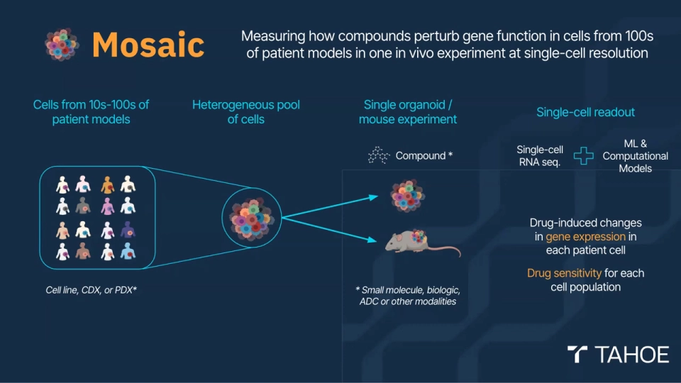
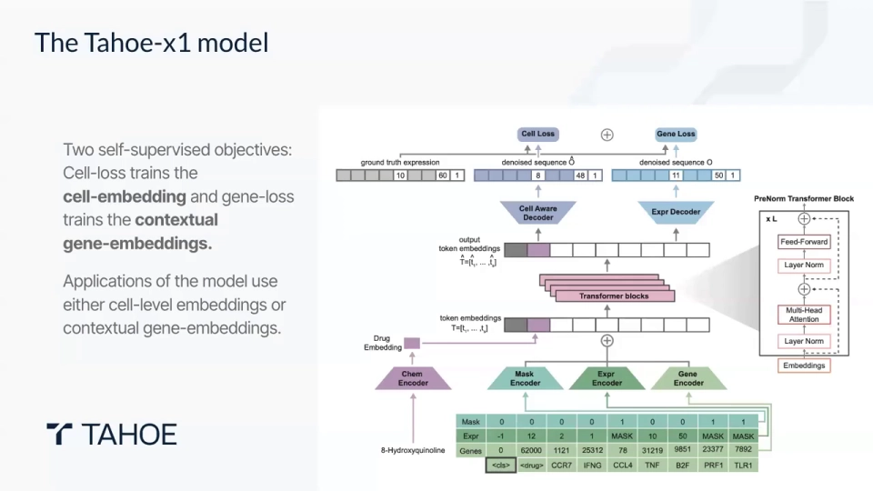
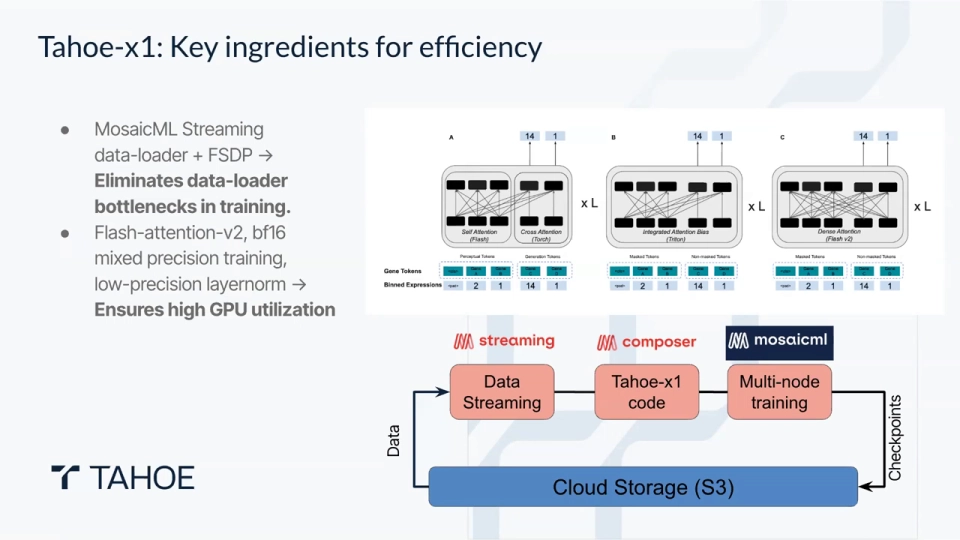
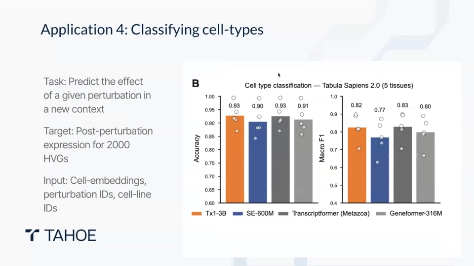
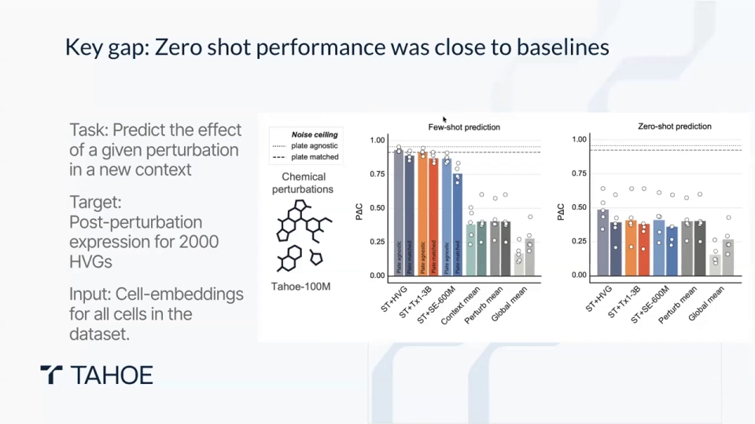
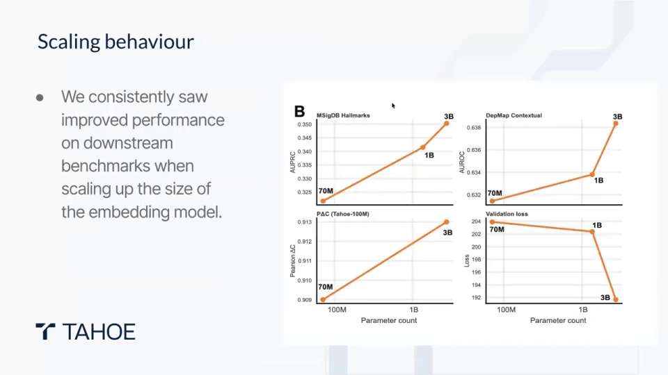

# 09 Tahoe-x1 怎么做：用 2.66 亿个细胞预训练一个「细胞底座」

> 本文基于两段视频整理：[BioML Seminar 4.4 — Shreshth Gandhi on Scaling Perturbation-Trained Single-Cell Foundation Models](https://www.youtube.com/watch?v=Nky3tlQ7phA)（作者报告，61:25）与 [Tahoe-x1: Scaling Perturbation-Trained Single-Cell Foundation Models](https://www.youtube.com/watch?v=BoGYADxG_ys)（速览，14:10）。原片为英文，使用 YouTube 自动字幕，本文校正了术语；两段材料数字有出入时，以作者报告与论文口径为准。

## 本讲要解决的核心问题（SCQA）

**背景**：单细胞测序已经积累了海量数据，但带「扰动标签」的数据仍稀缺；药物研发又偏偏最需要回答「给这个细胞系用这个药，表达会怎么变」。

**冲突**：传统深度学习在几百个样本、几十个细胞系上很容易训练不动；已有的单细胞基础模型大多从**观测数据**里学「细胞长什么样」，缺少「把细胞推一下会发生什么」的因果信号。更实际的问题是，训练大模型又很贵。

**疑问**：能不能把扰动数据做到足够大，并训练一个高效、可复用的**细胞与基因表示模型**？

**回答（中心思想）**：Tahoe-x1 的做法是先用**约 2.66 亿个细胞**（以 Tahoe-100M 的扰动数据为核心，再混入公开图谱）做自监督预训练，得到一个 Transformer 底座；它输出**细胞嵌入**和**基因嵌入**，再用简单的下游模型去完成基因必需性、通路归属、细胞类型注释和扰动响应预测。**它主要提供表征，而不是像 GEARS/chemCPA 那样直接吐出扰动响应**。

## 一、先想清楚它不是什么：是「底座」，不是「扰动预测器」

作者反复强调一个定位（[00:03:57](https://www.youtube.com/watch?v=Nky3tlQ7phA&t=237)、[00:16:56](https://www.youtube.com/watch?v=Nky3tlQ7phA&t=1016)）：

- **预训练阶段**只做自监督的「掩码—重建」，目标是学出好的表示；
- **下游阶段**才针对具体任务，在嵌入之上训练随机森林、MLP，或接一个 State Transport 之类的响应模型；
- 因此它和 GEARS、chemCPA 不是同一层：后两者是端到端预测器，Tahoe-x1 更像**通用细胞/基因特征提取器**。

一个底座可被很多任务复用。想判断一个基因在某个细胞系里是否必需，就用**基因嵌入**；想预测某个药物在没见过的细胞系里的响应，就用**细胞嵌入**再微调（[00:17:51](https://www.youtube.com/watch?v=Nky3tlQ7phA&t=1071)）。

```text
预训练语料（Tahoe-100M + 公开图谱）
              │  掩码 + 双解码器自监督
              ▼
      Tahoe-x1（70M / 1B / 3B）
              │
     ┌────────┴────────┐
     ▼                 ▼
 细胞嵌入 CLS       基因嵌入（带上下文）
     │                 │
 随机森林 / MLP /    基因功能、通路、
 State Transport     必需性预测
     │
     ▼
 扰动响应预测（需下游微调）
```


## 二、数据：Tahoe-100M 提供因果，图谱数据提供广度

Tahoe-x1 的核心数据是 **Tahoe-100M**：约 1 亿个单细胞转录组，来自 **50 个癌细胞模型**，覆盖约 **1,100 个药物—剂量条件**（论文过滤后为 379 种药物、1,135 个药物—剂量组合）（[00:00:30](https://www.youtube.com/watch?v=Nky3tlQ7phA&t=30)）。实验上，他们把多个细胞系混在一起做成 3D 球状体，一次测序后再用基因型「解复用」把每个细胞认回来源细胞系，从而用大致相同的成本换来约 50 倍的通量（[00:00:05](https://www.youtube.com/watch?v=Nky3tlQ7phA&t=5)）。



这份数据的关键不是「大」，而是**带干预**：模型看到的不只是「基因 A 高时基因 B 往往低」的相关性，而是「给这个细胞系用这个药，接下来哪些基因会变」的因果线索。速览视频把这一点讲得很直白：这正是药物发现需要的「如果……就会……」的知识（[00:01:15](https://www.youtube.com/watch?v=BoGYADxG_ys&t=75)）。

预训练语料并不只有 Tahoe-100M。作者报告总规模约 **2.66 亿个细胞**，另外两部分是 Arc Institute 汇总的公开数据 **SCBaseCount** 和 **CellxGene** 图谱（[00:03:32](https://www.youtube.com/watch?v=Nky3tlQ7phA&t=212)）。问答里给出的粗略比例是「1 亿来自 Tahoe，1.5 亿来自其他来源」（[00:59:32](https://www.youtube.com/watch?v=Nky3tlQ7phA&t=3572)），与 2.66 亿的差异来自统计口径和取整；**写论文时以作者/论文数字为准**。

还有一个细节：在 Tahoe-100M 的 t-SNE 图上，最大的变异来源是**细胞系**，其次才是**药物**（[00:01:16](https://www.youtube.com/watch?v=Nky3tlQ7phA&t=76)）。这意味着模型必须先学会区分「这是哪种细胞」，才谈得上判断「这个药在这个细胞里做了什么」。

## 三、模型：把细胞写成「基因词 + 表达词」的句子

Tahoe-x1 的架构对熟悉 BERT 的人很友好：输入是一串离散 token，做掩码，再在输出端重建（[00:04:47](https://www.youtube.com/watch?v=Nky3tlQ7phA&t=287)）。

**第一层是基因 token。** 每个基因用一个固定词表里的 ID 表示；词表约 6.5 万个基因，覆盖数据集中检测到的所有基因，而不只限于蛋白编码基因（[00:05:12](https://www.youtube.com/watch?v=Nky3tlQ7phA&t=312)）。每个细胞只保留有表达的基因，长度补齐到约 2000 个位置；训练时随机遮住其中 **50%** 的表达值（[00:11:02](https://www.youtube.com/watch?v=Nky3tlQ7phA&t=662)）。

**第二层是表达分箱。** 原始 count 的跨度极大，直接把数字喂进网络很难学。Tahoe-x1 把 count 做单调变换后离散成约 **50 个箱**，再转成 1–50 的整数（[00:07:42](https://www.youtube.com/watch?v=Nky3tlQ7phA&t=462)）。为什么不用「低/中/高」分类？因为表达量有大小顺序：10 条 reads 离 12 条很近，离 1000 条很远。用 MSE 回归而不是交叉熵分类，能保留这种「箱与箱之间的距离」（[00:03:20](https://www.youtube.com/watch?v=BoGYADxG_ys&t=200)）。

**第三层是药物 token。** 药物不按名字查表，而是用**Morgan 指纹**——一种把分子结构转成定长位串的经典化学信息学表示。指纹先过一个化学编码器变成 token，再和基因 token 一起送进 Transformer；编码器与主模型联合训练（[00:07:17](https://www.youtube.com/watch?v=Nky3tlQ7phA&t=437)）。速览视频提到，数据集中最初约有 377 种药物有可用的指纹（[00:02:30](https://www.youtube.com/watch?v=BoGYADxG_ys&t=150)）。

**最后是 CLS token。** 序列开头放一个特殊的 CLS token，它在最后一层的向量就是**整个细胞的嵌入**；所有基因 token 和药物 token 的信息都可以汇聚到它身上（[00:06:02](https://www.youtube.com/watch?v=Nky3tlQ7phA&t=362)）。



## 四、双解码器：让 CLS 不得不总结整个细胞

如果只用「遮住哪个基因就预测哪个基因」，模型可以只盯着局部上下文，CLS 向量未必真的包含全局信息。Tahoe-x1 因此设了**两个解码器**（[00:04:10](https://www.youtube.com/watch?v=BoGYADxG_ys&t=250)）：

1. **基因解码器（expression decoder）**：用被遮基因自己的 token 及上下文，重建它的表达，追求局部准确；
2. **细胞解码器（cell-aware decoder）**：只允许使用 CLS 向量，去重建所有被遮基因的表达。

第二个是关键：它强迫 CLS 把「细胞是什么状态」压进去，否则重建损失会惩罚它。两个解码器的损失只在被遮位置计算并取平均（[00:05:25](https://www.youtube.com/watch?v=BoGYADxG_ys&t=325)）。

作者说，他们刻意简化了前代模型的多重损失，只保留这两个真正驱动嵌入质量的目标（[00:06:52](https://www.youtube.com/watch?v=Nky3tlQ7phA&t=412)）。这也是实用的判断：**先把目标砍到最小，再把模型放大**。

## 五、效率：去掉自定义注意力掩码，反而更快

3B 模型在 **128 张 GPU** 上训练，按 H100 市场价约 **4.5 万美元**（[00:12:17](https://www.youtube.com/watch?v=Nky3tlQ7phA&t=737)）。能压到这个量级，不只靠堆卡：

- **数据流式加载 + FSDP**：模型和训练状态切分到所有 GPU，数据边读边训，避免节点等数据（[00:15:23](https://www.youtube.com/watch?v=Nky3tlQ7phA&t=923)）；
- **bf16 混合精度**：省显存、提速度；
- **注意力实现的选择**：这是最有意思的一段。

早期模型常用**自定义注意力掩码**，规定「可见基因只看可见基因、被遮基因不能互看」，以符合掩码语言模型的逻辑。但这种掩码无法直接用高度优化的 FlashAttention。Tahoe 团队先写了一个 Triton kernel，用加 `-∞` 偏置的方式模拟掩码；后来发现**干脆允许全稠密注意力、只在输入侧遮住表达值**，性能几乎不降，却能直接调用 FlashAttention，速度更快（[00:13:43](https://www.youtube.com/watch?v=Nky3tlQ7phA&t=823)、[00:14:58](https://www.youtube.com/watch?v=Nky3tlQ7phA&t=898)）。

再叠加流式数据加载等手段，作者报告相比早期单细胞模型有约 **3–30 倍**的训练效率提升（[00:05:50](https://www.youtube.com/watch?v=BoGYADxG_ys&t=350)）。同时，他们用 **70M 小模型**做了大量架构消融——pre-norm 还是 post-norm、哪些损失该留、哪些层能砍——因为小模型训练快，适合快速试错（[00:12:42](https://www.youtube.com/watch?v=Nky3tlQ7phA&t=762)）。



## 六、评估：四类任务，既看生物学意义也看预测

作者把评估分成间接和接近应用两层（[00:17:01](https://www.youtube.com/watch?v=Nky3tlQ7phA&t=1021)）。下面四类最有代表性。

**第一，DepMap 基因必需性。** DepMap 用 CRISPR 敲除每个基因，测量癌细胞还活不活，得到一个「细胞系 × 基因」的必需性分数。Tahoe-x1 用 CCLE 的 bulk 表达得到该细胞系里每个基因的上下文嵌入，再训一个随机森林去预测分数。它在**通用必需基因**和更难的**细胞系特异必需基因**上都优于对比嵌入（[00:21:24](https://www.youtube.com/watch?v=Nky3tlQ7phA&t=1284)）。速览视频特别强调，能抓到「只在特定遗传背景下才致命」的基因，对个性化肿瘤学才有意义（[00:09:10](https://www.youtube.com/watch?v=BoGYADxG_ys&t=550)）。


**第二，MSigDB 通路归属。** 给一个基因，预测它属于哪些癌症 hallmark 基因集。作者用基因嵌入训一个多标签 MLP，在留出基因上报告 AUPRC；3B 模型约 **0.35**，高于 SE-600M、Transcriptformer、PCA 等对比（[00:25:37](https://www.youtube.com/watch?v=Nky3tlQ7phA&t=1537)）。这说明模型在没有显式监督通路的情况下，自己学出了有功能意义的结构。


**第三，细胞类型注释。** 在 Tabula Sapiens 2.0 上做线性探测，各模型准确率都接近 0.9，3B 约 **0.93**，优势主要体现在稀有细胞类型（[00:34:11](https://www.youtube.com/watch?v=Nky3tlQ7phA&t=2051)）。作者坦承这个基准有点「循环」：细胞类型标签本身常由聚类得到，而聚类又用了表达特征。



**第四，零样本扰动预测。** 这是最接近药物发现的任务。做法是把 Tahoe-x1 的细胞嵌入接到 State Transport 上，在「细胞系 × 药物」矩阵里留出组合：**少样本**是见过该细胞系的其他药物，**零样本**是完全没见过该细胞系（[00:30:38](https://www.youtube.com/watch?v=Nky3tlQ7phA&t=1838)）。

结果很能说明边界：少样本时 PAC 可以到 0.8–0.9，接近重复实验的噪声上限；零样本只有约 **0.5**，与基线差距很小（[00:31:03](https://www.youtube.com/watch?v=Nky3tlQ7phA&t=1863)、[00:38:51](https://www.youtube.com/watch?v=Nky3tlQ7phA&t=2331)）。**见过一点数据**时嵌入很有用，**完全没见过**时仍接近「猜」。作者后续用流匹配在嵌入空间里做生成（BT2），把零样本往上推了一截，但仍未到噪声上限（[00:39:16](https://www.youtube.com/watch?v=Nky3tlQ7phA&t=2356)）。



**规模是否有效？** 从 70M 到 1B 再到 3B，验证损失和多个下游指标都呈单调改善（[00:36:59](https://www.youtube.com/watch?v=Nky3tlQ7phA&t=2219)）。不过有些坐标轴被放大了：例如 DepMap 上下文的 AUROC 只从约 0.63 走到 0.64（[00:37:49](https://www.youtube.com/watch?v=Nky3tlQ7phA&t=2269)）。更准确地说：**70M 在不少任务上已经有竞争力，3B 的优势稳定但幅度不一定大**。



## 七、关键区别与局限：它是一个强底座，但不是虚拟细胞的全部

**和 GEARS/chemCPA 的区别**值得单独说清楚：

- GEARS 用图先验直接预测「扰动后的表达」；chemCPA 用潜变量 + 化学编码器直接预测药物响应；
- Tahoe-x1 预训练阶段**不预测扰动响应**，它学的是「细胞/基因的通用表示」；要做响应预测，必须再训一个下游模型；
- 好处是复用性强、可接任意下游任务；代价是端到端预测能力取决于下游模型，底座本身不保证零样本效果。

**局限**也来自数据和设计（[00:12:05](https://www.youtube.com/watch?v=BoGYADxG_ys&t=725)）：

- **只在体外癌细胞系上训练。** 真实肿瘤有免疫细胞、基质、血管和空间结构，这些微环境信息不在 Tahoe-100M 里；从细胞系外推到病人仍有很大鸿沟。
- **零样本仍接近基线。** 新细胞系完全没数据时表现明显下降；作者的经验是至少给 5–10 个药物的小样本，才能接近「见过 100 多个药物」的水平（[00:57:02](https://www.youtube.com/watch?v=Nky3tlQ7phA&t=3422)）。
- **只覆盖转录组 + 化学结构。** 蛋白水平、表观遗传状态、空间位置等模态尚未纳入（[00:12:55](https://www.youtube.com/watch?v=BoGYADxG_ys&t=775)）。
- **大部分评测是在同一数据集内划分。** 共享的批次/细胞系方差可能让结果偏乐观；跨数据集、跨药物集合的泛化仍是下一步（[00:49:20](https://www.youtube.com/watch?v=Nky3tlQ7phA&t=2960)）。
- **单细胞噪声与稀疏性没有被显式校正。** 作者的做法是假设 dropout 存在，让掩码重建目标去「顺带学会」应对（[00:59:57](https://www.youtube.com/watch?v=Nky3tlQ7phA&t=3597)）。


## 小结

- Tahoe-x1 是**表征模型**，不是端到端扰动预测器；它把「细胞」和「基因」压成可复用的嵌入，下游再接轻量模型。
- 数据核心是 **Tahoe-100M**（约 1 亿细胞、50 个癌细胞模型、约 1,100 个药物—剂量条件），加上公开图谱后总语料约 **2.66 亿细胞**。
- 架构把细胞写成「基因 token + 表达分箱 token + 药物 Morgan 指纹 token」，用 **CLS** 表示整个细胞，用**基因解码器 + 细胞解码器**逼出全局表示。
- 工程上通过**去掉自定义注意力掩码、改用 FlashAttention**、FSDP、bf16 与流式加载，报告了约 **3–30 倍**效率提升；70M 小模型用于消融，3B 是旗舰。
- 评估覆盖 DepMap 必需性、MSigDB 通路、细胞类型注释和扰动预测；**少样本表现强，零样本仍接近基线**，且数据只覆盖体外癌细胞系——这是它最重要的边界。

## 关键术语速查

| 术语 | 一句话解释 |
| --- | --- |
| 基础模型（foundation model） | 先在大规模数据上自监督预训练、再迁移到多种下游任务的通用模型。 |
| 细胞嵌入 / CLS | 序列开头的特殊 token，其最后一层向量被当作整个细胞状态的摘要。 |
| 表达分箱 | 把跨度很大的 count 做单调变换后离散成有限个有序区间，再用回归目标学习。 |
| Morgan 指纹 | 把分子结构编码成定长位串的经典化学信息学表示。 |
| 掩码语言模型 | 随机遮住输入的一部分，让模型根据上下文重建，从而学表示。 |
| 双解码器 | 一个用基因自身上下文重建，一个只许用 CLS 重建，后者强迫全局表示信息充足。 |
| DepMap | 用 CRISPR 敲除测量各癌细胞系基因必需性的大规模数据资源。 |
| 零样本 / 少样本 | 下游任务中完全没见过某细胞系 / 只见过少量该细胞系数据。 |
| State Transport | Arc Institute 的扰动响应建模框架；Tahoe-x1 常把嵌入接入它做预测。 |
