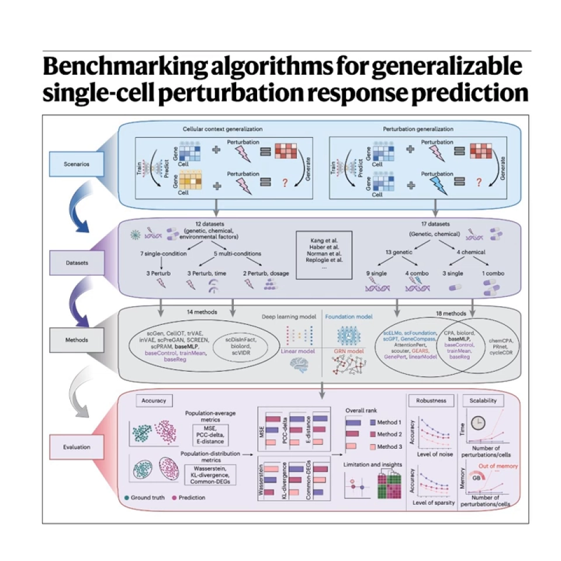
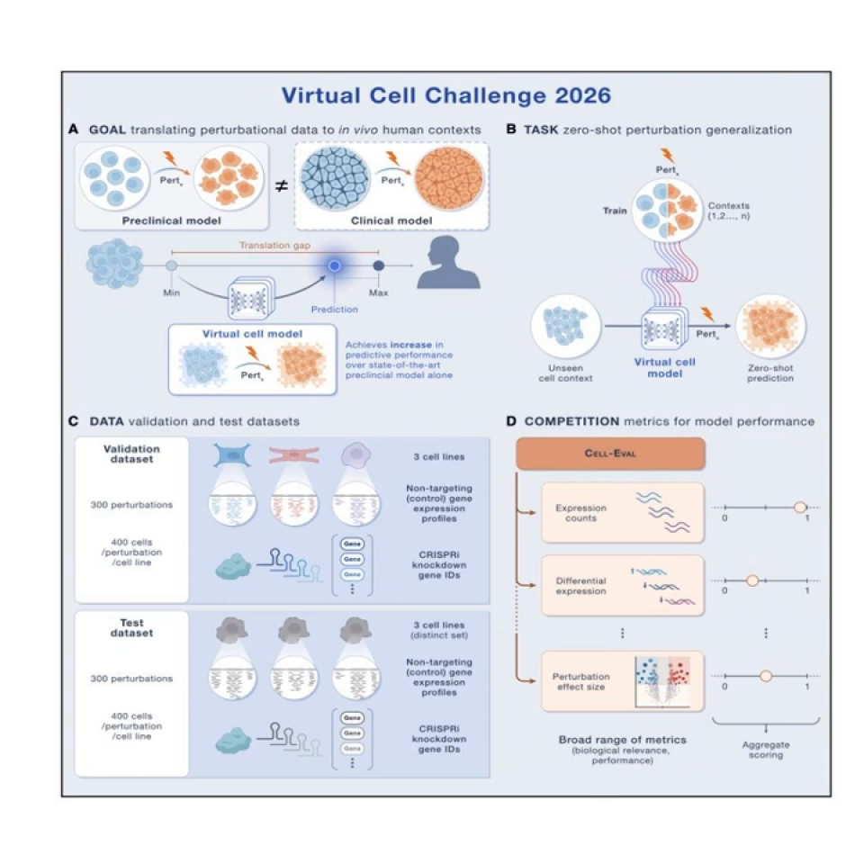

# 10 三个模型怎么选：没有全能冠军，只有场景匹配

> 本文基于以下两个视频整理：
> - [Benchmarking Single-Cell Perturbation Response Models](https://www.youtube.com/watch?v=EjgmO8VV_EU)（对 Nature Methods 基准论文的播客式解读，15:50）
> - [Virtual Cell Challenge 2026](https://www.youtube.com/watch?v=Jm4oNbfqYoE)（对 Cell 评论文章的播客式解读，25:25）
>
> 背景参考：[PerturBench: Benchmarking Machine Learning Models for Cellular Perturbation Analysis](https://www.youtube.com/watch?v=5M0HWIjmEhQ)。两场主视频都是「两个人对着论文图讲解」的形式，不是作者本人报告；其中的数字和排名，本文一律用「报告称」标注，避免把二手解读当成定论。

## 本讲要解决的核心问题（SCQA）

**背景**：虚拟细胞已有 GEARS（基因扰动）、chemCPA（药物与剂量）、Tahoe-x1（大规模细胞表征）等模型。它们都有论文，也都宣称能预测「没见过的扰动」。

**冲突**：但一项覆盖 27 种方法、29 个数据集的基准研究报告称，**没有任何模型在所有场景全面胜出**。同一个模型，在「新细胞系」上可能第一，在「新基因」上可能输给线性回归，在「双扰动组合」上可能输给「两个单扰动效果直接相加」。很多高分还来自「回归均值」——预测一团平均细胞，而非扰动的特异响应。

**疑问**：面对具体任务，到底该选哪个，还是先写一条基线？

**回答（中心思想）**：选型不是选「最强模型」，而是做**场景匹配**：先看任务是基因、药物还是通用表征，再看数据规模与泛化设定，最后永远先跑 no-change / mean / additive / linear 四条基线。**基因扰动优先 GEARS，药物与剂量优先 chemCPA，通用表征优先 Tahoe-x1；组合先信加性基线，零样本单独看。**

## 一、先说结论：模型排名会随场景翻转

这项基准把问题拆成两类泛化（[【跳转到 01:15】](https://www.youtube.com/watch?v=EjgmO8VV_EU&t=75)）：

- **细胞背景泛化**：扰动相同，换细胞类型或细胞系。比如在皮肤细胞上训练，预测肺细胞对同一药物的反应。
- **扰动泛化**：细胞类型相同，换没见过的基因或药物。比如训练过基因 A 的敲除，预测基因 B 的敲除。

两类难度完全不同。报告称，标准数据集上基础模型没有通吃，几类专用模型（如基于最优传输的 CellOT）反而靠前（[【跳转到 05:00】](https://www.youtube.com/watch?v=EjgmO8VV_EU&t=300)）；「新细胞类型」若与训练细胞差太远，所有模型都会退化，甚至不如直接猜平均（[【跳转到 06:15】](https://www.youtube.com/watch?v=EjgmO8VV_EU&t=375)）。

所以第一句话不是「哪个模型最好」，而是「**在哪个划分上、用什么指标、和谁比**」。

## 二、三个模型各自解决什么问题

### GEARS：把基因之间的关系先验带进扰动预测

**GEARS** 的核心想法是：基因不是孤立的，敲掉一个基因，影响会沿基因调控网络扩散。它用基因本体（GO）和共表达关系构造基因图，再用图神经网络（GNN）学习扰动表示，最后解码出扰动后的表达谱。

- **输入**：对照表达 + 被扰动基因（单个或一对）；**输出**：扰动后表达；**监督**：真实 Perturb-seq 的「扰动身份 + 单细胞表达」配对。
- **强在哪**：利用基因间先验，在**组合扰动**和**小数据**基因筛选里更有优势；它不把每个扰动当独立标签，而是从「相似基因」迁移。
- **弱在哪**：依赖基因图覆盖；目标基因在图上没有邻居时先验失效。基准报告也显示，双扰动任务上简单加性基线往往很强，GEARS 并不稳定赢（[【跳转到 10:25】](https://www.youtube.com/watch?v=EjgmO8VV_EU&t=625)）。

一句话：**GEARS 适合「基因扰动 + 组合 + 有网络先验」的场景**。

### chemCPA：把药物结构、剂量和细胞状态拆开

**chemCPA** 是 CPA（compositional perturbation autoencoder，组合扰动自编码器）的化学扩展版。CPA 把细胞状态压到潜空间，再把扰动表示「加」上去；chemCPA 给药物加了**化学结构编码器**，并显式建模**剂量**。

- **输入**：细胞状态 + 药物结构（如 SMILES，文本表示分子）+ 剂量；**输出**：扰动后表达；**监督**：真实药物扰动数据，常用 L1000 预训练。
- **强在哪**：能处理**未见药物**和**未试剂量**，因为它学的是「结构—响应」映射，而不是死记药名。报告称单药场景中 chemCPA 表现最好之一（[【跳转到 11:00】](https://www.youtube.com/watch?v=EjgmO8VV_EU&t=660)）。
- **弱在哪**：主要面向化学扰动，不直接处理基因敲除；药物组合仍难，报告称组合下简单线性反而更稳。

一句话：**chemCPA 适合「药物 + 剂量 + 未见化合物」的场景**。

### Tahoe-x1：先学一个通用细胞表征，再做下游任务

**Tahoe-x1** 走基础模型路线：在 Tahoe-100M 这类大规模单细胞扰动图谱上预训练，学习「细胞状态 + 扰动条件」的通用表示；下游接线性头或少量微调，做扰动预测、差异表达、细胞状态分类等任务。

- **输入**：单细胞表达（通常转成基因 token）+ 扰动/上下文；**输出**：细胞嵌入或下游预测；**监督**：大规模自监督/掩码预训练 + 下游标注。
- **强在哪**：**通用表征**，一次预训练服务多个任务，跨细胞类型、跨扰动的迁移潜力更大。
- **弱在哪**：算力和数据成本高；预训练目标不一定对齐扰动预测；零样本任务上同样可能回归均值，不一定赢专门模型或基线。

一句话：**Tahoe-x1 适合「需要通用表征、多个下游任务、愿意微调」的场景**。

## 三、横向对比：输入、输出、监督信号与边界

| 模型 | 输入 | 输出 | 监督信号 | 优势 | 局限 | 典型场景 |
| --- | --- | --- | --- | --- | --- | --- |
| **GEARS** | 对照表达 + 扰动基因（单/双） | 扰动后表达 | 真实 Perturb-seq + GO/共表达图 | 组合扰动、基因先验、小数据 | 依赖基因覆盖与网络质量；双扰动常输给加性 | 基因敲除/组合筛选 |
| **chemCPA** | 细胞状态 + 药物结构 + 剂量 | 扰动后表达 | 真实药物扰动 + L1000 预训练 | 未见药物、剂量外推 | 主要面向化学扰动；组合仍难 | 单药、剂量反应 |
| **Tahoe-x1** | 表达谱 + 扰动/上下文 | 细胞嵌入或下游预测 | 大规模图谱预训练 + 下游微调 | 通用表征、跨任务 | 算力大；零样本可能回归均值 | 表征学习、多任务 |
| **简单基线** | 对照表达 / 扰动身份 | 扰动后表达 | 无（或闭式解） | 极便宜、常常很强 | 不建模复杂互作 | 任何任务的 sanity check |

这张表最重要的不是「谁更强」，而是**它们吃的输入不一样**。如果你只有药物结构、没有基因图，GEARS 的图先验就用不上；如果你只有基因敲除、没有剂量，chemCPA 的剂量模块也发挥不了。选型的第一步，是看**你手里有什么数据**。

## 四、benchmark 视角：27 种方法、29 个数据集给出的场景化答案

报告称，这项基准把 27 种方法放在 29 个数据集上，覆盖遗传/化学扰动、单/组合、剂量与时间（[【跳转到 01:15】](https://www.youtube.com/watch?v=EjgmO8VV_EU&t=75)）。它给的不是总排行榜，而是一组「场景 → 推荐」：

- **标准数据集**：没有「神模型」；专用模型（如 CellOT）和部分基础模型各有胜负（[【跳转到 05:00】](https://www.youtube.com/watch?v=EjgmO8VV_EU&t=300)）。
- **新细胞背景**：CellOT 这类最优传输模型更稳；但新细胞与训练细胞差异过大时，所有模型都失效，甚至不如 mean（[【跳转到 06:15】](https://www.youtube.com/watch?v=EjgmO8VV_EU&t=375)）。有剂量、时间元数据时，scVIDR 这类模型更有优势。
- **新基因、小到中等数据**：GenePert 这类「大语言模型嵌入基因 + 线性回归」反而领先（[【跳转到 07:30】](https://www.youtube.com/watch?v=EjgmO8VV_EU&t=450)）。数据少时，文本里的基因功能先验比从少量表达硬学更值钱。
- **新基因、大数据**：到 Replogle 这种规模，CPA、scGPT 追了上来（[【跳转到 09:00】](https://www.youtube.com/watch?v=EjgmO8VV_EU&t=540)）。
- **组合扰动**：简单线性/加性最强（[【跳转到 10:25】](https://www.youtube.com/watch?v=EjgmO8VV_EU&t=625)）。很多组合确实近似相加，复杂模型容易拟合不存在的互作。
- **单药**：chemCPA 领先；**药物组合**又回到线性基线更稳（[【跳转到 11:00】](https://www.youtube.com/watch?v=EjgmO8VV_EU&t=660)）。

还有一个必须单说的发现：**指标会骗人**。报告称，即使最好的模型，在真实 Top 100 差异表达基因里也常只能找回不到 10%（[【跳转到 12:30】](https://www.youtube.com/watch?v=EjgmO8VV_EU&t=750)）。模型倾向预测「安全的平均值」，因为 MSE 更低；但生物学家关心的恰是少数强烈响应基因。**不看 DE、不看分布，只看 MSE，会高估模型**。

改进方向也值得记住：与其只给「肺细胞」标签，不如给**细胞背景嵌入**（细胞类型、基线表达、组织来源编码成向量），再接入基因/药物知识图谱（[【跳转到 14:10】](https://www.youtube.com/watch?v=EjgmO8VV_EU&t=850)）。零样本的瓶颈不只是模型容量，还有上下文表示和先验知识。

## 五、零样本：VCC 2026 为什么把难度再抬一级

如果说上面的 benchmark 是「开卷考试」，那么 Virtual Cell Challenge（VCC）2026 就是「换了一所学校、还不给教材」。

2025 年首届 VCC 只给一个细胞系——H1 人胚胎干细胞——要求预测单基因扰动后的转录组变化（[【跳转到 07:30】](https://www.youtube.com/watch?v=Jm4oNbfqYoE&t=450)）。规模很大：报告称 5000 多人注册、来自 114 个国家、1200 多支队伍、300 多份最终模型。最强模型在**扰动判别**和**差异表达基因识别**上进步明显，但**变化幅度**预测不好；模型还学会了「刷榜」，针对这个细胞系和实验条件过拟合，换个细胞系就崩（[【跳转到 10:00】](https://www.youtube.com/watch?v=Jm4oNbfqYoE&t=600)）。

2026 年因此换了考法（[【跳转到 11:40】](https://www.youtube.com/watch?v=Jm4oNbfqYoE&t=700)）：

- **六个癌症细胞系**，来自不同组织；三个验证，另外三个完全隐藏，只用于最终测试（[【跳转到 15:00】](https://www.youtube.com/watch?v=Jm4oNbfqYoE&t=900)）。
- 用 **CRISPRi** 敲低：dCas9 不切断 DNA，而像路障挡住转录，信号更干净（[【跳转到 16:00】](https://www.youtube.com/watch?v=Jm4oNbfqYoE&t=960)）。
- 用 **10x Flex 单细胞 RNA 测序**读取每个细胞的表达。
- 每个细胞系约 300 个扰动，每个扰动约 400 个细胞；参赛者只拿到**对照表达**和**目标基因 ID**，拿不到该细胞系上这些扰动的结果（[【跳转到 17:30】](https://www.youtube.com/watch?v=Jm4oNbfqYoE&t=1050)）。
- 评分用 **Cell-Eval** 六指标，参考归一化后聚合成总分；最终只看三个隐藏细胞系，最后一轮不给反馈，相当于盲测（[【跳转到 20:25】](https://www.youtube.com/watch?v=Jm4oNbfqYoE&t=1225)）。

这里要澄清：**零样本不是「完全没数据」**，而是「目标细胞系上没有匹配的扰动结果」。你仍有对照表达、扰动身份、别的细胞系上的扰动数据；模型要把「扰动造成的位移」迁移到新细胞背景。也正因如此，模型很容易退化成「预测平均」：平均最安全、MSE 最低，但生物学上最无聊。

所以，**不要把「已见组合」的成绩当泛化能力**。Norman 这种「单扰动都见过、只藏一半双扰动」的高分，只说明模型会插值；VCC 2026 考的是「换细胞系 + 换扰动结果」的外推。

报告也给了一个冷静定位：虚拟细胞不是取代湿实验，而是当「GPS」——在昂贵实验里挑出最值得做的那几个（[【跳转到 22:05】](https://www.youtube.com/watch?v=Jm4oNbfqYoE&t=1325)）。即便挑战成功，它也只是缩小搜索空间。

## 六、选型决策树：先问任务，再问数据，最后选模型

把前面的结论落成决策树：

1. **先定义任务和划分**：基因还是药物？单扰动、组合还是零样本？目标细胞系见过没有？这一步不清楚，后面选什么都可能错。
2. **先跑四条基线**：no-change、mean、additive、linear。它们便宜、可复现、经常赢；跑完才知道「难题」难在哪。
3. **按任务选主模型**：
   - **基因扰动，尤其组合、有网络先验** → **GEARS**；
   - **药物、剂量、未见化合物** → **chemCPA**；
   - **通用表征、多个下游、愿意微调** → **Tahoe-x1**；
   - **新细胞背景** → CellOT / trVAE 这类做分布对齐或状态迁移的模型，并加细胞背景嵌入；
   - **小规模基因筛选** → GenePert 这类「文本嵌入 + 线性」值得先试；**大规模 Perturb-seq** → scGPT / CPA 更有机会。
4. **按场景评估**：表达、DE、判别性、分布四层都看；「已见 / 未见」「单 / 双」「近邻 / 远邻细胞系」分开报告；零样本单独列。
5. **最后再谈「最强」**：默认答案是**基因先看 GEARS、药物先看 chemCPA、表征先看 Tahoe-x1**，但默认只是起点，不是结论。

## 小结

- **没有单一模型全面胜出**：排名随任务、数据规模、划分和指标翻转。
- **GEARS** =「基因扰动 + 组合 + 图先验」，强在基因关系，弱在网络覆盖，双扰动常输给加性。
- **chemCPA** =「药物 + 剂量 + 未见化合物」，强在结构与剂量外推，弱在基因扰动和药物组合。
- **Tahoe-x1** =「通用表征 + 下游微调」，强在跨任务迁移，弱在算力与零样本回归均值。
- **benchmark 结论**：单药偏 chemCPA，组合偏简单加性，基因小数据偏 GenePert、大数据偏 scGPT/CPA；报告称最好模型也只能找回不到 10% 的 Top 100 DE 基因。
- **零样本是另一道题**：VCC 2026 用六个细胞系、三个隐藏测试集、Cell-Eval 六指标盲测；已见组合的高分不等于泛化。
- **选型顺序**：任务与划分 → 四条基线 → 主模型 → 四层评估 → 再谈最强。

## 关键术语速查

| 术语 | 一句话解释 |
| --- | --- |
| GEARS | 用基因图先验 + GNN 预测基因扰动（含组合）后表达谱。 |
| chemCPA | 在 CPA 潜空间模型上加药物结构编码器和剂量模块。 |
| Tahoe-x1 | 在大规模单细胞扰动图谱上预训练、可下游微调的基础模型。 |
| 图先验 | 把 GO、共表达等关系做成图，让模型知道哪些基因「相近」。 |
| 剂量外推 | 只见过部分剂量，预测没试过的剂量下的响应。 |
| 零样本 | 目标细胞系无匹配扰动训练数据，仍要求预测扰动后状态。 |
| Cell-Eval | VCC 2026 的评估框架，多指标归一化后聚合成总分。 |
| 加性基线 | 两个单扰动表达变化相加，作为组合预测。 |
| 回归均值 | 模型倾向预测平均细胞以降低误差，失去扰动特异性。 |
