# 第01讲：课程简介

## 本讲要解决的核心问题（SCQA）

**背景**：图由一组节点和一组边组成。社交网络、交通网络、分子结构都能自然地写成图；深度学习也已在图像、文本上取得成功。

**冲突**：图不能直接套用 CNN、RNN。图像、文本拓扑规整、尺寸相对固定；图的邻居数量任意、拓扑更复杂、节点没有固定顺序。直接套用现成模型会丢掉图最核心的结构信息。

**疑问**：图这么简单，为什么值得单独开一门课？图上的特征学习如何演化到今天？这门课讲什么？

**回答（中心思想）**：图既是通用表示，又承载大量学习任务，其结构特性使传统机器学习和常规深度学习都难以直接胜任，所以需要专门的图深度学习。课程按“理论—方法—应用—前沿”四模块、九讲展开：先补基础，再讲网络嵌入、图神经网络及其鲁棒性与可扩展性，然后进入 NLP、数据挖掘、CV、健康医疗等应用，最后讨论前沿。

---

## 一、图是一种通用数据表示，所以值得单独研究

**结论：图重要的原因不在图论本身，而在于现实数据天然成图，非图数据也常常可以转成图。**

### 1.1 图就是节点集合加边集合

图由节点集合 $V$ 和边集合 $E$ 组成。节点代表实体，边代表关系：社交网络里节点是人、边是关注；交通网络里节点是路口或路段、边是道路；分子里节点是原子、边是化学键。

### 1.2 现实数据天然是图，其他数据也能转成图

天然成图的数据有社交网络、交通网络、人脑神经元网络、分子与蛋白质结构。非图数据也可以转换：

- **图像**：像素是节点，相邻像素连边，图像变成网格图；
- **树**：树本身就是特殊的图；
- **矩阵**：矩阵描述行与列的两两关系，可以看成图；
- **时序、序列数据**：可以把不同时刻或元素之间的关系建成图。

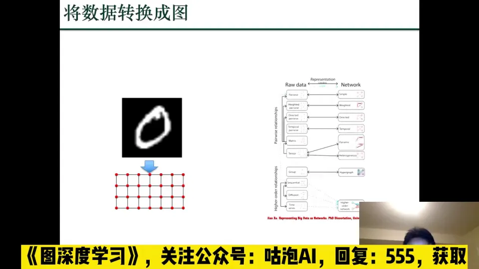

代价是可能丢失一部分信息。但很多下游任务并不需要那部分信息；只要保留下来的结构足以支撑任务，转图就是划算的。[【跳转到 02:23】](https://www.bilibili.com/video/BV1yx4y1R7uV/?p=1&t=143)

### 1.3 图把“关系”变成一等信息

传统机器学习把样本写成特征向量，默认样本独立；图则把“样本之间如何相连”也作为可计算的信息。

---

## 二、现实任务大多可归为图上的两类学习任务

**结论：按“一个实例是什么”划分，图任务可分为节点级和图级；前者预测节点或边，后者预测整张图。**

### 2.1 节点级任务之一：链接预测

链接预测（link prediction）给定当前图 $G$，预测 $t+\Delta t$ 时刻哪些节点之间会出现新链接。它对应朋友推荐、知识图谱补全、药物—药物相互作用预测等现实问题。抽象之后，都是“给一对节点打分，判断该不该有边”。[【跳转到 02:48】](https://www.bilibili.com/video/BV1yx4y1R7uV/?p=1&t=168)

### 2.2 节点级任务之二：节点分类

节点分类（node classification）给定一张图，其中部分节点有标签，利用图结构和已标注节点预测剩余节点的类别。课程举了两个例子：

- **空气质量预测**：观测站是节点，空间关系是边；不可能每个角落都建站，也可能有站点缺数据，于是用已有站点和邻接关系推断其他位置。
- **用户画像**：由于隐私（privacy）考虑，很多用户数据不完整；可以利用社交关系和已有用户信息补全属性，提高推荐与服务的精准度。

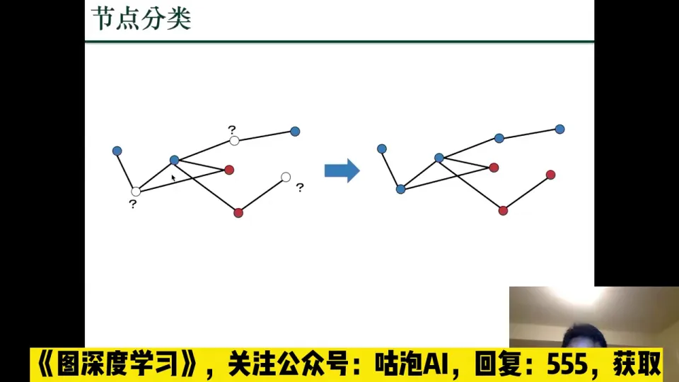

节点分类依赖**同质性（homophily）**：相连的节点往往属性或类别相近。图结构在这里提供了额外的监督信号。[【跳转到 03:38】](https://www.bilibili.com/video/BV1yx4y1R7uV/?p=1&t=218)

### 2.3 图级任务：图分类

图分类与前两类本质不同：前两类实例是节点；图分类的实例是一整张图，每张图有一个标签。典型例子是蛋白质特性预测：蛋白质表示成图，图的标签就是它的功能或特性；新冠疫情下出现新病毒蛋白时，可以直接预测其特性。图匹配、图生成也属于图级任务。[【跳转到 05:18】](https://www.bilibili.com/video/BV1yx4y1R7uV/?p=1&t=318)

### 2.4 两类任务的统一视角

| 任务类型 | 实例 | 典型任务 | 需要的表示 |
| :--- | :--- | :--- | :--- |
| 节点级 | 一个节点或一对节点 | 链接预测、节点分类 | 节点表示 |
| 图级 | 一整张图 | 图分类、图匹配、图生成 | 整图表示 |

这个区分决定了模型设计：节点级任务要节点表示，图级任务要整图表示。后面会看到，图滤波负责得到更好的节点表示，图池化负责把节点表示汇总成整图表示。[【跳转到 06:33】](https://www.bilibili.com/video/BV1yx4y1R7uV/?p=1&t=393)

---

## 三、图不能直接套用 CNN/RNN：三个结构差异决定了图深度学习的必要性

**结论：图上的机器学习可以“扁平化”成传统特征向量问题，但特征提取会成为瓶颈；直接套用图像、文本的深度学习模型也不行，因为图在邻域、拓扑和顺序上都与规整数据不同。**

### 3.1 图学习跨学科，但计算机科学关心“怎么算”

社会学、物理学、数学、统计早就研究图：社会网络、复杂系统、图论与概率工具。计算机科学关心的是如何完成图上的计算任务，一个流行做法是用机器学习。但主流机器学习假设数据独立同分布（IID）：样本彼此独立、分布相同。图天然不满足——节点通过边相互关联，一个节点会影响它的邻居。[【跳转到 06:58】](https://www.bilibili.com/video/BV1yx4y1R7uV/?p=1&t=418)

### 3.2 扁平化能复用传统 ML，但瓶颈在特征提取

一种直接方案是“扁平化”：把图变成传统数据表，每个节点一行，放它的特征或表示。这样链接预测变成二分类（有边/没边），社区发现变成聚类，其他任务也能改写成分类、回归、聚类。

好处是不需要为图专门设计算法，可以复用成熟的机器学习工具；代价是必须先做特征提取或表示学习。这一步做不好，后面再强的分类器也救不回来。[【跳转到 08:38】](https://www.bilibili.com/video/BV1yx4y1R7uV/?p=1&t=518)

### 3.3 深度学习很强，但不能自动复制到图上

深度学习是目前最流行的特征提取方法：图像目标识别在 ImageNet 上的错误率因它显著下降，文本侧的 BERT、GPT 和悟道等模型进展很大。于是自然要问：能不能把已有模型直接搬到图上？

**答案是不行。** CNN 针对图像或网格，RNN 针对序列，这两类数据尺寸相对固定、拓扑简单规整；图则完全不同。[【跳转到 11:34】](https://www.bilibili.com/video/BV1yx4y1R7uV/?p=1&t=694)

### 3.4 三个差异：邻域任意、拓扑复杂、节点无固定顺序

1. **邻居数量可以是任意数量**。图像里一个像素的邻居数基本固定；图里一个节点可以只有 1 个邻居，也可以有成千上万个。CNN 的固定尺寸卷积核无法直接处理可变邻域。
2. **拓扑结构更复杂**。图像是规则网格，文本是规则序列；图可以任意连接，还会出现 motif（模体）——反复出现的局部连接模式，如三角形、星形、闭环，往往对应重要的结构单元。
3. **节点没有固定顺序**。图的节点可以任意编号；把邻接矩阵的行和列同时交换，图还是同一张图（同构），拓扑不变。文本里交换两个词，语义可能完全改变。

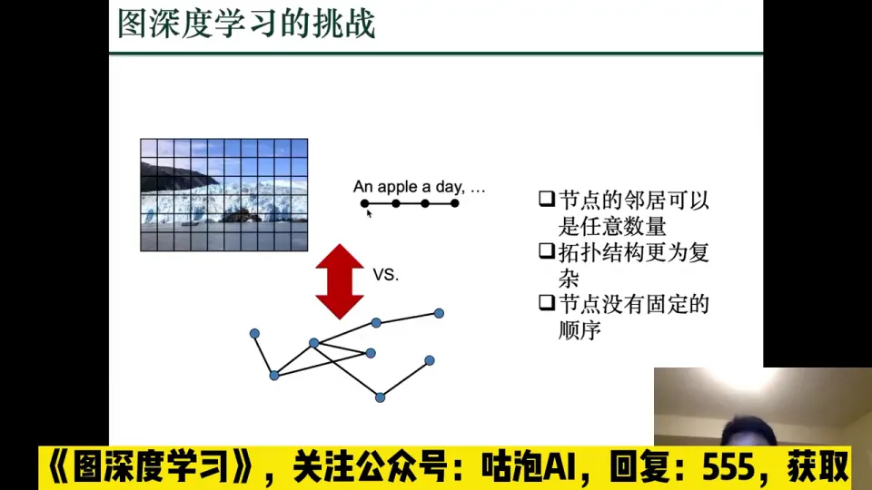

第三点意味着图模型必须具备**置换不变性（permutation invariance）**：无论节点怎么编号，整图输出不变；节点级输出随节点对应变化，但不依赖编号本身。CNN 的滑动窗口和 RNN 的时序递归都默认固定顺序，因此不能直接套用。[【跳转到 13:14】](https://www.bilibili.com/video/BV1yx4y1R7uV/?p=1&t=794)

---

## 四、图深度学习已经进入真实产业：推荐、交通、药物发现

**结论：图深度学习不是只停留在论文里，推荐系统、交通预测、药物发现都已经在用；它们的共同点是数据天然成图，任务又需要“关系 + 属性”的联合建模。**

### 4.1 推荐系统：用户和商品在同一张图里

推荐系统是离普通人最近的图应用。淘宝、京东等平台会根据行为推荐商品；用户、商品以及描述、店铺、品牌等信息可以组成一张大异构图。推荐的核心是学习用户和商品的隐向量（latent representation）；图深度学习表示能力强，因此可以自然用于推荐。阿里巴巴、亚马逊已在推荐中使用 GNN。[【跳转到 14:04】](https://www.bilibili.com/video/BV1yx4y1R7uV/?p=1&t=844)

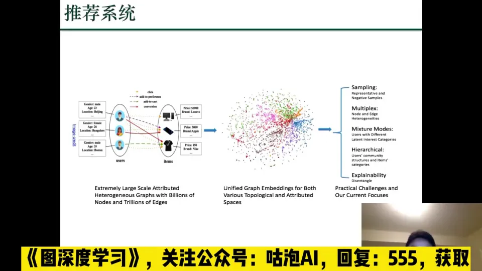

### 4.2 交通预测：路段是节点，路网是图

路段是节点、路段连接是边，交通预测就变成“预测每个节点上的交通状况如何变化”，本质上是图上的回归（regression）问题。这类方法已用于谷歌地图。[【跳转到 15:38】](https://www.bilibili.com/video/BV1yx4y1R7uV/?p=1&t=938)

### 4.3 药物发现：分子是图，特性预测是图分类

药物、蛋白、分子天然可以表示成图：原子是节点，化学键是边。传统研发靠“海量筛选”，例如寻找抗大肠杆菌的抗生素：在实验室测试成千上万种分子，看哪些具备所需特性。这个过程非常费时费力，也是药物制造成本不高、药价却很高的原因之一——研发阶段投入了大量人力、物力和金钱。[【跳转到 16:49】](https://www.bilibili.com/video/BV1yx4y1R7uV/?p=1&t=1009)

图深度学习可以改变流程：把“分子是否具有某种特性”看成一个图级分类问题，先用模型对海量候选分子做预测，筛出更有希望的分子，再做实验验证。这样能缩短研发周期、降低成本。[【跳转到 18:09】](https://www.bilibili.com/video/BV1yx4y1R7uV/?p=1&t=1089)

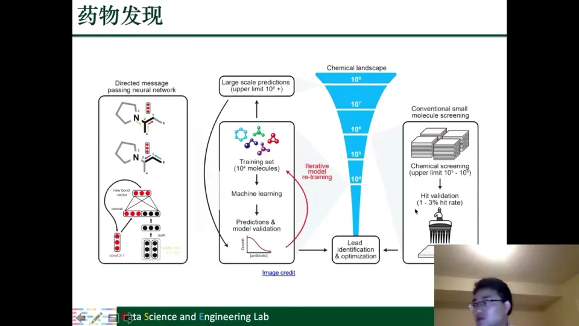

---

## 五、图上特征学习经历了三代演进

**结论：图上的特征学习不是突然出现的，它经历了“手工特征工程 → 特征选择/表示学习 → 基于图的降维 → 网络嵌入 → 图深度学习”的演进；每一代都在回答同一个问题——如何自动学到对下游任务有用的表示。**

### 5.1 起点：特征工程，手工设计但脆弱

深度学习流行前，工业界做机器学习很大一部分是特征工程（feature engineering）。图上常见的手工特征有度（degree）、中心性（centrality）、局部聚类系数（local clustering coefficient）等。

这些特征要人根据任务手动设计。头疼的是：要想哪些特征有用；有了以后还要判断是否足够；最麻烦的是无法确定它们对任务到底有多大帮助，可能完全不相干，换一个任务或用户偏好一变就失效。[【跳转到 19:20】](https://www.bilibili.com/video/BV1yx4y1R7uV/?p=1&t=1160)

### 5.2 特征选择与表示学习：保留原意，还是重建表示

特征学习有两条路线。

**特征选择（feature selection）**：从已有特征中选出最有效的一组。最大优点是保留原来特征的可解释性和物理意义——只是挑，不改变含义。比如想知道某种疾病里哪些基因重要，就可以用特征选择把基因挑出来，模型的可解释性和可验证性较强。[【跳转到 21:25】](https://www.bilibili.com/video/BV1yx4y1R7uV/?p=1&t=1285)

**表示学习（representation learning）**：融合节点信息和结构信息，学出一种全新的表示。新特征与物理意义上的原始特征关系不大，尤其深度学习下差异明显；代价是可能失去可解释性，但通常下游效果更好，因为它进行了高度融合和变换。[【跳转到 22:15】](https://www.bilibili.com/video/BV1yx4y1R7uV/?p=1&t=1335)

### 5.3 第一代图表示学习：基于图的降维

图表示学习的历史比深度学习长。最早的研究方向是**基于图的数据降维**：1970 年代到 2000 年前后的谱聚类（spectral clustering），2000 年的 Isomap、LLE，2003 年的拉普拉斯特征映射（Laplacian eigenmaps），2006 年的矩阵分解（matrix factorization）。

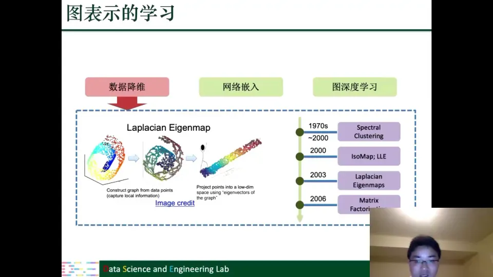

为什么有效？很多真实数据分布在**非线性流形（manifold）**上，PCA、LDA、CCA 这些线性方法捕捉不到非线性结构；先把数据建成图，用拓扑近似流形，再做降维，就能把纠缠的数据分开。Laplacian Eigenmap 就是典型：先由数据点构造图，捕捉局部关系，再投影到低维空间，使同类数据更容易分离。分离得好，后面的分类、聚类就更容易。[【跳转到 24:20】](https://www.bilibili.com/video/BV1yx4y1R7uV/?p=1&t=1460)

后来的研究表明，今天的 GNN 与这些传统降维方法密切相关，有些 GNN 操作的思想可以追溯到谱方法。所以课程把这一代称为“第一代图表示学习”。[【跳转到 25:35】](https://www.bilibili.com/video/BV1yx4y1R7uV/?p=1&t=1535)

### 5.4 第二代图表示学习：把 word2vec 搬到图上

第二代受 word2vec 启发。word2vec 的基本假设是：一个词的含义由它周围的词决定；把句子看成词的序列，就可以用上下文预测中心词，学到词向量。

图没有天然的“句子”。DeepWalk 的关键技巧是**随机游走（random walk）**：在图上随机走出一段节点序列，序列当“句子”，节点当“词”，就可以直接套用 word2vec。经常在随机游走中共同出现的节点，会被学到相似的表示。[【跳转到 26:50】](https://www.bilibili.com/video/BV1yx4y1R7uV/?p=1&t=1610)

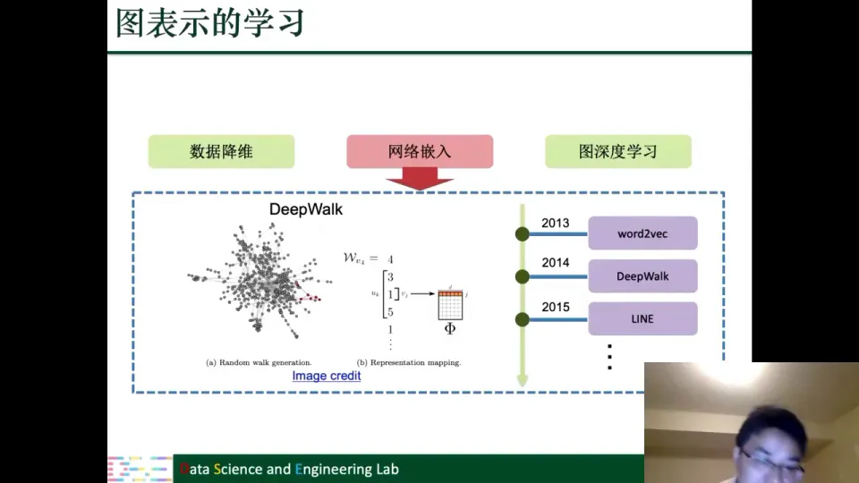

### 5.5 第三代图表示学习：图深度学习

从 2017 年前后开始，研究重心转向图上的深度学习，也就是用神经网络学习图表示。课程的主体正是这一代：GNN、鲁棒性与可扩展性、其他图深度学习模型，以及各领域应用。

第三代的变化不只是“模型更深”，而是**把特征学习和任务学习放进同一个端到端框架**：不再依赖人工特征，也不只是学一个静态节点向量，而是通过多层邻域聚合，让节点表示随任务目标一起优化。

---

## 六、课程按“理论—方法—应用—前沿”四个模块组织

**结论：课程不是论文清单，而是按学习规律组织：先补基础，再学方法，然后看应用，最后讨论前沿；同时提供“纵向方法线”和“横向应用线”，方便不同背景的读者选学。**

### 6.1 四个模块与九讲路线图

课程共九讲，第一讲简介，其余八讲对应八个内容单元：

| 讲次 | 内容 | 模块 |
| :--- | :--- | :--- |
| 第01讲 | 课程简介 | 导论 |
| 第02讲 | 理论基础：图基础 + 深度学习基础 | 理论 |
| 第03讲 | 网络嵌入 | 方法 |
| 第04讲 | 图神经网络 | 方法 |
| 第05讲 | 图神经网络的鲁棒性和可扩展性 | 方法 |
| 第06讲 | 其他图上的深度学习模型 | 方法 |
| 第07讲 | 应用（上）：自然语言处理、数据挖掘 | 应用 |
| 第08讲 | 应用（下）：计算机视觉、健康医疗 | 应用 |
| 第09讲 | 图深度学习的研究前沿 | 前沿 |

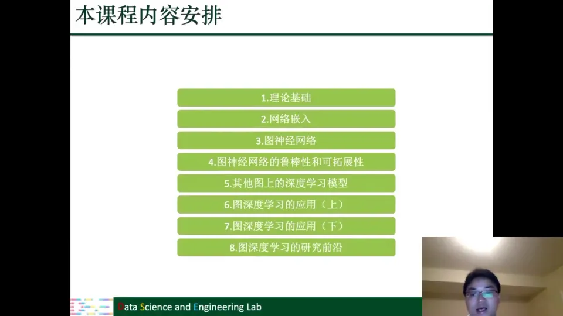

### 6.2 模块一：理论基础——图论基础与深度学习基础

第一模块解决预备知识。图深度学习建立在图和深度学习两块基石上，所以先补：

- **图论基础**：图的矩阵表示、图的性质、复杂图；
- **深度学习基础**：前馈神经网络、卷积神经网络、循环神经网络、自编码器。

谱图论和图上的信号处理很重要，但和 GNN 直接相关、理解稍复杂，所以放到第四讲讲 GNN 时再展开；今天时间不够，先不 cover。[【跳转到 58:23】](https://www.bilibili.com/video/BV1yx4y1R7uV/?p=1&t=3503)

### 6.3 模块二：方法——从图嵌入到 GNN，再到鲁棒性与可扩展性

**网络嵌入（第03讲）**：先提出一个普遍的图嵌入框架，在简单图上总结已有方法，再针对复杂图介绍代表性方法。现实中的图往往不是简单图，比如推荐系统里就是二分图，所以复杂图方法必不可少。

**图神经网络（第04讲）**：GNN 要同时服务节点级和图级任务：前者需要节点表示，后者需要整图表示。对应地，GNN 主要有两种操作：

1. **图滤波（graph filtering）**：给定图 $G$、邻接矩阵 $A$ 和节点特征 $X$，利用图结构对 $X$ 做变换，得到新的节点特征。拓扑不变，变的是节点特征。
2. **图池化（graph pooling）**：把节点表示逐步汇总、粗化，最后得到整图表示。它会改变图的结构。

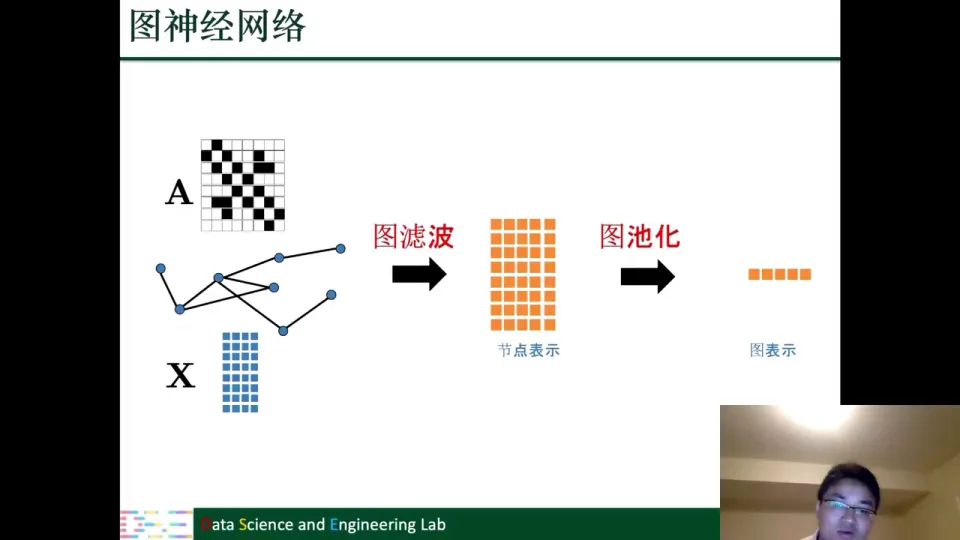

**鲁棒性与可扩展性（第05讲）**：GNN 和其他深度模型一样鲁棒性不强，容易受到对抗攻击：添加边、假节点或标签、修改节点特征，都可能让输出完全改变。课程会讲攻击模型（白盒、灰盒、黑盒）和防御模型（对抗训练、图净化、图注意力、图结构学习等）。[【跳转到 37:34】](https://www.bilibili.com/video/BV1yx4y1R7uV/?p=1&t=2254)

可扩展性是另一个难题。GNN 要不断聚合邻居，聚合几层就可能覆盖大部分图，造成“邻居爆炸”（neighbor explosion）。课程会介绍逐点采样、逐层采样、子图采样等方案。[【跳转到 38:24】](https://www.bilibili.com/video/BV1yx4y1R7uV/?p=1&t=2304)

**其他模型（第06讲）**：除 GNN 外，课程还介绍变分自编码器（VAE）在图上怎么用、对抗生成网络（GAN）怎么做图生成，以及 RNN/LSTM 如何处理图结构，例如 Tree-LSTM。这样读者不会把“图深度学习”等同于“GNN”。

### 6.4 模块三：应用——两条应用线，四种场景

第三模块用两讲覆盖四类应用：

- 第07讲：自然语言处理、数据挖掘；
- 第08讲：计算机视觉、健康医疗。

这个划分按**数据形态**切：NLP 和数据挖掘多为“关系图”（句法树、知识图谱、社交网络、二分图），CV 和健康医疗多为“几何图”或“分子图”（骨架、点云、分子结构、药物—蛋白图）。

### 6.5 两条学习路线与学习建议

课程还提供第二个视角：一条纵线、一条横线。

- **纵线（方法线）**：第一代图表示学习 → 第二代网络嵌入 → 第三代图深度学习 → 提升性能和扩展性 → 方法新进展。它回答“方法如何一步步深入”。
- **横线（应用线）**：把方法用到自己的领域。无论背景是 NLP、机器视觉还是数据挖掘，都能找到“如何把图深度学习用到我的领域”的入口。

课程在接下来八周、每周四同一时间进行，每次一小时或一个半小时。课程内容基于约两年前出版的书；前沿部分会补充书里没有的新进展。

学习建议：课程面向大众读者，已掌握的基础章节可以跳过；完全没有基础，或只有一点点机器学习、数据挖掘基础，也不用担心。但**图的基本语言不建议跳过**——节点、边、邻域、度、路径、连通性、矩阵表示是后面所有方法的共同语言。[【跳转到 33:24】](https://www.bilibili.com/video/BV1yx4y1R7uV/?p=1&t=2004)

---

## 七、自然语言处理与数据挖掘的任务大多可写成图问题

**结论：自然语言和数据挖掘里的很多对象本身就是图——句法树、语义图、知识图谱、社交网络、用户—商品二分图；图深度学习的作用，是把这些关系结构变成可学习的表示。**

### 7.1 自然语言处理：句子、语义和知识都是图

NLP 里有大量结构化表示：

- **依存句法树**：词是节点，语法依赖是边，说明谁修饰谁、谁是主语宾语；
- **抽象语义表示（AMR）**：概念是节点，语义角色是边，表示“谁对谁做了什么”。

有了这些图，机器翻译、词性标注、关系抽取等任务都可以写成图上的学习问题。课程强调，NLP 里很多数据都能自然地表示成图或树，因此图深度学习确实能提升这些任务。[【跳转到 40:54】](https://www.bilibili.com/video/BV1yx4y1R7uV/?p=1&t=2454)

**多跳问答（multi-hop QA）** 更能体现图的价值。问题是“Hanging Gardens of Mumbai 在哪个国家？”，候选答案有 Iran、India、Pakistan、Somalia。参考资料可能分成几段：一段说 Hanging Gardens 位于 Mumbai，另一段说 Mumbai 位于 India。单独看任何一段都不够，必须把“Hanging Gardens → Mumbai → India”这条链接起来。做法是把问题中的实体和文本中的 mention 作为节点，把同一实体、同一 mention 的关系作为边，构成跨文本图；再用 GNN 学到实体表示，沿图聚合多跳信息，最后回答。[【跳转到 41:44】](https://www.bilibili.com/video/BV1yx4y1R7uV/?p=1&t=2504)

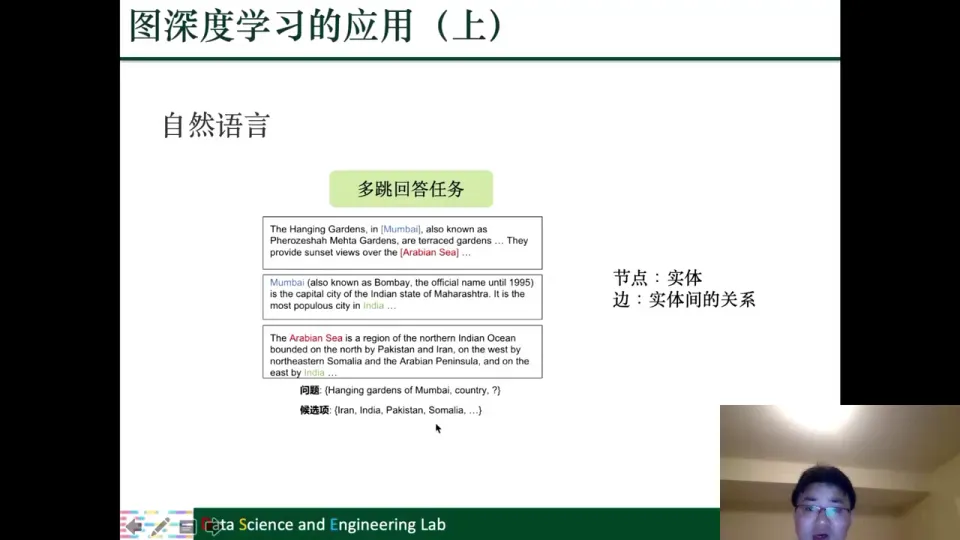

**知识图谱**本身就是图：实体是节点，关系是边。图深度学习可以做知识图谱补全、节点重要性预测，也可以在多个知识图谱之间做跨语言对齐。[【跳转到 43:24】](https://www.bilibili.com/video/BV1yx4y1R7uV/?p=1&t=2604)

### 7.2 数据挖掘：社交网络分析与推荐系统

第一个方向是**社交网络分析**。社交媒体天然是图：用户是节点，关注、好友、互动是边。社会影响力预测、社交表征学习、政治观点预测等任务，都可以用 GNN 同时利用用户属性与社交结构，学到比手工统计量更丰富的表示。[【跳转到 43:49】](https://www.bilibili.com/video/BV1yx4y1R7uV/?p=1&t=2629)

第二个方向是**推荐系统**，课程从三个角度讲：

- **用户—商品二分图**：用户和商品是两类节点，购买、点击、浏览是边；
- **社会化推荐（social recommendation）**：除用户—商品图外，还有用户—用户社交图，两张图共享用户节点，可以联合学习，用社交关系缓解行为数据稀疏；
- **知识图谱增强推荐**：商品侧可能有品牌、类别、属性、关联商品等知识图谱信息，可以和图神经网络结合，提升物品表示。

---

## 八、计算机视觉与健康医疗的结构天然适合图建模

**结论：计算机视觉里的物体、人体骨架、点云可以建成图；健康医疗里的分子、药物、蛋白更天然是图。图深度学习把几何结构和生物结构都变成了可学习对象。**

### 8.1 计算机视觉：物体关系图、骨架图与点云

**多目标检测（multi-object detection）**：一张图片里多个物体并不独立。网球和网球拍出现在同一张图片里的概率，要比网球拍和球出现的概率大得多。物体是节点，共现、空间关系是边，就可以用图深度学习帮助检测；模型不仅看单个物体外观，还能利用“哪些物体经常一起出现”的结构先验。[【跳转到 45:04】](https://www.bilibili.com/video/BV1yx4y1R7uV/?p=1&t=2704)

**人体行为识别**：人体骨架可以表示成时空图。关节点是节点，骨骼是边；每个时刻姿态不同，时间维度上又形成轨迹。这样一张时空骨架图可以描绘动作，图深度学习能从关节点的协同变化中识别行为。[【跳转到 46:19】](https://www.bilibili.com/video/BV1yx4y1R7uV/?p=1&t=2779)

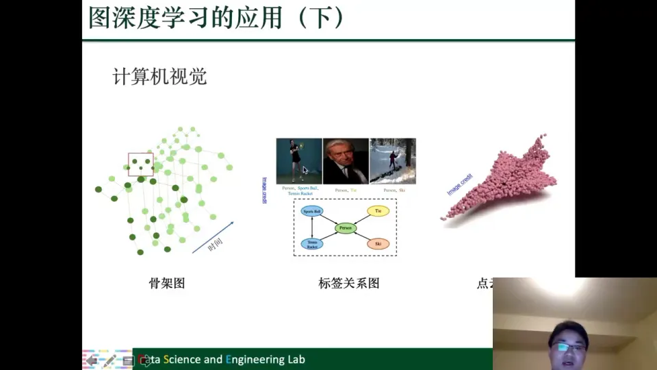

**点云（point cloud）**：三维扫描得到的点集可看成图或几何结构。

### 8.2 健康医疗：分子图、药物相互作用与复方药副作用

医疗数据天然是图：

- **分子特性预测**：分子是原子和化学键构成的图，预测分子是否具有某种特性，是图级分类；
- **药物—药物相互作用**：两种药一起用是否会产生相互作用，可看成边预测；
- **复方药物副作用**：同时使用多种药物时是否会出现副作用。把药物、蛋白、疾病等实体建成异构图（药物—药物、药物—蛋白、蛋白—蛋白），副作用预测就变成链接预测。做好这件事，可以减少很多生命风险。[【跳转到 47:09】](https://www.bilibili.com/video/BV1yx4y1R7uV/?p=1&t=2829)

---

## 九、研究前沿集中在可表达性、深度、自监督、可解释性与新应用

**结论：图深度学习还远未成熟。课程最后讨论五个前沿方向：GNN 能表达什么、能不能做得更深、如何利用无标签数据、如何解释预测，以及如何把图学习用到物理、程序、组合优化等新场景。**

### 9.1 可表达性：GNN 的结构辨识能力有上限

第一个前沿是**可表达性（expressiveness）**。研究表明，消息传递 GNN 区分图结构的能力上限，与 1-WL test（Weisfeiler-Lehman 测试）相当。也就是说，存在一些结构不同、但 GNN 无法区分（会给出相同表示）的图。

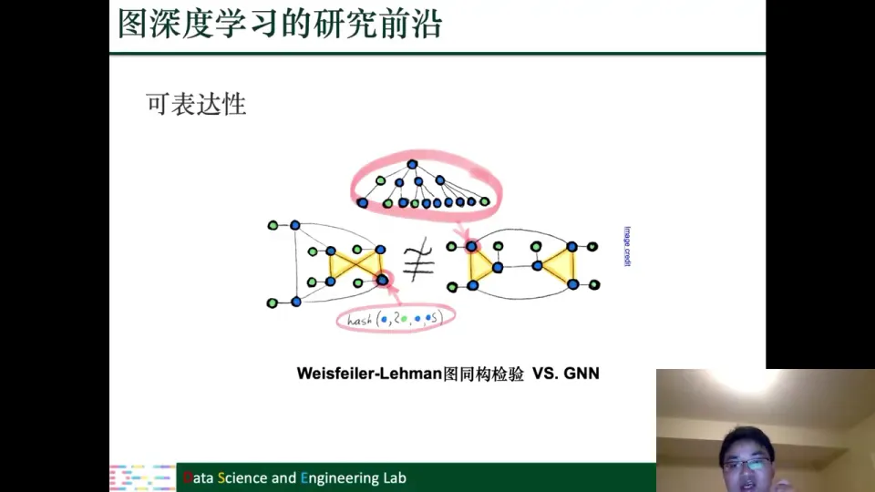

这不是说 GNN 没用，而是说它有理论边界。当前的研究方向是如何提高可表达性，让模型在结构辨识、结构学习方面更强，比如引入高阶结构、位置编码、子图信息等。[【跳转到 49:14】](https://www.bilibili.com/video/BV1yx4y1R7uV/?p=1&t=2954)

### 9.2 更深的 GNN：过平滑是必须跨过的坎

直接把 GNN 加深会遇到**过平滑（over-smoothing）**：聚合很多次以后，所有节点表示都变得非常相似，模型反而分不清节点。课程提到一些解决方案，比如 Jumping Knowledge、DropEdge、PairNorm。KDD 上有一个图深度学习竞赛，一些 top solutions 用了 50 层甚至更深的 GNN。[【跳转到 50:04】](https://www.bilibili.com/video/BV1yx4y1R7uV/?p=1&t=3004)

### 9.3 自监督与对比学习：更好地利用无标签数据

传统 GNN 大多做半监督学习：少量节点有标签，大量节点没有标签，两者一起用。但简单的消息聚合并不能充分利用无标签数据。

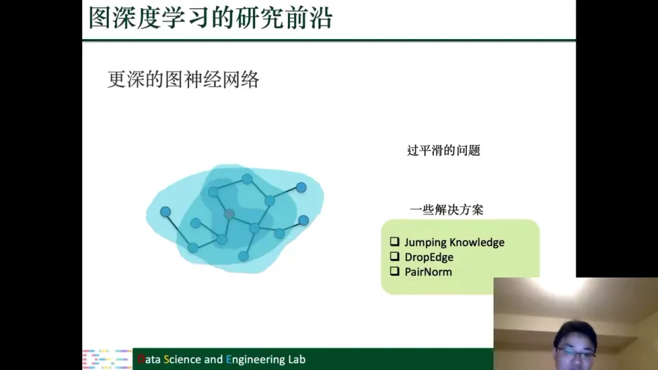

近年来的研究热点包括图上的自监督学习与对比学习（contrastive learning）：通过构造 pretext task，让模型在没有标签的情况下学习“哪些节点/子图应该相似、哪些应该不同”。课程会介绍一些有代表性的方法。[【跳转到 52:09】](https://www.bilibili.com/video/BV1yx4y1R7uV/?p=1&t=3129)

### 9.4 可解释性：从黑盒到说清楚为什么

GNN 大部分是黑盒，但很多应用需要知道“模型为什么这样预测”。课程区分两个层次：

- **样本级可解释性**：给定一个样本、一个节点，告诉用户模型为什么对它做出这样的预测；
- **模型级可解释性**：给定一组节点，解释整个图模型的决策逻辑。

### 9.5 新应用：物理、程序表示与组合优化

图深度学习的应用还在扩展，课程举了三个例子：

- **物理**：宇宙中的天体是节点，万有引力是边。整个宇宙是一张大图，可以用图学习预测天体的位置和动态。
- **程序表示与调试**：程序的数据流可以表示成图，用图模型自动发现 bug、误用变量、内存泄漏（memory leak）等问题。
- **组合优化**：旅行商问题（TSP）是经典 NP-hard 问题：每个城市是节点，要找一条经过每个城市一次并回到起点的最短路径。图学习方法可以用来表示和求解这类问题。

---

## 十、图基础是理解后续方法的共同语言

**结论：第一讲正文结束后，老师又用约 30 分钟提前讲了第二讲的图基础，包括矩阵表示、度与邻域、walk/trail/path、连通性、最短路与直径、中心性，以及六类复杂图。这些概念是后面所有方法的共同语言。**

### 10.1 图的矩阵表示：邻接矩阵、拉普拉斯矩阵、关联矩阵

先看最简单的图：无向、无权图。它由节点集合 $V=\{v_1,\dots,v_5\}$ 和边集合 $E=\{e_1,\dots,e_6\}$ 组成。

最常用的表示是**邻接矩阵（adjacency matrix）** $A$：行和列都表示节点，$A_{ij}=1$ 表示节点 $i$ 和 $j$ 之间有边，$A_{ij}=0$ 表示没有边。有权图把 1 换成权重。无向图的邻接矩阵对称；有向图不一定对称，因为 $i\to j$ 有边不代表 $j\to i$ 有边。

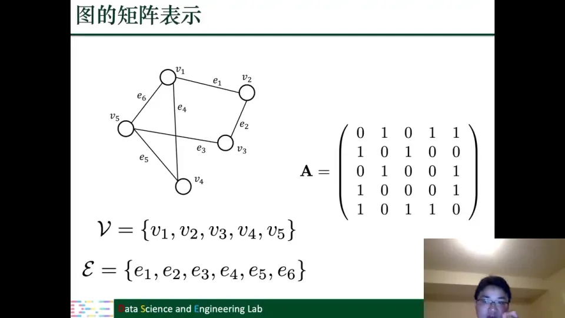

用矩阵表示图，一是直观，二是能把图论问题转成线性代数问题，例如 PageRank 和谱聚类都归结为特征值问题。

其他常见表示：**拉普拉斯矩阵** $L=D-A$（$D$ 是度矩阵），是谱聚类、图信号处理的核心；**关联矩阵**行是节点、列是边，每条边只有两个非零位置；**最短路矩阵**用节点间最短路径长度表示图，Isomap 就用了这种思想。

### 10.2 度与邻域：连了多少、连了谁

**度（degree）** 是节点连接的边的数量。无向图里就是与它相连的边数；有向图分**入度**和**出度**。比如节点 $v_5$ 有三条边，$d(v_5)=3$。[【跳转到 63:03】](https://www.bilibili.com/video/BV1yx4y1R7uV/?p=1&t=3783)

**邻域（neighborhood）** 是与节点直接相连的节点集合，直接相连的叫一跳邻居，最短路径为 2 的叫二跳邻居。邻域是 GNN 的核心：每层都在从邻居聚合信息，层数越多，看到的邻域越大。

### 10.3 途径、迹与路：三个容易混淆的概念

在图上游走会产生节点和边交替的序列，课程区分了三个概念：

- **途径（walk）**：节点和边交替出现的序列，节点和边都可以重复；
- **迹（trail）**：边各不相同的途径；
- **路（path）**：节点各不相同的途径。

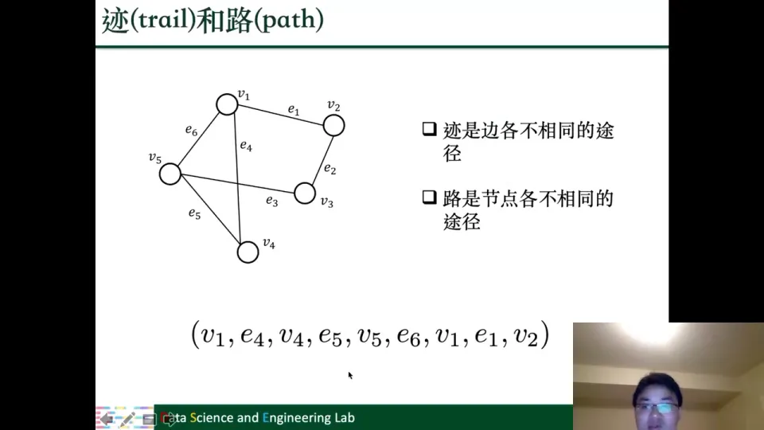

课程特别提醒：**随机游走产生的是 walk，不一定是 path**；但很多人口语里会把 walk 也叫成 path，这是一个容易误用的点。[【跳转到 65:08】](https://www.bilibili.com/video/BV1yx4y1R7uV/?p=1&t=3908)

### 10.4 连通性：为什么很多算法要求图连通

**连通图（connected graph）**：任意两个节点之间都至少存在一条路。

现实中的图经常不连通，会分成多个**连通分量（component）**。处理时常用一个技巧：加一个**虚拟节点（virtual node）**，让它连接到所有节点，从而保证图连通。课程提到，PageRank 在不连通图上可能无法收敛；加入虚拟节点后可以保证收敛性。[【跳转到 66:23】](https://www.bilibili.com/video/BV1yx4y1R7uV/?p=1&t=3983)

### 10.5 最短路与直径：六度理论为什么成立

**最短路（shortest path）** 是两个节点之间长度最小的路。路的长度由路径中边的个数定义，不是节点个数。比如 $v_5$ 到 $v_2$ 经过两条边，长度就是 2。

**图的直径（diameter）** 是所有节点对之间最短路径长度的最大值。它回答：从任意一个节点出发，最多走几步可以到达图上任何其他节点？[【跳转到 69:18】](https://www.bilibili.com/video/BV1yx4y1R7uV/?p=1&t=4158)

这解释了**六度理论（six degrees of separation）**：社交网络中，任意两个人平均只需很少几步就能连接。课程提到，Facebook 上的平均最短路径只有二点几，早些年还是四点几。正因为直径很小，现实社交网络才被称为**小世界（small world）**。[【跳转到 70:33】](https://www.bilibili.com/video/BV1yx4y1R7uV/?p=1&t=4233)

### 10.6 中心性：怎么衡量节点重不重要

**中心性（centrality）** 衡量节点在图上的重要程度。课程用王立群老师的人生道理讲了三层：

1. **度中心性（degree centrality）**：有多少人连接到你。连接越多越重要。$c_d(v_i)=d(v_i)=\sum_j A_{ij}$。
2. **特征向量中心性（eigenvector centrality）**：不仅看有多少人连接你，还要看连接你的人本身重不重要。可写成 $\lambda c_e = A c_e$，即邻接矩阵的特征向量问题。
3. **Katz 中心性（Katz centrality）**：在特征向量中心性基础上，再加上节点自身的重要性。$c_k(v_i)=\alpha\sum_j A_{ij}c_k(v_j)+\beta$。

特征向量中心性有一个很好的性质：无论怎么初始化重要度，最终都会收敛到同一个特征向量。这和后面 GNN 的过平滑现象有关：如果没有非线性激活和变换，反复聚合也会收敛到相似的特征表示。Katz 中心性里的 $\alpha$ 通常要在 0 到最大特征值分之一之间选择，否则矩阵可能不可逆，出现病态（ill-condition）问题。[【跳转到 71:48】](https://www.bilibili.com/video/BV1yx4y1R7uV/?p=1&t=4308)

### 10.7 复杂图：现实世界的图很少是“简单图”

**异构图（heterogeneous graph）**：包含多种类型的节点和边。比如学术网络里有作者、论文、会议三类节点，有“撰写”“引用”“发表”等不同类型的边。异构图除了 $V$ 和 $E$，还需要两个映射函数：$\phi_n: V\to T_n$ 把节点映射到类型，$\phi_e: E\to T_e$ 把边映射到类型。

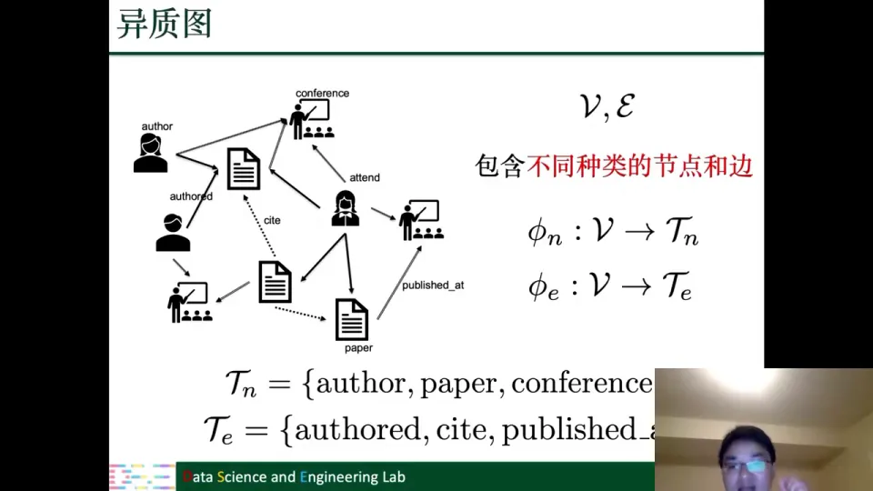

**二分图（bipartite graph）**：节点集合可分成两个不相交子集，边只存在于子集之间，同一子集内部没有边。用户—商品图、用户—新闻图都是二分图。[【跳转到 80:58】](https://www.bilibili.com/video/BV1yx4y1R7uV/?p=1&t=4858)

**多维图**：同一对节点之间可以同时存在多种关系。比如用户和作者之间可以有“订阅”“观看”“评论”；城市之间可以有火车、公路、飞机。不同关系构成不同维度。

**符号图（signed graph）**：边分正向边和负向边。社交媒体里 follow 是正向边、block 是负向边；基因之间既有促进关系，也有抑制关系。[【跳转到 82:13】](https://www.bilibili.com/video/BV1yx4y1R7uV/?p=1&t=4933)

**超图（hypergraph）**：普通图的边只连两个节点，超图的**超边（hyperedge）** 可以连任意多个节点。比如论文是节点，同一个作者的多篇论文构成一条超边，能表达高于两两关系的关系。[【跳转到 83:24】](https://www.bilibili.com/video/BV1yx4y1R7uV/?p=1&t=5004)

**动态图（dynamic graph）**：节点和边带时间信息。用两个映射函数表示：$\phi_n: V\to T$ 表示节点什么时候加入，$\phi_e: E\to T$ 表示边什么时候产生。动态图分两种：

- **连续时间动态图**：时间是连续的，像流式（streaming）数据，节点和边可以随时出现；
- **离散时间动态图**：在固定时间点取图的快照（snapshot），比如 2000、2001、2002 年各取一张图，两个快照之间的变化被压缩成一个时间步。

连续动态图更贴近现实，但研究更复杂；离散动态图更容易处理。关注复杂图，是因为节点关系无法用简单图刻画。[【跳转到 84:40】](https://www.bilibili.com/video/BV1yx4y1R7uV/?p=1&t=5080)

---

## 小结

- **图是通用表示**：社交网络、交通网络、大脑、分子都是图；图像、树、矩阵、序列也能转成图。转图可能丢信息，但下游任务未必需要。
- **图任务分两类**：节点级（链接预测、节点分类）和图级（图分类、图匹配、图生成）。前者要节点表示，后者要整图表示。
- **图不能直接套用 CNN/RNN**：邻居数量任意、拓扑复杂、节点无固定顺序。这三点决定了图深度学习必须专门设计。
- **图深度学习已有产业价值**：推荐系统、交通预测、药物发现都在用；推荐系统里的图还是超大规模异构图。
- **图特征学习经历三代**：特征工程 → 特征选择/表示学习 → 基于图的降维 → 网络嵌入（word2vec/DeepWalk）→ 图深度学习（GNN）。
- **课程按四模块、九讲组织**：理论—方法—应用—前沿；纵线看方法深化，横线看应用拓展；基础章节可跳过，但图的基本语言不建议跳过。
- **应用覆盖四条线**：NLP（句法/语义图、多跳问答、知识图谱）、数据挖掘（社交网络、推荐）、计算机视觉（物体关系、骨架、点云）、健康医疗（分子、药物相互作用）。
- **前沿有五个方向**：可表达性（1-WL 上限）、更深的 GNN（过平滑）、自监督/对比学习、可解释性、新应用（物理、程序、组合优化）。

---

## 关键术语速查

| 术语 | 一句话解释 |
| :--- | :--- |
| 图 | 由节点和边组成的结构。 |
| 连通分量 | 不连通图中彼此分离的连通部分。 |
| 虚拟节点 | 人为加入、连接所有节点，用于保证连通或改善收敛。 |
| 最短路 | 两个节点之间边数最少的路径。 |
| 直径 | 所有节点对之间最短路径长度的最大值。 |
| 小世界 | 图的直径很小，任意两点只需很少几步到达。 |
| 中心性 | 衡量节点在图上的重要程度。 |
| 度中心性 | 用节点的度衡量重要性。 |
| 特征向量中心性 | 同时考虑邻居重要性，对应邻接矩阵的特征向量。 |
| Katz 中心性 | 在特征向量中心性基础上加入节点自身重要性。 |
| 异构图 | 包含多种节点类型和边类型的图。 |
| 二分图 | 节点可分为两个不相交子集，边只存在于子集之间。 |
| 多维图 | 同一对节点之间可以存在多种不同关系。 |
| 符号图 | 边分为正向边和负向边。 |
| 超图 | 超边可以连接任意多个节点。 |
| 动态图 | 节点和边带时间信息、结构随时间变化。 |
| 链接预测 | 预测两个节点之间是否会出现边。 |
| 节点分类 | 利用图结构和已标注节点预测未标注节点类别。 |
| 图分类 | 把一个整图作为实例，预测整图标签。 |
| 图神经网络（GNN） | 通过邻域聚合学习节点表示或图表示。 |
| 图滤波 | 利用图结构变换节点特征，拓扑不变、特征更新。 |
| 图池化 | 把节点表示汇总、粗化成整图表示。 |
| 过平滑 | GNN 太深时节点表示趋于相似、难以区分。 |
| 可表达性 | 模型区分不同图结构的能力。 |
| 1-WL test | 分析消息传递 GNN 表达能力上限的图同构检验。 |
| 自监督学习 | 从数据本身构造学习信号，不依赖人工标签。 |
| 对比学习 | 拉近相似样本、推远不相似样本来学习表示。 |
| 变分自编码器（VAE） | 用编码器—解码器加概率先验学习隐表示的生成模型。 |
| 生成对抗网络（GAN） | 用生成器和判别器对抗训练生成数据。 |
| Tree-LSTM | 在树结构上递归计算的 LSTM 变体。 |
| 知识图谱 | 以实体为节点、关系为边的大规模结构化知识库。 |
| 社会化推荐 | 联合用户—商品图与用户—社交图进行推荐。 |

---

**下讲预告**：下周四同一时间，课程将进入图深度学习的技术模型，包括最常见的模型，以及训练技巧和训练方法。[【跳转到 87:49】](https://www.bilibili.com/video/BV1yx4y1R7uV/?p=1&t=5269)
