# 第02讲：深度学习基础

## 本讲要解决的核心问题（SCQA）

**背景**：上一讲汤老师介绍了课程概览，也讲了一些图相关的基础知识。后面的课程会反复用到神经网络、梯度、反向传播这些概念。

**冲突**：深度学习内容很多，而本讲只有一节课。按模型逐个去记，很容易变成一堆互不相干的名称。初学者常常知道“CNN 处理图像、RNN 处理序列”，却说不清它们共享什么、为什么必须不一样。

**疑问**：这些模型之间到底是什么关系？有没有一条主线，能把它们串成一个整体？

**回答（中心思想）**：有。所有模型都建立在同一个人工神经元上，也都用同一套“损失函数—梯度下降—反向传播”的流程训练；它们的区别，只在于为了适配不同数据结构而改变了神经元的连接方式——前馈网络全连接，卷积网络局部连接并共享参数，循环网络沿时间共享参数，自编码器则给中间表示加上信息瓶颈。抓住这条主线，本讲的内容就不再是零散的名词，而是一棵有共同树根、再按数据形态分叉的树。

这位主讲人是汤老师组里的博士生马耀，他将在本讲中依次介绍深度学习简史、前馈神经网络、神经网络训练、卷积神经网络、循环神经网络和自编码器 [【跳转到 00:00】](https://www.bilibili.com/video/BV1yx4y1R7uV/?p=2&t=0)。

## 一、深度学习是机器学习的一个子类：从神经元到深度网络的历史

**这一章的中心思想**：深度学习并不是凭空出现的新事物，它处在“人工智能—机器学习—深度学习”的层层包含关系中，核心构件人工神经元早在 1943 年就已出现。

### 1.1 人工智能、机器学习与深度学习是层层包含的关系

要回答“什么是深度学习”，得先从人工智能讲起。人工智能本质上是让计算机模拟人类行为、获得类人智能。

人工智能下面有一个重要方向，也是现在研究比较火热的领域，叫作机器学习。机器学习不再把规则一条条写死，而是给计算机大量数据，让它自己学出行为或知识。比如做推荐系统，不必手写“买过 A 就推荐 B”，把用户历史行为交给模型即可 [【跳转到 02:35】](https://www.bilibili.com/video/BV1yx4y1R7uV/?p=2&t=155)。

深度学习则是机器学习下面的一个子类，它利用深层次的神经网络来实现机器学习。这里的“深”，指的是网络由很多层组成；“学习”，指的仍然是从数据中调整参数。三者是层层包含的关系，不是并列关系。

### 1.2 人工神经元与感知机奠定了网络的基本构件

人工神经元参考了生物当中真实神经元的工作方式。1943 年，有人提出了 MP 神经元，它可以说是我们现在依然在使用的人工神经元的雏形 [【跳转到 04:02】](https://www.bilibili.com/video/BV1yx4y1R7uV/?p=2&t=242)。

MP 神经元接收二值输入，先求和，再经过激活函数。它刚提出时用的是阶梯函数：和值超过阈值就激活输出，否则为零。它无法训练，只能做简单计算然后输出结果 [【跳转到 04:52】](https://www.bilibili.com/video/BV1yx4y1R7uV/?p=2&t=292)。

到了 1958 年，Frank Rosenblatt 提出了感知机（Perceptron）。感知机和上面的神经元十分相似，一个重要的区别是，感知机里面有一些可以学习的参数。感知机刚提出的时候也是用来做二分类的。今天神经网络里用到的神经元，本质上还是和感知机一样的结构，所以感知机的提出对现代神经网络的发展也很重要 [【跳转到 05:42】](https://www.bilibili.com/video/BV1yx4y1R7uV/?p=2&t=342)。

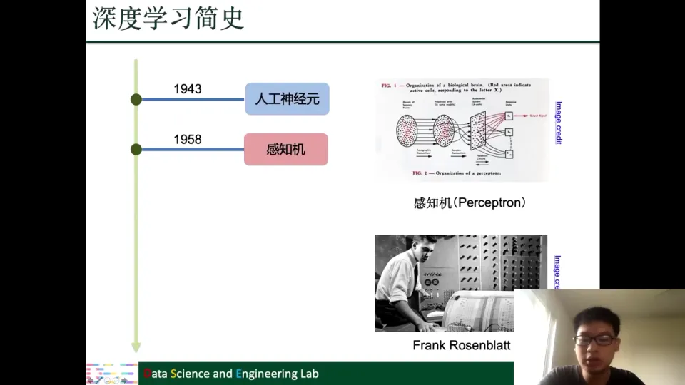

### 1.3 反向传播与 CNN、RNN、LSTM 在 1960 至 1997 年间相继出现

接着是反向传播算法。反向传播是训练神经网络时一个十分重要的方法，但它的思想很早就开始被研究了。

1960 年，控制论论文《Gradient Theory of Optimal Flight Paths》最早提出反向传播；1974 年 Werbos 在博士论文中公开讨论用它训练神经网络；1986 年 Rumelhart、Hinton 和 Williams 首次真正实现并用它训练网络 [【跳转到 06:32】](https://www.bilibili.com/video/BV1yx4y1R7uV/?p=2&t=392)。

在 1980 年到 2000 年之间，现在常用的一些神经网络模型也慢慢被提出来了。1980 年出现了 CNN 的雏形 Neocognitron（神经认知机）；1989 年 LeCun 提出了 LeNet-5，用它来识别数字并达到了很高的准确性；RNN 在 1980 年代出现，早期代表是 Hopfield Network（霍普菲尔德网络）；LSTM 稍晚一些，在 1997 年被提出 [【跳转到 08:12】](https://www.bilibili.com/video/BV1yx4y1R7uV/?p=2&t=492)。

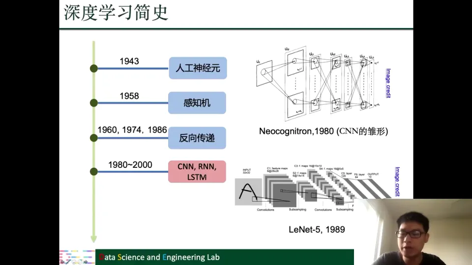

这些模型和算法早已存在，却长期不流行，直到最近才受关注。下一章回答“为什么是现在”。

## 二、深度学习在 2012 年后爆发，大数据与 GPU 缺一不可

**这一章的中心思想**：老算法直到最近十几年才爆发，是因为深度学习需要大量参数、大量数据和强大算力；这三者直到 2009 年前后才逐渐凑齐，而 2012 年的 AlexNet 是标志性转折点。

### 2.1 大参数模型需要大数据，ImageNet 提供了第一个规模化基础

神经网络模型往往包含大量参数。参数量很大，就需要很多数据让模型去学习，才能学到更好的表示、获得更好的泛化能力。最近这些年，随着互联网的发展，数据量大大增加，这正是最近十年左右深度学习大发展的原因之一 [【跳转到 09:52】](https://www.bilibili.com/video/BV1yx4y1R7uV/?p=2&t=592)。

2009 年，斯坦福李飞飞团队收集了大型图像数据集 ImageNet，包含成千上万张网络图像，很多都带标签，为训练深度模型提供了数据基础。此后互联网让数据量持续增长，深度学习才可能在各行各业发挥作用 [【跳转到 10:47】](https://www.bilibili.com/video/BV1yx4y1R7uV/?p=2&t=647)。

### 2.2 GPU 的并行计算能力匹配了神经网络的运算模式

光有数据还不够。数据量大了，怎么处理这些数据就成为问题；数据量越大，越需要更好的计算资源。

神经网络运算高度可并行，而 GPU 有很多计算单元，比 CPU 更适合这类运算。大约 2009 年或更早，GPU 开始被用于训练神经网络；如今大公司和实验室普遍使用 GPU 集群，这已成为主流 [【跳转到 12:02】](https://www.bilibili.com/video/BV1yx4y1R7uV/?p=2&t=722)。

### 2.3 AlexNet 在 2012 年 ILSVRC 上的突破标志着深度学习崛起

2012 年的 AlexNet 是 CNN 的一个特殊例子，也是最早在 GPU 上训练的神经网络之一。它参加了 ImageNet Large Scale Visual Recognition Challenge（简称 ILSVRC），这是一个在 ImageNet 上进行的公开竞赛，其中比较重要的部分是图像分类竞赛。

2012 年，AlexNet 赢得了这个大赛，而且大大降低了错误率。从图上的错误率曲线可以看到：2010 年是 28.20%，2011 年是 25.80%，2012 年 AlexNet 把错误率降到了 16.40%，差不多降低了十个个百分点；之后 2013 年是 11.70%，2014 年进一步降到 6.70% [【跳转到 13:45】](https://www.bilibili.com/video/BV1yx4y1R7uV/?p=2&t=825)。

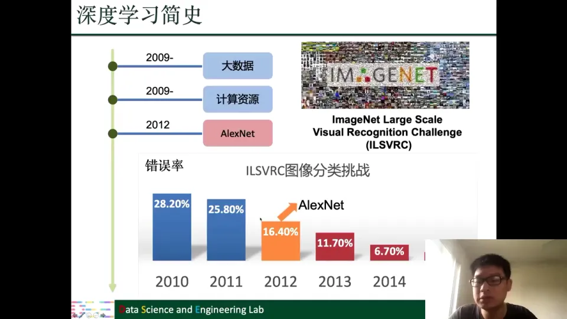

AlexNet 是第一个基于 CNN 赢得该大赛的模型；从 2012 年之后，历年冠军基本都由深度学习模型获得。

### 2.4 2014 年后的标志性进展把深度学习推向更多领域

2014 年，GAN（对抗生成网络）被提出，可以生成图片、做图像转换，也能用于换脸、改变容颜年龄等。

2016 年，DeepMind 的 AlphaGo 战胜李世石；约两年后，升级版又战胜柯洁。它基于深度强化学习。

2018 年，BERT 出现。它是在大量语料上训练的预训练模型，在各大自然语言处理任务上都有提升；现在主流做法常是在它之上再搭框架。同年，Yoshua Bengio、Geoffrey Hinton 和 Yann LeCun 这三位“三巨头”获得图灵奖，官方称他们为深度学习变革的“教父” [【跳转到 17:15】](https://www.bilibili.com/video/BV1yx4y1R7uV/?p=2&t=1035)。这段历史说明：深度学习的爆发是算法、数据、算力在同一时间汇合的结果。

## 三、前馈神经网络把神经元逐层堆叠，激活函数赋予它非线性表达能力

**这一章的中心思想**：前馈神经网络并不神秘，它就是把许多个“加权求和 + 偏置 + 激活”的神经元按层全连接起来；真正让它具备强大表达能力的，是层与层之间的非线性激活。

### 3.1 前馈网络由输入层、隐藏层和输出层串联而成

先看一个最直观的前馈神经网络。图上有输入 X，然后有若干隐藏层 F1、F2、F3，这些都是全连接的层次，最后 F4 是输出层。所谓全连接，就是上一层的每一个神经元都和下一层的每一个神经元相连 [【跳转到 17:24】](https://www.bilibili.com/video/BV1yx4y1R7uV/?p=2&t=1044)。

整个计算就是输入经过隐藏层运算后输出；信息单向流动、没有回路，所以叫前馈。比如分猫狗兔三类，输入是像素向量，输出是三个类别的分数。

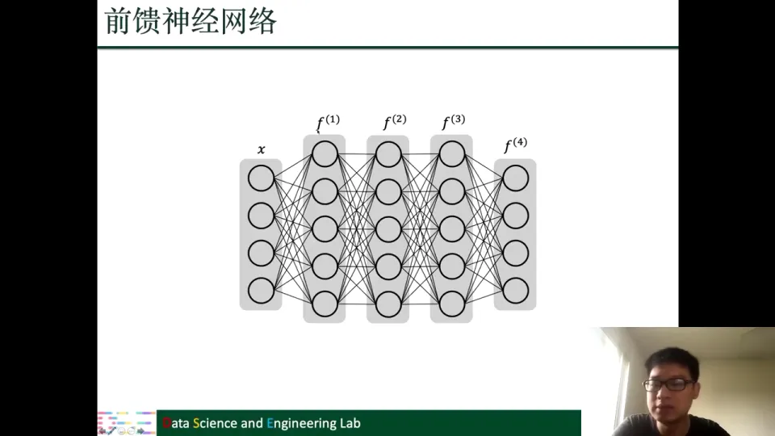

前馈网络由神经元堆叠而成，图中高亮的就是基础单元；其他神经网络同样由这种神经元组成 [【跳转到 18:14】](https://www.bilibili.com/video/BV1yx4y1R7uV/?p=2&t=1094)。所以理解网络，第一步是理解单个神经元。

### 3.2 单个神经元做的是“加权求和 + 偏置 + 激活”

把神经元放大，可以看到它的具体计算。左边是输入 x1、x2、x3、x4；对应每一个输入，都有一个权重 w1、w2、w3、w4。神经元先把每个输入和它的权重相乘，再把所有乘积求和；求和之后加上一个 bias（偏差）b；最后把结果送进激活函数 α。写成公式就是：

$$
\text{输出} = \alpha\left(b + \sum_i w_i x_i\right)
$$

[【跳转到 19:04】](https://www.bilibili.com/video/BV1yx4y1R7uV/?p=2&t=1144)

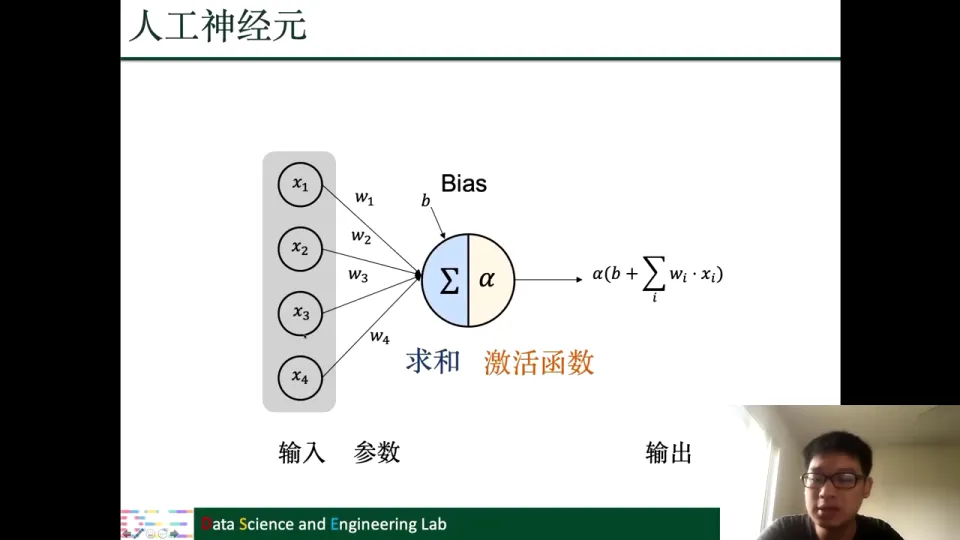

这三个部分各自有直观含义：

- **权重 w**：表示某个输入有多重要。权重越大，这个输入对输出的影响越大；权重接近零，就相当于忽略这个输入。
- **偏置 b**：表示神经元被激活的“门槛”或偏移量。即使所有输入都是零，偏置也可以让神经元有一个基础输出。
- **激活函数 α**：对加权和做一次非线性变换，决定神经元最终输出什么。

比如一个神经元根据“面积、房龄、到地铁距离”判断房价：面积权重为正，房龄和距离权重为负；加权求和、加偏置、过激活函数，就得到输出。训练的就是这些权重和偏置。

需要特别注意的是：在过激活函数之前，这个计算只是一个线性变换。如果整个网络都没有激活函数，那么无论堆多少层，本质上仍然等价于一次线性变换——两层线性变换 W2(W1x) 可以合并成 (W2W1)x。这样一来，加深网络就没有意义了。激活函数带来的非线性，正是深度网络表达能力的关键 [【跳转到 19:54】](https://www.bilibili.com/video/BV1yx4y1R7uV/?p=2&t=1194)。

### 3.3 激活函数是网络获得非线性表达能力的开关

课程快速介绍了三种常用的激活函数 [【跳转到 20:19】](https://www.bilibili.com/video/BV1yx4y1R7uV/?p=2&t=1219)：

- **ReLU**：$\mathrm{ReLU}(z)=\max\{0,z\}$。负半轴输出为零，正半轴输出等于输入。它是现在神经网络里比较常用的激活函数，形式简单、计算便宜。
- **Sigmoid**：$\sigma(z)=\frac{1}{1+\exp(-z)}$。输入可以是负无穷到正无穷，输出被压缩到 0 到 1 之间，最高点接近一。因为它输出的是 0 到 1 的数，后面讲 LSTM 的门控时还会用到它。
- **Tanh**：输出在 -1 到 1 之间，形状和 sigmoid 类似，但以零为中心。它也有一些应用。

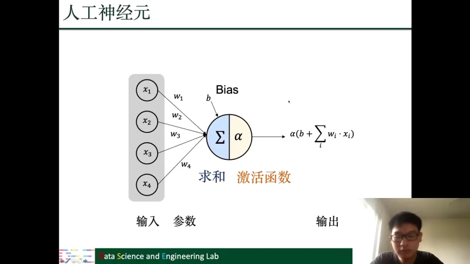

正是这些非线性开关，让多层网络能够拟合远比线性模型复杂的函数。

## 四、训练神经网络就是最小化损失函数：梯度下降更新参数，反向传播计算梯度

**这一章的中心思想**：训练神经网络分三步——先用损失函数衡量预测与基准的差距，再用梯度下降沿负梯度方向更新参数，最后由反向传播高效地算出梯度。三者构成一个闭环。

### 4.1 回归与分类需要不同的输出和损失设计

前馈网络的输出取决于具体任务 [【跳转到 21:34】](https://www.bilibili.com/video/BV1yx4y1R7uV/?p=2&t=1294)。

**回归任务**：基准（ground truth）是实数向量 $\hat{y}\in\mathbb{R}^d$ 或单个实数，输出也应是实数。衡量差距常用平方误差：

$$
\ell(y,\hat{y})=\lVert y-\hat{y}\rVert_2^2
$$

[【跳转到 21:59】](https://www.bilibili.com/video/BV1yx4y1R7uV/?p=2&t=1319)

比如预测房价，输出是实数；预测平面坐标，输出是二维向量。预测与真实值差得越远，平方误差越大。

一个样本不够，训练集通常有 N 个数据点，于是把 N 个损失加起来取平均，得到整个训练集上的损失：

$$
\mathcal{L}(W)=\frac{1}{n}\sum_{i=1}^{n}\ell\left(y^{(i)},\hat{y}^{(i)}\right)
$$

[【跳转到 23:39】](https://www.bilibili.com/video/BV1yx4y1R7uV/?p=2&t=1419)

这里的 W 代表网络的全部参数。

**分类任务**：基准不再是实数，而是一个 one-hot 向量。one-hot 向量的取值只有 0 或 1，并且只有一个位置是一，这个一代表样本属于哪一类 [【跳转到 24:29】](https://www.bilibili.com/video/BV1yx4y1R7uV/?p=2&t=1469)。

比如有四类，样本真实类别是第二类，基准就是 $(0,1,0,0)$。网络输出是实数，直接和 one-hot 比较并不合适，所以先做 softmax。softmax 是一种归一化：把实数输出变成加和为一、每个元素都为正的向量，每个值都可解释为“样本属于对应类别的概率” [【跳转到 25:19】](https://www.bilibili.com/video/BV1yx4y1R7uV/?p=2&t=1519)。

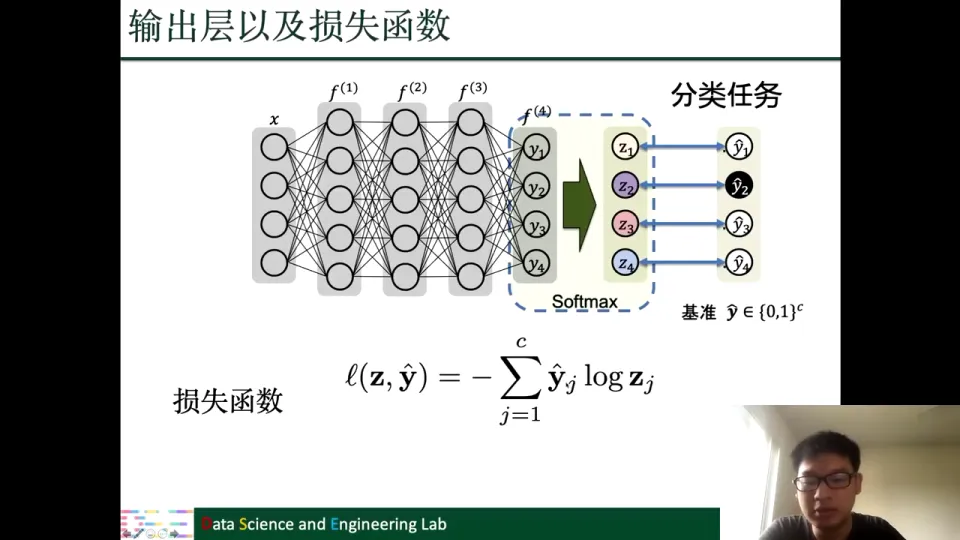

有了概率输出，分类任务常用交叉熵损失：

$$
\ell(z,\hat{y})=-\sum_{j=1}^{c}\hat{y}_j\log z_j
$$

其中 $\hat{y}_j$ 是 one-hot 基准的第 j 个分量，$z_j$ 是 softmax 输出的第 j 个概率。因为 one-hot 只有一项是一，求和实际只保留真实类别那一项。最小化交叉熵就是增大模型分对正确类别的概率 [【跳转到 26:59】](https://www.bilibili.com/video/BV1yx4y1R7uV/?p=2&t=1619)。N 个样本的损失同样要取平均。

### 4.2 梯度下降沿负梯度方向一步步降低损失

有了损失函数，训练目标就可以写成：

$$
W^*=\arg\min_W \mathcal{L}(W)
$$

[【跳转到 29:03】](https://www.bilibili.com/video/BV1yx4y1R7uV/?p=2&t=1743)

真实网络参数维度很高，课程用一维损失曲线示意：梯度是函数上升最快的方向，而最小化损失要沿反方向走，这就是“梯度下降” [【跳转到 29:28】](https://www.bilibili.com/video/BV1yx4y1R7uV/?p=2&t=1768)。

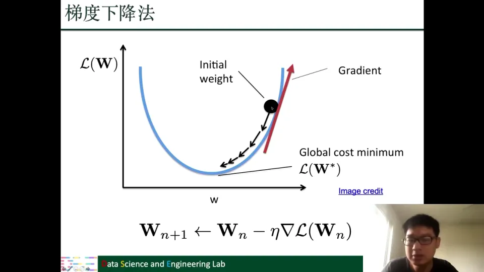

更新公式是：

$$
W_{n+1}\leftarrow W_n-\eta\nabla\mathcal{L}(W_n)
$$

其中 $\eta$ 是学习率（步长）：太大可能一步跨过最低点，太小又要走很多步。图中黑点从初始权重出发，沿负梯度方向逐步接近最优点 [【跳转到 30:43】](https://www.bilibili.com/video/BV1yx4y1R7uV/?p=2&t=1843)。

但图上的情况十分理想。真实网络的损失函数没有那么规则，一般达不到全局最优，只能找到局部最优点，把对应参数作为网络参数 [【跳转到 31:33】](https://www.bilibili.com/video/BV1yx4y1R7uV/?p=2&t=1893)。

现实中也很少对全部样本做梯度下降。常用变种是随机梯度下降（SGD）：随机选一些样本，用它们的损失估计梯度并优化。现在更流行 Adam 这类自适应变种，但不管哪种方法都离不开梯度计算 [【跳转到 32:48】](https://www.bilibili.com/video/BV1yx4y1R7uV/?p=2&t=1968)。

### 4.3 反向传播用链式法则和动态规划高效计算梯度

梯度是由偏导数组成的向量。课程先举一条链式网络：每个神经元只有一个输入、一个输出，从 h0 连到 hk，再到输出 o 和损失 L(W) [【跳转到 33:38】](https://www.bilibili.com/video/BV1yx4y1R7uV/?p=2&t=2018)。

如果想求损失对某条边参数 $W_{h^{r-1},h^r}$ 的偏导数，可以用链式法则，从损失开始一步步往回乘：

$$
\frac{\partial\mathcal{L}}{\partial W_{h^{r-1},h^r}}
=
\frac{\partial\mathcal{L}}{\partial o}
\cdot
\frac{\partial o}{\partial h^k}
\prod_{i=r}^{k-1}\frac{\partial h^{i+1}}{\partial h^i}
\cdot
\frac{\partial h^r}{\partial W_{h^{r-1},h^r}}
$$

链式网络很方便，但真实网络是全连接的：同一个 h^r 会连到下一层多个神经元，再到更后面多个神经元，所以从 h^r 到损失函数的路径有很多条，求偏导时必须全部相加 [【跳转到 36:08】](https://www.bilibili.com/video/BV1yx4y1R7uV/?p=2&t=2168)。

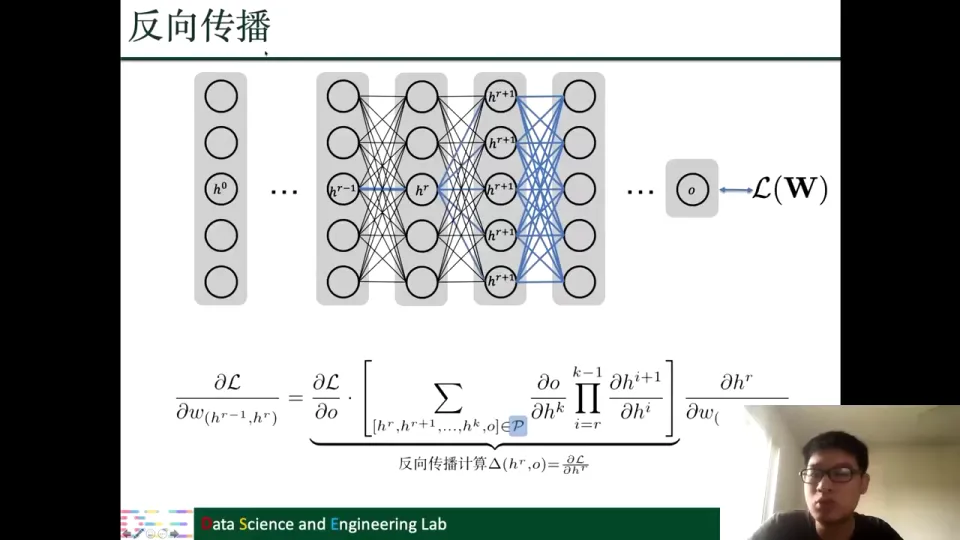

问题是路径数量随层数指数增长；每次都走完整路径会非常低效。

反向传播的关键观察是：这段求和可以复用。把从 h^r 出发的路径按先经过哪个 h^{r+1} 分类，每类提取公共因子 $\partial h^{r+1}/\partial h^r$；剩下的正好是损失对 h^{r+1} 的偏导 $\Delta(h^{r+1},o)$，于是有递推：

$$
\Delta(h^r,o)
=
\frac{\partial\mathcal{L}}{\partial o}
\sum_{h^{r+1}}
\frac{\partial h^{r+1}}{\partial h^r}
\cdot
\Delta(h^{r+1},o)
$$

其中 $\Delta(h^r,o)=\partial\mathcal{L}/\partial h^r$ [【跳转到 38:25】](https://www.bilibili.com/video/BV1yx4y1R7uV/?p=2&t=2305)。

这个递推的意义是：计算 h^r 这一层时，h^{r+1} 这一层的 $\Delta$ 已经算好，只要乘上局部偏导数再求和即可，不必从损失函数重新走一遍所有路径。这就是动态规划——把重复子问题存下来复用。反向传播从输出层开始逐层往回算，因此叫“反向”传播 [【跳转到 43:25】](https://www.bilibili.com/video/BV1yx4y1R7uV/?p=2&t=2605)。

有了各层的 $\Delta$，再乘上那条边本身的局部偏导数，就得到损失对该参数的梯度。梯度算出来以后，就可以交给梯度下降或更高级的优化方法去更新参数。训练神经网络时还有很多小技巧，课程没有展开，书里有简单介绍。

## 五、卷积神经网络用稀疏连接、参数共享和平移等变高效处理图像

**这一章的中心思想**：图像不能像普通向量那样随便打散，因为像素之间的空间关系很重要；卷积神经网络用局部连接、参数共享和平移等变这三个性质，既保留了空间结构，又把参数量压了下来。

### 5.1 图像分类不能简单地把像素拍平，因为位置会被当成重要信息

卷积网络最常做图像分类：给一张图片，判断它是兔子、猫、狗还是其他动物 [【跳转到 46:35】](https://www.bilibili.com/video/BV1yx4y1R7uV/?p=2&t=2795)。

图像很规则，可以把像素拼成向量直接喂给前馈网络，操作上没问题。但兔子不一定出现在固定位置；拍平会打散像素信息，而前馈网络对每个位置用不同参数，很容易把“出现在哪里”当成重要特征，兔子一换位置就可能认不出来 [【跳转到 47:50】](https://www.bilibili.com/video/BV1yx4y1R7uV/?p=2&t=2870)。

对“这是不是兔子”来说，位置其实不重要，重要的是形状、纹理等局部特征。卷积神经网络正是为解决这个问题而设计的。

### 5.2 卷积用局部连接和参数共享提取局部特征

卷积神经网络里主要有两种操作：卷积操作和池化操作。其中更重要的是卷积操作，所以课程重点讲卷积 [【跳转到 49:05】](https://www.bilibili.com/video/BV1yx4y1R7uV/?p=2&t=2945)。

一维例子中，普通全连接神经元计算 S3 会用 X1 到 X5 全部输入；卷积只让 S3 连接局部一段，如 X2、X3、X4。这就是**稀疏连接**——每个输出只连接输入的一小段 [【跳转到 49:54】](https://www.bilibili.com/video/BV1yx4y1R7uV/?p=2&t=2994)。

更关键的是**参数共享**。S2 连接 X1-X3，S3 连接 X2-X4；全连接网络会为两组连接分别学参数，卷积网络则让它们共用同一套参数。图中三种颜色代表三个参数 0.5、1、0.5，这个小向量就是**卷积核** [【跳转到 50:44】](https://www.bilibili.com/video/BV1yx4y1R7uV/?p=2&t=3044)。

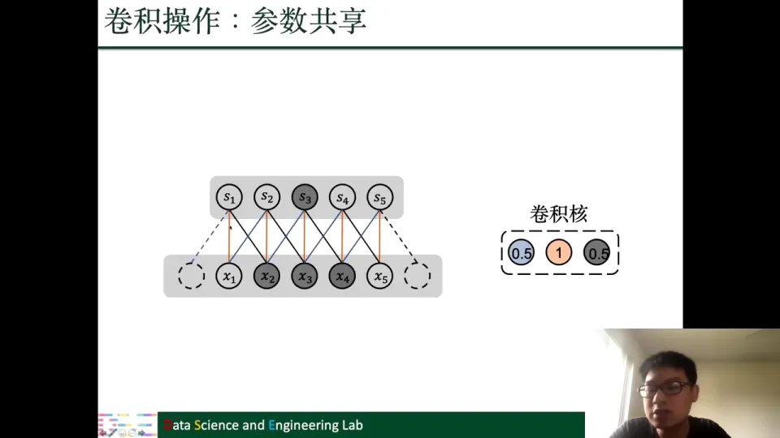

卷积就是拿着卷积核在输入上滑动：先对前三个位置加权求和，向右滑一步，参数不变，再对接下来三个位置做同样运算，反复直到滑完整条输入 [【跳转到 51:59】](https://www.bilibili.com/video/BV1yx4y1R7uV/?p=2&t=3119)。

实际使用中还有两个常见技巧：

- **Padding（补零）**：在输入两端补零，控制输出尺寸并让边缘被充分计算 [【跳转到 58:14】](https://www.bilibili.com/video/BV1yx4y1R7uV/?p=2&t=3494)。
- **Stride（步幅）**：卷积核每次移动的步幅，跳着移动可控制输出大小 [【跳转到 58:31】](https://www.bilibili.com/video/BV1yx4y1R7uV/?p=2&t=3511)。

二维卷积同理，只是卷积核变成二维小方块，在图像的宽、高两个方向滑动：覆盖一块局部区域，逐元素相乘再求和，得到一个输出点；滑遍整张图，就得到一整张输出特征图 [【跳转到 53:39】](https://www.bilibili.com/video/BV1yx4y1R7uV/?p=2&t=3219)。

### 5.3 平移等变让卷积网络不关心特征出现在哪里

卷积操作还有一个很重要的性质：**平移等变**。如果把输入整体向右平移一段，输出不会发生很大的变化，它也会相应地向右平移，整体信号不变，只是位置变了 [【跳转到 54:29】](https://www.bilibili.com/video/BV1yx4y1R7uV/?p=2&t=3269)。

这正是图像分类需要的：不管兔子在哪，卷积核滑到那里都能捕捉到局部特征。卷积网络关心的是“有没有出现这个特征”，而不是“必须出现在固定坐标”。

### 5.4 稀疏连接、参数共享和平移等变共同带来更少参数与更好泛化

把卷积的性质总结一下，就是三条 [【跳转到 55:44】](https://www.bilibili.com/video/BV1yx4y1R7uV/?p=2&t=3344)：

1. **稀疏连接**：每个输出只连接输入的一小段，连接数大大减少。
2. **参数共享**：同一个卷积核在不同位置重复使用，参数数量进一步减少。
3. **平移等变**：输入平移，输出也相应平移，整体信息不变。

前两条减少参数量、提升计算效率并抑制过拟合；平移等变让模型关注内容而非位置。三者共同提升泛化能力 [【跳转到 57:24】](https://www.bilibili.com/video/BV1yx4y1R7uV/?p=2&t=3444)。

实际会用多个卷积核得到多个通道，捕捉不同的局部模式，形成更丰富的特征 [【跳转到 53:14】](https://www.bilibili.com/video/BV1yx4y1R7uV/?p=2&t=3194)。

## 六、池化压缩特征图，卷积与全连接组成完整的图像分类框架

**这一章的中心思想**：卷积负责提取局部特征，池化负责压缩特征图、保留主要响应，最后把特征拍平交给全连接层完成分类；这就是 CNN 的标准框架。

### 6.1 最大池化与平均池化用邻域统计量压缩特征图

池化操作（pooling）的作用是减少输出的维度或大小。课程介绍了两种最常见的池化 [【跳转到 59:10】](https://www.bilibili.com/video/BV1yx4y1R7uV/?p=2&t=3550)。

**最大池化（max pooling）**：把一个小区域里的最大值作为这个区域的总结。比如左上 2×2 区域 1、2、1、0 的最大值是 2，右上区域 2、1、1、3 的最大值是 3。这样，4×4 的输入就被压缩成了 2×2 的输出 [【跳转到 59:35】](https://www.bilibili.com/video/BV1yx4y1R7uV/?p=2&t=3575)。

**平均池化（average pooling）**：用区域内的平均值作为总结。比如同一个 2×2 区域里 1、2、1、0 的平均值是 1；另一个区域的平均值是 1.75，等等 [【跳转到 60:00】](https://www.bilibili.com/video/BV1yx4y1R7uV/?p=2&t=3600)。

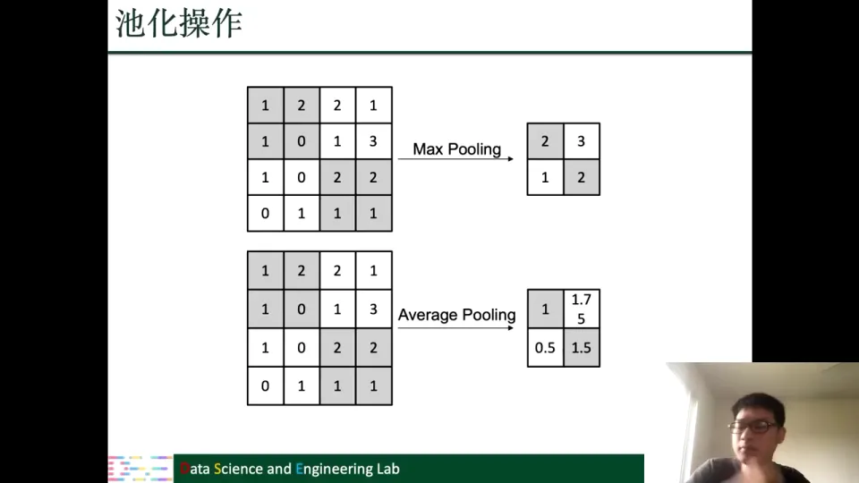

池化不引入新参数，却能降低特征图尺寸、减少后续计算量，并让表示对小幅位置变化更鲁棒。

### 6.2 完整 CNN 框架是“卷积—池化—拍平—全连接—分类”

卷积和池化组合起来就是 CNN 的整体框架 [【跳转到 60:25】](https://www.bilibili.com/video/BV1yx4y1R7uV/?p=2&t=3625)。

输入一张图片，比如有红、黄、蓝三个颜色通道，不同通道先叠加在一起；然后做卷积操作，提取局部特征；再做池化操作，压缩特征图。这些“卷积—池化”模块可以叠加很多层，层数越多特征越抽象；图中只画一层是为了示意。

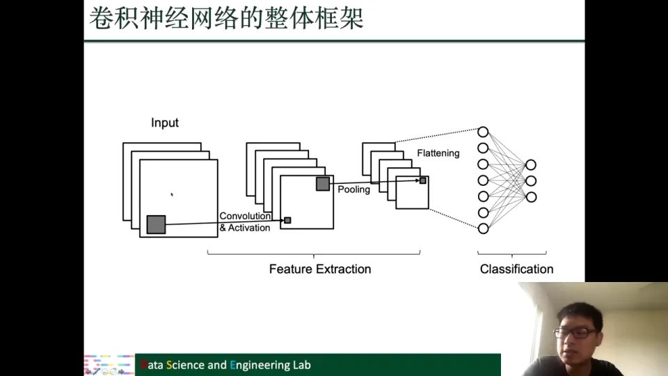

做完特征提取后，把最终的特征图拍平成一个向量，再用全连接层（也就是前面介绍的前馈神经网络）完成最后的分类 [【跳转到 61:15】](https://www.bilibili.com/video/BV1yx4y1R7uV/?p=2&t=3675)。分类输出经过 softmax 变成概率分布，损失函数用交叉熵——这套分类流程和第四章讲的完全一致。图中是三分类；实际网络通常更深，有更多卷积层和池化层。

到这里，图像这条线就讲完了：**卷积负责“看局部”，池化负责“抓重点”，全连接负责“下结论”**。接下来换成序列数据，神经元的组织方式又要换一种思路。

## 七、循环神经网络用参数共享处理变长序列，并能捕捉顺序信息

**这一章的中心思想**：序列数据的长度可变、顺序有意义，前馈网络难以处理；循环神经网络让同一个模块沿时间反复使用，用参数共享同时解决“变长”和“位置”两个问题。

### 7.1 序列数据随处可见，任务形式也多种多样

循环神经网络（RNN）一般处理序列数据，如句子、DNA 序列、声音序列 [【跳转到 62:30】](https://www.bilibili.com/video/BV1yx4y1R7uV/?p=2&t=3750)。

序列上的任务也有不同的输入输出形式：

- **序列到序列**：如机器翻译，英文句子进、中文句子出，两端都是序列 [【跳转到 63:15】](https://www.bilibili.com/video/BV1yx4y1R7uV/?p=2&t=3795)。
- **序列到单输出**：如情感分析，给句子判断正负或情绪，只要一个结果 [【跳转到 63:40】](https://www.bilibili.com/video/BV1yx4y1R7uV/?p=2&t=3820)。

### 7.2 前馈网络处理序列有两个硬伤：长度可变与位置敏感

能不能用前馈网络处理序列？乍看可以：把序列拍平，每个元素作为一个输入。但有两个问题 [【跳转到 64:30】](https://www.bilibili.com/video/BV1yx4y1R7uV/?p=2&t=3870)：

第一，**输入长度可变**：不同句子长度不同，译文长度也可能不同，而前馈网络输入维度固定。

第二，**同一信息出现在不同位置会被当成不同特征**。例如：

- 句子一：Last summer, I went to Yellowstone National Park.
- 句子二：I went to Yellowstone National Park last summer.

两个句子里 last summer 都表达时间信息，语义一样、位置不同；前馈网络对每个位置参数不同，就会把它们当成不同信息 [【跳转到 65:20】](https://www.bilibili.com/video/BV1yx4y1R7uV/?p=2&t=3920)。这和第五章的图像位置问题本质相同。

### 7.3 RNN 沿时间复用同一个模块，隐藏状态负责传递历史信息

循环神经网络就是用来处理这种序列数据的。它的结构可以展开成一条链 [【跳转到 66:10】](https://www.bilibili.com/video/BV1yx4y1R7uV/?p=2&t=3970)：

- 输入 X1、X2、X3 逐个进入网络；
- 每个时刻有一个隐藏状态 h_i，可以把它理解成网络对“到目前为止读到的内容”的记忆；
- 当前隐藏状态由上一时刻的隐藏状态和当前输入共同决定；
- 每个时刻还可以产生一个输出 y_i。

用公式表示，隐藏状态和输出的计算大致是：

$$
h_i=\alpha_h\left(W_{hh}h_{i-1}+W_{hx}x_i+b_h\right)
$$

$$
y_i=\alpha_y\left(W_{yh}h_i+b_y\right)
$$

[【跳转到 66:26】](https://www.bilibili.com/video/BV1yx4y1R7uV/?p=2&t=3986)

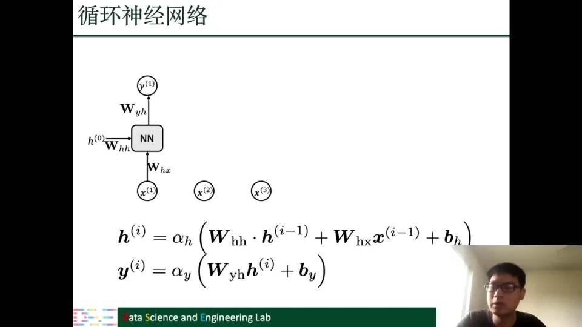

关键是：**每个时刻用同一套操作和参数**。处理 X2 时的参数与 X1 完全相同，只是输入换成 X2、隐藏状态换成 H1；X3 再重复一次 [【跳转到 67:16】](https://www.bilibili.com/video/BV1yx4y1R7uV/?p=2&t=4036)。

这带来两个好处：

1. **可以处理任意长度**。序列变长，只要多重复几次同一个模块即可；网络结构不需要随长度改变 [【跳转到 67:41】](https://www.bilibili.com/video/BV1yx4y1R7uV/?p=2&t=4061)。
2. **位置不再被写死**。因为参数在时间上共享，last summer 不管出现在句首还是句尾，处理它的都是同一套参数，网络就能识别出“这是同一个信息” [【跳转到 69:21】](https://www.bilibili.com/video/BV1yx4y1R7uV/?p=2&t=4161)。

输出可以灵活取用：需要序列输出（如翻译）就保留 Y1 到 YT；只需要一个结果（如情感分类）就保留最后一个，或把所有输出汇总 [【跳转到 68:31】](https://www.bilibili.com/video/BV1yx4y1R7uV/?p=2&t=4111)。

### 7.4 RNN 的三个性质：变长、顺序与参数共享

总结一下循环神经网络的性质 [【跳转到 70:11】](https://www.bilibili.com/video/BV1yx4y1R7uV/?p=2&t=4211)：

- 可以处理不同长度的序列；
- 可以捕捉顺序信息，因为元素逐个进入，隐藏状态把前面的信息带到后面；
- 参数共享，同一个模块沿时间重复使用。

不过，RNN 虽然性质很好，训练起来却有一个著名的问题：梯度消失或梯度爆炸。下一章就来解释这个问题，以及 LSTM 如何缓解它。

## 八、LSTM 用门控与单元状态缓解 RNN 的梯度消失和梯度爆炸

**这一章的中心思想**：RNN 沿时间反向传播时，梯度里会出现 W_hh 的连续乘积；乘积过大导致梯度爆炸，过小导致梯度消失。LSTM 用单元状态和三个门控制信息流动，让长距离依赖更容易被保留。

### 8.1 沿时间反向传播会把 W_hh 连乘很多次

训练 RNN 同样用梯度下降或其变种。误差要沿时间一步步往回传，所以叫“通过时间的梯度下降”（BPTT，Backpropagation Through Time）[【跳转到 71:01】](https://www.bilibili.com/video/BV1yx4y1R7uV/?p=2&t=4261)。

假设损失由最后输出产生，要对 W_hh 求梯度，就得从输出沿序列往回走。每个时间步都用了 W_hh，它会在链式求导中反复出现；对 h_t 关于 h_{t-1} 求偏导时也会出现 W_hh。序列多长，就要乘多少次 W_hh [【跳转到 72:41】](https://www.bilibili.com/video/BV1yx4y1R7uV/?p=2&t=4361)。

### 8.2 连乘的放大与缩小分别造成梯度爆炸和梯度消失

这会产生两种极端情况：

- 如果 W_hh 里很多数大于一，连乘结果会非常大，这就是**梯度爆炸**，训练无法进行 [【跳转到 73:06】](https://www.bilibili.com/video/BV1yx4y1R7uV/?p=2&t=4386)。
- 如果很多数小于一，连乘结果趋近于零，这就是**梯度消失**。梯度传不回前面，前面的参数得不到有效更新 [【跳转到 73:56】](https://www.bilibili.com/video/BV1yx4y1R7uV/?p=2&t=4436)。

后果是：RNN 很难捕捉序列中距离很长的依赖关系。

### 8.3 LSTM 增加单元状态，并用三个 sigmoid 门控制信息流

解决这个问题的办法，是引入带“门”（gate）操作的循环神经网络。LSTM 就是其中比较典型的代表。LSTM 仍是循环网络，主要不同是用 LSTM 模块代替普通神经网络模块；每个输入元素仍用同一个模块，参数共享依然存在 [【跳转到 75:11】](https://www.bilibili.com/video/BV1yx4y1R7uV/?p=2&t=4511)。

LSTM 有两个关键状态 [【跳转到 76:01】](https://www.bilibili.com/video/BV1yx4y1R7uV/?p=2&t=4561)：单元状态 C_t 承载历史信息，是“长期记忆”；隐藏状态 H_t 是当前时刻对外的“工作记忆”，有时也直接作为输出。

LSTM 的核心是门。门的主体是 sigmoid，把输入变成 0 到 1 的值；门的输出与输入相乘，就相当于用这个系数控制“有多少信息能流过去”：一为全通，零为全拦，中间按比例通过 [【跳转到 76:51】](https://www.bilibili.com/video/BV1yx4y1R7uV/?p=2&t=4611)。

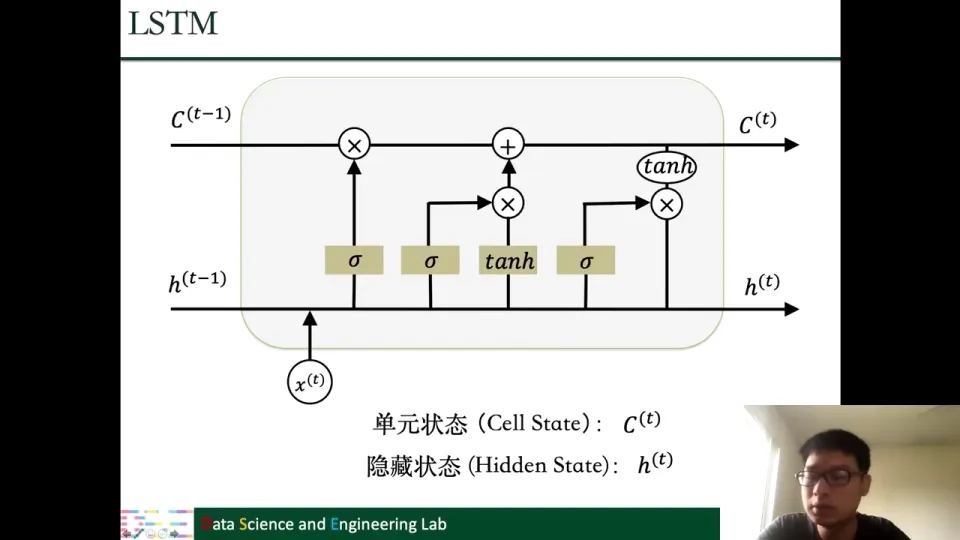

### 8.4 遗忘门、输入门、候选值与输出门共同完成一次更新

LSTM 一个时间步的更新可以拆成四步。

**第一步：遗忘门决定旧记忆保留多少。** 它接收 X_t 和 H_{t-1}，经过前馈网络和 sigmoid，输出 0 到 1 之间的 f_t：

$$
f_t=\sigma\left(W_f x_t+U_f h_{t-1}+b_f\right)
$$

f_t 与旧单元状态 C_{t-1} 逐元素相乘，决定哪些旧记忆保留 [【跳转到 78:06】](https://www.bilibili.com/video/BV1yx4y1R7uV/?p=2&t=4686)。

**第二步：输入门决定新信息写入多少。** 结构与遗忘门相同，只是参数不同，输出 i_t 控制新信息进入单元状态的比例 [【跳转到 78:31】](https://www.bilibili.com/video/BV1yx4y1R7uV/?p=2&t=4711)。

**第三步：候选值给出“新信息本身”。** 当前输入和上一步隐藏状态经过一个前馈网络，再用 tanh 做非线性变换，得到候选值：

$$
\tilde{C}_t=\tanh\left(W_c x_t+U_c h_{t-1}+b_c\right)
$$

它代表从当前输入里提取出的新信息。注意，输入门 i_t 决定“写入多少”，候选值 $\tilde{C}_t$ 决定“写入什么”，两者分工不同 [【跳转到 79:21】](https://www.bilibili.com/video/BV1yx4y1R7uV/?p=2&t=4761)。

**第四步：更新单元状态，再由输出门产生隐藏状态。** 新的单元状态由旧记忆和新信息相加得到：

$$
C_t=f_t\odot C_{t-1}+i_t\odot\tilde{C}_t
$$

其中 $\odot$ 是逐元素相乘。遗忘门控制旧记忆的保留比例，输入门控制新信息的写入比例 [【跳转到 80:11】](https://www.bilibili.com/video/BV1yx4y1R7uV/?p=2&t=4811)。

最后，输出门决定单元状态里有多少信息要输出。输出门同样由“当前输入 + 上一步隐藏状态 → 前馈网络 → sigmoid”得到 o_t；把单元状态过 tanh，再和 o_t 逐元素相乘，就得到当前隐藏状态：

$$
h_t=o_t\odot\tanh(C_t)
$$

这个 h_t 既会传给下一个时间步，也可以在需要时作为当前时刻的输出 [【跳转到 81:26】](https://www.bilibili.com/video/BV1yx4y1R7uV/?p=2&t=4886)。

一句话概括：**先决定忘掉多少旧记忆，再决定写入多少新信息，最后决定输出多少**。门控让信息流可控，单元状态提供了较直接的信息通路。

课程还提到 GRU。GRU 是另一种带门的循环神经网络，它可以看作对 LSTM 的简化：把一些门组合在一起。课程没有展开，书里有具体介绍 [【跳转到 82:16】](https://www.bilibili.com/video/BV1yx4y1R7uV/?p=2&t=4936)。

## 九、自编码器用信息瓶颈做无监督表示学习

**这一章的中心思想**：自编码器让输出尽量复制输入，但不是为了复制本身，而是为了逼着中间的隐藏层 h 学会保留输入的主要信息；信息瓶颈则防止网络走“直接抄过去”的捷径。

### 9.1 自编码器的目标是重构输入，从而让 h 编码主要信息

最后介绍自编码器（autoencoder）。它用来做无监督学习，和前面有标签的任务不同 [【跳转到 82:41】](https://www.bilibili.com/video/BV1yx4y1R7uV/?p=2&t=4961)。

课程主要介绍基于神经网络的自编码器。它的输出其实是想复制输入：我们希望重构出来的 $\hat{x}$ 和原始输入 x 越接近越好 [【跳转到 82:52】](https://www.bilibili.com/video/BV1yx4y1R7uV/?p=2&t=4972)。

为什么要这样做？目标其实是想让中间这个隐藏层 h 保留输入里面的主要信息。如果 h 能很好地保留信息，那我们就能通过 h 把 x 的信息复制出来。换句话说，**重构只是手段，学到有用的中间表示才是目的**。这个 h 可用于降维、特征提取或下游任务。

### 9.2 不加限制时，网络会学会“直接抄过去”的恒等映射

但这里有一个问题：神经网络的能力很强大，如果不对 h 加以限制，它很可能只是把输入原封不动地记住。

图上展示了一个很极端的情况：加粗的两条线代表一个恒等映射（identity），其他连接都消失了。如果网络学到这样的结构，它就能完美地复制 X，$\hat{x}$ 和 x 一模一样。但这样一来，h 里面就没有什么有价值的信息，h 可能也和 x 一模一样，自编码器就完全没用了 [【跳转到 84:07】](https://www.bilibili.com/video/BV1yx4y1R7uV/?p=2&t=5047)。

### 9.3 信息瓶颈迫使 h 只保留主要信息

所以通常会对 h 加一些限制，让它更好地学到有用的信息。最常见的做法是加一个**信息瓶颈**：希望流过 h 的信息是主要信息，而不是所有信息都能原样流过 [【跳转到 84:57】](https://www.bilibili.com/video/BV1yx4y1R7uV/?p=2&t=5097)。

一个简单的例子是**欠完备自编码器（undercomplete autoencoder）**：让 h 的维度比 x 小。窄口迫使网络压缩输入、只保留最重要的信息才能重构，这就是信息瓶颈 [【跳转到 85:22】](https://www.bilibili.com/video/BV1yx4y1R7uV/?p=2&t=5122)。

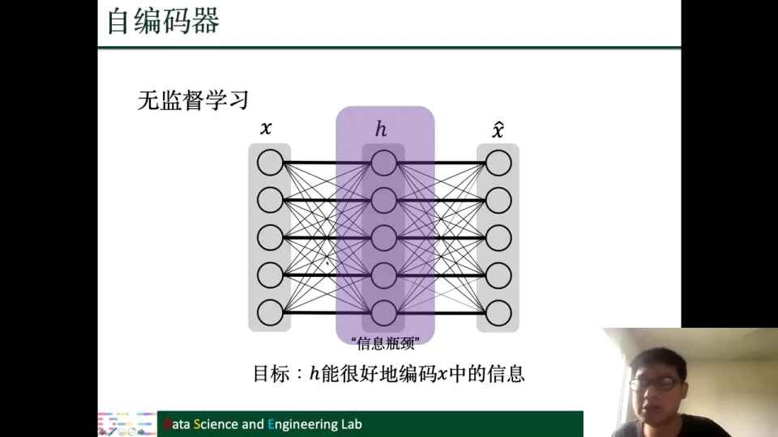

学习 h 的过程其实就是降维（dimensionality reduction）。

除了“把 h 变窄”，也可以给 h 加正则化，对 h 施加某种性质上的约束，希望它学到的东西和 x 不完全一样。这是另外一类信息瓶颈的做法，课程只做了简单介绍，书里还有更多例子 [【跳转到 85:47】](https://www.bilibili.com/video/BV1yx4y1R7uV/?p=2&t=5147)。

## 小结

- 深度学习是机器学习的子类，用深层神经网络从数据中学习；人工神经元从 MP 神经元、感知机一路演化而来。
- 反向传播、CNN、RNN、LSTM 等核心思想在 1960 至 1997 年间已出现；2012 年 AlexNet 之后，大数据与 GPU 才让深度学习真正爆发。
- 前馈网络把“加权求和 + 偏置 + 激活”的神经元逐层全连接；没有非线性激活，多层网络仍等价于一次线性变换。
- 训练闭环是：损失函数衡量差距，梯度下降沿负梯度更新，反向传播用动态规划复用中间结果高效算梯度。
- CNN 用稀疏连接、参数共享、平移等变处理图像，池化压缩特征后交给全连接分类；RNN 沿时间共享参数处理变长序列，LSTM 用单元状态和三个门缓解梯度问题；自编码器用信息瓶颈学习无监督表示。

## 关键术语速查

| 术语 | 一句话解释 |
| --- | --- |
| 感知机（Perceptron） | 1958 年 Rosenblatt 提出的可学习参数的二分类神经元模型。 |
| 激活函数 | 给神经元引入非线性的函数，如 ReLU、Sigmoid、Tanh。 |
| 前馈神经网络（FNN） | 由输入层、隐藏层、输出层全连接堆叠而成、信息单向流动的网络。 |
| 损失函数 | 衡量模型输出与基准差距的函数，训练目标是最小化它。 |
| Softmax | 把实数向量归一化成加和为一的正数向量，可解释为类别概率。 |
| 交叉熵 | 分类任务常用的损失，衡量预测概率分布与 one-hot 基准的差距。 |
| 梯度下降 | 沿负梯度方向、以学习率为步长迭代更新参数以降低损失。 |
| 随机梯度下降（SGD） | 每次用随机抽取的部分样本估计梯度，降低大样本下的计算量。 |
| 反向传播 | 从损失出发、按链式法则逐层回传并复用中间结果的梯度计算方法。 |
| 卷积 | 用一个小卷积核在输入上滑动，做局部加权求和以提取特征。 |
| 卷积核 | 一组可学习的局部权重，在卷积操作中被所有位置共享。 |
| 稀疏连接 | 每个输出只连接输入的一小段，而不是全部输入。 |
| 参数共享 | 同一组参数在不同位置或不同时间步重复使用。 |
| 平移等变 | 输入平移时，输出也相应平移，整体特征响应不变。 |
| Padding / Stride | Padding 在输入边缘补零；Stride 是卷积核每次滑动的步幅。 |
| 池化 | 用邻域的最大值或平均值压缩特征图，减少尺寸并保留主要响应。 |
| 循环神经网络（RNN） | 沿时间复用同一模块、用隐藏状态传递历史信息的序列模型。 |
| BPTT | 通过时间反向传播，即把 RNN 按时间展开后做反向传播。 |
| 梯度爆炸 / 消失 | 连乘使梯度数值过大或趋近于零，导致训练不稳定或无法学习长依赖。 |
| LSTM | 用单元状态和遗忘门、输入门、输出门控制信息流的循环网络。 |
| 单元状态 | LSTM 中承载长期记忆的向量，沿时间传递并按门控更新。 |
| GRU | LSTM 的一种简化变体，把部分门组合在一起。 |
| 自编码器 | 以重构输入为目标、学习中间表示的无监督神经网络。 |
| 信息瓶颈 | 限制中间表示容量，迫使网络只保留输入的主要信息。 |
| 欠完备自编码器 | 中间层 h 的维度小于输入 x 的自编码器，常用于降维。 |

