# 第03讲：网络嵌入

## 本讲要解决的核心问题（SCQA）

**背景**：第一讲定义了图：一个节点集合 $V$ 和一个边集合 $E$。第二讲补齐了深度学习的基础。到了真正要在图上做机器学习时，我们面对的第一个问题不是“用哪个模型”，而是“节点怎么表示成模型能吃的特征”。

**冲突**：最直接的表示是邻接矩阵的一行——每个节点对应一个 $n$ 维向量。但现实图很稀疏，一万个节点的一行里可能只有几个非零；向量维度又等于节点总数，节点越多维度越高。稀疏加上高维，会带来距离计算困难、维度灾难，以及下游任务效果不稳定。更麻烦的是，第一代节点表示方法（谱聚类、Isomap、Laplacian Eigenmaps 等）都依赖特征分解，很难直接扩展到大规模网络。

**疑问**：能不能学到一种低维、稠密、可扩展，并且能保留图上重要信息的节点表示？

**回答（中心思想）**：能。这类方法统称为**图嵌入（graph embedding）**，也叫**网络嵌入（network embedding）**。本讲先给出一个四组件的通用框架——映射函数、信息提取器、重构器、优化目标；再以 Word2Vec 和 DeepWalk 为样板，说明第二代方法如何把“保留什么信息”具体化为邻域共现、结构角色、节点状态、社区结构四类目标；最后把同一框架迁移到异质图、二分图、多维图、符号图、超图和动态图上。贯穿全讲的一句话是：**图嵌入不是随便把节点压到低维，而是有目的地让低维表示重构出原图上我们关心的那部分信息。**

本讲的主讲人马耀老师先说明了术语：图嵌入和网络嵌入在课程中不加区分，因为网络本身就是图的一种形式 [【跳转到 00:00】](https://www.bilibili.com/video/BV1yx4y1R7uV/?p=3&t=0)。全讲分为三部分：图嵌入的通用框架、简单图嵌入、复杂图嵌入 [【跳转到 00:50】](https://www.bilibili.com/video/BV1yx4y1R7uV/?p=3&t=50)。

---

## 一、节点表示必须从邻接矩阵走向低维嵌入，否则稀疏与维度灾难会拖垮下游任务

**这一章的中心思想**：图上的机器学习首先要把节点变成特征；邻接矩阵的行向量虽然直观，却同时踩中稀疏和高维两个坑，因此需要学习低维、稠密、紧凑的节点表示。

### 1.1 图上的机器学习，第一步永远是特征提取

在图上做机器学习，通常的一种做法是先把节点表示成一种特征。得到节点表示以后，图上的基础任务——节点分类、聚类、排序、链接预测——就可以交给传统的机器学习方法来解决 [【跳转到 02:05】](https://www.bilibili.com/video/BV1yx4y1R7uV/?p=3&t=125)。

这样做有优点，也有一个很关键的缺点：**节点表示的质量决定后续任务的上限**。如果表示很差，后续计算任务可能直接失败，甚至比一些更简单的方法还差。老师举了链接预测的例子：一个很常用的基线是数两个节点共享邻居的个数。假如节点特征学得很差，你用图上机器学习方法得到的效果，可能还不如直接数共同邻居 [【跳转到 02:30】](https://www.bilibili.com/video/BV1yx4y1R7uV/?p=3&t=150)。

这说明特征提取不是可有可无的预处理，而是整个图机器学习流程的基础环节。

### 1.2 邻接矩阵的行向量为什么不能直接当节点表示

表示一个图最简单的方法是**邻接矩阵** $A$：每一行代表一个节点，每一列也代表一个节点；$A_{ij}=1$ 表示节点 $i$ 和节点 $j$ 之间有连接 [【跳转到 03:20】](https://www.bilibili.com/video/BV1yx4y1R7uV/?p=3&t=200)。

一个非常直接的想法是：既然邻接矩阵的每一行对应一个节点，能不能直接用这一行的向量来表示这个节点？这个想法直观，但有两个致命问题 [【跳转到 03:45】](https://www.bilibili.com/video/BV1yx4y1R7uV/?p=3&t=225)。

第一，**极其稀疏**。现实中的图里，每个节点通常只和少数其他节点相连。假如图有一万个节点，这一行向量里可能只有几个位置非零，其余全是零 [【跳转到 04:10】](https://www.bilibili.com/video/BV1yx4y1R7uV/?p=3&t=250)。模型很难从这种“几乎全是零”的向量里稳定地学到东西。

第二，**维度随图规模膨胀**。向量的维度等于节点个数；如果有一百万个节点，向量就是一百万维。而在很多机器学习任务里，我们要计算节点之间的相似性或距离，在表示很稀疏、维度很高时，计算会变得非常困难，这就是常说的**维度灾难（curse of dimensionality）** [【跳转到 04:35】](https://www.bilibili.com/video/BV1yx4y1R7uV/?p=3&t=275)。

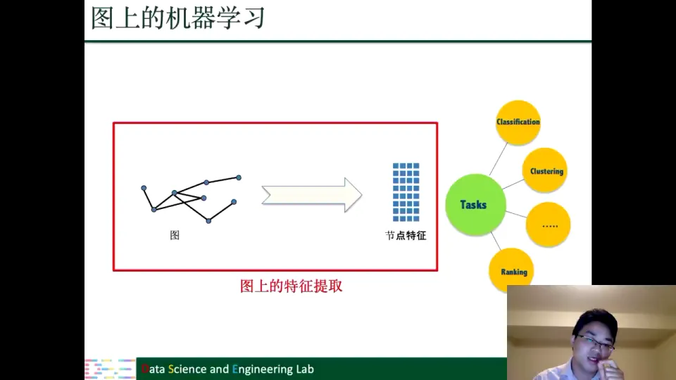

所以，用邻接矩阵的行向量来代表节点并不是一个好主意。我们希望学到一个**更低维、整体更稠密（dense）、更紧凑（compact）**的节点表示 [【跳转到 05:25】](https://www.bilibili.com/video/BV1yx4y1R7uV/?p=3&t=325)。

### 1.3 低维嵌入的形式化定义：映射可以有多种，但必须有目的

节点表示学习通常可以写成一个映射：

$$
f: V \rightarrow \mathbb{R}^d,
$$

它把图上的每一个节点映射到一个 $d$ 维空间，再用一个 $d$ 维向量表示这个节点 [【跳转到 05:50】](https://www.bilibili.com/video/BV1yx4y1R7uV/?p=3&t=350)。

在现实应用中，$d$ 通常远小于节点个数。比如数据集有一万个、几万个甚至几十万个节点，$d$ 往往取 32、64、128。与节点数相比，$d$ 非常小，所以叫**低维表示** [【跳转到 06:15】](https://www.bilibili.com/video/BV1yx4y1R7uV/?p=3&t=375)。

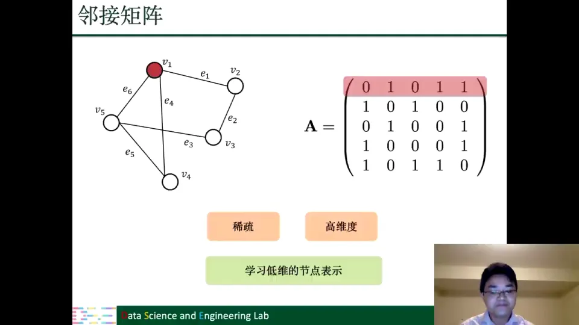

这里有一个容易被忽略但很重要的约束：**映射不能是随便的**。如果只是任意把节点映射到某个低维空间，得到的解不唯一，也没有意义。映射必须是有目的性的——映射到低维空间以后，表示要能保留原图上的一些重要信息 [【跳转到 07:05】](https://www.bilibili.com/video/BV1yx4y1R7uV/?p=3&t=425)。

老师补充：他读博士时，“表示学习”和“嵌入”都不流行，大家通常说“数据降维”；所以第一代方法基本都挂在数据降维概念下 [【跳转到 07:30】](https://www.bilibili.com/video/BV1yx4y1R7uV/?p=3&t=450)。

---

## 二、第一代节点表示本质是数据降维，特征分解的代价限制了它的大规模应用

**这一章的中心思想**：第一代方法把图嵌入看成“把高维邻接关系降到低维”，代表是谱聚类、Isomap、LLE、Laplacian Eigenmaps 和矩阵分解；它们为后面的方法提供了思想源头，但特征分解的高代价让它们难以处理大规模网络。

### 2.1 谱聚类：拉普拉斯矩阵的前 $d$ 个特征向量就是嵌入

谱聚类是第一代方法里很有代表性的一种。它的流程可以拆成三步：

1. 计算图的**拉普拉斯矩阵**；
2. 求拉普拉斯矩阵的特征值和特征向量，想降到 $d$ 维就取前 $d$ 个特征值对应的特征向量；
3. 用这些特征向量作为节点表示，再用传统聚类方法（比如 K-means）得到最终聚类结果 [【跳转到 08:20】](https://www.bilibili.com/video/BV1yx4y1R7uV/?p=3&t=500)。

所以谱聚类其实已经在做**谱嵌入（spectral embedding）**：特征向量就是节点的低维表示。只是在当时，大家更习惯把它叫作数据降维，而不是“嵌入表示学习” [【跳转到 09:10】](https://www.bilibili.com/video/BV1yx4y1R7uV/?p=3&t=550)。

### 2.2 从 Isomap、LLE 到矩阵分解：第一代的共同套路

沿着谱聚类的思路，后来出现了很多基于图的数据降维方法，比如 **Isomap、LLE、Laplacian Eigenmaps**。这些方法或多或少都和谱聚类有联系，因为它们都依赖拉普拉斯矩阵的特征值或特征向量 [【跳转到 09:35】](https://www.bilibili.com/video/BV1yx4y1R7uV/?p=3&t=575)。

2000 年前后，**非负矩阵分解（NMF）** 变得非常流行，字典学习等很多方法都用它做数据降维。在这之后，用矩阵分解给图降维也变得流行起来 [【跳转到 10:00】](https://www.bilibili.com/video/BV1yx4y1R7uV/?p=3&t=600)。

这些方法的主要想法是一致的：给定一个高维的连接矩阵，把维度降到一个低维。所以在节点表示 1.0 里，通常把它放在 dimensionality reduction（数据降维）的框架下解释 [【跳转到 10:25】](https://www.bilibili.com/video/BV1yx4y1R7uV/?p=3&t=625)。

### 2.3 第一代的价值：它是图神经网络的源头之一

虽然本讲不具体讲某一种第一代方法，但老师特别强调了一点：**Laplacian Eigenmaps 其实是图神经网络的一个基础**，图神经网络有些组件就基于 EigenMap [【跳转到 10:50】](https://www.bilibili.com/video/BV1yx4y1R7uV/?p=3&t=650)。

后面还会发现，很多 2.0 方法其实是特殊形式的矩阵分解；第一代因此是第二、三代方法的共同基础。后面的新技术主要让计算更高效、表达更强，而不是另起炉灶 [【跳转到 11:15】](https://www.bilibili.com/video/BV1yx4y1R7uV/?p=3&t=675)。

### 2.4 第一代的硬伤：特征分解很难扩展到大规模网络

第一代方法有一个共同局限：谱聚类、Isomap、Eigenmaps 都要计算特征值和特征向量，也就是做**特征分解**。这个过程非常复杂，所以很难应用到大规模网络上 [【跳转到 12:30】](https://www.bilibili.com/video/BV1yx4y1R7uV/?p=3&t=750)。

这是它最大的局限。后来引入了一些现代方法和现代技巧，才在此基础上设计出第二代和第三代的节点/图表示方法 [【跳转到 12:55】](https://www.bilibili.com/video/BV1yx4y1R7uV/?p=3&t=775)。换句话说，第二代的突破口不是“换一个更复杂的数学工具”，而是换一种**不需要对整张图做特征分解**的信息提取方式。

---

## 三、Word2Vec 用“上下文共现”定义了语义，为图嵌入提供了可直接迁移的范本

**这一章的中心思想**：Word2Vec 把“词义”转化为“上下文共现”，并用一个低维映射加一个重构目标来学习词向量；这套“提取共现—重构共现—让两者接近”的结构，后来被几乎原样搬到了图上。

### 3.1 在 Word2Vec 之前，大家说的是“降维”，不是“嵌入”

老师回忆，他读博士的时候以及那之前，“嵌入”这个词并不流行，大家很少用。Word2Vec 提出来以后，才真正进入了一个“嵌入”或者“表示学习”的时代 [【跳转到 13:20】](https://www.bilibili.com/video/BV1yx4y1R7uV/?p=3&t=800)。

所以要讲第二代节点表示，必须先讲 Word2Vec。原因有两个：一是它在自然语言处理里取得了巨大成功，让“嵌入”这个概念流行起来；二是第二代节点表示方法受它启发，甚至可以说是直接把 Word2Vec 迁移到图上，这代表了节点表示 2.0 的诞生 [【跳转到 13:52】](https://www.bilibili.com/video/BV1yx4y1R7uV/?p=3&t=832)。

### 3.2 one-hot 向量：能定位词，却不能表达词义

Word2Vec 的目标和节点表示一样：给定一个**语料（corpus）**，语料里有一组词，通常叫**词典（vocabulary）**，它代表语料中所有词的集合 [【跳转到 14:17】](https://www.bilibili.com/video/BV1yx4y1R7uV/?p=3&t=857)。

那怎么表示一个词？词本身没法直接输入模型，通常的做法是用 **one-hot 向量**。比如词典有一万个词，就用一个一万维的向量表示每个词；每个词分配一个索引，向量里只有该索引对应的位置为 1，其他位置全为 0 [【跳转到 14:42】](https://www.bilibili.com/video/BV1yx4y1R7uV/?p=3&t=882)。

比如某个词在词典里的索引是 10000，那么这个一万维向量的第 10000 个位置就是 1，其余都是 0。这就是 one-hot 名字的由来 [【跳转到 15:07】](https://www.bilibili.com/video/BV1yx4y1R7uV/?p=3&t=907)。

这种表示和邻接矩阵行向量有相似的毛病：

- **稀疏**：无论词有多少，只有一个位置为 1，其余全为 0 [【跳转到 15:32】](https://www.bilibili.com/video/BV1yx4y1R7uV/?p=3&t=932)；
- **维度高**：语料通常有上万甚至上百万个词，one-hot 向量会非常大 [【跳转到 15:57】](https://www.bilibili.com/video/BV1yx4y1R7uV/?p=3&t=957)；
- **没有语义**：one-hot 只记录“这个词在词典里的第几个位置”，完全无法表达词义 [【跳转到 16:22】](https://www.bilibili.com/video/BV1yx4y1R7uV/?p=3&t=982)。

第三条是最关键的。我们要分析文本，就需要词的表示能代表它的语义；而 one-hot 只代表索引，所以必须做**词嵌入**。

### 3.3 分布式假设：要理解一个词，就看它周围出现哪些词

词嵌入的目标是：给定语料，把每个词映射到一个低维空间，维度 $d$ 远小于词典大小；在映射过程中，尽量保留词的语义信息 [【跳转到 16:47】](https://www.bilibili.com/video/BV1yx4y1R7uV/?p=3&t=1007)。

怎么保留语义？答案藏在上下文里。老师用 **company** 举例：通常觉得 company 就是“公司”，如果没有上下文，就会认为它表示公司。但看看它周围的词，会发现这里的 company 其实不是“公司”，而是“陪伴”的意思 [【跳转到 17:12】](https://www.bilibili.com/video/BV1yx4y1R7uV/?p=3&t=1032)。

幻灯片上引了一句常被归给 J.R. Firth 的话：

> "You shall know a word by the company it keeps."

这句话的意思很直白：**一个词的含义，由它经常和哪些词一起出现决定**。所以，词周围词的信息能够代表这个词的语义；只要我们保留共现信息、再重构共现信息，就能以某种方式保留语义。这就是 Word2Vec 的基本思想 [【跳转到 18:02】](https://www.bilibili.com/video/BV1yx4y1R7uV/?p=3&t=1082)。

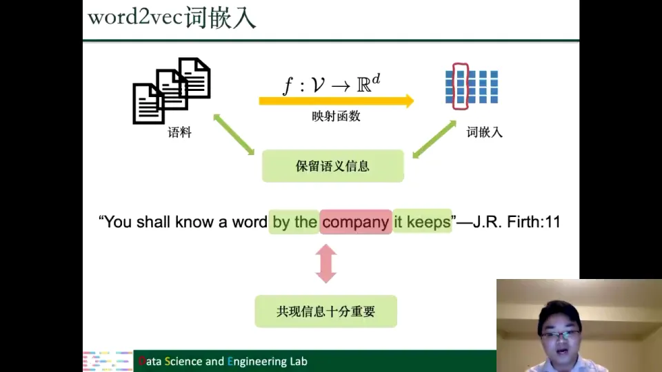

### 3.4 中心词、上下文词与窗口

为了把“上下文”说清楚，需要三个概念：

- **中心词（center word）**：当前关注的那个词。比如例子里的 company [【跳转到 18:27】](https://www.bilibili.com/video/BV1yx4y1R7uV/?p=3&t=1107)。
- **上下文词（context word）**：中心词周围提供语义线索的词。每个词都可以既当中心词，又当其他词的上下文词 [【跳转到 18:52】](https://www.bilibili.com/video/BV1yx4y1R7uV/?p=3&t=1132)。
- **窗口（window）**：定义“周围”的范围。比如窗口大小为 2，那么中心词左右各两个词以内的词，都算它的上下文词 [【跳转到 19:17】](https://www.bilibili.com/video/BV1yx4y1R7uV/?p=3&t=1157)。

这三个概念后面会原样迁移到图上：图里有**中心节点**、**上下文节点**，也有**上下文窗口**。

### 3.5 Word2Vec 的四个组件：两个空间之间的“提取—重构—对齐”

把词嵌入的过程拆开，可以得到四个组件 [【跳转到 21:47】](https://www.bilibili.com/video/BV1yx4y1R7uV/?p=3&t=1307)：

1. **映射函数**：把每个词映射到低维空间。它通常就是要学习的组件。
2. **信息提取器**：从原语料中提取能够代表语义的共现信息。
3. **重构器**：用学到的词嵌入，反过来重构这些共现信息。
4. **优化目标**：让“提取出来的共现信息”和“重构出来的共现信息”尽可能接近。

用一句话概括：Word2Vec 有两个空间——**原来的语料空间**和**嵌入空间**；在原空间提取共现，在嵌入空间重构共现，映射函数负责让这两部分信息对齐 [【跳转到 23:27】](https://www.bilibili.com/video/BV1yx4y1R7uV/?p=3&t=1407)。

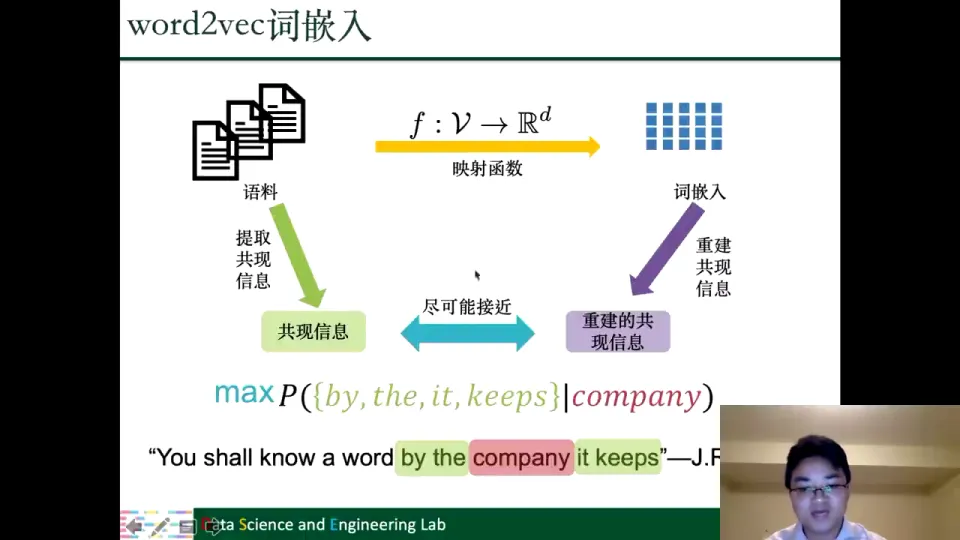

具体到 Word2Vec 的优化目标，就是给定中心词，让上下文词出现的概率尽可能大 [【跳转到 22:37】](https://www.bilibili.com/video/BV1yx4y1R7uV/?p=3&t=1357)。通过这个过程，嵌入空间保留了原空间的一部分信息，这就是词嵌入的基本想法 [【跳转到 23:52】](https://www.bilibili.com/video/BV1yx4y1R7uV/?p=3&t=1432)。

### 3.6 Word2Vec 的成功引出了 x2vec 潮流

Word2Vec 之后出现了大量 **x2vec**：词嵌入、文本嵌入、节点嵌入，节点侧的代表是 Node2Vec [【跳转到 24:17】](https://www.bilibili.com/video/BV1yx4y1R7uV/?p=3&t=1457)。

这带来了一个自然的联想：既然 Word2Vec 在文本上这么成功，能不能把它的思想用到图上，做图的节点表示？这就是 DeepWalk 出现的直接动机 [【跳转到 24:53】](https://www.bilibili.com/video/BV1yx4y1R7uV/?p=3&t=1493)。

---

## 四、图嵌入通用框架由四个组件构成，所有 2.0 方法都在回答“保留什么、怎么保留”

**这一章的中心思想**：图嵌入 2.0 不是一堆互不相干的方法，而是同一个四组件框架的不同填法；判断一个方法，只需看它保留什么信息、如何提取、如何重构、如何优化。

### 4.1 从 2014 到 2017：节点表示 2.0 的窗口期

老师讲了一个有趣的细节：他曾跟 DeepWalk 的作者开玩笑，说名字起得不对，不应该叫 DeepWalk，应该换一个更贴切的名字；没想到第二年真的有人用了那个名字 [【跳转到 25:18】](https://www.bilibili.com/video/BV1yx4y1R7uV/?p=3&t=1518)。

但本质上，DeepWalk 就是词嵌入到图嵌入的一个扩展，所以把它看作“图上的 Word2Vec”更恰当。它代表了节点表示 2.0 的诞生：从 2014 年 DeepWalk 出现，到 2017 年图神经网络提出之前，这三四年是图表示学习非常热门的时期 [【跳转到 25:43】](https://www.bilibili.com/video/BV1yx4y1R7uV/?p=3&t=1543)。

这一时期出现了很多图嵌入方法。它们比 1.0 更高效、可扩展性更强；但与 1.0 的联系是：DeepWalk、LINE、Node2Vec 等方法，其实都可以看成矩阵分解的一种特殊形式 [【跳转到 26:33】](https://www.bilibili.com/video/BV1yx4y1R7uV/?p=3&t=1593)。

### 4.2 所有 2.0 方法都要回答两个问题

第一个问题：**我们想保留原图中的什么信息？** 是节点之间的共现/邻域关系，还是节点扮演的结构角色，还是节点的重要性（状态），还是图里的社区结构？不同方法给出不同答案 [【跳转到 27:23】](https://www.bilibili.com/video/BV1yx4y1R7uV/?p=3&t=1643)。

第二个问题：**找到这些信息以后，怎么在低维空间里保留它们？** 做法和 Word2Vec 类似：用嵌入去尽可能重构这些需要保留的信息 [【跳转到 28:13】](https://www.bilibili.com/video/BV1yx4y1R7uV/?p=3&t=1693)。

这两个问题，就是后面所有方法的“审题提纲”。

### 4.3 图域与嵌入域：映射函数是连接两个空间的桥梁

图嵌入的通用框架和词嵌入高度一致，只是把“语料”换成了“图”：

- **图域** $\mathcal{G}=\{V,E\}$：原来的图所在的空间；
- **嵌入域** $\mathbb{R}^d$：低维表示所在的空间；
- **映射函数** $f: V \rightarrow \mathbb{R}^d$：把节点从图域映射到嵌入域 [【跳转到 29:03】](https://www.bilibili.com/video/BV1yx4y1R7uV/?p=3&t=1743)。

映射必须有目的性。随便映射会得到不唯一、也没有意义的解；我们的目标是保留原图中的重要信息 [【跳转到 29:53】](https://www.bilibili.com/video/BV1yx4y1R7uV/?p=3&t=1793)。

### 4.4 信息提取器、重构器与优化目标

围绕映射函数，框架还有三个组件 [【跳转到 30:18】](https://www.bilibili.com/video/BV1yx4y1R7uV/?p=3&t=1818)：

- **信息提取器**：从图域中提取我们想保留的信息。可能是共现信息，也可能是社区信息、结构角色信息或节点状态信息。
- **重构器**：在嵌入域中，从节点嵌入重构出相应的信息。
- **优化目标**：让“提取的信息” $\mathcal{I}$ 和“重构的信息” $\mathcal{I}'$ 尽可能接近、尽可能一致 [【跳转到 30:43】](https://www.bilibili.com/video/BV1yx4y1R7uV/?p=3&t=1843)。

因此，一个图嵌入方法可以写成四件套：

$$
\underbrace{f}_{\text{映射函数}},\quad
\underbrace{\mathcal{I}=\text{Extractor}(G)}_{\text{提取的信息}},\quad
\underbrace{\mathcal{I}'=\text{Reconstructor}(f)}_{\text{重构的信息}},\quad
\underbrace{\min \ \mathrm{dist}(\mathcal{I},\mathcal{I}')}_{\text{优化目标}}.
$$

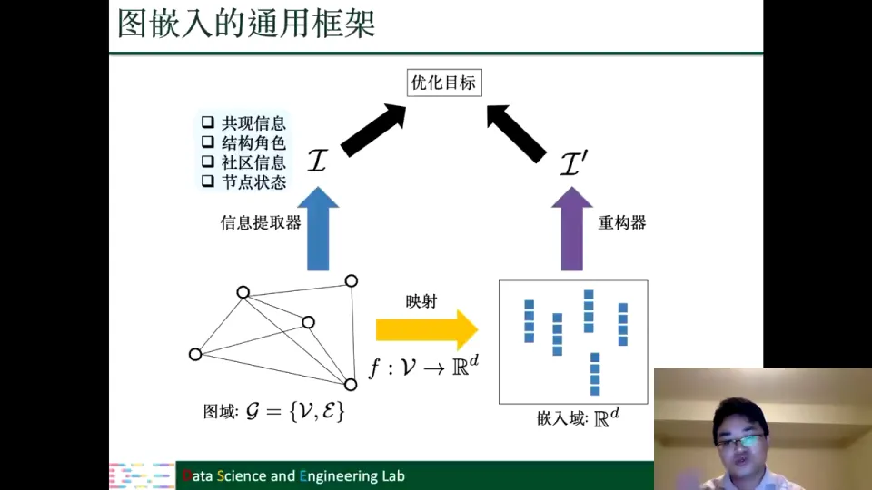

后面讲 DeepWalk、LINE、Node2Vec、Struc2Vec、社区嵌入时，本质上都是在填这张图的空格。

### 4.5 组件大多共享，后面只讲差异

老师特别说明：后面很多方法共享映射函数和优化目标，因为这些组件的目的都是“让两部分信息接近”。真正的差异主要在**如何提取信息**和**如何重构信息** [【跳转到 33:13】](https://www.bilibili.com/video/BV1yx4y1R7uV/?p=3&t=1993)。

所以后面讲新方法时，如果某个组件和 DeepWalk 一样，就只简单提一句，不再重复介绍 [【跳转到 33:38】](https://www.bilibili.com/video/BV1yx4y1R7uV/?p=3&t=2018)。这也意味着：**只要抓住每个方法对“共现”的重新定义，就能快速理解它的创新点。**

---

## 五、DeepWalk 把随机游走变成图上的句子，使 Word2Vec 可以直接用于节点表示

**这一章的中心思想**：DeepWalk 的关键贡献不是发明了一个新目标函数，而是解决了“图没有句子”这个输入问题——用随机游走把图拆成大量节点序列，之后就能原封不动地套用 Word2Vec 的 skip-gram 思路。

### 5.1 简单图：无向、同质、节点和边没有额外信息

正式讲方法前，先限定图的类型。第一讲定义过简单图：无向、同质，节点和边的类型都一致；本讲还假设节点和边上没有额外的属性信息 [【跳转到 35:43】](https://www.bilibili.com/video/BV1yx4y1R7uV/?p=3&t=2143)。

如果节点或边带有额外信息，现有方法也可以扩展，只是本讲不展开；其他类型的图会在“复杂图”部分讲 [【跳转到 36:08】](https://www.bilibili.com/video/BV1yx4y1R7uV/?p=3&t=2168)。

按“保留什么信息”，简单图嵌入方法分为四类 [【跳转到 36:33】](https://www.bilibili.com/video/BV1yx4y1R7uV/?p=3&t=2193)：

1. **保留邻域信息**（也就是共现信息）；
2. **保留结构角色**；
3. **保留节点状态**；
4. **保留社区结构**。

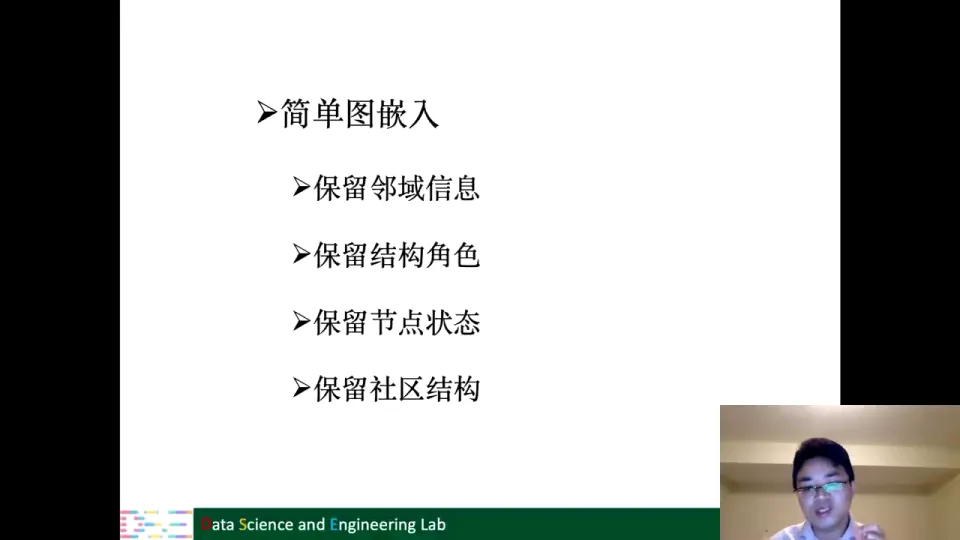

这一章先讲第一类里的 DeepWalk，后面再讲 LINE、Node2Vec，以及其他三类。

### 5.2 图没有句子，所以第一步是“造句子”

DeepWalk 是 Word2Vec 到图上的直接扩展。两者唯一的不同点是输入：词嵌入的输入是文本，也就是一个词的序列、一个句子；图的输入是普通拓扑结构，本身没有这种序列 [【跳转到 37:33】](https://www.bilibili.com/video/BV1yx4y1R7uV/?p=3&t=2253)。

所以第一个要解决的问题是：**如何把一个图变成很多这样的序列？** 如果这一步能做到，图里每个节点就代表序列里的一个词，接下来就可以直接用 Word2Vec 的框架做节点嵌入 [【跳转到 37:58】](https://www.bilibili.com/video/BV1yx4y1R7uV/?p=3&t=2278)。

DeepWalk 的做法是在图上建立一个“虚拟语言”：**每个节点代表一个词，图上每一条 path 或者 walk 代表一个句子** [【跳转到 38:23】](https://www.bilibili.com/video/BV1yx4y1R7uV/?p=3&t=2303)。这一步是 DeepWalk 最重要的贡献。

### 5.3 映射函数：从嵌入矩阵里“查表”

DeepWalk 的映射函数非常简单。令 $W\in\mathbb{R}^{n\times d}$ 为所有节点的嵌入矩阵，$e_i$ 为节点 $i$ 的 one-hot 向量，则

$$
f(v_i)=W e_i.
$$

$W$ 的每一行就是一个节点的 $d$ 维嵌入；$e_i$ 只有第 $i$ 位为 1，所以 $W e_i$ 就是把第 $i$ 行取出来 [【跳转到 40:52】](https://www.bilibili.com/video/BV1yx4y1R7uV/?p=3&t=2452)。

节点在图中本来没有顺序，但我们可以人为地给每个节点一个唯一 ID，就像词典给每个词一个索引；这样 one-hot 向量就能定位到某个节点 [【跳转到 41:42】](https://www.bilibili.com/video/BV1yx4y1R7uV/?p=3&t=2502)。

这里要特别注意：$W$ 既是“所有节点的嵌入”，也是“映射函数的参数”。它不是预先给定的，而是优化过程要学习的东西 [【跳转到 42:32】](https://www.bilibili.com/video/BV1yx4y1R7uV/?p=3&t=2552)。

### 5.4 信息提取器：均匀随机游走

随机游走很简单：从一个节点出发，每一步在它的邻居中按均匀概率选一个节点走过去。形式化地，

$$
p(v^{(t+1)}\mid v^{(t)})=
\begin{cases}
\dfrac{1}{d(v^{(t)})}, & v^{(t+1)}\in \mathcal{N}(v^{(t)}),\\[6pt]
0, & \text{otherwise},
\end{cases}
$$

其中 $d(v^{(t)})$ 是当前节点的度，$\mathcal{N}(v^{(t)})$ 是它的邻居集合 [【跳转到 45:27】](https://www.bilibili.com/video/BV1yx4y1R7uV/?p=3&t=2727)。

比如当前节点有四个邻居，就有四分之一的概率走到其中任何一个；到了下一个节点，再按它的度重新分配概率。整个过程重复固定步数，就得到一条长度固定的路径 [【跳转到 46:42】](https://www.bilibili.com/video/BV1yx4y1R7uV/?p=3&t=2802)。

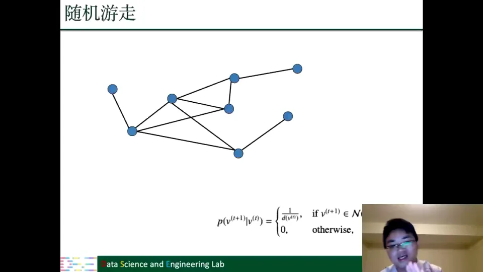

这里老师提醒了一个术语细节：严格来说，第一讲里的 **path** 不能有重复的边，而随机游走允许重复边，所以用“路径”来指代随机游走并不严格；但大家约定俗成都这么说，课程里也不刻意区分 path、walk、trail [【跳转到 44:37】](https://www.bilibili.com/video/BV1yx4y1R7uV/?p=3&t=2677)。

### 5.5 从序列到共现对：窗口重新定义“上下文”

有了序列，就可以像处理句子一样定义中心节点和上下文节点。假设窗口大小为 2：

- 当 $v_1$ 是中心节点时，$v_2$、$v_3$ 是它的上下文节点；
- 当 $v_2$ 是中心节点时，$v_1$、$v_3$、$v_4$ 都是它的上下文节点 [【跳转到 48:22】](https://www.bilibili.com/video/BV1yx4y1R7uV/?p=3&t=2902)。

于是每一条随机游走路径都能生成很多**节点对**：$(v_1,v_2)$、$(v_1,v_3)$、$(v_2,v_1)$、$(v_2,v_3)$、$(v_2,v_4)$……这些节点对就是 DeepWalk 要保留的共现信息 [【跳转到 49:37】](https://www.bilibili.com/video/BV1yx4y1R7uV/?p=3&t=2977)。

为了捕捉更多结构信息，通常不会只从每个节点走一次，而是从每个节点出发重复 $T$ 次。图有 $N$ 个节点，就得到 $N\times T$ 条路径，也就是 $N\times T$ 个“句子” [【跳转到 51:07】](https://www.bilibili.com/video/BV1yx4y1R7uV/?p=3&t=3067)。

### 5.6 重构器：两个角色，两个映射函数

DeepWalk 和 Word2Vec 一样，区分节点的两种角色：作为中心节点，和作为上下文节点。因此它有两个映射函数：

$$
f_{cen}(v_i)=W_{cen}e_i,\qquad f_{con}(v_i)=W_{con}e_i.
$$

也就是说，每个节点会学到两个嵌入：一个用于“当中心节点”，一个用于“当上下文节点” [【跳转到 55:03】](https://www.bilibili.com/video/BV1yx4y1R7uV/?p=3&t=3303)。

给定中心节点，上下文节点的条件概率用 softmax 计算：

$$
p(v_{con}\mid v_{cen})=
\frac{\exp\!\left(f_{con}(v_{con})^\top f_{cen}(v_{cen})\right)}
{\sum_{v\in V}\exp\!\left(f_{con}(v)^\top f_{cen}(v_{cen})\right)}.
$$

分子是两个嵌入的内积，内积越大表示越相似；分母是所有节点与中心节点内积的指数和，用来归一化成概率 [【跳转到 55:53】](https://www.bilibili.com/video/BV1yx4y1R7uV/?p=3&t=3353)。

把所有共现对的概率连乘，就得到观察到这些共现信息的联合概率。实际优化时通常取对数、最小化负对数，把连乘变成求和，降低计算复杂度 [【跳转到 57:31】](https://www.bilibili.com/video/BV1yx4y1R7uV/?p=3&t=3451)。

### 5.7 目标函数与两个嵌入的用法

把上面几步合起来，DeepWalk 的目标就是：

$$
\max \sum_{(v_{cen},v_{con})\in \mathcal{I}_W}\log p(v_{con}\mid v_{cen}),
$$

其中 $\mathcal{I}_W$ 是随机游走提取出来的共现对集合。直观地说：**让真实出现在同一窗口里的节点对，在嵌入空间里的内积尽量大**。

训练后每个节点有两个嵌入，下游用哪个都可以，看任务和效果 [【跳转到 60:01】](https://www.bilibili.com/video/BV1yx4y1R7uV/?p=3&t=3601)；这说明 DeepWalk 允许一个节点按角色拥有不同向量。

---

## 六、层次 softmax 与负采样把 softmax 的 $O(n)$ 代价降到可扩展

**这一章的中心思想**：DeepWalk 的目标函数本身没问题，问题在 softmax 的分母要对全图节点求和；层次 softmax 用二叉树索引把查找降到 $O(\log n)$，负采样则把“全量归一化”换成“真共现 vs 少量假共现”的二分类，两者都让 DeepWalk 能跑在大图上。

### 6.1 瓶颈在分母：每个中心节点都要遍历全图

Softmax 的分母要求中心节点和所有其他节点的内积。给定一个中心节点，就要计算它和全图 $n$ 个节点的相似度，复杂度是 $O(n)$ [【跳转到 60:26】](https://www.bilibili.com/video/BV1yx4y1R7uV/?p=3&t=3626)。

如果对每个节点都这么做，总体就是 $O(n^2)$ 级别。老师提醒：单看“每个节点线性复杂度”好像还能接受，但 $N$ 个节点乘起来就是平方级，实际非常高 [【跳转到 70:51】](https://www.bilibili.com/video/BV1yx4y1R7uV/?p=3&t=4251)。

所以 DeepWalk 介绍了两种降低复杂度的方法：**层次 softmax** 和**负采样** [【跳转到 62:01】](https://www.bilibili.com/video/BV1yx4y1R7uV/?p=3&t=3721)。

### 6.2 层次 softmax：把“查词典”变成“走二叉树”

层次 softmax 的思想和查字典很像。假如词典没有索引，想找一个词只能从头遍历整本词典，这就是原来的 softmax；如果建立了索引，就能快速定位 [【跳转到 63:16】](https://www.bilibili.com/video/BV1yx4y1R7uV/?p=3&t=3796)。

具体做法是：把图中的所有节点作为**二叉树的叶子节点**，再引入一些内部节点，建立一棵索引树 [【跳转到 64:11】](https://www.bilibili.com/video/BV1yx4y1R7uV/?p=3&t=3851)。

原来“给定中心节点，求某个上下文节点的概率”要遍历所有节点；现在变成“从根节点走到目标叶子节点”的一条路径。二叉树的深度是 $\log n$，所以复杂度从 $O(n)$ 降到 $O(\log n)$ [【跳转到 65:26】](https://www.bilibili.com/video/BV1yx4y1R7uV/?p=3&t=3926)。

一万个节点时，原来算一万次，现在约一百次，因为 $\log 10000$ 很小 [【跳转到 65:51】](https://www.bilibili.com/video/BV1yx4y1R7uV/?p=3&t=3951)。

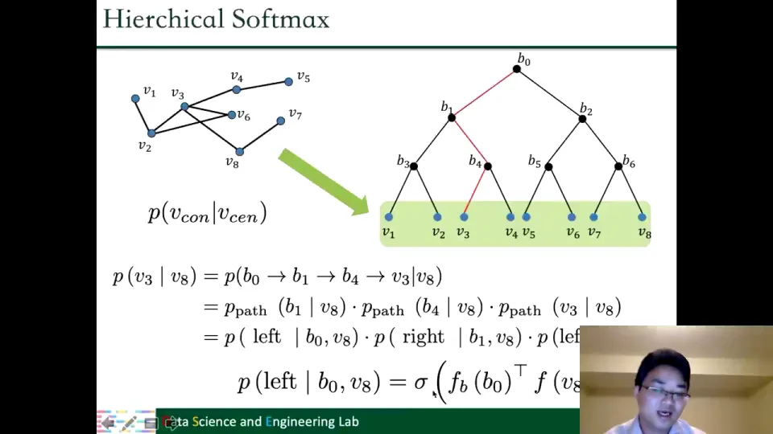

### 6.3 一条路径的概率，是一串二分类概率的乘积

以“给定中心节点 $v_8$，计算 $v_3$ 的概率”为例。在树上找到从根节点 $b_0$ 到 $v_3$ 的路径：$b_0 \to b_1 \to b_4 \to v_3$ [【跳转到 67:06】](https://www.bilibili.com/video/BV1yx4y1R7uV/?p=3&t=4026)。

这条路径的每一步都可以看成一个二分类问题：在当前内部节点，向左走还是向右走？于是路径概率可以写成每一步概率的乘积：

$$
p(v_3\mid v_8)=p(b_0\to b_1\mid v_8)\cdot p(b_1\to b_4\mid v_8)\cdot p(b_4\to v_3\mid v_8).
$$

每一步的向左概率用一个 sigmoid 函数表示：

$$
p(\text{left}\mid b,v)=\sigma\!\left(f_b(b)^\top f(v)\right),
$$

向右概率就是 $1-p(\text{left}\mid b,v)$ [【跳转到 68:46】](https://www.bilibili.com/video/BV1yx4y1R7uV/?p=3&t=4126)。

这样，原来 softmax 要考虑 $v_1$ 到 $v_8$ 八个节点，现在只需要考虑路径上的三个节点。节点越多，层次 softmax 的优势越明显。

这里多了一组参数：$f_b$ 是内部节点的映射函数，把每个内部节点也映射到一个低维空间。也就是说，除了节点的 embedding，我们还会学到内部节点的表示，比如 $b_0$、$b_1$、$b_6$。因为二叉树内部节点的个数与深度正相关，数量有限，所以额外开销可控 [【跳转到 69:11】](https://www.bilibili.com/video/BV1yx4y1R7uV/?p=3&t=4151)。

### 6.4 负采样：不遍历全图，只区分“真共现”和“假共现”

负采样换了一个角度看目标函数。先把 softmax 的分子粗略理解为“中心节点和上下文节点的相似性”，把分母理解为“中心节点和其他所有节点的相似性” [【跳转到 71:16】](https://www.bilibili.com/video/BV1yx4y1R7uV/?p=3&t=4276)。

于是优化目标可以读成两句话：

- 对**真实共现**的节点对，最大化它们的相似性；
- 对**没有共现**的节点对，最小化它们的相似性 [【跳转到 73:21】](https://www.bilibili.com/video/BV1yx4y1R7uV/?p=3&t=4401)。

但图里没有共现的节点太多了，没必要全部算。负采样的做法是：给定中心节点和它的一个真实上下文节点，最大化这对正样本的概率；同时从“没有出现在中心节点上下文里的节点”中随机抽 $K$ 个负样本，最小化它们的概率 [【跳转到 73:46】](https://www.bilibili.com/video/BV1yx4y1R7uV/?p=3&t=4426)。

这样，复杂度就从“与全图节点数 $n$ 相关”变成“与固定常数 $K$ 相关”。$K$ 通常和节点的度相关，书里有更详细的取值讨论 [【跳转到 75:01】](https://www.bilibili.com/video/BV1yx4y1R7uV/?p=3&t=4501)。

用公式表示，负采样的目标大致是：

$$
\max \sum_{(v_{cen},v_{con})\in \mathcal{I}_W}
\left[
\log \sigma\!\left(f_{con}(v_{con})^\top f_{cen}(v_{cen})\right)
+\sum_{k=1}^{K}\mathbb{E}_{v_k\sim P_n}
\log \sigma\!\left(-f_{con}(v_k)^\top f_{cen}(v_{cen})\right)
\right].
$$

前半部分拉近正样本，后半部分推远负样本。它和 softmax 的目标是一致的：**共现的尽量相似，不共现的尽量不相似**；区别只是不再对全图做归一化，而是抽样估计 [【跳转到 74:11】](https://www.bilibili.com/video/BV1yx4y1R7uV/?p=3&t=4451)。

### 6.5 两种方法怎么选

层次 softmax 用树结构把查找降到 $O(\log n)$；负采样实现更简单，复杂度只和 $K$ 有关，实践中更常用 [【跳转到 77:19】](https://www.bilibili.com/video/BV1yx4y1R7uV/?p=3&t=4639)。

到这里，DeepWalk 的四个组件就完整了：查表映射、随机游走提取共现、softmax 重构、最大化共现概率；再配上层次 softmax 或负采样解决计算瓶颈。后面的方法，大多是在这个骨架上换“共现”的定义。

---

## 七、LINE 与 Node2Vec 改变了“共现”的定义，却复用了 DeepWalk 的其余组件

**这一章的中心思想**：LINE 把“一条边”直接当作共现对，相当于只走一步的随机游走；Node2Vec 把一阶随机游走换成二阶随机游走，用参数 $p$、$q$ 控制“回头”和“走远”。两者都没有改映射函数、重构器和优化目标，只改了信息提取器。

### 7.1 LINE：一条边就是一对共现

DeepWalk 保留的是共现信息；LINE 也保留共现信息，而且它的映射函数、重构器、优化目标都可能和 DeepWalk 一样 [【跳转到 77:44】](https://www.bilibili.com/video/BV1yx4y1R7uV/?p=3&t=4664)。

唯一的不同点是：**LINE 怎么定义共现**。它没有做随机游走，而是直接用边——如果两个节点之间相连、有一条边，就认为它们是一对共现的 pair [【跳转到 78:02】](https://www.bilibili.com/video/BV1yx4y1R7uV/?p=3&t=4682)。

也可以把 LINE 理解成“随机游走长度等于 1”：只走一步，走到的就是这些边。所以 LINE 和 DeepWalk 的差别只在信息提取器，其他组件可以照搬 [【跳转到 78:27】](https://www.bilibili.com/video/BV1yx4y1R7uV/?p=3&t=4707)。

### 7.2 Node2Vec：二阶随机游走，让“怎么走”变成可调参数

Node2Vec 也保留共现信息，也用随机游走，但它用的不是一阶随机游走，而是**二阶随机游走**，这样可以更灵活地探索节点的邻域信息 [【跳转到 79:17】](https://www.bilibili.com/video/BV1yx4y1R7uV/?p=3&t=4757)。

一阶随机游走很简单：每次在当前节点的邻居里随机选一个，走到下一步，不停重复。二阶随机游走的区别是：决定下一步走到哪里时，不只看当前节点，还会看**上一个刚刚走过来的节点** [【跳转到 80:07】](https://www.bilibili.com/video/BV1yx4y1R7uV/?p=3&t=4807)。

为什么这有意义？老师用了两个生活化的类比：

- 上网浏览网页时，我们经常会按后退键，回头看看上一个页面；
- 放幻灯片时，也不会一直往前，有时要翻回去看之前的信息 [【跳转到 80:32】](https://www.bilibili.com/video/BV1yx4y1R7uV/?p=3&t=4832)。

所以随机游走不一定总是往前走，也可以以一定概率回到上一个节点。

### 7.3 $p$ 控制“回头”，$q$ 控制“走远”

Node2Vec 用两个参数来控制游走偏好：

- **$p$（返回参数）**：控制回到上一个节点的概率。当下一步访问的节点和上一个节点距离为 0（也就是同一个节点）时，访问概率与 $1/p$ 相关。直观地说，$p$ 越大，越不容易回头 [【跳转到 80:57】](https://www.bilibili.com/video/BV1yx4y1R7uV/?p=3&t=4857)。
- **$q$（进出参数）**：控制下一步是留在附近还是走远。当 $q>1$ 时，更倾向于访问离上一个节点比较近的节点；当 $q<1$ 时，访问较远节点的概率会更大 [【跳转到 82:12】](https://www.bilibili.com/video/BV1yx4y1R7uV/?p=3&t=4932)。

换句话说，$q$ 调大更关注局部邻域，$q$ 调小更倾向探索远处结构；这是 Node2Vec 和 DeepWalk 的核心差别 [【跳转到 82:37】](https://www.bilibili.com/video/BV1yx4y1R7uV/?p=3&t=4957)。

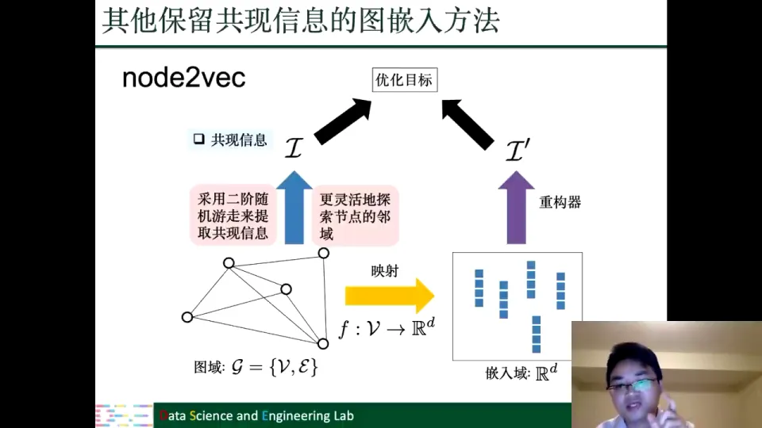

到这里，保留邻域/共现信息的三条代表路线就齐了：DeepWalk 用一阶随机游走，LINE 用边（长度为 1 的游走），Node2Vec 用带 $p$、$q$ 的二阶随机游走 [【跳转到 83:24】](https://www.bilibili.com/video/BV1yx4y1R7uV/?p=3&t=5004)。

---

## 八、Struc2Vec 用多层图捕捉结构角色，让远距离的同角色节点也能相似

**这一章的中心思想**：基于共现的方法会把“离得远”误判为“不相似”，但现实中两个节点可能地理位置很远、角色却相同（比如上海机场和北京机场都是枢纽）。Struc2Vec 的做法是先定义“结构相似性”，再据此重建一张多层图，在多层图上做随机游走。

### 8.1 共现方法的盲区：离得远，不等于角色不同

在基于共现的算法里，如果两个节点相连，或者距离很近，它们学到的嵌入会非常相似。因为无论怎么游走，它们都有一定概率出现在同一个窗口里，而 softmax 的内积又代表相似性 [【跳转到 83:49】](https://www.bilibili.com/video/BV1yx4y1R7uV/?p=3&t=5029)。

但有些应用里，两个节点距离很远，按共现算法得到的嵌入会非常不同；可它们在网络中的**角色**其实一样，都是中心节点、都是 hub 节点 [【跳转到 84:14】](https://www.bilibili.com/video/BV1yx4y1R7uV/?p=3&t=5054)。

老师用机场举例：上海、北京这些大城市都是交通枢纽，所以它们机场的角色信息非常相似。上海离杭州机场、北京离郑州机场在地理上比较近，但上海机场和北京机场的角色，跟杭州机场、郑州机场的角色差别非常大 [【跳转到 85:04】](https://www.bilibili.com/video/BV1yx4y1R7uV/?p=3&t=5104)。

这就是保留结构角色信息的基本动机：按共现看，两个远距离节点的嵌入相似性会非常低；但实际应用中它们应该相似，因为它们有相同的结构角色 [【跳转到 85:54】](https://www.bilibili.com/video/BV1yx4y1R7uV/?p=3&t=5154)。

### 8.2 用“度的序列”定义结构相似性

Struc2Vec 的第一步，是在原图里衡量两个节点的结构相似性。最简单的方法是看它们的**度**：度中心性就是节点重要程度的一种度量 [【跳转到 88:40】](https://www.bilibili.com/video/BV1yx4y1R7uV/?p=3&t=5320)。

但只看自己的度不够，还要看邻居的度。比如两个节点，它们邻居的度相似性是什么样的；可以把一个节点的邻居度看成一个序列，然后衡量两个序列的相似性。用 $s_1(u)$、$s_1(v)$ 表示一阶邻居的度相似性 [【跳转到 89:24】](https://www.bilibili.com/video/BV1yx4y1R7uV/?p=3&t=5364)。

文章进一步推广到 $K$ 阶邻居：不仅考虑自身的相似性，还考虑一阶邻居、二阶邻居，直到 $K$ 阶邻居的相似性。把所有阶层的相似性加起来，就得到两个节点的角色结构相似性 [【跳转到 90:14】](https://www.bilibili.com/video/BV1yx4y1R7uV/?p=3&t=5414)。

### 8.3 构造 $k$ 层图：每一层都是一张全连接图

有了 $K$ 阶相似性以后，Struc2Vec 不是直接在原图上游走，而是建立一张 **$k$ 层图**。每一层对应一个阶数，层内的边权由该阶的结构相似性决定：

$$
w_k(u,v)=\exp\!\left(-g_k(u,v)\right),
$$

其中 $g_k(u,v)$ 是节点 $u$、$v$ 在第 $k$ 阶上的结构距离，距离越小，边权越大 [【跳转到 91:39】](https://www.bilibili.com/video/BV1yx4y1R7uV/?p=3&t=5499)。

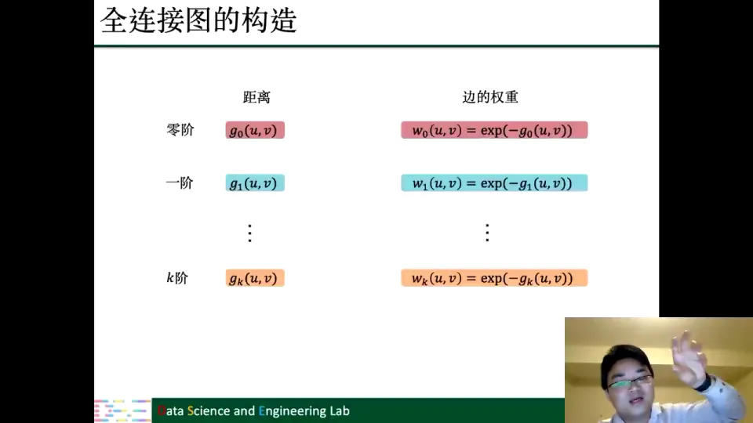

每一层内部是一个全连接图：所有节点两两相连，只是边权不同。层与层之间，则把同一个节点在不同层的副本连接起来。比如 $V_1$ 在 $K$ 层上，会和 $V_1$ 在 $K+1$ 层上有一条连接；同时也会连到 $K-1$ 层。这样整个 $K$ 层图就连成了一张大图 [【跳转到 92:29】](https://www.bilibili.com/video/BV1yx4y1R7uV/?p=3&t=5549)。

### 8.4 在层内游走，也有概率跳到相邻层

有了这张多层图，随机游走也相应改变：

- 首先在某一层内游走，走到同层的邻居；
- 在某个节点上，除了在本层继续走，还有一定概率跳到相邻层，也就是同一个节点在上一层或下一层的副本 [【跳转到 93:44】](https://www.bilibili.com/video/BV1yx4y1R7uV/?p=3&t=5624)。

其余操作与 DeepWalk 相似：游走产生序列、窗口提取共现、softmax 重构；创新集中在定义相似性、建图、多层游走三步 [【跳转到 94:34】](https://www.bilibili.com/video/BV1yx4y1R7uV/?p=3&t=5674)。

---

## 九、节点状态与社区结构需要在共现目标之外增加额外约束

**这一章的中心思想**：共现和结构角色都只描述“节点之间像不像”，但很多任务还关心“节点重不重要”和“节点属于哪个群体”。前者要求保留中心性排序，后者要求保留社区划分；做法都是在 DeepWalk 目标上再加一项。

### 9.1 节点状态：重要节点应该有更高的“地位”

为什么节点状态重要？在链接预测里，重要节点往往更容易吸引别人。比如微博里的明星，会有更大概率吸引其他用户关注，影响力更大 [【跳转到 94:52】](https://www.bilibili.com/video/BV1yx4y1R7uV/?p=3&t=5692)。

链接预测里有一个很有名的方法叫 **preferential attachment（优先连接）**：在社交媒体里，我们有很大概率、很大倾向去关注那些非常重要的节点。所以节点状态信息对影响力预测、链接预测都很有用 [【跳转到 95:42】](https://www.bilibili.com/video/BV1yx4y1R7uV/?p=3&t=5742)。

保留节点状态的算法框架不变，只是在 DeepWalk 的共现目标之外，再加一个保留节点状态/重要性的目标 [【跳转到 96:57】](https://www.bilibili.com/video/BV1yx4y1R7uV/?p=3&t=5817)。

### 9.2 保留排序，而不是保留具体分数

节点状态可用中心性衡量，比如度中心性、接近中心性、特征向量中心性；选一种算出每个节点的状态值 [【跳转到 97:47】](https://www.bilibili.com/video/BV1yx4y1R7uV/?p=3&t=5867)。

但这里有一个关键设计：**不要直接拟合具体数值**。因为不同中心性算法算出来的值差别可能很大，直接保留数值的鲁棒性和准确性都不高 [【跳转到 98:12】](https://www.bilibili.com/video/BV1yx4y1R7uV/?p=3&t=5892)。

更好的做法是保留**排序**。比如按中心性排序得到 $v_1$ 排在 $v_2$ 前面、$v_2$ 排在 $v_3$ 前面，就产生一个有序序列；我们希望嵌入也保持这种相对顺序，而不是复现某个具体分数 [【跳转到 99:02】](https://www.bilibili.com/video/BV1yx4y1R7uV/?p=3&t=5942)。

具体怎么学？给定两个节点的嵌入，计算“$v_i$ 排在 $v_j$ 之前”的概率：

$$
p(v_i \text{ before } v_j)=\sigma\!\left(w^\top\left(f(v_i)-f(v_j)\right)\right),
$$

其中 $w$ 是需要学习的参数。只要 $i$ 在排序中位于 $j$ 之前，就最大化这个概率 [【跳转到 100:42】](https://www.bilibili.com/video/BV1yx4y1R7uV/?p=3&t=6042)。

最终目标函数由两部分相加：一部分是 DeepWalk 的共现目标，另一部分是节点状态的排序目标。前者保证“相连的节点像”，后者保证“重要的节点在嵌入里也保持相对地位” [【跳转到 101:32】](https://www.bilibili.com/video/BV1yx4y1R7uV/?p=3&t=6092)。

### 9.3 社区结构：图里天然存在“稠密团块”

社区结构是另一类重要信息。图里常常有一些区域连接非常紧密、非常稠密，而两个紧密区域之间的连接非常松散 [【跳转到 101:57】](https://www.bilibili.com/video/BV1yx4y1R7uV/?p=3&t=6117)。

老师举了几个例子：

- 中国城市分布：大城市人口非常集中，而大城市之间的一些地方人口很少；
- 美国大选：Facebook 上有很明显的民主党和共和党，形成两个非常大的社区 [【跳转到 102:52】](https://www.bilibili.com/video/BV1yx4y1R7uV/?p=3&t=6172)；
- 反恐预测：恐怖分子之间会形成小社区，交互非常频繁，而和其他社区的交互有特征 [【跳转到 103:42】](https://www.bilibili.com/video/BV1yx4y1R7uV/?p=3&t=6222)。

### 9.4 模块度：衡量“社区内连接比随机图多多少”

社区发现里最有名的方法之一，是最大化**模块度（modularity）**。它的基本思想是：拿真实图和“随机生成的图”对比。如果图有明显的社区结构，社区内连接会很多，社区间连接会很少；如果图是随机生成的，每个连接都差不多，没有明显社区结构 [【跳转到 104:18】](https://www.bilibili.com/video/BV1yx4y1R7uV/?p=3&t=6258)。

模块度的定义是：

$$
Q=\frac{1}{2\,\mathrm{vol}(\mathcal{G})}
\sum_{i,j}\left(A_{i,j}-\frac{d(v_i)d(v_j)}{\mathrm{vol}(\mathcal{G})}\right)h_i h_j,
$$

其中 $d(v_i)$ 是节点度，$\mathrm{vol}(\mathcal{G})$ 是所有节点度之和，$h_i$ 表示节点所属社区 [【跳转到 105:33】](https://www.bilibili.com/video/BV1yx4y1R7uV/?p=3&t=6333)。

在两社区的情形下，$h_i$ 取 $+1$ 或 $-1$：

- 如果 $i$、$j$ 来自同一社区，$h_i h_j=+1$，最大化模块度就会让它们实际观察到的连接比随机生成的大得多；
- 如果来自不同社区，$h_i h_j=-1$，最大化模块度就会让这一项尽量小，也就是社区间连接比随机生成少 [【跳转到 106:23】](https://www.bilibili.com/video/BV1yx4y1R7uV/?p=3&t=6383)。

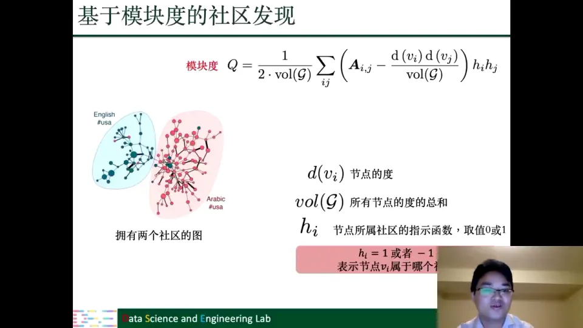

有多个社区时，$h_i$ 不再是一个标量，而是一个分配矩阵：假设有 $K$ 个社区，每个节点属于一个社区，就用一个 $K$ 维向量表示，属于第 $k$ 个社区则第 $k$ 维为 1，其他为 0。模块度的定义相应变成基于矩阵迹（trace）的形式，并加上“每个节点只属于一个社区”的约束 [【跳转到 107:13】](https://www.bilibili.com/video/BV1yx4y1R7uV/?p=3&t=6433)。

### 9.5 社区保留嵌入：同时重构“节点相关性”和“社区归属”

保留社区结构的图嵌入方法，基于模块度，但同时保留两部分信息：社区结构，以及节点之间的相关性 [【跳转到 108:26】](https://www.bilibili.com/video/BV1yx4y1R7uV/?p=3&t=6506)。

节点相关性用两部分合成：

- **一阶连接**：邻接矩阵 $A$，相连为 1，不相连为 0；
- **二阶重合**：$A_i$ 和 $A_j$ 的行向量分别代表 $i$ 的邻居和 $j$ 的邻居，相乘就表示两个节点邻居的重合度 [【跳转到 109:16】](https://www.bilibili.com/video/BV1yx4y1R7uV/?p=3&t=6556)。

把这两部分合起来得到节点相关性矩阵 $P$，然后用矩阵分解重构它：

$$
P \approx W_{con}W_{cen}^\top .
$$

这就是把 $P$ 分解成两个低维矩阵，用它们的内积表示节点相似性，和之前讲的矩阵分解是一回事 [【跳转到 110:31】](https://www.bilibili.com/video/BV1yx4y1R7uV/?p=3&t=6631)。

社区信息则用模块度得到的归属矩阵 $H$ 来表示。每个节点有两种嵌入：上下文嵌入和中心节点嵌入；捕捉社区信息时用中心节点嵌入：

$$
H \approx W_{cen}C^\top ,
$$

其中 $C$ 是额外参数 [【跳转到 111:21】](https://www.bilibili.com/video/BV1yx4y1R7uV/?p=3&t=6681)。

所以最终目标函数是两部分重构误差之和：

$$
\min\ \left\|P-W_{con}W_{cen}^\top\right\|_F^2
+\left\|H-W_{cen}C^\top\right\|_F^2 .
$$

第一部分保留节点相关性，第二部分保留社区归属；其余组件与 DeepWalk 相同 [【跳转到 112:11】](https://www.bilibili.com/video/BV1yx4y1R7uV/?p=3&t=6731)。

至此，简单图上的四类信息——邻域共现、结构角色、节点状态、社区结构——都有了对应的嵌入方法。它们共享同一个框架，差别只在“提取什么”和“怎么重构”。

---

## 十、复杂图嵌入没有推翻框架，而是重定义了随机游走与信息提取器

**这一章的中心思想**：现实中的图往往不是“无向、同质、无属性”的简单图。异质图、二分图、多维图、符号图、超图、动态图各自改变了“节点/边是什么”以及“怎么在图上走”，但映射函数、重构器和优化目标仍然沿用前面的框架。

### 10.1 异质图：meta-path 让随机游走带上语义

异质图里有不同类型的节点和不同类型的边。跟同质图相比，除了节点和边的信息，还需要两个映射函数：把每个节点映射到相应的类型，把每条边映射到相应的类型 [【跳转到 113:56】](https://www.bilibili.com/video/BV1yx4y1R7uV/?p=3&t=6836)。

幻灯片里的例子是学术网络：节点有作者、文章、会议三种类型；边有三种关系——作者和 paper 之间的写作关系、paper 和 paper 之间的引用（cite）关系、paper 和会议之间的发表关系 [【跳转到 114:11】](https://www.bilibili.com/video/BV1yx4y1R7uV/?p=3&t=6851)。

在异质图上，随机游走不能直接照搬：节点类型不同，一条跨类型的路径在语义上很难解释 [【跳转到 115:01】](https://www.bilibili.com/video/BV1yx4y1R7uV/?p=3&t=6901)。

解决办法是 **meta-path（元路径）**：它规定“按什么类型的节点、沿什么类型的关系走”，通常要借助领域知识预先定义。比如 author→paper→paper→venue：从作者出发，走到他写的 paper，再沿引用走到另一篇 paper，最后走到会议 [【跳转到 116:21】](https://www.bilibili.com/video/BV1yx4y1R7uV/?p=3&t=6981)。

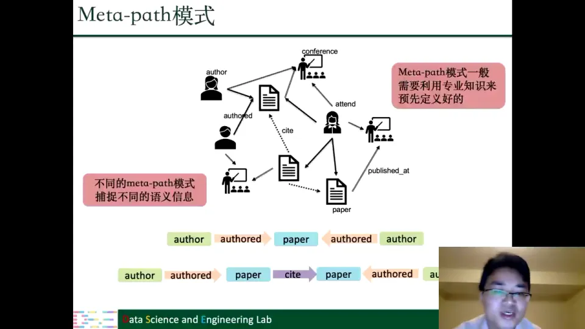

随机游走按模板走：当前是 author，下一步只能沿写作关系走到 paper；到了 paper，再按模板选下一种关系，这样序列才有明确语义 [【跳转到 118:12】](https://www.bilibili.com/video/BV1yx4y1R7uV/?p=3&t=7092)。

其余部分和 DeepWalk 一样。代表方法是 **Metapath2Vec**：用 meta-path 约束的随机游走提取共现，其余复用 DeepWalk [【跳转到 118:55】](https://www.bilibili.com/video/BV1yx4y1R7uV/?p=3&t=7135)。

### 10.2 二分图：边信息加两个同质子图

二分图有两组节点，同一组内部不相连，连接只发生在两组不同节点之间 [【跳转到 119:26】](https://www.bilibili.com/video/BV1yx4y1R7uV/?p=3&t=7166)。推荐系统是典型例子：一组是用户，一组是商品。

二分图嵌入提取三部分信息 [【跳转到 119:49】](https://www.bilibili.com/video/BV1yx4y1R7uV/?p=3&t=7189)：

1. **边信息**：用户和商品之间是否有边；
2. **用户子图**：把用户投影成一张同质图；
3. **商品子图**：把商品投影成一张同质图。

子图怎么生成？两个用户共享至少一个商品就连边；共享多个商品则把权重相乘后求和 [【跳转到 120:14】](https://www.bilibili.com/video/BV1yx4y1R7uV/?p=3&t=7214)。

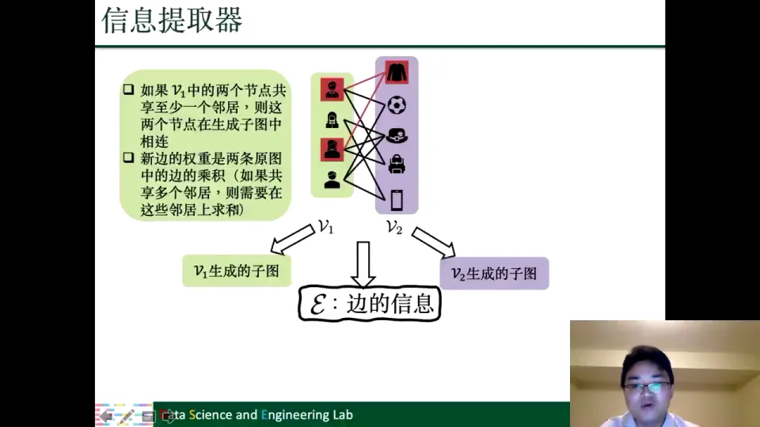

有了两个同质子图，就可以分别用 DeepWalk 捕捉用户侧和商品侧的结构信息 [【跳转到 120:39】](https://www.bilibili.com/video/BV1yx4y1R7uV/?p=3&t=7239)。

边信息则用重构器保留：给定两个节点的嵌入，用内积加 sigmoid 计算它们之间有一条边的概率；对真实存在的边最大化这个概率 [【跳转到 121:18】](https://www.bilibili.com/video/BV1yx4y1R7uV/?p=3&t=7278)。

### 10.3 多维图：共享映射加维度专属映射

多维图描述同一组节点之间的多种关系。比如在视频网站上，用户可以订阅某人、观看某人的视频、评论某人的视频；这三种关系就构成三个维度 [【跳转到 123:23】](https://www.bilibili.com/video/BV1yx4y1R7uV/?p=3&t=7403)。

它和 Struc2Vec 的 $k$ 层图相似，但有一个绝对差别：多维图中一个节点会连接到所有其他维度的对应节点，而 $k$ 层图只连接相邻层 [【跳转到 124:28】](https://www.bilibili.com/video/BV1yx4y1R7uV/?p=3&t=7468)。

映射函数也相应分成两部分 [【跳转到 124:53】](https://www.bilibili.com/video/BV1yx4y1R7uV/?p=3&t=7493)：

- 一个**共享映射**，得到所有维度共有的信息，跟具体维度无关；
- 每个维度一个**专属映射**，保留该维度特有的信息。

某个维度的最终表示，就是共享部分和该维度专属部分的相加 [【跳转到 125:43】](https://www.bilibili.com/video/BV1yx4y1R7uV/?p=3&t=7543)。

随机游走只在每个维度内部进行，算法同 DeepWalk。重构第 $l$ 个维度时，同时用共享信息和第 $l$ 个维度的专属信息；$K$ 个维度共需 $K+1$ 个映射函数：$K$ 个专属，加 1 个共享 [【跳转到 127:08】](https://www.bilibili.com/video/BV1yx4y1R7uV/?p=3&t=7628)。

### 10.4 符号图：平衡理论要求“朋友比敌人更近”

前面的图都假设边是正向的。但现实中存在负向边：社交媒体里可以屏蔽、拉黑用户；基因网络里，基因之间除了正向交互，也有负向交互 [【跳转到 128:16】](https://www.bilibili.com/video/BV1yx4y1R7uV/?p=3&t=7696)。

符号图的边分为正边和负边。对每个中心节点提取三元组 $(v_i,v_j,v_k)$：$v_i$–$v_j$ 是正边，$v_i$–$v_k$ 是负边 [【跳转到 128:16】](https://www.bilibili.com/video/BV1yx4y1R7uV/?p=3&t=7696)。

这来自社会学的**平衡理论**：安排座位时，你会和朋友坐得近、离敌人远 [【跳转到 129:06】](https://www.bilibili.com/video/BV1yx4y1R7uV/?p=3&t=7746)。

翻译成嵌入目标就是：让 $v_i$ 和 $v_j$ 的相似度，高于 $v_i$ 和 $v_k$ 的相似度。也就是最大化两者的差：

$$
\max\ \left[\operatorname{sim}(v_i,v_j)-\operatorname{sim}(v_i,v_k)\right].
$$

这样，有正边的节点对会被拉近，有负边的节点对会被推远 [【跳转到 130:46】](https://www.bilibili.com/video/BV1yx4y1R7uV/?p=3&t=7846)。

### 10.5 超图：超边描述的是一组节点之间的关系

超图里，一条边可以连接任意多个节点。幻灯片以论文为例：节点是文章，超边表示“这些文章共享作者”，同一作者的多篇文章被同一条超边连在一起 [【跳转到 132:11】](https://www.bilibili.com/video/BV1yx4y1R7uV/?p=3&t=7931)。

超图嵌入提取两部分信息：

1. **节点两两共现**：统计两个节点共同出现在多少条超边里，构造 $N\times N$ 的共现矩阵 $A$。$A_{ij}$ 是共同出现次数 [【跳转到 133:23】](https://www.bilibili.com/video/BV1yx4y1R7uV/?p=3&t=8003)。
2. **超边信息**：保留“这些节点同属一条超边”的关系 [【跳转到 133:48】](https://www.bilibili.com/video/BV1yx4y1R7uV/?p=3&t=8028)。

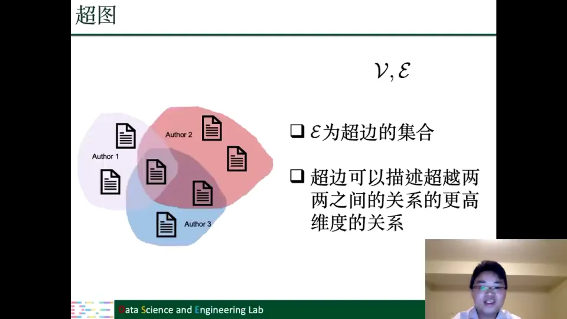

重构节点两两共现时，用一个映射函数即可，不区分中心节点和上下文节点；通过多层感知机（MLP）从节点嵌入重构共现信息，类似自编码器 [【跳转到 134:24】](https://www.bilibili.com/video/BV1yx4y1R7uV/?p=3&t=8064)。

重构超边信息时，给定共同属于一条超边的节点集合，计算它们同属一条超边的概率，同样用多层感知机加 sigmoid 表示。目标函数是两部分之和 [【跳转到 135:14】](https://www.bilibili.com/video/BV1yx4y1R7uV/?p=3&t=8114)。

### 10.6 动态图：随机游走不能“穿越时间”

动态图在节点和边之外，还给每个节点、每条边加了时间信息：节点什么时候加入图，边什么时候形成 [【跳转到 135:48】](https://www.bilibili.com/video/BV1yx4y1R7uV/?p=3&t=8148)。

动态图上的随机游走和 DeepWalk 基本一样，唯一不同是要考虑时间：**下一条边的发生时间必须在上一条边之后**，不能还没发生就游走过去 [【跳转到 136:38】](https://www.bilibili.com/video/BV1yx4y1R7uV/?p=3&t=8198)。

发生在过去的边，走过去概率为 0；只有未来的边有效，且发生时间离当前越近，被选中概率越大 [【跳转到 137:53】](https://www.bilibili.com/video/BV1yx4y1R7uV/?p=3&t=8273)。

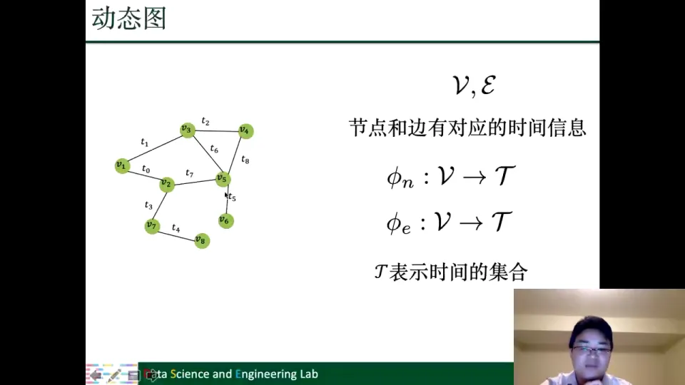

除游走约束外，信息提取、重构和优化都与 DeepWalk 一致 [【跳转到 138:43】](https://www.bilibili.com/video/BV1yx4y1R7uV/?p=3&t=8323)。

---

## 小结

- **图嵌入的目标不是“降维”本身，而是“有目的地保留信息”**。低维、稠密只是形式；真正决定方法好坏的是：低维表示能否重构出原图上我们关心的那部分结构。
- **第一代方法把图嵌入当作数据降维**：谱聚类取拉普拉斯矩阵的前 $d$ 个特征向量，Isomap、LLE、Laplacian Eigenmaps 和矩阵分解也都沿这条线。它们为图神经网络提供了思想源头，但特征分解的高代价限制了对大规模图的应用 [【跳转到 12:30】](https://www.bilibili.com/video/BV1yx4y1R7uV/?p=3&t=750)。
- **Word2Vec 提供了可迁移的范本**：用 one-hot 定位词，用上下文共现定义语义，用映射函数把词压到低维，再用“提取共现—重构共现—让两者接近”训练。它的四个组件后来原样出现在图嵌入里 [【跳转到 21:47】](https://www.bilibili.com/video/BV1yx4y1R7uV/?p=3&t=1307)。
- **图嵌入通用框架只有四个组件**：映射函数、信息提取器、重构器、优化目标。所有 2.0 方法都在回答“保留什么信息、怎么提取、怎么重构、怎么优化” [【跳转到 31:58】](https://www.bilibili.com/video/BV1yx4y1R7uV/?p=3&t=1918)。
- **DeepWalk 的关键是把图变成句子**：随机游走产生 $N\times T$ 条序列，节点当词、序列当句子，再用两个映射函数和 softmax 重构共现。层次 softmax 把查找降到 $O(\log n)$，负采样把全量归一化换成“正样本 vs $K$ 个负样本” [【跳转到 51:07】](https://www.bilibili.com/video/BV1yx4y1R7uV/?p=3&t=3067)。
- **简单图的四类信息对应四类方法**：邻域/共现（DeepWalk、LINE、Node2Vec）、结构角色（Struc2Vec）、节点状态（中心性排序）、社区结构（模块度 + 矩阵分解）。它们共享框架，只改信息提取器或加一项约束 [【跳转到 36:33】](https://www.bilibili.com/video/BV1yx4y1R7uV/?p=3&t=2193)。
- **复杂图没有推翻框架**：异质图用 meta-path 约束游走，二分图拆成边信息加两个子图，多维图用共享映射加维度专属映射，符号图用平衡理论构造三元组，超图用超边和两两共现矩阵，动态图给随机游走加时间约束 [【跳转到 113:06】](https://www.bilibili.com/video/BV1yx4y1R7uV/?p=3&t=6786)。
- **一句话记住整讲**：选一种“什么关系重要”的定义，设计能提取它的游走，再用低维映射重构并优化。

---

## 关键术语速查

| 术语 | 一句话解释 |
| --- | --- |
| 图嵌入 / 网络嵌入（graph/network embedding） | 把节点映射到低维向量空间，使向量保留原图的重要信息；本课程不区分“图”和“网络” |
| 节点表示学习（node representation learning） | 学习映射 $f:V\to\mathbb{R}^d$，用 $d$ 维向量表示每个节点，$d$ 远小于节点数 |
| 邻接矩阵（adjacency matrix） | $A_{ij}=1$ 表示节点 $i$、$j$ 相连；每一行可看作一个节点，但通常极其稀疏且维度等于节点数 |
| 谱聚类（spectral clustering） | 用拉普拉斯矩阵的前 $d$ 个特征向量作为节点表示，再对表示做 K-means 等聚类 |
| 拉普拉斯矩阵（Laplacian matrix） | 描述图结构的矩阵，其 eigenvalues/eigenvectors 是谱方法的核心；Laplacian Eigenmaps 是图神经网络的思想源头之一 |
| 中心词 / 上下文词（center / context word） | 当前关注的词是中心词；窗口范围内与它共现的词是上下文词 |
| 共现（co-occurrence） | 两个节点（或词）出现在同一个窗口/同一条边/同一条超边中；图嵌入要保留的核心信息之一 |
| 随机游走（random walk） | 从当前节点按转移概率走到邻居，重复若干步得到一条节点序列；DeepWalk 用它把图变成“句子” |
| 窗口（window） | 定义上下文范围的大小；序列中与中心节点距离不超过窗口的节点被视为上下文节点 |
| 层次 softmax（hierarchical softmax） | 用二叉树给节点建索引，把“对全图 softmax”变成“从根到叶的路径查找”，复杂度从 $O(n)$ 降到 $O(\log n)$ |
| 负采样（negative sampling） | 不遍历全图，只对真实共现的正样本和随机抽取的 $K$ 个负样本做二分类，复杂度与固定 $K$ 相关 |
| LINE | 把每条边直接当作共现对，相当于长度为 1 的随机游走；其余组件与 DeepWalk 类似 |
| Node2Vec | 用二阶随机游走提取共现，参数 $p$ 控制回到上一个节点，$q$ 控制走远还是留在附近 |
| 结构角色（structural role） | 节点在网络中扮演的功能性角色，例如枢纽；距离远但角色相同的节点也应当相似 |
| Struc2Vec | 用度的 $k$ 阶序列定义结构相似性，构造 $k$ 层全连接图，并在层内/层间随机游走 |
| 节点状态（node status） | 节点在图中的重要程度，可用度中心性、接近中心性、特征向量中心性等衡量 |
| 社区结构（community structure） | 图内部连接紧密、彼此之间连接松散的区域；可用模块度来发现 |
| 模块度（modularity） | 比较社区内实际连接数与随机图期望连接数的差异，值越大说明社区结构越明显 |
| 异质图（heterogeneous graph） | 节点类型和边类型不止一种的图，例如作者—论文—会议网络 |
| meta-path（元路径） | 异质图上规定节点类型和边类型的路径模板，例如 author→paper→paper→venue；随机游走按模板进行 |
| 二分图（bipartite graph） | 节点分成两组，组内不相连，边只存在于两组之间，例如用户—商品 |
| 多维图（multi-view graph） | 同一组节点之间存在多种关系，每种关系构成一个维度；表示由共享部分和维度专属部分组成 |
| 符号图（signed graph） | 边分为正边和负边；用平衡理论构造三元组，让正边节点比负边节点更相似 |
| 超图（hypergraph） | 一条超边可以连接任意多个节点，描述超越两两关系的更高维关系 |
| 动态图（dynamic graph） | 节点和边带有时间戳；随机游走只能沿时间上未发生的边走，且时间越近概率越大 |
