# 第04讲：图神经网络

## 本讲要解决的核心问题（SCQA）

**背景**：前几讲我们已经熟悉了图的基本表示——用邻接矩阵描述拓扑，用特征矩阵描述节点。也见过第一代图表示学习（谱聚类、ISOMAP、LLE、Laplacian eigenmaps、矩阵分解）和第二代图表示学习（把 Word2Vec 用到图上的 DeepWalk）。

**冲突**：这些方法大多是无监督的、浅层的，学到的图表示和下游任务之间是分开的；而真实场景里的图任务既有"给每个节点打标签"的节点级任务，也有"给整张图打标签"的图级任务，图数据又同时包含拓扑和节点特征。直接套用传统神经网络，既无法处理不规则的邻居结构，也无法把节点表示自然压缩成图表示。

**疑问**：能不能像卷积神经网络那样，为图设计可堆叠、可端到端训练的"层"？图上的"卷积"到底是什么？节点表示又怎样变成整张图的表示？

**回答（中心思想）**：图神经网络用两个基本操作回答了这两个问题。**图滤波**负责在保持拓扑不变的前提下更新节点特征，解决节点级任务；**图池化**负责把图逐步粗化、把节点表示压缩成图表示，解决图级任务。图滤波并不是凭空设计的聚合技巧：从拉普拉斯矩阵、图傅里叶变换出发，可以一步步推导出 GCN；而空间域的 GraphSAGE、GAT、ECC、GGNN 等方法，本质上都是在"换一种邻居聚合方式"，可以用消息传递（MPNN）统一描述。更进一步，这些图滤波操作可以被统一理解为**图信号降噪**，从而把"设计滤波器"转化为"设计优化问题"，为发明新模型提供了系统方法。

## 一、图神经网络是图表示学习的第三代：它把"层"和"端到端"带回图学习

### 1.1 三代演进：从矩阵分解、DeepWalk 到 GNN

讲图神经网络之前，讲者先给了一条历史线。**第一代图表示学习**是"图上的数据降维"：谱聚类（spectral clustering）、ISOMAP、LLE、Laplacian eigenmaps，以及我们熟悉的 PCA。这些方法很多都可以写成**矩阵分解**的形式；讲者反复强调，是因为矩阵分解是一种更通用的视角。[【跳转到 01:06】](https://www.bilibili.com/video/BV1yx4y1R7uV/?p=4&t=66)

**第二代**是把 Word2Vec 搬到图上，代表算法是 DeepWalk。它把图上的随机游走序列当作"句子"，把节点当作"词"，用 Word2Vec 学习节点嵌入。这一代方法在工程上很成功，但本质上仍然是浅层模型：讲者说，Word2Vec 也可以看成"一层的神经网络"，却没有传统深度学习那种层与层的结构，因此无法通过堆叠层来增加模型容量。[【跳转到 01:56】](https://www.bilibili.com/video/BV1yx4y1R7uV/?p=4&t=116)

**第三代**就是本讲的图神经网络。它真正引入了"层"的概念：输入层、隐含层、输出层，可以一层一层叠加，让模型变深、容量变大。讲者用"图表示学习 3.0"来称呼它。[【跳转到 02:46】](https://www.bilibili.com/video/BV1yx4y1R7uV/?p=4&t=166)

| 代际 | 代表方法 | 核心做法 | 主要局限 |
| --- | --- | --- | --- |
| 第一代 | 谱聚类、ISOMAP、LLE、Laplacian eigenmaps、PCA | 图矩阵降维 / 矩阵分解 | 浅层，表示与任务分离 |
| 第二代 | DeepWalk（Word2Vec + 随机游走） | 用序列学习节点嵌入 | 仍是一层式模型，难堆叠 |
| 第三代 | GCN、GraphSAGE、GAT 等 GNN | 图滤波 / 图池化，多层堆叠 | 需要专门设计聚合与池化 |

### 1.2 与网络嵌入的三个本质区别

讲者把 GNN 和前面两代的区别概括为三点。

**第一，层与层的结构带来深度和容量。** 有了层，就可以叠加很多层，让模型变得很深，模型的容量（capacity）变强，对数据表征的学习强度也就更大。[【跳转到 03:11】](https://www.bilibili.com/video/BV1yx4y1R7uV/?p=4&t=191)

**第二，从无监督走向（通常的）监督、端到端。** 网络嵌入大多只针对图结构本身做无监督学习；GNN 通常把图表示学习和下游任务放在一起训练，形成一个端到端（end-to-end）的结构。这样学到的图表征和下游任务是绑定的，中间没有"表示学习"和"任务"之间的 gap。[【跳转到 04:26】](https://www.bilibili.com/video/BV1yx4y1R7uV/?p=4&t=266)

**第三，表示是任务相关的。** 因为端到端训练，节点表示会朝着"对当前任务有用"的方向调整，而不是先学一个通用嵌入再拿去碰运气。这正是 GNN 与网络嵌入在目标上的根本差别。[【跳转到 05:16】](https://www.bilibili.com/video/BV1yx4y1R7uV/?p=4&t=316)

### 1.3 本讲的路线图：两个操作、四条线索

本讲内容分为四块：图神经网络简介；图论与图上的信号处理；图滤波；图池化。讲者特别说明，图论与信号处理本来应该放在"图基础"那一讲，但为了讲清图滤波，他们做了章节调整，把必要的内容挪到这里，避免大家来回翻。[【跳转到 00:24】](https://www.bilibili.com/video/BV1yx4y1R7uV/?p=4&t=24)

真正的核心只有两个操作：**图滤波**和**图池化**。前者面向节点级任务，后者面向图级任务。图滤波部分又会按"最早的图滤波 → 基于谱域的图滤波 → 基于空间域的图滤波"展开；图池化部分则按"平面池化 → 层次池化"展开。[【跳转到 06:06】](https://www.bilibili.com/video/BV1yx4y1R7uV/?p=4&t=366)

## 二、图神经网络的输入是"拓扑 + 特征"，节点级任务用滤波、图级任务用池化

### 2.1 与传统神经网络最大的不同：输入至少有两个模态

传统神经网络处理文本或图像时，输入通常是一个张量，也就是一个模态的数据。图神经网络不一样：它最少有两个模态。第一个是**图本身**，用邻接矩阵 $A$ 表示拓扑结构；第二个是**每个节点上的特征**，用特征矩阵 $F$ 表示。[【跳转到 06:56】](https://www.bilibili.com/video/BV1yx4y1R7uV/?p=4&t=416)

特征矩阵 $F$ 的形状是 $N \times d$：每一行是一个节点，每一列是节点某一维特征。比如一个社交网络有 $N$ 个用户，每个用户有年龄、注册时长、活跃度三个特征，那么 $F$ 就是 $N \times 3$。讲者强调，这是图神经网络的"最小输入"：拓扑结构（邻接矩阵）加上节点特征（特征矩阵）。实际任务中可能缺少一部分信息，也可能有额外信息，但基本盘就是这两个。[【跳转到 07:21】](https://www.bilibili.com/video/BV1yx4y1R7uV/?p=4&t=441)

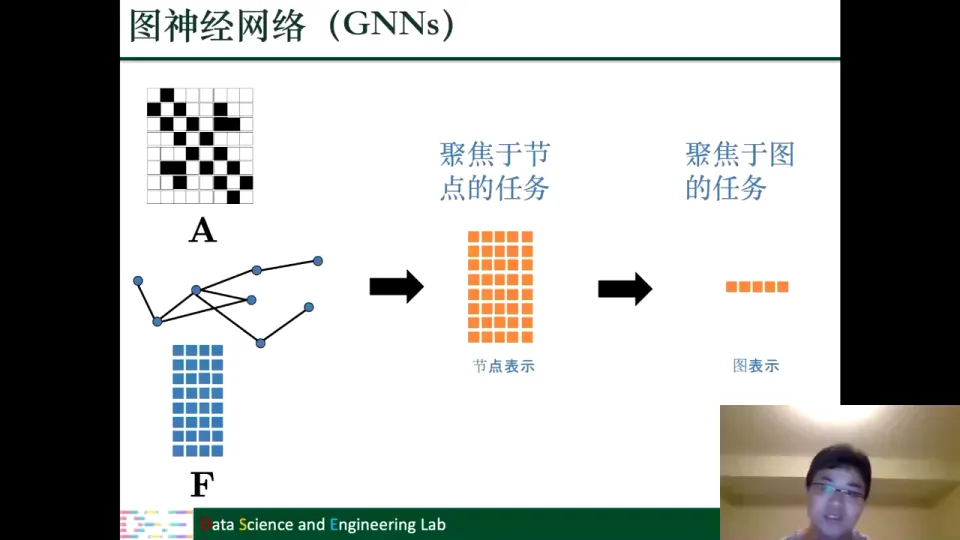

### 2.2 两类任务：节点级与图级

图上的任务一般分两类。**节点级任务**要学习每个节点的表示，比如给用户打标签、判断节点是否异常；这类任务主要靠图滤波操作。**图级任务**要学习整张图的表示，比如判断一个分子是否有毒、一张社交网络图是否属于某类社区；节点表示只是中间产物，最终要把许多节点的表示"压缩"成一个图表示，这就需要另一个操作——图池化。[【跳转到 08:36】](https://www.bilibili.com/video/BV1yx4y1R7uV/?p=4&t=516)

### 2.3 图滤波：只改特征，不改拓扑

图滤波操作的输入是图的拓扑结构和节点原来的表示，输出是新的节点表示 $F'$。它**不会改变图的拓扑结构**，只会学习到更好的节点表示：从 $F$ 变成 $F'$。用讲者的话说，图滤波的关注点就是"如何学到更好的节点表示"。[【跳转到 09:26】](https://www.bilibili.com/video/BV1yx4y1R7uV/?p=4&t=566)

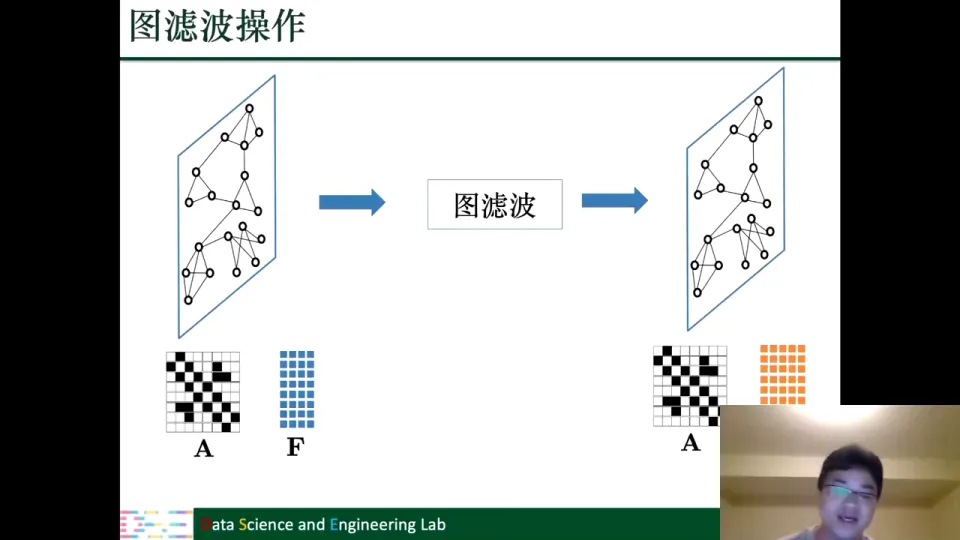

得到节点表示以后，就可以做节点级任务。和传统神经网络一样，图滤波之后通常要接一个**激活函数**，给模型引入非线性；也可以把"滤波 + 激活"当作一层，反复堆叠，让模型变深、容量变大。讲者在这里特意呼应了第一章：GNN 之所以能"深"，靠的就是这种可堆叠的层结构。[【跳转到 10:16】](https://www.bilibili.com/video/BV1yx4y1R7uV/?p=4&t=616)

### 2.4 图池化：拓扑和特征一起变小

图池化操作的输入还是邻接矩阵和节点表示，但它的输出是**新的拓扑结构** $A_p$ 和**新的节点特征** $F'_p$。也就是说，池化既改变图的结构，也改变节点表示。它的做法是把这个图适当地简化、粗化、变小：比如原来有三百个节点，一步池化后只剩五个；再池化一次，可能只剩一个节点。[【跳转到 12:04】](https://www.bilibili.com/video/BV1yx4y1R7uV/?p=4&t=724)

当图被池化成一个节点时，这个节点的表示就代表整张图。于是"节点表示 → 图表示"的转换就完成了。讲者把这种结构称为真正面向图任务的图神经网络模块。[【跳转到 13:44】](https://www.bilibili.com/video/BV1yx4y1R7uV/?p=4&t=824)

### 2.5 通用框架：滤波 + 激活，图任务再加池化

把上面的讨论合起来，就得到两个通用框架。

**节点级框架**：输入图结构和节点特征，经过多次"图滤波 + 非线性激活"，最后输出新的节点表示。整个过程中拓扑结构不变，只有节点表示在更新。

**图级框架**：在节点级框架的基础上，最后加一个图池化操作，把节点表示逐步压缩成图表示。也可以把"滤波 + 激活 + 池化"当作一个模块，反复堆叠，让整个结构变得很深，从而增加模型容量和可表达性。[【跳转到 14:39】](https://www.bilibili.com/video/BV1yx4y1R7uV/?p=4&t=879)

无论节点级还是图级任务，都离不开图滤波和图池化。接下来讲清这两个操作；先补图论与图信号处理。

## 三、拉普拉斯矩阵把"图信号有多光滑"变成可计算的频率

### 3.1 图信号：节点特征就是定义在节点上的信号

图可以写成 $G=(V,E)$：一组节点 $V$、一组边 $E$。图的研究本身是一个跨学科领域，计算机、电气工程、数学、统计、社会科学都在研究它，所以同一个概念常有多套术语；这部分还涉及线性代数，若一时听不懂，可以回看书第二章。**图信号**是定义在节点上的函数，它把每个节点映射到一个低维空间中的向量。换句话说，每个节点上都有一维或多维的数值，这些数值合起来就是图信号。[【跳转到 15:54】](https://www.bilibili.com/video/BV1yx4y1R7uV/?p=4&t=954)

这里有一个术语对照，讲者特意提醒不要被绕晕：

- 在**信号处理**的语言里，图信号的每一维叫一个**通道**（channel）；
- 在**机器学习**的语言里，同一件事叫**节点特征**的某一维，整个图信号就是我们熟悉的特征矩阵 $X$。

所以"图信号""节点特征矩阵""每个节点的表示"说的是同一件事，只是场景不同、叫法不同。为了方便，后面先假设每个节点只有一维信号，也就是一个长度为 $N$ 的向量 $f=(f_1,\dots,f_N)$，其中 $f_i$ 是节点 $v_i$ 上的信号值。[【跳转到 17:09】](https://www.bilibili.com/video/BV1yx4y1R7uV/?p=4&t=1029)

### 3.2 拉普拉斯矩阵 $L=D-A$ 是图上的差分算子

邻接矩阵 $A$ 很直观：两个节点有边，对应位置就是非零；没有边就是零。但在图信号处理里，还有一个比邻接矩阵更"好用"的矩阵——**拉普拉斯矩阵**。

它的定义很简单：

1. 先由邻接矩阵算出**度矩阵** $D$。度矩阵是对角矩阵，对角线上第 $i$ 个元素是节点 $v_i$ 的度（与它相连的边数），其余位置全为零。
2. 用度矩阵减去邻接矩阵：$L = D - A$。

比如一个节点的度是 1，$D$ 对角线上就是 1；$D$ 的每一行其实就是邻接矩阵对应行的加和。虽然只是做了一个很简单的变换，但拉普拉斯矩阵承载了图论中大量重要性质，后面几乎所有谱方法都建立在它或它的变形之上。[【跳转到 19:14】](https://www.bilibili.com/video/BV1yx4y1R7uV/?p=4&t=1154)

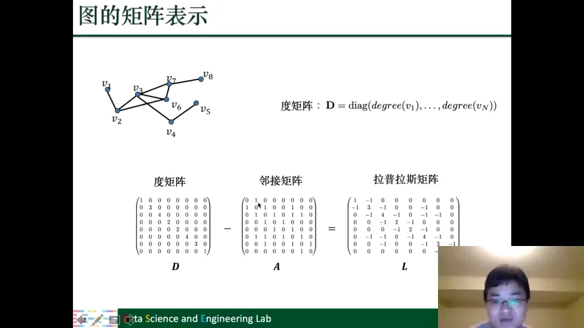

### 3.3 用 $L$ 乘图信号：衡量节点与邻居的差异

把拉普拉斯矩阵作用在一个图信号 $f$ 上：

$$
h = Lf = (D-A)f = Df - Af
$$

对每个节点 $v_i$，可以写成：

$$
h(i) = \sum_{v_j \in \mathcal{N}(v_i)} \big(f(i)-f(j)\big)
$$

其中 $\mathcal{N}(v_i)$ 是节点 $v_i$ 的邻居集合。这个式子的含义很直白：$h(i)$ 就是"节点 $i$ 的信号"与"它所有邻居的信号"之差的总和。所以拉普拉斯矩阵可以看成一个**差分算子**：它不关心信号本身有多大，只关心信号在相邻节点之间变化了多少。[【跳转到 20:54】](https://www.bilibili.com/video/BV1yx4y1R7uV/?p=4&t=1254)

不过，直接对差值求和有一个问题：有的差是正的，有的差是负的，正负会互相抵消。两个节点差别很大，但一正一负加起来可能接近零，这就不能真实反映差异大小。于是我们改用**二次型**：

$$
f^T L f = \frac{1}{2}\sum_{i,j=1}^{N} A[i,j]\big(f(i)-f(j)\big)^2
$$

平方以后，正负不再抵消，我们只看差异的绝对大小。这个量就能很好地衡量图信号的**光滑程度**：相邻节点信号越接近，$f^T L f$ 越小；相邻节点信号差得越远，$f^T L f$ 越大。[【跳转到 23:49】](https://www.bilibili.com/video/BV1yx4y1R7uV/?p=4&t=1429)

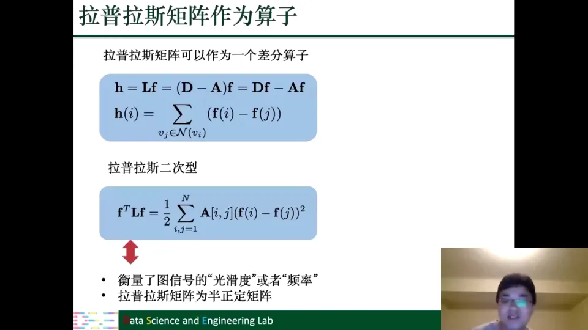

用信号处理的术语说，这就是**频率**：

- 信号很光滑、相邻节点很相似 → 低频；
- 信号很粗糙、相邻节点差异很大 → 高频。

比如一张社交网络上的"用户活跃度"信号，如果朋友之间的活跃度都差不多，它就是低频信号；如果相邻用户之间忽高忽低，它就是高频信号。这个类比把抽象的"特征"变成了可以讨论"平滑/振荡"的对象。

### 3.4 半正定性：为什么拉普拉斯矩阵可以做特征分解

从二次型还能看出一个关键性质。对任意非零向量 $f$，$f^T L f$ 是一堆平方项的和，所以它不可能小于零，只能大于零或等于零。线性代数里，这样的矩阵叫**半正定矩阵**（positive semi-definite）。讲者说，这个性质非常重要，因为半正定矩阵一定可以做特征分解。[【跳转到 25:54】](https://www.bilibili.com/video/BV1yx4y1R7uV/?p=4&t=1554)

拉普拉斯矩阵的特征分解是：

$$
L = U\Lambda U^T
$$

其中 $U$ 的每一列是一个特征向量，$\Lambda$ 是对角矩阵，对角线上是对应的特征值。因为 $L$ 是半正定的，所以它有 $N$ 个标准正交的特征向量，对应 $N$ 个非负特征值。通常把特征值从小到大排列：

$$
0 = \lambda_0 < \lambda_1 \le \cdots \le \lambda_{N-1}
$$

最小的特征值一定是零，对应的特征向量是"所有分量都相等"的常向量——直观上，整张图上信号处处相同，当然最光滑、频率最低。[【跳转到 27:14】](https://www.bilibili.com/video/BV1yx4y1R7uV/?p=4&t=1634)

### 3.5 特征向量就是一组"图信号基"，特征值就是频率

这里有一个非常漂亮的视角转换。$L$ 是 $N \times N$ 的矩阵，每个特征向量 $u_i$ 也是 $N$ 维的。既然图信号也是 $N$ 维的，那么**每个特征向量都可以看作定义在图上的一个信号**。[【跳转到 28:29】](https://www.bilibili.com/video/BV1yx4y1R7uV/?p=4&t=1709)

把 $u_i$ 当作图信号，它的频率是多少？由特征方程 $L u_i = \lambda_i u_i$，两边左乘 $u_i^T$，并利用 $u_i^T u_i = 1$，得到：

$$
u_i^T L u_i = \lambda_i
$$

也就是说，**特征值 $\lambda_i$ 正好就是特征向量 $u_i$ 这个图信号的频率**。特征值越大，对应的特征向量在图上的变化越剧烈，频率越高；从 $u_0$ 到 $u_{N-1}$，信号会从低频逐渐变得越来越高频。讲者用一组小图演示了这一点：$u_0$ 几乎处处相同，$u_7$ 则在相邻节点之间剧烈振荡。[【跳转到 30:59】](https://www.bilibili.com/video/BV1yx4y1R7uV/?p=4&t=1859)

因为这些特征向量两两正交，它们构成了 $N$ 维空间的一组正交基。就像二维平面上任何向量都可以用 $x$ 轴、$y$ 轴两个基表示一样，任何一个图信号也都可以用这 $N$ 个特征向量作为"坐标轴"来表示。这个类比是理解图傅里叶变换的钥匙。[【跳转到 32:14】](https://www.bilibili.com/video/BV1yx4y1R7uV/?p=4&t=1934)

### 3.6 图傅里叶变换：空间域与谱域之间的来回切换

任意图信号 $f$ 都可以写成特征向量的线性组合：

$$
f = \sum_{i=0}^{N-1} \hat{f}_i \, u_i
$$

其中 $\hat{f}_i$ 是第 $i$ 个基的系数，称为**傅里叶系数**。因为 $U$ 是正交矩阵，系数可以通过内积求出：

$$
\hat{f}_i = f^T u_i
\quad\Longleftrightarrow\quad
\hat{f} = U^T f
$$

反过来，知道所有系数，就可以重建原信号：

$$
f = U\hat{f}
$$

这两个方向分别叫**图傅里叶变换（GFT）**和**图傅里叶反变换（IGFT）**。它们让我们可以在两个"域"之间来回切换：

- **空间域（spatial domain / spatial space）**：信号直接定义在原来的图结构上，我们能看到哪个节点取什么值；
- **谱域（spectral domain）**：信号表示成各频率分量的系数，我们能看到它由哪些频率组成、各占多少。

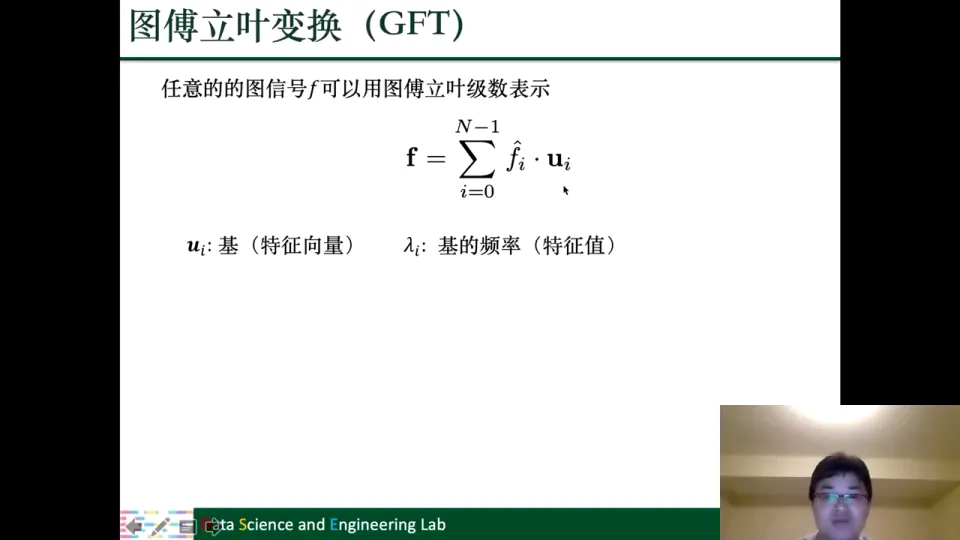

这个"两域"视角是后面所有谱图滤波的基础：**滤波既可以在空间域做，也可以在谱域做**。在空间域，我们根据邻居连接设计聚合；在谱域，我们直接对频率分量做取舍。两条路看似不同，后面会看到它们其实是相通的。[【跳转到 37:31】](https://www.bilibili.com/video/BV1yx4y1R7uV/?p=4&t=2251)

## 四、谱域图滤波从任意滤波器出发，经过多项式与切比雪夫简化，最终得到 GCN

### 4.1 最早的图滤波：把邻居信息聚合成新特征

在讲谱方法之前，讲者先介绍了 20 世纪 90 年代或 21 世纪初的**最早图滤波操作**。它已经是"聚合邻居"的雏形：某一层的输入是上一层的输出；节点 $v_i$ 的新表示 $F'_i$，由它邻居的信息聚合而来：

$$
F'_i = \sum_{v_j \in \mathcal{N}(v_i)} f\big(l_i, F_j, l_j\big), \qquad \forall v_i \in V
$$

其中 $F_i$ 是图滤波的输入特征，$l_i$ 是节点的初始信息，$F'_i$ 是输出特征；$f$ 通常是一个前馈神经网络（MLP，多层感知机）。也就是说，对每个邻居，先用一个可学习的函数把"中心节点信息、邻居特征、邻居初始信息"变换一下，再把所有邻居的变换结果加起来。[【跳转到 39:36】](https://www.bilibili.com/video/BV1yx4y1R7uV/?p=4&t=2376)

这个操作非常朴素，但它是后面所有空间域方法的原型。讲者把它放在这里，是为了在讲完 GCN、GraphSAGE、GAT 之后再回头看：这些现代方法虽然形式不同，但"从邻居聚合信息"的内核是一样的。

### 4.2 谱滤波的三步：变换、过滤、反变换

有了图傅里叶变换，设计滤波器就有了清晰的流程：

1. **正变换**：把空间域信号 $f$ 变到谱域，得到傅里叶系数 $\hat{f}=U^T f$；
2. **过滤**：在谱域对每个频率分量乘一个滤波器 $g(\lambda_i)$，得到 $\hat{y}_i = g(\lambda_i)\hat{f}_i$；
3. **反变换**：把过滤后的系数变回空间域，$y = U\hat{y}$。

合起来就是：

$$
y = U \, g(\Lambda) \, U^T f
$$

其中 $g(\Lambda)$ 是对角矩阵，对角线上是 $g(\lambda_0),\dots,g(\lambda_{N-1})$。如果想让高频分量衰减，就设计一个**低通滤波器**：当 $\lambda_i$ 较小时 $g(\lambda_i)$ 接近 1，当 $\lambda_i$ 较大时 $g(\lambda_i)$ 接近 0。反过来也可以设计高通、带通，或者只保留某个频率区间。[【跳转到 42:31】](https://www.bilibili.com/video/BV1yx4y1R7uV/?p=4&t=2551)

这就是谱图滤波的总体思路：**滤波器的形状决定保留哪些频率**。剩下的问题是：这个 $g$ 从哪里来？

### 4.3 两个工程问题：滤波器怎么定、多通道怎么办

讲者把困难归纳为两个问题。

**第一，滤波器 $g$ 怎么设计？** 我们通常没有信号的先验知识，也不知道哪些频率对下游任务有用。最自然的做法是**从数据里学习** $g$。这正是机器学习的优势：不需要人工指定滤波器，而是让模型根据任务自动调整。[【跳转到 45:51】](https://www.bilibili.com/video/BV1yx4y1R7uV/?p=4&t=2751)

**第二，多通道信号怎么处理？** 前面讲的是一维信号到一维信号，设计一个滤波器就够了。如果输入是 $d_1$ 维、输出是 $d_2$ 维，通常的做法是设计 $d_1 \times d_2$ 个滤波器：输出的每一维，都是对输入所有维度分别滤波后求和的结果。写成矩阵形式就是 $F' = U g(\Lambda) U^T F$，其中 $F$ 是 $N \times d_1$，$F'$ 是 $N \times d_2$，$g(\Lambda)$ 变成了一个对角块结构（每个输入输出通道对一个滤波器）。[【跳转到 46:35】](https://www.bilibili.com/video/BV1yx4y1R7uV/?p=4&t=2795)

### 4.4 非参数滤波器：最灵活，但参数多、算不起

第一种学习 $g$ 的方法最"粗"：对 $g$ 不做任何假设，直接把它看成一个长度为 $N$ 的参数向量 $\theta_1,\dots,\theta_N$，每个特征值对应一个可学习参数。这就是**非参数滤波器**。

它的优点是灵活：数据是什么样，就学什么样的滤波器。如果某个高频分量没用，模型可以把对应的 $\theta_i$ 学成 0，相当于把它滤掉。但问题也很致命：

- **参数太多**：每个滤波器要学 $N$ 个参数，$N$ 是节点数；多通道还要再乘 $d_1 \times d_2$。现实中的图可能非常大，参数量无法接受。
- **必须做特征分解**：因为没有对 $g$ 做任何函数形式的假设，无法把 $U g(\Lambda) U^T$ 写成拉普拉斯矩阵的函数，只能先对 $L$ 做特征分解得到 $U$。而 $N \times N$ 矩阵的特征分解非常费时，扩展性很差。[【跳转到 51:25】](https://www.bilibili.com/video/BV1yx4y1R7uV/?p=4&t=3085)

所以它在真实大图上不可取。

### 4.5 多项式滤波器：用 $K+1$ 个参数共享所有频率

第二种思路是给 $g$ 一个函数形式：假设它是一个 $K$ 阶多项式：

$$
g(\lambda) = \sum_{k=0}^{K} \theta_k \lambda^k
$$

这样一来，不管图有多大、有多少个特征值，滤波器只有 $K+1$ 个参数，所有频率共享同一组 $\theta_k$。参数量从 $O(N)$ 降到了 $O(K)$，而 $K$ 通常很小。[【跳转到 53:05】](https://www.bilibili.com/video/BV1yx4y1R7uV/?p=4&t=3185)

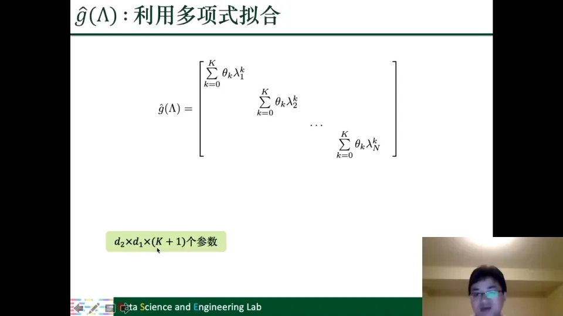

更妙的是，把多项式代入 $U g(\Lambda) U^T$，利用 $U\Lambda^k U^T = L^k$，可以得到：

$$
U g(\Lambda) U^T f = \sum_{k=0}^{K} \theta_k L^k f
$$

这意味着我们**不需要做特征分解**，直接用拉普拉斯矩阵的幂就能完成滤波。计算上只涉及稀疏矩阵乘法，复杂度大大降低。

而且 $L^K$ 有明确的空间含义：如果两个节点之间存在一条长度为 $K$ 的路径，那么 $L^K$ 的对应位置就非零；否则为零。所以多项式滤波在空间域上就是**从 $K$ 跳邻居内聚合信息**。这解释了为什么"谱域设计"最终会落到"邻居聚合"上。[【跳转到 54:20】](https://www.bilibili.com/video/BV1yx4y1R7uV/?p=4&t=3260)

但多项式基 $1,x,x^2,\dots$ 有一个缺点：它**不是正交的**。基不正交，参数稍微扰动一下，学习过程就可能非常不稳定，学到的参数可能差异很大。于是讲者引入了切比雪夫多项式。

### 4.6 切比雪夫多项式：正交基让训练更稳定

**切比雪夫多项式**用递推方式定义：

$$
T_0(x)=1,\qquad T_1(x)=x,\qquad T_k(x)=2xT_{k-1}(x)-T_{k-2}(x)
$$

它在特定函数空间里是正交的。用切比雪夫多项式作基，滤波函数写成：

$$
g(\Lambda) = \sum_{k=0}^{K}\theta_k T_k(\tilde{\Lambda}),
\qquad
\tilde{\Lambda} = \frac{2\Lambda}{\lambda_{\max}} - I
$$

这里把特征值缩放到了 $[-1,1]$，正好落在切比雪夫多项式的定义域内。缩放还有一个好处：做 $L$ 的高次幂时，数值不会爆炸，训练更稳定。[【跳转到 56:50】](https://www.bilibili.com/video/BV1yx4y1R7uV/?p=4&t=3410)

对应到空间域，滤波可以写成：

$$
U g(\Lambda) U^T f = \sum_{k=0}^{K}\theta_k T_k(\tilde{L})f,
\qquad
\tilde{L} = \frac{2L}{\lambda_{\max}} - I
$$

它和多项式滤波的结构完全一样，唯一区别是基换成了正交的切比雪夫多项式。因此它同样只需要 $K+1$ 个参数、同样不需要特征分解，但学习过程更稳定。讲者把这条演化线总结为：**任意多项式 → 基本多项式 → 切比雪夫多项式**。

### 4.7 GCN 是切比雪夫滤波器的"一阶简化"

有了切比雪夫滤波器，GCN 的推导就水到渠成了。讲者把它概括为三步简化：

1. **只取一阶**：令 $K=1$，只保留前两项，$g(\Lambda)=\theta_0+\theta_1(\Lambda-I)$；
2. **假设最大特征值为 2**：$\lambda_{\max}=2$，进一步化简；
3. **令两个参数相等**：$\theta=\theta_0=-\theta_1$，把两个参数合并成一个。

经过这些简化，滤波操作变成：

$$
U g(\Lambda) U^T f = \theta\big(I + D^{-1/2}AD^{-1/2}\big)f
$$

再给每个节点加上 **self-loop**（自连接），把 $A$ 换成 $\tilde{A}=A+I$，并做重归一化（renormalization）：

$$
\tilde{A} = A+I,\qquad
\hat{A} = \tilde{D}^{-1/2}\tilde{A}\tilde{D}^{-1/2}
$$

最终得到 GCN 的经典形式：

$$
F' = \hat{A}F\Theta
$$

其中 $\Theta$ 是可学习的线性变换参数。讲者说，GCN 在实践中很多情况下比完整的切比雪夫滤波器效果还要好一点，但它本质上只是切比雪夫滤波器的一个特殊形式，并不是凭空发明的"魔法"。[【跳转到 61:07】](https://www.bilibili.com/video/BV1yx4y1R7uV/?p=4&t=3667)

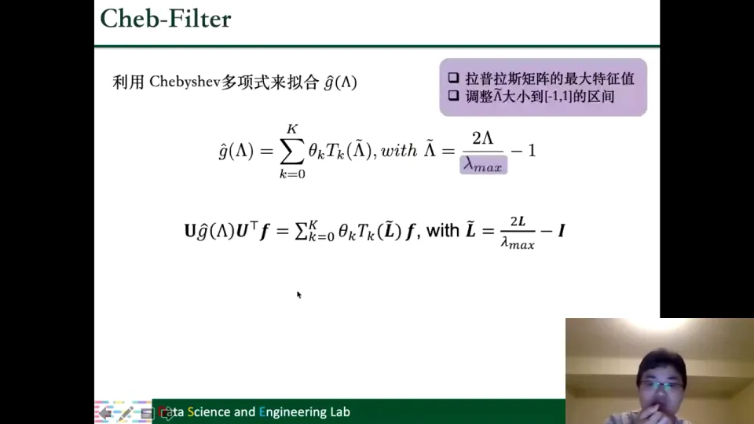

### 4.8 空间域解释：GCN 就是在"邻居 + 自己"上加权求和

GCN 的公式还可以从空间域理解。把 $\hat{A}$ 的每一行看成一个节点的聚合权重：

$$
F'_i = \sum_{j} \hat{A}[i,j] \, F_j \, \Theta
$$

由于 $\hat{A}[i,j]$ 只在 $v_j$ 是 $v_i$ 的邻居、或者 $v_j=v_i$ 本身时才非零，这个式子就是：**先对每个邻居（包括自己）做线性变换，再按 $\hat{A}$ 的权重加权求和**。所谓 GCN 的一层，就是一次"邻居聚合"。[【跳转到 68:23】](https://www.bilibili.com/video/BV1yx4y1R7uV/?p=4&t=4103)

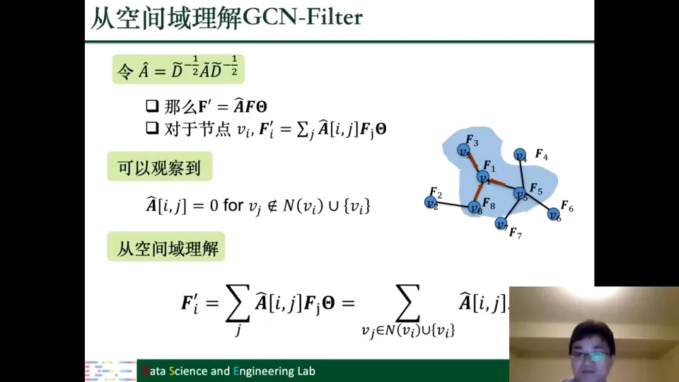

讲者在这里做了一个很有价值的对比：GCN 和最早的图滤波操作，**在"从邻居聚合信息"这一点上是一模一样的**。它们的差别主要有四处：

- **self-loop**：GCN 把节点自己也加进聚合范围，最早的方法只聚合邻居；
- **变换函数**：GCN 用线性变换 $\Theta$，最早的方法用 MLP；
- **归一化**：GCN 用 $\hat{A}$ 做了度归一化，避免度数不同的节点聚合后的数值范围差异过大；
- **原始信息**：最早的滤波器还会把节点的初始信息 $l_i$ 作为输入，GCN 的一层只接收上一层输出。

另外，GCN 的线性变换 $\Theta$ 也可以换成 MLP，这一点又和最早的图滤波器一致。这些差别是工程上的改进，但设计思路一脉相承。讲者反复强调这一点，是因为很多人只从空间域理解 GNN，觉得"反正就是在邻居上做 aggregation"；但只有理解了谱域的推导，才知道**为什么要这样聚合、为什么权重长这样、为什么需要 self-loop 和归一化**。[【跳转到 68:53】](https://www.bilibili.com/video/BV1yx4y1R7uV/?p=4&t=4133)

## 五、空间域方法没有改变"聚合"的本质，只是换了聚合方式

讲者把话锋一转：从谱域回到空间域。空间域的方法非常直观，因为它们直接利用图的连接结构，大家理解起来也更容易。这些算法看起来五花八门，其实都在做同一件事——**对邻居信息做聚合**，只是聚合的方式不同。[【跳转到 70:53】](https://www.bilibili.com/video/BV1yx4y1R7uV/?p=4&t=4253)

### 5.1 GraphSAGE：先采样邻居，再聚合，最后与自身结合

GCN 有一个现实问题：它要用到**所有**邻居。如果某个节点有上万个邻居，或者图大到一台机器放不下，逐邻居聚合就很吃力。GraphSAGE 的第一个改动是**采样**：从邻居集合 $\mathcal{N}(v_i)$ 中采样固定数量 $S$ 个邻居，记作 $\mathcal{N}_S(v_i)$。这样每个节点的计算量就固定了，模型可以扩展到很大的图。[【跳转到 71:43】](https://www.bilibili.com/video/BV1yx4y1R7uV/?p=4&t=4303)

$$
\mathcal{N}_S(v_i) = \text{SAMPLE}\big(\mathcal{N}(v_i), S\big)
$$

第二个改动是**聚合后再与自身结合**：

$$
f'_{\mathcal{N}_S(v_i)} = \text{AGG}\big(\{F_j, \forall v_j \in \mathcal{N}_S(v_i)\}\big)
$$

$$
F'_i = \sigma\Big(\big[F_i, f'_{\mathcal{N}_S(v_i)}\big]\Big)
$$

方括号表示拼接（concatenation）。也就是说，GraphSAGE 先把采样到的邻居聚合成一个向量，再把这个向量和节点自己的特征拼起来，经过激活函数得到新表示。这样"邻居信息"和"自身信息"是分开处理的，模型可以自己学习两者的比重。

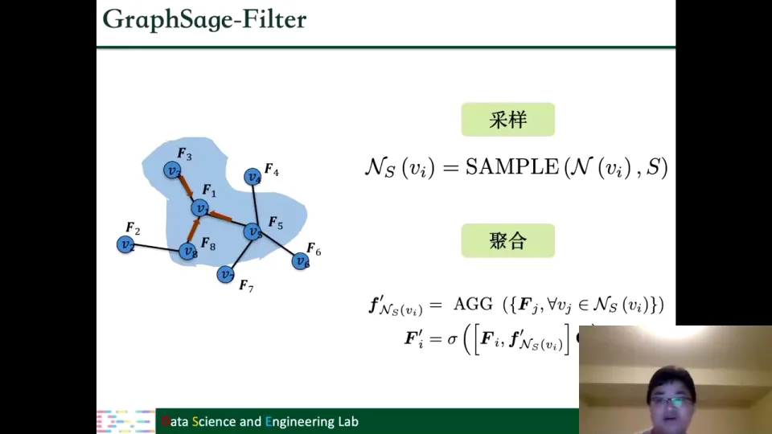

[【跳转到 72:23】](https://www.bilibili.com/video/BV1yx4y1R7uV/?p=4&t=4343)

### 5.2 GAT：用注意力学习每个邻居的权重

GCN 给邻居的权重来自邻接矩阵和度归一化，是"结构决定"的。GAT 的想法是：**不同邻居对中心节点的贡献应该不一样**，而且这个贡献应该由模型学出来。

GAT 为每条边 $(j \to i)$ 学习一个注意力系数 $\alpha_{ij}$，表示邻居 $j$ 对节点 $i$ 的贡献程度。计算方法就是神经网络里常见的注意力机制：

$$
e_{ij} = \text{LeakyReLU}\Big(\vec{a}^T\big[\Theta F_i \,\|\, \Theta F_j\big]\Big)
$$

$$
\alpha_{ij} = \frac{\exp(e_{ij})}{\sum_{k \in \mathcal{N}(v_i)\cup\{v_i\}} \exp(e_{ik})}
$$

其中 $\|$ 表示拼接，$\vec{a}$ 是可学习的注意力向量。分母对所有邻居（含自身）做 softmax，保证权重非负且加和为 1。这样一来，无论一个节点有 2 个邻居还是 4 个邻居，聚合后的数值范围都可比，不会因为邻居多就"爆炸"。[【跳转到 73:48】](https://www.bilibili.com/video/BV1yx4y1R7uV/?p=4&t=4428)

把 GCN 公式里的 $\hat{A}[i,j]$ 换成 $\alpha_{ij}$，就得到 GAT 的聚合形式：

$$
F'_i = \sum_{v_j \in \mathcal{N}(v_i)\cup\{v_i\}} \alpha_{ij} F_j \Theta
$$

所以讲者说，GAT 和 GCN 的差别"简直就是把 $A_{ij}$ 用一个注意力机制替换掉"。[【跳转到 75:28】](https://www.bilibili.com/video/BV1yx4y1R7uV/?p=4&t=4528)

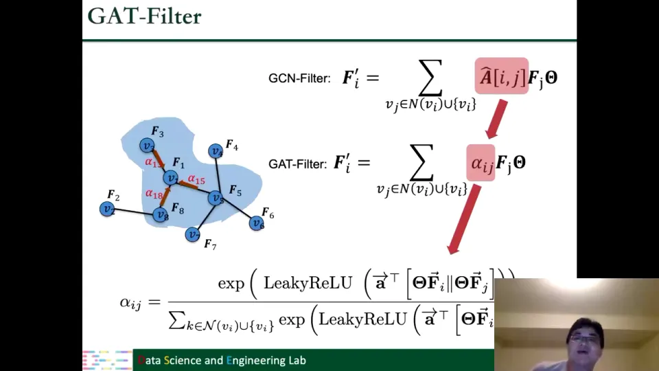

### 5.3 ECC 与 GGNN：把"边的类型"和"边的方向"纳入聚合

前面几种方法都默认边是同质的：有边就是有边，不区分边的种类。但很多图不是这样。**ECC（Edge-Conditioned Convolution）**针对的就是"边有不同的类型"。

比如在知识图谱里，实体之间的连接类型可能完全不同：我和学校之间是"工作于"，我和父亲之间是"父子"，两种关系的含义不一样，理应使用不同的变换参数。ECC 的做法是：为每一种边类型 $tp(v_i,v_j)$ 准备一个参数矩阵 $\Theta_{tp(v_i,v_j)}$：

$$
F'_i = \frac{1}{|\mathcal{N}(v_i)|}\sum_{v_j \in \mathcal{N}(v_i)} F_j \, \Theta_{tp(v_i,v_j)}
$$

也就是说，聚合时不仅要看"邻居是谁"，还要看"通过什么类型的边连过来"。[【跳转到 75:53】](https://www.bilibili.com/video/BV1yx4y1R7uV/?p=4&t=4553)

**GGNN（Gated Graph Neural Network）**则进一步考虑**方向**。它是为有向图设计的：同样的边类型，入边和出边应该区别对待。聚合完邻居信息后，GGNN 不是简单相加，而是用 GRU（门控循环单元）来更新节点状态：

$$
m_i = \sum_{(v_j,v_i)\in \mathcal{E}} \Theta^{e}_{tp(v_j,v_i)} F_j
$$

$$
F'_i = \text{GRU}(m_i, F_i)
$$

GRU 就像一个"门"，决定保留多少旧状态、吸收多少新消息。这比固定的加权求和更灵活，也更适合有向、带时序的图。[【跳转到 76:43】](https://www.bilibili.com/video/BV1yx4y1R7uV/?p=4&t=4603)

### 5.4 MPNN：把上述方法统一成"消息传递 + 更新"

讲者最后给出了一个统一的框架——**MPNN（Message Passing Neural Network，消息传递神经网络）**。它把空间域方法的共同结构抽象成两步：

**第一步，消息传递。** 每个邻居 $v_j$ 根据中心节点特征 $F_i$、邻居特征 $F_j$、边特征 $e_{(v_i,v_j)}$ 生成一条消息，所有邻居的消息求和：

$$
m_i = \sum_{v_j \in \mathcal{N}(v_i)} M\big(F_i, F_j, e_{(v_i,v_j)}\big)
$$

**第二步，更新。** 把聚合得到的消息 $m_i$ 和节点原来的特征 $F_i$ 一起送入更新函数 $U$：

$$
F'_i = U(F_i, m_i)
$$

不同的 GNN，只是选择了不同的 $M$ 和 $U$。比如 GraphSAGE 的"采样"可以看成让一部分 $e_{ij}=0$；GCN 的 $M$ 是线性变换加归一化权重，$U$ 是求和；GGNN 的 $U$ 是 GRU；有些模型还会用 LSTM 做更新。[【跳转到 77:58】](https://www.bilibili.com/video/BV1yx4y1R7uV/?p=4&t=4678)

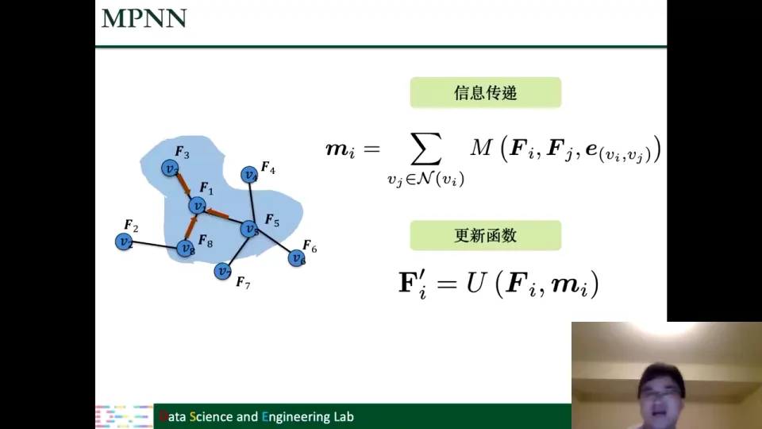

讲者强调，MPNN 不是一个具体的模型，而是一个"描述语言"。有了它，我们看任何空间域 GNN 都可以问三个问题：消息怎么造？邻居怎么聚合？状态怎么更新？这三问就是设计空间。[【跳转到 78:23】](https://www.bilibili.com/video/BV1yx4y1R7uV/?p=4&t=4703)

## 六、PPNP/APPNP 把信息传得更远，而统一视角揭示图滤波本质是图信号降噪

### 6.1 GCN 的局限：只能看见近邻

GCN 的一层只聚合直接邻居，两层才能看到两跳邻居。如果两个节点在图上相距很远，但它们其实属于同一个社区、信号应该相似，GCN 要堆很多层才能把信息传过去。而层数一多，又会出现**过平滑（over-smoothing）**：所有节点的表示被反复平均，越来越像，区分度下降。

讲者用 PPNP 来缓解这个矛盾。PPNP 不再用稀疏的邻接矩阵，而是用 **Personalized PageRank** 构造一个稠密的传播矩阵 $P$：理论上，只要两个节点之间存在一条路径，它们之间的 $P_{ij}$ 就不为零。于是每个节点都能"看见"全图所有与它连通的节点，而不只是近邻。[【跳转到 79:38】](https://www.bilibili.com/video/BV1yx4y1R7uV/?p=4&t=4778)

$$
F' = PF_{tr},
\qquad
P = \beta\big(I-(1-\beta)\hat{A}\big)^{-1}
$$

其中 $\beta$ 控制"保留自身信息"和"向远处传播"的比例。这个公式很漂亮，但有一个工程问题：它要求 $N \times N$ 矩阵的逆，复杂度是 $O(N^3)$，大图上根本算不起。

### 6.2 APPNP：用迭代逼近，把 $O(N^3)$ 变成 $O(K)$ 次稀疏乘法

APPNP 的做法是**不打逆，改用迭代**：

$$
F_{out}^{(k)} = (1-\beta)\hat{A}F_{out}^{(k-1)} + \beta F_{tr},
\qquad k=1,\dots,K
$$

每一步都做一次稀疏的邻居传播，再把原始信号 $F_{tr}$ 按 $\beta$ 的比例加回来。因为 $\hat{A}$ 是稀疏的，每一步的代价很低；迭代 $K$ 次（比如 $K=10$）就能非常接近 PPNP 的精确解，当 $K$ 趋于无穷时收敛到 PPNP，而 $K$ 远小于 $N$。[【跳转到 82:12】](https://www.bilibili.com/video/BV1yx4y1R7uV/?p=4&t=4932)

这个 $\beta F_{tr}$ 项被讲者称为**残差连接（residual connection）**：无论传播多少层，当前层总能从第一层的原始信号里继承一部分信息。这有两个好处：

- **缓解过平滑**：第一层没有经过反复平均，保留着节点的原始区分度；把它加回来，等于给模型一个"锚点"。
- **保留原始信息**：避免所有信息都被邻居信号淹没，节点不会越传越"没有自己"。

所以 APPNP 虽然简单，却比 GCN 多了一个可控的"回看原始信号"的机制。[【跳转到 84:37】](https://www.bilibili.com/video/BV1yx4y1R7uV/?p=4&t=5077)

### 6.3 换个角度：图滤波其实是在给图信号降噪

讲完 PPNP/APPNP，讲者提出了整讲最"升维"的一个观点：GCN、GAT、PPNP 这些看起来不同的聚合操作，**本质上都在做同一件事——图信号降噪**。[【跳转到 87:12】](https://www.bilibili.com/video/BV1yx4y1R7uV/?p=4&t=5232)

先定义问题。假设我们观察到一个带噪声的图信号 $F_{tr}$，想恢复干净的信号 $F'$。我们手里还有图结构，它提供了先验知识：**相连的节点，信号应该比较相似**。于是可以写成优化问题：

$$
\arg\min_{F'} \mathcal{L}(F') =
\big\|F' - F_{tr}\big\|_F^2
+
c\cdot\frac{1}{2}\sum_{i\in V}\frac{1}{|\mathcal{N}(i)|}
\sum_{j\in\mathcal{N}(i)}\big\|F'_i-F'_j\big\|_2^2
$$

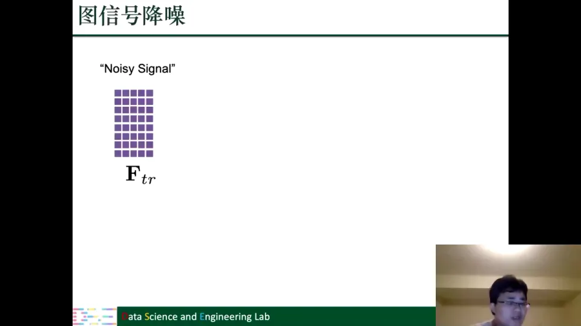

这个目标函数有两项，各有明确含义：

- **第一项是数据保真**：干净信号不能离观测信号太远，否则你恢复出来的东西和原始数据毫无关系；
- **第二项是平滑先验**：相邻节点的信号应该接近，这是图结构告诉我们的知识。系数 $c$ 控制平滑的强度；如果某些节点的邻居和它相似度不高，还可以给每个节点单独的 $c_i$，让惩罚更有针对性。[【跳转到 88:32】](https://www.bilibili.com/video/BV1yx4y1R7uV/?p=4&t=5312)

这个优化问题是凸的，对 $F'$ 求导并令导数为零，可以得到精确解：

$$
F' = \frac{1}{1+c}\Big(I-\frac{c}{1+c}\hat{A}\Big)^{-1}F_{tr}
$$

令 $\beta = \frac{1}{1+c}$，立刻得到：

$$
F' = \beta\big(I-(1-\beta)\hat{A}\big)^{-1}F_{tr} = PF_{tr}
$$

这正是 PPNP。也就是说，**PPNP 不是拍脑袋设计的传播公式，而是在精确求解上面这个降噪问题**。[【跳转到 92:21】](https://www.bilibili.com/video/BV1yx4y1R7uV/?p=4&t=5541)

### 6.4 GCN 是"只走一步梯度下降"的降噪

那 GCN 呢？GCN 没有求精确解，而是用**梯度下降**迭代求解同一个目标函数。对目标函数求导，从 $F'=F_{tr}$ 出发走一步：

$$
F' \leftarrow F_{tr} - b\frac{\partial \mathcal{L}}{\partial F'}\Big|_{F'=F_{tr}}
= (1-2bc)F_{tr} + 2bc\hat{A}F_{tr}
$$

如果令学习率 $b=\frac{1}{2c}$，第一项系数变成 0，第二项系数变成 1，于是：

$$
F' = \hat{A}F_{tr}
$$

这就是 GCN 的传播形式（再乘上可学习的 $\Theta$ 就是完整的 GCN 层）。换句话说，**GCN 相当于只做了一步梯度下降的降噪**；PPNP 做的是精确解；APPNP 做的是多步迭代。三者不是互不相干的模型，而是同一个优化问题的不同求解策略。[【跳转到 94:06】](https://www.bilibili.com/video/BV1yx4y1R7uV/?p=4&t=5646)

GAT 也可以用同样的方式解释：它同样在解一个带图先验的降噪问题，只是它的权重不是固定的 $\hat{A}$，而是学出来的注意力 $\alpha_{ij}$。于是 GCN、GAT、PPNP 被放进了同一个框架。

### 6.5 统一视角的价值：把"设计模型"变成"设计优化问题"

讲者强调，这个统一视角有两层价值。

**第一层是理解**：以前我们只知道 GCN、GAT 在做邻居聚合，但不知道"为什么是这种聚合"。现在我们知道，聚合是在利用图结构做降噪，平滑先验就是"相连节点应该相似"。

**第二层是设计**：既然图滤波等价于一个优化问题，那么设计新滤波器就有两条系统化的路径：

1. **设计新的正则项 $\mathcal{R}(F')$**：把你对图的先验知识写进目标函数；
2. **设计新的优化方法**：同一个目标函数，用不同的迭代/求解策略，就能得到不同的传播规则。

这比"拍脑袋想一个聚合公式"要有章法得多。[【跳转到 95:46】](https://www.bilibili.com/video/BV1yx4y1R7uV/?p=4&t=5746)

讲者给出了一个具体例子：发表在 ICML 上的 **Graph Trend Filtering / Elastic 图滤波器**。传统方法默认"相连节点一定相似"，用的是二次惩罚；但现实中的图往往有社区结构：社区内部节点很相似，社区之间的边却连接着信号差异很大的节点。如果还用二次惩罚，社区边界会被强行抹平。讲者团队的工作把二次项换成一阶项（类似 L1 的惩罚），允许在少数边上出现很大的信号跳变，从而在降噪的同时保留社区边界。这个例子说明：**有了统一的优化视角，很多"图上看上去很难处理"的问题，可以借用优化领域的工具来解决**。[【跳转到 98:16】](https://www.bilibili.com/video/BV1yx4y1R7uV/?p=4&t=5896)

## 七、图池化把节点表示压缩成图表示，平面与层次两条路线各有取舍

### 7.1 池化的目标：从 $N$ 个节点到一个图向量

图滤波解决的是"每个节点怎么表示"，图池化解决的是"整张图怎么表示"。它的基本思路是不断把图变小：$N$ 个节点 → $N_p$ 个节点 → …… → 1 个节点。最后这个节点的表示，就是整张图的表示。[【跳转到 99:44】](https://www.bilibili.com/video/BV1yx4y1R7uV/?p=4&t=5984)

和滤波不同，池化**同时改变拓扑和特征**：既要得到新的邻接矩阵 $A_p$，也要得到新的节点特征 $F'_p$。所有池化算法都在回答这两个问题：新图长什么样？新节点的特征怎么算？[【跳转到 100:34】](https://www.bilibili.com/video/BV1yx4y1R7uV/?p=4&t=6034)

图池化分两大类：**平面池化（flat pooling）**一步到位，直接把整张图压成一个向量；**层次池化（hierarchical pooling）**分多步，每次只压缩一点，最后再压成一个节点。

### 7.2 平面池化：平均、最大、虚拟节点、注意力加权

平面池化不改变图的中间结构，直接对所有节点表示做汇总。常见做法有四类。

**平均池化**：对每个特征维度，取所有节点该维度的平均值：

$$
f_G[i] = \text{ave}(F_{:,i})
$$

**最大池化**：对每个特征维度，取所有节点该维度的最大值：

$$
f_G[i] = \max(F_{:,i})
$$

平均池化保留"整体水平"，最大池化保留"最突出的特征"。比如判断一张图里有没有某个子结构，最大值可能比平均值更敏感。[【跳转到 101:31】](https://www.bilibili.com/video/BV1yx4y1R7uV/?p=4&t=6091)

**虚拟节点（virtual node）**：在图上额外加一个节点，让它和所有节点相连。这个虚拟节点通过图滤波聚合全图信息，最后用它的表示作为整张图的表示。讲者把它类比成自然语言处理里的特殊符号：在句子里加一个用于分类的特殊 token，用它的表示代表整个句子。图上的虚拟节点起的是同样的作用。[【跳转到 102:17】](https://www.bilibili.com/video/BV1yx4y1R7uV/?p=4&t=6137)

**注意力加权池化**：不是简单平均，而是给每个节点学一个重要性权重 $s_i$，再加权求和：

$$
f_G = \sum_{v_i\in V} s_i \cdot \tanh(F_i\Theta_{ip}),
\qquad
s_i = \frac{\exp(h(F_i))}{\sum_{v_j\in V}\exp(h(F_j))}
$$

其中 $h(\cdot)$ 是一个打分函数，softmax 保证权重加和为 1。这样重要的节点贡献大，不重要的节点贡献小，比平均池化更有区分度。[【跳转到 103:23】](https://www.bilibili.com/video/BV1yx4y1R7uV/?p=4&t=6203)

平面池化简单、一步到位，但压缩太急，容易丢失结构信息，于是有了层次池化。

### 7.3 层次池化：一步步粗化，尽量少丢信息

层次池化不是"一步从整张图到一个节点"，而是每次把图缩小一点，反复多次，最后得到一个节点。这样做的好处是：每一步只合并少量信息，中间还可以穿插图滤波，让模型在粗化的同时不断提取特征，从而减少信息丢失。[【跳转到 103:48】](https://www.bilibili.com/video/BV1yx4y1R7uV/?p=4&t=6228)

不过讲者提醒：层次池化**不一定**比平面池化效果好。如果任务只需要一个粗粒度的全局判断，平面池化可能就够了；如果任务依赖图的层次结构（比如分子中的官能团、社交网络中的社区），层次池化更有优势。选择要看具体任务和数据。[【跳转到 104:13】](https://www.bilibili.com/video/BV1yx4y1R7uV/?p=4&t=6253)

层次池化有两条基本路线：

1. **保留重要节点**：从原图中挑出一部分重要节点，组成一个小图；
2. **合并子图为超节点**：把原图中的一个子图（subgraph）整体变成一个节点（supernode）。

前者是"采样"，后者是"聚类"。gPool/SAGPool 属于前者，DiffPool/EigenPooling 属于后者。[【跳转到 105:03】](https://www.bilibili.com/video/BV1yx4y1R7uV/?p=4&t=6303)

### 7.4 gPool 与 SAGPool：学习节点重要性，保留 Top-$N_p$

gPool 的思路很直接：给每个节点打一个重要性分数，保留分数最高的 $N_p$ 个节点，用它们组成粗化图。[【跳转到 106:18】](https://www.bilibili.com/video/BV1yx4y1R7uV/?p=4&t=6378)

- **打分**：gPool 用一个可学习的投影向量 $p$，把节点特征投影成一个标量：
  $$
  y_i = \frac{F_i^T p}{\|p\|}
  $$
- **选择**：对 $y$ 排序，取前 $N_p$ 个节点的下标 $idx$；
- **生成新图**：$A_p = A[idx, idx]$，只保留被选中节点之间的边；
- **生成新特征**：先取出 $F_{inter}=F[idx,:]$，再用分数做一个门控：
  $$
  F'_p = F_{inter} \odot \text{sigmoid}(y)
  $$
  其中 $\odot$ 是逐元素乘。这样保留下来的节点不仅被筛选，还按重要性被缩放。

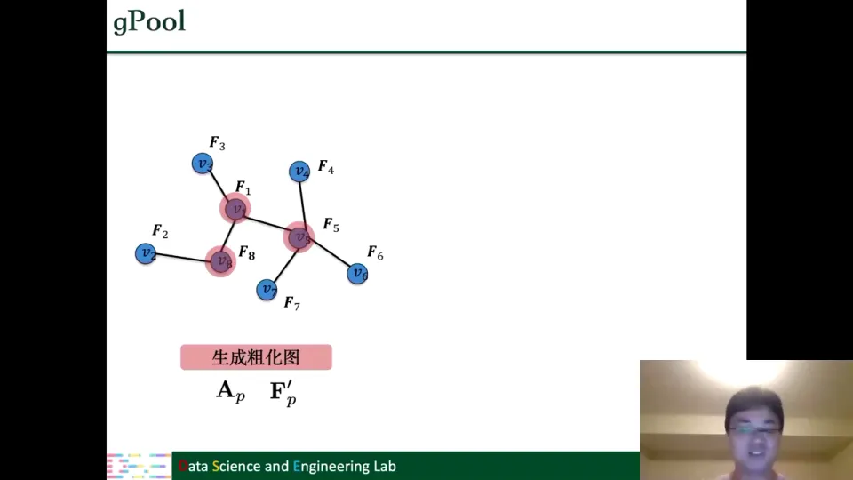

SAGPool 和 gPool 的流程几乎一样，唯一区别是**打分方式**：gPool 用投影向量 $p$，SAGPool 用一个 GCN filter 自动学习每个节点的分数。讲者说，两者其他过程非常类似，SAGPool 相当于把"人工设计的投影"换成了"数据驱动的打分网络"。[【跳转到 109:03】](https://www.bilibili.com/video/BV1yx4y1R7uV/?p=4&t=6543)

### 7.5 DiffPool：用 GCN 学习"软分配"矩阵

DiffPool 走的是"合并子图"路线。它不显式地选节点，而是学习一个**分配矩阵** $S \in \mathbb{R}^{N\times N_p}$：$S_{ij}$ 表示原节点 $i$ 属于新节点 $j$ 的可能性（likelihood）。这个 $S$ 由一个 GCN 生成。[【跳转到 109:55】](https://www.bilibili.com/video/BV1yx4y1R7uV/?p=4&t=6595)

同时，DiffPool 用另一个 GCN 生成节点的中间特征 $F_{inter}$。有了 $S$ 和 $F_{inter}$，粗化图的结构和特征都可以用矩阵乘法得到：

$$
A_p = S^T A S
$$

$$
F'_p = S^T F_{inter}
$$

直观理解：$A_p$ 是"把原图的边按分配关系汇总"，$F'_p$ 是"把原节点的特征按分配关系加权求和"。因为 $S$ 是软分配（每个节点可以按不同比例属于多个超节点），DiffPool 能表达重叠社区，而不是硬切分。[【跳转到 110:45】](https://www.bilibili.com/video/BV1yx4y1R7uV/?p=4&t=6645)

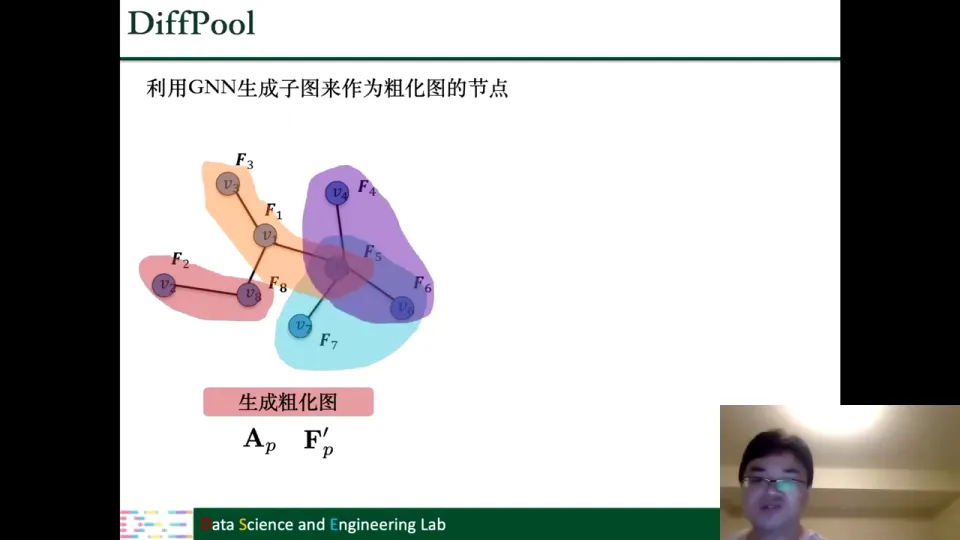

### 7.6 EigenPooling：在谱域池化，用傅里叶系数保留子图信息

EigenPooling 是第一个谱域池化算法，它也走"子图变超节点"的路线，但它不用 GCN 学分配，而是先用传统的**社区发现/谱聚类**把图分成若干子图，然后把每个子图变成一个超节点。[【跳转到 114:53】](https://www.bilibili.com/video/BV1yx4y1R7uV/?p=4&t=6893)

它的核心问题是：一个子图里有多个节点、多条边，怎样用一个向量来表示它，才能尽量不丢信息？EigenPooling 的答案是**用图傅里叶系数**。

对每个子图，先做图傅里叶变换，得到一组傅里叶系数。这个系数已经同时包含了子图的拓扑结构和节点信号，而且 GFT/IGFT 是可逆的——理论上，用全部系数可以无损重建子图信号。所以拿它当超节点的特征，信息损失最小。[【跳转到 118:06】](https://www.bilibili.com/video/BV1yx4y1R7uV/?p=4&t=7086)

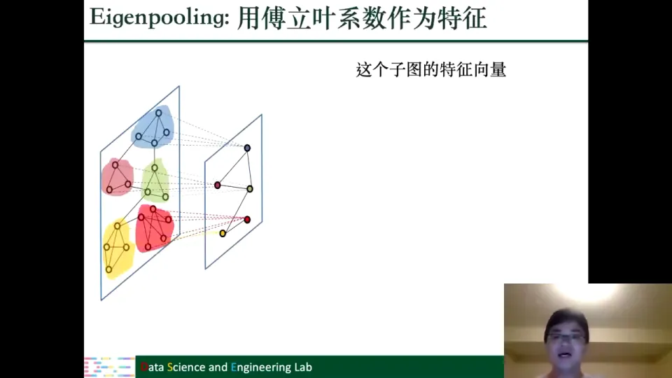

讲者用一个手写数字"2"的网格图演示：用全部傅里叶系数可以完美重建；只保留很少一部分低频系数，虽然细节有损，但"这是 2"的关键信息仍然保留。这说明尾部高频系数对分类任务未必重要，砍掉它们不会伤筋动骨。EigenPooling 还给出了理论上的信号损失保证，这也是它区别于启发式池化的地方。[【跳转到 120:18】](https://www.bilibili.com/video/BV1yx4y1R7uV/?p=4&t=7218)

但直接这么做有两个问题：

1. **子图大小不一**：$N$ 个节点的子图有 $N$ 个傅里叶系数，不同子图的超节点特征维度不同，没法拼成一个规整的矩阵；
2. **特征分解太贵**：每个子图都要做一次特征分解，大图上不可行。

EigenPooling 的解法是**只取前 $K$ 个傅里叶系数**。这样做一举两得：所有超节点的特征维度都固定为 $K$，解决了维度不一致；只需要计算前 $K$ 个特征向量，计算量也与子图大小脱钩，解决了可扩展性。[【跳转到 122:51】](https://www.bilibili.com/video/BV1yx4y1R7uV/?p=4&t=7371)

## 八、一条从图论到 GNN 的推导链，构成本讲的知识地图

整讲可以串成一条推导链：

**历史与定位**：图表示学习从矩阵分解（第一代）到 DeepWalk（第二代），再到 GNN（第三代）。GNN 的关键增量是"层"和"端到端"。

**问题与操作**：GNN 的输入是邻接矩阵 $A$ 和特征矩阵 $F$。节点级任务用图滤波（$A$ 不变，$F\to F'$），图级任务用图池化（$A\to A_p$，$F\to F'_p$，$N\to N_p$）。

**理论工具**：拉普拉斯矩阵 $L=D-A$ 是图上的差分算子；二次型 $f^T L f$ 衡量信号光滑度；$L$ 半正定，可特征分解；特征向量是图信号的基，特征值是频率；图傅里叶变换在空间域和谱域之间来回切换。

**谱域滤波**：在谱域乘一个滤波器 $g(\Lambda)$，再反变换回来。非参数滤波器参数太多、要特征分解；多项式滤波器用 $K+1$ 个共享参数、避免特征分解；切比雪夫多项式用正交基提升稳定性；GCN 是 $K=1$、$\lambda_{\max}=2$、参数合并后的特例，再加 self-loop 和重归一化。

**空间域方法**：GraphSAGE 采样邻居再聚合；GAT 用注意力学权重；ECC 区分边类型；GGNN 区分方向并用 GRU 更新；MPNN 把它们统一成"消息传递 + 更新"。

**统一视角**：GCN、GAT、PPNP 都在解同一个图信号降噪问题；GCN 是走一步梯度下降，PPNP 是精确解，APPNP 是多步迭代。这个视角把"设计聚合公式"变成了"设计正则项或优化方法"。

**图池化**：平面池化一步得到图向量（平均、最大、虚拟节点、注意力）；层次池化逐步粗化（采样保留重要节点，或把子图合并成超节点）。gPool/SAGPool 属于采样，DiffPool/EigenPooling 属于子图合并。

这条链说明：GNN 不是一堆互不相干的技巧，而是"图信号处理 + 优化 + 聚合"三个视角下的同一个对象。理解了这条链，再看到新的 GNN 变体，就可以问：它改的是滤波器、聚合方式、优化目标，还是池化策略？

## 小结

- **GNN 是图表示学习的第三代**：它把"层"和"端到端"引入图学习，使模型可以堆叠、变深，并让表示直接服务于下游任务。
- **两个基本操作**：图滤波解决节点级任务，保持拓扑、更新特征；图池化解决图级任务，同时粗化拓扑和特征，最终把节点表示压成图表示。
- **拉普拉斯矩阵是图滤波的语言**：$L=D-A$ 是差分算子，二次型衡量信号光滑度；$L$ 半正定，特征分解给出正交的"图信号基"，特征值就是频率。
- **谱滤波的三步**是"傅里叶变换 → 乘滤波器 → 反变换"。非参数滤波器参数多且要特征分解；多项式滤波器用 $K+1$ 个共享参数避免特征分解；切比雪夫多项式用正交基提升稳定性。
- **GCN 是切比雪夫滤波器的简化**：$K=1$、$\lambda_{\max}=2$、参数合并，再加 self-loop 和重归一化。它在空间域就是"邻居 + 自己"的加权聚合。
- **空间域方法只是在换聚合方式**：GraphSAGE 采样、GAT 注意力、ECC 边类型、GGNN 方向；MPNN 用"消息 + 更新"统一描述它们。
- **PPNP/APPNP 让信息传得更远**：PPNP 用 Personalized PageRank 构造稠密传播，APPNP 用迭代逼近并保留原始信号的残差，缓解过平滑。
- **图滤波可以统一理解为图信号降噪**：GCN 是一步梯度下降，PPNP 是精确解，APPNP 是多步迭代；设计新滤波器可以从正则项或优化方法入手。
- **图池化分平面与层次**：平面池化简单但压缩急；层次池化逐步粗化，分"采样保留节点"和"子图合并成超节点"两条路线。没有绝对优劣，取决于任务。

## 关键术语速查

| 术语 | 一句话解释 |
| --- | --- |
| 图神经网络（GNN） | 在图结构上定义可堆叠、可端到端训练的神经网络，核心操作是图滤波与图池化。 |
| 图滤波 | 保持图拓扑不变，利用邻居信息把节点特征 $F$ 更新为 $F'$ 的操作，服务节点级任务。 |
| 图池化 | 同时改变拓扑和特征，把大图逐步粗化成小图，最终得到一个图表示，服务图级任务。 |
| 邻接矩阵 $A$ | $N\times N$ 矩阵，$A_{ij}$ 表示节点 $i$ 与 $j$ 之间是否有边（或边的权重）。 |
| 特征矩阵 $F$ | $N\times d$ 矩阵，每一行是一个节点的 $d$ 维特征。 |
| 图信号 | 定义在节点上的函数，每个节点对应一个数值或向量；在机器学习语境下就是节点特征。 |
| 通道（channel） | 图信号的每一维；与"特征的每一维"是同一件事的不同叫法。 |
| 度矩阵 $D$ | 对角矩阵，对角线上是每个节点的度（相连边数）。 |
| 拉普拉斯矩阵 $L$ | $L=D-A$，图上的差分算子；$Lf$ 的每个分量是节点与邻居信号之差的和。 |
| 拉普拉斯二次型 | $f^T L f=\frac12\sum_{i,j}A_{ij}(f_i-f_j)^2$，衡量图信号的光滑度/频率。 |
| 半正定矩阵 | 对任意非零向量 $x$，$x^T M x\ge 0$ 的矩阵；半正定保证可以特征分解。 |
| 特征分解 | 把 $L$ 写成 $U\Lambda U^T$，$U$ 的列是特征向量，$\Lambda$ 的对角线是特征值。 |
| 特征值 / 特征向量 | 特征值是对应特征向量的频率；特征向量是图上的一组正交信号基。 |
| 图傅里叶变换（GFT） | $\hat f=U^T f$，把空间域图信号变成谱域傅里叶系数；反变换为 $f=U\hat f$。 |
| 空间域 / 谱域 | 空间域直接看节点上的信号；谱域看信号由哪些频率分量组成。 |
| 谱滤波 | 在谱域乘滤波器 $g(\Lambda)$ 再反变换，$y=Ug(\Lambda)U^Tf$。 |
| 非参数滤波器 | 直接学习 $N$ 个频率权重，最灵活但参数多、必须做特征分解。 |
| 多项式滤波器 | 用 $\sum_{k=0}^K\theta_k\lambda^k$ 拟合滤波器，只有 $K+1$ 个参数，可用 $L^k$ 避免特征分解。 |
| 切比雪夫多项式 | 一组正交多项式，递推定义为 $T_k=2xT_{k-1}-T_{k-2}$，用于稳定地拟合滤波器。 |
| GCN | 简化到一阶的切比雪夫滤波器，$F'=\hat AF\Theta$，$\hat A$ 是带 self-loop 的归一化邻接矩阵。 |
| self-loop | 节点与自身相连的边；GCN 用它把节点自身信息纳入聚合。 |
| 重归一化（renormalization） | 对 $\tilde A=A+I$ 做 $\tilde D^{-1/2}\tilde A\tilde D^{-1/2}$，控制不同度节点的数值范围。 |
| GraphSAGE | 先采样固定数量邻居，聚合后与自身特征拼接，适合大图和归纳式学习。 |
| GAT | 用注意力机制学习邻居权重 $\alpha_{ij}$，替代 GCN 中固定的邻接权重。 |
| ECC | 按边的类型选择不同的变换参数，适合知识图谱等多关系图。 |
| GGNN | 面向有向图，区分入边/出边，并用 GRU 更新节点状态。 |
| MPNN | 消息传递框架：$m_i=\sum M(F_i,F_j,e_{ij})$，$F'_i=U(F_i,m_i)$，统一描述空间域 GNN。 |
| PPNP | 用 Personalized PageRank 构造稠密传播矩阵 $P=\beta(I-(1-\beta)\hat A)^{-1}$，让所有连通节点贡献信息。 |
| APPNP | 用迭代 $F^{(k)}=(1-\beta)\hat AF^{(k-1)}+\beta F_{tr}$ 逼近 PPNP，避免矩阵求逆。 |
| 过平滑（over-smoothing） | 层数过多时节点表示被反复平均、趋于一致，区分度下降的现象。 |
| 图信号降噪 | 把图滤波看成"从带噪信号 $F_{tr}$ 恢复干净信号 $F'$"，用图结构的光滑先验约束。 |
| 平面池化 | 一步把整张图压成一个向量，常见平均、最大、虚拟节点、注意力加权。 |
| 层次池化 | 多步粗化图，每次保留部分节点或合并子图，最后得到一个图表示。 |
| gPool / SAGPool | 学习节点重要性分数，保留 Top-$N_p$ 个节点组成粗化图；SAGPool 用 GCN 打分。 |
| DiffPool | 用 GCN 学习软分配矩阵 $S$，通过 $A_p=S^TAS$、$F'_p=S^TF_{inter}$ 生成粗化图。 |
| EigenPooling | 先用聚类得到子图，再用子图的傅里叶系数作为超节点特征，取前 $K$ 个系数控制维度与开销。 |

