# 第05讲：图神经网络的健壮性和可扩展性

## 本讲要解决的核心问题（SCQA）

**背景**：图神经网络（Graph Neural Network，GNN）已经能处理节点分类、图分类、欺诈检测等任务。与此同时，深度学习模型在图像领域早已暴露出一个弱点：在图片上叠加一层肉眼几乎看不出的噪声，就能让一个训练良好的卷积神经网络（CNN）把熊猫认成长臂猿。

**冲突**：图数据也不是“天然安全”的。攻击者不需要改很多东西，只要加一条边、删一条边、换一个特征，就可能让 GNN 的判断翻转。更麻烦的是，真实世界的图动辄上亿节点，把整张图放进显存做全批量训练根本不现实；而如果按层展开邻居，计算量又会随层数指数爆炸。

**疑问**：GNN 到底有多容易被攻击？攻击者掌握多少信息时能做什么？防御该从哪些环节入手？面对超大图，又该怎样把“指数级的邻居展开”变成“可控的批量计算”？

**回答（中心思想）**：本讲把 GNN 的健壮性问题拆成“攻击”和“防御”两条主线：攻击按攻击者掌握的信息分为白盒、灰盒、黑盒三类，分别用梯度、代理模型、强化学习来生成微小扰动；防御则从对抗训练、图净化、图结构学习和图注意力四条路线削弱扰动的影响。可扩展性问题的根源是“邻居爆炸”，解决思路是用节点采样、层采样和子图采样，把每层涉及的节点数从指数级压到线性级或固定批量。

## 一、鲁棒性不是附加项：图模型和图像模型一样会被微小扰动改变判断

### 1.1 先看图像：肉眼仍是熊猫，模型却说是长臂猿

“鲁棒性”（robustness）在中文里也常写作“健壮性”，指的是模型在输入受到扰动时，输出能保持多稳定。给定一张熊猫图片 $x$，一个训练良好的 CNN 可以轻松输出“熊猫”。但如果我们在图片上叠加一个很小的扰动 $\epsilon$，得到 $x'=x+\epsilon$，人眼看上去几乎没变化，仍然会认为这是一只熊猫；模型却可能改口，把 $x'$ 判成“长臂猿”。

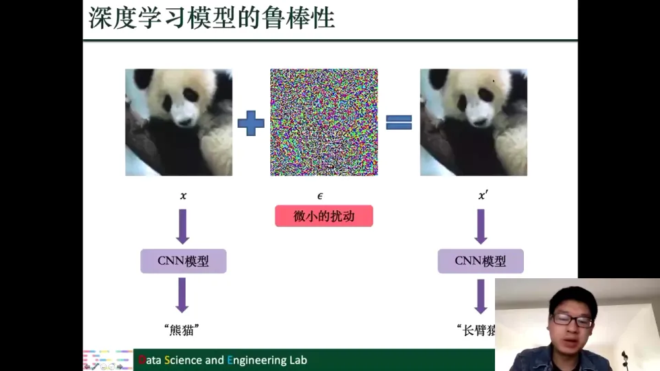

这类“专门找出来、用来骗模型”的微小扰动，叫做**对抗攻击**（adversarial attack）；研究如何防御它，就是**对抗防御**。在熊猫例子里，改错一个分类似乎无伤大雅；但如果同样的 CNN 用在自动驾驶上，路牌被贴上一小块精心设计的图案，模型就可能识别失败，后果会严重得多。[【跳转到 09:41】](https://www.bilibili.com/video/BV1yx4y1R7uV/?p=5&t=581)

### 1.2 图上的对应问题：加一条边，预测就可能翻转

图神经网络也有同样的问题。把一张图输入 GNN，模型会输出预测；这个预测既可以是整张图的分类，也可以是某个节点的分类。现在攻击者只在图里加一条边，再把修改后的图输入同一个、参数完全没变的 GNN，预测结果就可能不同。[【跳转到 12:17】](https://www.bilibili.com/video/BV1yx4y1R7uV/?p=5&t=737)

这件事在金融场景里尤其危险。假设银行用 GNN 分析交易关系，识别哪些账户在做欺诈。如果 GNN 的鲁棒性不好，欺诈者只要改变自己和外界的一些连接，就可能让模型把自己判成正常账户，从而躲过侦查。对金融系统来说，这会带来直接的经济损失。也正因为如此，研究图神经网络的鲁棒性不是学术上的“锦上添花”，而是落地前的必要条件。

### 1.3 鲁棒性研究分成“攻击”和“防御”两半

本讲把鲁棒性研究分成两部分：

1. **图对抗攻击**：研究怎样生成不易察觉的微小扰动，加到图里，使 GNN 的效果下降。攻击本身是有害的，但必须先理解攻击，才能知道模型怕什么。
2. **图对抗防御**：研究怎样减少这类攻击带来的影响，让模型在受到扰动时仍然稳定。

为什么一定要研究攻击？因为只有先弄清楚“模型对怎样的攻击容易受影响、是否容易受影响”，才能有针对性地保护它。攻击研究得越透彻，防御才越有依据。[【跳转到 13:57】](https://www.bilibili.com/video/BV1yx4y1R7uV/?p=5&t=837)

## 二、攻击的共性框架：在预算内改结构或改特征，让扰动“不易察觉”

### 2.1 扰动加在两个地方：连接矩阵 A 和特征矩阵 F

图可以用连接矩阵（邻接矩阵）$A$ 描述结构，用节点特征矩阵 $F$ 描述每个节点带的信息。攻击者要生成“不易察觉”的微小扰动，本质上就是改这两个对象之一，或者两个都改：

- 对结构：$A \to A+\Delta A = A'$；
- 对特征：$F \to F+\Delta F = F'$。

在图对抗攻击里，这两者都可以被扰动。[【跳转到 15:52】](https://www.bilibili.com/video/BV1yx4y1R7uV/?p=5&t=952)

### 2.2 “微小”怎么定义：用预算约束改变的数量

“不易察觉”需要一个可计算的界定。常见的做法是限制被改动的元素总数：

$$
\|A'-A\|_0 + \|F'-F\|_0 \le \Delta
$$

这里的 $\|\cdot\|_0$ 是“非零元素个数”，可以理解为“改了多少条边、多少个特征”。$\Delta$ 是攻击者预先设定的预算：总共只允许改这么多条边、这么多个特征。落在这个预算以内的扰动，我们就认为它是微小扰动。[【跳转到 17:57】](https://www.bilibili.com/video/BV1yx4y1R7uV/?p=5&t=1077)

在很多论文里，节点特征还被假设成**二值特征**：向量的每个元素只能是 0 或 1，攻击时只能把 1 改成 0、或把 0 改成 1。这个假设不是随便定的。早期图研究常用引用网络（citation graph）：节点是论文，特征来自论文摘要的词袋表示——摘要里出现某个词，对应位置就是 1；没出现就是 0。因此特征天然是 0/1 向量，改特征也就等价于“把某个词从有改成无，或从无改成有”。[【跳转到 43:24】](https://www.bilibili.com/video/BV1yx4y1R7uV/?p=5&t=2604) 今天课程里讨论的攻击，基本都针对这种二值特征。

需要说明的是，预算约束只是“微小扰动”的一种常见定义，后续论文里也有用其他方式定义微小扰动的；本讲采用这一种作为主线。

### 2.3 扰动的五种基本动作

在结构上，攻击者可以做这些动作：

- **加边**：在原本没有边的两个节点之间连一条边；
- **减边**：删掉原本存在的一条边；
- **重连（rewiring）**：先删一条边，再加一条边，把连接关系“挪”到别处；
- **加节点**：加入一个新节点，并把它和图中其他节点连接起来。

在特征上，则是直接修改节点的输入特征，二值特征就是 0/1 翻转。[【跳转到 18:47】](https://www.bilibili.com/video/BV1yx4y1R7uV/?p=5&t=1127)

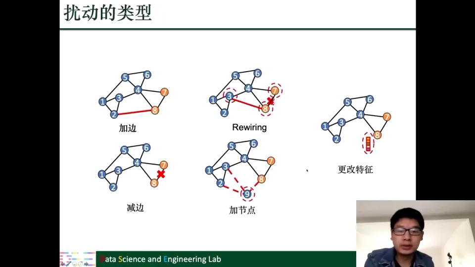

### 2.4 逃逸攻击与投毒攻击：区别在于“动不动训练集”

按攻击发生的阶段，常见两类攻击：

- **逃逸型攻击**（evasion attack）：模型已经训练好、参数固定，攻击者只扰动测试时输入的图，让测试效果变差。它不影响训练过程，也不改变模型“长什么样”。
- **投毒攻击**（poisoning attack）：攻击者把扰动加到用于训练的图上，模型在这个“有毒”的图上训练，因此模型本身会受到影响；训练完再在同样被扰动的图上测试。

两者的关键区别是：逃逸攻击只影响测试，投毒攻击会影响训练。投毒攻击通常意味着攻击者已经能够触达训练数据、甚至能改动一部分训练数据。[【跳转到 20:27】](https://www.bilibili.com/video/BV1yx4y1R7uV/?p=5&t=1227)

### 2.5 白盒、灰盒、黑盒：攻击者到底知道多少

攻击者掌握的信息不同，能用的方法也不同。课程按“知道多少”分成三档：

| 攻击类型 | 攻击者掌握的信息 | 现实性 |
| --- | --- | --- |
| 白盒攻击 | 训练数据、模型结构、模型参数全都知道 | 现实中较少见，但便于研究模型脆弱性 |
| 灰盒攻击 | 只知道训练数据，不知道模型结构、参数 | 训练数据公开时较现实 |
| 黑盒攻击 | 模型内部一无所知，只能查询预测结果 | 最受限，也最接近真实攻击者 |

白盒攻击在现实中不那么实际，因为模型通常会被保护起来，不会把结构和参数都交给攻击者；但它对研究很有意义——可以从“最理想攻击者”的角度理解模型的鲁棒性边界。灰盒攻击对应“训练数据公开、但模型不公开”的情形。黑盒攻击则把模型当成一个黑盒子：给它一个输入，它返回预测，攻击者只能利用这种查询能力。[【跳转到 23:57】](https://www.bilibili.com/video/BV1yx4y1R7uV/?p=5&t=1437)

## 三、白盒 PGD 攻击：把“改哪条边”学成一个 0/1 掩码

### 3.1 攻击目标：让节点从正确类别掉到其他类别

PGD 拓扑攻击（PGD topology attack）是一个白盒攻击。攻击者能拿到模型结构、模型参数，也就意味着能拿到模型的梯度——这一点后面会反复用到。它的攻击目标是节点分类：对于真实标签为 $y_i$ 的节点 $v_i$，攻击者希望扰动图以后，GNN 把 $v_i$ 分类成其他标签，而不是 $y_i$。换句话说，模型原来能判对，现在要让它判错。[【跳转到 27:18】](https://www.bilibili.com/video/BV1yx4y1R7uV/?p=5&t=1638)

### 3.2 扰动怎么写：$\Delta A=(\bar A-A)\odot S$

PGD 拓扑攻击只改结构，通过加边或减边来扰动。它把扰动写成：

$$
\Delta A = (\bar A - A)\odot S
$$

其中：

- $A$ 是原来的连接矩阵；
- $\bar A$ 是 $A$ 的补矩阵：$A_{ij}=1$ 时 $\bar A_{ij}=0$，$A_{ij}=0$ 时 $\bar A_{ij}=1$；
- $S\in\{0,1\}^{N\times N}$ 是攻击者要学习的 0/1 掩码，$S_{ij}=1$ 表示“这条边要动”，$S_{ij}=0$ 表示“不动”；
- $\odot$ 是逐元素相乘。

$\bar A-A$ 负责决定“怎么动”：

- 如果边 $(i,j)$ 原本存在，$A_{ij}=1$、$\bar A_{ij}=0$，两者相减得 $-1$，表示要**减边**；
- 如果边原本不存在，$A_{ij}=0$、$\bar A_{ij}=1$，两者相减得 $+1$，表示要**加边**。

所以 $S$ 只决定“动哪些边”，$\bar A-A$ 决定“每条边是加还是减”。攻击者要学的就是 $S$。[【跳转到 29:12】](https://www.bilibili.com/video/BV1yx4y1R7uV/?p=5&t=1752)

### 3.3 用模型的梯度来选边：从概率到损失

因为这是白盒攻击，攻击者可以把扰动后的 $A'$ 输入参数固定的 GNN，得到节点 $v_i$ 的分类概率向量 $z$。假设这是一个六分类任务，向量里的每一格就是“判成某一类”的概率；绿色那一格对应正确标签 $y_i$，即 $z[y_i]$。

攻击者希望 $z[y_i]$ 越小越好，最好比“其他类里最大的那个概率”还小。于是定义攻击损失：

$$
l(v_i)=z[y_i]-\max_{c\ne y_i} z[c]
$$

只要这个损失小于 0，就说明正确类的概率已经低于某个错误类，模型很可能判错。损失越小，说明差距拉得越开，攻击越成功。

实际实现时还会加一个边界 $\kappa$（$\kappa>0$）：

$$
l(v_i)=\max\left(z[y_i]-\max_{c\ne y_i} z[c],\ -\kappa\right)
$$

意思是：如果正确类已经比最强错误类低了超过 $\kappa$，差距“够大了”，就不再继续惩罚；优化器把精力放在那些还差得不够多的节点上。这个设计让攻击更聚焦，也更稳定。[【跳转到 35:52】](https://www.bilibili.com/video/BV1yx4y1R7uV/?p=5&t=2152)

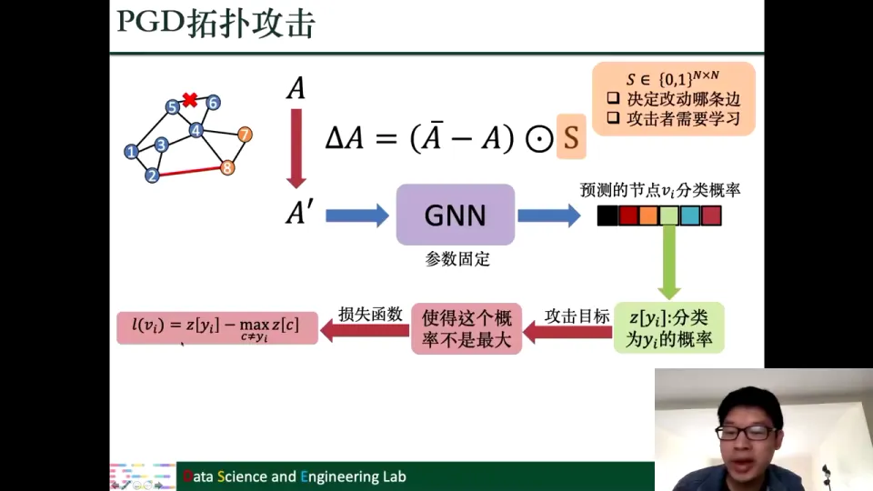

### 3.4 二值约束太硬：先松弛，再投影，最后采样

$S$ 的元素只能是 0 或 1，直接对 $S$ 做梯度下降做不到。标准做法是先把 $S$ 松弛成连续变量 $S'\in[0,1]^{N\times N}$，允许它的元素取 0 到 1 之间的实数。

但普通梯度下降不能保证更新后的 $S'$ 仍落在 $[0,1]$ 里——它可能变成负数，也可能大于 1。于是使用**投影梯度下降**（projected gradient descent，PGD）：每做一步梯度更新，就把结果投影回 $[0,1]$ 区间。这样得到的 $S'$ 就可以解释成一个概率矩阵：$S'_{ij}$ 表示“边 $(i,j)$ 被改动的概率”。

最后，按这个概率做伯努利采样：以 $S'_{ij}$ 的概率取 1，以 $1-S'_{ij}$ 的概率取 0，得到一个真正的 0/1 矩阵 $S$。这个 $S$ 才是最终用于加边、减边的掩码。[【跳转到 38:22】](https://www.bilibili.com/video/BV1yx4y1R7uV/?p=5&t=2302)

如果只想攻击一个节点，优化上面的单个损失即可；如果想同时攻击多个节点，就把这些节点的损失加起来，作为总的攻击目标。[【跳转到 40:52】](https://www.bilibili.com/video/BV1yx4y1R7uV/?p=5&t=2452)

## 四、积分梯度攻击：用多点梯度平均弥补“0 到 1”的非局部性

### 4.1 和 PGD 同样的起点，但把梯度当“打分器”

基于积分梯度的攻击（integrated gradients attack）同样是白盒攻击，同样针对节点分类，也同时能攻击图结构和节点特征。结构和特征都是 0/1 的，所以“加边/减边”和“0→1/1→0 改特征”在数学上是同一类操作。

它和 PGD 的第一处不同，是不直接把梯度上升的结果当作扰动，而是把梯度当作“改这条边会带来多大影响”的分数。原因很实际：如果直接对 $A$ 做梯度上升，得到的 $A'$ 会是连续的、稠密的，既不是 0/1，也不稀疏，根本不像一张真实的图。[【跳转到 41:39】](https://www.bilibili.com/video/BV1yx4y1R7uV/?p=5&t=2499)

### 4.2 单点梯度只看得见“脚边”，看不见整段路

对损失函数关于 $A_{ij}$ 求偏导：

$$
\frac{\partial l(v_i)}{\partial A_{ij}}
$$

它衡量的是“在当前位置把 $A_{ij}$ 稍微增大一点，损失会怎么变”。如果 $A_{ij}$ 本来是 0、我们想加边，这个偏导就可以当作加边后的影响估计；如果 $A_{ij}$ 本来是 1、我们想减边，方向相反，取负号即可。

问题是：这个梯度只在当前点附近有效。加边是从 0 直接跳到 1，跨度很大，单点梯度未必能准确代表整段变化。就像只摸到山脚一小块地面的坡度，不能据此判断整座山的高度差。[【跳转到 47:34】](https://www.bilibili.com/video/BV1yx4y1R7uV/?p=5&t=2854)

### 4.3 积分梯度：沿 0→1 的路径多取几个点

积分梯度的做法很朴素：既然一个点不够，就沿 0 到 1 的路径多取几个点，比如取 $K$ 个点，分别算这些点处的梯度，再加起来（或求平均）。如果取 1/3、2/3 这些位置，就相当于把“从 0 变到 1”这段路切成几段，每一段都估一下坡度，最后综合起来。

这样得到的分数，比只看 0 点处的梯度更能代表“整条边翻转”的真实影响。对每条边 $(i,j)$ 都可以算一个分数 $S_{ij}$：分数越大，说明改这条边越可能让损失上升、越值得改。特征维度同理。[【跳转到 49:39】](https://www.bilibili.com/video/BV1yx4y1R7uV/?p=5&t=2979)

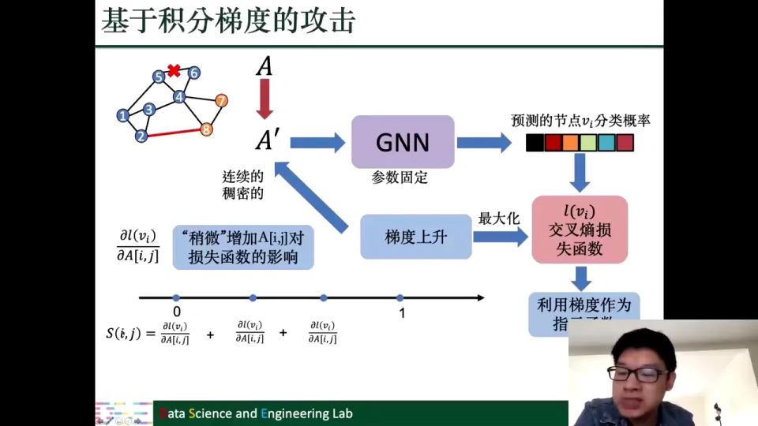

### 4.4 贪心选择：每次改分数最大的那条边

有了分数以后，攻击就变成一个贪心过程：每次选当前分数最大的边（或特征），做加边/减边（或 0/1 翻转），更新图，再重新算分数，直到用完预算。这个“每次选局部最优”的策略不保证全局最优，但实现简单、效果通常不错。[【跳转到 52:09】](https://www.bilibili.com/video/BV1yx4y1R7uV/?p=5&t=3129)

以上就是两个白盒攻击：PGD 拓扑攻击用“掩码 + 投影”直接优化扰动；积分梯度攻击用“多点梯度打分 + 贪心”选边。接下来进入灰盒攻击。

## 五、灰盒 Nettack：用代理模型和三条约束逼近真实模型

### 5.1 灰盒设定：知道训练数据，但不知道模型

Nettack 是图上较早的攻击方法之一，属于灰盒攻击。攻击者能拿到训练数据，但拿不到模型结构和模型参数。它的任务还是节点分类：对真实标签为 $y_i$ 的节点 $v_i$，希望攻击后 GNN 把它判成其他标签。

和前面的白盒攻击相比，Nettack 多了几条限制，不是“想怎么改就怎么改”：

1. **扰动预算**：对图结构的改动加上对节点特征的改动，总数不能超过预算，保证扰动足够小。
2. **度分布约束**：攻击后图的度分布不能变化太大。节点的度就是它连出的边数，把所有节点的度统计成一个分布，就是度分布；它是图的重要性质。如果攻击把大量节点变成“超级枢纽”，一眼就能看出图被动了手脚。
3. **特征共现约束**：在引用网络里，特征对应摘要中的词。攻击后不能出现“两个几乎不会一起出现的词突然同时出现”这种不自然的组合。换句话说，改特征也要改得像正常文本。[【跳转到 54:56】](https://www.bilibili.com/video/BV1yx4y1R7uV/?p=5&t=3296)

Nettack 既能攻击结构（加边/减边），也能攻击特征（0/1 翻转）。因为两者的操作逻辑类似，课程主要讲结构攻击。

### 5.2 没有模型怎么办：训练一个“替身”

灰盒攻击者有训练数据，但没有目标模型。一个自然的办法是：根据经验猜一个和目标模型差不多的结构，用训练数据训练一个**代理模型**（surrogate model）。课程里的例子假设目标模型可能是两层 GCN filter 叠加、没有激活函数；代理模型就按这个结构来建，参数用训练数据学出来。

代理模型不是目标模型本身，但它和目标模型“长得像”。攻击者希望：在代理模型上找到的扰动，迁移到真正的目标模型上也能起作用。[【跳转到 58:09】](https://www.bilibili.com/video/BV1yx4y1R7uV/?p=5&t=3489)

### 5.3 打分与贪心：每次改“最能让正确类掉下去”的边

有了代理模型，流程就和白盒攻击类似了：把候选的扰动图输入代理模型，得到节点 $v_i$ 的分类概率；用这些概率构造攻击损失，衡量“正确类 $y_i$ 的概率是否被压下去”。对每条边、每个特征都算一个分数，然后贪心选择分数最大的那个改动，重复直到预算用完。

Nettack 和白盒 PGD 的主要区别，一是引入了代理模型，二是加了更多约束（度分布、特征共现）；整体“算分数、贪心改”的骨架是一样的。[【跳转到 61:04】](https://www.bilibili.com/video/BV1yx4y1R7uV/?p=5&t=3664)

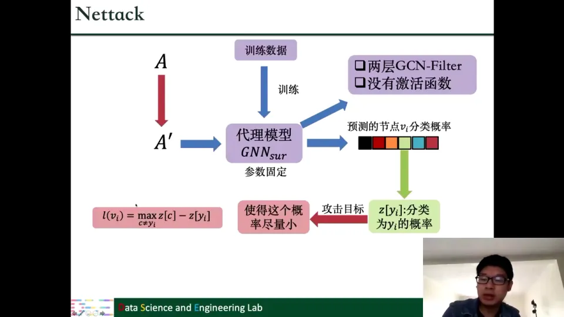

## 六、灰盒 Metattack：用元梯度和双层优化攻击整个测试集

### 6.1 目标升级：不再盯着一个节点，而是让整个测试集变差

Metattack 也是灰盒攻击，也只知道训练数据。它和 Nettack 的一个重要区别是攻击目标：Nettack 针对某个节点或某一批节点，Metattack 则希望 GNN 在整个测试集上的效果都变差。

它还有两个特点：

- **投毒攻击**：扰动加在训练图上，模型在这个被扰动的图上训练，再在同样被扰动的图上测试。前面介绍的 Nettack 等还不能算投毒攻击。
- **约束沿用 Nettack**：因为两者出自同一作者，预算、度分布、特征共现等限制基本一致。论文发表时 Metattack 只攻击图结构，后来也扩展到了特征。[【跳转到 62:35】](https://www.bilibili.com/video/BV1yx4y1R7uV/?p=5&t=3755)

### 6.2 没有测试标签，怎么衡量“测试集变差”

投毒流程是：先扰动训练图 $A\to A'$，在 $A'$ 上训练代理模型，再在 $A'$ 的测试节点上预测。问题是，攻击者不知道测试集的真实标签，无法直接算测试准确率，也就无法判断攻击是否成功。

Metattack 的解决办法是“自己造标签”：

1. 先在**没有被扰动的原图** $A$ 上训练一个代理模型。因为图是干净的，这个模型的预测相对可靠。
2. 用它在测试节点上的预测结果当作**伪标签**（pseudo-label）。
3. 再在扰动图 $A'$ 上训练另一个代理模型，用它的预测和伪标签算交叉熵 $L_{self}(A')$。

攻击者希望扰动后的模型预测和伪标签差得越远越好，也就是最大化 $L_{self}(A')$。等价地，定义攻击损失 $L_{atk}(A')=-L_{self}(A')$，最小化它即可。[【跳转到 65:58】](https://www.bilibili.com/video/BV1yx4y1R7uV/?p=5&t=3958)

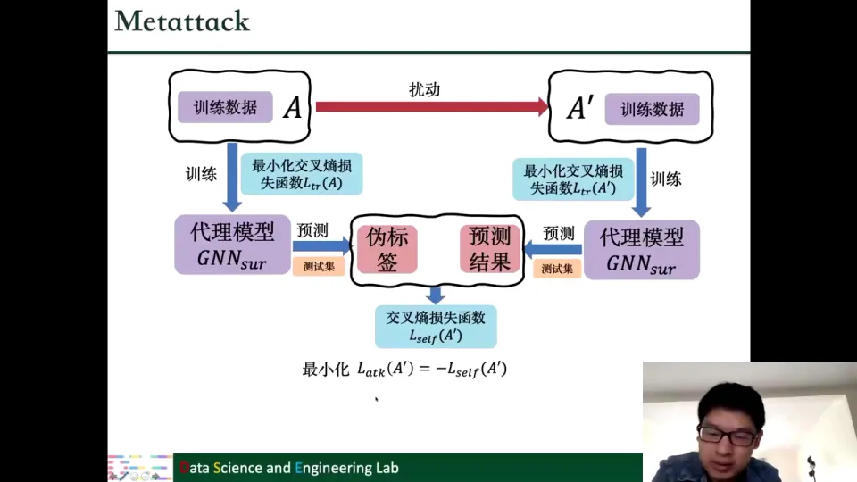

### 6.3 为什么是“双层优化”

这里有一个相互依赖：代理模型的参数 $\Theta$ 取决于训练图 $A'$；而攻击者优化 $A'$ 时，又要看模型在 $\Theta$ 下的表现。写成优化问题就是：

$$
\min_{A'}\ \mathcal L_{atk}\big(GNN_{sur}(A';\Theta^*)\big)
\quad \text{s.t.}\quad
\Theta^*=\arg\min_{\Theta}\ \mathcal L_{tr}\big(GNN_{sur}(A';\Theta)\big)
$$

外层优化 $A'$，内层优化模型参数 $\Theta$。因为 $\Theta^*$ 是 $A'$ 的函数，求外层梯度时必须穿过内层的训练过程，这就是“双层优化”（bilevel optimization）的难点。[【跳转到 68:28】](https://www.bilibili.com/video/BV1yx4y1R7uV/?p=5&t=4108)

原论文还加了一项：把训练损失也放进攻击目标。逻辑是，如果扰动让模型连训练集都拟合不好，那么它在测试集上更不可能好。因此总的攻击目标不仅让测试预测偏离伪标签，也让训练本身变困难。[【跳转到 70:08】](https://www.bilibili.com/video/BV1yx4y1R7uV/?p=5&t=4208)

### 6.4 元梯度：对“训练后的参数”再求一次导

为了优化外层目标，Metattack 使用**元梯度**（meta-gradient）：

$$
\nabla^{meta}_{A'}:=\nabla_{A'}\mathcal L_{atk}\big(GNN_{sur}(A';\Theta^*)\big),
\quad
\Theta^*=\arg\min_{\Theta}\mathcal L_{tr}(GNN_{sur}(A';\Theta))
$$

直观地说，普通梯度是“改输入，看输出怎么变”；元梯度是“改输入，看模型训练完之后的表现怎么变”。因为 $\Theta^*$ 本身由 $A'$ 决定，求导时要沿着“$A'$ 影响 $\Theta^*$，$\Theta^*$ 再影响损失”的链条一路回传，计算比普通梯度复杂得多。

拿到元梯度后，有两种用法：

- **元梯度下降**：直接把元梯度用于更新 $A'$。但这样得到的 $A'$ 仍然是稠密、连续的，不符合“只改少量 0/1 边”的要求。
- **元梯度做指示**：像积分梯度那样，把元梯度当作“改这条边会带来多大影响”的分数。加边时 $S_{ij}=\nabla^{meta}_{A'[i,j]}$，减边时取负号；再用贪心算法选分数最大的边进行改动。论文最终采用的是这一种。[【跳转到 73:58】](https://www.bilibili.com/video/BV1yx4y1R7uV/?p=5&t=4438)

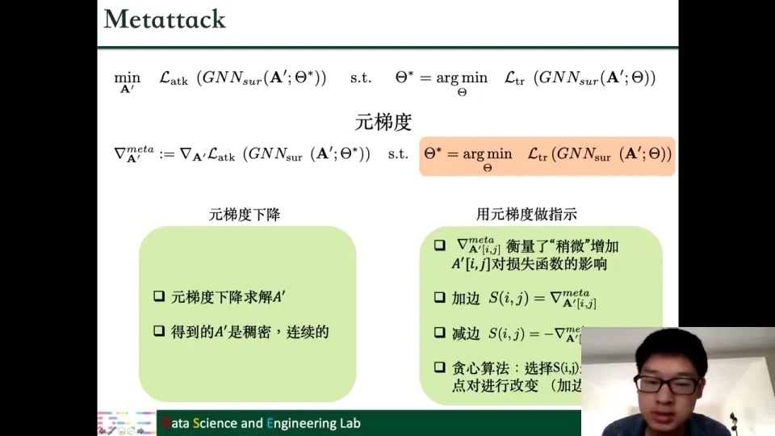

## 七、黑盒攻击：把加边减边建模成马尔可夫决策过程

### 7.1 黑盒设定：只能“输入图、拿预测”

黑盒攻击中，攻击者对模型结构、训练数据、参数一无所知。它唯一能做的是查询：给模型一张图，模型返回预测结果。攻击目标还是节点分类，限制也类似——只能改有限条边，改动数量由预算控制。

此外，黑盒攻击通常还规定：新加的边只能连接原图中距离小于 $D$ 的节点对。理由是，距离近的节点相似性可能更高，连起来扰动较小；如果两个相距很远的节点突然被连上，这种改动太显眼。[【跳转到 75:27】](https://www.bilibili.com/video/BV1yx4y1R7uV/?p=5&t=4527)

### 7.2 攻击是一串动作：RL-S2V 的 MDP 建模

黑盒攻击一般用强化学习来做。以 RL-S2V 为例，攻击过程被建模成一系列“加边/减边”的动作：

- **状态**（state）：当前的图，包括原图和每一步改动后的中间图；
- **动作**（action）：加一条边或减一条边，第 $t$ 个动作记为 $a_t$；
- **奖励**（reward）：攻击结束时的反馈；
- **终止条件**：攻击成功，或者预算用完。

关键假设是马尔可夫性：下一步只取决于当前状态，和之前怎么走到这里无关。也就是说，在 $s_{t+2}$ 时刻决定“加哪条边、减哪条边”时，只需要看当前的图，不需要回放此前的操作历史。这就是**马尔可夫决策过程**（Markov decision process，MDP）。[【跳转到 78:10】](https://www.bilibili.com/video/BV1yx4y1R7uV/?p=5&t=4690)

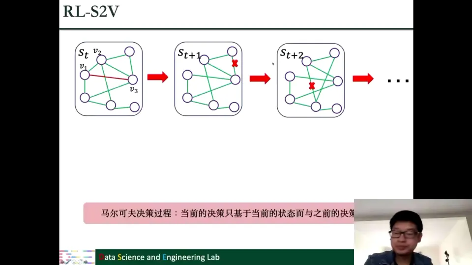

RL-S2V 的奖励设计很简洁：只在攻击结束时给奖励。攻击成功（预测标签和原来不一样）给 $+1$，失败给 $-1$；中间步骤不给任何奖励。这样强化学习的目标就是“学会一串动作，让最终成功”。[【跳转到 81:30】](https://www.bilibili.com/video/BV1yx4y1R7uV/?p=5&t=4890)

### 7.3 REWARD：用“重连”代替加边减边

REWARD 是另一个黑盒攻击，攻击任务是图分类：如果一张图的标签是 $y_i$，攻击者希望模型把它分到其他类别。它最大的贡献是引入了一种新操作——**重连**（rewiring）。

重连涉及三个节点 $v_1,v_2,v_3$：先删掉 $v_1$ 和 $v_2$ 之间的边，再在 $v_1$ 和 $v_3$ 之间加一条边。为了不让扰动太突兀，论文额外要求 $v_3$ 必须是 $v_1$ 的二阶邻居——既然已经“离得不远”，把连接挪过去就比较自然。[【跳转到 84:03】](https://www.bilibili.com/video/BV1yx4y1R7uV/?p=5&t=5043)

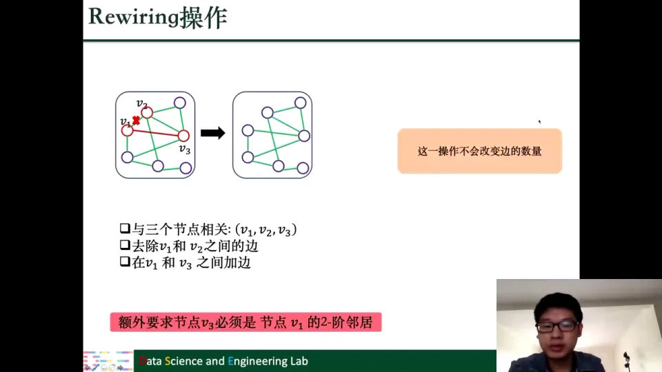

重连有三个好处：

1. **边数不变**：删一条、加一条，总边数保持不变；边数不变，度也不变，度分布自然更稳定。
2. **对拉普拉斯矩阵特征值的影响较小**：拉普拉斯矩阵由度矩阵减去邻接矩阵得到，它的特征值/特征向量刻画了图的连通性、平滑性等整体性质，重连对它的扰动比直接加边减边小。
3. **对连通性的影响较小**：直接减边可能把图弄断，重连只是“挪动”连接，更不容易破坏连通性。[【跳转到 85:43】](https://www.bilibili.com/video/BV1yx4y1R7uV/?p=5&t=5143)

REWARD 同样把攻击建模成 MDP，也用强化学习训练攻击者。它和 RL-S2V 的奖励设计不同：不是只在最后给奖励，而是每一步都给。当前步攻击成功（预测和初始预测不一样），给 $+1$；当前步没成功，给一个负奖励。负奖励通常取 $-1/K$，其中 $K$ 是预算；因为不同图的边数不同，$K$ 一般定义为边数的一个比例 $p\cdot|E|$，这样奖励尺度不会随图的大小失控。终止条件有两个：某一步成功就立即停止，或者一直没成功、直到预算用完。[【跳转到 87:53】](https://www.bilibili.com/video/BV1yx4y1R7uV/?p=5&t=5273)

课程没有展开强化学习的训练细节，只提到 REWARD 用了层次化策略网络（hierarchical policy network）。对初学者来说，记住“状态是图、动作是重连、奖励看是否成功、用 RL 学策略”这个框架即可。

## 八、防御的四条路线：从数据增强到结构重建，再到注意力降权

攻击部分讲完，接下来是防御。课程把防御方法分成四类：**对抗训练、图净化、图结构学习、图注意力机制**。这四类方法的切入点不同：对抗训练改的是“训练数据”，图净化改的是“输入图”，图结构学习改的是“图结构本身”，图注意力改的是“聚合时的权重”。[【跳转到 90:33】](https://www.bilibili.com/video/BV1yx4y1R7uV/?p=5&t=5433)

### 8.1 对抗训练：把“被攻击过的图”也放进训练集

对抗训练（adversarial training）的思路很直接。普通训练是给定图的结构 $A$ 和特征 $F$，直接训练 GNN；对抗训练则先对图做一次对抗攻击，得到被扰动的图，再把这个“被攻击过的图”也加入训练集。这样模型在训练阶段就见过带扰动的样本，面对攻击时会更稳。从数据角度看，这相当于一种**数据增强**（data augmentation）。[【跳转到 90:58】](https://www.bilibili.com/video/BV1yx4y1R7uV/?p=5&t=5458)

按扰动加在哪里，课程介绍了三种做法：

1. **针对图结构**：先用 $A,F$ 训练，再用 PGD 等攻击得到 $A',F$，然后用 $A',F$ 继续训练；攻击和训练可以循环进行。相当于不断“制造更难的结构样本”让模型适应。
2. **针对节点特征**：扰动节点特征，目标是让节点 $v_i$ 的预测和它邻居的预测尽量不相似。形式化地，找一个在 $\epsilon$ 范围内、能让“节点 $i$ 与邻居 $j$ 的表示距离”最大的扰动 $r_i$，再在这个扰动后的特征上训练（外层最小化最坏扰动下的训练损失）。这样模型会学会在特征被恶意改动时仍保持局部一致性。
3. **同时针对结构和特征**：不直接扰动输入，而是扰动 GNN 的隐藏层 $F^{(1)}$。因为隐藏层已经融合了结构和特征的信息，扰动它就相当于同时影响两者。训练目标是
$$
\min_{\Theta}\max_{\zeta\in D}\mathcal L_{train}\big(A,F^{(1)}+\zeta;\Theta\big),
\quad
D=\{\zeta:\|\zeta_i\|_2\le \Delta\}.
$$
内层最大化让扰动尽可能破坏训练，外层最小化让模型尽可能抵抗这种破坏，形成一个 min-max 对抗过程。[【跳转到 95:16】](https://www.bilibili.com/video/BV1yx4y1R7uV/?p=5&t=5716)

### 8.2 图净化：利用攻击留下的两个统计痕迹

图净化（graph purification）不改变模型结构，而是在训练前先对图做预处理：把攻击者加进来的“有害边”尽量删掉，得到一张更干净的图，再在干净图上训练 GNN。

课程给出两个可用于识别有害边的观察：

**观察一：攻击者倾向于连接不相似的节点。** Jaccard 相似度衡量两个节点邻居集合的重合程度：交集大小除以并集大小，取值在 0 到 1 之间，越大说明两个节点越相似。在干净图里，相连节点的 Jaccard 相似度往往集中在较高区间；图被攻击后，相似度分布会明显向低值偏移，出现大量“相似度很低却相连”的边。于是可以设一个相似度阈值，把低于阈值的边删掉。阈值本身是一个超参数，需要通过验证集调节。这类“按相似度删边”的做法，文献中常对应 GCN-Jaccard。[【跳转到 97:33】](https://www.bilibili.com/video/BV1yx4y1R7uV/?p=5&t=5853)

**观察二：攻击会抬高邻接矩阵的秩。** 扰动预算越大，邻接矩阵的秩增长越明显。既然攻击让矩阵变得“更高秩”，就可以反过来求它的低秩近似：用奇异值分解（singular value decomposition，SVD）保留最大的若干个奇异值，重建一个低秩的邻接矩阵，从而压掉攻击带来的噪声成分。这类做法常对应 GCN-SVD。课程幻灯片上把 SVD 误写成了 SVM，讲者在现场专门更正为 SVD。[【跳转到 99:28】](https://www.bilibili.com/video/BV1yx4y1R7uV/?p=5&t=5968)

这两种方法的共同点是：先观察攻击在图统计性质上留下什么痕迹，再用一个简单的预处理把痕迹抹掉。它们不保证恢复出原始图，但能把大部分有害边去掉。

### 8.3 图结构学习：把“干净图”和“GNN 参数”一起学

图结构学习和图净化目标相似：都想要一张更干净的图。区别在于，图净化是“先清洗、再训练”的两步走；图结构学习则把“学图结构”和“学 GNN 参数”放进同一个优化目标，联合训练。

课程以 Pro-GNN 为例，其目标函数是：

$$
\min_{S,\Theta}\ \mathcal L_{train}(S,F;\Theta)
+\|A-S\|_F^2
+\beta_1\|S\|_1
+\beta_2\|S\|_*
+\beta_3\operatorname{tr}(F^\top L F)
$$

逐项解释：

- $\mathcal L_{train}(S,F;\Theta)$：在学到的图 $S$ 上训练 GNN，保证任务性能；
- $\|A-S\|_F^2$：学到的 $S$ 不能离原图 $A$ 太远，否则等于把整张图推倒重来；
- $\|S\|_1$：让 $S$ 稀疏，避免学出一张稠密图；
- $\|S\|_*$：核范数（nuclear norm），也就是矩阵奇异值之和；最小化它会鼓励 $S$ 低秩，对应“攻击会抬高秩”的观察；
- $\operatorname{tr}(F^\top L F)$：特征平滑项，$L$ 是图拉普拉斯矩阵，这一项鼓励相连节点的特征相近，对应“攻击会连接不相似节点”的观察。

优化完成后，模型同时得到一张更干净的图 $S$ 和一组适配这张图的 GNN 参数 $\Theta$。[【跳转到 100:29】](https://www.bilibili.com/video/BV1yx4y1R7uV/?p=5&t=6029)

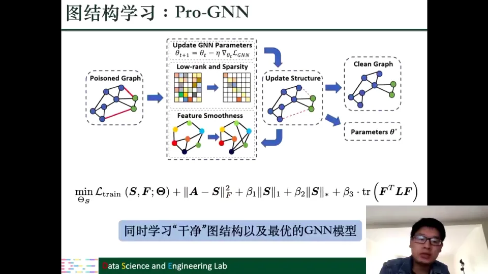

### 8.4 图注意力：让可疑的边和节点自动降权

图注意力机制的想法是：与其硬删边，不如在聚合时给可疑的边或节点一个很小的注意力权重，让它们对结果的影响自然变小。这样既保留了图的信息，又削弱了攻击的作用。

**RGCN** 的做法是给每个节点的表示建一个高斯分布。高斯分布由均值 $\mu$ 和方差 $\sigma^2$ 描述，方差越大，分布越分散：

$$
h_i^{(l)}\sim \mathcal N\big(\mu_i^{(l)},\operatorname{diag}(\sigma_i^{(l)})\big)
$$

聚合时按节点度做归一化（分母含 $\sqrt{\tilde D_{ii}\tilde D_{jj}}$），并同时计算均值和方差。注意力系数设计为

$$
\alpha_j^{(l)}=\exp\big(-\gamma\sigma_j^{(l)}\big)
$$

方差越大，负号让注意力越小。为什么方差能指示“被攻击”？因为被攻击的节点往往既连接相似节点，又连接攻击者塞进来的不相似节点，聚合到的信息更杂，方差自然更大。课程展示的实验也显示，被攻击节点的平均方差确实更高。于是 RGCN 用方差自动给可疑节点降权。[【跳转到 105:37】](https://www.bilibili.com/video/BV1yx4y1R7uV/?p=5&t=6337)

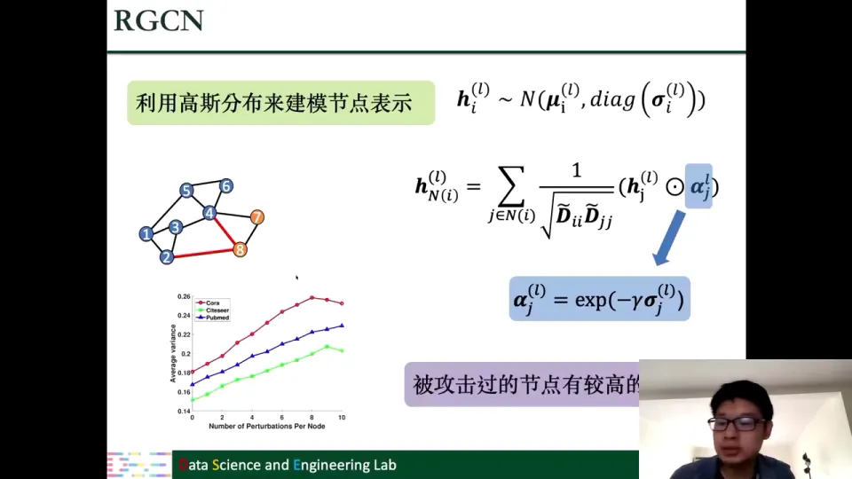

**PA-GNN** 则把注意力放在边上，学习每条边 $(i,j)$ 的注意力分数 $\alpha_{ij}$。它的训练信号来自“自己造的脏数据”：虽然我们不知道目标图原来长什么样，但可以找一批同领域的干净图（比如都是社交网络），自己用前面介绍的扰动方法把它弄脏，并记录哪些边是被自己改过的。这样就有了监督信息——干净边给高分，被攻击边给低分，训练模型学会“识别可疑边”。

更关键的是，PA-GNN 用**元学习**（meta-learning）来迁移这种能力：先在多张干净图上学习一个共享的初始化参数，让这个初始化“擅长学注意力”；再把它迁移到真正被攻击的目标图上，在此基础上微调。这样目标图即使没有标签，也能继承从其他图上学到的“识别攻击边”的能力。[【跳转到 107:17】](https://www.bilibili.com/video/BV1yx4y1R7uV/?p=5&t=6437)

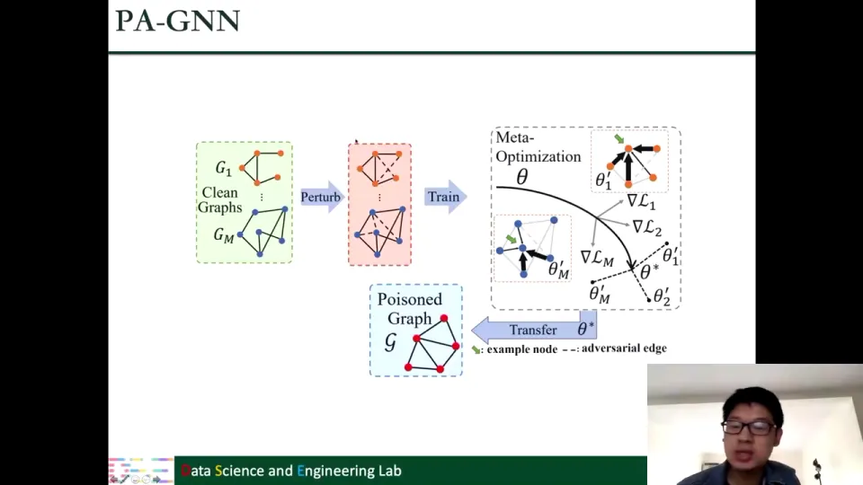

## 九、可扩展性的瓶颈不在显存，而在邻居爆炸

### 9.1 图已经大到不能“整图训练”

现实中的图越来越大。课程展示了一些主流平台的用户规模：Facebook、YouTube、WhatsApp、微信、Instagram、QQ 空间、QQ、抖音、新浪微博、Twitter，动辄数亿甚至数十亿用户。把这么多节点和边组成的图全部放进内存，做全批量梯度下降（full-batch gradient descent），根本不现实——内存放不下，计算量也承受不了。[【跳转到 112:03】](https://www.bilibili.com/video/BV1yx4y1R7uV/?p=5&t=6723)

所以训练方式必须改成随机梯度下降（stochastic gradient descent，SGD）或小批量训练：每次只取一部分节点/子图，算这部分上的梯度，更新参数。但即使改成 SGD，GNN 还有一个特有的麻烦——**邻居爆炸**（neighborhood explosion）。

### 9.2 为什么层数一多，计算量就指数上涨

以 L 层 GCN 为例，每一层的表示按下面的方式聚合邻居：

$$
F_i^{(l)}=\sum_{v_j\in \mathcal N(v_i)}\hat A_{ij}F_j^{(l-1)}\Theta^{(l-1)},\quad l=1,\dots,L
$$

其中 $\hat A$ 是归一化后的连接矩阵，$\mathcal N(v_i)$ 是节点 $v_i$ 的邻居集合，$\Theta^{(l-1)}$ 是这一层要学的参数。

要算节点 $v_i$ 在第 L 层的表示 $F_i^{(L)}$：

- 第 L 层需要它的 1 跳邻居；
- 第 L−1 层，这些邻居又需要各自的邻居，也就是 $v_i$ 的 2 跳邻居；
- 依此类推，到第 1 层时，需要 $v_i$ 的 L 跳邻居。

如果节点的平均度是 $\deg$，那么涉及的节点数量大约是 $O(\deg^L)$，随层数指数增长。课程用一棵“邻居展开树”展示了这一点：每一层都向下分叉，层数越多，底层节点数越恐怖。如果某些节点本身度很大，爆炸速度还会更快。[【跳转到 113:28】](https://www.bilibili.com/video/BV1yx4y1R7uV/?p=5&t=6808)

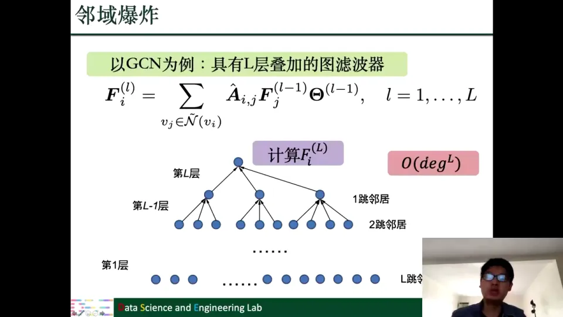

这也解释了为什么“只算一个节点的表示”都可能放不进内存：不是模型参数太大，而是为了算这一个节点，背后要展开的邻居子图太大。解决思路自然是“不要展开全部邻居，只采样一部分”。

## 十、采样把指数级邻居展开变成可控的批量计算

### 10.1 逐点采样：每个节点每层只采固定数量的邻居

最直观的采样方法是**逐点采样**（node sampling）：在每一层，对每个节点只随机抽取固定数量 $n^l(v_i)$ 个邻居，而不是用它全部的邻居。然后用采样到的邻居去估计原来的聚合结果：

$$
F_i^{(l)}=\frac{|\mathcal N(v_i)|}{|n^l(v_i)|}
\sum_{v_j\in n^l(v_i)}\hat A_{ij}F_j^{(l-1)}\Theta^{(l-1)}
$$

前面的比例因子 $|\mathcal N(v_i)|/|n^l(v_i)|$ 是“放大系数”：只抽了一部分邻居，就把这部分的结果按比例放大，用来近似全部邻居的结果。这样得到的估计是**无偏估计**（unbiased estimate）——多次采样平均下来，期望等于真实值，教材里有详细证明。GraphSAGE 采用的就是这类逐点采样思路。[【跳转到 117:13】](https://www.bilibili.com/video/BV1yx4y1R7uV/?p=5&t=7033)

逐点采样解决了“高度节点一下爆炸”的问题：不管节点有多少邻居，每层最多只采 $K$ 个。但它没有解决指数增长：如果每层都采样 $K$ 个，第 L 层仍然会有 $K^L$ 个节点。也就是说，它把“每层分叉数”从 $\deg$ 降到了 $K$，但分叉的层数还在，总量仍然指数级。[【跳转到 119:11】](https://www.bilibili.com/video/BV1yx4y1R7uV/?p=5&t=7151)

### 10.2 逐层采样：整层共用一批节点，把 $K^L$ 变成 $K\cdot L$

**逐层采样**（layer sampling）换了一个思路：不再“每个节点各自采样邻居”，而是“每一层整体采样一批节点”。具体来说，第 L 层从一个统一的分布 $q^L$ 中采样出 $N^L$ 个节点，这一层所有节点的计算都只用这批节点；下一层再采一批。估计式为：

$$
F_j^{(l)}=\frac{1}{|N^l|}
\sum_{v_j\in N^l}\frac{\hat A_{ij}}{q^l(v_j)}
F_j^{(l-1)}\Theta^{(l-1)}
$$

其中 $q^l(v_j)$ 是节点 $v_j$ 在第 l 层被采到的概率，分母上的 $q^l(v_j)$ 是重要性校正，用来保证估计无偏。

关键区别在于：逐点采样是“每个节点各自分叉”，总量 $K^L$；逐层采样是“整层共享一批节点”，如果每层采 $K$ 个，总量只有 $K\cdot L$，从指数级降到线性级。这就是它最大的价值。[【跳转到 119:56】](https://www.bilibili.com/video/BV1yx4y1R7uV/?p=5&t=7196)

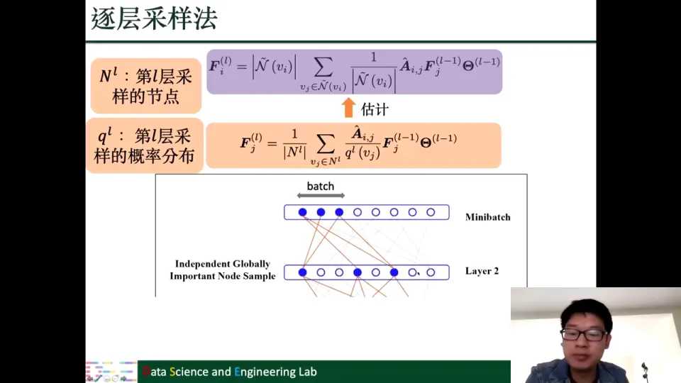

采样分布 $q^l$ 不能随便选。虽然只要 $q^l$ 非零，估计就是无偏的，但如果方差太大，估计值会偏离真实值很多。因此设计 $q^l$ 时通常以“最小化方差”为目标。课程提到两种设计：一种让所有层共享同一个 $Q$；另一种让每层有各自的 $Q^l$，并且会参考上一层采到了什么。两种方法都只能得到近似最优，具体推导在教材里。[【跳转到 123:12】](https://www.bilibili.com/video/BV1yx4y1R7uV/?p=5&t=7392)

### 10.3 逐层采样的副作用：采着采着，邻居没了

逐层采样有一个新问题：某一层采到的节点，在下一层可能一个邻居都没被采到。比如节点 3 在下一层需要从邻居收集信息，但它的邻居恰好都没被采样，那么节点 3 就完全无法计算表示。课程把这个情况称为“节点被采空了”。

解决这个问题，一种思路是让层与层之间的采样“更紧密”，但这会让采样方案设计变得复杂，现有方法一般没有那么做。更简单、更实际的办法是：**每一层都用同一批节点**。这样节点之间的连接关系始终保留在同一个子图里，不会出现“邻居全丢”的情况；而且因为整张子图被反复使用，节点之间的连接反而更密。[【跳转到 124:52】](https://www.bilibili.com/video/BV1yx4y1R7uV/?p=5&t=7492)

### 10.4 子图采样：每次拿一小块图来训练

“每层用同一批节点”自然引出**子图采样**（subgraph sampling）：从大图里抽出一个子图，在这个子图上训练 GNN；训练完再换一个子图，重复这个过程。因为每次都在一个完整的子图上做前向和反向传播，节点不会因为“邻居没被采到”而失去信息。

课程介绍两种子图采样方法：

- **Cluster-GCN**：先用聚类把大图切成若干个子图（簇），每次选一个子图训练，重复。聚类就是把连接紧密的节点分到同一组，这样能保证子图内部连接较密，减少跨子图的信息损失。
- **GraphSAINT**：每次随机生成一个子图。生成方式有三种：随机采样节点后保留这些节点之间的边；随机采样边后保留边两端的节点；从某个节点出发做随机游走（每次随机走到一个邻居，走若干步），用游走经过的节点组成子图。三种方式得到子图后，都在子图上训练 GNN，再换下一个。[【跳转到 127:16】](https://www.bilibili.com/video/BV1yx4y1R7uV/?p=5&t=7636)

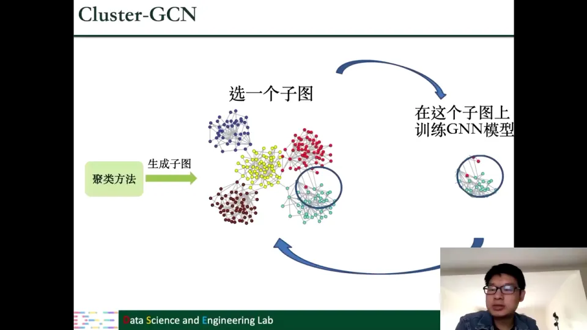

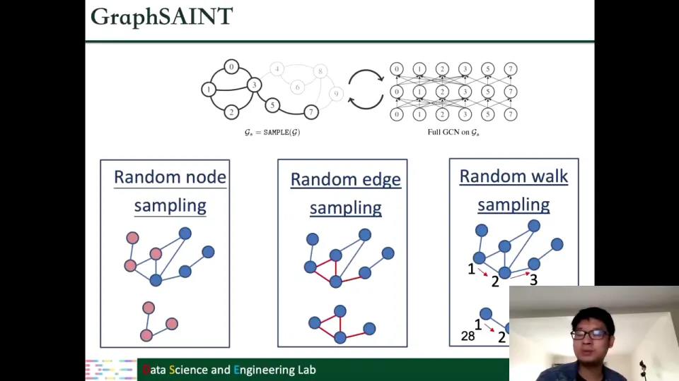

至此，可扩展性部分的逻辑就完整了：全批量不可行 → 小批量仍遇邻居爆炸 → 逐点采样把每层分叉降到 K，但总量仍是 $K^L$ → 逐层采样把总量降到 $K\cdot L$，但可能采空邻居 → 子图采样用“同一批节点/一整块子图”保证连接完整，并用 Cluster-GCN 或 GraphSAINT 决定子图怎么来。

## 小结

- **鲁棒性研究必须同时看攻击和防御。** 攻击回答“模型怕什么”，防御回答“怎样让它不怕”。只研究防御，容易造出“看起来能用、实际一攻就破”的模型。
- **攻击的统一语言是“预算内的扰动”。** 扰动可以加在连接矩阵 $A$ 上，也可以加在特征矩阵 $F$ 上；用 $\|A'-A\|_0+\|F'-F\|_0\le\Delta$ 约束改动数量，才谈得上“不易察觉”。
- **攻击按阶段分逃逸和投毒，按信息分白盒、灰盒、黑盒。** 逃逸只改测试图，投毒会改训练图；白盒知道全部信息，灰盒只知道训练数据，黑盒只能查询预测。
- **白盒攻击靠梯度。** PGD 拓扑攻击用 0/1 掩码 $S$ 表示“改哪些边”，用 $\bar A-A$ 决定“加还是减”，再通过松弛、投影、采样得到合法扰动；积分梯度攻击用 0→1 路径上的多点梯度平均，弥补单点梯度的局部性。
- **灰盒攻击靠代理模型。** Nettack 用代理模型算分数、贪心改边，并额外约束度分布和特征共现；Metattack 用伪标签衡量测试集效果，用双层优化和元梯度实现投毒，目标是让整个测试集变差。
- **黑盒攻击靠强化学习。** RL-S2V 把“加边/减边”序列建模成 MDP，用最终成功/失败给奖励；REWARD 引入重连操作，保持边数和度不变，并改成每一步都给奖励。
- **防御有四条路线。** 对抗训练把攻击样本加入训练；图净化用相似度和低秩性删掉可疑边；图结构学习联合学习干净图和 GNN 参数；图注意力用方差或监督信号给可疑边/节点降权。
- **可扩展性的核心矛盾是邻居爆炸。** L 层 GCN 计算一个节点要展开 $O(\deg^L)$ 个邻居；逐点采样把每层分叉降到 $K$，但总量仍是 $K^L$；逐层采样把总量降到 $K\cdot L$，但可能采空邻居；子图采样用一整块子图保证连接完整，Cluster-GCN 和 GraphSAINT 是两种代表。

## 关键术语速查

| 术语 | 一句话解释 |
| --- | --- |
| 鲁棒性（robustness） | 输入受到扰动时，模型输出保持稳定的程度；中文也写作“健壮性”。 |
| 对抗攻击（adversarial attack） | 专门构造微小扰动来欺骗模型、让模型判错的过程。 |
| 扰动（perturbation） | 对图结构或节点特征所做的改动，如图中加边、删边、特征 0/1 翻转。 |
| 连接矩阵 / 邻接矩阵（$A$） | 描述图中节点之间是否相连的矩阵；$A_{ij}=1$ 表示节点 $i$ 与 $j$ 有边。 |
| 节点特征矩阵（$F$） | 每个节点带的信息；引用网络中常是词袋表示，取值为 0/1。 |
| 预算（$\Delta$） | 攻击者允许改动的边数/特征数上限，用来定义“微小扰动”。 |
| 逃逸攻击（evasion） | 模型已训练好且参数固定，只扰动测试图，不影响训练。 |
| 投毒攻击（poisoning） | 把扰动加进训练图，模型在“有毒”图上训练，因而影响模型本身。 |
| 白盒攻击 | 攻击者掌握训练数据、模型结构、模型参数等全部信息。 |
| 灰盒攻击 | 攻击者只掌握训练数据，不知道模型结构和参数。 |
| 黑盒攻击 | 攻击者对模型内部一无所知，只能查询输入对应的预测结果。 |
| PGD（投影梯度下降） | 每步梯度更新后把变量投影回可行域（如 $[0,1]$）的优化方法。 |
| 积分梯度（integrated gradients） | 沿 0→1 路径取多个点的梯度并累加，用来估计整段翻转的影响。 |
| 代理模型（surrogate model） | 攻击者根据经验构造、用训练数据训练的“替身模型”，用来近似目标模型。 |
| 伪标签（pseudo-label） | 用干净图上训练好的模型对无标签数据做预测，把预测结果当作标签使用。 |
| 双层优化（bilevel optimization） | 外层优化扰动、内层优化模型参数，两层相互依赖的优化问题。 |
| 元梯度（meta-gradient） | 考虑“输入改变→模型训练结果改变→损失改变”整条链后求出的梯度。 |
| 马尔可夫决策过程（MDP） | 状态、动作、奖励、终止条件组成的序贯决策框架；下一步只依赖当前状态。 |
| 重连（rewiring） | 删掉一条边、再加一条边，把连接关系“挪”到另一个节点上；边数不变。 |
| 对抗训练（adversarial training） | 把攻击产生的扰动样本加入训练集，让模型提前适应攻击。 |
| 图净化（graph purification） | 训练前先清洗图，按相似度阈值删边或用低秩近似去掉攻击噪声。 |
| 奇异值分解（SVD） | 把矩阵分解为奇异值和奇异向量，保留最大的若干项可得到低秩近似。 |
| 图结构学习 | 把“学干净图结构”和“学 GNN 参数”放在同一个目标里联合优化，如 Pro-GNN。 |
| 核范数（nuclear norm） | 矩阵奇异值之和，常用来鼓励矩阵低秩。 |
| 拉普拉斯矩阵（$L$） | 由度矩阵和邻接矩阵构造的矩阵，$F^\top L F$ 可衡量图上特征的平滑程度。 |
| 图注意力机制 | 给边或节点学习注意力权重，让可疑边/节点在聚合时影响更小。 |
| 邻居爆炸（neighborhood explosion） | L 层 GNN 计算一个节点要展开 L 跳邻居，节点数随层数指数增长。 |
| 逐点采样（node sampling） | 每个节点每层只随机采固定数量的邻居，得到无偏但仍有 $K^L$ 复杂度的估计。 |
| 逐层采样（layer sampling） | 每一层整体采样一批节点并在该层共享，把节点数从 $K^L$ 降到 $K\cdot L$。 |
| 无偏估计（unbiased estimate） | 多次采样结果的平均值等于真实值的估计方式。 |
| 子图采样（subgraph sampling） | 每次从大图抽一个子图并在子图上训练 GNN，避免逐层采样把邻居采空。 |
| Cluster-GCN | 先用聚类把图切成子图，每次选一个子图训练 GNN 并重复。 |
| GraphSAINT | 每次随机生成子图（随机节点/随机边/随机游走），在子图上训练 GNN。 |
