# 第06讲：图上的其他深度模型

## 本讲要解决的核心问题（SCQA）

**背景**：前几讲讲图神经网络时，核心动作始终是“聚合邻居信息”：每个节点把相邻节点的表示加权求和，再乘一个可学习的变换矩阵，得到自己的新表示。这套做法默认图是“干净”的简单图——节点同质、边没有类型、没有正负、也不随时间变化。

**冲突**：真实世界的图往往不满足这个前提。学术网络里有作者、论文、会议等不同类型的节点；电商平台天然是“用户—商品”的二分结构；社交网络里既有“关注”这样的正关系，也有“拉黑”这样的负关系；短视频平台上，同一对用户之间可能同时存在关注、观看、评论等多种关系；此外还有一条边连接多个节点的超图，以及不断增删节点和边的动态图。直接套普通图神经网络，就会把不同语义混在一起。

**疑问**：面对这些复杂图，图神经网络应该怎么改？除了图神经网络，还有哪些深度模型可以用到图上，又该怎么用？

**回答（中心思想）**：复杂图上的滤波并没有推翻“聚合邻居”的框架，它改的是框架里最关键的一步——**邻居是谁**。异质图用元路径定义邻居，二分图用“另一侧集合”定义邻居，多维图把邻居分成“维度内”和“跨维度”，符号图按正负边分成“朋友”和“敌人”，超图先把超边拆成成对关系，动态图则让参数沿时间演化。第二部分介绍的循环神经网络、自编码器、变分自编码器和生成对抗网络，迁移到图上的关键同样是找到一个“让图结构进入模型”的接口：改遗忘门、重构邻接矩阵、用 GNN 学分布、用邻居采样或图生成做对抗。

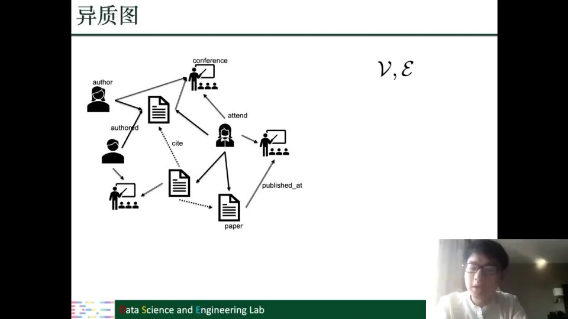

## 一、复杂图滤波的总思路：先按结构重新定义“邻居”，再做聚合

### 1.1 所有图滤波共享同一个骨架

在普通图上，一层图滤波可以写成：

$$
\mathbf{h}_i^{(l)} = \sigma\Big(\sum_{v_j \in \mathcal{N}(v_i)} \alpha_{ij}\,\mathbf{h}_j^{(l-1)}\,\mathbf{W}^{(l-1)}\Big)
$$

其中 $\mathcal{N}(v_i)$ 是邻居集合，$\mathbf{h}_j^{(l-1)}$ 是邻居 $j$ 上一层的表示，$\mathbf{W}$ 是变换矩阵，$\alpha_{ij}$ 是聚合权重，$\sigma$ 是非线性激活。简单说：先决定听谁的，再把信息汇总，最后做一次变换。

这个骨架包含三个可替换的零件：邻居集合、聚合权重、变换矩阵。复杂图上的改动，绝大多数发生在“邻居集合”这一层；聚合和变换通常沿用原来的做法，只是额外加上类型相关或符号相关的参数。

### 1.2 六类复杂图，改的都是“谁算邻居”

本讲覆盖六类复杂图，它们可以按“图里多了什么信息”来分组：

| 复杂图 | 比简单图多了什么 | 邻居怎么重新定义 |
| --- | --- | --- |
| 异质图 | 节点类型、边类型 | 按元路径（如“作者—论文—作者”）走到的节点 |
| 二分图 | 节点分成两个不相交集合 | 只能从另一侧集合取邻居 |
| 多维图 | 同一对节点间有多种关系 | 维度内邻居 + 其他维度里的“同一个自己” |
| 符号图 | 边有正负 | 正边邻居（朋友）与负边邻居（敌人）分开 |
| 超图 | 一条边连接多个节点 | 先把超边拆成成对关系，再取邻居 |
| 动态图 | 图随时间变化 | 每个时间片一张图，参数随时间演化 |

这张表也标出了本讲的路线：前五章逐个说明“邻居怎么改”，后四章换成另一类问题——把非 GNN 的深度模型搬到图上。

### 1.3 本讲只讨论滤波，不展开池化

需要先说明一个范围：今天在复杂图上主要讲滤波操作，也就是图卷积；很少涉及池化操作。池化会把多个节点表示汇总成图级表示，本讲不展开，注意力集中在“消息如何沿边传递”上。[【跳转到 01:40】](https://www.bilibili.com/video/BV1yx4y1R7uV/?p=6&t=100)

## 二、异质图：用元路径分层聚合，再用注意力融合多种语义

### 2.1 异质图的“异”在于类型

异质图（heterogeneous graph）是指节点类型和边类型都不止一种的图。课程反复使用的例子是一个学术网络：节点有作者（author）、论文（paper）、会议（conference）三类；边有“作者写作论文”（authored）、“论文引用论文”（cite）、“作者参会”（attend）、“论文发表于会议”（published_at）等多种。普通同质图里所有节点都是同一种东西，异质图里“作者”和“会议”显然是两类对象，不能不加区分地混在一个表示空间里。[【跳转到 03:20】](https://www.bilibili.com/video/BV1yx4y1R7uV/?p=6&t=200)

### 2.2 元路径把“语义”写进邻居定义

异质图上的关键工具是**元路径**（meta-path）：它是一条由节点类型和边类型交替组成的路径模板。比如：

- `author —authored→ paper ←authored— author`：两个作者共同写作了某篇论文，也就是“合作者”关系；
- `author —authored→ paper —cite→ paper ←authored— author`：一个作者写的论文引用了另一个作者写的论文，也就是“引用关系”。

元路径不是某一对具体节点的路径，而是一个模式。学术网络里很多作者之间都可能存在“共同合作”的关系，这个模式捕捉的就是这一类语义。课程强调，做图上的数据挖掘或机器学习时一般会尽量保留各种元路径的信息；之前讲网络嵌入时，也是用元路径指导随机游走，再学习节点 embedding。到了 GNN 阶段，我们仍然想利用元路径，因为它很好地捕捉了异质图里关键的语义信息。[【跳转到 04:41】](https://www.bilibili.com/video/BV1yx4y1R7uV/?p=6&t=281)

### 2.3 第一层聚合：在每条元路径内部聚合

设某条元路径为 $\psi$。对中心节点 $v_i$，把所有能通过 $\psi$ 走到的节点组成集合 $\mathcal{N}_\psi(v_i)$。如果 $\psi$ 是“作者—论文—作者”，这个集合就是“和 $v_i$ 合作过的作者集合”。直觉是：能和你合作论文的人，研究领域很可能相近，所以从他们那里聚合信息是有意义的。

第一层聚合写成：

$$
\mathbf{z}_{\psi,i}^{(l)} = \sum_{v_j \in \mathcal{N}_\psi(v_i)} \alpha_{\psi,ij}^{(l-1)}\,\mathbf{F}_j^{(l-1)}\,\Theta_\psi^{(l-1)}
$$

这里 $\mathbf{F}_j^{(l-1)}$ 是邻居 $j$ 在上一层的表示，$\Theta_\psi$ 是**专门属于这条元路径**的变换矩阵——不同语义用不同参数，避免混在一起。$\alpha_{\psi,ij}$ 是注意力权重，用来区分同一元路径下不同邻居的重要性：同样是合作者，合作次数多、方向更接近的可能更重要。[【跳转到 09:41】](https://www.bilibili.com/video/BV1yx4y1R7uV/?p=6&t=581)

### 2.4 第二层聚合：把多条元路径的语义融合起来

一个异质图通常不止一条元路径。除了“共同合作”，还有“引用关系”，还可以定义更多。只聚合一条元路径显然不够，所以需要第二层聚合，把所有元路径得到的表示再汇总一次：

$$
\mathbf{F}_i^{(l)} = \sum_{\psi \in \Psi} \beta_\psi^{(l)}\,\mathbf{z}_{\psi,i}^{(l)}
$$

其中 $\Psi$ 是元路径模式的集合，$\beta_\psi$ 又是一个注意力权重，用来区分不同元路径对当前任务的重要性。比如做“预测两位作者是否合作”时，“共同合作”元路径可能比“引用”元路径更重要；任务变了，重要性也可能变。这个权重让模型自己学，而不是人工指定。

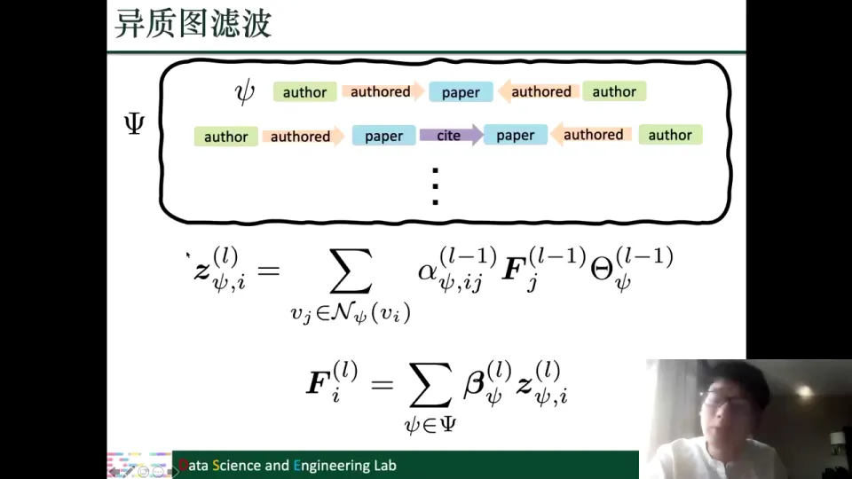

[【跳转到 12:11】](https://www.bilibili.com/video/BV1yx4y1R7uV/?p=6&t=731)

### 2.5 两层结构的一句话总结

异质图滤波可以概括为“**先分语义，再融语义**”：第一层对每条元路径分别聚合，保证不同语义不互相污染；第二层用注意力把多条元路径的表示加权融合，得到节点最终表示。这就是异质图滤波的完整流程：先按元路径分组聚合，再在组间融合。[【跳转到 13:01】](https://www.bilibili.com/video/BV1yx4y1R7uV/?p=6&t=781)

## 三、二分图与多维图：跨集合、跨维度地聚合信息

### 3.1 二分图：边只存在于两个集合之间

二分图（bipartite graph）的节点可以分成两个不相交的子集 $U$ 和 $V$：同一集合内部没有边，所有边都从一个集合连到另一个集合。最典型的例子是电商平台：$U$ 是用户，$V$ 是商品，用户点击或购买商品构成边。这类结构在推荐系统里非常常见，所以二分图上的滤波操作很多时候就是推荐算法的骨架。[【跳转到 14:24】](https://www.bilibili.com/video/BV1yx4y1R7uV/?p=6&t=864)

### 3.2 二分图滤波：从另一侧取邻居，两侧各用各的变换

既然边只跨集合，那么 $U$ 中节点的邻居一定在 $V$ 里，$V$ 中节点的邻居一定在 $U$ 里。于是滤波操作变成两次方向相反的聚合：

$$
\mathbf{F}_{u_i}^{(l)} = \frac{1}{|\mathcal{N}(u_i)|}\sum_{v_j \in \mathcal{N}(u_i)} \mathbf{F}_{v_j}^{(l-1)}\,\Theta_v^{(l-1)}
$$

$$
\mathbf{F}_{v_i}^{(l)} = \frac{1}{|\mathcal{N}(v_i)|}\sum_{u_j \in \mathcal{N}(v_i)} \mathbf{F}_{u_j}^{(l-1)}\,\Theta_u^{(l-1)}
$$

第一式表示：更新用户表示时，从该用户交互过的商品聚合信息，用商品侧的变换矩阵 $\Theta_v$；第二式表示：更新商品表示时，从购买过该商品的用户聚合信息，用用户侧的变换矩阵 $\Theta_u$。前面的 $1/|\mathcal{N}(\cdot)|$ 是按邻居数量做平均，避免数值爆炸。

最需注意的一点是：**两类节点的变换矩阵不一样**。用户和商品是两种对象，不能用同一套参数硬套。这和异质图里“不同元路径用不同 $\Theta_\psi$”是同一个思想。

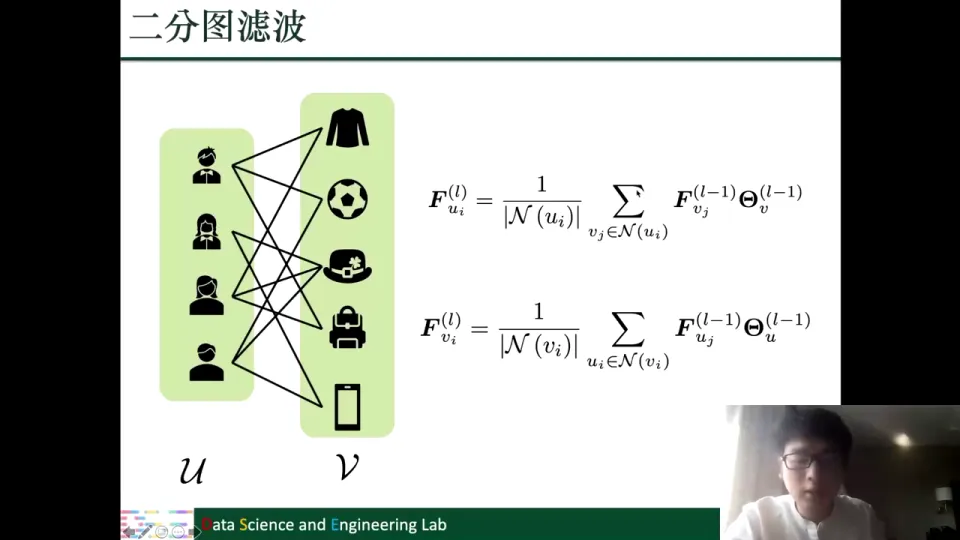

[【跳转到 16:29】](https://www.bilibili.com/video/BV1yx4y1R7uV/?p=6&t=989)

推荐领域还有更高级的设计，后面的推荐系统章节会专门讲。

### 3.3 多维图：同一种节点，多重关系

多维图（multi-dimensional graph）要解决的问题是：同一对节点之间可能同时存在多种关系。以短视频平台为例，用户之间可能有关注关系、观看关系、评论关系，它们可以同时存在。

建模方式是把每一种关系画成一层图：比如一层放关注关系，一层放观看关系，一层放评论关系。各层的节点是同一批节点，只是边不同。于是“多维”可以理解为“多张共享节点的图叠在一起”。[【跳转到 19:18】](https://www.bilibili.com/video/BV1yx4y1R7uV/?p=6&t=1158)

### 3.4 两类邻居：维度内邻居与跨维度邻居

学习节点表示时，不能只看某一层。课程举了一个预测任务：根据用户的历史观看记录和评论记录，预测他下一步会看什么。要预测的目标是“观看”关系，但“关注”关系对这个预测影响很大——用户很可能优先看自己关注的人的内容；“评论”关系也有帮助——一个用户可能没关注某个 up 主，但之前看过他的视频并留了评论。也就是说，其他维度会影响当前维度。

因此对红色这一层的节点，要定义两种邻居：

- **维度内邻居**（within-dimension neighbors）：在同一层里和它相邻的节点，比如和它在同一关系下有边相连的其他用户；
- **跨维度邻居**（across-dimension neighbors）：它在其他层里的“同一个自己”。注意这不是别的节点，而是同一个节点在另一层中的表示。跨维度聚合就是把“自己在其他关系下的样子”拿过来参考。

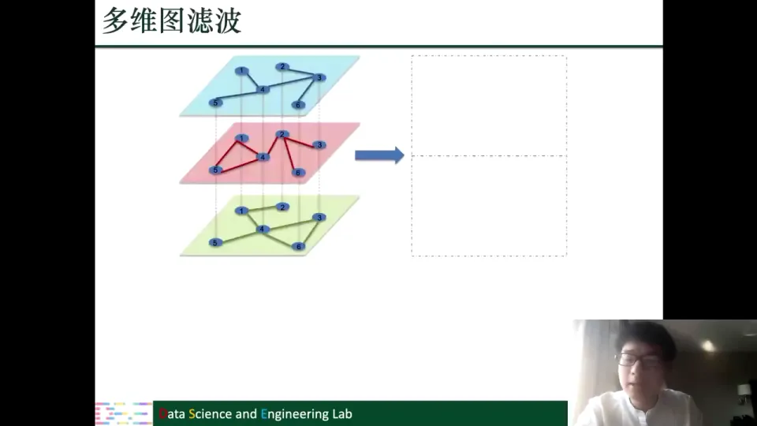

### 3.5 多维图滤波：先投影，再分别聚合，最后拼接

具体做法分三步。

第一步是**投影**。上一层的节点表示只有一个向量，而每个维度需要自己的表示空间，所以用不同的参数矩阵 $C_d$ 把上一层表示投影到第 $d$ 个维度：

$$
\mathbf{F}_{d,j}^{(l-1)} = \mathbf{F}_j^{(l-1)}\,C_d^{(l-1)}
$$

第二步是**维度内聚合**：

$$
\mathbf{F}_{w,d,i}^{(l)} = \sum_{v_j \in \mathcal{N}_d(v_i)} \mathbf{F}_{d,j}^{(l-1)}\,\Theta_d^{(l-1)}
$$

其中 $\mathcal{N}_d(v_i)$ 是节点 $v_i$ 在第 $d$ 维里的邻居集合。不同维度的邻居集合不同，聚合结果也不同。

第三步是**跨维度聚合**：

$$
\mathbf{F}_{a,d,i}^{(l)} = \sum_{g=1}^{D} \beta_{g,d}^{(l-1)}\,\mathbf{F}_{g,i}^{(l-1)}\,\Theta_g^{(l-1)}
$$

这里 $D$ 是维度总数，$\beta_{g,d}$ 是注意力权重，衡量第 $g$ 维的信息对第 $d$ 维有多重要。两个结果——维度内聚合的 $\mathbf{F}_{w,d,i}$ 和跨维度聚合的 $\mathbf{F}_{a,d,i}$——再结合起来（课程画的是相加，实际可以是加权相加），就得到节点 $v_i$ 在第 $d$ 维的新表示。

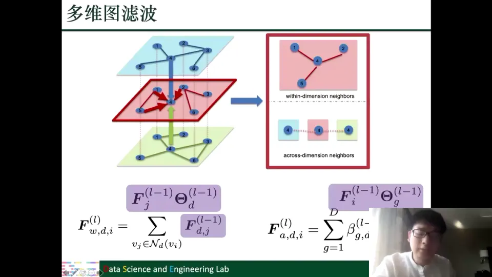

对所有维度重复上述过程，会得到蓝色、红色、绿色三套节点表示。最后把这三套表示拼接（concatenation），再做一个变换，得到包含所有维度信息的最终节点表示。整个流程可以记成：**投影到各维度 → 维度内聚合 + 跨维度聚合 → 各维度表示拼接 → 变换输出**。[【跳转到 28:09】](https://www.bilibili.com/video/BV1yx4y1R7uV/?p=6&t=1689)

多维图滤波的核心思想只有一句：既要保留维度内的图结构，也要保留其他维度对当前维度的影响。

## 四、符号图：正负边分开建模，用平衡理论区分朋友与敌人

### 4.1 符号图：边带正负号

符号图（signed graph）的边分为正边和负边，所有边可以分成两个不相交的子集。典型例子是社交网络：`follow` 是正边，表示友好、关注；`block` 是负边，表示拉黑、敌对。为什么叫“符号图”？就是因为边上带有正负号。[【跳转到 29:24】](https://www.bilibili.com/video/BV1yx4y1R7uV/?p=6&t=1764)

### 4.2 直接聚合会把“朋友”和“敌人”混为一谈

普通图滤波只从邻居聚合信息，不区分边的含义。但在符号图里，从正边聚合来的信息和从负边聚合来的信息性质完全不同：一个来自朋友，一个来自敌人。如果把两者直接相加，就等于说“朋友和敌人对我是一样的”，这显然不合理。所以符号图滤波的第一条原则是：**分别学习两套表示**，一套保留“朋友/友好”信息，一套保留“敌人/不友好”信息。[【跳转到 31:04】](https://www.bilibili.com/video/BV1yx4y1R7uV/?p=6&t=1864)

### 4.3 多跳之后要看“负边数量的奇偶”

只看直接邻居时，正边就是朋友、负边就是敌人。但图滤波通常会堆好几层，聚合二跳、三跳邻居，关系就复杂了。课程用“平衡理论”来解释：

- 敌人的敌人可能是朋友：两个人有共同的敌人，他们很可能是朋友；
- 朋友的朋友是朋友；
- 敌人的朋友可能是敌人。

判断规则可以落到“路径上负边的条数”：**负边条数为偶数（包括 0）的路径，到达的是朋友；负边条数为奇数的路径，到达的是敌人**。比如 $v_i \to U_1 \to B_2$ 有两条负边，是偶数，所以 $B_2$ 仍可能是朋友；$v_i \to B_1 \to U_2$ 有一条正边、一条负边，负边数为奇数，所以 $U_2$ 是敌人。

平衡理论最初是针对三角形的：一个三角形里，如果负边数量是偶数，它就是平衡的；如果是奇数，就不平衡。为什么不平衡的关系难维持？可以想象三个人里两个人是朋友、另外两个人闹矛盾，这个三角关系就很容易出问题。[【跳转到 36:20】](https://www.bilibili.com/video/BV1yx4y1R7uV/?p=6&t=2180)

### 4.4 平衡邻居与不平衡邻居

把上述规则推广到任意跳数，就得到两类邻居：

- **平衡邻居**（balanced neighbor，记作 $B$）：从 $v_i$ 到它的路径上负边数量为偶数（含 0）；
- **不平衡邻居**（unbalanced neighbor，记作 $U$）：从 $v_i$ 到它的路径上负边数量为奇数。

这里的“邻居”是广义的，可以是二跳、三跳甚至更远的节点。课程用 $B^{(1)}, B^{(2)}, B^{(3)}$ 表示不同跳数上的平衡邻居，用 $U^{(1)}, U^{(2)}, U^{(3)}$ 表示不平衡邻居。

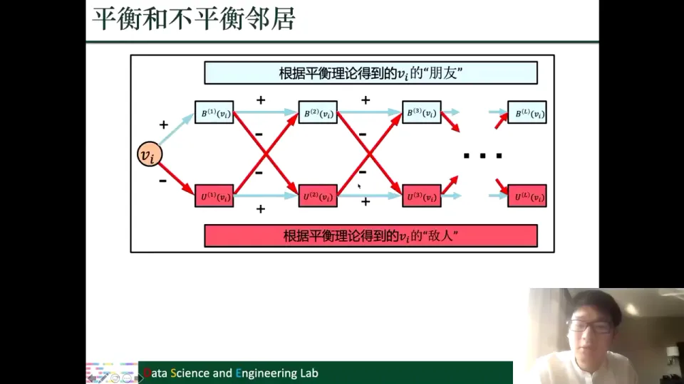

### 4.5 两套表示怎么更新

先看“平衡/朋友”表示的更新。对节点 $v_i$，第 $l$ 层的平衡表示由三部分拼接而成：

1. 从**正边邻居** $\mathcal{N}_+(v_i)$ 聚合来的平衡信息：如果对方本来就是平衡的，再加一条正边，仍然是平衡的；
2. 从**负边邻居** $\mathcal{N}_-(v_i)$ 聚合来的不平衡信息：敌人的敌人是朋友，所以负边邻居的“敌人表示”可以为当前节点贡献平衡信息；
3. 节点自己上一层的平衡表示。

公式写成：

$$
\mathbf{F}_i^{(B,l)} = \sigma\Big(\sum_{v_j \in \mathcal{N}_+(v_i)} \frac{\mathbf{F}_j^{(B,l-1)}}{|\mathcal{N}_+(v_i)|},\ \sum_{v_k \in \mathcal{N}_-(v_i)} \frac{\mathbf{F}_k^{(U,l-1)}}{|\mathcal{N}_-(v_i)|},\ \mathbf{F}_i^{(B,l-1)}\Big)
$$

方括号里的三项分别是上述三部分，$\sigma$ 把拼接后的结果变换成新的平衡表示。

“敌人/不平衡”表示的更新完全对称：从正边邻居取它的**不平衡**信息（朋友的敌人是敌人），从负边邻居取它的**平衡**信息（敌人的朋友是敌人），再加上自己上一层的不平衡表示，拼接后变换。这样每个节点最终都有两套表示：朋友表示和敌人表示。[【跳转到 41:20】](https://www.bilibili.com/video/BV1yx4y1R7uV/?p=6&t=2480)

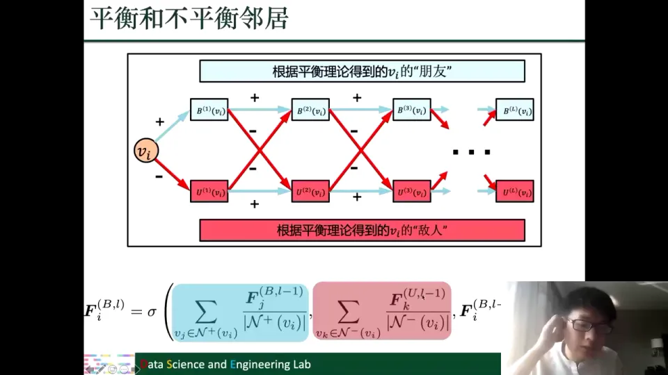

### 4.6 敌人信息为什么也要保留

一个自然的疑问是：既然要预测友好关系，为什么还要费力维护“敌人表示”？课程的解释是，敌人的信息对刻画一个人同样有用。比如“这个人讨厌什么”能帮助我们理解他的偏好和立场，只是它不能和朋友信息混在一起。实际使用时可以灵活选择：把两套表示拼接后变换，得到统一表示；如果任务只关心朋友关系，也可以只用平衡表示，或者只用敌人表示。[【跳转到 43:42】](https://www.bilibili.com/video/BV1yx4y1R7uV/?p=6&t=2622)

## 五、超图与动态图：一个拆解高阶关系，一个沿时间演化参数

### 5.1 超图：一条边可以连接多个节点

普通图的一条边只连接两个节点。超图（hypergraph）的边叫**超边**（hyperedge），一条超边可以连接任意多个节点。课程的例子是学术网络：节点是论文，超边是作者。一个作者发表了三篇论文，这三篇论文就是三个节点，通过“作者一”这条超边连在一起；另一个作者发了四篇论文，就通过另一条超边连四个节点。

它的意义在于描述**超越两两关系的高维关系**。三篇论文同属一个作者，这是一种“一组节点共同参与某个事件”的关系，用两两连边只能拆成三条边，会丢失“它们属于同一组”的信息。[【跳转到 45:02】](https://www.bilibili.com/video/BV1yx4y1R7uV/?p=6&t=2702)

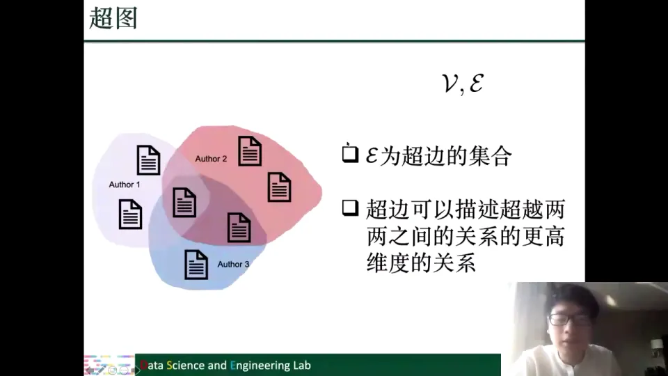

### 5.2 现有做法：把超边打回成对关系

现有超图滤波的常见做法很直接：把超边拆成成对的边，得到一张普通图，再在普通图上跑已有的 GNN。课程介绍了两类拆法：

- **团扩展（clique expansion）**：如果两个节点在至少一条超边中同时出现，就给它们连一条边。如果它们在多条超边中都同时出现，说明关系更强，这些超边的影响可以合并、加权。比如两篇论文不仅在同一个作者的超边里出现，还在另一条超边里一起出现，它们的连接就比只同属一个作者更强。
- **每组只留一对**：每条超边包含多个节点，只选其中两个节点保留一条边。这相当于对超边做采样或摘要，保留一部分成对关系。

拆成普通图以后，就可以直接套用前面讲过的图滤波操作，不需要为超图单独设计一套消息传递规则。[【跳转到 47:32】](https://www.bilibili.com/video/BV1yx4y1R7uV/?p=6&t=2852)

### 5.3 超图拆解的局限

课程明确表达了一个观点：把超边打回成对关系，可能不是最优解，这里有进一步探索的空间。原因很直接：超图的价值就在于描述高阶关系，而“打回成对关系”恰好把高阶结构压平了。未来可以探索直接在超边上做消息传递的方法，而不是先拆再算。当然，现有的大量方法仍然是拆成对关系后处理的。[【跳转到 48:22】](https://www.bilibili.com/video/BV1yx4y1R7uV/?p=6&t=2902)

### 5.4 动态图：每个时间片一张图

动态图（dynamic graph）是随时间变化的图：节点可能出现或消失，边可能新增或删除。课程区分了两种形式：一种是连续变化，时间是连续的；另一种是离散的时间切片，比如时间一、时间二、时间三各有一张快照。本讲只讨论有时间切片的类型。

最朴素的做法是：对每个时间片单独训练一个 GNN，得到该时刻的节点表示。这样做当然可以，但有两个问题：一是每个时间片都重新训练，浪费时间和算力；二是相邻时间片的图很接近，从零开始学参数没有必要。[【跳转到 50:45】](https://www.bilibili.com/video/BV1yx4y1R7uV/?p=6&t=3045)

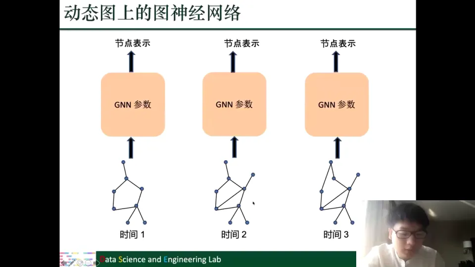

更合理的做法是让参数沿时间演化：用 RNN 把时间一的 GNN 参数更新为时间二的参数，再更新为时间三的参数。也就是说，模型学习的不是“每个时刻独立的参数”，而是“参数如何随时间变化”：

$$
\Theta_{t_2} = \mathrm{RNN}(\Theta_{t_1}),\qquad \Theta_{t_3} = \mathrm{RNN}(\Theta_{t_2})
$$

这样既利用了相邻时间片之间的相似性，又避免了重复训练。课程补充说，动态图上还有其他类型的图神经网络，这里只介绍这一种。[【跳转到 51:35】](https://www.bilibili.com/video/BV1yx4y1R7uV/?p=6&t=3095)

## 六、图上的循环神经网络：树结构要求每个分支都有自己的遗忘门

### 6.1 从序列到树：信息不再只有一条来路

第二部分换了一个问题：不再改造 GNN，而是把其他深度模型搬到图上。循环神经网络和自编码器在深度学习基础那讲介绍过，这里只做回顾；变分自编码器和生成对抗网络之前没介绍过，会讲得稍细。第一个是循环神经网络（Recurrent Neural Network，RNN）。RNN 的特点是参数共享、模块重复：处理每个输入时用的是同一套参数，每个时间步上的模块结构也相同。LSTM 是一种特殊的 RNN，它把普通 RNN 模块换成了 LSTM 模块，并额外维护两个状态：**单元状态**（cell state，$C^{(t)}$）和**隐藏状态**（hidden state，$h^{(t)}$）。[【跳转到 54:25】](https://www.bilibili.com/video/BV1yx4y1R7uV/?p=6&t=3265)

在普通的序列数据上，每个时刻只有一个输入来自上一步，所以 LSTM 只需要一个遗忘门（forget gate），决定“上一步的信息要忘掉哪些”。课程PPT里有一个小笔误：序列图最后一个输入写成了 $x_4$，按上下文应该是 $y_4$，但这不影响理解。[【跳转到 56:38】](https://www.bilibili.com/video/BV1yx4y1R7uV/?p=6&t=3398)

### 6.2 树结构：一个节点可能有多个“上一步”

图不一定是链式的序列，也可能是树结构。树上的一个节点可能有多个子节点，于是它接收到的信息不是一条，而是多条。比如某个模块有三个子节点，就有三路信息同时流进来。普通 LSTM 的一个遗忘门无法分别控制三路信息——它对三路输入做的是同一个“忘或不忘”的决定，这显然不够精细。

解决办法是：**为每一路输入各设一个遗忘门**。如果有 $K$ 路信息流入，就建立 $K$ 个遗忘门，分别决定每一路要保留什么、忘掉什么；然后把经过各自遗忘门处理的信息整合起来，一起输入 LSTM 模块。课程把这种结构称为 Tree-LSTM，也就是把 LSTM 扩展到树上的方法。[【跳转到 57:28】](https://www.bilibili.com/video/BV1yx4y1R7uV/?p=6&t=3448)

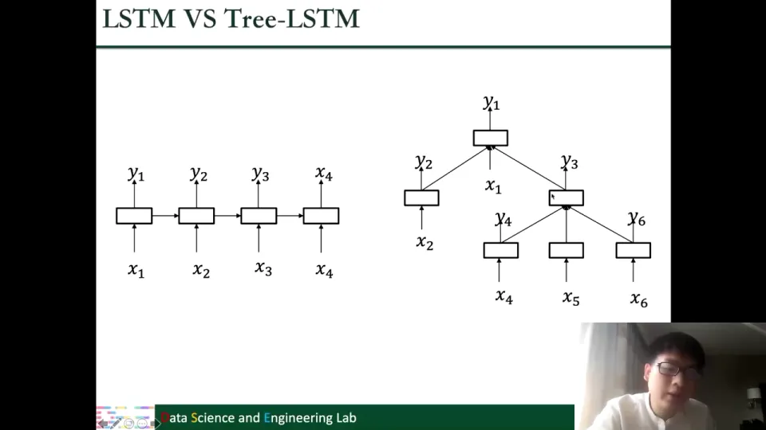

### 6.3 这个改动的本质

Tree-LSTM 的本质不是“换了一个更复杂的公式”，而是**让门的数量匹配输入的来路数量**。序列里只有一条来路，所以一个门够用；树节点有多条来路，就要多个门。

## 七、图上的自编码器：重构邻接矩阵的行，逼出低维节点表示

### 7.1 自编码器：压缩再还原

自编码器（Autoencoder，AE）由两部分组成：编码器和解码器。编码器把输入 $x$ 压缩成一个低维的隐表示 $z$，解码器再从 $z$ 尽量还原出输入。训练目标是让还原出来的 $\hat{x}$ 和原来的 $x$ 尽量相似。中间那个低维表示通常被称为“信息瓶颈”：它迫使模型只保留最重要的信息，因为维度不够，什么都记下来是做不到的。

自编码器有两个常见用途：一是得到低维表示，方便后续算法处理；二是当作生成模型——解码器训练好后，给定一个 $z$ 就能生成新样本。[【跳转到 61:03】](https://www.bilibili.com/video/BV1yx4y1R7uV/?p=6&t=3663)

### 7.2 图上的自编码器：输入和输出都是邻接矩阵的行

把自编码器用到图上，第一个问题是：输入输出是什么？课程给出的答案是**邻接矩阵的行**。对节点 $v_i$，取邻接矩阵的第 $i$ 行 $\mathbf{a}_i$（课程里把它转置成列来表示），这一行描述的是“节点 $i$ 和哪些节点相连”。它其实是关于节点 $i$ 的一个相当重要的结构描述。

图自编码器做的事情是：把 $\mathbf{a}_i$ 压缩成低维表示 $\mathbf{z}_i$，再解码出 $\hat{\mathbf{a}}_i$，希望 $\hat{\mathbf{a}}_i$ 尽量接近 $\mathbf{a}_i$。如果能够从低维的 $\mathbf{z}_i$ 还原出整行的连接信息，就说明 $\mathbf{z}_i$ 保留了关于节点 $i$ 的足够信息。损失函数就是重构误差：

$$
\sum_{v_i \in \mathcal{V}} \|\mathbf{a}_i - \hat{\mathbf{a}}_i\|_2^2
$$

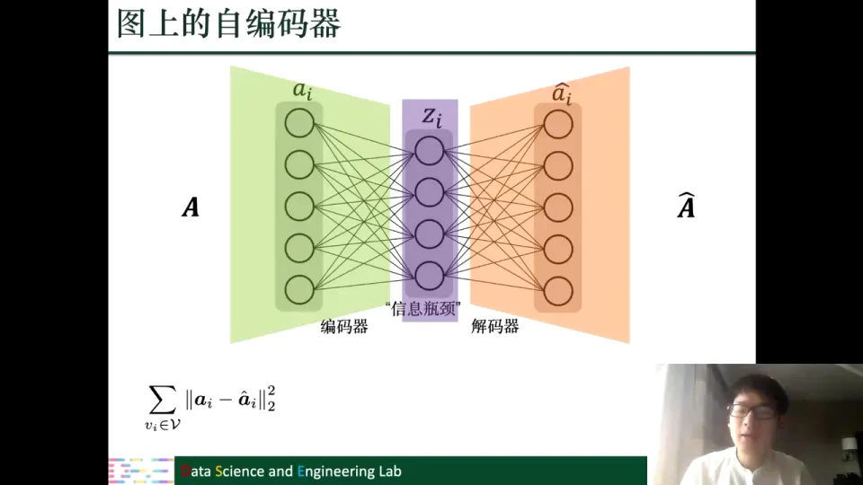

### 7.3 稀疏图的训练技巧：非零元素权重更高

真实图通常非常稀疏：一个节点可能只有几个到几十个邻居，但整个图可能有成千上万个节点，所以 $\mathbf{a}_i$ 里绝大多数元素是 0。如果直接做平方误差，模型会把大量精力花在“把 0 逼近成 0”上，反而忽略了少数真正重要的 1。课程介绍了一个小技巧：对误差做加权，**降低零元素的权重，提高非零元素的权重**。这样模型会更关注“有没有把真正的边重构出来”，而不是“有没有把零预测成零”。

除了重构损失，课程还介绍了一个额外的约束：如果两个节点 $i$ 和 $j$ 相连（$A_{ij}=1$），那么它们的低维表示 $\mathbf{z}_i$ 和 $\mathbf{z}_j$ 应该比较相似。这个约束不是解码器的一部分，而是一个额外的正则项，用来保留“相连节点表示相近”的信息。最后，编码器和解码器的参数还会做正则化，防止过拟合。[【跳转到 67:18】](https://www.bilibili.com/video/BV1yx4y1R7uV/?p=6&t=4038)

### 7.4 用 GNN 做编码器的图自编码器

上面的编码器是普通前馈神经网络，只吃邻接矩阵的一行，不看节点特征；课程图里只画了一层，实际可以用多层。另一种更“图原生”的做法是：用 GNN 做编码器，输入邻接矩阵 $A$ 和节点特征 $F$，输出所有节点的表示矩阵 $Z$：

$$
Z = \mathrm{GNN}(A, F)
$$

解码器则用节点表示的内积来重构邻接矩阵：

$$
\hat{A} = \sigma(ZZ^\top)
$$

这里 $ZZ^\top$ 的第 $(i,j)$ 个元素是 $\mathbf{z}_i$ 和 $\mathbf{z}_j$ 的内积。内积越大，说明两个节点的表示越相似，模型就越倾向于认为它们之间有一条边；$\sigma$ 把数值压到 0 到 1 之间，当作“存在边的概率”。训练目标还是让 $\hat{A}$ 尽量接近 $A$。

两种图自编码器的区别只在编码器：前一种用普通神经网络逐行处理邻接矩阵；后一种用 GNN 把整张图和节点特征一起编码，输出包含所有节点表示的矩阵。[【跳转到 68:25】](https://www.bilibili.com/video/BV1yx4y1R7uV/?p=6&t=4105)

## 八、图上的变分自编码器：编码成分布，既能学表示也能生成图

### 8.1 从“编码成一个点”到“编码成一个分布”

变分自编码器（Variational Autoencoder，VAE）的外形和自编码器很像：同样有编码器、隐表示和解码器。区别在于中间那一步。普通自编码器把输入 $x$ 直接编码成一个固定的向量 $z$；变分自编码器则把输入编码成**一个高斯分布**，编码器要学的是这个分布的均值 $\mu$ 和方差参数 $\sigma$，然后从分布中采样出 $z$，再交给解码器。

用公式表示：编码器建模 $q(z\mid x;\Phi)$，其中 $\Phi$ 是编码器参数；解码器建模 $p(x\mid z;\Theta)$，其中 $\Theta$ 是解码器参数。实际实现时，编码器通常用神经网络输出 $\mu$ 和 $\log\sigma$，再从这个高斯分布中采样 $z$。

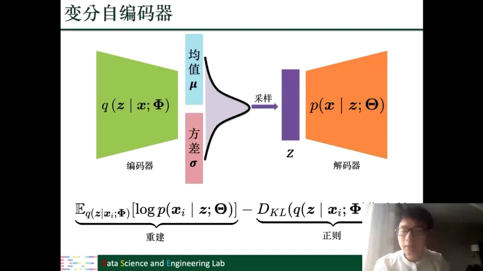

### 8.2 为什么要编码成分布

为什么要把点换成分布？课程给出了一个直观的理由：普通自编码器的隐空间是“一个个孤立的点”，输入 $x$ 和隐表示 $z$ 是一一对应的。训练数据覆盖到的 $z$ 附近，解码器见过，效果不错；但两个训练样本之间的大片空白区域，解码器从来没学过，随便采一个 $z$ 去解码，结果可能很差。

变分自编码器编码的是分布，每个输入对应隐空间里的一个“区域”，不同输入的区域会有重叠。这样一来，隐空间被“填满”了，采样任意一个 $z$ 都有机会落在学过的区域里。两个输入之间也可以平滑过渡，甚至可以把两个样本的特征“整合”在一起生成新样本。课程用一句话概括：自编码器得到的是点，变分自编码器得到的是面。[【跳转到 76:12】](https://www.bilibili.com/video/BV1yx4y1R7uV/?p=6&t=4572)

### 8.3 损失函数：重建项 + KL 正则项

变分自编码器的训练目标是最大化下面这个量（实际是最小化它的相反数）：

$$
\mathbb{E}_{q(z\mid x_i;\Phi)}\big[\log p(x_i\mid z;\Theta)\big] - D_{KL}\big(q(z\mid x_i;\Phi)\,\|\,p(z)\big)
$$

第一项是**重建项**：从编码分布中采样 $z$，再让解码器重构 $x_i$，重构的概率越大越好，也就是输出要像输入（类似交叉熵）。第二项是**正则项**：KL 散度 $D_{KL}$ 衡量编码器输出的分布 $q(z\mid x_i)$ 和先验分布 $p(z)$ 有多不一样。通常先验取标准正态分布 $\mathcal{N}(0,I)$，所以这一项要求“编码出来的分布不要离标准正态太远”。

为什么拉向标准正态？课程给了两个解释：

1. **生成时用的就是标准正态**。训练完以后，我们往往不再用编码器，而是直接从 $\mathcal{N}(0,I)$ 采样 $z$，再交给解码器生成数据。如果训练时编码器输出的分布和标准正态差得太远，测试时从标准正态采样的 $z$ 就不在解码器熟悉的区域里，生成效果会差。
2. **让不同样本的分布相互重叠**。如果每个输入的高斯分布都离得很远、互不重叠，那隐空间又退化成一个个孤立的点，和普通自编码器区别不大。KL 正则把分布往标准正态“拉”，使它们集中在中心附近并发生重叠，从而获得连续、可采样的隐空间。

### 8.4 图上用于节点表示的变分自编码器

把 VAE 用到图上学习节点表示，输入还是邻接矩阵 $A$ 和节点特征 $F$。这里的目的不是生成，而是学更好的节点表示。编码器用两个 GNN 分别输出均值和方差：

$$
\mu = \mathrm{GNN}_\mu(F, A; \Phi_\mu),\qquad \log\sigma = \mathrm{GNN}_\sigma(F, A; \Phi_\sigma)
$$

注意这里每个**节点**都有自己的高斯分布，所以输出的 $\mu$ 和 $\sigma$ 是矩阵，每一行对应一个节点。从每个节点的分布中采样，得到节点表示矩阵 $Z$。解码器还是用内积加 sigmoid 来建模边存在的概率：

$$
p(\hat{A}_{ij}=1\mid Z) = \sigma(\mathbf{z}_i^\top \mathbf{z}_j)
$$

这和前面 GNN 版自编码器的解码器几乎一样，区别只在编码器：自编码器直接输出一个向量 $Z$，变分自编码器输出一个分布，再从分布里采样 $Z$。[【跳转到 81:37】](https://www.bilibili.com/video/BV1yx4y1R7uV/?p=6&t=4897)

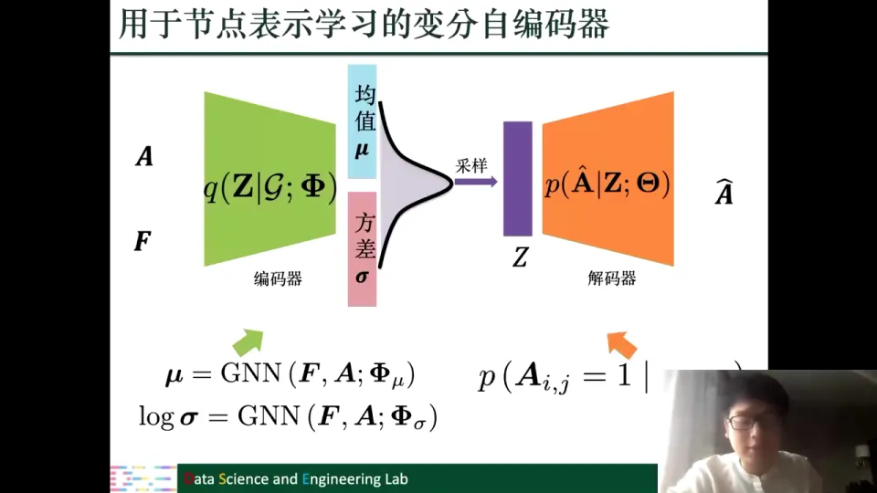

### 8.5 图上用于图生成的变分自编码器

如果要生成的不是节点表示，而是整张图，VAE 也能做。课程以分子图为例：一个分子可以用三样东西描述——

- $A$：邻接矩阵，表示原子之间怎么连接；
- $F$：节点类型，表示每个原子是什么元素；
- $E$：边类型，表示化学键的种类（单键、双键等）。

编码器要把整张图编码成**一个**高斯分布，而不是每个节点一个分布。所以这里需要池化（pooling）操作，把图中所有节点的表示汇总成一个图级别的向量：

$$
\mu = \mathrm{pool}\big(\mathrm{GNN}_\mu(\mathcal{G})\big),\qquad \log\sigma = \mathrm{pool}\big(\mathrm{GNN}_\sigma(\mathcal{G})\big)
$$

从图级别的高斯分布采样出 $z$，再用解码器生成图。这里的解码器通常是一个 MLP，输出三个矩阵：

$$
\hat{A},\ \hat{F},\ \hat{E} = \mathrm{MLP}(z)
$$

三个矩阵的含义不同：

- $\hat{A}$ 的每个元素是“这条边存在的概率”，取值在 0 到 1 之间；
- $\hat{F}$ 的每一行经过 softmax，表示这个节点属于各种原子类型的概率；
- $\hat{E}$ 的每一行经过 softmax，表示这条边属于各种化学键类型的概率。

有了这三个概率矩阵，就可以从中采样出一张具体的图。训练好以后，生成新图只需要解码器：从标准正态分布随机采样一个 $z$，解码出 $\hat{A},\hat{F},\hat{E}$，再采样即可。[【跳转到 90:06】](https://www.bilibili.com/video/BV1yx4y1R7uV/?p=6&t=5406)

## 九、图上的生成对抗网络：生成器造假，判别器鉴假

### 9.1 GAN 的基本框架：两个角色互相竞争

生成对抗网络（Generative Adversarial Network，GAN）由两个部分组成：

- **生成器**（generator）$G(z;\Theta)$：输入随机噪声 $z$，输出一张生成的图像（fake image）；
- **判别器**（discriminator）$D(x;\Phi)$：输入一张图像，判断它是来自训练集的真图像，还是生成器生成的假图像。

生成器要“以假乱真”，让判别器分不出来；判别器要尽量区分真样本和假样本。两者互相竞争、共同提高，最后达到平衡。[【跳转到 93:35】](https://www.bilibili.com/video/BV1yx4y1R7uV/?p=6&t=5615)

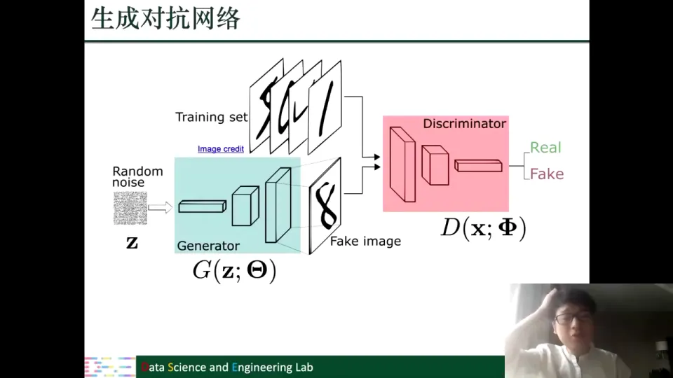

### 9.2 目标函数：一个最小最大博弈

GAN 的目标可以写成一个最小最大问题：

$$
\min_{\Theta}\max_{\Phi}\ \mathbb{E}_{x\sim p_{\text{data}}}\big[\log D(x;\Phi)\big] + \mathbb{E}_{z\sim p(z)}\big[\log\big(1-D(G(z;\Theta);\Phi)\big)\big]
$$

逐项看：

- 第一项 $\mathbb{E}_{x\sim p_{\text{data}}}[\log D(x)]$：判别器希望把真实样本判为“真”的概率越高越好；
- 第二项 $\mathbb{E}_{z}[\log(1-D(G(z)))]$：判别器希望把生成样本判为“真”的概率越低越好，也就是判为“假”；
- 生成器 $\Theta$ 则相反，它希望判别器把生成样本误判为“真”，所以它要最小化判别器识别出假样本的能力。

训练时交替优化：固定判别器，更新生成器；再固定生成器，更新判别器。课程强调，这其实就是一个二分类任务，只不过“负样本”是生成器现场造出来的，分布会随着训练不断变化。[【跳转到 96:05】](https://www.bilibili.com/video/BV1yx4y1R7uV/?p=6&t=5765)

### 9.3 用 GAN 学习节点表示：生成器采样“邻居”，判别器分辨真假邻居

GAN 不只能生成图像，也能用来学习节点表示。课程介绍了一个很有代表性的设计：把“生成邻居”当作生成任务。

对中心节点 $v_i$，生成器的目标是**从全图中采样一个节点，作为 $v_i$ 的邻居**。它建模的条件概率是：

$$
G(v_j\mid v_i;\Theta) = \frac{\exp(\boldsymbol{\theta}_j^\top \boldsymbol{\theta}_i)}{\sum_{v_k\in\mathcal{V}}\exp(\boldsymbol{\theta}_k^\top \boldsymbol{\theta}_i)}
$$

其中 $\boldsymbol{\theta}_i$ 和 $\boldsymbol{\theta}_j$ 是生成器这一套节点表示。这个 softmax 的含义是：和 $v_i$ 表示越相似的节点，被采样为邻居的概率越大。生成器的训练目标是让“采样到真实邻居”的概率尽可能高。

判别器的任务是：给定一组节点对 $(v_j, v_i)$，判断它们是真的在原图中相连，还是生成器采样出来的“假邻居”。它用另一套节点表示 $\boldsymbol{\phi}_i,\boldsymbol{\phi}_j$，输出一个 0 到 1 之间的概率：

$$
D(v_j,v_i;\Phi) = \frac{1}{1+\exp(-\boldsymbol{\phi}_j^\top \boldsymbol{\phi}_i)}
$$

判别器要尽量区分“真邻居”和“采样邻居”。两个角色对抗训练，最终生成器的表示要能很好地还原邻域结构，判别器的表示要能把周围节点和其他节点区分开。训练完后，$\boldsymbol{\theta}$ 和 $\boldsymbol{\phi}$ 都可以作为节点表示，也可以拼接起来使用。总的效果是：**表示里保留了邻域信息**。[【跳转到 100:30】](https://www.bilibili.com/video/BV1yx4y1R7uV/?p=6&t=6030)

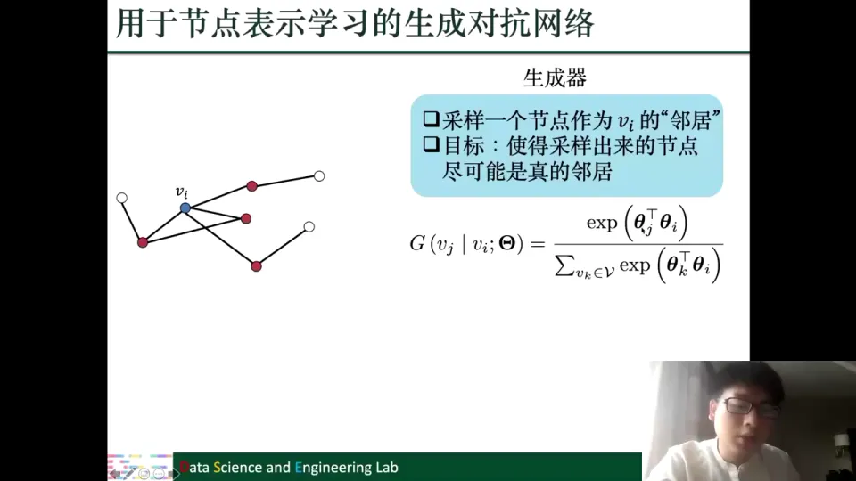

### 9.4 用 GAN 生成图：从噪声到概率矩阵，再到分子图

GAN 也可以直接生成图。课程还是以分子图为例。生成器的流程是：

1. 从标准正态分布 $\mathcal{N}(0,I)$ 采样噪声 $z$；
2. 用前馈网络（MLP）把 $z$ 映射成两个概率矩阵 $\hat{F}$ 和 $\hat{E}$，分别表示节点类型和边类型的概率；
3. 从这两个概率矩阵中采样，得到一张具体的分子图。

这里和 VAE 的图生成有一个细微但重要的区别：$\hat{F}$ 和 $\hat{E}$ 的每一行除了“属于哪种类型”之外，还多了一个“**这个节点/这条边压根不存在**”的选项。也就是说，生成器不仅要决定“是什么类型”，还要决定“存不存在”。

判别器则接收一张图（真的或生成的），用 GNN 学习节点表示，再用池化得到图级别的表示 $h_{\mathcal{G}}$，最后接一个二分类器判断“真/假”：

$$
h_{\mathcal{G}} = \mathrm{pool}\big(\mathrm{GNN}(\mathcal{G})\big)
$$

课程特别指出，这里的 GNN 指的是只做滤波操作的 GNN，池化负责把节点表示汇总成图表示。判别器的训练目标就是尽量区分训练集中的真实图和生成器生成的图。[【跳转到 102:24】](https://www.bilibili.com/video/BV1yx4y1R7uV/?p=6&t=6144)

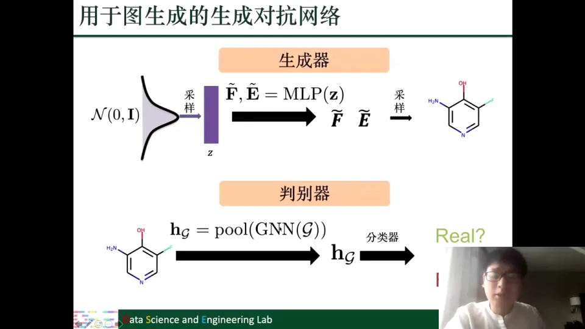

### 9.5 四种模型的分工

四种模型可以放在一张表里对比：

| 模型 | 核心机制 | 主要用途 | 图上的关键改造 |
| --- | --- | --- | --- |
| 图 RNN / Tree-LSTM | 沿结构递归传递状态 | 处理树、序列结构 | 每个分支一个遗忘门 |
| 图自编码器 | 编码—瓶颈—重构 | 学习低维节点表示 | 重构邻接矩阵的行或整个邻接矩阵 |
| 图变分自编码器 | 编码成分布—采样—解码 | 学表示 + 生成图 | 用 GNN 学 $\mu,\sigma$，图级别池化 |
| 图生成对抗网络 | 生成器与判别器对抗 | 学表示 + 生成图 | 采样邻居 / 生成节点边类型矩阵 |

它们针对不同任务：想要稳定的低维表示，自编码器最直接；想从隐空间采样生成新图，变分自编码器更合适；想让生成结果更逼真，或者用“真假邻居”的对抗信号学表示，GAN 提供了另一种思路。

## 小结

- 复杂图滤波没有推翻“聚合邻居”的框架，它改的是**邻居的定义**：异质图按元路径取邻居，二分图跨集合取邻居，多维图分维度内/跨维度取邻居，符号图按正负边分朋友/敌人，超图先拆超边，动态图按时间片演化参数。
- 异质图的核心是“**先分语义，再融语义**”：每条元路径内部聚合一次，多条元路径之间再用注意力融合。两层都用了注意力，前者区分邻居重要性，后者区分元路径重要性。
- 符号图的核心是“**不能把朋友和敌人混在一起**”：用平衡理论按路径上负边数量的奇偶，把邻居分成平衡/不平衡两类，分别维护两套表示。
- 超图的现有做法是“降维”：把高阶超边拆成成对关系，再套普通 GNN；这样做会损失高阶信息，仍有探索空间。
- 动态图不必每个时间片从头训练：让 GNN 参数沿时间用 RNN 演化，既省算力又利用时间相关性。
- Tree-LSTM 的关键改动是“**输入有几路，遗忘门就有几个**”；图自编码器的关键是“**重构邻接矩阵**”，用重构误差逼出有用的低维表示。
- 变分自编码器把“编码成一个点”改成“编码成一个分布”，从而获得连续、可采样的隐空间；损失由重建项和 KL 正则项组成。
- 生成对抗网络用生成器和判别器的对抗来提升生成质量；用到图上时，既可以把“采样邻居”当作生成任务来学节点表示，也可以直接生成节点/边类型矩阵来生成图。

## 关键术语速查

| 术语 | 一句话解释 |
| --- | --- |
| 异质图（heterogeneous graph） | 节点类型和边类型都不止一种的图，如作者—论文—会议网络。 |
| 元路径（meta-path） | 由节点类型和边类型交替组成的路径模板，如“作者—论文—作者”。 |
| 二分图（bipartite graph） | 节点分成两个不相交集合、边只跨集合的图，如用户—商品。 |
| 多维图（multi-dimensional graph） | 同一批节点之间同时存在多种关系、每种关系一层图的图。 |
| 维度内邻居（within-dimension neighbor） | 在同一层图内与节点相邻的节点。 |
| 跨维度邻居（across-dimension neighbor） | 同一个节点在另一层图中的表示。 |
| 符号图（signed graph） | 边分正负的图，正边表示友好，负边表示敌对。 |
| 平衡理论（balance theory） | 用路径上负边数量的奇偶判断“朋友/敌人”的理论；偶数负边为平衡（朋友），奇数为不平衡（敌人）。 |
| 平衡邻居（balanced neighbor） | 从中心节点到它的路径上负边数量为偶数（含 0）的邻居。 |
| 不平衡邻居（unbalanced neighbor） | 从中心节点到它的路径上负边数量为奇数的邻居。 |
| 超图（hypergraph） | 一条超边可以连接任意多个节点的图。 |
| 超边（hyperedge） | 超图中连接多个节点的边，用来描述高阶关系。 |
| 团扩展（clique expansion） | 把超边中共同出现的节点两两连边，从而把超图转成普通图。 |
| 动态图（dynamic graph） | 节点和边随时间变化的图，常见形式是离散时间快照。 |
| 循环神经网络（RNN） | 参数共享、按时间步重复使用同一模块的神经网络，适合序列数据。 |
| LSTM | 一种带单元状态和门控机制的 RNN，能缓解长序列中的遗忘问题。 |
| Tree-LSTM | 把 LSTM 扩展到树结构，为每个分支设置独立遗忘门的模型。 |
| 自编码器（autoencoder） | 编码器压缩、解码器还原的模型，中间低维表示可作特征。 |
| 信息瓶颈（information bottleneck） | 用低维表示迫使模型只保留关键信息的机制。 |
| 变分自编码器（VAE） | 把输入编码成概率分布、再从分布采样解码的生成模型。 |
| KL 散度（KL divergence） | 衡量两个概率分布差异的指标；VAE 用它把编码分布拉向标准正态。 |
| 生成对抗网络（GAN） | 由生成器和判别器对抗训练而成的生成模型。 |
| 生成器（generator） | GAN 中把随机噪声映射成生成样本的网络。 |
| 判别器（discriminator） | GAN 中判断样本来自真实数据还是生成器的分类器。 |
| 池化（pooling） | 把多个节点表示汇总成一个图级别表示的操作。 |
