# 第07讲：图深度学习的应用（上）

## 本讲要解决的核心问题（SCQA）

**背景**：前六讲已经把图深度学习的基础打完了——图与图神经网络的基本概念、网络嵌入、图神经网络（GNN）的消息传递框架，以及 GNN 的健壮性、可扩展性和图上的其他深度模型。从这一讲开始，课程进入"怎么用"的阶段。

**冲突**：真实任务不会自动附带一张"好图"。有的领域天生就有图，比如社交网络本身就是一张用户关系图；有的领域图并不存在，比如回答一个需要查多篇文档的问题；还有的领域虽然有图，但图是异质的、带类型的、随时间变化的，直接套用最基础的 GCN 并不能解决问题。更麻烦的是，即使有图，也不代表这张图对当前任务有用。

**疑问**：面对一个具体任务，到底该不该用图神经网络？如果要用，图从哪里来？有了图之后，又该怎么设计模型，才能让它真正提升任务表现？

**回答（中心思想）**：本讲所有应用都可以归结为两个必须回答的问题——**第一，任务中有没有图？没有图的话，构造一个图有没有意义、这张图对任务是否有用？第二，有了图之后，如何针对这张图的特点设计 GNN，并把 GNN 与已有模型结合起来？** 自然语言处理中的语义角色标注、机器翻译、关系抽取、多跳问答、知识图谱补全，以及数据挖掘中的社交网络、推荐系统、城市数据和网络安全，都是这两个问题的不同答案。抓住这两个问题，比记住某一个具体模型更重要。

---

## 一、应用图深度学习的第一步，是判断图在哪里以及图是否有用

### 1.1 图有两种来源：显式存在与人为构造

在有些应用里，图是"显式存在"的。做社交网络分析时，用户是节点，关注、好友、评论、点赞是边，这张图本来就摆在那里。这类任务不需要你发明图，只需要你想清楚怎么把图喂给模型。

在另一些应用里，图并不存在，需要针对任务构造。比如多跳问答，文档之间没有现成的图，但可以把实体提及抽成节点、把实体关系连成边，构造一张"实体图"来做推理。这张图不是数据自带的，而是为任务人为设计的。

所以拿到任务，第一反应不应该是"我要用 GNN"，而应该是：**有没有图？没有图，构造一张有没有意义？这张图对任务是不是有利？** 如果图对任务没用，硬套 GNN 只会增加复杂度。

### 1.2 图的"有用性"来自它是否承载了任务需要的关系

一张图有没有用，取决于它所表达的关系是否正是任务需要的信息。语义角色标注就是例子：句子的语义角色（谁对谁做了什么）和句法依存关系（主语、宾语）高度对应，所以依存树对任务有用；多跳问答中，实体在不同文档之间的共现、共指关系，正是把多篇文档连起来推理所需的，所以实体图也有用。

反过来，如果一张图只是把原始数据换了一种存法，边上的关系对预测目标没有信息量，那么 GNN 再深也不会带来本质提升。**构造图之前先问"这张图为什么能帮到我"，比构造完再调参更重要。**

### 1.3 GNN 通常是"增强器"，而不是"替代品"

本讲反复出现的一个设计思想是：**大多数应用不是用 GNN 把原有模型整个替换掉，而是把 GNN 插到原有模型中间，增强已有表示。** 语义角色标注里，序列建模仍然用 BiLSTM，GNN 只是在词表示之上再加入句法结构；机器翻译里，编码器、注意力、解码器的骨架不变，GNN 只是增强每个词的表示；推荐系统里，用户和商品的嵌入仍然是主要参数，GNN 负责在这些嵌入之上聚合邻居信息。

这个观察很重要：你不需要为了用 GNN 而推翻一个工作良好的领域模型，只需要找到"表示学习"这一层，把图结构作为额外信息源接进去。后面几乎所有案例都是"已有模型 + 针对图特点设计的聚合层"。

[【跳转到 00:00】](https://www.bilibili.com/video/BV1yx4y1R7uV/?p=7&t=0)

---

## 二、自然语言处理天然充满图结构

### 2.1 句法树、语义表示树和知识图谱都是图

自然语言处理是图神经网络最自然的应用领域之一，因为语言本身就带有大量结构化关系。课程开始给出了三类例子：

第一类是**句法依存树（dependency parse tree）**。给定一个句子，每个词是节点，词与词之间的语法依赖是边。比如"The policeman detained the suspect at the park"中，"detained"是谓语，"policeman"是它的名词主语，"suspect"是它的直接宾语，"at the park"是介词短语。依存树的边不仅表示"谁和谁相连"，还表示"以什么语法关系相连"，所以它是一张有向、带类型的图。

第二类是**抽象语义表示（AMR，Abstract Meaning Representation）**。它用一棵树来表示整个句子的语义结构，比如"want-01""go-01"这样的语义谓词，以及 ARG0、ARG1 这样的论元角色。AMR 也是一棵树，而树是图的一种特殊形式。

第三类是**知识图谱（knowledge graph）**。达芬奇、蒙娜丽莎、卢浮宫、巴黎、埃菲尔铁塔这些实体是节点，"是一个人""画了""位于"这些关系是边。知识图谱是显式存在的异质图，节点和边都有类型。

除此之外，还有很多任务是"针对具体任务构造图"，比如多跳问答中的实体图。**自然语言处理中图无处不在，所以用图神经网络提升 NLP 任务是一件很自然的事。**

[【跳转到 04:05】](https://www.bilibili.com/video/BV1yx4y1R7uV/?p=7&t=245)

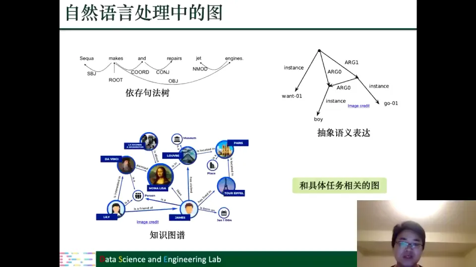

### 2.2 本讲聚焦五个 NLP 任务

这一讲重点讲五个任务：**语义角色标注、神经机器翻译、关系抽取、多跳问答、知识图谱中的神经网络**。前三个任务的共同点是图已经存在，我们只需要针对图的特点设计 GNN；多跳问答的图不存在，需要自己构造；知识图谱则是显式存在但高度异质的图，需要专门处理。

后面每讲一个任务，都可以用同一组问题去套：这个任务里图是什么？图对任务有没有用？图有什么特殊性质（有向、带类型、异质、稀疏）？GNN 怎么和原有模型结合？下一讲会转向健康医疗、生化与计算机视觉，最后讲研究前沿。

---

## 三、语义角色标注：用依存树补上序列模型缺失的语法信息

### 3.1 任务定义：谁对谁做了什么

**语义角色标注（Semantic Role Labeling，SRL）** 要回答的是"who did what to whom, where, when"——谁对谁做了什么、在什么地方、在什么时间。给定一个谓语，我们需要做两件事：第一，找出这个谓语的**论元（argument）**，也就是参与这个动作的实体；第二，给每个论元标注**语义角色**，比如施事者（agent，谁做的）、受事者（patient，对谁做的）、地点、时间等等。

课程里的例子是"警察在公园扣留了嫌疑人"：谓语是 **detained**；论元一是 **The policeman**，角色 A0（施事者）；论元二是 **the suspect**，角色 A1（受事者）；**at the park** 是地点论元。把谓语、论元、角色标注清楚，就能为问答、信息检索、事件抽取等下游任务提供结构化信息。

[【跳转到 06:20】](https://www.bilibili.com/video/BV1yx4y1R7uV/?p=7&t=380)

### 3.2 传统做法：把序列标注当成分类问题

语义角色标注的流程是：检测谓语、识别论元、给论元分类角色；很多场景下谓语已知，第一步可省略。

不用图时，最自然的做法是**序列标注**：给每个词打一个标签。模型用**双向 LSTM（BiLSTM）**，前向和反向各读一遍句子，把两个方向的隐藏表示拼起来，得到同时包含上文和下文的词表示，再接分类器判断它是不是论元、是哪种角色。大多数词不是论元，所以引入一个**空类别**（NULL 或 NN）表示"不是论元"。"是不是论元"和"是哪种角色"因此被统一成一个多分类问题。

问题在于：**BiLSTM 只建模了词的前后关系，没有显式利用语法结构**，而语义角色和句法结构恰恰高度相关。

[【跳转到 15:56】](https://www.bilibili.com/video/BV1yx4y1R7uV/?p=7&t=956)

### 3.3 依存树为什么有用：语法边和语义边高度重合

看句法依存树就会明白这种对应关系。依存树是一张有向、带类型的图：边从中心词指向依存词，边上的标签表示语法关系，比如 NSBJ（名词主语）、DOBJ（直接宾语）、POBJ（介词宾语）、PREP（介词短语）。同时，语义角色标注给出了 A0（主事者）、A1（受事者）这样的语义边。把两张图叠在一起看，会发现**红色边是语义关系，黑色边是语法关系，它们在很多位置上是重合的**：A0 对应 NSBJ，A1 对应 DOBJ，地点论元对应 POBJ/PREP。

这就是"图对任务有用"的具体含义：依存树把"谁修饰谁、谁是谁的主语/宾语"显式写了出来，而这些信息正是判断语义角色所需要的。把依存树加进模型，等于给模型提供了一个先验结构，帮助它更快地捕捉语义关系。

[【跳转到 14:16】](https://www.bilibili.com/video/BV1yx4y1R7uV/?p=7&t=856)

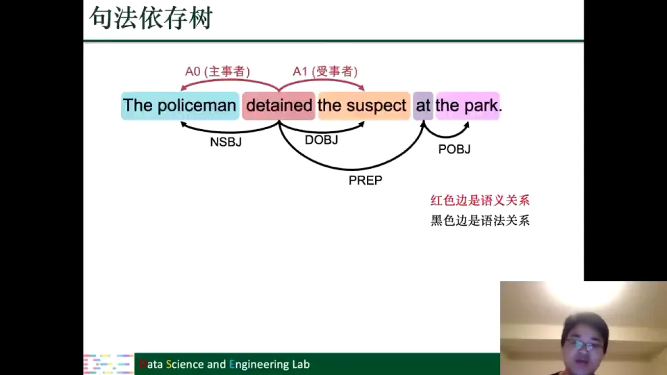

### 3.4 针对有向、带类型的依存树设计 GNN

有了依存树，接下来的问题就是"怎么把图用起来"。课程给出的方案是 **BiLSTM + GNN**：BiLSTM 部分保持不变，仍然为每个词生成上下文表示；GNN 部分以依存树为结构，对词表示做进一步聚合和增强；增强后的表示再送入分类器。

设计 GNN 时要考虑依存树的两个性质：第一，**它是有向图**，边从中心词指向依存词，方向不同含义不同，课程为出度和入度分别设一个转换矩阵；第二，**边是有类型的**，NSBJ、DOBJ、POBJ、PREP 代表不同语法关系，课程为边标签学习一个表示或偏置。

用公式写出来，第 $l$ 层节点 $i$ 的表示为：

$$
F_i^{(l)} = \sigma\left(\sum_{v_j \in \mathcal{N}(v_i)} F_j^{(l-1)} \Theta_{\mathrm{dir}(i,j)}^{(l-1)} + b_{\mathrm{lab}(i,j)}^{(l-1)}\right)
$$

其中 $\mathcal{N}(v_i)$ 是邻居集合，$\Theta_{\mathrm{dir}(i,j)}$ 按方向区分，$b_{\mathrm{lab}(i,j)}$ 按边标签区分，$\sigma$ 是激活函数。直观地说：**每个邻居先把表示转换到"当前方向、当前边类型"对应的空间，再被聚合起来。**

[【跳转到 18:26】](https://www.bilibili.com/video/BV1yx4y1R7uV/?p=7&t=1106)

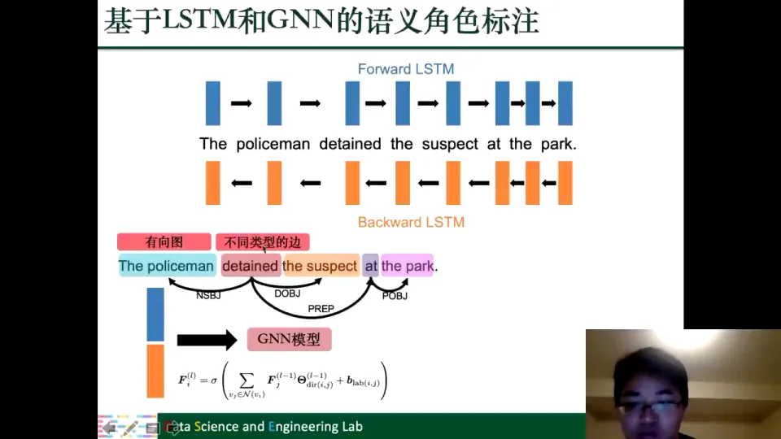

### 3.5 这个案例给出了后面所有案例的模板

语义角色标注这一节已经把整讲套路走完了：图存在（依存树）、图有用（语法边对应语义角色）、图有特殊性（有向、带类型）、用法是在 BiLSTM 表示上加 GNN 按方向和边类型聚合，且 GNN 是增强器而非替代品。后面的任务只是换了图和聚合方式。

[【跳转到 20:31】](https://www.bilibili.com/video/BV1yx4y1R7uV/?p=7&t=1231)

---

## 四、神经机器翻译和关系抽取：同一套"序列模型 + 图增强"配方

### 4.1 神经机器翻译的基本框架是 seq2seq

**机器翻译**是把一种语言（源语言）自动转换成另一种语言（目标语言）。课程举的例子是：输入"The policeman detained the suspect at the park"，输出"警察在公园扣留了嫌疑人"。讲者还提到，他去智利开会时靠翻译软件点菜、问路，说明机器翻译已经非常实用。

用神经网络做机器翻译，最常用的框架是 **sequence-to-sequence（seq2seq）**，也就是"编码器—解码器"结构：

- **编码器（encoder）**：用一个 RNN/LSTM/GRU 读入源语言句子，把整个句子编码成一个表示；
- **解码器（decoder）**：以编码器的输出为条件，逐步生成目标语言的词序列。

用 RNN/LSTM 是因为语言是序列，前后词有依赖；LSTM、GRU 都是 RNN 的变种。编码器之上再加一个**注意力机制**，让解码器生成每个词时动态关注源句的不同位置，而不是只依赖一个固定长度的句子向量。

seq2seq 不只用于机器翻译。对话系统也是"输入一句话、输出下一句话"的 seq2seq；甚至生物信息学中的"从一个基因序列转换到另一个基因序列"也可以用同样的框架。**只要任务是"序列到序列"，编码器—解码器就是一个通用模板。**

[【跳转到 24:53】](https://www.bilibili.com/video/BV1yx4y1R7uV/?p=7&t=1493)

### 4.2 把依存树接进编码器：又见"LSTM + GNN"

和语义角色标注一样，标准的 seq2seq 编码器只按词序读句子，没有显式利用句法结构。改进方法也很一致：用句法依存树作为图，在 BiLSTM 得到每个词的表示之后，用 GNN 按依存关系聚合邻居，增强词表示；增强后的词表示再送入注意力机制和解码器。

整个结构可以概括为：BiLSTM 编码源句；以依存树为结构用 GNN 聚合语法邻居；注意力机制对增强表示加权得到句子表示；解码器逐步输出目标语言。

这里再次体现"增强而非替代"：seq2seq 的骨架、注意力、解码器都没变，GNN 只是插在编码器和注意力之间补上句法信息。**同一个配方，换个任务就能复用。**

[【跳转到 28:10】](https://www.bilibili.com/video/BV1yx4y1R7uV/?p=7&t=1690)

### 4.3 关系抽取：把"两个实体是什么关系"变成分类问题

**关系抽取（relation extraction）** 的目标是：给定句子中的两个实体，判断它们之间是什么关系。课程的例子是"Obama was born in Hawaii"：主语是 Obama，宾语是 Hawaii，模型要预测出关系 **born-in（出生于）**。

这天然就是一个分类问题。但两个实体可能根本没有关系，如果排除"没有关系"，模型就要先判断有没有关系、再判断是哪种关系，变成两个任务。课程把**"没有关系"也作为一个特殊类别**加入分类器，一次分类同时回答两个问题。这和语义角色标注用 NULL 表示"不是论元"是同一个技巧：**用一个额外类别吸收负样本，把多步判断压成一步分类。**

[【跳转到 29:16】](https://www.bilibili.com/video/BV1yx4y1R7uV/?p=7&t=1756)

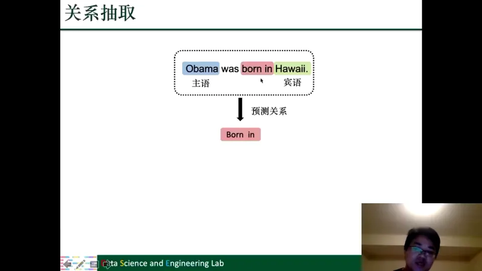

### 4.4 关系抽取模型：主宾语表示 + 整句表示

关系抽取的模型同样可以写成"LSTM + GNN"：

1. 用 LSTM 学每个词的表示；
2. 依据句法依存树，用 GNN 增强词表示；
3. 从增强后的词表示中取出主语表示和宾语表示；
4. 对整句所有词表示做**最大池化（max pooling）**：每个维度取所有词中最大的值，得到一个固定长度的句子表示；
5. 把主语表示、宾语表示、句子表示拼接起来，送入分类器预测关系。

为什么要加整句表示？因为关系不仅取决于两个实体，还取决于上下文，"born in"需要看到"was born in"整个短语才能确认。最大池化保留每个维度上最显著的信号，把变长句子压成定长向量。

这个模型是关系抽取中比较有代表性的"GNN/GCN + 序列模型"结构：**图提供结构，序列模型提供上下文，两者互补而非互斥。**

[【跳转到 31:19】](https://www.bilibili.com/video/BV1yx4y1R7uV/?p=7&t=1879)

---

## 五、多跳问答：当图不存在时，如何从文档构造实体图

### 5.1 任务：一个文档不够，需要多跳推理

前面三个任务的图都是现成的。从多跳问答开始，图需要自己构造。

**多跳问答（multi-hop question answering）** 的特点是：答案不能从单一文档中直接读到，必须把多篇文档的信息串起来。课程的例子是：问"孟买空中花园在哪个国家"，选项有印度、伊朗等；文档一说花园在孟买，文档二说孟买在印度，文档三说阿拉伯海东边是印度。单看任何一篇都得不到答案，必须把"花园—孟买—印度"连起来。这就是"多跳"：答案需要跨多个实体、多篇文档跳转。

[【跳转到 35:34】](https://www.bilibili.com/video/BV1yx4y1R7uV/?p=7&t=2134)

### 5.2 节点：实体提及，而不是合并后的实体

要构造图，先定义节点。课程的做法是：**把问题和候选选项中出现的所有实体，以及这些实体在每篇文档中的每一次提及（mention），都作为节点。** 注意，同一个实体在不同文档中的提及是**两个不同的节点**，并不合并成一个全局实体。

不合并是为了保留文档边界：如果把不同文档中的"孟买"合并，模型就无法区分信息来自哪篇文档。保留提及级节点，再用边连接同一实体，才能既保留文档结构，又实现跨文档流动。

[【跳转到 37:39】](https://www.bilibili.com/video/BV1yx4y1R7uV/?p=7&t=2259)

### 5.3 边：match、document-based、coreference 和 complement

节点有了，接下来定义边。课程给出四类边：

1. **match（跨文档同一实体）**：同一实体在不同文档中的提及连边，告诉模型"这两个提及是同一个东西"。
2. **document-based（同文档共现）**：同一文档内部，实体提及之间连边，表示"它们在同一段文本中共现"。
3. **coreference（同文档共指）**：同一文档内不同表述指向同一实体时连边，比如"Obama"和"the president"，需要**共指消解**。
4. **complement（互补边）**：前三类边通常很稀疏，于是补充连接剩余节点，形成完整图。

这四类边分别承载"跨文档同一实体""同文档共现""同文档共指""补全连通"四种关系。**边类型不是随便定的，每一种边都对应一种我们希望模型利用的关系。**

[【跳转到 38:04】](https://www.bilibili.com/video/BV1yx4y1R7uV/?p=7&t=2284)

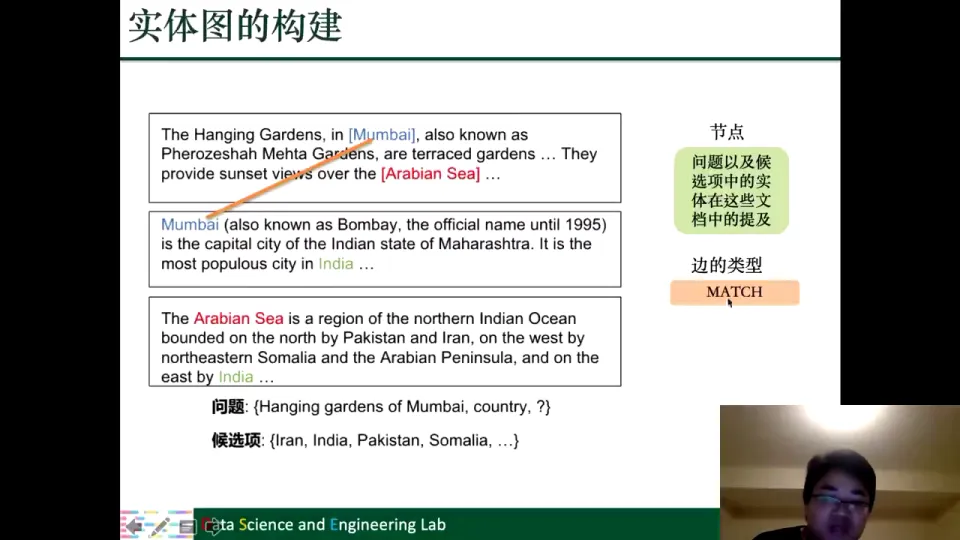

### 5.4 图上的推理：类型感知的消息传递 + 门控更新

有了实体图，就可以用 GNN 在图上做推理。课程采用的是一个比较通用的**消息传递（message passing）**框架，分两步：先聚合邻居信息，再更新自身表示。

四类边意味着四个转换矩阵，参数量是原来的四倍。边少时这个代价可以接受；边多时会参数爆炸，这也为后面知识图谱的 CompGCN 埋下伏笔。

此外，模型还加了一个**自环（self-loop）**，让节点在聚合邻居的同时保留自身信息。自环没有边类型，所以单独用一个转换矩阵 $\Theta_0$ 表示。课程中的公式大致是：

$$
m_i^{(l-1)} = F_i^{(l-1)}\Theta_0^{(l-1)} + \frac{1}{|\mathcal{N}(v_i)|}\sum_{r\in\mathcal{R}}\sum_{v_j\in\mathcal{N}_r(v_i)} F_j^{(l-1)}\Theta_r^{(l-1)}
$$

$$
a_i^{(l-1)} = \sigma\left([m_i^{(l-1)}, F_i^{(l-1)}]\Theta_a^{(l-1)}\right)
$$

$$
F_i^{(l)} = \rho\left(m_i^{(l-1)}\right)\odot a_i^{(l-1)} + F_i^{(l-1)}\odot\left(1-a_i^{(l-1)}\right)
$$

第一行是**信息聚合**：自身表示加上各类邻居表示，每类邻居用自己的转换矩阵。第二行是**门机制**：学一个权重 $a$，决定这次更新要多少邻居信息、多少自身信息。第三行是**信息更新**：按权重把聚合信息和自身信息加权融合。

讲者觉得这个设计有点怪，但可以理解为给节点加自环、让自身信息有独立通道。模型结构没有绝对答案，关键是信息通道是否留出来。

[【跳转到 40:14】](https://www.bilibili.com/video/BV1yx4y1R7uV/?p=7&t=2414)

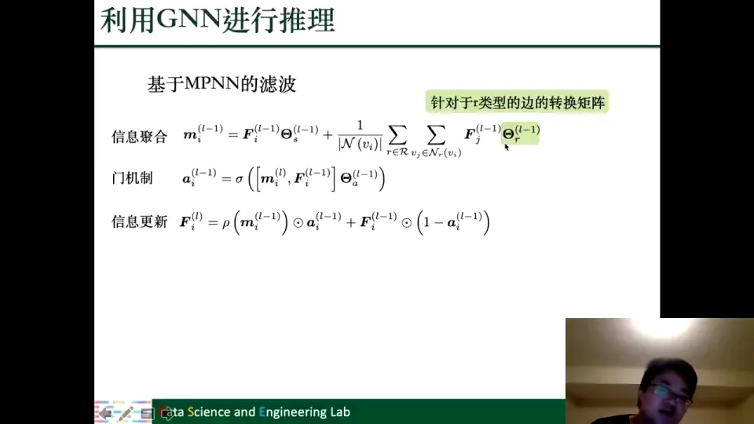

### 5.5 答案选择：候选提及与问题表示打分

图神经网络输出每个实体提及的表示 $F_i^L$（$L$ 是层数）。接下来，对每一个候选答案相关的提及，计算它与问题表示 $Q$ 的匹配分数：

$$
\text{score}_i = F\left(F_i^L, Q\right)
$$

然后选择分数最高的候选作为答案。这里的 $F$ 可以是一个简单的相似度函数，也可以是一个小型分类器。直觉是：**如果某个候选实体的图表示和问题的表示最匹配，它就最可能是答案。**

这个方法的创新点不在 GNN 本身，而在**图的构造**：它把实体提及、跨文档同一实体、同文档共现、共指关系都编码进图，让信息沿边在多篇文档之间流动。

不过讲者也提醒：哪种 GNN 效果最好要靠实验；某些设计（比如自环处理）可能不必需，但没有实验不能下结论。

[【跳转到 45:39】](https://www.bilibili.com/video/BV1yx4y1R7uV/?p=7&t=2739)

---

## 六、知识图谱补全：异质图上的两种设计哲学

### 6.1 知识图谱就是大量三元组

**知识图谱（knowledge graph）** 用节点表示实体、用边表示实体之间的关系。它的基本单位是**三元组（triple）**：

$$
(\text{头实体}, \text{关系}, \text{尾实体})
$$

也可以写成（源节点，关系，目标节点）。比如：

- (达芬奇, 是一个人, 人)
- (达芬奇, 画了, 蒙娜丽莎)
- (蒙娜丽莎, 位于, 卢浮宫)
- (卢浮宫, 位于, 巴黎)
- (埃菲尔铁塔, 位于, 巴黎)

达芬奇是头实体/源节点，"是一个人"是关系，人是尾实体/目标节点。很多个三元组叠在一起，细看是三元组，整体看就是一张图。

[【跳转到 48:35】](https://www.bilibili.com/video/BV1yx4y1R7uV/?p=7&t=2915)

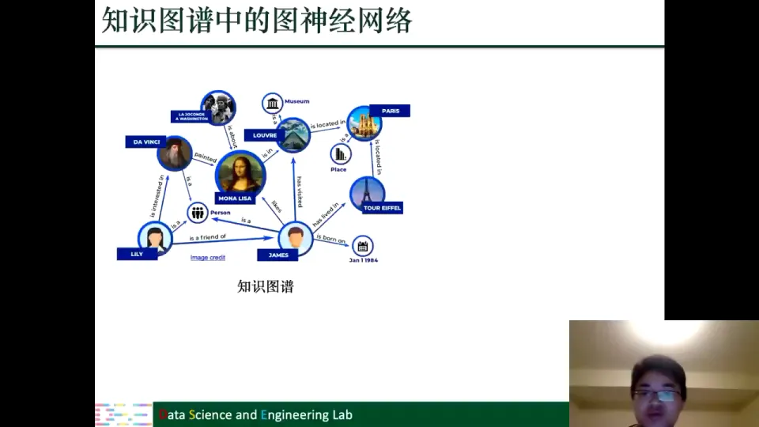

### 6.2 知识图谱补全：预测缺失的关系

现实中的知识图谱往往不完整：很多关系没有被收录。**知识图谱补全**就是预测缺失的关系，比如判断埃菲尔铁塔和达芬奇之间是否可能存在某种关系。

补全的关键是学习实体表示，这听起来正是 GNN 擅长的。但知识图谱有两个特殊之处：**节点类型多**（人、地点、博物馆、画作……），**边类型多**（出生、位于、画了、是一个……，可能成千上万）。所以它是**异质图**，直接套 GCN 会把所有关系混在一起，丢失类型信息。

[【跳转到 51:55】](https://www.bilibili.com/video/BV1yx4y1R7uV/?p=7&t=3115)

### 6.3 两种设计哲学：把异质图变简单，或为异质图造专用模型

第一种思路是**把知识图谱转换成简单图**：把各种关系压缩成一张普通图的邻接矩阵，然后用现成的 GNN——像"不想洗碗就发明洗碗机"，用更通用的工具解决问题。第二种是**为知识图谱设计专用图滤波器**：保留关系类型，设计能区分关系的 GNN——像"想上天就造飞机"，为特定需求造专用工具。两种思路都很好，能把问题转化成已有工具能处理的形式，本身就是一种能力。

### 6.4 路线一：用关系影响力把知识图谱压成简单图

转换的关键是定义**实体 $i$ 对实体 $j$ 的影响力**，把它作为简单图邻接矩阵的元素 $A_{ij}$。课程给出的定义基于"关系在图中出现的频率"：

$$
\mathrm{fun}(r) = \frac{\#\text{Source with } r}{\#\text{Edges with } r}, \qquad
\mathrm{ifun}(r) = \frac{\#\text{Target with } r}{\#\text{Edges with } r}
$$

$$
A_{i,j} = \sum_{(v_i,r,v_j)\in\mathcal{E}} \mathrm{ifun}(r) + \sum_{(v_j,r,v_i)\in\mathcal{E}} \mathrm{fun}(r)
$$

直观理解：$\mathrm{fun}(r)$ 是"有该关系的源实体数"除以"该关系的边数"，衡量平均每个源实体分出多少条该关系的边；比值越大，说明该关系在源端越有区分度。$\mathrm{ifun}(r)$ 对目标端做同样计算。公式把两个方向的影响力加起来，得到对称化的简单图。

这样做的好处是前面所有 GNN 都能直接用；坏处是关系类型被压成标量，类型信息有损失。**这是"用信息换通用性"的权衡。**

[【跳转到 54:42】](https://www.bilibili.com/video/BV1yx4y1R7uV/?p=7&t=3282)

### 6.5 路线二之一：R-GCN 为每种关系学一个转换矩阵

**R-GCN（Relational GCN）** 的思路很直接：既然不同关系含义不同，那就为每一种关系 $r$ 学一个独立的特征转换矩阵 $\Theta_r$。聚合时，只对同一种关系的邻居使用对应的矩阵：

$$
F_i^{(l)} = \sum_{r\in\mathcal{R}}\sum_{v_j\in\mathcal{N}_r(v_i)} \frac{1}{|\mathcal{N}_r(v_i)|} F_j^{(l-1)}\Theta_r^{(l-1)} + F_i^{(l-1)}\Theta_0^{(l-1)}
$$

其中 $\mathcal{N}_r(v_i)$ 是节点 $i$ 通过关系 $r$ 连接的邻居集合，$\Theta_0$ 是自环的转换矩阵。这个公式和前面语义角色标注的 GNN 很像，区别只是"按边类型分组"的粒度更细：那里是按语法标签分，这里是按关系分。

R-GCN 的问题也很明显：**参数量与关系数量线性相关。** 现实知识图谱可能有上万个关系，如果每个关系一个矩阵，参数量就是原来的上万倍，既占显存又容易过拟合。课程幻灯片上专门标注了"参数量与关系数量线性相关"。

[【跳转到 58:25】](https://www.bilibili.com/video/BV1yx4y1R7uV/?p=7&t=3505)

### 6.6 路线二之二：CompGCN 用关系嵌入代替关系矩阵

**CompGCN** 的核心思想是：不再为每种关系学一个大矩阵，而是为每种关系学一个**关系嵌入（relation embedding）** $Z_r$，然后用一个简单的组合函数 $\phi$ 把邻居表示和关系嵌入组合起来：

$$
F_i^{(l)} = \sum_{(v_j,r)\in\mathcal{N}(v_i)} \phi\left(F_j^{(l-1)}, Z_r^{(l-1)}\right)\Theta_{\mathrm{dir}(r)}^{(l-1)}
$$

其中：

- $Z_r$ 是关系 $r$ 的嵌入，不同层可以有不同的关系嵌入；
- $\phi$ 是组合函数，可以非常简单，比如相加、相乘、相减；
- $\Theta_{\mathrm{dir}(r)}$ 只按方向区分，通常只有三种：正向（$i\to j$）、反向（$j\to i$）、自环。

这样，参数数量就和关系种类的数量脱钩了：不管有 10 种关系还是 10000 种关系，转换矩阵只有三个（按方向），关系本身只用一个低维嵌入表示。**这相当于把"为每种关系造一个专用转换器"换成了"给每种关系一个语义向量，再让向量和邻居表示做简单组合"。**

CompGCN 和 R-GCN 的对比，可以总结为：

| 维度 | R-GCN | CompGCN |
| --- | --- | --- |
| 关系处理 | 每种关系一个转换矩阵 $\Theta_r$ | 每种关系一个嵌入 $Z_r$，与邻居表示组合 |
| 参数量 | 随关系数量线性增长 | 与关系数量基本无关 |
| 方向处理 | 通常包含在关系类型中 | 显式分为正向、反向、自环三类 |
| 适用场景 | 关系种类较少的异质图 | 关系种类极多的知识图谱 |

选择哪一种，取决于知识图谱的关系规模。关系少，R-GCN 表达能力强；关系多，CompGCN 更现实。**没有"最好"的模型，只有"匹配问题规模"的模型。**

[【跳转到 61:45】](https://www.bilibili.com/video/BV1yx4y1R7uV/?p=7&t=3705)

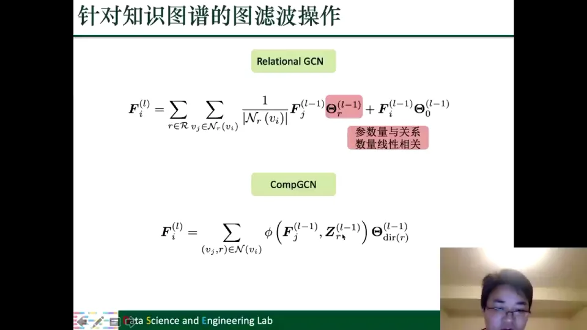

---

## 七、数据挖掘中的图：社交网络、推荐系统与多图融合

自然语言处理之外，数据挖掘是图神经网络的另一个主战场。课程把数据挖掘中的数据分成三类：**万维网数据（web）、城市数据、网络安全数据**。它们有一个共同点：数据之间存在大量关系，天然适合用图来表示。

- **社交网络**：用户是节点，朋友、关注、评论、点赞是边；其中还可能混有"僵尸粉"。
- **推荐系统**：用户和商品是两类节点，购买、浏览、收藏、评分是边。
- **智慧城市**：道路、路段、区域、空气质量监测站是节点，空间相邻、交通连接是边。
- **互联网**：网页是节点，超链接是边，整张互联网本身就是一张大图。

讲者用一句话概括："有数据就有图，有图就有图神经网络。" 接下来分别看社交网络、推荐系统、城市数据和网络安全中的代表性任务。

[【跳转到 41:37】](https://www.bilibili.com/video/BV1yx4y1R7uV/?p=7&t=2497)

### 7.1 社会影响力预测：用 ego network 判断邻居行为会不会影响你

**社会影响力预测（social influence prediction）** 要回答的是：给定社交网络中的一个节点 $v$，如果它的邻居做了某个行为，$v$ 是否也会跟着做？比如在微博上，你的邻居转发了一条微博，你会不会也转发？

这个任务有直接应用：病毒式营销要选影响力大的种子用户；谣言/虚假信息传播预测可以提前干预，尤其是大 V 转发虚假信息时负面影响很大。

用 GNN 做这个任务的方法很直接：

1. 从完整的社交网络中，以目标节点 $v$ 为中心，抽取它的一跳、二跳邻居，形成一个 **ego network（自我中心网络）**；
2. 因为算法不假设节点自带属性，所以先用传统的**网络嵌入**方法（第三讲介绍过）为每个节点生成初始表示；
3. 用 GNN（比如 GAT）在 ego network 上聚合邻居信息，增强节点表示；
4. 把增强后的表示送入分类器，做二分类：$v$ 会不会产生相应行为。

这个案例说明：图本身是简单同质图时，GCN/GAT 可以直接用；难的不是模型，而是把任务定义成图上二分类问题。

[【跳转到 72:51】](https://www.bilibili.com/video/BV1yx4y1R7uV/?p=7&t=4371)

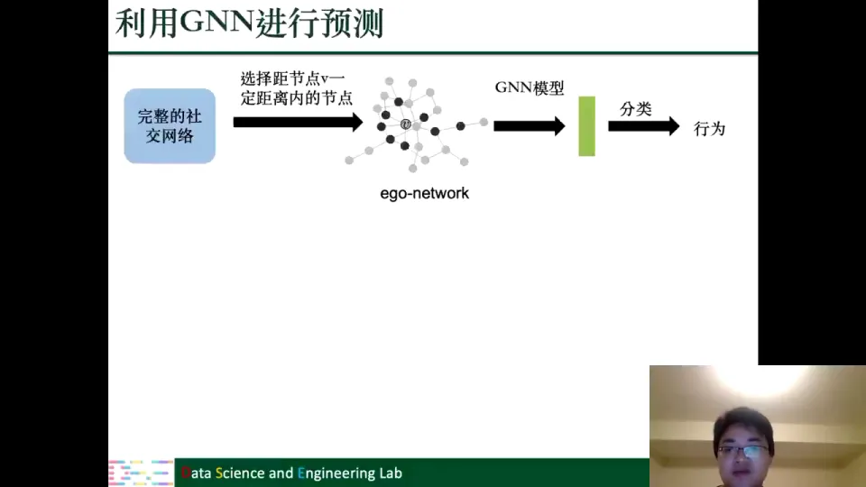

### 7.2 社交表征学习：同一个人在不同主题下有不同偏好

**社交表征学习（social representation learning）** 的目标是学习用户的向量表示。难点是用户在不同情境下偏好不同：一个"新爸爸"可能关注旅游、工作，但最近最关注奶瓶、尿布、儿童玩具；经典案例是买牛奶、面包、尿布的顾客很可能买啤酒。这说明用户行为要放在具体主题下理解。

模型的做法是引入**主题（topic）** $c$：

1. 每个用户有一个通用的节点表示 $F_j$；
2. 每个主题有一个二值掩码 $b_c$，把通用表示映射成主题特定的表示：

$$
F_{j|c}^{(l-1)} = F_j^{(l-1)} \odot b_c^{(l-1)}
$$

3. 在主题 $c$ 下，用注意力权重 $\alpha_{i,j,c}$ 聚合邻居信息：

$$
F_{v_j\to v_i}^{(l-1)} = \sum_{c=1}^{C}\alpha_{i,j,c}^{(l-1)}\cdot F_{j|c}^{(l-1)}
$$

4. 把所有邻居的信息聚合起来，再和自身表示一起更新：

$$
m_i^{(l-1)} = \sum_{v_j\in\mathcal{N}(v_i)}F_{v_j\to v_i}^{(l-1)}, \qquad
F^{(l)} = \alpha\left([F_i^{(l-1)}, m_i^{(l-1)}]\right)
$$

直观理解：先把邻居表示"投影"到不同主题下，再看它在哪个主题上对当前用户重要，最后按主题聚合。同一邻居在"旅游"和"育儿"主题下贡献的信息可以完全不同。这个设计与 CompGCN 的"关系嵌入 + 组合"很像：用嵌入区分不同关系/主题，说明设计模式可以跨任务迁移。

[【跳转到 82:14】](https://www.bilibili.com/video/BV1yx4y1R7uV/?p=7&t=4934)

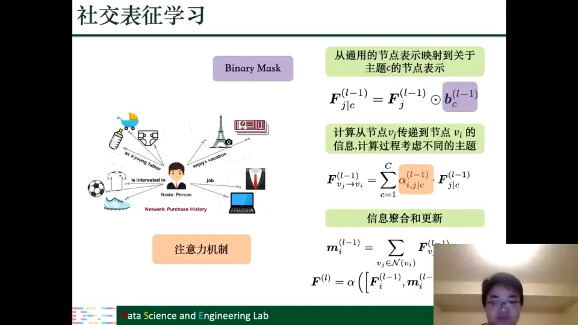

### 7.3 推荐系统基础：协同过滤与用户—商品二分图

**推荐系统**要解决的是：给用户推荐他可能喜欢的商品。最经典的方法是**协同过滤（collaborative filtering）**，它的基本假设是："过去相似的用户，将来也倾向于相似。"

比如用户 A 和 B 过去喜欢同样的电影，就可以把 A 喜欢、B 没看过的电影推荐给 B。这背后是"历史会重演"：高中、大学时的好朋友，多年后爱好仍可能相似。

协同过滤用**交互矩阵**建模用户—商品关系：行是用户，列是商品，元素是评分（1–5 分）或是否有交互（0/1）。这个矩阵也可以画成**二分图**：一边用户、一边商品，有交互就连边。

关键问题是"怎么衡量用户相似"。直接用矩阵行向量算相似度会遇到**数据稀疏**：大多数用户只交互过极少数商品，矩阵大量为 0，相似度不可靠。所以通常先学习用户和商品的低维**嵌入**，再在嵌入空间算相似度。**推荐系统的核心，就是学好用户和商品的表示。**

[【跳转到 83:39】](https://www.bilibili.com/video/BV1yx4y1R7uV/?p=7&t=5019)

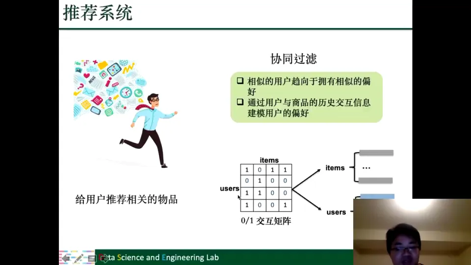

### 7.4 只用交互图：把评分类型当作边类型

有了二分图，用户和商品就是节点、交互就是边，GNN 可以在两者之间传递信息。如果交互只有"有没有"，普通 GCN/GAT 就够了；但现实中的交互往往带评分（1–5 分）。课程把**每一种评分看作一种边类型**，更新用户表示时按评分类型分别聚合：

$$
\mu_{i,r} = \sum_{j\in\mathcal{N}_{i,r}}\frac{1}{c_{ij}}W_r x_j
$$

其中 $r$ 是评分类型，$\mathcal{N}_{i,r}$ 是用户 $i$ 通过评分 $r$ 连接的商品集合，$W_r$ 是该类型对应的转换矩阵。然后把不同评分类型得到的表示拼接/整合起来：

$$
u_i = W\cdot\sigma\left(\text{accum}(u_{i,1},\dots,u_{i,R})\right)
$$

商品的表示同理。得到用户和商品的表示后，就可以算相似度或预测评分。这个设计的思想和语义角色标注、R-GCN 一致：**边类型携带信息，按类型分别聚合比混在一起更能保留信息。** 很多基于 GNN 的推荐算法都是在这个思路上加不同的 tricks。

[【跳转到 88:41】](https://www.bilibili.com/video/BV1yx4y1R7uV/?p=7&t=5321)

### 7.5 引入知识图谱：用户决定"哪种关系更重要"

只用交互图，信息量有限。商品本身还有很多属性：电影有导演、演员、类型、出品公司；球鞋有品牌、系列、代言人。这些可以用**知识图谱**表示，比如《阿甘正传》的主演是 Tom Hanks，《达芬奇密码》也是他主演。

把知识图谱引入推荐的关键是：**不同用户对不同的关系重视程度不一样。** 有人是 Tom Hanks 的粉丝，"主演"关系对他很重要；有人喜欢冒险片，"类型"关系更重要。所以不能对所有用户用同一套关系权重，而要针对用户建模关系的重要性。

课程给出的做法是：

1. 对每个用户 $u$ 和每种关系 $r$，用一个函数 $g(u,r)$ 计算重要性分数：

$$
\pi_r^u = g(u,r)
$$

2. 对同一个商品的所有关系分数做 softmax，得到归一化权重：

$$
\tilde{\pi}_{r,e}^u = \frac{\exp(\pi_{r,e}^u)}{\sum_{e\in\mathcal{N}(v)}\exp(\pi_{r,e}^u)}
$$

3. 用这些权重聚合知识图谱上的实体表示，得到商品表示；
4. 把商品表示和用户表示结合，预测用户对这个商品的偏好（比如点击/购买概率）。

直观理解：**知识图谱告诉你"电影有哪些属性"，用户表示告诉你"用户在乎哪些属性"，两者结合，才能判断用户会不会喜欢这部电影。**

[【跳转到 93:04】](https://www.bilibili.com/video/BV1yx4y1R7uV/?p=7&t=5584)

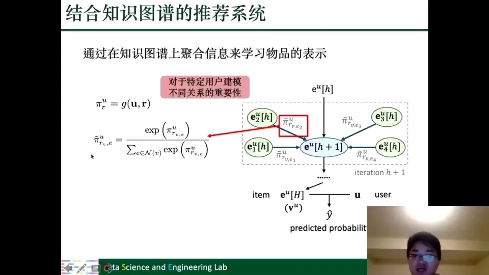

### 7.6 引入社交网络：GraphRec 同时建模交互图和社交图

除了商品知识图谱，用户还有社交关系。**社交推荐**的基本想法是：你信任/关注的人喜欢的东西，你更可能喜欢。拼多多的"砍一刀"就是典型——靠亲友关系传播。

课程介绍了 **GraphRec**，它同时利用两张图：

- **用户—商品交互图（User-Item Graph）**：用户买过/评分过的商品；
- **社交图（Social Graph）**：用户之间的关注/朋友关系。

两张图通过"用户"这个桥梁连接起来。模型分为两部分：

- **用户建模（User Modeling）**：一方面从交互过的商品聚合信息（Item Aggregation），另一方面从社交邻居聚合信息（Social Aggregation），两者拼接得到用户表示；
- **商品建模（Item Modeling）**：从与商品交互过的用户聚合信息（User Aggregation），得到商品表示；
- 最后把用户表示和商品表示拼接，预测评分。

这里有一个很重要的实现细节：**推荐系统的主要参数不是 GNN 的转换矩阵，而是用户、商品、评分类型以及用户对商品 opinion（评分意见）的嵌入。** 因为推荐系统通常没有原始节点特征，用户和商品的嵌入是随机初始化、在训练中学习的；它们数量大，构成了参数的主要部分。这一点和前面 NLP 任务不同：NLP 里 GNN 的参数主要是特征转换矩阵，而推荐系统里嵌入层才是大头。

[【跳转到 96:10】](https://www.bilibili.com/video/BV1yx4y1R7uV/?p=7&t=5770)

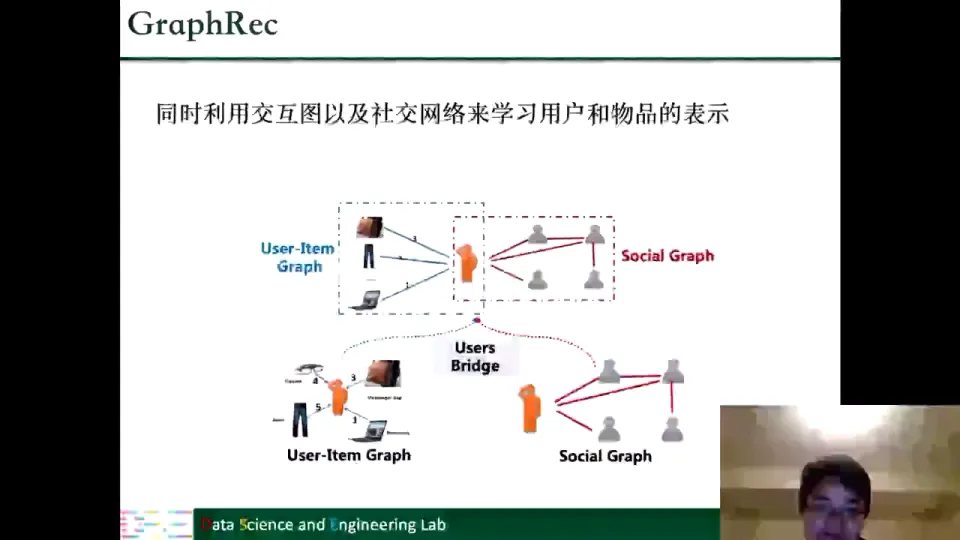

---

## 八、城市数据与网络安全：时空图、异质图和图分类

### 8.1 城市数据：时空图 = 每一时刻一张图 + 时间上的序列模型

城市数据可以用图表示，而且这种图**随时间变化**：节点是路段、区域、空气质量监测站；边是路段连接、空间相邻；节点特征包括车流量、车速、PM2.5、PM10、CO。今天的空气质量和一个月后的不一样，图在变化。

这类图叫**时空图**：空间关系用图建模，时间关系用序列建模。典型做法是：每个时刻 $t$ 用 GNN 聚合空间邻居；把不同时刻的表示排成序列，用 RNN/LSTM/Transformer 捕捉时间依赖；最后做预测。空气质量、交通流量、车速预测都遵循 "GNN + 序列模型" 的模式。

[【跳转到 100:35】](https://www.bilibili.com/video/BV1yx4y1R7uV/?p=7&t=6035)

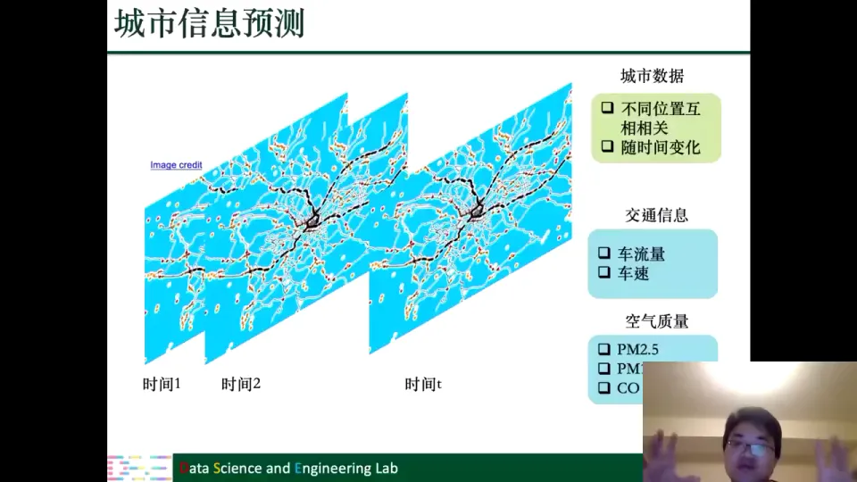

### 8.2 恶意账号检测：账号—设备异质图 + 残差输入

恶意账号包括垃圾邮件发送者、刷粉丝的僵尸粉、电商平台上的虚假评论者。为什么能用 GNN？因为行为有规律：**设备复用**——同一个攻击者会用同一批设备注册/登录大量账号，注册需要手机号、MAC、IMEI、SIM，个人不可能拥有上万个；**批量操作**——攻击者不会每分钟加一个粉丝，而是突然增加几百几千个，因为目的是赚钱，不是模拟正常人。

基于这两点构造**账号—设备异质图**：节点是账号和设备（设备分手机号、MAC、IMEI、SIM 等类型）；账号在某个设备上有活动，就连一条边。

模型有两个特点：第一，**按设备类型拆子图**，每种设备类型 $d$ 用单独的邻接矩阵 $A^{(d)}$ 聚合邻居；第二，**保留原始输入**，每一层都加一个从原始特征 $X$（如节点活动频率）到当前层的**残差连接**：

$$
F^{(l)} = \sigma\left(X\Theta^{(l-1)} + \frac{1}{|\mathcal{D}|}\sum_{d\in\mathcal{D}}A^{(d)}F^{(l-1)}\Theta_{(d)}^{(l-1)}\right)
$$

其中 $X$ 是原始节点特征，第一项保证每一层都能直接看到原始信息，第二项是按设备类型聚合的邻居信息。最后做二分类：这个账号是不是恶意账号。

这个案例的启发是：**图构造的质量往往比 GNN 结构更重要。** 把"账号—设备"关系建对，恶意账号的检测问题就完成了一大半；剩下的分类模型可以很标准。

[【跳转到 107:08】](https://www.bilibili.com/video/BV1yx4y1R7uV/?p=7&t=6428)

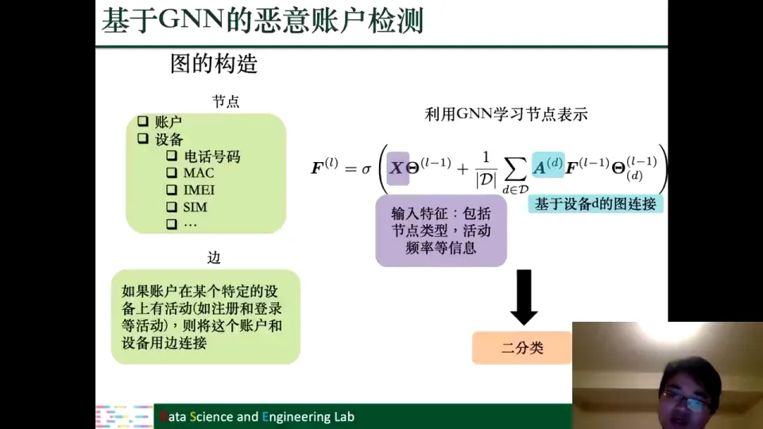

### 8.3 虚假新闻检测：把每条新闻的传播图当成一个样本

网络安全里的第二个任务是**虚假新闻检测**。核心观察是：**虚假新闻和真实新闻的传播路径不一样。** 真实新闻往往会被共青团、政府机构等高权威账号转发；虚假新闻的传播路径中很难出现这些账号。所以拿到一条新闻的**传播图**，就可以通过图结构判断真假：用户是节点，传播、点赞、评论、转发是边；用 GNN 学图级表示，做**图分类**（二分类）。模型通常先用几层 GNN 得节点表示，再用**池化**聚合成图表示，最后接全连接层。

这个方法有一个现实局限：**它需要新闻已经传播开来才能构造传播图**，等图构造好，虚假新闻可能已经造成社会影响。讲者提出，可以把传播图方法和传统的内容/账号特征方法结合，争取更早判断。

[【跳转到 110:08】](https://www.bilibili.com/video/BV1yx4y1R7uV/?p=7&t=6608)

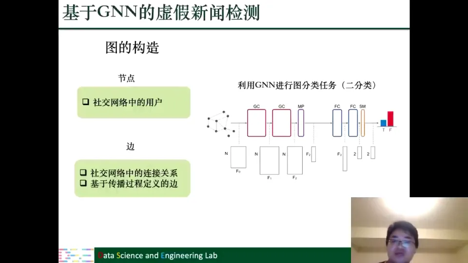

---

## 九、回到两个问题：一套可复用的应用方法论

### 9.1 问题一：图在哪里，图有没有用

讲到最后，课程再次回到开头的两个问题。第一个问题是：**任务中有没有图？没有图的话，如何构造图？构造出来的图对任务有没有用？**

从这一讲的所有案例可以总结出三种情况：

| 情况 | 典型案例 | 做法 |
| --- | --- | --- |
| 图显式存在，且对任务有用 | 语义角色标注（依存树）、机器翻译（依存树）、关系抽取（依存树）、知识图谱 | 直接利用现成图，针对图的特点设计 GNN |
| 图显式存在，但需要多图融合 | 推荐系统（交互图 + 知识图谱 + 社交图）、恶意账号（账号—设备图） | 分别建模每张图，再聚合/拼接 |
| 图不存在，需要构造 | 多跳问答（实体图）、虚假新闻（传播图）、城市数据（时空图） | 先定义节点和边，再验证图对任务是否有用 |

判断"图有没有用"的标准，不是图看起来是否合理，而是**图上的边是否承载了任务需要的关系**。依存树的语法边对应语义角色，实体图的 match/coref 边对应跨文档推理，用户—商品边对应用户偏好，传播图的边对应信息扩散路径。

### 9.2 问题二：有了图，怎么设计 GNN

第二个问题是：**有了图之后，如何针对图的特点设计 GNN，并与已有模型结合？**

这一讲的案例展示了几个反复出现的设计模式：

1. **按边类型分组聚合**：语义角色标注按语法标签分，多跳问答按 match/doc-based/coref 分，知识图谱按关系分，推荐系统按评分分。边类型不同，信息含义不同，就不应该用同一个转换矩阵。
2. **按方向区分**：依存树是有向图，CompGCN 区分正向/反向/自环。方向不是细节，而是语义的一部分。
3. **关系/主题嵌入**：当类型太多、不能为每种类型单独设矩阵时，用低维嵌入 + 简单组合（CompGCN、社交表征学习）来压缩参数。
4. **门控与残差**：多跳问答用门控决定聚合信息与自身信息的比例；恶意账号检测用残差保留原始特征；GraphRec 用拼接融合多源信息。
5. **图级别池化**：虚假新闻检测把节点表示池化成图表示，做图分类。
6. **与已有模型结合**：BiLSTM + GNN、seq2seq + GNN、矩阵分解/嵌入 + GNN。GNN 通常是增强器，不是替代品。

这些模式不是互斥的，实际模型往往同时用几种。比如一个推荐模型可以同时有"按评分类型聚合"和"按用户—关系注意力加权"；一个知识图谱模型可以同时有"关系嵌入"和"自环"。

[【跳转到 115:06】](https://www.bilibili.com/video/BV1yx4y1R7uV/?p=7&t=6906)

### 9.3 这套方法论怎么用到你自己的领域

如果你手上有新任务，可以按"找图—造图—验图—选模型—做结合—看任务层级"的顺序思考。讲者说，只要把这两个问题想清楚，应用到自己的领域就没有大问题。**本讲的价值不在于记住模型名字，而在于建立"从任务到图、从图到模型"的思考框架。**

---

## 小结

1. **图深度学习的应用可以统一成两个问题**：图是否存在、如何构造、对任务是否有用；有了图之后，如何针对图的特点设计 GNN，并与已有模型结合。
2. **自然语言处理中图无处不在**：依存句法树、抽象语义表示、知识图谱都是图。语义角色标注、机器翻译、关系抽取直接利用依存树，都是"BiLSTM/seq2seq + GNN 增强"的配方；GNN 不替代原模型，而是补上语法信息。
3. **多跳问答的关键是图构造**：节点是实体提及（不跨文档合并），边分为 match、document-based、coreference、complement 四类；GNN 用类型感知的消息传递和门控更新推理，最后用候选表示与问题表示打分。**知识图谱是异质图**：可以压成简单图（关系影响力矩阵），也可以用 R-GCN（每种关系一个矩阵）或 CompGCN（关系嵌入 + 组合函数）专门建模，前者适合关系少，后者适合关系多。
4. **数据挖掘中的图往往要多图融合**：社交影响力用 ego network + 网络嵌入 + GAT；推荐系统从只用交互图（按评分类型聚合），扩展到知识图谱（用户—关系注意力）和社交图（GraphRec）；推荐系统的主要参数是嵌入，不是 GNN 转换矩阵。
5. **城市数据是时空图**：每个时刻一张图，GNN 捕捉空间关系，RNN/Transformer 捕捉时间关系。**网络安全任务强调图构造**：恶意账号检测构造账号—设备异质图，按设备类型聚合并保留原始输入；虚假新闻检测构造传播图做图级二分类，但需要警惕"传播发生后才检测"的滞后性。

---

## 关键术语速查

| 术语 | 一句话解释 |
| --- | --- |
| 语义角色标注（SRL） | 给定谓语，找出它的论元并标注每个论元的语义角色（施事者、受事者、地点、时间等）。 |
| 论元（argument） | 参与谓语所表示动作的实体，比如"警察逮捕疑犯"中的警察和疑犯。 |
| 句法依存树 | 以词为节点、以语法依赖为有向边的树，边标签如主语、宾语、介词宾语。 |
| 双向 LSTM（BiLSTM） | 同时用前向和反向 LSTM 编码序列，每个词得到融合上下文的表示。 |
| 序列标注 | 给序列中每个词/字打一个标签的任务，如语义角色标注、命名实体识别。 |
| 神经机器翻译（NMT） | 用神经网络把源语言序列转换成目标语言序列，常用 seq2seq + 注意力。 |
| seq2seq | 编码器—解码器框架：编码器把输入序列编码成表示，解码器逐步生成输出序列。 |
| 关系抽取 | 给定句子中的两个实体，判断它们之间是什么关系（如 born-in），可含"无关系"类。 |
| 多跳问答 | 答案需要综合多篇文档、经过多次实体跳转才能得到的问答任务。 |
| 实体提及（mention） | 实体在文本中的一次具体出现；同一实体在不同文档中出现算不同提及。 |
| 共指消解（coreference resolution） | 判断文本中不同表述是否指向同一个实体，如"奥巴马"和"总统"。 |
| 消息传递（message passing） | GNN 的通用框架：先聚合邻居信息，再更新自身表示。 |
| 知识图谱（KG） | 用（头实体，关系，尾实体）三元组表示实体及关系的图，节点和边都有类型。 |
| 知识图谱补全 | 预测知识图谱中缺失的关系，通常通过学实体/关系表示实现。 |
| 异质图（heterogeneous graph） | 节点类型或边类型不止一种的图，知识图谱、账号—设备图都是异质图。 |
| R-GCN | 为每种关系学一个特征转换矩阵的 GNN，表达能力强但参数量随关系数线性增长。 |
| CompGCN | 用关系嵌入和组合函数代替关系专用矩阵的 GNN，参数量与关系数量基本无关。 |
| 协同过滤 | 基于"过去相似、将来也相似"的推荐方法，用用户—商品交互矩阵建模偏好。 |
| 时空图 | 每个时刻一张空间图、不同时刻构成序列的图，用于交通、空气质量等预测。 |
| 图分类 | 给整张图打一个标签的任务，如判断一条新闻的传播图是真是假。 |
