# 第08讲：图深度学习的应用（下）

## 本讲要解决的核心问题（SCQA）

**背景**：此前的课程已经给出了"给定一张图，怎么学"的成熟答案：用图滤波在邻居之间传递和聚合信息，学节点表示，再用池化（把多个节点表示汇总成一个向量）得到整张图的表示。

**冲突**：但真实世界的数据往往不是现成的图。照片里是像素，视频里是连续画面，三维物体是一堆无序的点，分子是原子和化学键，蛋白质是氨基酸链，病历则混合了医学影像和年龄、性别等信息。如果只会处理别人整理好的图，图神经网络（GNN）的用武之地就会被大大限制。

**疑问**：能不能把这些"不像图"的数据翻译成图？翻译成图后，GNN 又能分别在计算机视觉、生物化学和医疗健康中解决哪些问题？

**回答（中心思想）**：本讲的方法论可以概括为四步——**先找实体，再定关系，然后建图，最后用 GNN 学表示**。视觉问答、骨架动作识别、图像分类、点云学习，以及分子性质预测、蛋白质界面预测、药物—蛋白质亲和性预测、复方药副作用预测、疾病预测，都是同一思路的实例。

## 一、计算机视觉里的图不止一种：骨架、物体关系和点云都能建图

**结论：计算机视觉的很多数据天生就是图，或者稍加处理就能变成图；能否用上 GNN，第一步取决于你能否找到合适的"节点"和"关系"。**

### 1.1 三种常见的视觉图数据

幻灯片给出了三类典型数据，分别对应三种建图方式。[【跳转到 00:33】](https://www.bilibili.com/video/BV1yx4y1R7uV/?p=8&t=33)

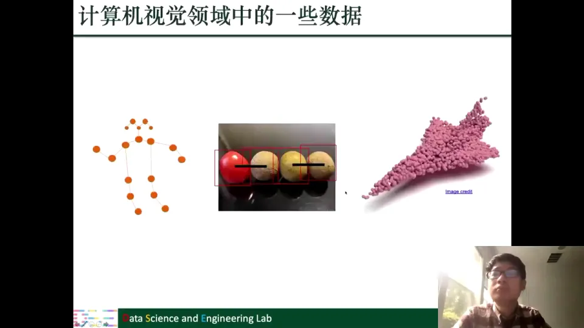

第一类是**人体骨架**：关节是节点，骨骼或关节之间的连接是边。人做动作时关节位置随时间变化，于是"一帧骨架"是一张图，"一段视频"就是一串图。大量计算机视觉工作用骨架序列描述人体动作，或据此做动作识别。

第二类是**图片中的物体及其关系**：先把物体检测出来，每个物体是一个节点；物体之间的空间关系（谁在左、谁在右、距离多远）或语义关系作为边。这样一张图片就组织成了一张"物体关系图"，和知识图谱里的场景图（scene graph）思路相似。

第三类是**点云**：一堆三维点，每个点有 $(x,y,z)$ 坐标，放在一起可以描述飞机、椅子、汽车乃至整个房间的形状。点云本身不是图：它没有天然的边，也没有固定顺序，不能直接套用处理规则网格的 CNN。但我们可以按点与点之间的距离，把每个点和最近的若干个点连起来，人为构造一张图，再在图上做图滤波。[【跳转到 01:23】](https://www.bilibili.com/video/BV1yx4y1R7uV/?p=8&t=83)

### 1.2 本讲只覆盖四类视觉应用

课程明确说明，视觉部分只讲四块内容：**视觉问答、基于骨架的动作识别、图像分类、点云学习**。[【跳转到 03:03】](https://www.bilibili.com/video/BV1yx4y1R7uV/?p=8&t=183) 由于成书较早、领域发展很快，这一讲更像一张"建图地图"：告诉你哪些任务能建图、节点和边怎么定义。[【跳转到 02:13】](https://www.bilibili.com/video/BV1yx4y1R7uV/?p=8&t=133)

## 二、视觉问答：难点在于问题与图像必须彼此"看见"

**结论：视觉问答的难点不是分别理解图像和问题，而是让两者在表示层面发生交互，并利用物体之间的空间关系；否则模型只是把两个向量硬拼在一起。**

### 2.1 任务形式：给一张图和一个问题，输出一个答案

视觉问答（Visual Question Answering，简称 VQA）的形式很直观：给定图片 $I$ 和自然语言问题 $q$，要求模型输出答案。幻灯片里的例子是四个水果，问题是 "What is the color of fruit at the left?"，正确答案是红色。[【跳转到 03:40】](https://www.bilibili.com/video/BV1yx4y1R7uV/?p=8&t=220)

它和普通文本问答不同：VQA 同时给了图片和问题，像"看图说话"的反向任务，因此要同时**理解问题**（问的是颜色还是位置）和**理解图片**（找到最左边的水果并判断颜色），是计算机视觉与自然语言处理结合的任务。[【跳转到 04:05】](https://www.bilibili.com/video/BV1yx4y1R7uV/?p=8&t=245)

### 2.2 最直接的基线：分别编码再拼接，缺点是没有交互

最朴素的做法是"双塔式"：CNN 把图片编码成一个向量，RNN/LSTM 把问题编码成另一个向量，两个向量拼接（concatenate）后送进全连接层或分类器做预测。[【跳转到 04:30】](https://www.bilibili.com/video/BV1yx4y1R7uV/?p=8&t=270) 它能跑通，但**图片和问题之间没有交流**：图片编码时不知道问题在问什么，问题编码时也不知道图片里有什么，两个向量直到最后一刻才被强行拼在一起，模型很难做到"问题问水果，就重点看水果"。[【跳转到 05:20】](https://www.bilibili.com/video/BV1yx4y1R7uV/?p=8&t=320)

具体来说，有两类关系没有被利用：一是**问题与图像区域的关系**——问题问"最左边的水果"，取信息时就该重点看水果，而不是背景里的水瓶、桌子；二是**物体与物体的关系**——要回答"最左边"，模型必须知道谁在左、谁在右。[【跳转到 06:35】](https://www.bilibili.com/video/BV1yx4y1R7uV/?p=8&t=395)

这正是 GNN 的用武之地：把物体当作节点、把物体关系当作边，同时把问题信息注入节点或边，就能让"问题"和"图像"在同一张图里交互。

### 2.3 把答案当成类别：VQA 可以转化为分类问题

VQA 的答案通常是简短的词或短语，比如"红色""左边""两只"。一个常用做法是把训练集中出现过的所有答案收集起来，构成答案词表，每个答案就是一个类别，于是 VQA 就变成了一个**分类问题**：模型从答案词表中选出最可能的一个。这意味着后面关于"分类器"的讨论都可以直接用在 VQA 上。[【跳转到 08:15】](https://www.bilibili.com/video/BV1yx4y1R7uV/?p=8&t=495)

## 三、用 GNN 做视觉问答：建图、关系感知滤波、池化三步走

**结论：把物体变成节点、把问题信息注入节点、用物体间关系连边，再用 GNN 学整张图的表示，就能让问题与图像真正交互；其中"关系感知的图滤波"和"Top-K 稀疏化"是两个关键设计。**

### 3.1 第一步：物体检测 + CNN 得到每个物体的向量

建图的第一步是确定节点。给定图片后，先用物体检测器把图中的物体框出来。幻灯片里的例子有四个红框，对应四个物体。每个红框就是一个候选节点。[【跳转到 08:53】](https://www.bilibili.com/video/BV1yx4y1R7uV/?p=8&t=533)

接下来为每个节点生成初始特征：用 CNN 对整张图片做卷积得到特征图，对每个红框，把框内位置的特征做平均，得到一个统一长度的向量作为该物体的表示，相当于在特征图上对每个框做一次平均池化。[【跳转到 12:00】](https://www.bilibili.com/video/BV1yx4y1R7uV/?p=8&t=720)

### 3.2 第二步：把问题向量注入每个物体

只有物体特征还不够，因为模型还不知道问题在问什么。于是用 RNN/LSTM 对问题编码，得到问题向量。然后把"物体向量"和"问题向量"拼接起来，送进一个多层感知机（MLP，也就是若干层全连接网络），输出一个新的物体表示。[【跳转到 13:40】](https://www.bilibili.com/video/BV1yx4y1R7uV/?p=8&t=820)

这个新表示仍然描述物体，但已经"带着问题"了：问题向量相当于给每个物体加了一个"任务上下文"，让后续的关系建模知道当前该关注什么。

### 3.3 第三步：用内积建全连接图，再保留 Top-K 边

有了每个物体的"问题感知表示"之后，就可以决定边了。最直接的做法是计算任意两个物体表示的内积，把内积当作边的权重。内积越大，说明两个物体在表示空间里越接近、关系越强。因为每两个物体之间都算了一个权重，所以得到的是一个**带权全连接图**。[【跳转到 14:05】](https://www.bilibili.com/video/BV1yx4y1R7uV/?p=8&t=845)

全连接图有两个问题：边太密、计算量大；很多边是噪声，毫不相干的物体也会被强行连上。于是论文做稀疏化：**对每个节点只保留权重最大的 K 条边**。幻灯片示例中每个节点只保留一条边，实际使用时 K 通常大于 1。K 是一个需要在验证集上调整的超参数。[【跳转到 14:55】](https://www.bilibili.com/video/BV1yx4y1R7uV/?p=8&t=895)

### 3.4 第四步：关系感知的图滤波

图建好后，就可以做图滤波了。这里的图滤波和普通 GCN 的聚合公式长得很像，但多了两个系数，分别刻画两类信息。[【跳转到 16:53】](https://www.bilibili.com/video/BV1yx4y1R7uV/?p=8&t=1013)

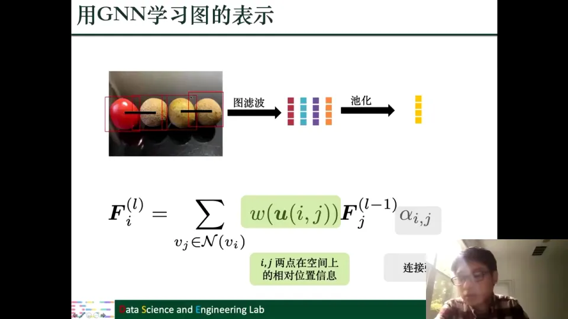

公式可以写成：

$$
F_i^{(l)} = \sum_{v_j \in \mathcal{N}(v_i)} w\big(u(i,j)\big)\, F_j^{(l-1)}\, \alpha_{i,j}
$$

其中：

- $F_i^{(l)}$ 是第 $l$ 层节点 $i$ 的表示；
- $\mathcal{N}(v_i)$ 是节点 $i$ 的邻居集合；
- $w(u(i,j))$ 是节点 $i$ 和 $j$ 在**空间位置**上的相对关系，比如两个物体中心之间的距离和角度；
- $\alpha_{i,j}$ 是上一步建图时得到的**连接强度**。

两者分工明确：$W$ 回答"这两个物体在图片里的几何关系是什么"，$\alpha$ 回答"这两个物体在语义上有多相关"。普通 GCN 通常只有一个基于度的归一化系数，这里则把"空间几何"和"语义连接强度"显式拆开——回答"左边/右边"需要几何，回答"颜色"需要语义，两者都不能少。[【跳转到 17:18】](https://www.bilibili.com/video/BV1yx4y1R7uV/?p=8&t=1038)

### 3.5 第五步：池化与分类

图滤波之后，每个节点都得到了更新后的表示。接下来做一个全局池化（比如对所有节点表示取平均），把整张图压缩成一个向量，作为"图片+问题"的联合表示。最后把这个图表示和问题向量再次结合，送进分类器，从答案词表中选出答案。[【跳转到 18:08】](https://www.bilibili.com/video/BV1yx4y1R7uV/?p=8&t=1088)

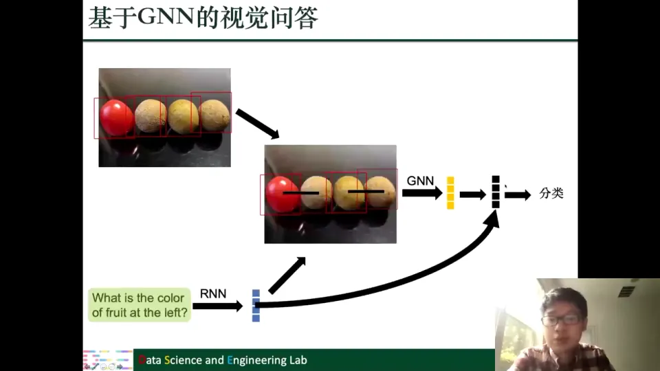

整个流程即：**检测物体 → CNN 特征 → 融合问题 → 内积建图并 Top-K 稀疏化 → 关系感知图滤波 → 全局池化 → 与问题结合分类**。[【跳转到 18:58】](https://www.bilibili.com/video/BV1yx4y1R7uV/?p=8&t=1138)

课程还补充了一个变体：句子本身也可以表示成图，比如用句法依存树把词连起来，再用 RNN 加 GNN 编码问题。这样问题侧不再是"扁平向量"，而是带有语法结构的图，和上一讲把文本建模成图的做法一脉相承。[【跳转到 20:08】](https://www.bilibili.com/video/BV1yx4y1R7uV/?p=8&t=1208)

## 四、基于骨架的动作识别：把一段视频变成一个时空图

**结论：动作识别不必直接处理像素，可以把每一帧的人体抽象成骨架图，再把连续多帧的骨架按时间连起来，构成一张时空图；GNN 同时在"空间邻居"和"时间邻居"上聚合信息，就能学到整个动作的表示。**

### 4.1 从视频到骨架：丢掉无关背景，只保留动作结构

给定一段视频，任务是判断视频中的人在做什么，比如走路、跑步、跳跃。视频是一帧帧图片连续播放，直接处理像素会引入大量与动作无关的信息：背景、光照、衣服颜色、镜头抖动等。真正关键的是"手怎么动、脚怎么动、身体各部位怎么配合"。于是把每帧的人体抽象成一副骨架：关节是节点，骨骼或关节间的连接是边。一帧画面就变成一张小图，背景等无关信息被自然丢掉。[【跳转到 21:26】](https://www.bilibili.com/video/BV1yx4y1R7uV/?p=8&t=1286)

### 4.2 时空图：空间上一张图，时间上一串图

每帧的姿态不同，同一副骨架在不同帧里的节点位置也不同。把所有帧的骨架按时间排列，就得到一个**骨架序列**：每个元素是一张骨架图，相邻元素在时间上连续。[【跳转到 22:16】](https://www.bilibili.com/video/BV1yx4y1R7uV/?p=8&t=1336)

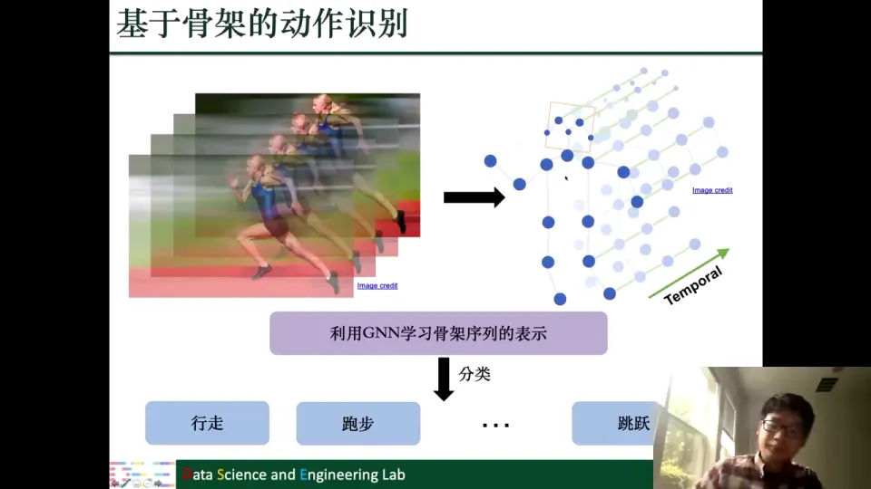

这张结构有两个维度：**空间维度**上，某一帧内部的关节通过骨骼相连，构成一张空间图；**时间维度**上，同一关节在不同帧之间出现，把相邻帧的同一个关节连起来，就形成时间边。两者合在一起，就是一张**时空图（spatio-temporal graph）**——不是"一张图"，而是"一系列图按时间连起来"。[【跳转到 22:41】](https://www.bilibili.com/video/BV1yx4y1R7uV/?p=8&t=1361)

### 4.3 时空图滤波：同时向空间邻居和时间邻居借信息

既然动作序列可以表示成时空图，就可以用 GNN 来学习它的表示。做动作识别时，我们最终要得到一个向量，表达整个骨架序列的信息，再用它分类成"行走/跑步/跳跃"等类别。[【跳转到 23:56】](https://www.bilibili.com/video/BV1yx4y1R7uV/?p=8&t=1436)

时空图上的图滤波和普通图滤波有一个关键区别。以某个红色节点为例：

- **空间聚合**：它先从同一帧内与它相连的关节（比如肘关节从肩关节和腕关节）聚合信息。这和普通 GCN 一样。
- **时间聚合**：它还要从相邻帧中对应位置的节点聚合信息，也就是前一帧的同一个关节和后一帧的同一个关节。[【跳转到 24:34】](https://www.bilibili.com/video/BV1yx4y1R7uV/?p=8&t=1474)

幻灯片用红色区域标出聚合范围：中间是当前帧，左边是前一帧，右边是后一帧。实际实现不一定只看前后各一帧，也可以看前两帧、后两帧。所以，时空图滤波和普通图滤波的主要区别就是**多考虑了时间因素**：普通图滤波只在一张图上聚合，时空图滤波则在一串图上聚合，既看"此刻的身体结构"，也看"动作如何随时间演变"。[【跳转到 26:39】](https://www.bilibili.com/video/BV1yx4y1R7uV/?p=8&t=1599)

### 4.4 池化与分类：从关节表示到动作类别

做完时空图滤波后，每个关节在每个时刻都有一个表示。用池化把这些表示汇总成一个向量，作为整个骨架序列的表示，再送进分类器判断动作类别。整体流程就是：**视频 → 逐帧骨架 → 时空图 → 时空图滤波 → 池化 → 分类**。[【跳转到 27:29】](https://www.bilibili.com/video/BV1yx4y1R7uV/?p=8&t=1649)

## 五、图像分类的 GNN 视角：分类器就是一行可学习的向量

**结论：在图像分类中，所谓"某一类的分类器"本质上就是分类参数矩阵中的一行向量；图像表示与这一行做内积，就得到该类的分数。把分类器看成向量，是理解零样本、少样本和多标签分类的关键。**

### 5.1 标准流程：CNN 提特征，线性层打分，Softmax 出概率

课程用兔子的例子说明标准流程：给定一张图片，预测它属于哪个类别。[【跳转到 28:32】](https://www.bilibili.com/video/BV1yx4y1R7uV/?p=8&t=1712)

第一步是**特征提取**：用 CNN（包括卷积层、池化层等）把图片变成一个向量，比如四维向量，可以理解为图片的"摘要"。第二步是**分类**：把图像向量映射成每个类别的分数；假设有猫、兔、狗、松鼠四个类别，就输出四个分数。第三步是**Softmax**：把分数归一化成概率，训练目标就是让正确类别的分数尽量高。[【跳转到 31:02】](https://www.bilibili.com/video/BV1yx4y1R7uV/?p=8&t=1862)

### 5.2 分类器就是参数矩阵的一行

关键的一点在第二步：分数是怎么算出来的？答案是**内积**。分类参数是一个矩阵，每一行对应一个类别；把图像向量与某一行的向量做内积，就得到该类的分数。[【跳转到 31:27】](https://www.bilibili.com/video/BV1yx4y1R7uV/?p=8&t=1887)

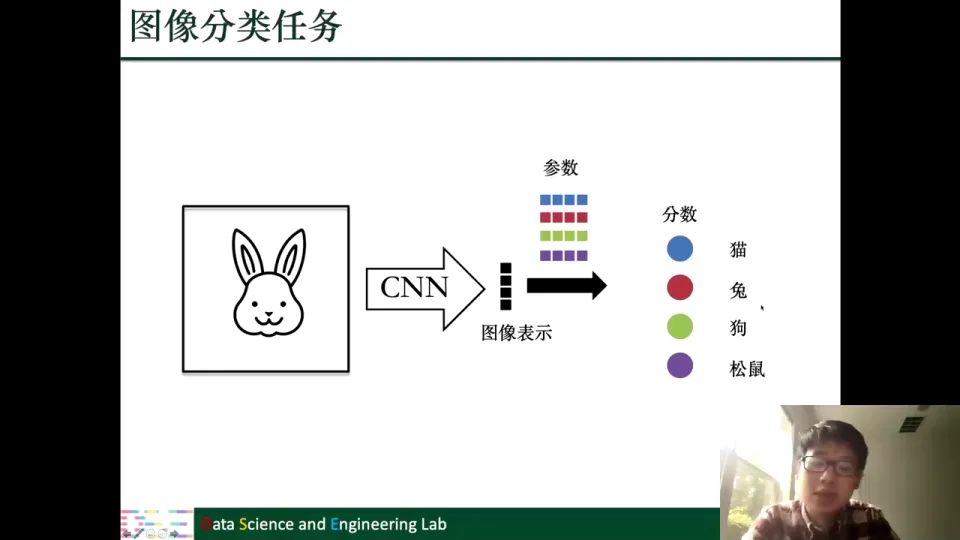

如果图像表示是 $K$ 维，类别数是 $C$，那么这个参数矩阵就是 $C$ 行 $K$ 列。每一行是一个 $K$ 维向量，对应一个类别。幻灯片用颜色做了区分：蓝色行对应猫，红色行对应兔，绿色行对应狗，紫色行对应松鼠。[【跳转到 32:17】](https://www.bilibili.com/video/BV1yx4y1R7uV/?p=8&t=1937)

内积可以理解为一种**相似度**：图像向量和哪一行越接近、内积越大，模型就越倾向于认为它属于那一类。分类器向量可以看成"该类在表示空间里的模板"。

### 5.3 为什么要把"分类器"叫成"一行向量"

这里有一个容易混淆的术语。平时我们说"分类器"，往往指整个模型（比如一个 CNN 加一个 Softmax）；但在这一讲的语境里，"分类器"特指**参数矩阵中与某个类别对应的那一行向量**。比如"猫的分类器"就是蓝色那一行，"兔的分类器"就是红色那一行。[【跳转到 33:32】](https://www.bilibili.com/video/BV1yx4y1R7uV/?p=8&t=2012)

课程特意强调这一点，因为后面三个任务都会反复使用这个说法：零样本要"预测没见过类的分类器"，少样本要"用小样本分类器换更好的分类器"，多标签要让"标签的分类器之间产生关联"。[【跳转到 34:47】](https://www.bilibili.com/video/BV1yx4y1R7uV/?p=8&t=2087)

把分类器看成向量之后，一个自然的问题就出现了：**如果一个类别一个样本都没有，我们还能不能得到它的分类器向量？** 这就是零样本分类要解决的问题。

## 六、零样本分类：用类别关系图把"词义"翻译成分类器

**结论：零样本分类的目标不是"凭空识别"，而是利用类别的语义（词嵌入）和类别之间的关系图，预测出未见类别的分类器向量；GNN 在这里扮演的是"从语义到分类器"的映射函数。**

### 6.1 问题设定：有的类样本充足，有的类一个样本都没有

零样本分类（zero-shot classification）的设定是：数据集中有一些**样本充足的类**，比如斑马和鹿，每个类都有大量图片；同时有一些**零样本的类**，比如霍加狓（okapi），在训练集中一张图片都没有出现过。[【跳转到 36:02】](https://www.bilibili.com/video/BV1yx4y1R7uV/?p=8&t=2162)

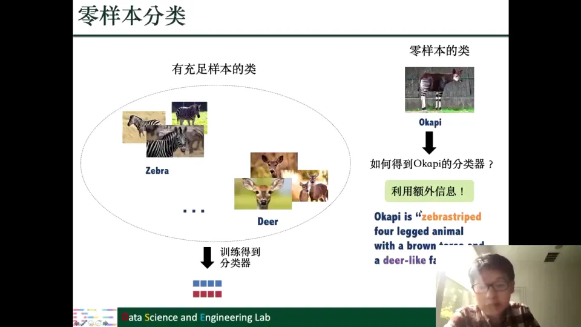

对于样本充足的类，我们可以正常训练得到分类器向量；但零样本的类没有样本，无法通过"看图—算损失—更新参数"得到分类器。问题于是变成：**能不能在不看任何霍加狓图片的情况下，得到霍加狓的分类器？**[【跳转到 38:19】](https://www.bilibili.com/video/BV1yx4y1R7uV/?p=8&t=2299)

### 6.2 额外信息：用文字描述补上"没见过"的缺口

人类之所以能做到，是因为有额外的知识。幻灯片给了一段霍加狓的描述：有斑马条纹、四条腿、棕色身体、脸像鹿。这段描述把"霍加狓"和熟悉的类别（斑马、鹿）联系了起来。也就是说，**类别不是孤立的，类别之间存在语义关系**；把这些关系表示成图，就能把"见过的类"的知识迁移到"没见过的类"上。[【跳转到 40:49】](https://www.bilibili.com/video/BV1yx4y1R7uV/?p=8&t=2449)

### 6.3 用词嵌入表示类别语义

具体实现时，每个类别的名字（如 "Zebra""Deer""Okapi"）都可以通过**词嵌入（word embedding）**变成一个向量。词嵌入把词表中的每个词映射到低维向量，语义相近的词在向量空间里也相近；课程在前面讲网络嵌入时已经介绍过，网络嵌入本身也是从词嵌入发展而来的。[【跳转到 43:01】](https://www.bilibili.com/video/BV1yx4y1R7uV/?p=8&t=2581)

于是，零样本分类的输入就是类别的词嵌入向量，输出是类别的分类器向量。这是一个**回归任务**：希望预测出的分类器向量和真实的分类器向量越接近越好。真实的分类器向量从哪来？从样本充足的类那里训练得到，作为 ground truth（基准）。[【跳转到 42:49】](https://www.bilibili.com/video/BV1yx4y1R7uV/?p=8&t=2569)

### 6.4 直接用词嵌入回归效果不好，所以加一张类别关系图

如果直接用词嵌入过 MLP 或 RNN 来回归分类器，效果并不理想。原因是词嵌入只描述单个类别的语义，没有利用类别之间的关系；单看"霍加狓"的词向量，看不出它和斑马、鹿的关系。解决办法是再加一张**类别关系图**：类别是节点，类别之间的语义关系是边。这样 GNN 做回归时，不仅能看到当前类别的词嵌入，还能从相邻类别聚合信息。幻灯片里的图把"有充足样本的类"和"零样本的类"都连在一起，形成一张跨区域的类别图。[【跳转到 44:16】](https://www.bilibili.com/video/BV1yx4y1R7uV/?p=8&t=2656)

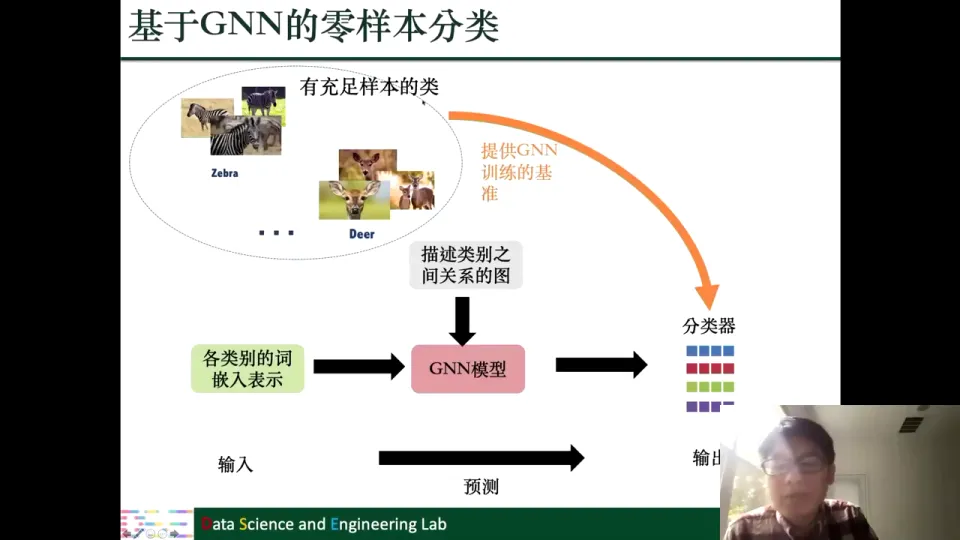

整个流程就是：**词嵌入 → 类别关系图 → GNN → 分类器**。训练时用充足样本类的真实分类器做监督，推理时输入零样本类的词嵌入，预测它的分类器。这相当于一种**半监督式的分类**：有标签的类别提供监督，无标签的类别通过图结构"借用"邻居的信息。[【跳转到 46:21】](https://www.bilibili.com/video/BV1yx4y1R7uV/?p=8&t=2781)

## 七、少样本分类：用图关系修正小样本训练出的分类器

**结论：少样本分类先用 K 个样本训练出一个"粗糙"的分类器，再用类别关系图上的 GNN 把它"修正"成更好的分类器；它和零样本分类共享同一张类别图，区别只在于输入从词嵌入换成了 K 样本分类器。**

### 7.1 问题设定：K 很小，但不是零

少样本分类（few-shot classification）的设定和零样本很像，也有两类类别：

- **充足样本的类**：每个类别有 $N$ 个样本，$N$ 可能成千甚至上万；
- **少样本的类**：每个类别只有 $K$ 个样本，$K$ 通常很小，比如 1、2、3 个。

这里有一个特殊情况：如果 $K=0$，问题就退化成零样本分类；如果 $K$ 是 1、2、3，就是少样本分类。所以可以把零样本看成少样本在 $K=0$ 时的特例。[【跳转到 47:40】](https://www.bilibili.com/video/BV1yx4y1R7uV/?p=8&t=2860)

### 7.2 小样本训练出的分类器为什么不够好

和零样本不同，少样本的类至少有几个样本，理论上可以直接用这 $K$ 个样本训练一个分类器。但**样本太少，分类器容易过拟合，泛化能力差**：只见过三张橘猫照片，模型可能把"橘色""沙发背景"当成猫的本质特征，换一张黑猫在草地上的照片就认不出来了。[【跳转到 48:05】](https://www.bilibili.com/video/BV1yx4y1R7uV/?p=8&t=2885)

### 7.3 用类别关系图修正分类器

解决办法仍然是利用类别之间的关系图。虽然少样本的类只有 $K$ 个样本，但它和其他类别之间的语义关系是已知的；这张图可以帮助它从样本充足的类那里"借"信息。[【跳转到 48:30】](https://www.bilibili.com/video/BV1yx4y1R7uV/?p=8&t=2910)

整个形式和零样本分类非常相似，也是回归过程，唯一的区别在输入：零样本输入**类别的词嵌入**，少样本输入**由 K 个样本训练出来的分类器**。输出都是"更好的分类器"。也就是说，GNN 学的是一个"分类器到分类器"的映射：输入粗糙的 K 样本分类器，输出接近 N 样本分类器的、更稳健的分类器。[【跳转到 49:56】](https://www.bilibili.com/video/BV1yx4y1R7uV/?p=8&t=2996)

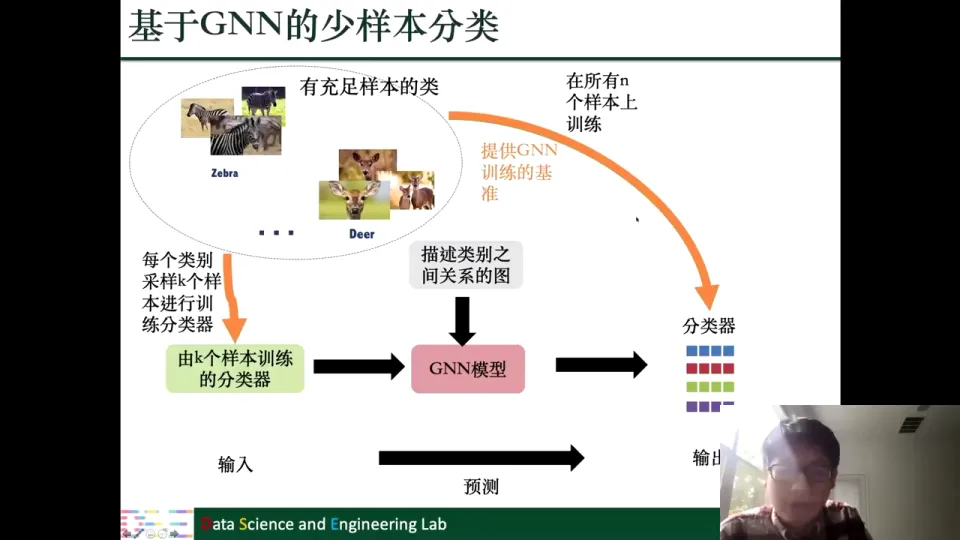

### 7.4 训练数据从哪来：在充足样本类上模拟"少样本"

训练这个 GNN 的监督信号来自**在样本充足的类上模拟少样本场景**：对每个充足样本的类，先用全部 $N$ 个样本训练一个分类器作为"理想输出"；再从 $N$ 个样本中随机采样 $K$ 个，训练一个"粗糙分类器"作为输入；让 GNN 学习从粗糙分类器映射到理想分类器。重复很多次、每次采样不同的 $K$ 个样本，就构造出大量训练样本对。[【跳转到 51:36】](https://www.bilibili.com/video/BV1yx4y1R7uV/?p=8&t=3096)

### 7.5 推理：把新类的 K 样本分类器送进 GNN

训练好之后，对于真正的少样本类，先用它的 $K$ 个样本训练一个分类器，把它作为 GNN 的输入，GNN 输出修正后的分类器。然后用这个修正后的分类器去分类新图片。[【跳转到 52:26】](https://www.bilibili.com/video/BV1yx4y1R7uV/?p=8&t=3146)

## 八、多标签分类：用标签共现图让分类器互相"通气"

**结论：多标签分类不是从 C 个类里选一个，而是做 C 个独立的二分类；标签之间存在共现关系，把这些关系建成图并用 GCN 生成分类器，可以让原本各自为战的分类器共享信息。**

### 8.1 任务形式：一张图可以同时有多个标签

前面的图像分类都是"多选一"：一张图要么是猫，要么是兔。多标签分类（multi-label classification）则允许一张图同时拥有多个标签。幻灯片给了三个例子：打网球的人有 Person、Sports Ball、Tennis Racket；穿西装的老人有 Person、Tie；滑雪的人有 Person、Ski。[【跳转到 53:21】](https://www.bilibili.com/video/BV1yx4y1R7uV/?p=8&t=3201)

任务就是：给定一张图片，判断哪些标签出现在图片里；"Person"几乎总是出现，其他标签则可以同时出现多个。

### 8.2 和多分类的区别：分数不互相比较，而是各自过阈值

多标签分类也有 C 个分类器、每个输出一个分数，但比较方式完全不同：[【跳转到 54:11】](https://www.bilibili.com/video/BV1yx4y1R7uV/?p=8&t=3251)

- **多分类**：C 个分数之间互相比较，经过 Softmax 后选最大的那个，类别之间是互斥的；
- **多标签**：每个分数只和自己比，超过某个阈值就认为该标签存在，标签之间不互斥。

所以多标签分类本质上是 **C 个独立的二分类任务**：C=4 时，就是四个"有/没有"的判断。[【跳转到 54:36】](https://www.bilibili.com/video/BV1yx4y1R7uV/?p=8&t=3276)

### 8.3 标签不是孤立的：领带出现，人大概率也在

如果只用 CNN 提特征，然后接 C 个独立的分类器，模型会忽略一个重要的先验：**标签之间存在共现关系**。[【跳转到 55:26】](https://www.bilibili.com/video/BV1yx4y1R7uV/?p=8&t=3326)

课程举了几个直观例子：出现**领带**，大概率也出现**人**，但反过来不一定；出现**网球拍**，大概率也出现**网球**，反过来也成立；滑雪板等器材也往往和"人"一起出现。这些关系可以建模成一张**有向图**：节点是标签，边表示"一个标签出现时，另一个标签出现的概率更高"。领带 → 人是单向的，网球拍 ↔ 网球是双向的。这里的"有向"不是说因果，而是说共现概率的方向性不对称。[【跳转到 57:03】](https://www.bilibili.com/video/BV1yx4y1R7uV/?p=8&t=3423)

### 8.4 用 GCN 在标签图上生成分类器

有了标签关系图，就让分类器不再独立，而是在标签图上做信息传递。[【跳转到 57:53】](https://www.bilibili.com/video/BV1yx4y1R7uV/?p=8&t=3473)

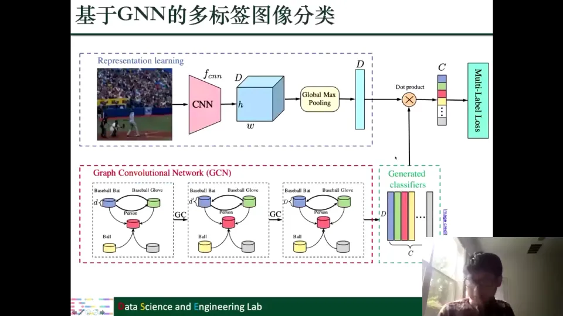

整个模型分成上下两路：

- **上路（图像表示）**：CNN + 池化，把图片变成一个 $D$ 维向量；
- **下路（分类器生成）**：以每个标签的词向量为初始节点特征，在标签关系图上跑 GCN，输出 C 个分类器向量。幻灯片里的例子有 11 个标签，所以生成 11 个低维分类器。

最后，把图像向量分别与每个标签分类器做内积，得到 C 个分数，再过各自的阈值，就完成了多标签预测。训练时使用多标签损失（Multi-Label Loss），让每个标签的预测都尽量正确。[【跳转到 59:13】](https://www.bilibili.com/video/BV1yx4y1R7uV/?p=8&t=3553)

这一设计让**分类器在标签图上"协商"**：既然"领带"和"人"相邻，它们的分类器就会相互影响；图片里有领带时，人的分类器也更容易给出高分。标签共现的先验知识被编码进了模型结构。

## 九、点云学习：用 KNN 图给无序点集补上邻接关系

**结论：点云是一组无序的三维点，不能直接套用 CNN；用 KNN 按空间距离建图后，就可以用图滤波学习每个点的表示，并通过逐层更新图来适应不断变化的局部结构。**

### 9.1 点云是什么：一堆带坐标的点

点云（point cloud）由大量三维点组成，每个点有 $(x,y,z)$ 坐标，放在一起就能描述物体的三维形状。[【跳转到 60:21】](https://www.bilibili.com/video/BV1yx4y1R7uV/?p=8&t=3621) 幻灯片展示了飞机、椅子、汽车以及两个房间内部的扫描。点云的好处是灵活：不需要固定网格，也不要求点之间有顺序，因此可以表示任意形状。但这也带来一个问题——**点云是无序的**，同一架飞机，点的排列顺序可以任意打乱，CNN 那种"按位置滑窗"的方式用不上。[【跳转到 61:11】](https://www.bilibili.com/video/BV1yx4y1R7uV/?p=8&t=3671)

### 9.2 点云上的两类任务：分割与分类

点云上常见的任务有两类：[【跳转到 61:20】](https://www.bilibili.com/video/BV1yx4y1R7uV/?p=8&t=3680)

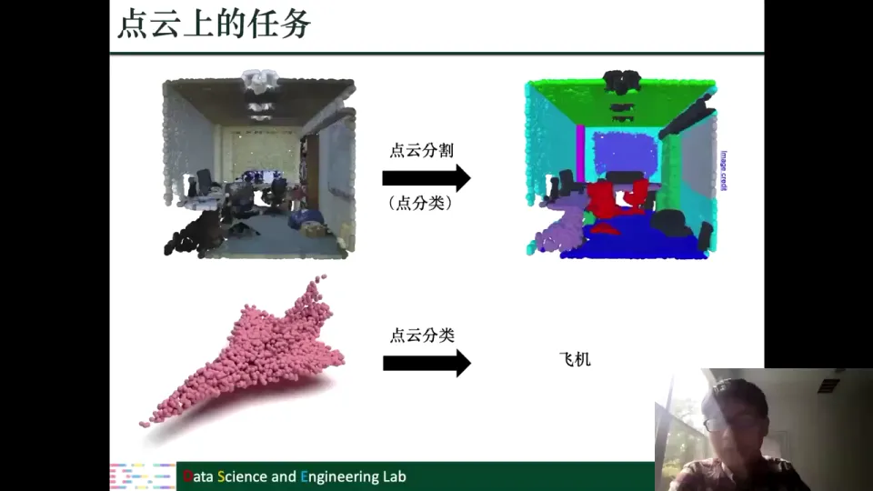

- **点云分割（segmentation）**：把点云分成不同的语义部分，比如房间的天花板、墙壁、桌子、椅子各是一块。因为每一块都要标到每个点上，所以它本质上是**对每个点做分类**，和节点分类类似。
- **点云分类（classification）**：对整个点云做一个判断，比如给定一架飞机的点云，预测它是"飞机"。

无论哪种任务，关键都在于**学好点的表示**：分割需要每个点的表示，分类需要整个点云的表示。[【跳转到 62:35】](https://www.bilibili.com/video/BV1yx4y1R7uV/?p=8&t=3755)

### 9.3 用 KNN 建图：把"距离近"变成"有边"

点云本身没有边，所以第一步是人工建图。最常用的方法是 **KNN（K-Nearest Neighbor，K 近邻）**：对每个点，找到空间中距离它最近的 K 个点，把它们连起来。[【跳转到 63:15】](https://www.bilibili.com/video/BV1yx4y1R7uV/?p=8&t=3795)

"最近"用空间距离衡量：三维坐标越接近，距离越小，越可能被连边。这样每个点都有 K 个邻居，点云就变成一张 KNN 图。三维空间里挨得近的点，往往属于同一个物体或部位，应该互相交流信息。[【跳转到 64:05】](https://www.bilibili.com/video/BV1yx4y1R7uV/?p=8&t=3845)

### 9.4 图滤波：从邻居聚合信息

有了 KNN 图就可以做图滤波：对每个点 $i$，从邻居点 $j$ 聚合信息，更新自己的表示。[【跳转到 64:05】](https://www.bilibili.com/video/BV1yx4y1R7uV/?p=8&t=3845)

课程展示了两种聚合设计：第一种是 $\sigma(F_j^{(l-1)} \Theta^{(l-1)})$，对邻居特征做线性变换再过激活函数，是最常见的 GNN 形式；第二种是 $\sigma\big((F_j^{(l-1)} - F_i^{(l-1)})\Theta^{(l-1)}\big)$，先计算邻居和中心点的**特征差**再做线性变换，聚合"相对差异"而不是"绝对特征"，可以更好地保留局部几何结构。[【跳转到 65:20】](https://www.bilibili.com/video/BV1yx4y1R7uV/?p=8&t=3920)

### 9.5 动态图：每学完一层，重新建一次图

点云表示学习还有一个和普通 GNN 不一样的地方：**图不是固定不变的，而是逐层更新的**。[【跳转到 66:10】](https://www.bilibili.com/video/BV1yx4y1R7uV/?p=8&t=3970) 普通 GNN 的图在第一次消息传递前就确定了，之后所有层都在同一张图上；但在点云里，随着每层学出新的点表示，点与点的"邻近关系"也可能变化。于是下一层不再使用原来的 KNN 图，而是**根据新表示重新构建一张图**再聚合：第一层按"原始三维坐标"找邻居，第二层按"学到的特征"找邻居；前者是几何上的近，后者是语义上的近。

到这里，计算机视觉的四个任务就讲完了，共同点仍是：**找到合适的节点和关系，把数据建图，再用 GNN 学表示。**[【跳转到 66:35】](https://www.bilibili.com/video/BV1yx4y1R7uV/?p=8&t=3995)

## 十、生物化学与医疗：分子、蛋白质、药物、患者都能建图

**结论：生物医药数据里的核心实体和关系天然适合建图；这一部分的五类应用，分别对应分子图上的性质预测、蛋白质图上的成对分类、药物图加蛋白序列上的回归、异质图上的链接预测，以及患者图上的半监督节点分类。**

### 10.1 三类图数据：分子、蛋白质、药物—蛋白质网络

本领域有三类图数据。[【跳转到 67:17】](https://www.bilibili.com/video/BV1yx4y1R7uV/?p=8&t=4037)

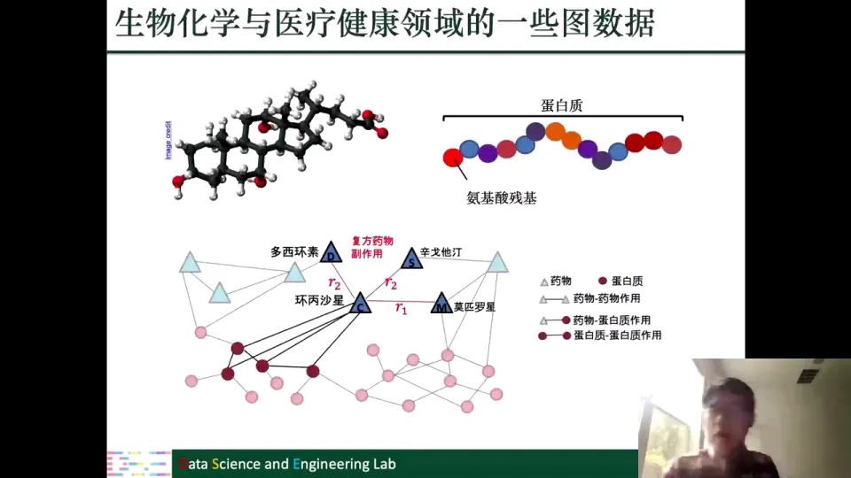

分子：原子是节点、化学键是边；蛋白质：氨基酸残基组成的链，可按序列或三维距离连边；药物—蛋白质—蛋白质网络：药物作用于蛋白质，蛋白质之间相互作用，药物之间还可能产生副作用。这些实体和关系放在一起，就是一张包含多种节点类型和多种边类型的**异质图**（也称多模态图）。

### 10.2 分子表示学习：在原子—化学键图上预测分子性质

药物发现需要合成并测试大量候选分子，费时费钱；用机器学习先做一轮筛选，可以大幅缩小实验范围。[【跳转到 68:45】](https://www.bilibili.com/video/BV1yx4y1R7uV/?p=8&t=4125) 筛选的第一步是得到分子的向量表示，再用它预测**可溶性、毒性、有效性**等性质。[【跳转到 70:00】](https://www.bilibili.com/video/BV1yx4y1R7uV/?p=8&t=4200)

分子天然是图：原子是节点、化学键是边。图滤波时每个原子从相邻原子聚合信息，同时保留自身信息（自环）。课程特别指出一个设计：**按邻居数量使用不同参数**——中心原子有 5 个邻居就用 $\Theta_5$，只有 1 个邻居就用 $\Theta_1$，即参数 $\Theta_{|\mathcal{N}(v_i)|}$ 的下标是邻居数。[【跳转到 71:15】](https://www.bilibili.com/video/BV1yx4y1R7uV/?p=8&t=4275)

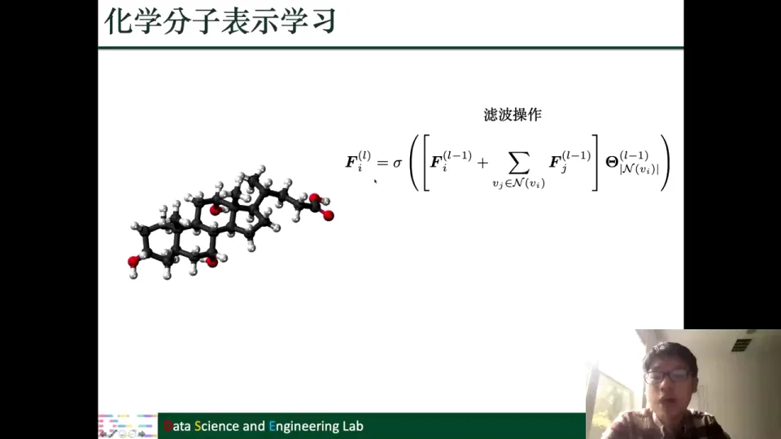

邻居数量直接影响化学性质：碳能形成四个键、氢只有一个键，不区分就会抹平差异。得到每层、每个原子的表示后，把所有层和所有原子的表示汇总，经 Softmax 加权得到整个分子的向量，再预测性质。[【跳转到 72:30】](https://www.bilibili.com/video/BV1yx4y1R7uV/?p=8&t=4350)

### 10.3 蛋白质相互作用界面预测：把三维折叠变成距离图

蛋白质由氨基酸残基连成链，但会折叠成复杂的三维结构；它要发挥作用往往需要和其他蛋白质相互作用，因此研究相互作用发生在哪些残基上很重要。[【跳转到 73:51】](https://www.bilibili.com/video/BV1yx4y1R7uV/?p=8&t=4431) 只用序列建模会丢失折叠信息：序列上相隔很远的残基，三维空间里可能挨得很近。为了捕捉这种"远距离接触"，把蛋白质建成图：**残基是节点，空间距离近的残基连边**。[【跳转到 75:56】](https://www.bilibili.com/video/BV1yx4y1R7uV/?p=8&t=4556)

"相互作用界面预测"要回答：给定两个蛋白质，哪些残基对发生了相互作用？因为输入是一对一对的残基，所以它是**成对的二分类**：对每一对残基输出"是/否"。[【跳转到 77:11】](https://www.bilibili.com/video/BV1yx4y1R7uV/?p=8&t=4631)

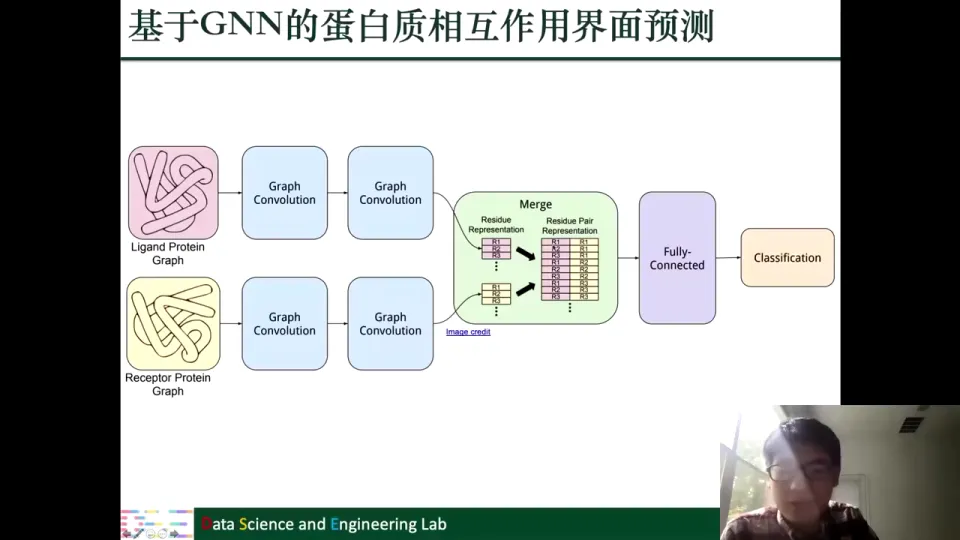

配体蛋白（ligand protein）和受体蛋白（receptor protein）各建一张图，分别做图卷积得到残基表示；把一对残基的表示拼接，送进全连接层做二分类。遍历所有残基对时，同一个残基的表示会和另一侧多个残基分别拼接。[【跳转到 79:01】](https://www.bilibili.com/video/BV1yx4y1R7uV/?p=8&t=4741)

### 10.4 药物—蛋白质结合亲和性：药物图加蛋白序列的回归

药物要起作用，通常需要和特定蛋白质结合。**结合亲和性（binding affinity）**衡量结合的强度：亲和性越高，可能只需很少药量就能产生效果。[【跳转到 81:17】](https://www.bilibili.com/video/BV1yx4y1R7uV/?p=8&t=4877) 预测亲和性是**回归任务**，因为它是连续数值，不是简单的高/低二分类。输入包括药物的分子图和蛋白质的氨基酸序列。[【跳转到 82:32】](https://www.bilibili.com/video/BV1yx4y1R7uV/?p=8&t=4952)

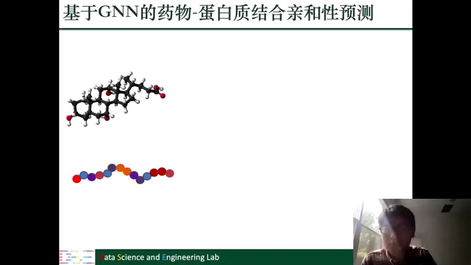

直接方案：药物用 GNN 学表示，蛋白质用 RNN/LSTM 学表示，拼接后送进回归层。课程也指出，蛋白质本身也可以建图，用图模型替代序列模型，可能带来进一步改进。[【跳转到 83:22】](https://www.bilibili.com/video/BV1yx4y1R7uV/?p=8&t=5002)

### 10.5 复方药物副作用：异质图上的链接预测

有些疾病很难用一种药治疗，需要同时服用多种药物，这叫**复方用药（polypharmacy）**。它可能提高疗效，也可能带来单药没有的副作用。[【跳转到 84:24】](https://www.bilibili.com/video/BV1yx4y1R7uV/?p=8&t=5064) 把所有组合都做临床试验不现实，于是希望模型预测：**哪两种药一起用会产生副作用？产生的是哪种副作用？**[【跳转到 85:14】](https://www.bilibili.com/video/BV1yx4y1R7uV/?p=8&t=5114)

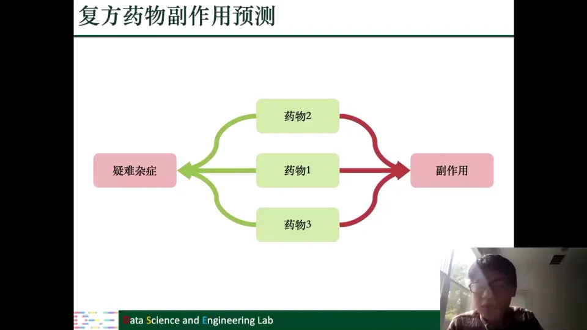

这可建模成一张异质图：三角形是药物，药物之间的边表示"一起用可能产生副作用"；圆形是蛋白质，药物—蛋白边表示药物作用于该蛋白；蛋白—蛋白边表示蛋白相互作用；边还带关系类型，比如 $r_1$ 表示胃肠道出血、$r_2$ 表示心动过缓。[【跳转到 86:29】](https://www.bilibili.com/video/BV1yx4y1R7uV/?p=8&t=5189)

任务是**链接预测 + 关系分类**：先判断两个药物节点间是否存在某种副作用边，再判断是哪一种副作用。建模为：

$$
p(v_i, r, v_j) = \sigma\big(z_i^{\top} D_r R\, z_j\big)
$$

其中 $z_i$、$z_j$ 是药物表示，$r$ 是副作用关系，$D_r$ 是该关系需要学习的矩阵，$R$ 是所有关系共享的矩阵，$\sigma$ 把结果映射到 0 到 1，作为存在该副作用的概率。$R$ 共享让不同副作用互相借力，$D_r$ 专门化让每种副作用保留特点。[【跳转到 89:49】](https://www.bilibili.com/video/BV1yx4y1R7uV/?p=8&t=5389)

### 10.6 疾病预测：患者图上的半监督节点分类

最后一个应用是疾病预测。医疗数据通常包含医学影像（如 MRI）和非影像信息（年龄、性别、数据采集地点等），医生诊断时会同时参考两类信息，模型也应如此。[【跳转到 92:05】](https://www.bilibili.com/video/BV1yx4y1R7uV/?p=8&t=5525)

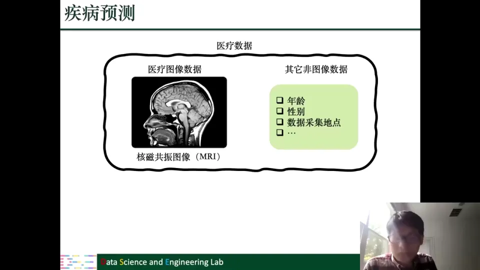

只用影像可以做二分类（有/无疾病，比如是否有脑瘤），但额外信息也有用：年龄相近的人影像和疾病状态可能更相似，同一设备、同一医院采集的数据分布也可能更接近。[【跳转到 93:20】](https://www.bilibili.com/video/BV1yx4y1R7uV/?p=8&t=5600) 于是把每位患者当作节点，用额外信息建边：年龄相差不超过五岁连边，采集地点相同连边。疾病预测就变成患者图上的**半监督节点分类**：每个节点有标签（有病/没病），但只有部分节点有标签，模型利用图结构把标签传播到未标注节点。[【跳转到 95:25】](https://www.bilibili.com/video/BV1yx4y1R7uV/?p=8&t=5725) 影像作为节点输入特征：用 CNN 提取影像特征作为 GNN 的初始表示，这样 GNN 既能看到患者自己的影像，也能参考"年龄相近、采集地点相同"的其他患者信息。[【跳转到 96:15】](https://www.bilibili.com/video/BV1yx4y1R7uV/?p=8&t=5775)

## 小结

- **建图是本讲的第一性问题。** 视觉里的骨架、物体关系、点云，生物医药里的分子、蛋白质、药物、患者，都要先定义清楚"实体"和"关系"，GNN 才有用武之地。
- **视觉问答的关键是交互。** 把物体当节点、把问题信息注入节点、用空间关系和连接强度做图滤波，模型才能"问什么就看什么"；骨架动作识别则把时间边加进图，同时在空间和时间邻居上聚合。
- **分类器可以看成一行向量。** 这一视角是零样本、少样本、多标签分类的共同基础：分类器可以被预测、被修正、被生成。
- **零样本靠语义和关系，少样本靠少量样本加关系。** 两者共享类别关系图；零样本输入词嵌入，少样本输入 K 样本分类器，输出都是更好的分类器。
- **多标签分类让标签分类器在标签图上"协商"，点云则用 KNN 图补结构。** 标签共现关系被编码进 GCN；点云先按距离连边，再逐层更新图。
- **生物医药的五类任务覆盖不同预测形式。** 分子性质是图级预测，蛋白质界面是成对二分类，药物—蛋白亲和性是回归，复方药副作用是异质图链接预测，疾病预测是患者图上的半监督节点分类。

## 关键术语速查

| 术语 | 一句话解释 |
| --- | --- |
| 图神经网络（GNN） | 在图结构上做消息传递和聚合的神经网络；节点从邻居收集信息并更新自己的表示。 |
| 视觉问答（VQA） | 给定一张图片和一个自然语言问题，输出答案的任务；需要同时理解图像和问题。 |
| 图滤波 | GNN 的核心操作：按边把邻居信息加权求和，更新当前节点表示。 |
| 分类器（本讲含义） | 特指分类参数矩阵中与某一类别对应的一行向量；图像表示与它做内积得到该类分数。 |
| 零样本分类 | 训练集中完全没有某类样本，仍要预测该类的分类器或完成分类。 |
| 少样本分类 | 每个新类别只有 K 个（通常 1–5 个）样本，需要在小样本条件下得到可用的分类器。 |
| 多标签分类 | 一张图片可以同时拥有多个标签；通常拆成 C 个独立的二分类任务。 |
| 词嵌入（Word Embedding） | 把词映射成低维向量，语义相近的词在向量空间中也相近。 |
| 类别关系图 | 节点是类别、边是类别间语义关系的图；用于把已知类别知识迁移到新类别。 |
| 点云（Point Cloud） | 由大量三维点 $(x,y,z)$ 组成的数据，可灵活表示三维形状，但点之间没有天然顺序。 |
| KNN 图 | 每个点只和距离最近的 K 个点连边所构成的图；常用于点云等无序数据。 |
| 时空图 | 由多帧骨架图按时间连接而成的图；空间上有骨骼边，时间上有帧间边。 |
| 异质图 / 多模态图 | 包含多种节点类型和多种边类型的图；如药物、蛋白质、副作用共存的网络。 |
| 链接预测 | 预测图中两个节点之间是否存在某种边；复方药副作用预测就是带关系类型的链接预测。 |
| 半监督节点分类 | 图中只有部分节点有标签，利用图结构把标签信息传播到未标注节点。 |
| 分子图 | 原子为节点、化学键为边的图；用于学习分子表示和预测分子性质。 |
| 结合亲和性 | 药物与蛋白质结合的强度；亲和性越高，通常所需药量越少。 |

