# 第09讲：图深度学习的研究前沿

## 本讲要解决的核心问题（SCQA）

**背景**：前八讲已经把图神经网络的基础、成熟模型和成熟应用讲完了。读者现在会用一个标准套路解决问题：把数据建成图，选一个 GNN，堆几层，聚合邻居信息，再做节点分类或图分类。

**冲突**：这套套路一旦往深处走、往真实场景走，就会撞上三堵墙。第一，给 GNN 加深并不像给 CNN 加深那样稳定，往往到十层左右性能就明显下降；第二，真实图数据通常缺少标签，而 GNN 利用无标签数据的方式又过于简单，只是在邻居上聚合；第三，我们说不清 GNN 的能力边界——它到底能区分什么样的图结构、上限在哪里。

**疑问**：既然“更深、更省标签、更强能力”都是刚需，图深度学习接下来应该往哪里走？除了这些方法问题，GNN 还能被用到哪些意想不到的领域？

**回答（中心思想）**：本讲给出三条方法主线——**设计更深的 GNN、图上的自监督学习、GNN 的表达性**；并用“可解释性、公平性、非欧几何、隐私”等方向勾勒研究前沿，最后用组合优化、程序分析、物理系统等高级应用说明：GNN 的价值不只在“有图可用”，更在于**把原本没有图的问题建成图，再用图模型去学它的结构规律**。[【跳转到 05:40】](https://www.bilibili.com/video/BV1yx4y1R7uV/?p=9&t=340)

---

## 一、加深 GNN 的动机成立，但深度并不自动带来性能

**结论：加深 GNN 能扩大感受野、提升模型容量，但十层左右就会因过拟合与过度平滑而退化，深度不是免费的午餐。**

### 1.1 深度带来两个真实收益：更大的感受野与更强的模型容量

先说“为什么要深”。对 GNN 来说，深度有一个非常具体的含义：**一层就是一次邻居聚合**。第一层看到直接邻居，第二层看到邻居的邻居，第三层看到更远的邻居；到第 K 层，节点实际上是从它的 K 跳邻域（K-hop neighborhood）聚合信息。层数越深，感受野（receptive field）越大，一个节点能“看到”的图范围就越广。[【跳转到 09:25】](https://www.bilibili.com/video/BV1yx4y1R7uV/?p=9&t=565)

第二个收益来自模型容量（model capacity）。深度学习的强大，很大程度上来自大量参数：工业级卷积网络动辄几亿个参数，而每一层都有自己的参数，层数增加，参数数量也随之增加。参数多本身不是坏事——只要数据量足够大，这些参数就能被充分训练，模型容量越大，能拟合的规律越复杂。讲师在这里打了一个通俗的比方：做计算机视觉的人见面会问“你的模型训练到多少层了”，就像中国人见面问“你吃了吗”，层数一度成了“模型有多强”的代称。[【跳转到 06:30】](https://www.bilibili.com/video/BV1yx4y1R7uV/?p=9&t=390)

但讲师紧接着提醒：**加深不保证提升**。数据不够时，参数越多越容易过拟合；而对 GNN 来说，还多了一个 CNN 没有的麻烦。

### 1.2 十层就“崩”：三个数据集上的共同现象

幻灯片给出了三个 citation 数据集——CiteSeer、Cora、Pubmed——上的层数-准确率曲线。图中红、蓝两条虚线是普通的 GNN；实线是加了残差连接的版本。先只看虚线：层数从 1 增加到 10，测试准确率并没有稳步上升，而是在某个深度之后急剧下降。以其中最典型的一条为例，准确率可以从接近 90% 掉到 70% 左右——而这还只是十层，远没有到 CNN 动辄上百层的量级。[【跳转到 12:00】](https://www.bilibili.com/video/BV1yx4y1R7uV/?p=9&t=720)

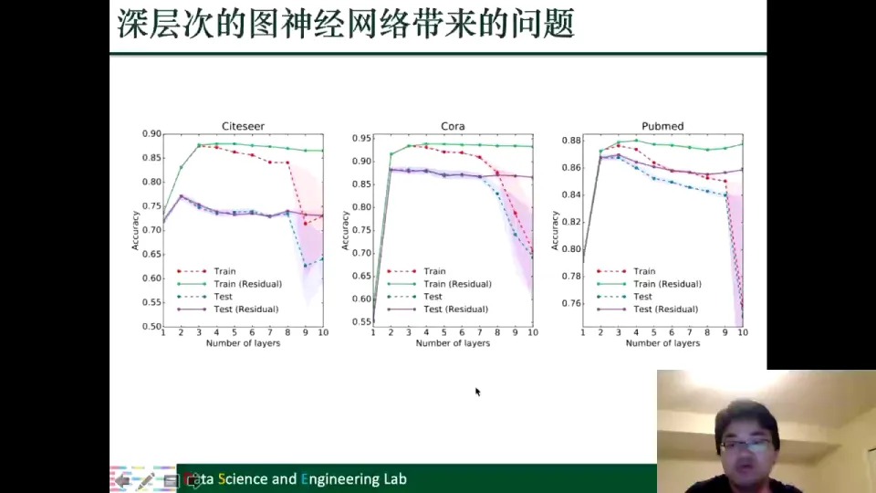

图里还有一条对照：加了残差连接的实线在层数增加时基本能稳住。残差让每一层都能从原始输入继承信息，相当于给深层网络留了一条“短路”；但即便有残差，普通 GNN 的深层训练仍不理想。

### 1.3 两个原因：过拟合只是其一，更特殊的是过度平滑

性能下降的第一个原因，和普通神经网络一样：**过拟合**。这几个 citation 数据集都不大，层数增加意味着参数增加，模型很容易记住训练集的噪声，训练准确率还很高、测试准确率却掉下去。

但讲师强调，GNN 还有一个更严重、也更独特的原因——**过度平滑（over-smoothing）**。它指的是：随着层数增加，图上不同节点的表示越来越像，最后趋于完全相同。节点表示一旦“糊成一片”，分类器就再也分不开它们。[【跳转到 14:30】](https://www.bilibili.com/video/BV1yx4y1R7uV/?p=9&t=870)

---

## 二、过度平滑：深层 GNN 把不同节点“抹平”成一个样子

**结论：过度平滑不是训练技巧问题，而是 L 层聚合数学上收敛到常数向量的必然结果。**

### 2.1 直观实验：Karate Club 上，层数越深颜色越混

Karate Club 是图学习中常用的一个小型社交网络：每个节点是俱乐部成员，边代表成员之间的交往，成员按所属派系被染成不同颜色。图上能清楚看到几个社区（community）。[【跳转到 14:30】](https://www.bilibili.com/video/BV1yx4y1R7uV/?p=9&t=870)

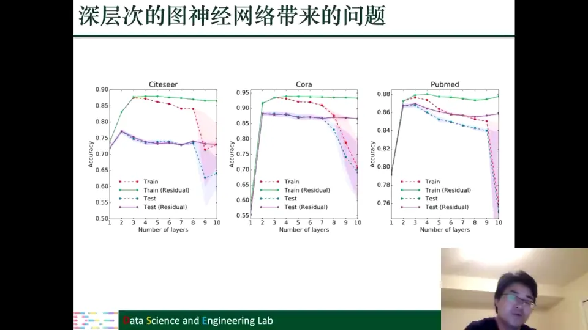

把这张图送进 GCN，再把学到的节点表示画到二维平面上：

- **一层 GCN**：不同颜色的点还比较分散，社区之间有一定区分度；
- **三层 GCN**：点开始向中间聚拢，不同颜色的边界变得模糊；
- **五层 GCN**：大部分点已经挤在一起，来自不同社区的点看上去非常相似。

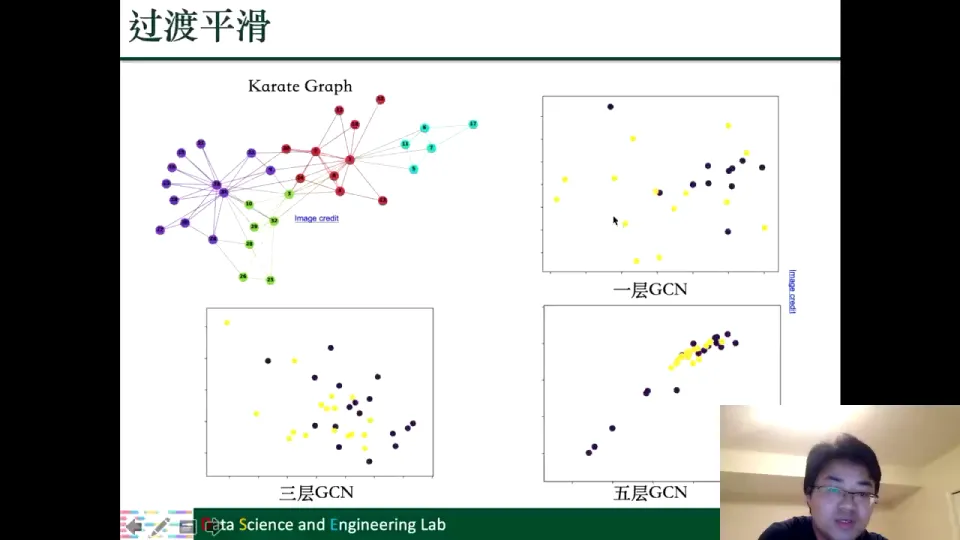

层数继续加深，节点表示会几乎重合；理论上层数趋于无穷时，所有节点会变成同一个向量。这不是训练技巧问题，而是聚合机制决定的。

### 2.2 理论推导：L 层堆叠等于归一化邻接矩阵的 L 次幂

为了把这件事说清楚，先把 GNN 的一层写成矩阵形式。忽略激活函数和 bias，只保留最核心的“聚合 + 变换”：

$$
\mathbf{F}^{(i+1)}=\widetilde{\mathbf{D}}^{-\frac12}\widetilde{\mathbf{A}}\widetilde{\mathbf{D}}^{-\frac12}\mathbf{F}^{(i)}\boldsymbol{\Theta}^{(i)},\qquad \widetilde{\mathbf{A}}=\mathbf{A}+\mathbf{I}
$$

其中 $\mathbf{A}$ 是邻接矩阵，$\mathbf{I}$ 是单位矩阵，$\mathbf{A}+\mathbf{I}$ 表示给每个节点加上自连接（self-loop），这样聚合时既看邻居也看自己；$\widetilde{\mathbf{D}}$ 是加了自连接后的度矩阵，用来做归一化；$\mathbf{F}^{(i)}$ 是第 $i$ 层的节点特征矩阵，$\boldsymbol{\Theta}^{(i)}$ 是该层的可学习变换。[【跳转到 16:10】](https://www.bilibili.com/video/BV1yx4y1R7uV/?p=9&t=970)

把每一层的变换都看成同一个矩阵 $\widehat{\mathbf{A}}=\widetilde{\mathbf{D}}^{-1/2}\widetilde{\mathbf{A}}\widetilde{\mathbf{D}}^{-1/2}$，那么堆 L 层就相当于：

$$
\mathbf{F}^{(L)}=\widehat{\mathbf{A}}^{L}\mathbf{F}^{(0)}\boldsymbol{\Theta}
$$

也就是说，**深度的本质，是对归一化邻接矩阵做 L 次幂**。这一步是整段推导的枢纽：把“堆网络层”翻译成了“矩阵乘方”，后面就可以用特征分解来分析极限行为。[【跳转到 17:25】](https://www.bilibili.com/video/BV1yx4y1R7uV/?p=9&t=1045)

### 2.3 特征分解：为什么 L 趋于无穷时只剩“常数向量”

对 $\widehat{\mathbf{A}}$ 做特征分解：

$$
\widehat{\mathbf{A}}=\mathbf{U}\boldsymbol{\Lambda}\mathbf{U}^{\top}
$$

$\mathbf{U}$ 的每一列是特征向量，$\boldsymbol{\Lambda}$ 是对角矩阵，对角元素是特征值。由于 $\mathbf{U}$ 是正交矩阵，$\mathbf{U}^{\top}\mathbf{U}=\mathbf{I}$，所以：

$$
\widehat{\mathbf{A}}^{L}=\mathbf{U}\boldsymbol{\Lambda}^{L}\mathbf{U}^{\top}
$$

L 次幂只作用在特征值上。而归一化邻接矩阵的特征值满足 $1=\lambda_1>\lambda_2\ge\cdots\ge\lambda_n>-1$：最大的特征值是 1，其余都小于 1。当 $L\to\infty$ 时，$\lambda_1^L=1$ 保留，其他 $\lambda_i^L\to 0$。于是极限只剩第一项：

$$
\lim_{L\to\infty}\widehat{\mathbf{A}}^{L}=\mathbf{u}_1\mathbf{u}_1^{\top}
$$

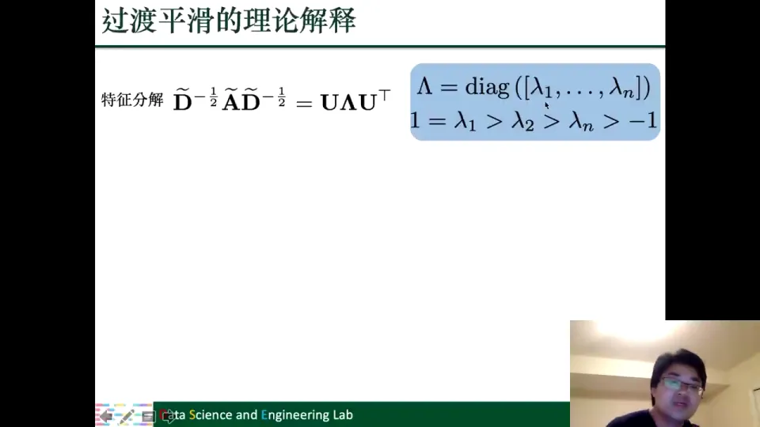

更直观地看，把极限矩阵作用到特征矩阵 $\mathbf{F}^{(0)}\boldsymbol{\Theta}$ 的每一列 $\mathbf{f}_j$ 上：

$$
\widehat{\mathbf{A}}^{L}\mathbf{f}_j\;\longrightarrow\;\left(\mathbf{u}_1^{\top}\mathbf{f}_j\right)\mathbf{u}_1
$$

结果是一个标量乘以 $\mathbf{u}_1$。而 $\mathbf{u}_1$ 是归一化邻接矩阵最大特征值对应的特征向量，它的所有元素都相同（就是常数向量）。因此每一列最终都变成一个“所有分量相等”的向量，所有节点的表示也就完全相同。[【跳转到 21:54】](https://www.bilibili.com/video/BV1yx4y1R7uV/?p=9&t=1314)

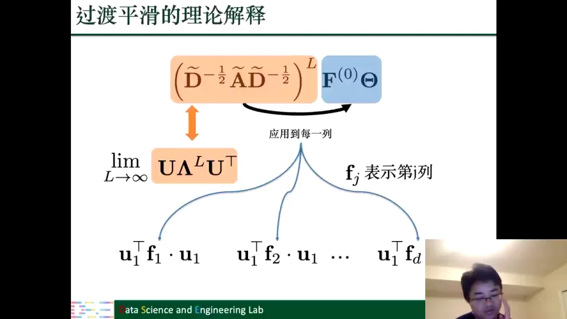

### 2.4 过度平滑为什么致命，以及目前有哪些缓解办法

过度平滑的后果很直接：分类器要靠节点表示的差异来区分节点，如果所有节点表示一样，不同标签的节点就无法被分开，模型自然学不好。这就是为什么“加深 GNN”不能照搬 CNN 的经验。[【跳转到 23:03】](https://www.bilibili.com/video/BV1yx4y1R7uV/?p=9&t=1383)

已有几类缓解思路，幻灯片把它们放在一起对照：

1. **Jumping Knowledge（JK）**：不只用最后一层的输出，而是把各层输出聚合成最终表示，即 $\mathbf{F}_i^{O}=\mathrm{JK}(\mathbf{F}_i^{(0)},\dots,\mathbf{F}_i^{(L)})$。深层虽然会平滑，但浅层的细节仍被保留下来。
2. **DropEdge**：每个训练周期随机去掉图上的一部分边，类似 Dropout。每次训练看到的图结构不同，能在一定程度上抑制过度平滑。
3. **PairNorm**：在损失里加正则项：一方面让相连节点表示接近（拉普拉斯正则），另一方面让不相连节点的表示尽量拉开。这样即使层数变深，表示也不至于全部塌缩到一处。
4. **残差类方法（如 GCNII）**：让每一层都能从原始输入继承信息，缓解深层退化。

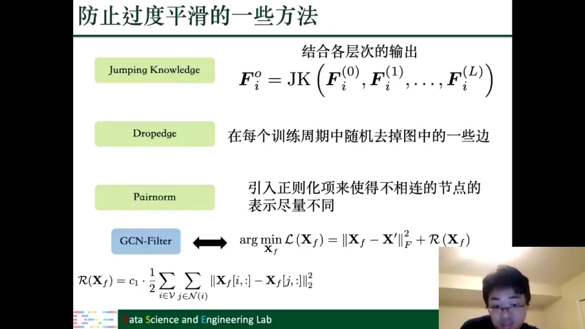

但这些方法只能让 GNN 深一些，**效果仍不理想**。更根本的是：**我们到底需不需要更深的 GNN？** 如果加深带来的提升，究竟是因为缓解了过度平滑，还是因为模型容量变大、拟合能力增强？实验上有一些观察，理论上还不清楚。[【跳转到 26:22】](https://www.bilibili.com/video/BV1yx4y1R7uV/?p=9&t=1582)

---

## 三、图上的自监督学习：让数据自己出题，减少对标签的依赖

**结论：自监督学习把“人工标签”换成从数据自身构造的辅助任务，是缓解标签稀缺最直接的一条路。**

### 3.1 为什么需要自监督：标签又贵又少

训练深度模型通常需要大量标签，但图数据上的标签尤其难得：给节点打标签要人工审核，给分子图标性质要做实验，给用户打标签还涉及隐私。讲师把困难概括为两点：**一是拿不到，二是就算能拿到也非常费钱费力**。于是自然产生一个想法：能不能不依赖人工标签，而是**从数据本身制造监督信号**？[【跳转到 27:22】](https://www.bilibili.com/video/BV1yx4y1R7uV/?p=9&t=1642)

这就是自监督学习（self-supervised learning）。它的做法是设计一个**辅助任务（pretext task）**：任务的标签不需要人来标，而是由数据自身的结构“免费”生成。模型为了完成这个辅助任务，必须学到数据中有用的规律；学到的表示再拿去做真正的下游任务。理论上，只要有大量无标签数据，就可以用这种方式训练出很强的模型。

### 3.2 从图像拼图理解“辅助任务”：预测相对位置

幻灯片用图像拼图（jigsaw）做例子。把一张猫的图片切成若干块，给每块编号 1 到 7；取其中一块作为“源块”，另一块作为“目标块”，让模型预测**目标块相对于源块在哪个位置**。比如目标块在源块的右边第三格，标签就是 3。这个标签完全由切图方式决定，不需要人工标注。[【跳转到 28:12】](https://www.bilibili.com/video/BV1yx4y1R7uV/?p=9&t=1692)

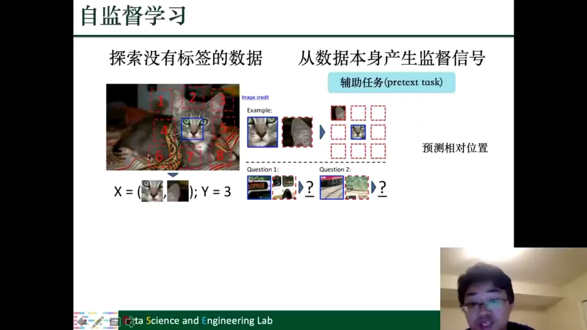

讲师用两组对比说明它为什么有用：只给两个小块、不告诉物体类别，判断相对位置很难；一旦提示“这是车”或“这是火车”，人就能借助整体形状更快判断。也就是说，**当模型学会“这是什么物体”时，它也就更容易判断局部之间的空间关系**。反过来，为了做好相对位置预测，模型不得不去理解物体的整体语义。这正是自监督任务的价值：辅助任务本身不是目的，它逼着模型学到对下游有用的表示。[【跳转到 30:42】](https://www.bilibili.com/video/BV1yx4y1R7uV/?p=9&t=1842)

自然语言处理里也有同样的思路：判断两个句子是不是相邻的下一句，或者把句子中的某个词 mask 掉、让模型预测被掩盖的词。无论是图像还是文本，自监督的核心问题都是同一个——**如何设计一个既有难度、又能从数据本身获得标签的辅助任务**。[【跳转到 31:57】](https://www.bilibili.com/video/BV1yx4y1R7uV/?p=9&t=1917)

### 3.3 两种使用范式：联合训练与“预训练 + 微调”

设计出辅助任务后，还要决定它和下游任务怎么配合。幻灯片给出两种模式：[【跳转到 33:27】](https://www.bilibili.com/video/BV1yx4y1R7uV/?p=9&t=2007)

- **联合训练（joint training）**：辅助任务和下游任务共享同一个特征抽取器，但各自接一个 adaptation 层（可以理解为把通用特征转换成任务专用特征的小网络），然后两个任务一起训练。辅助任务相当于一个额外的正则项，帮助特征抽取器学到更通用的表示。
- **两阶段训练（pre-training + fine-tuning）**：先用辅助任务预训练特征抽取器，再把它迁移到下游任务上；下游任务共享这个已经学好的特征抽取器，只学习一个新的 adaptation 层。讲师举了 BERT 和 word2vec 的例子：它们都是通过预训练学到通用表示，再服务于具体任务。

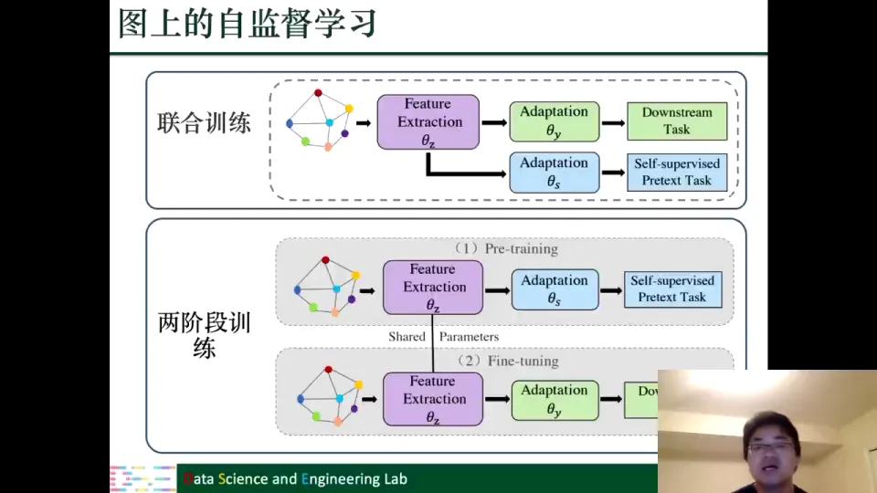

两种方式没有绝对优劣：下游数据充足可选联合训练，数据少则可选两阶段。

### 3.4 节点级辅助任务：从局部结构、全局结构、属性到伪标签

图上的信息比图像更复杂：既有结构信息，又有节点属性。辅助任务也因此可以分成几类。讲师的讲解顺序是“局部结构 → 全局结构 → 节点属性 → 标签”。[【跳转到 36:09】](https://www.bilibili.com/video/BV1yx4y1R7uV/?p=9&t=2169)

**第一类，利用局部结构信息。** 图神经网络并不一定能自动学到所有结构指标，所以可以先从原图上抽取一些结构量，比如节点的度（degree，节点有多少条边）、中心性（centrality，节点在图中有多“核心”），再训练 GNN 去预测它们。[【跳转到 36:09】](https://www.bilibili.com/video/BV1yx4y1R7uV/?p=9&t=2169)

另一个局部任务是**掩码边预测**：把图上的一部分边“盖住”，让模型根据剩余结构预测这些边是否存在。这和 NLP 里 mask 掉词再预测词是同构的思路，只不过这里 mask 的是边。

**第二类，利用全局结构信息。** 局部结构只看节点周围一小圈，全局结构则要求模型看到整张图。例如预测两个节点之间的最短路径距离，或者先把图分成若干社区、计算每个节点到各社区中心的距离，再让模型预测这些距离。讲师特意对比：前面的度、掩码边只用局部信息，而最短路径、社区距离必须利用整张图才能算出来。[【跳转到 37:08】](https://www.bilibili.com/video/BV1yx4y1R7uV/?p=9&t=2228)

**第三类，利用节点属性。** 做法很直接：掩盖一部分节点属性，让模型预测被掩盖的属性；或者先计算节点之间的相似性，再让 GNN 预测这种相似性，使学到的表示保留原空间中的相似关系。后者相当于要求模型“别把本来相似的节点学散”。

**第四类，利用标签（的替代品）。** 每个节点可能有标签或某一维特征，可以计算节点到各个标签的距离作为预测目标。但图上很多节点没有标签，于是可以先用 label propagation（标签传播）生成伪标签，再拿伪标签构造辅助任务。

讲师提醒：**辅助任务不是越简单越好，也不是随便加一个就有收益**。如果任务太简单，比如只预测节点度，GNN 本身就能轻松捕捉，设计这样的辅助任务对性能提升非常有限；相反，一些更复杂、GNN 本来不擅长的任务，才更有可能带来提升。[【跳转到 39:31】](https://www.bilibili.com/video/BV1yx4y1R7uV/?p=9&t=2371)

### 3.5 图级辅助任务：判断两个子图是否来自同一个节点

如果下游任务是整张图的分类（比如判断分子有没有某种性质），辅助任务就应该侧重图级表示。讲师介绍的第一种方法是**上下文预测（context prediction）**：给定一个中心节点，构造两个子图——[【跳转到 40:17】](https://www.bilibili.com/video/BV1yx4y1R7uV/?p=9&t=2417)

- **K 跳邻域图**：以中心节点为中心，向外扩展到 K 跳得到的大子图；
- **上下文图（context graph）**：只保留距中心 r1 到 r2 跳之间的那一圈节点和边，相当于一个“环带”。

然后让模型判断：这两个子图是不是来自同一个中心节点？如果是，它们应该共享中心节点的语义；如果不是，就应该被区分开。为了让这个任务有解，需要满足 $r_1<K$，让两个子图在结构上有一定重叠（overlap）；如果完全不重叠，模型就没有线索可循。[【跳转到 41:32】](https://www.bilibili.com/video/BV1yx4y1R7uV/?p=9&t=2492)

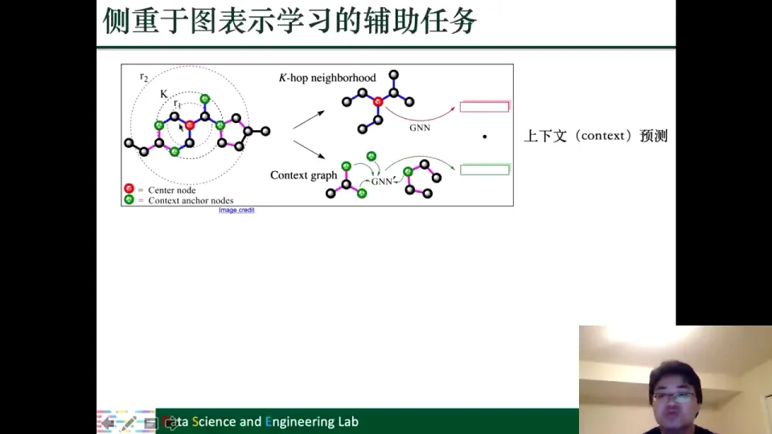

除了结构，图本身也有属性信息。可以像节点属性那样，预测整张图的属性，作为图级辅助任务。

---

## 四、GNN 的表达性：它能区分多复杂的图结构，上限在哪里

**结论：GNN 区分图结构的能力有明确上限——WL 图同构测试；理解它，才知道 GNN 的能与不能。**

### 4.1 把“能力”问题缩小成一个可回答的问题

“GNN 究竟能干什么”是一个太大的问题。讲师把它收缩为一个可操作的问题：**给定两个图，GNN 能不能区分它们不同的结构？** 能区分说明捕捉到了结构差异；区分不了说明超出了表达能力。[【跳转到 43:04】](https://www.bilibili.com/video/BV1yx4y1R7uV/?p=9&t=2584)

这决定了 GNN 的能力边界：若某类结构从原理上就区分不了，再多数据和再大模型也无法弥补。

### 4.2 同构图与 WL 测试：用“颜色迭代”判断两个图是否一样

先定义同构图（isomorphic graph）：两个图看上去画得不一样，但节点和边可以一一对应，本质上是同一个图，只是节点位置或画法变了。判断两个图是否同构并不容易——精确搜索可能是 NP 问题，目前没有完整的高效精确解法，所以通常用近似方法。WL 图同构测试（Weisfeiler-Lehman test）就是其中最有名的一种。[【跳转到 46:21】](https://www.bilibili.com/video/BV1yx4y1R7uV/?p=9&t=2781)

WL 测试的过程可以拆成三步：

1. **初始化**：给每个节点一个初始标签（颜色），比如 1、2、3、4；
2. **聚合邻居**：对每个节点，把它自己和邻居的标签收集起来，形成一个多重集（multiset）。多重集允许重复，因为不同邻居可能有相同标签；
3. **哈希映射**：把这个多重集通过哈希函数映射成一个新标签，作为该节点的新颜色。

然后不断重复“聚合—哈希”，直到两个图的标签分布不再变化。如果两个图的标签集始终一致，就认为它们同构；如果出现不一致，就认为不同构。实际实现时会设置最大迭代次数，达到上限仍未区分就判为通过。[【跳转到 47:11】](https://www.bilibili.com/video/BV1yx4y1R7uV/?p=9&t=2831)

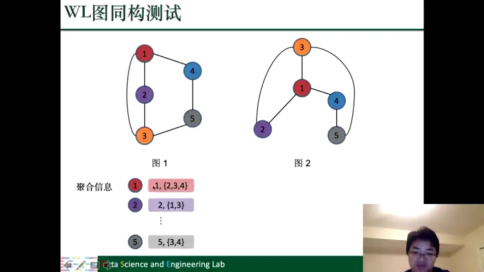

### 4.3 GNN 与 WL 测试同构：聚合 + 更新就是“颜色迭代”

把 WL 的步骤和 GNN 的一层对照，会发现它们几乎是一回事：GNN 也是“从邻居聚合信息，再经过变换得到新表示”，WL 也是“收集邻居标签，再哈希成新标签”。区别只在于 GNN 的聚合和变换是可学习的函数，WL 用的是固定的哈希。[【跳转到 48:44】](https://www.bilibili.com/video/BV1yx4y1R7uV/?p=9&t=2924)

基于这个对应关系，可以得到本讲最重要的结论之一：**当 GNN 有足够的深度、且聚合与更新函数具有足够的单射（injective）能力时，它在区分图结构上的表达能力上限就是 WL 图同构测试**。换句话说，凡是 WL 测试区分不了的两个图，GNN 也区分不了；GNN 能区分的，WL 一定能区分。这就是“GNN 的可表达性上限是 WL”的含义。[【跳转到 49:27】](https://www.bilibili.com/video/BV1yx4y1R7uV/?p=9&t=2967)

讲师也强调，这只是通过 WL 测试建立的一个结论，可表达性问题本身更复杂，还有很多其他维度需要研究。

### 4.4 上限不等于没用：GNN 能学表示，WL 只能回答“是不是”

既然 GNN 的上限只是 WL，那 GNN 相对 WL 有什么好处？讲师的回答很关键：**WL 只回答“两个图是不是同构”这个是非题，而 GNN 能学到图的表示**。有了表示，就可以做很多 WL 做不了的下游任务：计算两个图的相似度、做图分类、预测蛋白质或分子的性质。[【跳转到 51:04】](https://www.bilibili.com/video/BV1yx4y1R7uV/?p=9&t=3064)

比如在药物开发中，两个分子可能不同构，但性质相似；WL 只会说“不同构”，而 GNN 可以把它们映射到相近的表示，进而预测它们是否具有相似的活性。这就是“表达能力上限”与“实际有用性”之间的区别：上限描述的是最坏情况下的分辨能力，而表示学习提供的是可迁移、可复用的特征。

---

## 五、其他前沿方向：可解释、公平、几何与隐私

**结论：除性能外，GNN 还要解决可解释、公平、几何与隐私等“可信”问题。**

除了三条主线，讲师还快速扫过了一组同样重要、但更偏“负责任 AI”的方向。[【跳转到 52:24】](https://www.bilibili.com/video/BV1yx4y1R7uV/?p=9&t=3144)

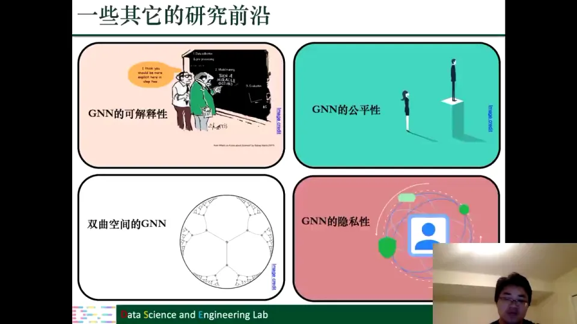

**可解释性（explainability）**：GNN 和传统神经网络一样是黑盒子。我们需要打开黑盒子，理解它到底是根据哪些节点、哪些边、哪些结构做出预测的。这在高风险场景中尤其重要。

**公平性（fairness）**：GNN 可能对某一类节点不公平。讲师举了一个具体发现：在某些数据上，GNN 对度比较小的节点性能明显更差。另一种情况是节点带有敏感信息，比如推荐系统中的用户性别——模型是否会因为性别而给出不公平的结果？这些都是需要研究的问题。

**对抗攻击（adversarial attack）**：GNN 也可能被精心构造的扰动欺骗，需要研究其鲁棒性。

**双曲空间 GNN**：现有 GNN 多在欧式空间设计，但图数据未必适合欧式几何；在双曲空间等非欧几何中设计 GNN，可能缓解过度平滑。

**隐私保护（privacy）**：GNN 的表示可能泄露节点信息，包括结构信息和属性信息。因此需要研究隐私保护机制。

**“什么样的图适合 GNN”**：讲师提到自己最近的工作，研究 GNN 在什么样的图上性能好、在什么样的图上性能差。这看似基础，却直接决定了实际应用中该不该用 GNN，而不是靠反复试错。

研究前沿不只是“更强”，还包括“更可信、更可用”。

---

## 六、高级应用的通用方法论：先问“图在哪里”，再问“模型怎么设计”

**结论：高级应用的第一步不是选模型，而是判断“图在哪里”，把问题结构化。**

讲完方法，讲师转向应用，并给出统一框架：面对新领域，不要一上来套 GNN，而要先回答两个问题。[【跳转到 55:31】](https://www.bilibili.com/video/BV1yx4y1R7uV/?p=9&t=3331)

1. **这个应用里有没有图？图是什么？** 如果原本没有显式的图，就要想办法把问题建模成图——谁是节点、谁是边、节点和边各带什么特征。
2. **有了图以后，如何针对这个应用设计 GNN 模型？** 包括聚合方式、层数、损失函数，以及如何把领域知识编码进图结构。

---

## 七、组合优化：把 NP-hard 问题变成节点或边的二分类

**结论：组合优化可以转成节点或边的二分类，用 GNN 学启发式，但解仍需有效性检验。**

### 7.1 三个经典的图组合优化问题

很多组合优化问题天然就是图问题，而且往往是 NP-hard：在现有认知下（通常认为 P≠NP），无法在多项式时间内找到精确解。讲师举了三个例子。[【跳转到 56:44】](https://www.bilibili.com/video/BV1yx4y1R7uV/?p=9&t=3404)

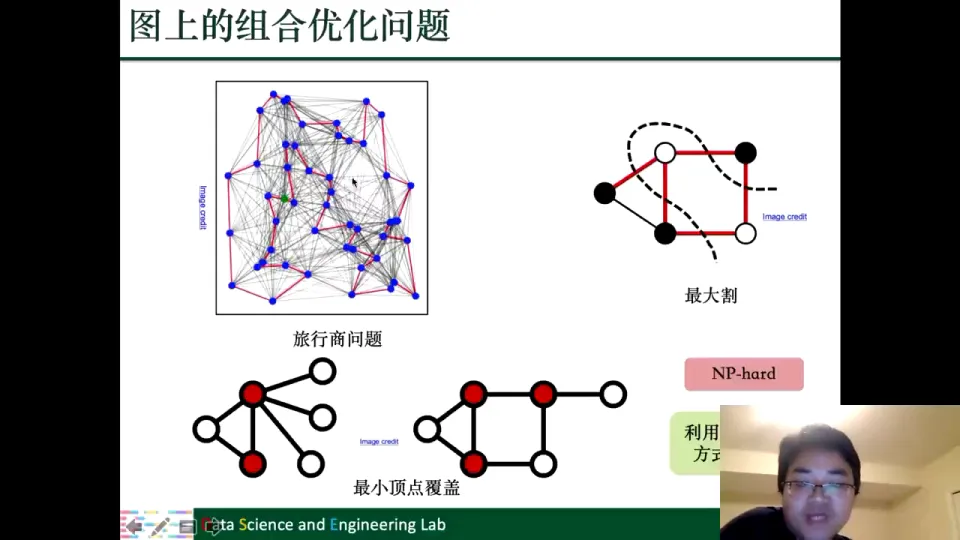

- **旅行商问题（TSP）**：每个节点是一座城市，边是城市之间的通路。给定起点，要求走遍每个城市一次并回到起点，使总路程最短。直观理解就是推销员要跑遍所有城市，又不想走冤枉路。
- **最大割（max cut）**：把图的节点分成两个不相交的集合，割边是两端分别落在两个集合中的边。目标是让割边的数量最多。
- **最小顶点覆盖（min vertex cover）**：选一个节点集合，使每条边至少有一个端点在集合里，同时让集合尽可能小。

这些问题通常靠近似算法或启发式搜索求解，而设计好的启发式方法往往需要领域专家。讲师的思路是：既然问题本身是图，能不能让 GNN 从大量“已知答案的图”中**自动学出一个启发式策略**？

### 7.2 关键一步：把优化问题翻译成机器学习任务

以最小顶点覆盖为例，可以把它看成**节点的二分类**：对每个节点，预测它是否属于最优解（1 表示属于，0 表示不属于）。旅行商问题则可以看成**边的二分类**：对每条边，预测它是否属于最优路径。[【跳转到 61:19】](https://www.bilibili.com/video/BV1yx4y1R7uV/?p=9&t=3679)

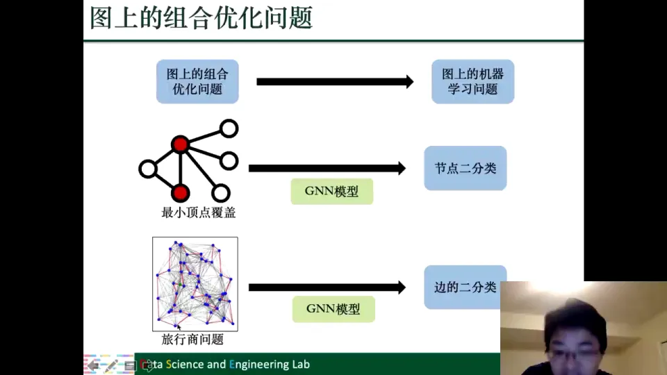

这样，训练数据就是“一批图 + 它们的最优解”：图结构已知，标签由传统算法或已知答案提供。GNN 学习的本质是“什么样的局部结构倾向于被选入解”；训练好后，输入新图即可输出节点或边属于解的概率，再构造近似解。

### 7.3 旅行商实例：按概率贪心选边，还要做有效性检查

旅行商问题的具体做法是：模型对每条边输出一个“被选中概率”，然后按概率从高到低贪心地选边，逐步拼出一条路径。[【跳转到 63:21】](https://www.bilibili.com/video/BV1yx4y1R7uV/?p=9&t=3801)

但这里有一个不能忽略的细节：TSP 要求形成一条**经过所有城市、回到起点的合法回路**，而逐边分类得到的解不一定是有效解。因此，模型输出之后还需要额外的检测与修正步骤，才能把“概率最高的边集”变成一个有效解。

这也解释了为什么 GNN 解组合优化不是“端到端替代传统算法”，而更像是“学一个高质量的启发式初解，再交给验证/修复模块”。它的价值在于快速给出一个高质量的初始解。

---

## 八、程序分析：把代码建成图，找变量误用与函数漏洞

**结论：程序天然不是图，但语法、控制流、数据流都可以建成图，从而转化为节点分类与图分类。**

### 8.1 从“写程序的痛点”到可学习的任务

讲师用一段很生活化的回忆引入：早年在 C/C++ 里写程序，变量命名、全局/局部变量重名、宏定义污染都很容易造成 bug，而且很难 debug。宏定义是全局的，一个工程里只有一个 `A`，队友随手写一个宏就可能把你后面的变量全部改掉。现在的 Python 等高级语言有命名空间、自动内存管理，问题少了很多，但**变量误用、函数设计漏洞**依然存在。[【跳转到 63:46】](https://www.bilibili.com/video/BV1yx4y1R7uV/?p=9&t=3826)

这些问题的本质可以转成两个学习任务：

- **变量分类（节点级）**：某个变量是否被误用、是否无用、是否被重复使用；
- **函数分类（图级）**：某个函数是否存在漏洞。

### 8.2 四种程序表示：AST、CFG、DFG 与自然代码序列

要喂给 GNN，先得把程序变成图。幻灯片给出四种表示，它们从不同角度描述同一段代码：[【跳转到 67:04】](https://www.bilibili.com/video/BV1yx4y1R7uV/?p=9&t=4024)

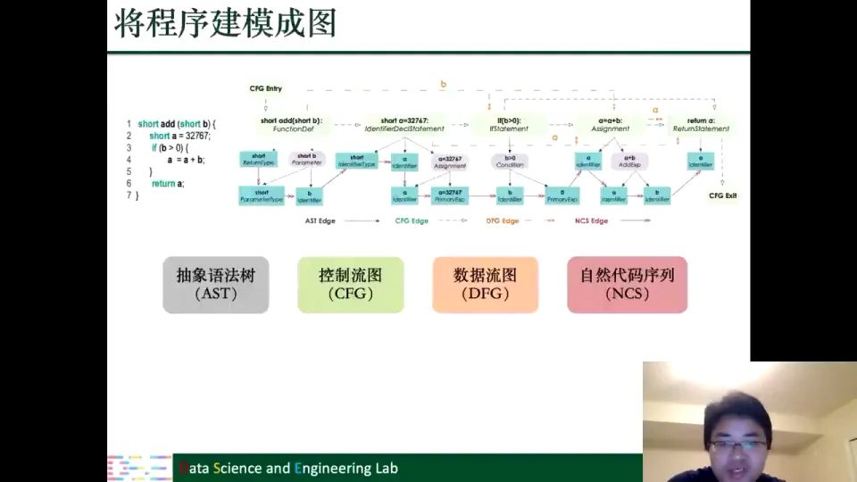

1. **抽象语法树（AST）**：描述代码的语法结构。编译或解释程序时本来就会构造语法树，用它做 GNN 输入可以保留表达式、语句的层次关系。
2. **控制流图（CFG）**：描述程序执行的路径。条件语句 `if` 会产生分叉，循环会产生回边；CFG 的节点对应程序中的语句或基本块，边表示执行顺序。
3. **数据流图（DFG）**：描述变量之间如何传递和变换。节点是变量（或变量定义/使用），边表示“这个变量的值流向了那里”。比如 `a = a + b` 之后，`a` 和 `b` 之间就建立了联系。
4. **自然代码序列（NCS）**：把代码当成自然语言文本，按 token 序列建模。它保留词序信息，但丢失结构信息。

实际系统往往不只用一种图，而是把 AST、CFG、DFG 甚至 token 序列组合起来，形成一个异构的代码图，再交给 GNN。

### 8.3 任务映射：变量误用是节点分类，函数漏洞是图分类

有了图，任务就自然对应上了：变量级别的判断是**节点分类**，函数级别的判断是**图分类**。例如用控制流图表示一个函数，整张图经过 GNN 得到一个图级表示，再判断这个函数有没有漏洞；用数据流图表示变量关系，每个变量节点得到一个表示，再判断它是否被误用。[【跳转到 69:03】](https://www.bilibili.com/video/BV1yx4y1R7uV/?p=9&t=4143)

这说明：**程序不是图，但语法、控制、数据依赖天然构成图**；把领域知识编码进结构，比当成文本序列更能捕捉规律。

---

## 九、物理系统与“想不到”的应用：图是描述相互作用的通用语言

**结论：物理系统、音乐、电路都能用“实体 + 相互作用”建图。**

### 9.1 N 体问题与带电粒子：完全图上的状态预测

物理系统里充满了“多个对象相互作用”的场景。N 体问题中，N 个天体之间存在万有引力；每个天体是一个节点，任意两个天体之间都有引力，因此构成一张**完全图**，边的权重可以由引力大小决定。带电粒子之间也类似：正负电荷相互吸引、同种电荷相互排斥，每个粒子是一个节点，相互作用是边。[【跳转到 70:15】](https://www.bilibili.com/video/BV1yx4y1R7uV/?p=9&t=4215)

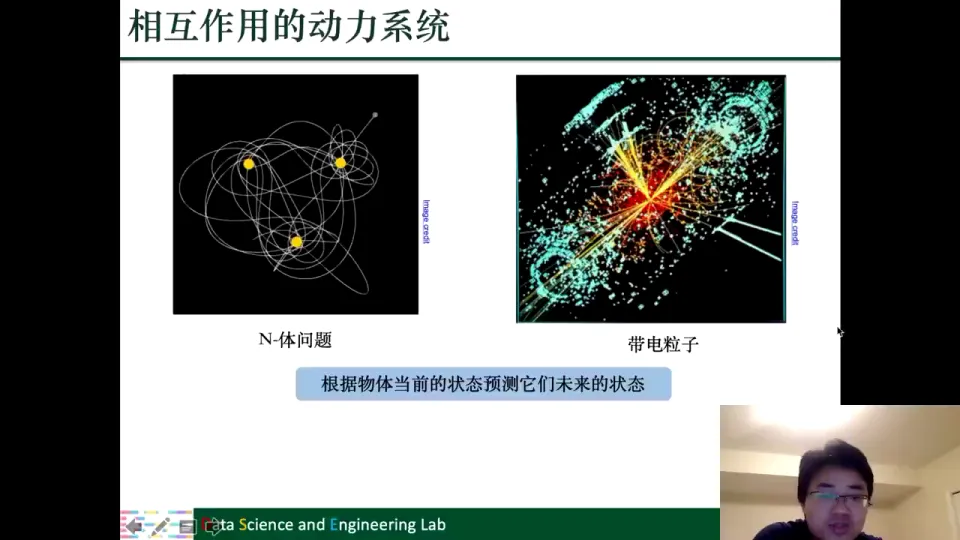

建好图之后，任务变成：给定当前（或过去）的状态，预测未来的状态。比如给出各天体的位置和速度，预测它们将来会出现在哪里、运行速度如何；或者观察某颗行星的轨道，判断它是否会撞向地球。用历史观测数据训练，把要预测的物理量作为标签即可。[【跳转到 72:00】](https://www.bilibili.com/video/BV1yx4y1R7uV/?p=9&t=4320)

### 9.2 乐谱与电路：把“结构化创意”也变成图

讲师最后展示了两个更“意想不到”的应用。[【跳转到 73:24】](https://www.bilibili.com/video/BV1yx4y1R7uV/?p=9&t=4404)

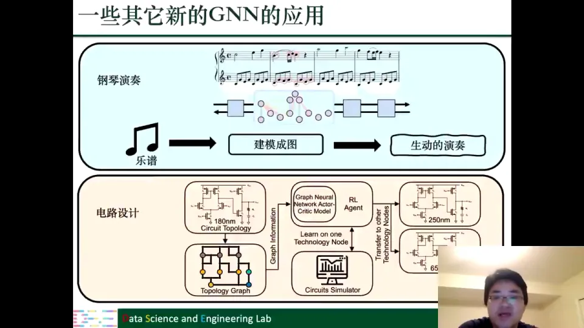

- **音乐生成**：乐谱中的音符、节拍、和声关系可以建成图，用 GNN 学习乐谱的结构，进而生成更生动、更自然的钢琴演奏。
- **电路设计**：电路本身就是由元件和连线构成的拓扑图，可以用 GNN 学习电路拓扑与性能之间的关系，辅助甚至自动完成电路设计。

这两个例子说明：**图是描述“关系”的通用语言**。只要问题中存在实体和相互作用，就可以尝试建图，再让 GNN 学习其中的规律。

---

## 十、课程总结：GNN 与第一代图表示学习一脉相承，基础不能丢

**结论：方法会变，图论与图上机器学习的基础不会过时。**

最后一讲，讲师讲了三点“学习观”。[【跳转到 74:46】](https://www.bilibili.com/video/BV1yx4y1R7uV/?p=9&t=4486)

**第一，温故而知新。** 课程从 6 月讲到 8 月，两个半月里内容很多，第一遍听懂不等于真正理解。孔子说“温故而知新”，很多知识第一眼看上去懂了，其实只是记住了结论；通过不断回顾和练习，每一遍都能学到新东西。

**第二，要打破砂锅问到底。** 讲师说自己读论文可以花一两个月，但一定要把每个细节弄懂，因为只有把知识真正变成自己的，才有可能在此基础上创造新知识。他批评了一种常见状态：听的时候不停点头“是的是的”，真正要用的时候却说“我不知道”。这就是一知半解：知识只是零散的点，没连成面、形成体；换个形式（“穿个马甲”）就认不出来。

**第三，GNN 的很多设计，其实与第一代图表示学习密切相关。** 讲师提到面试很多学生、看过很多 CCF-A 类论文，发现有些人只知道 GNN 在做 aggregation，却完全不了解聚合背后的图论依据，也不知道为什么要这样聚合。发文章不等于理解领域；做应用或许可以照猫画虎，但做深入研究必须补上图论和传统图上机器学习的底子。[【跳转到 82:16】](https://www.bilibili.com/video/BV1yx4y1R7uV/?p=9&t=4936)

讲师也坦言遗憾：课程没有实践部分和练习，将来会补上；GNN 论文可能已有上万篇，但“GNN 适合什么样的图”仍没有答案。课程结束了，研究还在路上。[【跳转到 80:36】](https://www.bilibili.com/video/BV1yx4y1R7uV/?p=9&t=4836)

讲师和马耀感谢大家的支持，并表示会继续在研究、授课和教材上投入：尽快写教材第二版、补充新知识，还计划写一本关于 GNN 实际应用的书，并做更多知识普及。[【跳转到 85:36】](https://www.bilibili.com/video/BV1yx4y1R7uV/?p=9&t=5136)

---

## 小结

- **深 GNN 的收益与代价并存**：更深的层数带来更大的感受野和模型容量，但十层左右就可能因过拟合与过度平滑而性能骤降。
- **过度平滑有严格的理论解释**：L 层 GNN 等价于归一化邻接矩阵的 L 次幂；当 L 趋于无穷，只剩最大特征值 1 对应的常数特征向量，所有节点表示趋同。
- **缓解方法各有侧重**：Jumping Knowledge 保留各层信息，DropEdge 随机扰动结构，PairNorm 拉开不相连节点，残差类方法（如 GCNII）保留原始输入；但“是否需要更深的 GNN”仍是开放问题。
- **自监督学习用数据自己出题**：图像拼图、掩码预测、上下文预测都是辅助任务；训练范式分为联合训练和“预训练 + 微调”两阶段。
- **图上的辅助任务覆盖多个层次**：局部结构（度、中心性、掩码边）、全局结构（最短路径、社区距离）、节点属性、伪标签，以及图级的上下文预测。
- **GNN 的表达性上限是 WL 图同构测试**：GNN 的聚合-更新过程与 WL 的颜色迭代高度对应；但 GNN 能学表示，因而能做相似度、图分类等 WL 做不到的下游任务。
- **研究前沿不止于性能**：可解释性、公平性、双曲空间 GNN、隐私保护与对抗攻击，都是重要方向。
- **高级应用的通用方法是“先建图，再设计模型”**：组合优化、程序分析、物理系统、音乐与电路，都是先把问题结构化，再用 GNN 学习其中的规律。

---

## 关键术语速查

| 术语 | 一句话解释 |
| --- | --- |
| 感受野（receptive field） | 一个节点经过 K 层聚合后能“看到”的 K 跳邻域范围。 |
| 模型容量（model capacity） | 模型能拟合的规律复杂程度，通常随参数量和深度增加而增大。 |
| 过拟合（overfitting） | 模型记住训练集噪声，训练表现好但测试表现差。 |
| 过度平滑（over-smoothing） | 深层 GNN 反复聚合后，不同节点的表示趋于相同，导致无法区分。 |
| 归一化邻接矩阵 | $\widetilde{\mathbf{D}}^{-1/2}\widetilde{\mathbf{A}}\widetilde{\mathbf{D}}^{-1/2}$，GNN 聚合的矩阵形式，加了自连接并做度归一化。 |
| 特征分解 | 把矩阵写成 $\mathbf{U}\boldsymbol{\Lambda}\mathbf{U}^{\top}$，用特征值和特征向量分析矩阵幂的极限行为。 |
| 自监督学习（self-supervised learning） | 不需要人工标签，从数据本身构造监督信号来训练模型。 |
| 辅助任务 / 预文本任务（pretext task） | 为实现自监督而设计的“假任务”，如预测拼图位置、预测被掩盖的词或边。 |
| 联合训练（joint training） | 辅助任务与下游任务共享特征抽取器，同时训练。 |
| 预训练 + 微调（pre-training + fine-tuning） | 先用辅助任务预训练特征抽取器，再迁移到下游任务上微调。 |
| 标签传播（label propagation） | 利用图结构把已知标签沿边传播，为无标签节点生成伪标签。 |
| 上下文预测（context prediction） | 图级自监督任务：判断 K 跳子图与上下文子图是否来自同一个中心节点。 |
| 图同构（graph isomorphism） | 两个图的节点和边能一一对应，本质上是同一个图。 |
| WL 图同构测试 | 通过“聚合邻居标签 + 哈希映射”反复迭代颜色，判断两个图是否同构的近似测试。 |
| 表达性（expressiveness） | 模型区分不同图结构的能力；在区分图结构上，GNN 的上限与 WL 测试相同。 |
| 单射函数（injective function） | 不同输入映射到不同输出；GNN 的聚合/更新函数具备单射性时表达能力更强。 |
| 组合优化（combinatorial optimization） | 在离散候选集合中找最优解的问题，如 TSP、最大割、最小顶点覆盖，常为 NP-hard。 |
| 旅行商问题（TSP） | 从起点出发，走遍所有城市一次并回到起点，使总路程最短。 |
| 最大割（max cut） | 把节点分成两个集合，使两端分属不同集合的边数最多。 |
| 最小顶点覆盖（min vertex cover） | 选最少的节点，使每条边至少有一个端点在选中集合中。 |
| 抽象语法树（AST） | 用树结构表示程序的语法层次。 |
| 控制流图（CFG） | 用图表示程序所有可能的执行路径与分支。 |
| 数据流图（DFG） | 用图表示变量之间值的传递与变换关系。 |
| 自然代码序列（NCS） | 把源代码当成 token 序列，用自然语言模型处理。 |
