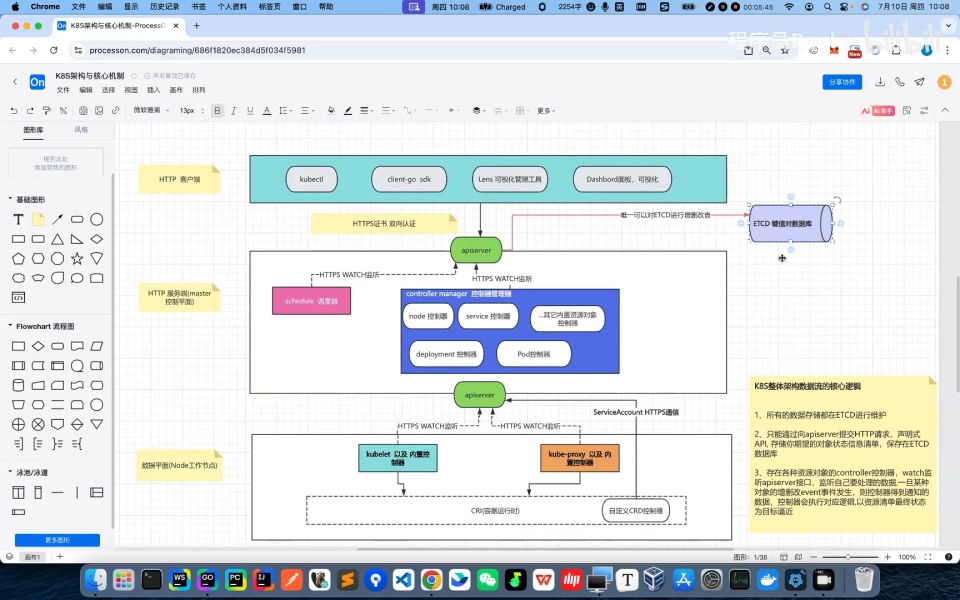
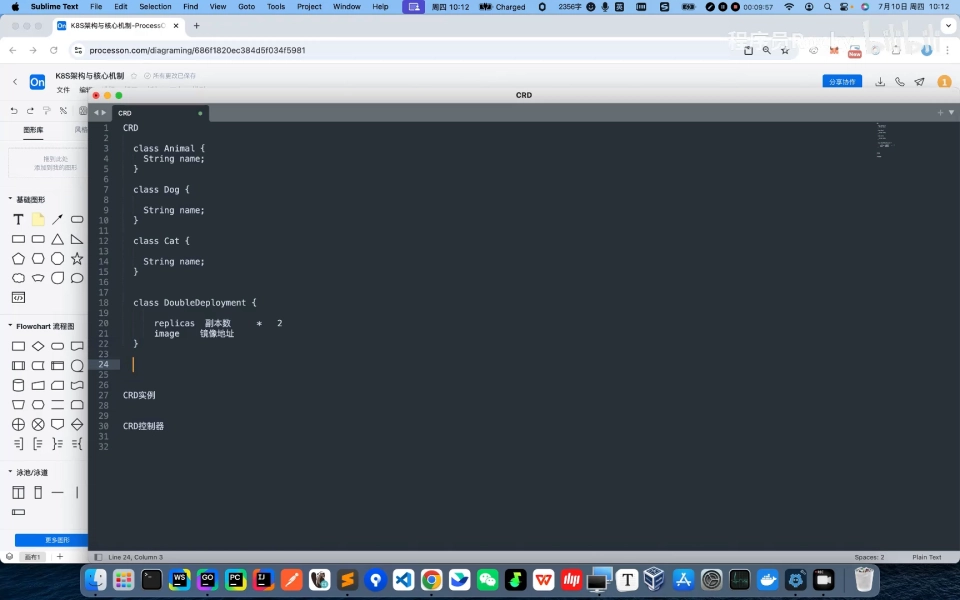
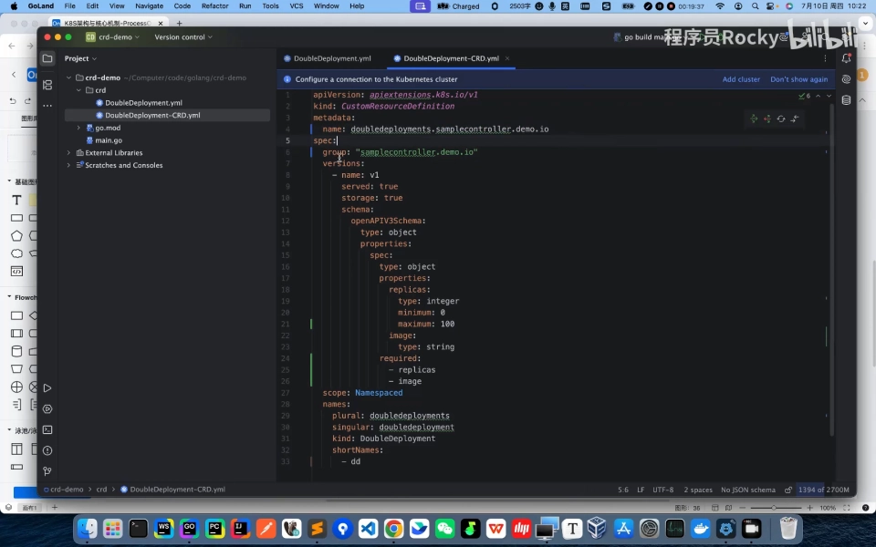
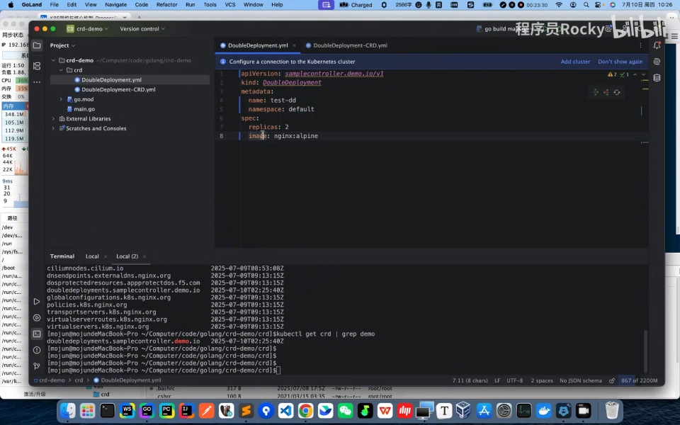
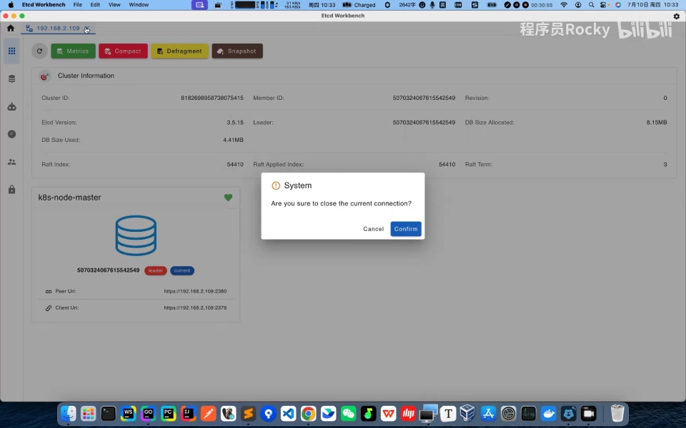

# k8s 架构与数据流核心逻辑：控制面组件到底各干什么

> 视频来源：[B站最清晰讲解，k8s(kubernetes)数据流核心底层逻辑-通俗易懂](https://www.bilibili.com/video/BV1BAGMziEoY/)｜作者：程序员Rocky｜时长：33:04
>
> 一支"划图讲原理"的长视频：作者在 ProcessOn 上一笔一笔画出 K8S 的整体架构图，再把"一条 `kubectl apply` 从提交到 Pod 跑起来"的完整数据流讲透。适合已经把应用部署过 K8S、但说不清"里面到底谁在干活"的读者。本文按视频内容重写为中文，并纠正了自动字幕里的错拼（如 `COOLETTE`→**kubelet**、`CI`→**CRI**、`control manager`→**controller manager**）。

## 本讲要解决的核心问题（SCQA）

**背景**：大多数人用 K8S，是把 Deployment、Pod 往集群里一扔就完事；能说出"控制平面有 API Server、调度器、控制器管理器，工作节点有 kubelet、kube-proxy"这句顺口溜的人也不少。

**冲突**：可一旦系统出问题——比如 `kubectl apply` 之后 Pod 迟迟不出来——很多人就卡住了：**我明明把 YAML 提交上去了，东西到底存在哪？是谁把 Pod 真正创建出来的？** 只记得组件名字、不理解它们之间"谁指挥谁、数据怎么流"，就没法有目的地排查问题，更别提做二次开发（写 Operator/CRD）。

**疑问**：K8S 集群里到底有哪些组件？它们各自负责什么？一条资源对象的增删改查请求，从客户端出发到最终落到某个节点上跑起来，中间经过了哪些环节？数据又存在哪里？

**回答（中心思想）**：K8S 的数据流可以概括成**三层**——**HTTPS 客户端**（kubectl、client-go、Lens、Dashboard）→ **HTTPS 服务端（控制平面）**（API Server 是唯一入口，etcd 是唯一账本，调度器负责选址，控制器管理器维持状态）→ **数据平面（工作节点）**（kubelet 真正把 Pod 跑起来）。而这一切的核心逻辑只有三条：**① 所有数据都存在 etcd；② 只能通过 API Server 以声明式 API 提交期望状态；③ 各种资源的控制器 watch 监听 API Server 的事件，把实际状态向期望状态"逼近"。** 理解了这三条，K8S 内部的"魔法"就消失了。

---

## 一、先建立三层视角：客户端 → 控制平面 → 数据平面

作者开场把整个数据流拆成"三层"来理解，画出来的第一张全景图如下（图中的文字就是本讲的骨架）。[【跳转到 00:50】](https://www.bilibili.com/video/BV1BAGMziEoY/?t=50)



- **第一层：HTTPS 客户端。** 包括命令行工具 `kubectl`、程序里的 `client-go` SDK、可视化管理工具像 Lens、以及 Dashboard 面板。它们的角色都一样——**都是 HTTPS 客户端**，想查询或操作集群数据，都要经过 **HTTPS 双向认证（mTLS）** 去请求 API Server。[【跳转到 02:43】](https://www.bilibili.com/video/BV1BAGMziEoY/?t=163)
- **第二层：HTTPS 服务端（控制平面 / master）。** 整个集群的流量入口就是 **API Server**；master 节点上还跑着**调度器**和**控制器管理器**，集群的所有状态数据则存在 **etcd** 里。[【跳转到 00:50】](https://www.bilibili.com/video/BV1BAGMziEoY/?t=50)
- **第三层：数据平面（Node 工作节点）。** 这里才是**真正部署 Pod、跑业务容器**的地方，节点上跑着 `kubelet` 和 `kube-proxy`。[【跳转到 02:05】](https://www.bilibili.com/video/BV1BAGMziEoY/?t=125)

一句话记住这个方向：**客户端发请求 → 控制平面做决策并记录 → 数据平面落地执行**。

## 二、控制平面三件套：API Server、调度器、控制器管理器

master 节点上主要跑三样东西，它们的职责分工非常清晰：

### 2.1 API Server：整个集群唯一的流量入口

**API Server 承载的是整个 K8S 集群的 HTTPS 流量入口。** 无论你要对集群里的资源做增删改查，**都必须通过 HTTPS 接口调用 API Server**，由它来替你完成操作。[【跳转到 01:15】](https://www.bilibili.com/video/BV1BAGMziEoY/?t=75)

这里有个容易被忽略的关键点：**etcd 的"客户端"只有一个，就是 API Server。** 也就是说，**对 etcd 做增删改查，只能允许 API Server 作为客户端来操作**——其它任何组件都不能绕过 API Server 直连数据库。[【跳转到 01:40】](https://www.bilibili.com/video/BV1BAGMziEoY/?t=100)

> 记忆锚点：**API Server = 集群的"前门 + 总台"**。所有流量都从这里进，所有组件之间也不直接互连，都通过它转达。

### 2.2 调度器（scheduler）：负责"往哪放"

调度器是**选址的决策者**：当有一个新 Pod 还没被安排到节点上时，它根据资源等情况挑一个合适的节点（详见本系列第 3 章"调度与节点执行"）。本讲不展开，只需知道它是控制平面里的"选址组件"。

### 2.3 控制器管理器（controller manager）：负责"把状态拉回正轨"

控制器管理器是**控制器的集合体**——它把一大群控制器（Deployment 控制器、Service 控制器、Node 控制器、Pod 控制器以及其它内置资源对象的控制器）**跑在同一个进程里**，持续监听、修正集群状态。[【跳转到 00:50】](https://www.bilibili.com/video/BV1BAGMziEoY/?t=50)

它到底怎么"修正"？这正是第五节要讲的**控制循环**——所有控制器（包括你未来自己写的 CRD 控制器）都遵循同一套模式。

## 三、etcd：集群唯一的"账本"，只有 API Server 能读写

**etcd 是一个键值对（key-value）数据库**，它是 K8S 集群里**唯一保存所有数据**的地方：资源对象的**期望状态、当前状态以及相关元数据**，全都存在这里。[【跳转到 03:33】](https://www.bilibili.com/video/BV1BAGMziEoY/?t=213)

作者反复强调它的地位：

- **所有数据都在 etcd 里维护**——这是"集群状态"这个词的物理落点；
- **只有 API Server 能读写 etcd**，其它组件想动数据，一律走 API Server；
- 所以对集群做**备份时，最要紧的就是备份 etcd**——数据丢了，集群的元数据就全没了。[【跳转到 31:25】](https://www.bilibili.com/video/BV1BAGMziEoY/?t=1885)

> 记忆锚点：**etcd = 集群的"唯一事实来源"**。每次改动最终都会落到它身上。

## 四、数据平面：kubelet 与 kube-proxy

Node 工作节点上跑着两个关键组件，它们分别对接两类"接口"：

- **kubelet**：**监听 API Server**，看"分配到我这个节点上的 Pod 有没有到"；如果到了，就调用 **CRI（容器运行时接口）** 让容器运行时创建对应的 Pod，然后**更新 Pod 的状态**回写。[【跳转到 02:18】](https://www.bilibili.com/video/BV1BAGMziEoY/?t=138)
- **kube-proxy**：解决 **Service（Pod 与 Pod 之间访问）的路由**问题，会调用 **CNI（网络插件）** 为 Pod 分配 IP 地址，并保证后续的网络通信。[【跳转到 02:18】](https://www.bilibili.com/video/BV1BAGMziEoY/?t=138)

> 字幕里的 `COOLETTE` / `CI` 是识别错误，正确写法是 **kubelet** 和 **CRI**。第 3 章的"节点执行"、第 4 章的"CNI"会更深入地拆解这两个组件。

## 五、一条请求的完整数据流：三条核心逻辑

理解了组件，作者把整条链路浓缩成**三条核心逻辑**（也正是他画在图上的那三段文字）。[【跳转到 03:33】](https://www.bilibili.com/video/BV1BAGMziEoY/?t=213)

1. **所有数据都存在 etcd 维护。** 资源对象的期望状态、当前状态、元数据，都落在 etcd 这个数据库里。
2. **只能通过向 API Server 提交 HTTP 请求，用声明式 API 存储你期望的对象状态清单。** 比如 `kubectl apply` 一份 Deployment 清单，提交后就被存进 etcd。
3. **各种资源对象都有对应的控制器（controller），它们 watch 监听 API Server 接口**，盯着自己要处理的数据；一旦某种对象发生**增 / 删 / 改**（event 事件），控制器就收到通知，执行对应逻辑，**以资源清单里的最终状态为目标，不断"逼近"它**。

用一句话把三条串起来：

> **把数据提交给 API Server → API Server 把它存进 etcd → 对应的控制器 watch 到事件 → 控制器执行逻辑，把实际状态推向期望状态。**

作者特别点破了一个直觉上的误区：**所谓"控制器"，叫它"监听器（listener）"其实更贴切。** 因为它的本质动作就是"订阅事件、收到事件就干活"，而不是主动去"控制"什么。[【跳转到 04:23】](https://www.bilibili.com/video/BV1BAGMziEoY/?t=263)



理解了这套模式，你会发现它和"自定义 CRD"是同一回事——下一节就用一个亲手写的例子验证它。

## 六、为什么"内置资源"和"自定义资源"本质是一回事：CRD 三个概念

视频后半段用一个自制的 **double-deployment**（把副本数翻倍的"自定义 Deployment"）演示，把三个概念一次讲透。[【跳转到 08:27】](https://www.bilibili.com/video/BV1BAGMziEoY/?t=507)

### 6.1 CRD ≈ 代码里的 class 定义

**CRD（CustomResourceDefinition，自定义资源定义）** 好比写代码时定义的一个 `class`（比如 `Animal`、`Dog`、`Cat`）：它描述了这类对象**有哪些属性、属性是什么类型、有什么取值限制**。[【跳转到 08:27】](https://www.bilibili.com/video/BV1BAGMziEoY/?t=507)

作者的例子是定义一个 `double-deployment` 类型（组名 `simplecontroller.demo.io`），它有两个字段：

- `replicas`：**整数**类型，有最小值、最大值限制，**必填**；
- `image`：**字符串**类型，镜像地址，**必填**。

```yaml
# DoubleDeployment-CRD.yml（示意）
apiVersion: apiextensions.k8s.io/v1
kind: CustomResourceDefinition
metadata:
  name: doubledeployments.simplecontroller.demo.io
spec:
  group: simplecontroller.demo.io
  scope: Namespaced          # 命名空间级别
  names:
    kind: DoubleDeployment
    shortNames: [dd]         # 缩写 dd
  # ...（字段定义：replicas: integer；image: string）
```

### 6.2 CRD 实例 ≈ `new` 出来一个对象

**CRD 实例（也叫 CRD 资源对象）** 相当于按这个 class **创建了一个具体对象**。同样用 `kubectl apply` 提交一份实例清单（视频里实例名叫 `test-dd`，`replicas: 2`，镜像是 nginx），经过 HTTPS 双向认证提交给 API Server，再存进 etcd。[【跳转到 19:37】](https://www.bilibili.com/video/BV1BAGMziEoY/?t=1177)



### 6.3 CRD 控制器 ≈ 处理这个对象的"主函数"

**只定义 class、`new` 出实例，程序是不会自己跑起来的——还差一个"主函数"来处理它。** 放回 K8S 语境：你把 CRD 和实例都提交了，**但没有对应的控制器去 watch 它，就不会有任何实际动作**。[【跳转到 15:27】](https://www.bilibili.com/video/BV1BAGMziEoY/?t=927)

作者现场验证了这一点：创建完 `double-deployment` 和它的实例后，**集群里一个 Pod 都没有**——因为默认没有"double-deployment 控制器"这个东西。

于是他**用 Go 写了一个自定义控制器**：

1. 从 `main` 函数读集群配置（家目录下的 kubeconfig，里面有证书和 API Server 地址）；
2. 用 `client-go` 建客户端；
3. 进入循环（作者为演示只用了 `list` 查询，并说明"正常应该用 **watch** 机制"），找到 `double-deployment` 对象；
4. 如果发现它还没被部署过，就**创建底层 Deployment**，并把副本数 `× 2`（这是 double-deployment 的核心逻辑）；
5. 运行后日志打印 `Create deployment Test-dd with replicas = 4`，`kubectl get pods` 果然看到 **4 个 Pod**——正好是实例里写的 `replicas: 2` 翻倍的结果。[【跳转到 26:11】](https://www.bilibili.com/video/BV1BAGMziEoY/?t=1571)




### 6.4 一个有意思的结论

作者顺势给出结论：**其实 K8S 官方内置的 Deployment、Pod 等资源，本质上也都是"CRD"，只不过是官方替你维护好的**。所以他和自己定义的 `double-deployment` 在模型上"是平级的、同一类东西"——**区别只在于一个是官方维护、一个是你自己维护**。[【跳转到 08:27】](https://www.bilibili.com/video/BV1BAGMziEoY/?t=507)（内置控制器、CRD、Operator 的更多细节见本系列第 2.3 章"扩展控制面"。）

## 七、打开 etcd 看一看：数据到底长什么样

为了证明"数据真的存在 etcd 里"且就是"键值对"，作者用 **Etcd Workbench** 连上 etcd 实地查看。[【跳转到 30:42】](https://www.bilibili.com/video/BV1BAGMziEoY/?t=1842)

连接要点：因为 etcd 用的是**双向认证**，客户端要提供**根证书、证书、证书私钥**这三个文件——它们就在集群的 `/etc/kubernetes/pki/etcd/` 目录里，下载下来配到客户端即可（地址、认证信息另填）。[【跳转到 31:01】](https://www.bilibili.com/video/BV1BAGMziEoY/?t=1861)

连上后可以看到数据就是**键值对**（本质和 Redis 没太大区别）：

| 看什么 | etcd 里的 key（逻辑路径） | value 大概是什么 |
| :--- | :--- | :--- |
| 自定义的 CRD 定义 | `/registry/apiextensions.k8s.io/customresourcedefinitions/doubledeployments.simplecontroller.demo.io` | 你提交的 CRD 清单（YAML 被转成 JSON） |
| 某个 Pod | `/registry/pods/default/<pod 名>` | Pod 元数据；序列化前是 protobuf，工具里展示为 JSON，里面有 `nodeName`（例如 `k8s-node-0`）等 |
| 命名空间 | `/registry/namespaces/...` | 集群里有哪些 namespace |
| 节点 | `/registry/minions/...`（节点信息） | 有哪些节点、IP、名字等 |

作者还提到两点值得记住的实践结论：

- **API Server 是无状态的**，所以集群的"高可用"关键其实落在 **etcd 的高可用与备份**上；
- **etcd 里的事件（event）不会无限保存**，它有一个**固定的清理策略/TTL**，时间到了会按策略把某些 key 下的 value 删掉。[【跳转到 31:49】](https://www.bilibili.com/video/BV1BAGMziEoY/?t=1909)



## 小结

- K8S 数据流是**三层结构**：HTTPS 客户端（kubectl/client-go/Lens/Dashboard）→ 控制平面（API Server + 调度器 + 控制器管理器 + etcd）→ 数据平面（kubelet + kube-proxy）。
- **API Server 是集群唯一的流量入口**；**etcd 只能由 API Server 读写**，是集群的唯一事实来源。
- 三条核心逻辑：**① 数据都存在 etcd；② 只能通过 API Server 用声明式 API 提交期望状态；③ 各资源对象的控制器 watch 监听事件，向期望状态逼近。**
- **控制器本质是"监听器"**：订阅 API Server 的事件（增/删/改），收到就干活。
- **内置资源与自定义 CRD 本质相同**：CRD≈class、CRD 实例≈`new` 对象、CRD 控制器≈处理它的"主函数"；缺了控制器，实例就只是"躺在 etcd 里的数据"。
- 实践结论：**API Server 无状态，高可用要靠 etcd 的高可用与备份**；etcd 的 event 有 TTL 清理策略。

## 关键术语速查

| 术语 | 一句话解释 |
| :--- | :--- |
| API Server | 集群唯一的 HTTPS 流量入口与通信中枢，也是唯一能读写 etcd 的客户端 |
| etcd | 保存集群全部数据的键值对数据库，集群的唯一事实来源 |
| 调度器（scheduler） | 为新 Pod 挑选合适节点的决策组件 |
| 控制器管理器（controller manager） | 把众多控制器跑在同一进程里，持续把实际状态拉回期望状态 |
| kubelet | 节点上的"执行者"：监听 API Server，调用 CRI 创建/更新 Pod |
| kube-proxy | 处理 Service / Pod 间访问路由，调用 CNI 分配 IP |
| CRI / CNI | 容器运行时接口 / 容器网络接口，分别对接"跑容器"和"通网络" |
| 声明式 API | 你只提交"期望的最终状态"，由控制器负责把它变成现实 |
| watch | 控制器订阅 API Server 事件（资源对象的增/删/改）的机制 |
| CRD | 自定义资源定义，相当于给集群"定义一个 class" |
| 双向认证（mTLS） | 客户端与服务端互相验证证书，K8S 里所有通信都走 HTTPS 双向认证 |
