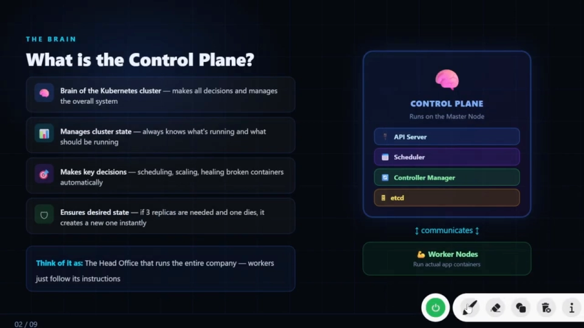
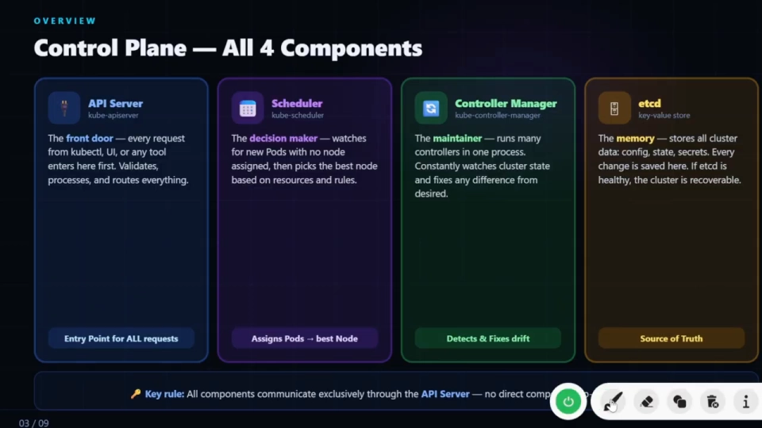
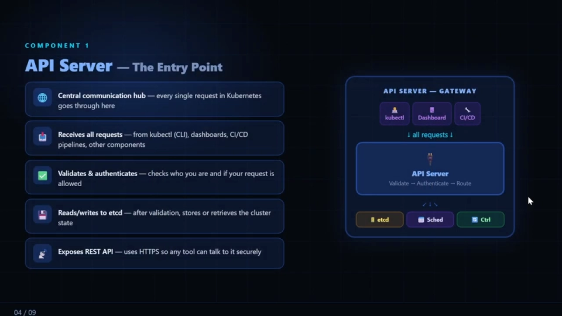
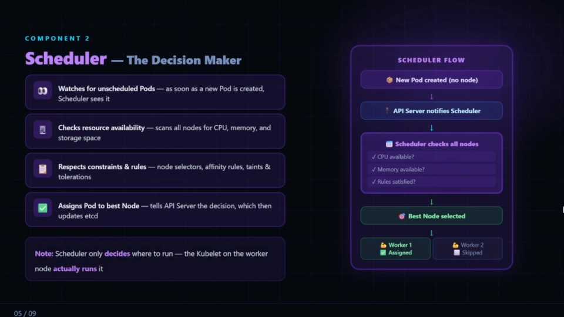
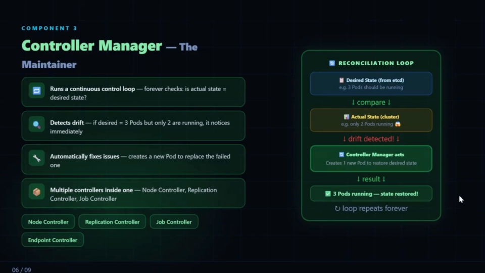
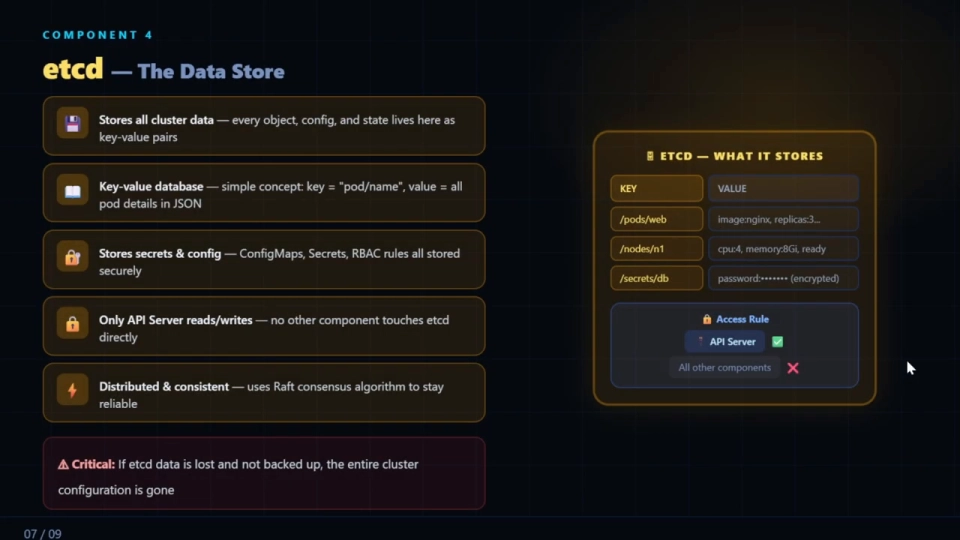
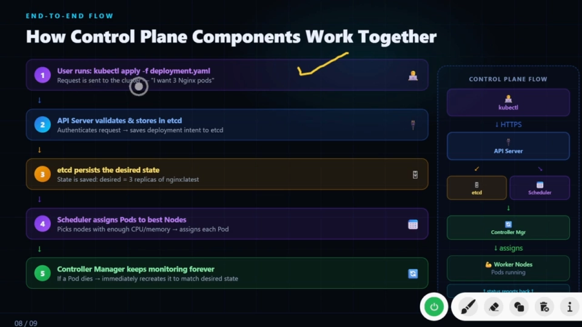
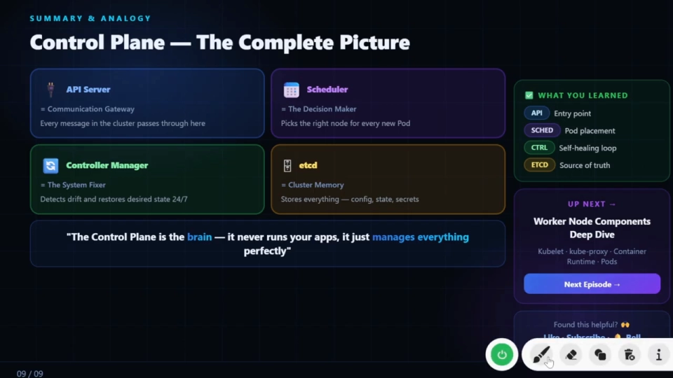

# 控制面四大组件与协作流程：API Server、Scheduler、Controller Manager、etcd

> 视频来源：[Kubernetes Control Plane Components Explained | API Server, Scheduler, Controller Manager & etcd](https://www.youtube.com/watch?v=SiOwrgLXd3M)（YouTube，Kubernetes 系列）
>
> 这是该系列"讲架构"的第二支：上一支从高处扫过所有组件，这一支**只盯控制平面**——先讲清"控制平面是什么"，再**逐个拆解四大组件**（API Server / Scheduler / Controller Manager / etcd），最后用一张端到端流程图把它们串起来。文稿左栏为英文自动字幕，本文已翻译并重写为中文。

## 本讲要解决的核心问题（SCQA）

**背景**：上一支视频已经知道 K8S 集群分成"控制平面"和"工作节点"两半，也粗略看过组件图。

**冲突**：但那张图是把所有组件一次性铺开讲的，**控制平面里那四个方框——API Server、Scheduler、Controller Manager、etcd——到底谁干什么、它们怎么配合**，还是糊的。尤其容易混淆的是：**决定"Pod 该跑到哪个节点上"的和"真正把 Pod 跑起来"的，是不是同一个东西？**

**疑问**：控制平面是什么？它的四大组件各自承担什么职责？一条 `kubectl apply` 从下达到 Pod 就绪，这四个组件按什么顺序各做各的事？

**回答（中心思想）**：**控制平面是 K8S 集群的"大脑"，负责做决策、维护状态，但它自己从不运行你的应用。** 它由四大组件构成，各有明确分工：**API Server** 是唯一的"前门"和通信中枢（所有请求都从这进），**Scheduler** 是"决策者"（负责给新 Pod 选节点），**Controller Manager** 是"维护者"（跑控制循环，把实际状态拉回期望状态），**etcd** 是"数据存储"（集群的唯一事实来源）。而且有一条铁律：**所有组件之间只通过 API Server 通信，没有任何组件直连 etcd。**

---

## 一、控制平面是什么：集群的"大脑"，只管决策、不跑应用

**控制平面（Control Plane）就像 K8S 集群的大脑**，它做出所有决策、管理整个系统，并管理**整个集群的状态**——它**始终知道"现在在跑什么"和"应该跑什么"（即期望状态，desired state）**。[【跳转到 00:41】](https://www.youtube.com/watch?v=SiOwrgLXd3M&t=41)

它做的关键决策包括：

- **调度（scheduling）**：把 Pod 放到合适的节点上；
- **扩缩容（scaling up/down）**；
- **自愈（self-healing）**：自动修复挂掉的容器。

举个最直观的例子：**如果期望跑 3 个副本，其中一个挂了，控制平面会在第一时间自动补出一个新的**——这种"维持期望状态"的能力就由控制平面提供。[【跳转到 01:06】](https://www.youtube.com/watch?v=SiOwrgLXd3M&t=66)

不理解也没关系，先记住一个生活化类比：**控制平面好比一家公司的"总部"**——它做决策、给一线下达指令；而真正的体力活由"分公司/一线"（工作节点）执行。[【跳转到 01:31】](https://www.youtube.com/watch?v=SiOwrgLXd3M&t=91)

> 划重点：**控制平面从不运行你的应用**。它只负责"管理"应用该长什么样，真正跑容器的工作节点（第 1.1.2 讲）才负责"执行"。

## 二、控制平面的四大组件：一图看清分工

控制平面由四个核心组件构成，它们的"人设"可以先一眼记住：[【跳转到 02:21】](https://www.youtube.com/watch?v=SiOwrgLXd3M&t=141)

| 组件 | 官方名 | 一句话职责 |
| :--- | :--- | :--- |
| API Server | kube-apiserver | 所有请求的入口 / 中央通信中枢 |
| Scheduler | kube-scheduler | 为没有节点的 Pod 挑选最佳节点 |
| Controller Manager | kube-controller-manager | 维护者，检测并修复状态漂移 |
| etcd | etcd | 键值数据库，集群的唯一事实来源 |

下面逐个拆开讲。

### 2.1 API Server：所有请求的"前门"与中央通信中枢

**API Server 是 K8S 里每个请求的必经入口。** 无论请求来自 kubectl、Dashboard，还是 CI/CD 流水线，**都要先经过 API Server**，由它来**校验、处理并把请求路由到该去的地方**。[【跳转到 02:26】](https://www.youtube.com/watch?v=SiOwrgLXd3M&t=146)

更准确地说，**它是整个 K8S 的"中央通信枢纽"——集群里每一个请求都只经过这里**，每个 "入口" 和 "出口" 都由它维护。它接收来自四面八方的请求：kubectl（命令行）、UI Dashboard、CI/CD 流水线，以及集群内其它组件/工具。[【跳转到 04:41】](https://www.youtube.com/watch?v=SiOwrgLXd3M&t=281)

收到请求后，它做两件关键的事：

1. **校验与认证**：先确认"你是谁"——这个请求到底从哪来、用户身份是否通过**认证（authenticated）**、是否被**授权（authorized）**；只有通过，才允许执行该操作。
2. **读写 etcd**：请求被校验通过后，它把数据**写入 / 刷新到 etcd 数据库**，从而更新集群状态。

此外，**它对外暴露的是 REST API，走的是 HTTPS**，所以任何工具都能用这种安全的方式与它通信。[【跳转到 04:41】](https://www.youtube.com/watch?v=SiOwrgLXd3M&t=281)

### 2.2 Scheduler：只负责"决定跑到哪"，不负责"真正跑起来"

**Scheduler 是"决策者"**，它专门解决"新 Pod 该放哪个节点"的问题，流程是：[【跳转到 05:42】](https://www.youtube.com/watch?v=SiOwrgLXd3M&t=342)

1. **盯住还没被调度的 Pod**：只要一个新 Pod 被创建出来、还没有绑定节点，Scheduler 就会看到它；
2. **检查资源可用量**：它会**扫描每个节点**，看 CPU、内存、存储的余量是否够；
3. **遵守约束与规则**：它会尊重诸如 **nodeSelector、亲和性（affinity）、污点与容忍（taints & tolerations）** 这类规则；
4. **挑出最佳节点并指派**：把 Pod 分配到最合适的节点上，**把决定告诉 API Server**，再由 API Server 更新进 etcd（第 3.1 章"调度"会展开这套机制）。

作者特别给出一个最容易混淆的关键点：

> **Scheduler 只决定 Pod"跑在哪"，真正"跑起来"的是工作节点上的 kubelet。** [【跳转到 06:42】](https://www.youtube.com/watch?v=SiOwrgLXd3M&t=402)

### 2.3 Controller Manager：把"实际状态"拉回"期望状态"的维护者

**Controller Manager 是"维护者"**，它干三件事：[【跳转到 09:02】](https://www.youtube.com/watch?v=SiOwrgLXd3M&t=542)

1. **跑一个持续不断的控制循环**：**永远在检查"实际状态是否等于期望状态"**。比如期望跑 3 个 Pod、实际只有 2 个，它立刻就能发现并纠正；
2. **自动修复问题**：自动创建新的 Pod 来替换掉失败的那些；
3. **一个进程里塞了一堆控制器**：Controller Manager 内部其实包含**多个控制器**——如 node controller、replication controller、job controller、endpoint controller 等，全都由它统一管理和运行。

它"纠正"的过程叫**调和循环（reconciliation loop）**，一图胜千言：

- **期望状态**（来自 etcd）：应有 3 个 Pod 在跑；
- **与实际集群对比**：发现只有 2 个 → **检测到状态漂移（drift）**；
- **采取行动**：补创建一个 Pod，恢复到 3 个 → **期望状态被恢复**。

这个循环会**反复执行**，由 Controller Manager 在后台持续维护。[【跳转到 09:02】](https://www.youtube.com/watch?v=SiOwrgLXd3M&t=542)

> 这里的"控制循环 / 调和循环"，正是本系列第 2.1 章"控制器模式"的主题；本讲只需先建立"维护者 = 不断把实际拉回期望"的直觉。

### 2.4 etcd：集群的键值存储与唯一事实来源

**etcd 是"数据存储"，相当于集群的记忆。** 它把所有集群数据——每个对象、配置、状态——都以**键值对（key-value）** 形式保存下来。[【跳转到 10:55】](https://www.youtube.com/watch?v=SiOwrgLXd3M&t=655)

- **它存什么**：键值数据库的概念很简单，**key = `pod/名字`，value = 该 Pod 的全部详情（JSON 格式）**；此外还安全地保存 **Secrets、ConfigMaps、RBAC 规则**等配置信息；
- **谁能读写**：**只有 API Server 会读它、也会写它——没有任何其它组件直接接触 etcd**；
- **它为什么可靠**：etcd 是**分布式且一致**的，使用 **Raft 一致性算法**来保证整个集群范围内的可靠性。

作者在这里给了一个非常重要的警示：

> **如果 etcd 数据丢了、又没有备份，那么整个集群状态和配置就全没了，集群将无法恢复。** 正因如此，**备份 etcd 是最佳实践**。[【跳转到 12:00】](https://www.youtube.com/watch?v=SiOwrgLXd3M&t=720)

## 三、一条铁律：所有组件只通过 API Server 通信

把四个组件分开讲完后，作者强调了一条贯穿全局的架构规则：[【跳转到 04:06】](https://www.youtube.com/watch?v=SiOwrgLXd3M&t=246)

> **所有组件之间的通信都"只通过 API Server"完成，不存在组件到组件的直接访问。**
> API Server 就是那扇前门——**组件之间不互相直连，一切都要经过它**，否则通信就没有意义（也没有安全的边界）。

这也解释了为什么 API Server 会被反复称为"通信网关 / 中央枢纽"：**它既是外部请求的入口，也是内部组件协作的公共总线。**

## 四、端到端：一次 `kubectl apply` 里四个组件如何接力

最后，作者用一张完整流程图把四个组件串成一条链。场景是：**用户执行 `kubectl apply -f deployment.yaml`，说"我要 3 个 Nginx Pod"。**[【跳转到 13:30】](https://www.youtube.com/watch?v=SiOwrgLXd3M&t=810)

按顺序走过一遍：

1. **用户提交请求** → 请求进入集群；
2. **API Server 校验并存入 etcd**：它先认证请求，然后把这份 Deployment（以及"期望 3 个 Nginx 副本"这个意图）持久化到 etcd，**期望状态就此保存**；
3. **Scheduler 分配节点**：它盯上新创建的 Pod，根据 CPU/内存等资源情况，**把 Pod 指派到资源足够的最佳节点**；
4. **Controller Manager 维持状态**：它持续监控——**如果有 Pod 挂掉，就自动重建**，始终把状态保持在期望值上；
5. **工作节点真正执行**：真正的活儿（运行容器）发生在工作节点上（由 kubelet 完成）；
6. **状态回报**：整个状态再经过 API Server **回报给 Controller Manager**，闭环完成。[【跳转到 13:30】](https://www.youtube.com/watch?v=SiOwrgLXd3M&t=810)

一张总结图收尾——四大组件的"人设"一目了然：[【跳转到 16:04】](https://www.youtube.com/watch?v=SiOwrgLXd3M&t=964)

## 小结

- **控制平面是集群的"大脑"**：负责决策与维护状态（调度、扩缩容、自愈），但**从不运行你的应用**。
- 四大组件分工：**API Server** = 前门 / 中央通信中枢；**Scheduler** = 决策者（选节点）；**Controller Manager** = 维护者（控制循环、修复漂移）；**etcd** = 键值存储 / 唯一事实来源。
- **Scheduler 只决定"跑在哪"，kubelet 才真正"跑起来"**——这是最易混淆的一点。
- **Controller Manager 靠"调和循环"持续把实际状态拉回期望状态**，且一个进程内跑着多个控制器。
- **只有 API Server 读写 etcd**，且所有组件之间的通信都只经过 API Server。
- **etcd 一旦丢失且无备份，整个集群将无法恢复**——备份 etcd 是最佳实践。

## 关键术语速查

| 术语 | 一句话解释 |
| :--- | :--- |
| 控制平面（Control Plane） | 集群的"大脑"，做决策、维持状态，但不运行应用 |
| kube-apiserver | 所有请求的唯一入口与中央通信中枢，唯一能读写 etcd 的组件 |
| kube-scheduler | 决策者：为未调度的 Pod 扫描节点资源与规则后选定最佳节点 |
| kube-controller-manager | 维护者：一个进程跑多个控制器，靠控制循环修复状态漂移 |
| etcd | 键值数据库，保存集群全部对象/配置/状态，用 Raft 保证一致性 |
| 期望状态（desired state） | 你希望集群达到的样子（如 3 个副本），存放在 etcd 里 |
| 调和循环（reconciliation loop） | 不断比较"实际状态 vs 期望状态"，发现漂移就修复的循环 |
| Raft | etcd 使用的分布式一致性算法，保证多副本数据可靠一致 |
| nodeSelector / 亲和性 / 污点与容忍 | 影响调度器选择节点的规则与约束 |
