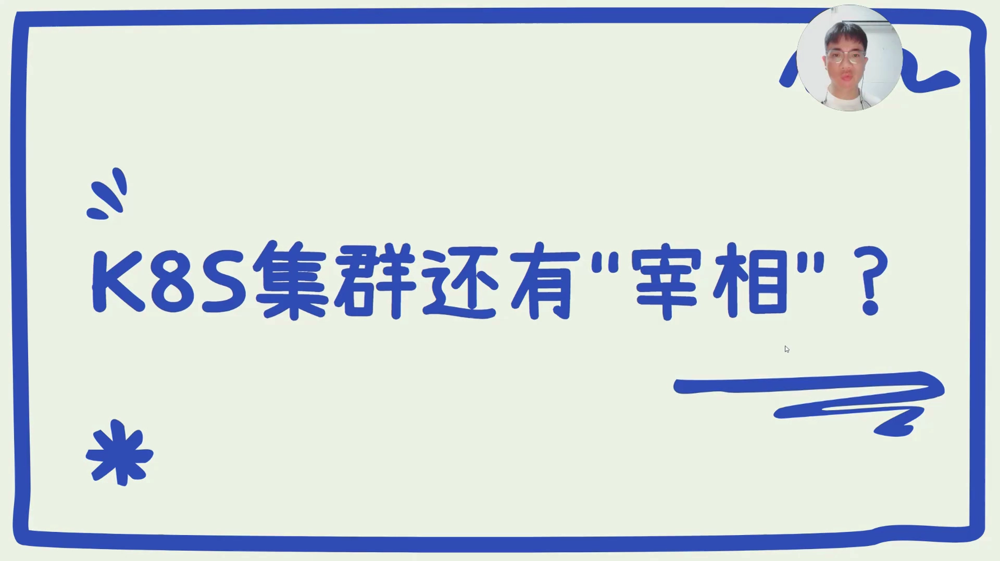
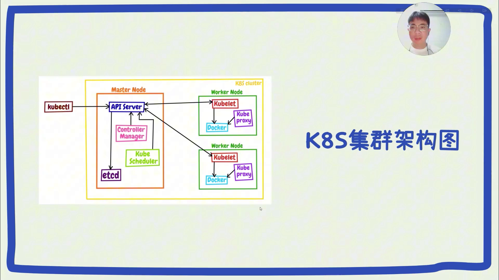
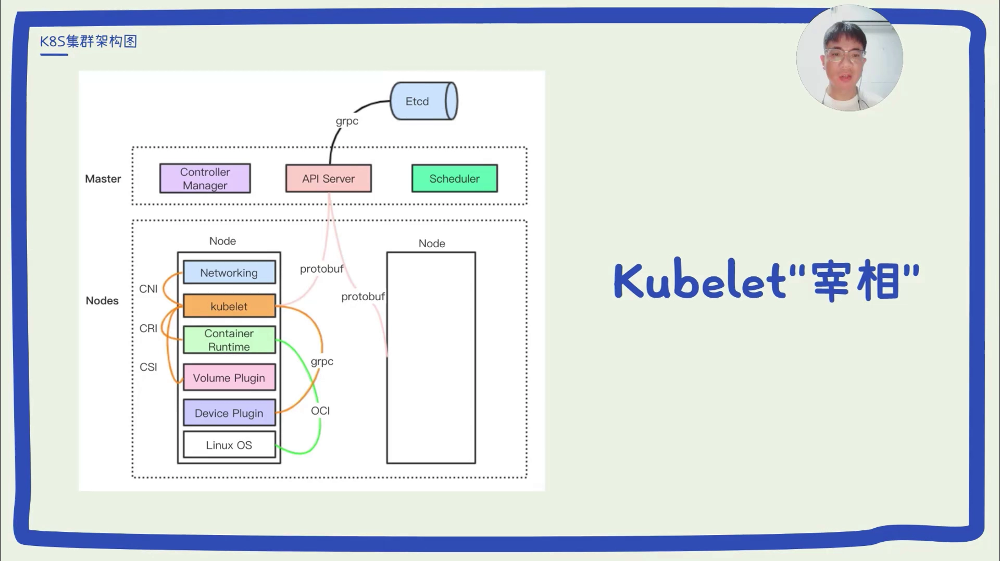
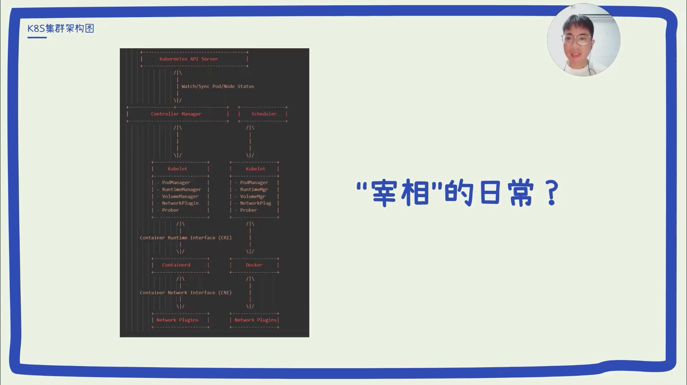

# kubelet 是节点上的"宰相"：一个比喻看懂它的职责与"子管家"

> 视频来源：[K8S 经验分享｜Kubelet 这样讲，你应该能听懂了吧？](https://www.bilibili.com/video/BV1N3YKeiEi5/)｜作者：七哥｜时长：约 4 分钟
>
> 这是一支用"宰相"比喻把 kubelet 讲透的短视频：先定角色（节点上的一位"大管家"），再列日常（监听、执行、上报），最后掀开"宰相府"，把 kubelet 内部的几个子组件（Pod 管理、运行时管理、存储卷、网络、探针）一个个点名。适合想知道"kubelet 到底在节点上忙什么"的读者。本文按视频内容重写为中文，并纠正了自动字幕里的错拼（如 `COBLIGHT`/`库巴light`→**kubelet**、`IP server`/`i pi 服务器`→**kube-apiserver**、`control managge`→**controller manager**、`CR2`/`C 压`→**CRI**、`content 的 D`→**containerd**）。

## 本讲要解决的核心问题（SCQA）

**背景**：看完控制面（本系列 1.1.1）我们知道，所有请求都要经过 API Server。可 API Server 只负责"记账和分发"，它自己并不会去节点上把容器拉起来。

**冲突**：那到底是谁，守在每一个节点上，把"期望状态"变成"真的有一个容器在跑"？这个角色就是 kubelet。但它同时管着 Pod 生命周期、健康检查、存储卷、网络……事务多到像一个"宰相"，很多人只知道它名字，却说不出它究竟管哪几摊事。

**疑问**：kubelet 在节点上具体负责什么？它向上、向下分别和谁打交道？它内部又是靠哪些"子管家"把活拆开干的？

**回答（中心思想）**：kubelet 是**驻守在 node 节点上的核心组件**，用"宰相"来理解最贴切——它向上听命于 apiserver（皇帝），向下指挥容器运行时，**承上启下**地把每个节点上的容器管起来。它内部还带着一府"子管家"：**Pod 管理器、运行时管理器、存储卷管理器、网络插件、探针**，分别管生命周期、容器启停、存储挂载、网络和健康检查。

---

## 一、kubelet 是节点上的"宰相"：不在 master，守在 node

视频开场就点明了一个容易记混的归属：**kubelet 不在 master（控制平面）节点上，而在 node（工作节点）上**。它是 Kubernetes 里最核心的组件之一，扮演着**节点上 Pod 与容器管理**的关键角色。[【跳转到 00:00】](https://www.bilibili.com/video/BV1N3YKeiEi5/?t=0)

为什么用"宰相"来比喻？视频给的理由很形象：**宰相通常是皇帝的最高助手，负责执行皇帝的命令并管理日常政务**。对应到 kubelet：

- **"皇帝"就是 apiserver**——kubelet 接收来自 apiserver 的命令，去执行 Pod 的**创建、更新、删除**以及其它操作。[【跳转到 00:45】](https://www.bilibili.com/video/BV1N3YKeiEi5/?t=45)
- **"管理日常政务"**——负责监控节点上 Pod 和容器的状态，确保它们按预期运行，并处理容器的生命周期。[【跳转到 00:45】](https://www.bilibili.com/video/BV1N3YKeiEi5/?t=45)

一句话总结这个岗位：**承上启下**——向上，它把节点的状态和健康信息报告给 apiserver；向下，它把指令下发给容器运行时。[【跳转到 01:10】](https://www.bilibili.com/video/BV1N3YKeiEi5/?t=70) 正是靠这个角色，kubelet 保证了 Kubernetes 集群里每个节点上的容器都能**高效、稳定地运行**。

## 二、"宰相的日常"：kubelet 每天在忙什么

定位讲清后，视频把镜头对准 kubelet 的日常事务，可以归成"一收一发"两件事：

- **收（监听与拉取）**：kubelet 通过 apiserver 的 **watch 机制**监听 Pod 的变更事件。当有**新的 Pod 被分配到该节点**，或 Pod 的状态需要更新时，它就会获取最新的 **Pod 规范（PodSpec）**。[【跳转到 01:35】](https://www.bilibili.com/video/BV1N3YKeiEi5/?t=95)
- **发（定期上报）**：活干完了还不算完，它要**定期向 apiserver 报告节点和 Pod 的状态**——包括运行状态、资源使用情况和健康状况。[【跳转到 01:35】](https://www.bilibili.com/video/BV1N3YKeiEi5/?t=95)

## 三、它和谁打交道：controller manager 与 scheduler

除了 apiserver 这条主线，kubelet 还和集群里另外两个角色有交集，视频用"既要扶持好皇帝，也要搞好群臣关系"来形容：

- **与 controller manager**：controller manager 通过 API 获取节点的状态信息，并据此做出调整决策、或触发其它控制逻辑（例如 **HPA**，即水平自动扩缩容）。[【跳转到 02:00】](https://www.bilibili.com/video/BV1N3YKeiEi5/?t=120)
- **与 scheduler**：scheduler 通过 apiserver 把**调度决策**告知 kubelet——也就是把某个 Pod 分配到具体的节点；kubelet 收到指令后，就负责在本节点上**启动并管理**这个 Pod。[【跳转到 02:25】](https://www.bilibili.com/video/BV1N3YKeiEi5/?t=145)

## 四、"宰相府"里的子管家：kubelet 内部如何分工

事务这么多，一个"宰相"也忙不过来——"偌大的宰相府肯定得有很多个子管家"。视频顺势拆出了 kubelet 内部的几个子组件，它们是理解 kubelet 职责的关键：[【跳转到 02:25】](https://www.bilibili.com/video/BV1N3YKeiEi5/?t=145)

| 子管家 | 负责什么 |
| :-- | :-- |
| **pod manager** | 管理节点上 Pod 的生命周期，包括创建、更新以及删除。[【跳转到 02:50】](https://www.bilibili.com/video/BV1N3YKeiEi5/?t=170) |
| **runtime manager** | 通过 **CRI** 与容器运行时（如 containerd 或 Docker）交互，负责容器的启动、停止与管理。[【跳转到 02:50】](https://www.bilibili.com/video/BV1N3YKeiEi5/?t=170) |
| **volume manager** | 解决**存储卷的挂载与卸载**，确保 Pod 能访问持久化存储。[【跳转到 02:50】](https://www.bilibili.com/video/BV1N3YKeiEi5/?t=170) |
| **network plugin** | 使用 **CNI** 插件配置 Pod 网络，确保**网络隔离与通讯**。[【跳转到 03:15】](https://www.bilibili.com/video/BV1N3YKeiEi5/?t=195) |
| **probe** | 执行**健康检查探针**，监控 Pod 与容器的健康状态。[【跳转到 03:15】](https://www.bilibili.com/video/BV1N3YKeiEi5/?t=195) |

## 五、再往下一层：CRI 与 CNI

视频最后顺着子管家往下看，点出了两条关键接口线：

- **CRI（Container Runtime Interface）**：runtime manager 通过它对接容器运行时。视频特意点出一个时代变化——**老的 docker 管家到了"退休"的年龄，新的 CRI 管家 containerd 继续接手**，来执行容器的创建、运行和销毁。[【跳转到 03:15】](https://www.bilibili.com/video/BV1N3YKeiEi5/?t=195)
- **CNI（Container Network Interface）**：最底层的子管家与**网络插件**交互，负责为 Pod **分配 IP、配置网络接口**，实现网络策略和隔离。[【跳转到 03:40】](https://www.bilibili.com/video/BV1N3YKeiEi5/?t=220)

这两条接口正是后面章节的主题：CRI 与容器运行时的调用关系见第 3 章（节点执行），CNI 与 Pod 网络见第 4 章（Pod 网络与 CNI）。

## 小结

- **归属**：kubelet 不在 master，而是**每个 node 节点上的核心组件**，主管节点上的 Pod 与容器。
- **身份**：用"宰相"理解——听命于 apiserver（皇帝），**承上启下**：向上报告节点/Pod 状态，向下指挥容器运行时。
- **日常**：通过 **watch** 监听 Pod 变更、获取最新 PodSpec；定期上报运行状态、资源使用与健康状况。
- **对外协作**：和 controller manager（据节点状态决策，如 HPA）、scheduler（下发调度决策）打交道。
- **内部子管家**：pod manager（生命周期）、runtime manager（CRI/容器启停）、volume manager（存储卷）、network plugin（CNI/网络）、probe（健康检查）。
- **两条接口**：CRI 对接容器运行时（containerd 接替 docker），CNI 负责 Pod 的 IP 与网络。

## 关键术语速查

| 术语 | 一句话解释 |
| :-- | :-- |
| kubelet | 每个 node 上的核心组件/节点代理，负责本节点 Pod 与容器的管理与状态上报 |
| PodSpec | 描述 Pod 该跑哪些容器的规范，kubelet 据此执行 |
| watch | kubelet 监听 apiserver 上 Pod 变更事件的机制 |
| 子管家（内部子组件） | kubelet 内部的分工模块：pod manager、runtime manager、volume manager、network plugin、probe |
| CRI | Container Runtime Interface，kubelet 与容器运行时之间的接口（containerd 等） |
| CNI | Container Network Interface，配置 Pod 网络、分配 IP、实现网络隔离与策略 |
| HPA | Horizontal Pod Autoscaler，依据指标自动扩缩副本数 |
