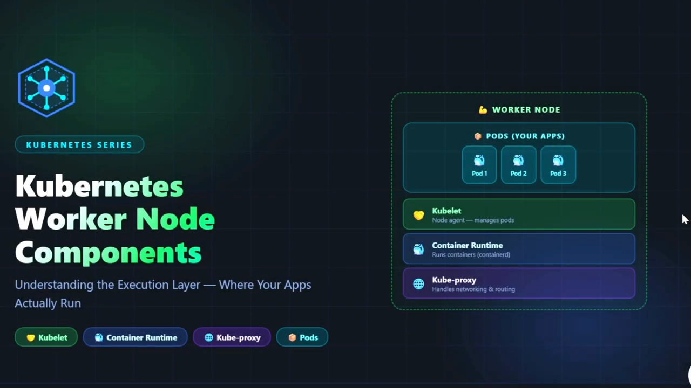
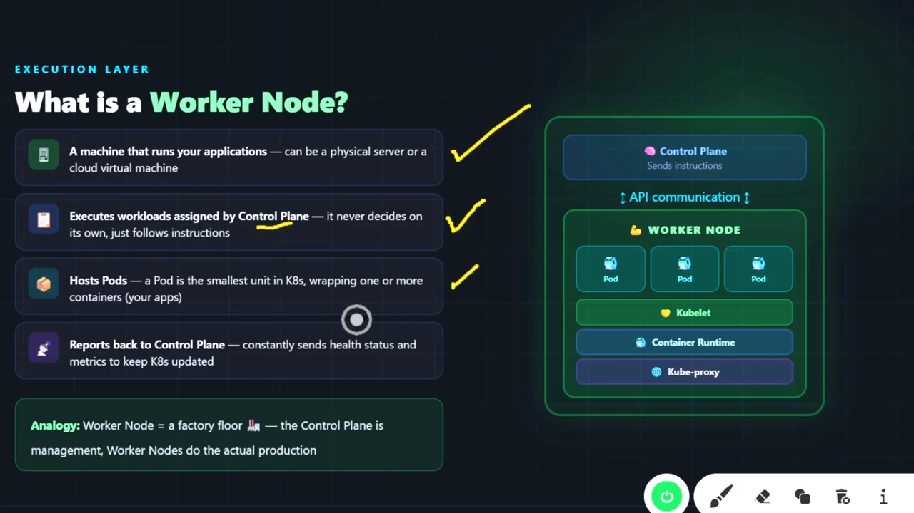
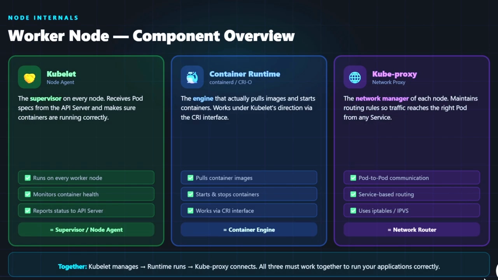
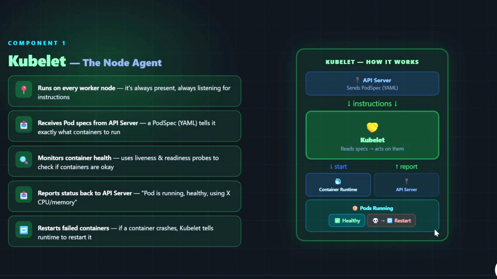
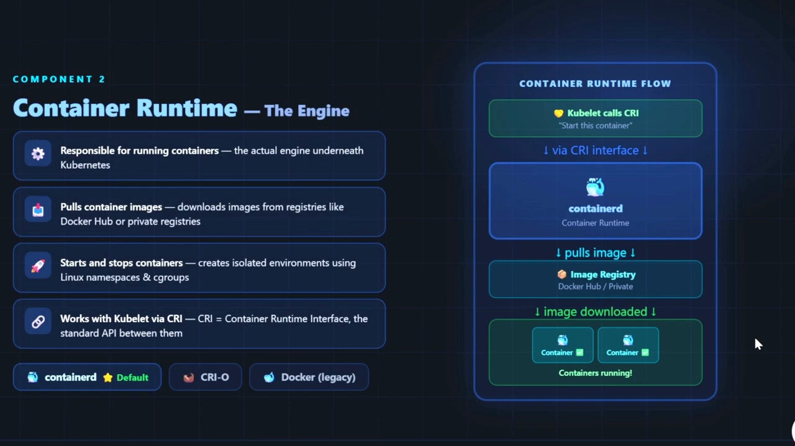
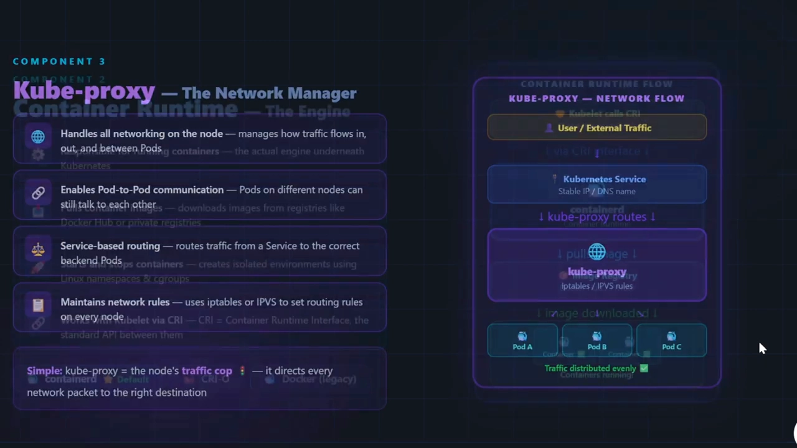
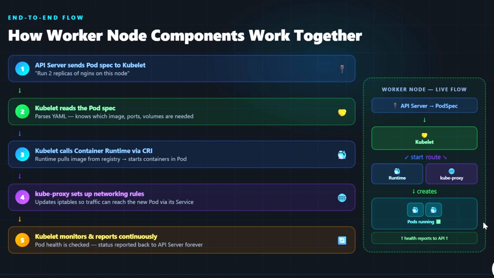
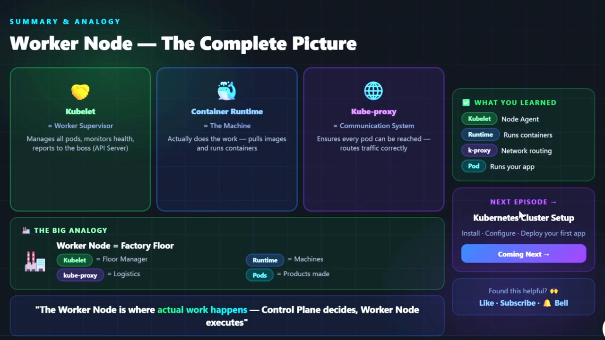

# 工作节点三件套：kubelet、容器运行时与 kube-proxy 各干什么

> 视频来源：[Kubernetes Worker Node Components Explained: kubelet, kube-proxy & Container Runtime](https://www.youtube.com/watch?v=ufhpfZDtQI8)｜频道：IT Achiever YT｜时长：约 14 分钟
>
> 这是一支按"一页幻灯片讲一个组件"节奏推进的入门讲解视频：先给工作节点定角色，再把 kubelet、容器运行时、kube-proxy 逐个拆开，最后用一个端到端流程图把三者串起来。适合已经看过控制平面（见本系列 1.1.1）的读者，用来补齐"节点这一侧到底谁在干活"。本文按视频内容重写为中文，并纠正了自动字幕里的错拼（如 `cube CTL`→**kubelet**、`container D`→**containerd**、`support specifications`→**Pod 规范**、`Engine X`→**nginx**）。

## 本讲要解决的核心问题（SCQA）

**背景**：上一讲我们看清了控制平面（Master）——API Server、Scheduler、Controller Manager、etcd，它们是集群里"做决策"的一方。很多人到这一步会以为：决策完了，集群就自动运转了。

**冲突**：可"决策"只是画了个图纸，**真正把容器跑起来的机器在别处**。工作节点（Worker Node）上同样密密麻麻地跑着好几个组件，kubelet、容器运行时、kube-proxy 挤在一起，谁负责拉镜像、谁负责起容器、谁负责接通网络，很多人只记得名字，分不清职责边界。结果就是：Pod 起不来、Service 访问不通时，不知道该去哪一侧排查。

**疑问**：工作节点到底是什么？它上面有哪些组件？每个组件的职责是什么？一条从控制平面下达的指令，要经过节点上哪几只手，才能把容器真正跑起来并接通网络？

**回答（中心思想）**：工作节点是集群的**执行层——只干活、不做决定**。它上面恰好有三个核心组件，各自守一块职责：**kubelet 是"总管/节点代理"**（接收指令、盯健康、报状态），**容器运行时是"引擎"**（真正拉镜像、起停容器），**kube-proxy 是"网络总管"**（管流量怎么进出、怎么路由到正确的 Pod）。三者的关系可以一句话概括：**kubelet 负责管理 → 运行时负责运行 → kube-proxy 负责连接**，缺一个，应用就跑不起来。

---

## 一、工作节点是什么：集群的"执行层"，只干活不做决定

视频一上来先把"工作节点"这个角色的定位讲清楚，并用一个贯穿全片的类比固定下来：**工作节点 = 工厂车间，控制平面 = 管理层**。[【跳转到 01:02】](https://www.youtube.com/watch?v=ufhpfZDtQI8&t=62)

工作节点的定义和职责，可以拆成四条：

- **它是一台运行应用的机器**——可以是物理服务器，也可以是云上的虚拟机（VM）。[【跳转到 01:02】](https://www.youtube.com/watch?v=ufhpfZDtQI8&t=62)
- **它执行由控制平面分配的负载**——注意这个方向的措辞：它**从不自己拿主意**，只是跟着控制平面收到的指令走。[【跳转到 01:02】](https://www.youtube.com/watch?v=ufhpfZDtQI8&t=62)
- **它承载 Pod**——Pod 是 Kubernetes 里最小的调度单位，把一个或多个容器打包在一起（也就是你的应用）。这些 Pod 只被工作节点承载。[【跳转到 01:27】](https://www.youtube.com/watch?v=ufhpfZDtQI8&t=87)
- **它把状态往回报**——持续把健康状态（也就是指标 metric）发回控制平面，让集群状态保持最新。[【跳转到 01:27】](https://www.youtube.com/watch?v=ufhpfZDtQI8&t=87)

一句话记住这个方向：**控制平面通过 API 下达指令 → 工作节点负责"实际把活干了"，然后回报结果**。[【跳转到 01:52】](https://www.youtube.com/watch?v=ufhpfZDtQI8&t=112)

## 二、工作节点的三大组件：一句话记住各自职责

进入节点内部，视频给出了一张"组件总览"对照表——这也是全文的骨架：三个组件、三块职责、三个身份标签。[【跳转到 02:22】](https://www.youtube.com/watch?v=ufhpfZDtQI8&t=142)

| 组件 | 身份 | 一句话职责 |
| :-- | :-- | :-- |
| **kubelet** | 节点代理（Supervisor / Node Agent） | 每个节点上的"总管"：接收 API Server 的 Pod 规范，确保容器按规范正确地跑着 |
| **容器运行时** | 容器引擎（Container Engine） | 真正拉镜像、起停容器的引擎，在 kubelet 指挥下通过 CRI 工作 |
| **kube-proxy** | 网络路由（Network Router） | 每个节点的"网络总管"：维护路由规则，让流量能找到正确的 Pod |

三个身份标签连起来就是那句核心总结：**kubelet 管理 → 运行时运行 → kube-proxy 连接，三者必须一起工作，应用才能正确运行**。[【跳转到 02:22】](https://www.youtube.com/watch?v=ufhpfZDtQI8&t=142)

### 2.1 kubelet：节点上的"总管"与"代理人"

kubelet 是视频里着墨最多的组件。它的定位是**每个节点上的主管（supervisor）**，在每个工作节点上都运行、常驻、随时监听指令。[【跳转到 04:20】](https://www.youtube.com/watch?v=ufhpfZDtQI8&t=260)

它的工作流程可以概括成"接收 → 执行 → 监控 → 上报"四步：

- **接收**：从 API Server 接收 **Pod 规范（PodSpec，写在 YAML 里）**——这份规范告诉它"到底要跑哪些容器"。[【跳转到 04:20】](https://www.youtube.com/watch?v=ufhpfZDtQI8&t=260)
- **监控健康**：用 **liveness（存活）探针**和 **readiness（就绪）探针**检查容器是否正常。[【跳转到 05:10】](https://www.youtube.com/watch?v=ufhpfZDtQI8&t=310)
- **上报状态**：把状态回报 API Server——"Pod 在跑、健康、正占用多少 CPU/内存"。[【跳转到 05:35】](https://www.youtube.com/watch?v=ufhpfZDtQI8&t=335)
- **重启失败容器**：如果容器崩溃，kubelet 会**告诉运行时重启它**。[【跳转到 05:35】](https://www.youtube.com/watch?v=ufhpfZDtQI8&t=335)

还有一条常被忽略的连线：kubelet 把状态汇报给 API Server 后，这份信息会**继续传给控制平面里的 Controller Manager**——这正是后面第 2 章"控制器模式"里，控制器能感知节点与 Pod 状态、进而做出调整的输入来源。[【跳转到 06:25】](https://www.youtube.com/watch?v=ufhpfZDtQI8&t=385)

### 2.2 容器运行时：真正把容器跑起来的"引擎"

如果说 kubelet 是"总管"，那么**容器运行时就是真正干活的引擎**——Kubernetes 之下最底层、负责运行容器的那个组件。[【跳转到 06:32】](https://www.youtube.com/watch?v=ufhpfZDtQI8&t=392)

它做三件事：

- **拉取镜像**：从 Docker Hub 或私有仓库把镜像下载下来。[【跳转到 06:32】](https://www.youtube.com/watch?v=ufhpfZDtQI8&t=392)
- **起停容器**：创建与销毁容器，并用 **Linux namespace（命名空间）** 和 **cgroup（控制组）** 造出隔离的运行环境。[【跳转到 06:57】](https://www.youtube.com/watch?v=ufhpfZDtQI8&t=417)
- **对接 kubelet**：通过 **CRI（Container Runtime Interface，容器运行时接口）** 与 kubelet 通信——CRI 是两者之间的**标准 API**。[【跳转到 06:57】](https://www.youtube.com/watch?v=ufhpfZDtQI8&t=417)

常见的运行时工具有三类：**containerd（目前的默认选择）**、**CRI-O**，以及**已被标记为 legacy（遗留）的 Docker**。[【跳转到 07:42】](https://www.youtube.com/watch?v=ufhpfZDtQI8&t=467)

它的工作流是一条清晰的链：**kubelet 调 CRI（"启动这个容器"）→ 请求经 CRI 接口到达 containerd → containerd 反序列化规格、需要时拉镜像 → 启动容器**。[【跳转到 07:42】](https://www.youtube.com/watch?v=ufhpfZDtQI8&t=467)

### 2.3 kube-proxy：节点上的"网络总管/交警"

第三个组件 kube-proxy 负责**节点上的全部网络**：流量怎么流进流出、Pod 之间怎么互相通信，都由它管。[【跳转到 08:12】](https://www.youtube.com/watch?v=ufhpfZDtQI8&t=492)

它的职责有四项：

- **Pod-to-Pod 通信**：让**不同节点上的 Pod 也能互相说话**。[【跳转到 08:12】](https://www.youtube.com/watch?v=ufhpfZDtQI8&t=492)
- **Service 路由（service-based routing）**：把流量从某个 Service 转发到**正确的后端 Pod**——这件事只能靠 kube-proxy 完成。[【跳转到 08:37】](https://www.youtube.com/watch?v=ufhpfZDtQI8&t=517)
- **维护网络规则**：用 **iptables 或 IPVS** 在**每个节点**上写下路由规则。[【跳转到 08:37】](https://www.youtube.com/watch?v=ufhpfZDtQI8&t=517)
- 视频给的类比很形象：**kube-proxy 就是节点的"交警"**，把每一个网络包指挥到正确的方向。[【跳转到 09:02】](https://www.youtube.com/watch?v=ufhpfZDtQI8&t=542)

它的网络流向是一条接力：**外部/用户流量先到 Kubernetes Service（一个稳定的 IP 或 DNS 名，DNS 解析在这里发生）→ kube-proxy 依据 iptables/IPVS 表，把流量路由到当前可用且正确的 Pod（Pod A、Pod B、Pod C）→ 流量被均摊分发**，最终把任务正确地交出去。[【跳转到 09:27】](https://www.youtube.com/watch?v=ufhpfZDtQI8&t=567)

> 章节归属提示：kube-proxy 的 iptables 模式与 IPVS 模式本身是本系列第 5 章（Service 与负载均衡）的重点，这里只需记住它在节点上的**职责定位**：管路由、管连通。

## 三、三者协作：一条指令在工作节点上的完整接力

把三个组件串起来，视频给了一个端到端流程图，例子是"在某个节点上跑 2 个 nginx 副本"。[【跳转到 10:06】](https://www.youtube.com/watch?v=ufhpfZDtQI8&t=606)

按时间顺序，节点这一侧发生的事情是：

1. **API Server 把 PodSpec 发给 kubelet**（例："在这个节点上跑 2 个 nginx 副本"）。[【跳转到 10:06】](https://www.youtube.com/watch?v=ufhpfZDtQI8&t=606)
2. **kubelet 读规范、解析 YAML**——知道要用哪个镜像、占哪些端口、需要什么卷，一切都在规范里写好了。[【跳转到 10:31】](https://www.youtube.com/watch?v=ufhpfZDtQI8&t=631)
3. **kubelet 通过 CRI 调容器运行时**——运行时拉取镜像、在那个 Pod 里把容器起起来。[【跳转到 10:31】](https://www.youtube.com/watch?v=ufhpfZDtQI8&t=631)
4. **容器跑起来后轮到网络**——kube-proxy 建立网络规则、更新 iptables，让流量能通过它的 Service 抵达这个新 Pod。[【跳转到 10:56】](https://www.youtube.com/watch?v=ufhpfZDtQI8&t=656)
5. **kubelet 持续监控并回报**——健康状态经 API Server 传给控制平面里的 Controller Manager。[【跳转到 11:21】](https://www.youtube.com/watch?v=ufhpfZDtQI8&t=681)

这就是"三件套协作"的全貌：**API Server 给指令 → kubelet 读指令并按指令启动、拉起调度 → kube-proxy 按指令接通流量 → 容器运行起来、健康状态被持续上报**。[【跳转到 11:46】](https://www.youtube.com/watch?v=ufhpfZDtQI8&t=706)

## 小结

- **工作节点是执行层**：它在哪儿，活就在哪儿干；控制平面负责决定，工作节点只负责执行，**从不自作主张**。
- **三个核心组件，三块职责**：kubelet 是**节点代理/总管**，容器运行时是**引擎**，kube-proxy 是**网络总管**。
- **kubelet**：接收 PodSpec → 用探针监控健康 → 回报状态 → 重启失败容器，并把状态接到控制平面的 Controller Manager。
- **容器运行时**：通过 CRI 被 kubelet 调用，负责拉镜像、起停容器，用 namespace/cgroup 造隔离环境（containerd 为默认）。
- **kube-proxy**：用 iptables/IPVS 维护每节点路由规则，支撑 Pod-to-Pod 通信与 Service 路由，像"交警"一样指挥流量。
- **工厂类比**：工作节点=工厂车间，kubelet=车间主任（floor manager），kube-proxy=物流（logistics），容器运行时=机器（machines），Pod=生产出来的产品。[【跳转到 12:09】](https://www.youtube.com/watch?v=ufhpfZDtQI8&t=729)

## 关键术语速查

| 术语 | 一句话解释 |
| :-- | :-- |
| 工作节点（Worker Node） | 真正运行应用的机器（物理机/云 VM），负责执行控制平面分配的负载、承载 Pod、回报状态 |
| kubelet | 每个节点上的节点代理/总管：接收 API Server 的 PodSpec，监控容器健康、上报状态、重启失败容器 |
| PodSpec | 描述"要跑哪些容器"的规范（写在 YAML 中），是 kubelet 执行动作的依据 |
| 容器运行时（Container Runtime） | 真正拉镜像、起停容器的引擎，如 containerd、CRI-O、Docker（legacy） |
| CRI | Container Runtime Interface，容器运行时接口，kubelet 与运行时之间的标准 API |
| kube-proxy | 每个节点的网络总管/路由组件，维护路由规则，支撑 Pod-to-Pod 通信与 Service 路由 |
| iptables / IPVS | kube-proxy 用来在节点上落地路由规则的两种后端 |
| liveness / readiness 探针 | 存活/就绪探针，kubelet 用来判断容器是否健康、是否可接收流量 |
