# Kubernetes Leader Election 选举机制：控制面组件的"多副本部署、单实例运行"

> 视频来源：[10 分钟入门kubernetes leader election](https://www.bilibili.com/video/BV15v4y1178U/)｜时长：约 16 分钟
>
> 这是一支讲 Kubernetes 组件高可用机制的分享视频：先讲清"为什么控制面的某些组件必须只有一个实例在跑"，再用一段 client-go 代码加一个三实例演示，直观展示 leader election 的选举与故障切换过程。本文按视频内容重写为中文，并纠正了自动字幕里的错拼（如 `KBS`/`KOS`→**k8s**、`leader leg`/`拉克逊`→**leader election**、`tugo country`→**kube-controller-manager**、`酷睿cs`→**kube-scheduler**、`listen`→**Lease**、`最per`→**ZooKeeper**、`多多副本部署`→**多副本部署**）。它与同系列《Kubernetes list-watch 机制》互为姊妹篇：那一篇讲组件"怎么通信"，这一篇讲组件的"高可用"怎么实现。

## 本讲要解决的核心问题（SCQA）

**背景**：上一讲讲清了组件之间怎么通信——所有组件都通过 apiserver、靠 list-watch 收发事件。我们也知道，控制面组件（scheduler、controller-manager）本身就是集群里的"大脑"。

**冲突**：为了一台机器挂了集群还能活，我们希望这些"大脑"也部署**多个副本**做冗余。可这里有个矛盾：controller-manager 一旦有多个副本同时干活，同一个 Deployment 的副本数就可能被两个控制器**重复计算、反复伸缩**，集群反而乱套。也就是说——**多副本是为了高可用，但同一时刻又只允许一个实例真正决策**。

**疑问**：怎样才能既部署多副本做冗余，又保证任意时刻只有一个实例在真正工作？

**回答（中心思想）**：用 **leader election（领导者选举）** 机制，也就是"**多副本部署、单实例运行**"。多个副本各自去竞争同一把"锁"（在 k8s 里就是 **Lease** 资源）：抢到锁的那个实例成为 **leader**，真正执行业务逻辑；其余实例作为 **follower** 待命。leader 一旦挂掉，锁被释放或被超时回收，剩下的 follower 会重新选举出一个新 leader 顶上——这样既有了冗余，又保证了"同一时刻只有一个在干活"。

---

## 一、哪些组件需要 leader election

视频首先点出背景：leader election 在分布式世界里并不陌生——ZooKeeper、etcd 这些项目都有 leader election，而且它们都是基于 **Raft 算法**来落地的。但这一讲要讲的，是 **Kubernetes 自己的一些系统组件**（原生组件）里本身就存在的 leader election 实现。[【跳转到 00:25】](https://www.bilibili.com/video/BV15v4y1178U/?t=25)

那么到底有哪些组件用到了它？视频列了出来：

- **kube-controller-manager**：它是 k8s 里的**核心控制器**，主要负责 Pod、对 Deployment 这些资源进行副本扩缩容，以及 ReplicaSet 创建等一整套完整的控制；[【跳转到 00:58】](https://www.bilibili.com/video/BV15v4y1178U/?t=58)
- **kube-scheduler**：核心组件，一个控制器；
- 还有一个运行在数据平面的控制器（同样开启了 leader election）。

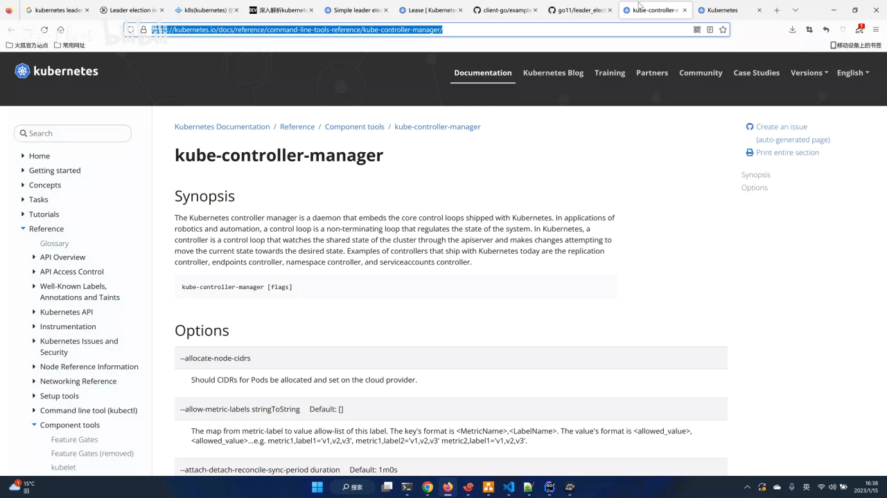

以 kube-controller-manager 为例，它开启 leader election 靠的就是一个参数——`--leader-elect`。视频现场演示了在它的启动参数里找这个字段，可以看到它有一个**默认的选举资源（resource lock）**，用的就是 **Lease** 这个资源。[【跳转到 01:53】](https://www.bilibili.com/video/BV15v4y1178U/?t=113)

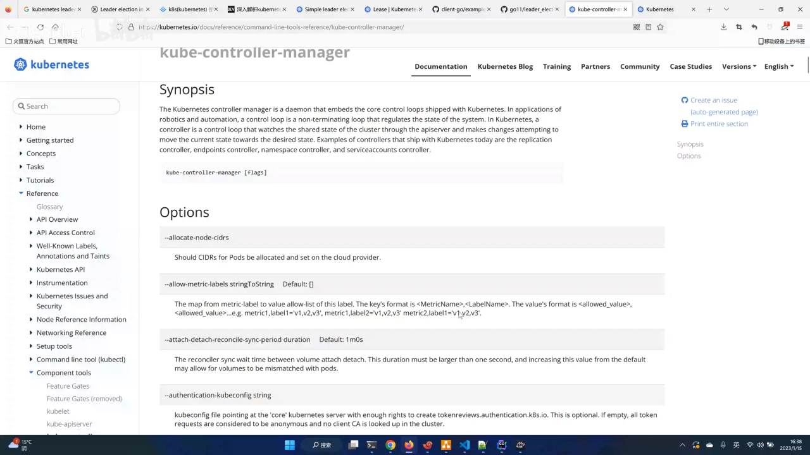

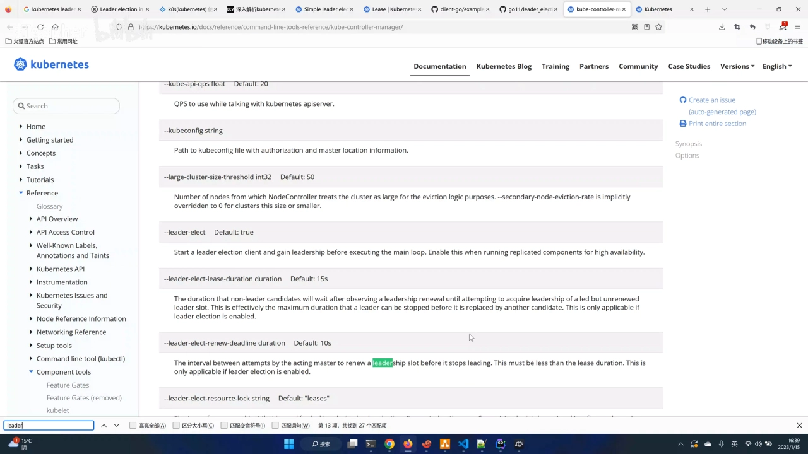

> 注意：视频里提到的 `ZooKeeper` / `etcd` 的选举是基于 Raft（多数派共识），而 k8s 组件这里的 leader election 是**基于 Lease 锁 + 超时续租**的机制——两者目的相同（选出唯一 leader），实现路径不同。etcd 与 Raft 的细节将在本系列 1.3.1 展开。

## 二、为什么是"多副本部署、单实例运行"

概念上，视频用一句话点破了这类组件的宿命：**在 k8s 世界里面有很多组件，它只允许一个实例运行**。[【跳转到 02:15】](https://www.bilibili.com/video/BV15v4y1178U/?t=135)

但"只允许一个实例运行"不等于"只部署一个实例"。为了让它具备**高可用**，我们希望部署**多个副本**——因为多副本能提供状态的**冗余保障**；而与此同时，又只能用**一个实例在运行**，保证同一时刻只有一个实例存活、在工作。[【跳转到 02:34】](https://www.bilibili.com/video/BV15v4y1178U/?t=154)

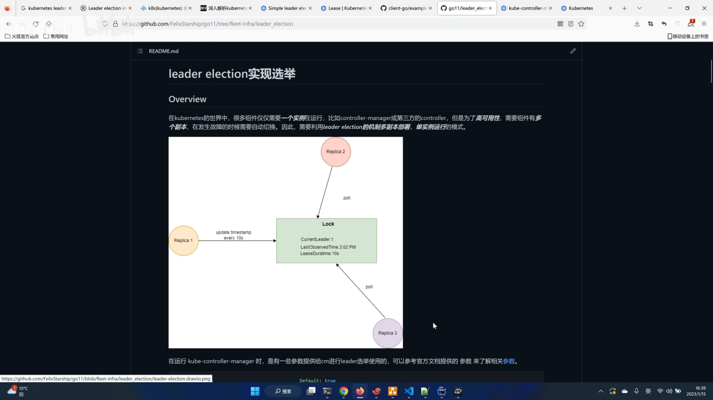

因此在这种情况下，我们就需要用到 leader election 机制的"**多副本部署、单实例运行**"模式。（视频原文特别强调了一遍——"再强调一遍：多副本部署、单实例运行"。）这类场景其实很多，比如前面提到的 kube-controller-manager，它是 k8s 控制器的核心组件。[【跳转到 03:07】](https://www.bilibili.com/video/BV15v4y1178U/?t=187)

## 三、它怎么实现：基于 client-go 的 leaderelection

讲完"为什么要"，视频开始拆"怎么做"，并说明分两部分阐述。第一部分看 leader election 本身，**主要是基于 client-go 提供的一个 example（示例）**。[【跳转到 03:44】](https://www.bilibili.com/video/BV15v4y1178U/?t=224)

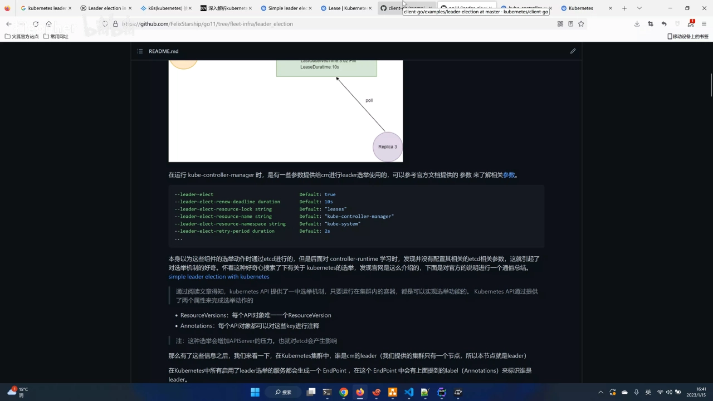

代码的骨架大致分几步：

- **配置参数**：最上面是**锁资源（resource lock）**、然后是 **kubeconfig 的路径**等；
- **初始化客户端**：这部分是 client-go 的基础应用，官方示例已经写得很详细；
- **创建锁资源**：在 k8s 里实现 leader election 需要一把"锁"，它用 **Lease 资源**来充当锁；[【跳转到 04:37】](https://www.bilibili.com/video/BV15v4y1178U/?t=277)

    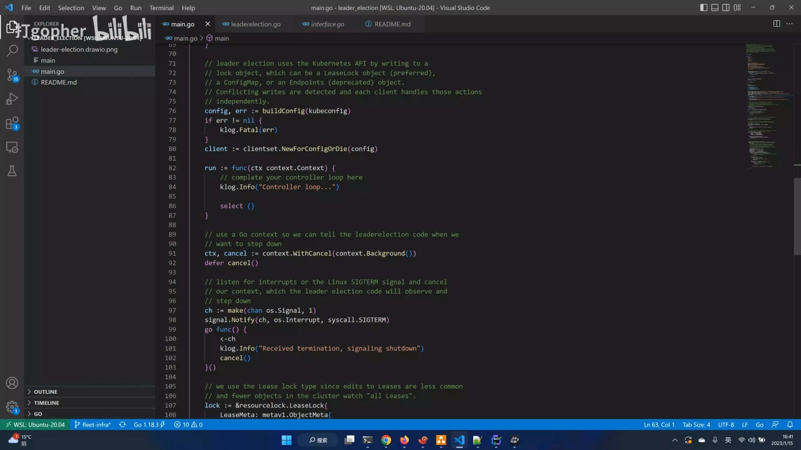

- **启动选举**：调用 `leaderElector.Run`，它启动一个进程来监听、参与选主；再往下就是**核心部分，也就是回调**——上锁、执行业务、失锁、退出这一整套流程，其实是一体的。[【跳转到 05:02】](https://www.bilibili.com/video/BV15v4y1178U/?t=302)

    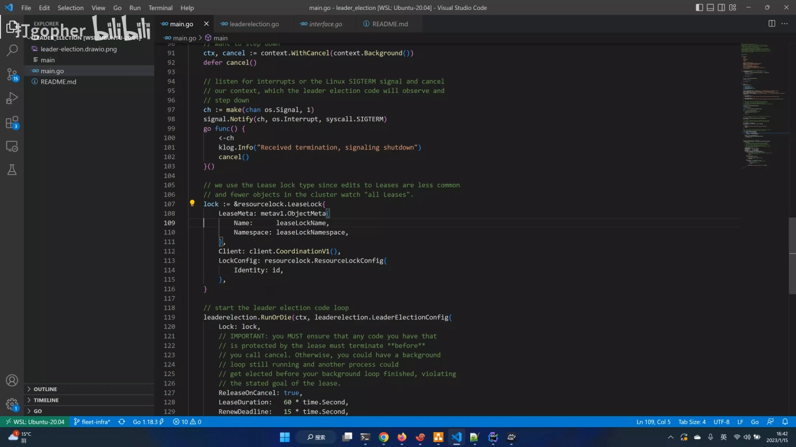

这里有一个很关键的编程模式：**我们的业务代码，全都写在"成为 leader 之后"的那个回调里**。视频里模拟抽出了一个方法，代表"拿到锁之后持续运行的业务逻辑"。这种"把业务藏在回调里、由框架在成为 leader 时调用"的写法，在 k8s 生态里非常常见——我们熟悉的 **informer**，以及自己实现 **Operator / Controller** 时，都是以这种**回调的形式**对外暴露一个 `Run` 实现，让我们自由灵活地注册。[【跳转到 06:17】](https://www.bilibili.com/video/BV15v4y1178U/?t=377)

## 四、动手演示：三个实例抢锁、leader 挂掉后自动切换

光讲代码还不够，视频用一段自己编译的程序做了现场演示——本地是一个 **k3s** 环境，程序带一个"实例标识"参数，用来模拟不同的副本。[【跳转到 06:39】](https://www.bilibili.com/video/BV15v4y1178U/?t=399)

演示过程如下：

1. **启动第一个实例**：它拿到了锁，进入 `OnStartedLeading`（成为 leader 的回调），业务逻辑跑了起来；[【跳转到 07:04】](https://www.bilibili.com/video/BV15v4y1178U/?t=424)
2. **再启动第二、第三个实例**：因为我们采用的是"多副本部署"，相当于起了三个进程（可以理解为三个 Pod）。可以看到它们打印出的日志显示：**当前 leader 是第一个实例在运行**，而第二、三个实例都标记为"不是 leader"，只是存活待命；[【跳转到 07:29】](https://www.bilibili.com/video/BV15v4y1178U/?t=449)

    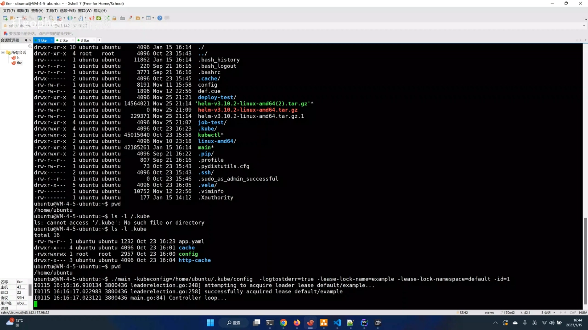

    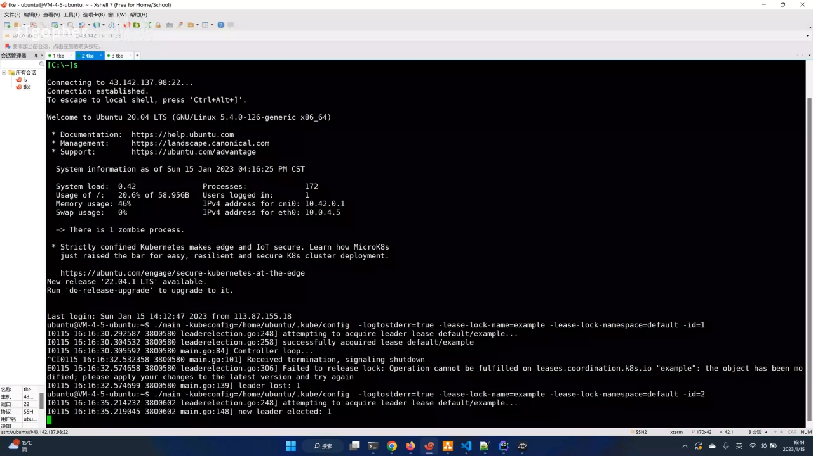

3. **模拟故障**：把当前 leader（第一个实例）**down 掉**，观察是否会自动选出新 leader；[【跳转到 07:54】](https://www.bilibili.com/video/BV15v4y1178U/?t=474)
4. **自动切换**：很快就选出了新的 leader——**第三个实例**被选中。可以看到，新 leader 是从 follower 重新选举上来的，而原先那个 leader 已经是一个"正在退出"的实例。[【跳转到 08:19】](https://www.bilibili.com/video/BV15v4y1178U/?t=499)

    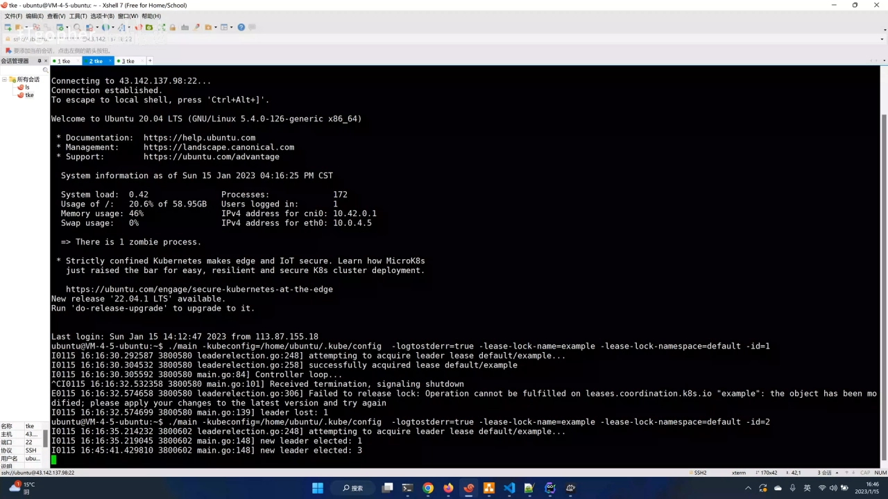

这个演示直接证明了高可用的意义：**如果只有一个副本、一个进程，它一旦 down 掉，整个服务就中断了**——对应的 Pod 会一直处于被控制器调度、反复重启的状态；而采用多实例部署 + leader election，这种"中断"就不存在了——挂掉一个之后会自动显示（选出）一个新的 leader，从而保证整个服务的高可用。[【跳转到 09:09】](https://www.bilibili.com/video/BV15v4y1178U/?t=549)

## 五、实战背景：一个 API Server 代理为什么要"单实例"

视频后半段讲了这段实现背后的真实项目背景——这也是理解 leader election 应用价值的一个好例子。作者所在团队做的是**多云管理**，需要在 k8s 之上抽象出一个 **proxy（代理）**，也就是一个 **k8s API Server 代理**，用来保障对被纳管集群的访问。[【跳转到 09:58】](https://www.bilibili.com/video/BV15v4y1178U/?t=598)

这类代理本质上是**反向代理 / 隧道**，要保证代理服务自身的高可用。视频举例提到 rancher 的 [`remotedialer`](https://github.com/rancher/remotedialer) 项目——它也是一个 k8s 的反向代理，但它（曾是）基于 Raft 协议实现；它同样用到了 leader election 的选举算法来保证代理服务的可用性。[【跳转到 10:53】](https://www.bilibili.com/video/BV15v4y1178U/?t=653)

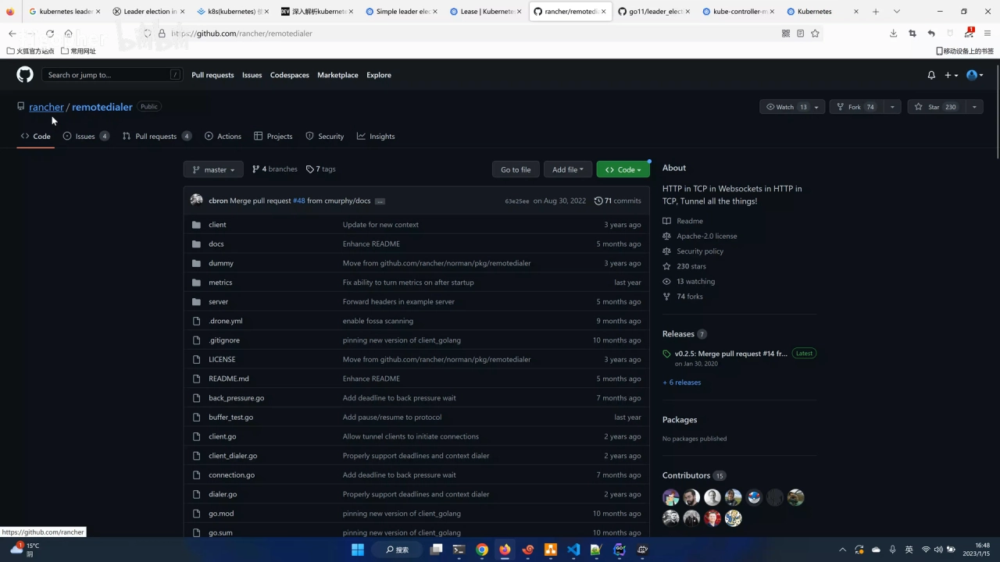

那么问题来了：**这个代理为什么不能多副本？** 视频给了解释——因为这类代理本身是**无状态**的，而且它一边连客户端、一边连服务端：如果同时有多个副本在转发请求，同一批请求就**可能被重复地分发**；再加上反向代理过程中会与服务端建立连接，于是基于这样的背景，就衍生出了它"**单实例、多副本部署**"的场景——用 leader election 保证同一时刻只有一个副本在真正对外服务。[【跳转到 12:58】](https://www.bilibili.com/video/BV15v4y1178U/?t=778)

视频还翻了另一个项目的实现（作者提到是"青云的项目"）：它也用到 leader election，且**锁同样是用 Lease 资源**来做的；它的 leader 模型只用到"启动、运行、停止这个 leader"三个动作，另外还有 proxy 与 server 两部分代码。[【跳转到 14:13】](https://www.bilibili.com/video/BV15v4y1178U/?t=853)

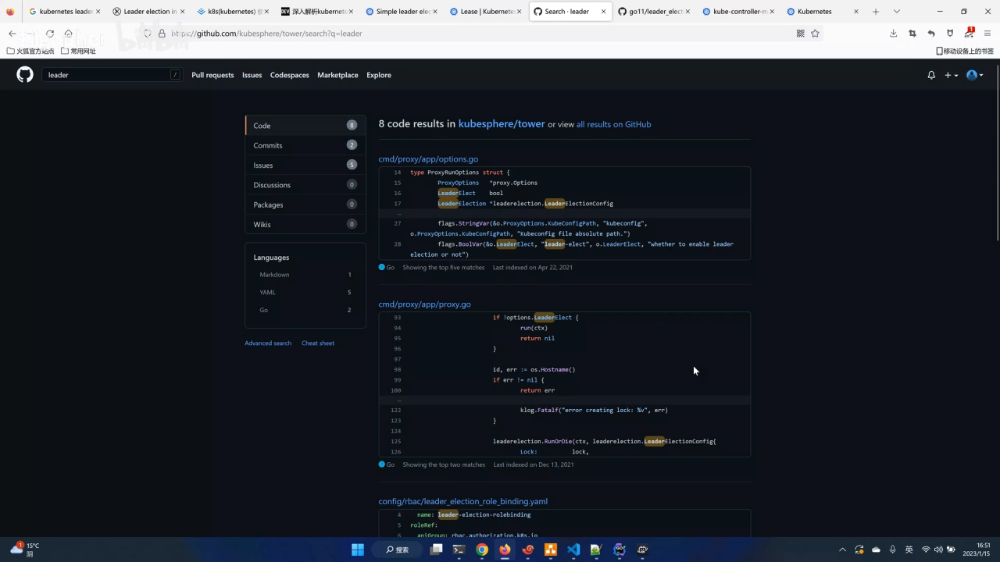

> 视频结尾作者还做了一处自我更正：他原本以为 rancher 的实现也是"单实例"，后面发现 **rancher 的实现可能不一样，它能够允许高副本部署**（客户端实现机制不同）。这说明"要不要单实例"取决于组件本身是否无状态、能否安全地并发处理请求——并非所有代理都必须单实例。

## 小结

- **适用对象**：kube-controller-manager、kube-scheduler 等"同一时刻只能有一个实例决策"的控制面/控制器组件，需要 leader election。[【跳转到 00:58】](https://www.bilibili.com/video/BV15v4y1178U/?t=58)
- **核心模式**：**多副本部署、单实例运行**——多副本提供冗余，election 保证只有一个在干活。[【跳转到 02:34】](https://www.bilibili.com/video/BV15v4y1178U/?t=154)
- **实现关键**：用 **Lease 资源充当锁**，配合 `--leader-elect` 参数与 `leaderElector.Run`；业务逻辑写在"成为 leader"的回调里。[【跳转到 04:37】](https://www.bilibili.com/video/BV15v4y1178U/?t=277)
- **故障切换**：leader 挂掉后，follower 会重新选举产生新 leader，从而保证服务高可用。[【跳转到 08:19】](https://www.bilibili.com/video/BV15v4y1178U/?t=499)
- **典型应用**：无状态、涉及会话/连接、多副本会重复处理请求的代理类组件，适合"单实例 + leader election"。[【跳转到 12:58】](https://www.bilibili.com/video/BV15v4y1178U/?t=778)

## 关键术语速查

| 术语 | 一句话解释 |
| --- | --- |
| leader election | 领导者选举：多副本中选出唯一一个真正干活的实例，其余待命 |
| leader / follower | 抢到锁、正在干活的是 leader；其余待命的实例是 follower |
| 多副本部署、单实例运行 | 部署多个副本做冗余，但任意时刻只允许一个实例运行 |
| Lease（租约） | k8s 里用来当"锁"的资源对象，leader 通过续租来维持领导权 |
| `--leader-elect` | 组件的启动参数，控制是否开启 leader election 及选举时长等 |
| `leaderElector.Run` | client-go 里启动选举的方法，成为/失去 leader 时回调相应函数 |
| OnStartedLeading | "成为 leader"后触发的回调，业务逻辑通常写在这里 |
| resource lock | 选举用的锁资源（这里指 Lease），各副本凭它竞争领导权 |
| kube-controller-manager | 控制面核心控制器组件，负责副本扩缩容等，需要 leader election |
| kube-scheduler | 控制面核心调度组件，同样需要 leader election |
