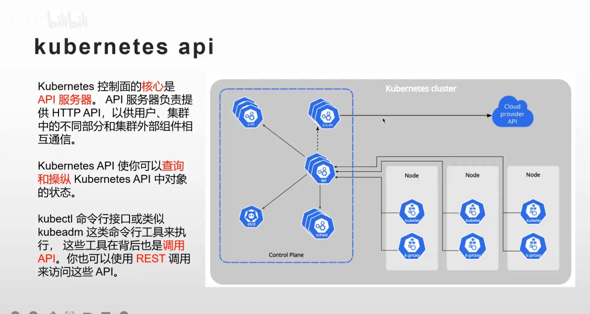
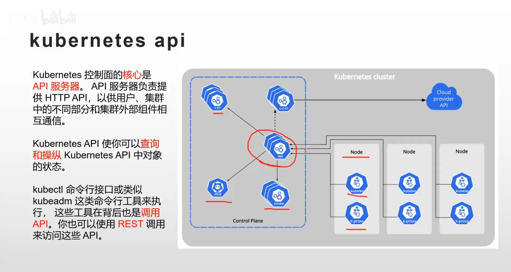
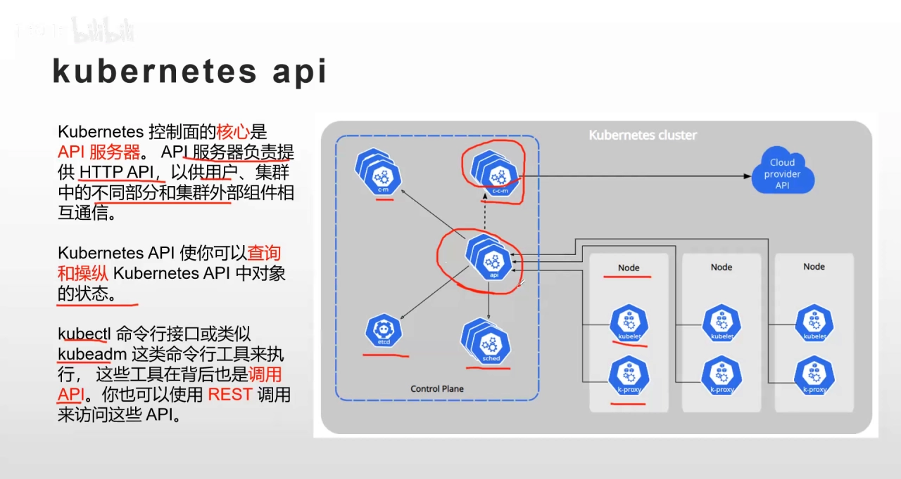
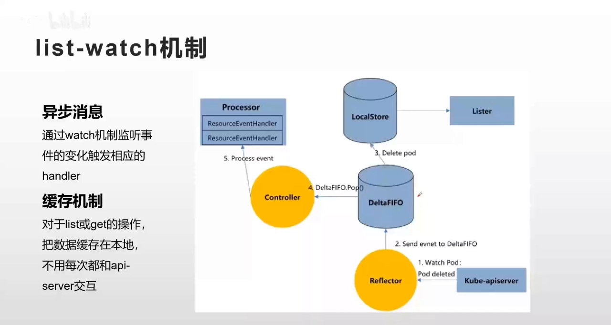
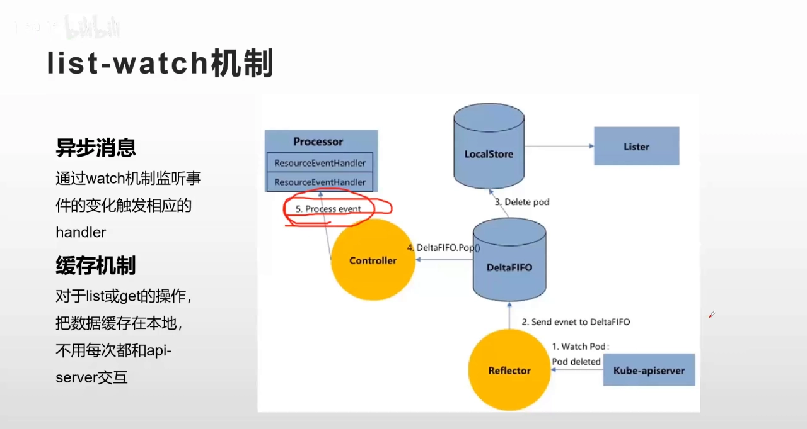
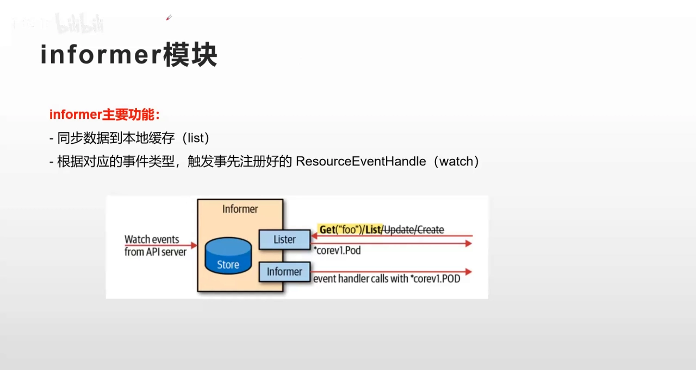
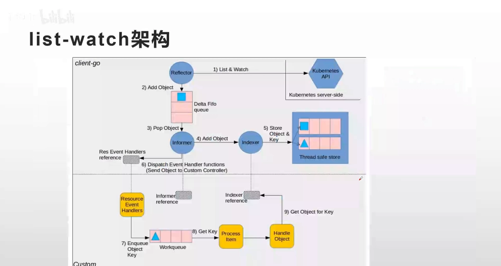
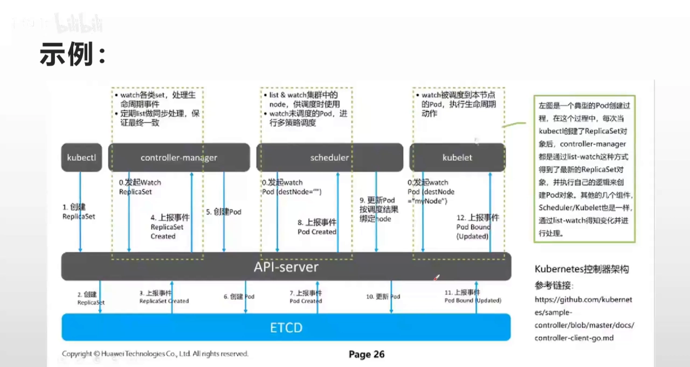
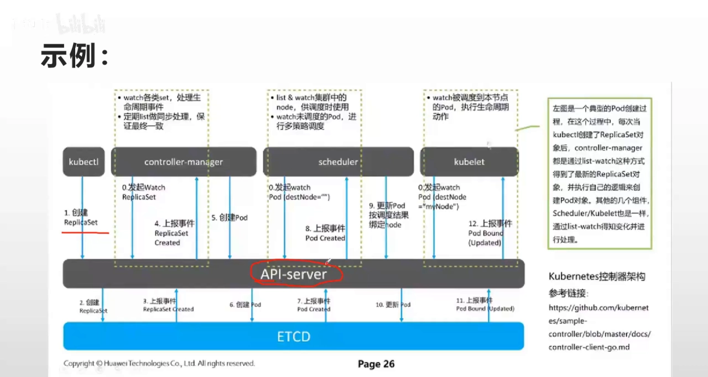
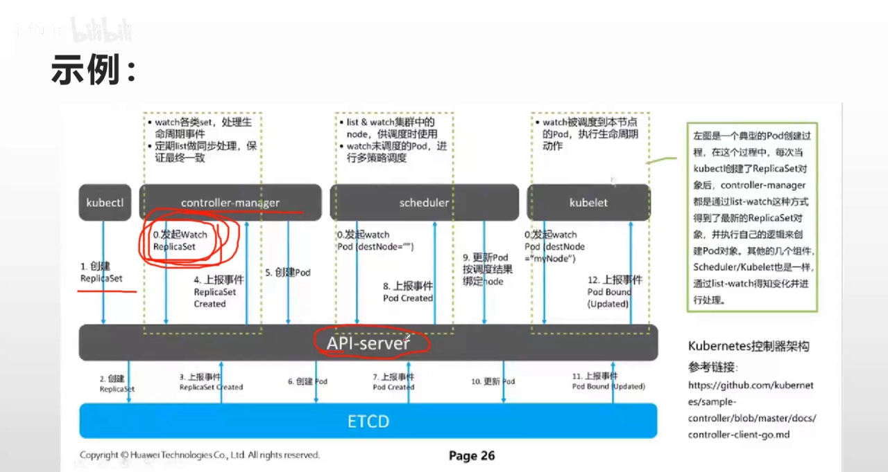

# Kubernetes list-watch 机制：集群组件如何只通过 API Server 通信

> 视频来源：[kubernetes list-watch机制（学习）](https://www.bilibili.com/video/BV1yR4y197dA/)｜时长：约 15 分钟
>
> 这是一支以"一张架构图 + 一张时序图"讲透 Kubernetes 组件通信机制的讲解视频。它回答了一个比"组件各干什么"更底层的问题：**集群里这么多组件，到底是怎么"对话"的**。本文按视频内容重写为中文，并纠正了自动字幕里的错拼（如 `cop net`→**Kubernetes**、`app收入`/`a p i`→**apiserver**、`cube cdl`→**kubectl**、`list voice`→**list-watch**、`义务消息`→**watch 消息**、`local store`→**local store（本地缓存）**、`df fo`→**DeltaFIFO**、`informer`→**informer**）。本文与同系列 1.1.1《控制面组件与职责》互补：那一篇讲"谁是谁"，这一篇讲"它们之间怎么通信"。

## 本讲要解决的核心问题（SCQA）

**背景**：上一讲我们已经把控制平面（API Server、Scheduler、Controller Manager、etcd）和节点组件（kubelet、容器运行时、kube-proxy）分清了——每个组件的职责都知道，也知道有一条铁律：所有组件都通过 API Server 通信。

**冲突**：可是"通过 API Server 通信"这句话背后藏着一个大问题。集群里的组件那么多，任何一个事件（创建 Pod、删除、扩缩容）都要落到 API Server 上；如果每个组件都靠自己**不停地轮询** API Server 去问"有没有新变化"，API Server 根本忙不过来。而如果让每个组件都自己去读 etcd，那 etcd 又会成为被反复踩踏的瓶颈。

**疑问**：组件们既不互相直连、也不直接连 etcd，那它们究竟靠什么机制，既能实时知道"某个资源变了"，又不会把 API Server 压垮？

**回答（中心思想）**：Kubernetes 用的是 **list-watch 机制**。它把"通信"拆成两半：**list** 先一次性拉取全量数据缓存到本地，**watch** 再用一条长连接，只在资源真正发生变化时才接收增量事件。于是组件平时读的是**自己内存里的缓存**，只有在需要改数据、或缓存需要"对账"时才去碰 API Server。这套机制由 client-go 的 **informer** 模块封装，是 kubelet、kube-proxy、scheduler、controller-manager 等所有组件的统一通信方式。

---

## 一、星型结构：所有组件都只通过 API Server 通信

视频开篇先给出一张典型的 Kubernetes 集群总览图：左边是控制平面，右边是数据平面（工作节点）。从这张图能看出一个关键事实——**所有组件都是通过 apiserver 来交互的**，都经过 apiserver 这一个组件通信。[【跳转到 00:25】](https://www.bilibili.com/video/BV1yR4y197dA/?t=25)

具体是哪些组件？视频一一列了出来：

- **控制器组件**（controller，如 controller-manager）——通过 apiserver；
- **etcd 组件**——通过 apiserver；
- **调度器组件**（scheduler）——通过 apiserver；
- **工作节点上的 kubelet**——通过 apiserver；
- **kube-proxy**——通过 apiserver。

所有这些组件都是通过 apiserver 来**解耦**的。它们的接口就是 apiserver，彼此之间并不直接建立连接。[【跳转到 00:50】](https://www.bilibili.com/video/BV1yR4y197dA/?t=50)

### 1.1 apiserver 到底是个什么服务

那 apiserver 实现了什么功能？其实它实现的就是**一个 API 服务器的功能**——我们把它当作一个 API 服务器来看待。它提供的是 **HTTP API，是一种 RESTful 风格的接口**，用这种方式来实现客户端、集群中不同的组件、以及集群外部组件之间的相互通信。[【跳转到 01:15】](https://www.bilibili.com/video/BV1yR4y197dA/?t=75)

有了它，我们就可以查询或操作 API 里的 Pod、Service 等等对象的状态。平时我们用 `kubectl` 或者 `kubeadm` 这类命令行工具去操作 k8s 资源时，其实最后也是调用 apiserver；当然，你也可以直接用 RESTful 的方式调用、访问 apiserver。[【跳转到 01:40】](https://www.bilibili.com/video/BV1yR4y197dA/?t=100)

> 一句话记住这个结构：**这是一个"星型"结构，中心是 apiserver，所有组件都是"星"的端点。** 谁也不直连谁，更没人绕过 apiserver 直连 etcd——etcd 只有 apiserver 能读写（这一点与 1.1.1 一致）。

## 二、为什么不能靠轮询：把 API Server 打爆的代价

既然所有组件都通过 apiserver 调用，一个问题就浮出水面：**如果发生任何一个事件**，或者说我们需要查询某一种资源的更新、删除、修改等操作，难道每次都要向 apiserver 发一次请求吗？[【跳转到 01:25】](https://www.bilibili.com/video/BV1yR4y197dA/?t=125)

显然，这样一来 apiserver 就会非常繁忙、肯定忙不过来——因为**任何一个时间点都可能触发对 apiserver 的一次操作**，这使得 apiserver 的负载过大，无法满足生产环境的需求。[【跳转到 01:50】](https://www.bilibili.com/video/BV1yR4y197dA/?t=150)

于是，一种叫 **list-watch** 的机制被提了出来。[【跳转到 02:55】](https://www.bilibili.com/video/BV1yR4y197dA/?t=175)

它解决问题的思路是两招：

1. **watch 消息 + 异步机制**：我们不需要实时去"问"资源的当前状态，而是被动接收变化通知；[【跳转到 03:10】](https://www.bilibili.com/video/BV1yR4y197dA/?t=190)
2. **缓存机制**：把全量数据缓存在本地，之后大部分查询直接命中本地内存。

这两招合起来，就把 apiserver 的压力降了下来。

## 三、list-watch 怎么工作：一次 list 拉全量，一个 watch 收增量

先看"什么时候才触发处理"：只有当资源发生变化、我们通过 **watch 机制监听到某个资源的变更通知以后**，才会触发这些事件变化；而这些事件变化，对应着我们事先注册好的**事件处理函数（event handler）**。[【跳转到 04:00】](https://www.bilibili.com/video/BV1yR4y197dA/?t=240)

再看"数据放在哪"：通过缓存机制，我们首先在**组件启动时**，用 list API 把**全量数据缓存到客户端本地（local store）**；下次再需要 get 或者 list 这些资源时，就**不需要和 apiserver 打交道了**，只需要访问本地缓存（也就是内存上的数据）即可。[【跳转到 04:25】](https://www.bilibili.com/video/BV1yR4y197dA/?t=265)

接着视频给出了右侧那张"数据流转图"，把内部流程一步步拆开：

- 客户端接收到一个 post/delete 操作的请求，会先发一个事件到一个叫 **DeltaFIFO** 的队列里；同时，这个"删除 Pod"的请求也会被发送到本地的 **local store**，local store 随之更新缓存数据；[【跳转到 04:50】](https://www.bilibili.com/video/BV1yR4y197dA/?t=290)
- 这个 local store，其实就是组件初始化时获取到的那份全量数据；当 watch 到数据变化时，也会首先同步到 local store；它实时响应这些事件、更新数据，于是我们下次 list 和 get 时就直接访问这个 store 就可以了；[【跳转到 05:15】](https://www.bilibili.com/video/BV1yR4y197dA/?t=315)
- 然后，会通过 DeltaFIFO 的 **pop** 操作把这个事件同步给 **controller**，controller 响应这个事件，调用相应的 `processEvent`，进而调用相应的事件处理函数，从而**创建或者删除一个 Pod**——注意，这些"真正的写操作"仍然是要和 apiserver 交互的。[【跳转到 06:05】](https://www.bilibili.com/video/BV1yR4y197dA/?t=365)

到这里可以总结成一句话：**list-watch 的本质 = 用 list 建一条 HTTP 短连接拉全量 → 存进本地 store → 之后用 watch 接收增量事件 → 通过队列（生产者-消费者）交给 controller 消费 → 事件处理函数执行真正的增删改。**[【跳转到 06:30】](https://www.bilibili.com/video/BV1yR4y197dA/?t=390)

## 四、informer：把 list-watch 封装起来的那个模块

所谓 list-watch，其实是**封装在 informer 这个模块里的**——informer 模块实现了 list 和 watch 的 API。[【跳转到 07:46】](https://www.bilibili.com/video/BV1yR4y197dA/?t=466)

从图上看它的逻辑很清晰：

- 如果是 **get 或 list** 操作，就直接调用 **list 接口**获取数据；
- 如果获取到的是**增删改**操作，就直接调用相应逻辑（**indexer**），触发事先注册好的事件处理函数（event handler）来处理相应事件。[【跳转到 08:11】](https://www.bilibili.com/video/BV1yR4y197dA/?t=491)

如果进一步深入源码，还会看到一整套数据结构：队列的 push/pop、触发的 handler、各种 **indexer**（informer 里各种资源及其区别），以及 **thread-safe 的 store** 这类数据存储方式。涉及的数据结构比较多，而且都有对应实现的接口。视频建议：**熟悉 client-go 的读者可以直接去看 client-go 相关源码。**[【跳转到 08:52】](https://www.bilibili.com/video/BV1yR4y197dA/?t=852)

## 五、端到端：一条 `kubectl create ReplicaSet` 引发的连锁反应

光看机制太抽象，视频用一个具体例子把它跑了一遍：**以创建 Pod、或创建 ReplicaSet 为例**，模拟从敲下命令到容器真正跑起来的全过程。[【跳转到 08:36】](https://www.bilibili.com/video/BV1yR4y197dA/?t=516)

1. **你敲命令**：通过 `kubectl` 命令行工具，输入 `kubectl create`（比如创建 ReplicaSet 的 YAML），也就是创建 ReplicaSet 这条命令。[【跳转到 08:41】](https://www.bilibili.com/video/BV1yR4y197dA/?t=521)

    

2. **apiserver → etcd**：apiserver 获取到这条命令的请求，把这个命令的模板放到内存、写进 **etcd** 存储；etcd 随即触发一个"资源创建"事件给 apiserver，而 apiserver 本身也在实时 **watch etcd 的变化**。[【跳转到 09:06】](https://www.bilibili.com/video/BV1yR4y197dA/?t=546)

3. **controller-manager 收到事件**：controller-manager 获取到 etcd 触发的事件后，会把它上报到 controller-manager 内部（因为它初始化时就针对各种资源类型去 watch 它们的变化，比如 Deployment、ReplicaSet、Pod 的变化），再分发到相应的 **reactor**——这期间经历了一次 **HTTP 长连接**。[【跳转到 09:31】](https://www.bilibili.com/video/BV1yR4y197dA/?t=571)

    

4. **触发创建 Pod 的处理函数**：接着它获取到 apiserver 上报的 ReplicaSet 事件——这个事件其实就是"要创建一个 Pod"，于是触发事件处理函数，向 apiserver 发出一条**创建 Pod 的指令**；apiserver 接到指令就创建这些 Pod，同时把 Pod 的模板（也就是它的**期望状态**）和其它参数写进 etcd。[【跳转到 10:46】](https://www.bilibili.com/video/BV1yR4y197dA/?t=646)

5. **scheduler 来调度**：我们知道，创建 Pod、用 kubelet 真正拉起 Pod 之前，需要通过 **scheduler** 来调度，决定这个 Pod 落在哪个节点上。scheduler 获取到 apiserver 发起的 Pod 创建事件后，会做一个 watch 操作（同样是**长连接**），然后触发它的一些调度函数，把 Pod **绑定（bind）到指定 node** 上；这时再次更新 Pod（记录它落在哪个 node），写进 etcd，etcd 触发一次 Pod 更新操作。[【跳转到 11:36】](https://www.bilibili.com/video/BV1yR4y197dA/?t=696)

    

6. **kubelet 真正拉起容器**：事件上报到 Pod 所在节点的 kubelet；kubelet 同样有一个 watch 操作，它 watch 到"Pod 创建"的命令后，就会调用容器引擎（CRI），真正创建出这个 Pod。[【跳转到 12:26】](https://www.bilibili.com/video/BV1yR4y197dA/?t=746)

    

这就是从"敲一条命令创建资源"到"资源真正生成"的完整过程——**它其实就是 list-watch 机制在背后串起来的一条链**。[【跳转到 12:51】](https://www.bilibili.com/video/BV1yR4y197dA/?t=771)

## 六、list 与 watch 的分工：watch 管实时，list 管"对账"

最后视频强调：这条链里**最主要的其实是 watch**——它负责实时接收变化。那 list 又是干什么的？[【跳转到 13:16】](https://www.bilibili.com/video/BV1yR4y197dA/?t=796)

list 的作用是**"对账"**：在 watch 的过程中，如果某个事件中断了（长连接断开、事件丢失），我们就会通过 list 重新获取**实际状态**，再和 etcd 里记录的**期望状态**进行比对；如果不一致，就做同步处理——可能会创建一个新的 watch 来更新、同步数据。[【跳转到 13:41】](https://www.bilibili.com/video/BV1yR4y197dA/?t=821)

一句话对比：**watch 负责"增量、实时"，list 负责"全量、兜底"**。两者配合，才让组件既实时又不容易"掉队"。

## 小结

- **星型拓扑**：集群所有组件（controller、scheduler、etcd、kubelet、kube-proxy……）都只通过 **kube-apiserver** 交互，apiserver 是一个 RESTful 风格的 HTTP API 服务器，组件之间靠它解耦。[【跳转到 00:50】](https://www.bilibili.com/video/BV1yR4y197dA/?t=50)
- **为什么需要 list-watch**：如果组件都去轮询 apiserver，任何时刻的操作都可能把它打爆，负载无法满足生产需求。[【跳转到 02:30】](https://www.bilibili.com/video/BV1yR4y197dA/?t=150)
- **list-watch = list + watch**：list 一次性拉全量进本地缓存（local store），watch 用长连接只接收增量事件。[【跳转到 04:25】](https://www.bilibili.com/video/BV1yR4y197dA/?t=265)
- **数据流**：事件进入 **DeltaFIFO** 队列 → 更新 local store → controller 消费 → 触发 event handler → 执行真正的增删改。[【跳转到 06:05】](https://www.bilibili.com/video/BV1yR4y197dA/?t=365)
- **informer 封装**：list-watch 封装在 client-go 的 **informer** 模块里，对外提供 list/watch API 与 indexer/store 等结构。[【跳转到 07:46】](https://www.bilibili.com/video/BV1yR4y197dA/?t=466)
- **端到端链路**：`kubectl create` → apiserver → etcd → controller-manager → 创建 Pod 指令 → scheduler 调度绑定 → kubelet 调 CRI 起容器。[【跳转到 12:51】](https://www.bilibili.com/video/BV1yR4y197dA/?t=771)
- **list vs watch**：watch 管实时增量，list 管全量兜底（对账、重建 watch）。[【跳转到 13:16】](https://www.bilibili.com/video/BV1yR4y197dA/?t=796)

## 关键术语速查

| 术语 | 一句话解释 |
| --- | --- |
| apiserver | 集群唯一的 API 入口，RESTful 风格的 HTTP API 服务器，所有组件都通过它与集群交互 |
| list-watch | 组件与 apiserver 通信的核心机制：list 拉全量 + watch 收增量 |
| watch | 建立在 HTTP 长连接上的机制，资源一有变化就主动推送事件给客户端 |
| informer | client-go 里封装 list-watch 的模块，维护本地缓存并分发事件 |
| local store | 组件本地缓存（内存），保存 list 拉来的全量数据，读操作优先命中它 |
| DeltaFIFO | 存放"资源变化事件"的先进先出队列，controller 从中 pop 事件来消费 |
| event handler | 事先注册好的事件处理函数，被 controller 在消费事件时调用 |
| indexer | informer 内对缓存对象建索引的结构，支持按索引快速查找 |
| reactor | controller-manager 内部对不同资源变化的分发处理单元 |
| CRI | 容器运行时接口，kubelet 通过它调用容器运行时真正拉起容器 |
