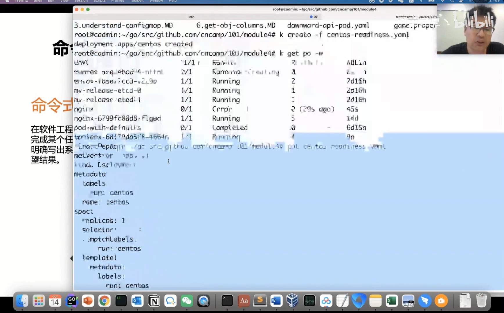
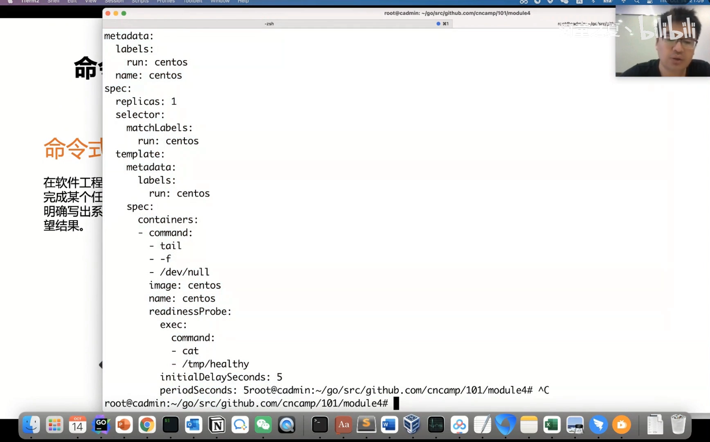
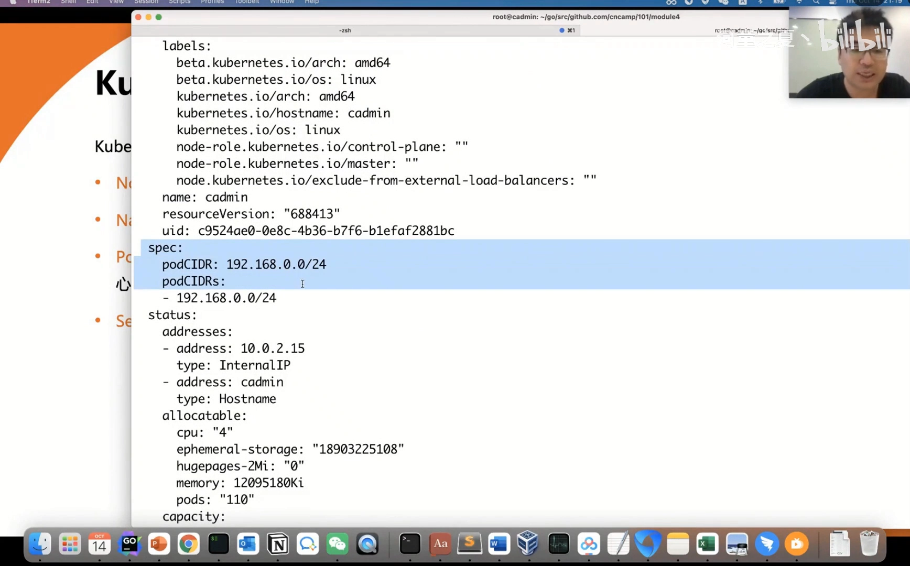
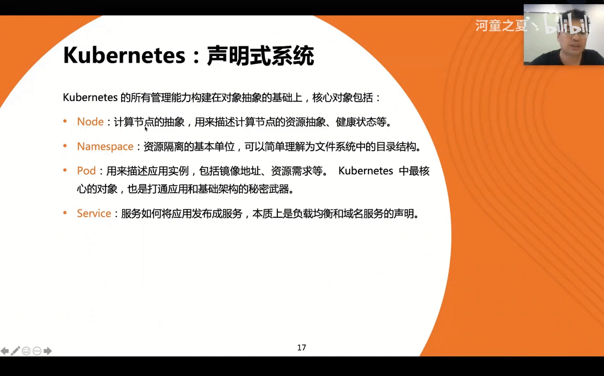

# K8S 架构原则与对象设计：声明式系统

> 视频来源：[7.6 K8S架构原则和对象设计-K8S—声明式系统](https://www.bilibili.com/video/BV1ew4m1f7ZX/)｜时长：约 20 分钟
>
> 这是一支云原生课程的课堂实录：前半段用 `kubectl run` / `kubectl create` 现场演示「声明式」到底长什么样，后半段回到理论，讲清命令式与声明式两种系统模式的区别、声明式系统里 `spec`（期望状态）与 `status`（实际状态）的分工，以及 K8s 如何用 node、namespace、pod、service 这几个对象把整个集群「抽象」出来。本文按视频内容重写为中文，并纠正了自动字幕里的错拼（如 `cooperation`/`COVENESS`/`COINT`→**Kubernetes（k8s）**、`cop c t l`/`cop Ctrl`→**kubectl**、`yo 文件`→**YAML 文件**、`JASON`→**JSON**、`生命式`→**声明式**、`name space`→**Namespace**、`pad`→**Pod**、`OPENNET`→**Kubernetes**）。与同系列 1.1.1《控制面组件与职责》互补：那一篇讲组件「谁是谁」，这一篇讲它们共同服务的「声明式模型」是什么。

## 本讲要解决的核心问题（SCQA）

**背景**：在 K8s 里创建资源，最典型的方式是写一份 YAML，`kubectl create -f` 一提交，过一会儿 `kubectl get` 就发现 Pod 已经跑起来了。我们已经习惯了「提交一份描述文件」这件事。

**冲突**：但如果把 K8s 和以前的 `docker run` 放在一起看，会立刻发现一个反差——`docker run` 是「我命令你现在把一个容器跑起来」，命令的执行和结果是同一件事；而 K8s 只是「我告诉你我想要什么」，中间会发生调度、绑节点、拉镜像、起容器一长串动作，而命令行早就返回了，我并没有一步一步地指挥它。

**疑问**：K8s 为什么要刻意把「我要三个副本」和「启动三个容器」区分开？这套「只描述结果、不描述过程」的模型到底解决什么问题？要做到这一点，系统内部又必须额外具备哪些能力？

**回答（中心思想）**：K8s 是一套 **声明式系统（declarative system）**。用户把请求保存成对象的 **spec（期望状态）**，系统自己去达成，并把最终达成的 **status（实际状态）** 反馈回来。正因为「请求被持久保存、目标本身是稳定的」，系统才能反复尝试、从中断里恢复、把小步动作做得可重试可验证。也正因为 K8s 只做两件事——**定义厂商中立的通用 API** 和 **提供厂商中立的通用框架**——它才能解决高可用、滚动升级、故障转移、扩缩容这些「和任何厂商实现都无关」的通用问题，最终成为业界标准。

---

## 一、先看一个 Demo：从 docker run 到 kubectl create

视频先不讲理论，而是用一个最简单的例子把「声明式」摆到眼前。[【跳转到 00:55】](https://www.bilibili.com/video/BV1ew4m1f7ZX/?t=55)

### 1.1 kubectl run 就像 docker run

用容器的时候我们会用 `docker run`，一条命令直接指定要跑哪个镜像。到了 K8s，有一个同样重要的命令——`kubectl`（凡是装过 K8s 的机器上都有它）。其中 `kubectl run` 和 `docker run` 很像：`docker run` 是「跑一个容器镜像的某个实例」，`kubectl run` 也是一样，只不过它会在集群里产生一个 **Pod** 的概念。

所以 `kubectl run` 去运行某个镜像时，效果就是集群里多了一个正在运行的 Pod。这说明——**`kubectl run` 是一条命令式的入口**，它和 `docker run` 一样，是「直接下命令」。

### 1.2 用一份 YAML 定义对象（这才是声明式）

但 K8s 真正推荐的用法不是敲命令，而是**写一份 YAML 文件**。[【跳转到 02:45】](https://www.bilibili.com/video/BV1ew4m1f7ZX/?t=165)

YAML 类似于 JSON，区别在于它**用缩进（空格）来约定属性和属性之间的关系**，因此不需要 JSON 里那层层大括号。这份文件定义了一个「对象」，里面依次写了这些东西：

- **apiVersion**：用哪个版本的 API；
- **kind**：这是什么类型的对象；
- **metadata**：它的名字（`name`）是谁；
- **spec**：最关键的部分——**它的定义、也就是我们「期望」的样子**。

写完之后，用 `kubectl create` 提交这份文件，对象就被创建了：`kubectl get` 一查，能看到已经有一个 Pod 在运行。接着还能像 `docker exec` 那样，用 `kubectl exec` 直接进到这个 Pod 的容器里操作。[【跳转到 03:26】](https://www.bilibili.com/video/BV1ew4m1f7ZX/?t=206)

**这段 Demo 最核心的点是**：我们只是**用一份 YAML 声明了「要在 K8s 上运行一个什么样的程序」**——跑哪个镜像、执行什么命令、要多少 CPU 和资源。剩下的，都交给 K8s。

### 1.3 请求提交后，K8s 内部做了什么

K8s 拿到这份声明后，大致做四件事：[【跳转到 04:28】](https://www.bilibili.com/video/BV1ew4m1f7ZX/?t=268)

1. **接收请求**：通过 API 接口把这份声明收下来；
2. **保存请求**：把这份「期望」持久保存下来（不是执行完就丢）；
3. **调度绑定**：经过调度能力，把这个请求和某个具体的计算节点绑定起来；
4. **节点执行**：在那个节点上，用容器技术把声明的镜像跑起来。

“接收 → 保存 → 调度 → 在节点上跑起来”，这就是 K8s 背后所做的事。注意到没有——**K8s 是先「把期望存下来」，再去「慢慢实现它」**。这正是后面要讲的声明式系统的关键。

---

## 二、命令式与声明式：两种系统模式

讲完 Demo，视频回到理论：今天的系统大部分可以分成两种模式——**命令式**和**声明式**。[【跳转到 05:07】](https://www.bilibili.com/video/BV1ew4m1f7ZX/?t=307)

### 2.1 命令式：交互式，关注「如何做」

命令式一般就是**交互式的系统**，它关注的是**如何做**。

在操作系统里敲 `ls`，它给你反馈「当前有哪些文件」；敲 `pwd`，它告诉你「你现在在哪」；敲 `cd`，它切换目录。这就是命令式——**我给一个命令、它给我一个反馈，我再根据上一次的反馈，决定下一条命令怎么敲**。

这种系统里，**人是全程参与的**：每一步都依赖上一步的返回结果。

### 2.2 声明式：只约定「做什么」

声明式则相反：**只约定我需要做什么，至于你怎么做，我不关心。** [【跳转到 06:15】](https://www.bilibili.com/video/BV1ew4m1f7ZX/?t=375)

视频给了两个很贴切的类比：

- **电视遥控器是命令式的**：我按一下换频道，它给我换掉，我看看喜不喜欢，再决定换下一个——交互式、一步步来。
- **空调是声明式的**：我控制不了「它什么时候把室温调到我需要的值」，我唯一能做的是**设定一个期望温度**（比如 25℃），剩下的交给它。

在 K8s 这类场景里，命令式就是我们给一个请求、它立马返回；可一旦任务复杂、要 10 分钟甚至 20 分钟才做完，命令式就尴尬了——[【跳转到 07:30】](https://www.bilibili.com/video/BV1ew4m1f7ZX/?t=450)

- 要么**一直阻塞**等着它给我反馈；
- 要么**一直轮询**问它「好了吗？好了吗？」；
- 而声明式给的是第三条路：**我告诉你目标，你做完以后，把结果更新到你的状态里就行**——我随时来查即可。

### 2.3 复杂系统为什么需要声明式

交互式（命令式）一般只适合**响应非常快、足够简单**的系统：我给命令、你立马返回。可真实世界的复杂系统做不到，于是声明式就成了更自然的选择。视频甚至说：**K8s 之所以能「一统江湖」，正是声明式这种系统帮了它的大忙。**[【跳转到 07:55】](https://www.bilibili.com/video/BV1ew4m1f7ZX/?t=475)

一句话概括两者的差别：

> 命令式是「我要你做、我要你怎么做，你严格按我的要求一步一步做」——一种**家长式的约束**；
> 声明式是「我告诉你我要做一件事、目标是什么，你做好了告诉我」。

---

## 三、spec 与 status：声明式系统的设计初衷

声明式系统的一大好处是：**请求可以被保存下来**。[【跳转到 08:57】](https://www.bilibili.com/video/BV1ew4m1f7ZX/?t=537)

因为我把请求交给了你，你就可以用某种方式把它**持久保存**，然后慢慢去做。这里就引出了 K8s 对象里最重要的两个字段：

- **spec**：保存下来的「我的请求」，也就是**期望状态**；
- **status**：你真实系统的**当前状态、实际状态**。

于是整个交互就变成了：**我把期望状态（spec）告诉你 → 系统自己去实现 → 系统把最终的真实状态（status）反馈回来。** 这就是声明式系统设计的初衷，也是以后我们写控制器、看对象设计时会反复遇到的规范——**几乎所有 K8s 对象都遵循它**。

> 记住这对搭档：**spec 是「我想要的」，status 是「现在的实况」**。声明式系统的工作，本质就是不断让 status 去逼近 spec。

---

## 四、K8s 的核心：厂商中立的 API + 通用框架

视频很推崇 K8s 的一个重要原因：**它其实「没做什么」，只做了两件事**。[【跳转到 10:00】](https://www.bilibili.com/video/BV1ew4m1f7ZX/?t=600)

1. **定义了一堆 API**——这些 API 是**厂商中立的、通用的**；
2. **提供了一套框架来支撑这些 API**，给它提供最核心的功能——这些框架代码也**完全是厂商中立的**。

它的目标，是用可复用的核心框架代码去解决**业界的一些通用问题**。什么是通用问题？**高可用怎么做、滚动升级怎么做、故障转移怎么做、扩缩容怎么做**。

关键在于：**这些问题的解法，跟任何厂商实现、任何技术实现都没有太大关系**——因为它们是通用逻辑。[【跳转到 11:15】](https://www.bilibili.com/video/BV1ew4m1f7ZX/?t=675)

- 你用 Linux 还是 Windows？没关系。
- 你是 ARM 还是 x86？没关系。
- 你用什么样的网络、什么样的存储？那是厂商自己要解决的事——**自己提供对应的插件（plugin）就行**。

**这正是它厉害、也必然长寿的地方**：K8s 把「厂商相关」的东西剥离出去，只解决最核心的通用问题；同时又把系统做得足够灵活，**任何人、任何方案都可以和它对接**。比如你自己提供一个 CNI 网络插件，甚至可能因此成就一家创业公司——**它给整个生态都带来了机会**，所以大家都愿意跟它对接。

---

## 五、对象抽象：node、namespace、pod、service

既然是声明式系统，集群里被管理的一切，**都得有对应的「对象」**。视频接着梳理了 K8s 的几个核心对象抽象。[【跳转到 12:30】](https://www.bilibili.com/video/BV1ew4m1f7ZX/?t=750)

### 5.1 node：把计算资源抽象出来

K8s 的本质，是把一堆集群节点组成一个集群，所以它天然有**集群管理**的功能：怎么把几百上千个节点组成一个集群？——用 **node** 对象来抽象。[【跳转到 13:09】](https://www.bilibili.com/video/BV1ew4m1f7ZX/?t=789)

装好 K8s 集群后就有 node 对象，它的名字通常就是主机名。在 node 对象里能看到：这个节点上 Pod 的 CIDR、节点本身的状态、以及**共有多少 capacity（总计算资源）、多少可分配（allocatable）资源**。也就是说，node 把「计算资源」这件事抽象成了一个可声明的对象。

### 5.2 namespace：隔离用的「虚拟目录」

集群管理用 node 抽象好了，那**用户的应用**怎么管？能不能把多个用户、多个项目的对象**彼此隔离开**？——用 **namespace** 对象。[【跳转到 13:59】](https://www.bilibili.com/video/BV1ew4m1f7ZX/?t=839)

视频用文件系统来类比：一台电脑用目录把整个磁盘管理起来，把文件放进不同目录，还能给目录设权限。**namespace 就是一个「虚拟的文件系统目录」**：一旦创建，其它对象就可以放进这个目录里。

由此，K8s 的对象分成两类：

- **namespace 对象**：可以放进某个 namespace，比如 Pod；
- **非 namespace 对象**：它属于**整个集群**，不属于任何 namespace，比如 node。

所以 `kubectl get node` 只会显示名字、**没有 namespace**；而一个 Pod 的属性和定义里则带有 `namespace`（默认是 `default`）。这样做的好处很实际：可以为 namespace 设权限、做访问控制——「我建的对象不让人动、甚至不让人看」；而且当集群里有几十万上百个 Pod 时，**每次只查某个 namespace，查询也很快**；如果全都堆在一起，就完全没法管理了。

### 5.3 pod：打通基础设施与应用

接下来是最核心的对象——**Pod**。[【跳转到 15:55】](https://www.bilibili.com/video/BV1ew4m1f7ZX/?t=955)

Pod 是**用来描述应用实例**的核心对象，也是 K8s 里设计最精巧的体现之一。视频强调：**正是 Pod 这个对象的出现，打通了「基础架构」和「应用接入」这两个原本割裂的维度**——大家都可以面向 Pod 的 API 来完成各自的业务目的。

视频用自己公司的经历举例：以前用 OpenStack 集群，下面是 OpenStack 层、只管操作系统，上面只管应用部署，**上下两层是割裂的**：

- 没有一个好的视图能回答「哪些应用部署在哪些集群上」；
- 要做 OpenStack 集群升级时，很难知道「哪些节点可以一起重启」；
- 一起重启时会不会影响应用？也无从判断。

结果就是**基础架构层面的升级变得非常困难**。而 K8s 里有了 Pod、有了面向应用的容器镜像、有了统一的 API，**基础架构和应用就能联动起来**：我能知道「这些 Pod 跑在这些节点上」，也就能判断「重启某个节点或某批节点会影响哪些应用」。[【跳转到 16:45】](https://www.bilibili.com/video/BV1ew4m1f7ZX/?t=1005)

Pod 里主要包含**镜像地址、资源需求**这些信息——说白了，就是用户来描述「我要跑一个 Nginx，需要一个 CPU、2G 内存」这样的抽象。

### 5.4 service：把服务发布出去

最后一个是 **service**。[【跳转到 17:35】](https://www.bilibili.com/video/BV1ew4m1f7ZX/?t=1055)

你把应用实例跑起来之后，**怎么对外发布服务**？你肯定需要一个负载均衡、域名之类的能力——这就是 service 提供的：它负责**服务发现和服务治理**。

### 5.5 小结：K8s 到底做了什么

把上面几件事串起来，K8s 其实回答的是一个老问题——「集群管理、作业调度、服务发现」： [【跳转到 18:00】](https://www.bilibili.com/video/BV1ew4m1f7ZX/?t=1080)

- 用 **node** 的抽象，实现对**计算资源的抽象**与**集群管理**；
- 用 **pod** 描述「运行哪个镜像、需要多少资源」；
- 用 **scheduler（调度器）** 完成**作业调度**；
- Pod 调度、应用起来之后，用 **service** 把应用发布出去，供别人访问，由此带来**服务发现与服务治理**的能力。

---

## 小结

- **声明式是 K8s 的底色**：不描述每一步怎么做，只描述「结果应该是什么」；K8s 能成为业界标准，声明式系统帮了大忙。
- **spec / status 是核心契约**：spec 是期望状态（用户请求被持久保存的地方），status 是实际状态；系统的职责就是不断让 status 逼近 spec。
- **K8s 只做两件「厂商中立」的事**：定义通用 API、提供通用框架，用它去解决高可用、滚动升级、故障转移、扩缩容这类通用问题；厂商相关的网络/存储则交给插件，从而既长寿又繁荣。
- **一切都落成对象**：node 抽象计算资源、namespace 做隔离、pod 描述应用实例并打通基础设施与应用、service 负责发布与服务发现。
- **一句话记住 Demo 的含义**：写一份 YAML（声明）+ `kubectl create`（提交）——你给的是「期望」，K8s 负责「达成」。

## 关键术语速查

| 术语 | 一句话解释 |
| --- | --- |
| 命令式（imperative） | 交互式系统，交代「每一步怎么做」，人全程参与、逐步根据反馈决策 |
| 声明式（declarative） | 只描述「想要的结果」，不关心过程；请求可被保存，系统自行达成并反馈状态 |
| spec | 对象里保存的「期望状态」，即用户提交的请求 |
| status | 系统反馈的「实际状态」，即当前真实情况 |
| 声明式系统（declarative system） | 保存期望、持续逼近目标的系统模式；K8s 即以此为核心 |
| node | 集群节点对象，抽象计算资源（capacity / allocatable）并承载集群管理 |
| namespace | 用于隔离的「虚拟目录」；对象分为 namespace 对象与非 namespace 对象 |
| pod | 描述应用实例的核心对象，打通基础架构与应用两个维度 |
| service | 负责对外发布服务，提供负载均衡、服务发现与服务治理 |
