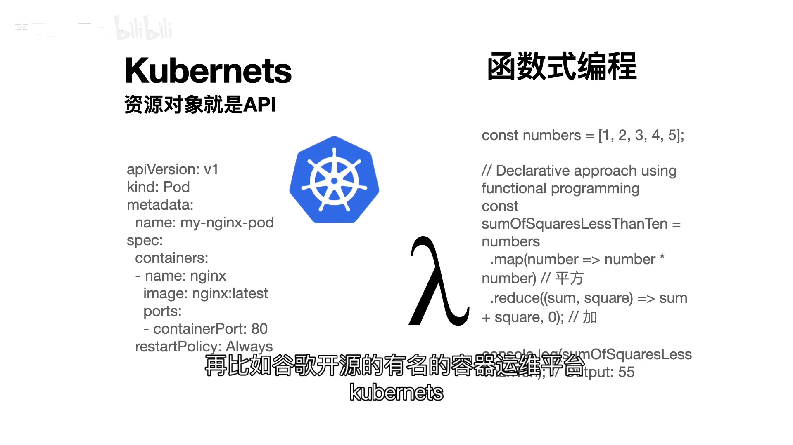
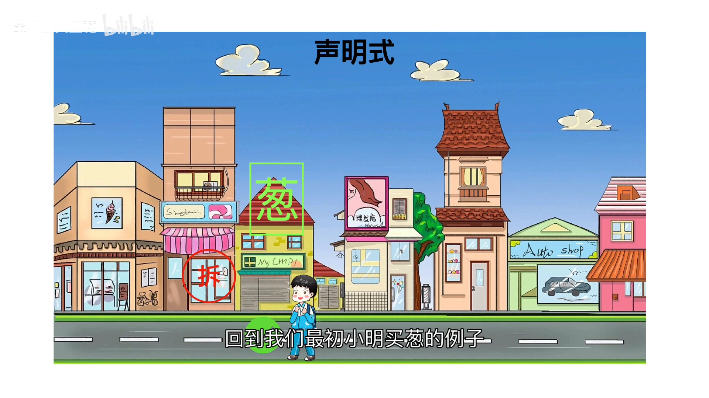
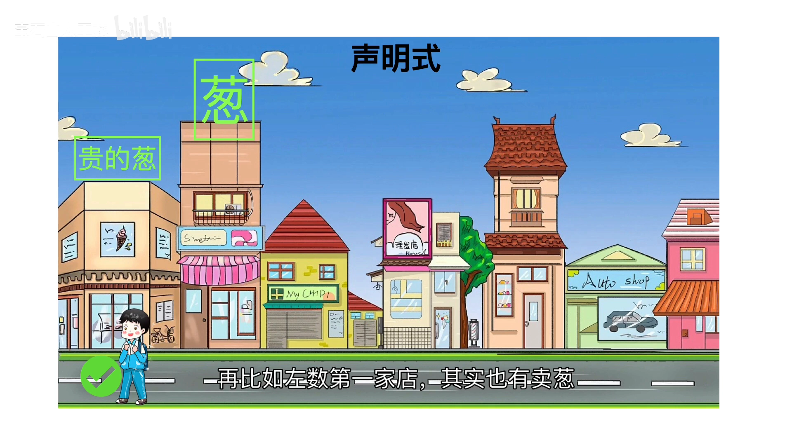

# 什么是声明式：声明式 vs 命令式，K8s 为什么选择声明式

> 视频来源：[什么是声明式？声明式 vs 命令式！k8s为什么选择声明式？声明式一定更高级吗？](https://www.bilibili.com/video/BV1Yx4y167W2/)｜时长：约 4.5 分钟
>
> 这是一支用「妈妈让小明买葱」这一个日常例子，把声明式与命令式讲透的概念讲解视频。它回答的是 1.2 节最基础也最容易含糊的问题：**声明式到底是什么、为什么 K8s 选择声明式、以及声明式是不是就一定更高级**。本文按视频内容重写为中文，并纠正了自动字幕里的错拼（如 `cooper net`→**Kubernetes（K8s）**、`yo 文件`→**YAML 文件**、`生命式`/`指令式`→**声明式/命令式**、`中泰生平时`→**声明式平时（声明式天然）**、`密等`→**幂等**、`脉冲`→**货**、`充电`→**店铺**）。与同系列 1.2.1《K8S 架构原则与对象设计：声明式系统》互补：那一篇讲 K8s 的声明式系统「长什么样」，这一篇讲「为什么」。

## 本讲要解决的核心问题（SCQA）

**背景**：我们天天在写 YAML、`kubectl apply`，也都听说过 K8s 是「声明式」的。可到底什么是声明式？它和命令式（我们更熟悉的敲命令、一步步操作）到底差在哪？

**冲突**：有人说声明式更高级、更适合 K8s。但既然声明式这么好，为什么不全用声明式？命令式是不是就没有价值了？

**疑问**：声明式与命令式的本质区别是什么？它们各自的好处和代价在哪里？K8s 为什么偏偏选了声明式？

**回答（中心思想）**：声明式的本质是**只描述「要什么结果」，不管「怎么做到」**——它天然抽象更高、更好维护、更利于并行；而命令式是**把每一步怎么做都交代清楚**，在特定场景下**性能更高、更能满足定制化需求、对细节掌控更强**。所以结论是：**通常提供声明式 API 对用户更友好，但命令式并非过时——关键看场景**。K8s 把「描述结果」交给用户，把「怎么做到」留给自己。

---

## 一、一个买葱的例子：声明式与命令式的分界

视频用一个日常场景切入。[【跳转到 00:09】](https://www.bilibili.com/video/BV1Yx4y167W2/?t=9)

- 妈妈说：「**去买一根葱**」——这是**声明式**。它只强调**最终结果**：不管你去哪儿买、怎么买，只要最终买到葱就行。
- 妈妈又说：「**去左数第二家店里买一根葱**」——这是**命令式**。它把**如何达到结果的每一步**都详细描述了出来。

差别一下就清楚了：

> **声明式关注「要什么」，命令式关注「怎么做」。** 在命令式下，小明只能去左手第二家店买葱，他**不能**去左手第三家买。

## 二、K8s 是声明式的典型代表

再看 K8s。[【跳转到 00:42】](https://www.bilibili.com/video/BV1Yx4y167W2/?t=42)

K8s 是一个把声明式用得「炉火纯青」的开源软件：它把**所有资源对象都通过一份 YAML 文件来描述**，而 YAML 中描述的，**将成为这个对象的最终状态**——这就是我们常说的「**所见即所得**」，是一种非常典型的声明式设计。

视频还顺带提了一句背景：**声明式更早出现在函数式编程里**，函数式编程通常代码很简洁、程序功能一目了然。

于是问题来了：**声明式一定更好吗？是所有的程序都应该采用声明式设计吗？** 接下来视频围绕买葱这个例子，逐条数了声明式的好处与代价。

## 三、声明式的三个好处

### 3.1 抽象程度更高，篇幅更短

因为声明式的理念是**屏蔽具体过程、直接展示结果**，所以它**天然的抽象程度更高**；用声明式设计的程序或 API，**篇幅也更短**。[【跳转到 01:18】](https://www.bilibili.com/video/BV1Yx4y167W2/?t=78)

### 3.2 易于维护，兼容性问题更少

再看维护性。声明式**没有每一步的细节**，所以**步骤的变化并不会影响到 API**。[【跳转到 01:43】](https://www.bilibili.com/video/BV1Yx4y167W2/?t=103)

视频用「店搬家」来说明：假如那家店**从左数第二家搬到了左数第三家**——

- **在声明式下**：这不受影响，因为程序内部会自动找到一家卖葱的店，只要达到「买到一根葱」的目的即可；
- **在命令式下**：就会出问题。因为妈妈详细交代了「必须去左数第二家店」，却没交代「店搬家了怎么办」，于是**接口就必须更新**——为了兼容各种异常，指令越写越复杂。

这里有个关键隐喻：**妈妈就是「你的用户」，小明就是「你的程序」**。如果你把程序设计成命令式，你的用户就得**维护一大堆复杂的指令**。[【跳转到 02:13】](https://www.bilibili.com/video/BV1Yx4y167W2/?t=133)

反过来，声明式其实**天然传递了一些信息**：如果你宣称你的接口是声明式的，那就相当于告诉用户——**无论如何，你的程序最终会达到用户所描述的状态**。

### 3.3 更好并行

声明式还有一个好处是**更好并行**。[【跳转到 02:38】](https://www.bilibili.com/video/BV1Yx4y167W2/?t=158)

假设妈妈除了买葱还要买蒜：

- **声明式的说法**：「去买葱和蒜」；
- **命令式的说法**：「去左数第二家店买葱，然后去另一条街的第三家店买蒜」。

在声明式下，小明可以**指挥小弟在自己买葱的同时去买蒜**，于是**性能提升一倍**；而在命令式下，因为妈妈指定了「必须先买葱、再买蒜」的顺序，**即使有小弟也无法并行**。

## 四、声明式的代价：命令式并非过时

那声明式有没有问题呢？有。[【跳转到 03:22】](https://www.bilibili.com/video/BV1Yx4y167W2/?t=202)

声明式下，妈妈**没有说明如何买葱**，那么「怎么买」就得由小明自己去实现一套算法。假设小明的算法是：**从左数第一家店开始，挨家挨户问老板有没有葱，有就买**——比起命令式，这样**多出了「挨个询问」的时间，效率变低了**；如果偏偏要到第 100 家才买得到，那这个算法就会**严重影响性能**。

再比如：左数第一家店**其实也有葱，只是更贵**。在声明式下，小明只需要达成「买葱」的目的，**当然会选第一家**，因为快；可如果妈妈想买**便宜**的葱，就**最好改用命令式**，直接告诉小明「必须去左手第二家店买才可以」。

于是就有了这段总结：[【跳转到 03:47】](https://www.bilibili.com/video/BV1Yx4y167W2/?t=227)

**命令式也有它的好处**：在特定场景下**性能更高**、可以完成**更定制化的需求**、对细节**有掌控**。

## 五、结论：看场景，而不是看「谁更高级」

视频最后给出结论：[【跳转到 04:12】](https://www.bilibili.com/video/BV1Yx4y167W2/?t=252)

> **通常情况下，我们提供声明式的 API 会对用户更友好**——接口使用更简洁、抽象程度更高；**但对于一些特殊的用户，命令式的 API 反而更能满足他们的需求。**

所以「声明式一定更高级吗」的答案是否定的：**它是两种取向、各自适配不同场景**。K8s 的选择是——把「描述结果」这部分交给声明式（因为它面向的是大量、复杂、长期运行的对象，更需要抽象、维护性和并行性），而在需要精细控制时，仍然保留命令式的入口（比如 `kubectl run`、`kubectl create`）。

## 小结

- **本质区别**：声明式只描述「要什么结果」，命令式把「每一步怎么做」都交代清楚。
- **K8s 是声明式的典型代表**：所有资源对象都用 YAML 描述，YAML 里写的就是对象的最终状态——所见即所得。
- **声明式的三个好处**：抽象更高、篇幅更短；易于维护、兼容性问题更少（步骤变化不影响接口）；更好并行。
- **声明式的代价**：具体算法要由实现方负责，算法不好就会影响效率/性能；也可能偏离用户的隐含偏好（如「买便宜的」）。
- **命令式的价值**：特定场景性能更高、更能满足定制化需求、对细节有掌控。
- **一句话结论**：通常声明式 API 对用户更友好；但特殊场景下命令式反而更合适——**选择取决于场景，而非高低之分**。

## 关键术语速查

| 术语 | 一句话解释 |
| --- | --- |
| 声明式（declarative） | 只描述要达到的结果，不描述实现步骤；K8s 的 YAML 即此风格 |
| 命令式（imperative） | 把每一步如何做都交代清楚，逐步下达指令 |
| 所见即所得 | YAML 里描述的对象状态，就是它最终要达到的状态 |
| 抽象程度 | 屏蔽过程、只暴露结果的程度；声明式天然抽象更高 |
| 兼容性 | 内部实现（如「店搬家」）变化时，是否还需要改动对外接口 |
| 并行性 | 任务之间能否同时执行；声明式因不强制顺序而更易并行 |
