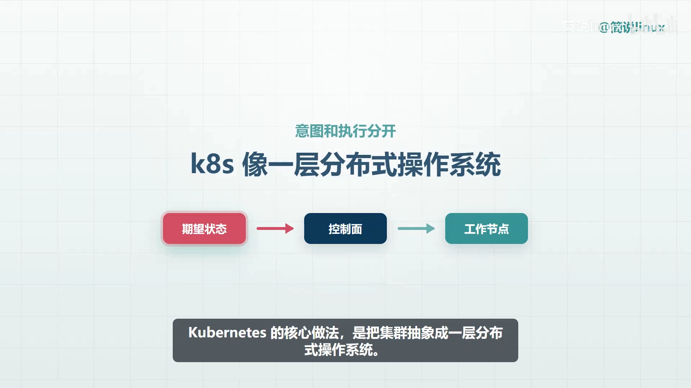
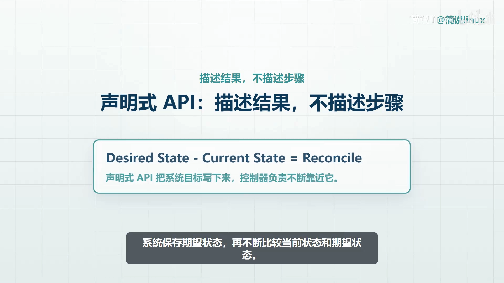
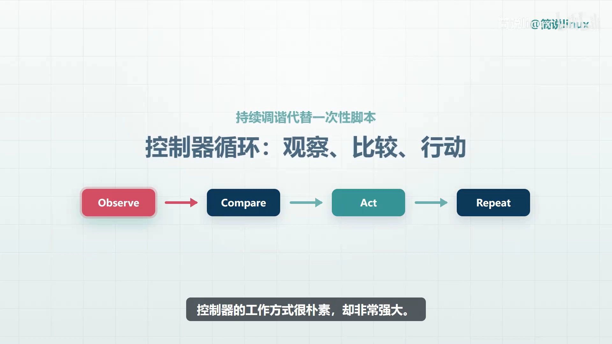
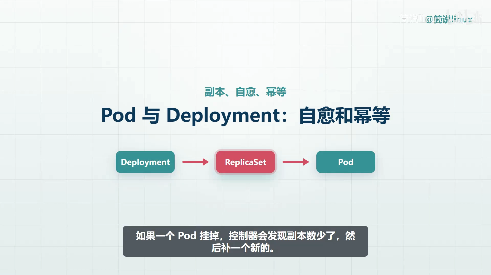
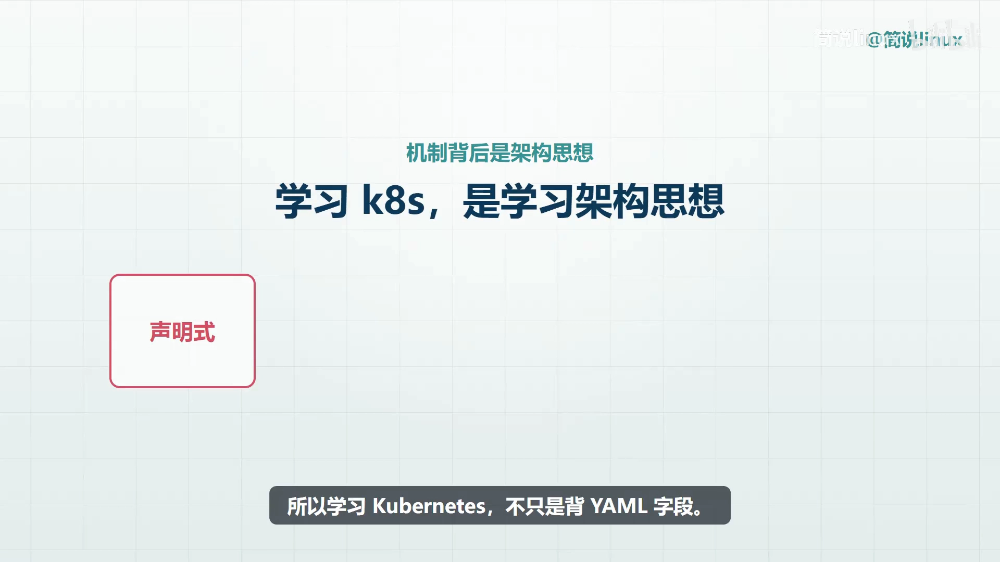

# 别只会操作 K8s：从声明式与控制器底层读懂分布式软件设计

> 视频来源：[别只会操作 K8s！从声明式、控制器底层读懂分布式软件设计](https://www.bilibili.com/video/BV15mMn6gEYa/)｜时长：约 4.5 分钟
>
> 这是一支短小精悍的架构思维讲解。它不教你敲 YAML，而是换一个角度：把 K8s 当成**一套分布式软件架构的设计样本**，从中提炼出可以迁移到自己业务系统里的几条思想——意图与执行分离、声明式接口、控制循环、稳定抽象、自愈与职责解耦。本文按视频内容重写为中文，并纠正了自动字幕里的错拼（如 `COBERNATI`/`cooper nice`/`CUBBERNATI`→**Kubernetes（K8s）**、`密等`→**幂等**、`实力`→**实例**、`重视`→**重试**、`中段里`→**中断里**、`Config map`→**ConfigMap**）。与同系列 1.2.1《K8S 架构原则与对象设计：声明式系统》互补：那一篇讲 K8s 的声明式系统长什么样，这一篇讲这套模型能给架构设计带来什么启发。

## 本讲要解决的核心问题（SCQA）

**背景**：我们都把 K8s 当成「部署容器的工具」。但真的只是这样吗？当一个单体服务拆成多个服务之后，问题会一起冒出来：谁来做部署、谁来做扩容、谁来发现故障、谁来接住流量、谁来管理配置？

**冲突**：这些问题如果靠人工脚本一层层堆起来，系统只会越来越脆弱。服务数量一多，机器变多、版本变多、依赖关系也变多，**这时真正困难的已经不是写代码，而是让系统在变化和故障中仍然保持可控**。

**疑问**：K8s 到底靠什么机制，让这么复杂的系统还能「可控」？这些机制里，有哪些是可以搬到自己业务系统里的通用架构思想？

**回答（中心思想）**：K8s 的核心做法是**把集群抽象成一层分布式操作系统**——用户提交**期望状态**，控制面持续协调，节点负责运行真实工作负载。由此提炼出四条可迁移的架构思想：**① 把意图和执行分开；② 用声明式接口表达期望状态；③ 用可重试的小步控制循环收敛偏差；④ 用稳定抽象+职责解耦把变化限制在边界内，让系统自愈。**

---

## 一、从「部署工具」到「架构样本」：先看清要解决的真问题

视频开篇就换了个视角——**K8s 不只是部署容器的工具，更像一套分布式软件架构的设计样本**。我们会沿着它的机制，提炼出可以迁移到业务系统里的架构思想。[【跳转到 00:00】](https://www.bilibili.com/video/BV15mMn6gEYa/?t=0)

因为 K8s 解决的问题，几乎也是每一个复杂后端系统迟早会遇到的问题。[【跳转到 00:23】](https://www.bilibili.com/video/BV15mMn6gEYa/?t=23)

> 服务一多，问题会一起出现：**谁来部署、谁来扩容、谁来发现故障、谁来接住流量、谁来管理配置。** 靠人工脚本堆，只会让系统越来越脆弱。

## 二、核心做法：把集群抽象成一层「分布式操作系统」

K8s 给出的答案很朴素：**把集群抽象成一层分布式操作系统**——用户提交期望状态，控制面持续协调，节点负责运行真实工作负载。[【跳转到 00:48】](https://www.bilibili.com/video/BV15mMn6gEYa/?t=48)

这背后藏着第一条架构思想：**把意图和执行分开。** 控制面把这些细节隐藏起来，只暴露**稳定的资源模型和操作入口**；这种抽象让上层系统可以更专注于业务意图，而不是陷入底层执行细节。

这就是声明式 API 的价值所在。在 K8s 里，我们通常**不是**说「请立刻启动三个容器」，而是说「**我希望这个应用始终有三个副本**」。[【跳转到 01:23】](https://www.bilibili.com/video/BV15mMn6gEYa/?t=83)

系统会**保存这份期望状态，并不断比较当前状态和期望状态**——这正是声明式模型的关键：它让使用者**描述结果，而不是描述每一步怎么做**。

## 三、控制循环：声明式模型为什么能「自愈」

声明式模型还有一个隐含的好处：**它留下了「目标本身」**。既然目标是稳定存在的，那么**系统就可以重复尝试，也可以从中断里恢复**——失败了再来一次，卡住了从头再来，目标不会因为一次执行失败而丢失。[【跳转到 01:33】](https://www.bilibili.com/video/BV15mMn6gEYa/?t=93)

承担「重复尝试」的，就是控制器，而它的工作方式**很朴素，却非常强大**：[【跳转到 01:53】](https://www.bilibili.com/video/BV15mMn6gEYa/?t=113)

1. **先观察**当前状态；
2. **再和期望状态比较**；
3. **然后采取一次最小行动**；
4. 这个循环不断重复，系统就能从混乱里**慢慢收敛**到正确状态。

> 注意：它**不是一次性把所有事情做完**，而是不断做**小步、可重试、可验证的动作**。这种「控制循环」在业务系统里同样可以借鉴——比如**订单补偿、任务调度、缓存修复**。

## 四、稳定抽象与职责解耦：把变化限制在边界内部

接着视频把镜头对准具体的对象，看它们背后的设计取向。[【跳转到 02:24】](https://www.bilibili.com/video/BV15mMn6gEYa/?t=144)

**Pod 是运行单元，Deployment 则负责维护一组副本。** 如果一个 Pod 挂掉，控制器会发现「副本数少了」，然后**补一个新的**。[【跳转到 02:29】](https://www.bilibili.com/video/BV15mMn6gEYa/?t=149)

这给业务架构的启发有三条：

- **操作要幂等**；
- **组件要能被替换**；
- **故障要被系统吸收**。

在这个模型里，**单个实例并不神圣，重要的是整体副本数和服务能力**。所以应用要尽量**把状态外置**，把实例设计成**可以随时销毁和重建**的。

正因为 Pod 的地址会变，**客户端不应该直接依赖某一个 Pod，而应该访问稳定的 Service**，由 Service 背后把流量分发给健康的 Pod。这就是**稳定抽象层**的价值：它不是为了隐藏所有复杂性，而是**把变化限制在边界内部**。映射到业务架构里，就是那三句话——**接口稳定、实现可替换、调用方不感知内部拓扑。**

最后是**职责解耦**：ConfigMap 管配置、Secret 管敏感信息、Ingress 管外部入口——这些机制把「变化快的部分」从业务容器里拆了出来。[【跳转到 03:19】](https://www.bilibili.com/video/BV15mMn6gEYa/?t=199)

- 如果配置写死在镜像里，每次改配置都要**重新构建和发布**；
- 如果入口规则和业务逻辑耦合，流量治理就会变成**一次又一次的临时修改**。

所以分布式架构也一样：要把**运行环境、配置、安全、流量规则**从业务逻辑中分离出来。

## 五、结论：把 K8s 当成架构思考的参照系

视频最后点题：**学 K8s 不只是背 YAML 字段，更重要的是理解它背后的「声明式接口、控制循环、稳定抽象、自愈能力、职责解耦」**。这些机制组合起来，就是构建分布式软件时最值得借鉴的架构思想。[【跳转到 03:56】](https://www.bilibili.com/video/BV15mMn6gEYa/?t=236)

当你设计自己的系统时，可以反过来问自己三个问题：[【跳转到 04:16】](https://www.bilibili.com/video/BV15mMn6gEYa/?t=256)

1. 我有没有**清楚地表达期望状态**？
2. 系统能不能**自动检测偏差**？
3. 失败以后能不能**重试和收敛**？

如果这些问题都有了答案，那 K8s 就不只是运维工具，而会变成你**架构思考的参照系**。

## 小结

- K8s 不只是部署容器，更是一套**分布式软件架构的设计样本**；它面对的问题（部署/扩容/故障/流量/配置）也是所有复杂后端的共性问题。
- **意图与执行分离**：用户提交期望状态，控制面协调，节点执行——这正是声明式 API 的价值。
- **控制循环 = 可自愈**：观察 → 比较 → 最小行动 → 循环收敛；小步、可重试、可验证，可用于订单补偿、任务调度、缓存修复。
- **稳定抽象 + 职责解耦**：操作幂等、组件可替换、故障被吸收；状态外置、实例可销毁重建；用 Service 稳定入口把变化限制在边界内部。
- 设计系统时自问三题：**期望状态表达清楚了吗？能自动检测偏差吗？失败后能重试收敛吗？**

## 关键术语速查

| 术语 | 一句话解释 |
| --- | --- |
| 期望状态（desired state） | 用户声明的「我想要的样子」，被系统持久保存 |
| 控制循环（control loop） | 观察当前状态→与期望比较→采取最小行动→不断重复，逐步收敛 |
| 声明式接口 | 使用者只描述结果，不描述每一步怎么做 |
| 幂等（idempotent） | 同一操作执行多次与执行一次的效果相同，因此可安全重试 |
| 稳定抽象层 | 用固定入口（如 Service）屏蔽后端实例的创建/销毁与地址变化 |
| 职责解耦 | 把配置、密文、入口等「变化快」的部分从业务逻辑中拆分出去 |
