# Kubernetes API 基础：API 组、版本、生命周期与弃用策略

> 视频来源：[Kubernetes API Fundamentals You Must Know!](https://www.youtube.com/watch?v=_65Md2qar14)（YouTube，频道 KodeKloud）
>
> 我们平时 `kubectl` 敲得飞起，却很少去想"请求到底发给了谁、`apiVersion: apps/v1` 里的 `apps` 和 `v1` 是什么意思、为什么有的写 `v1beta1` 有的写 `v1`、老版本什么时候会消失"。这一讲把 Kubernetes API 的**组织结构（组 / 版本 / 资源 / 动词）**和**版本生命周期与弃用策略**系统讲清楚。
> 文稿左栏为英文自动字幕，本文已翻译并纠正错拼（如 kubectl/kube-proxy/etcd/k8s.io 等）后重写为中文。

## 本讲要解决的核心问题（SCQA）

**背景**：我们做的每一个操作——`kubectl get`、`kubectl apply`、甚至只在命令行看个版本——本质上都是在和 **kube-apiserver** 打交道，要么通过 `kubectl`，要么直接发 REST 请求。

**冲突**：API 并不是"一个平面"，而是**分成许多组、每个组又有多个版本**；而随着 Kubernetes 升级，**新 API 不断加入、旧 API 会被标记弃用甚至删除**。不搞清这套规则，升级集群时就会突然发现"YAML 里的 `apiVersion` 用不了了"。[【跳转到 27:13】](https://www.youtube.com/watch?v=_65Md2qar14&t=1633)

**疑问**：Kubernetes API 到底怎么分组？`core group` 和 `named group` 有什么区别？版本号里的 `alpha`、`beta`、`v1` 各代表什么、可靠程度如何？为什么一个 API 可以**同时存在多个版本**？"preferred version"和"storage version"又是什么？一个旧版本到底要保留多久、什么时候能删？升级后老 YAML 怎么办？

**回答（中心思想）**：Kubernetes API 在顶层分为**核心组（core group）**和**具名组（named group）**，组下面是**资源（resource）**，每个资源配有一组**动词（verb）**；每个组拥有**一个或多个版本**——`alpha → beta → GA(v1)` 是它的生命周期。[【跳转到 06:03】](https://www.youtube.com/watch?v=_65Md2qar14&t=363) 多个版本可并存，但只有一个 `preferred version`（查询默认用）和一个 `storage version`（存进 etcd 用）；**弃用策略用四条规则**（元素只能靠升版本移除、版本间可无损往返、稳定性只能"从高到低"弃用、旧版本在弃用后至少保留 9~12 个月或 3 个 release）约束"什么时候能删"。升级后可用 **`kubectl convert`** 把旧清单迁移到新版本。

## 一、Kubernetes API 与它的分组方式

不管你用 `kubectl` 还是直接发 REST 请求，**最终都是在和 kube-apiserver 对话**。[【跳转到 00:48】](https://www.youtube.com/watch?v=_65Md2qar14&t=48) API 的路径本身就说明了结构：

- 想看版本：访问 master 节点地址 + 端口 **6443**（默认）下的 `/version`；[【跳转到 01:13】](https://www.youtube.com/watch?v=_65Md2qar14&t=73)
- 想要 pod 列表：访问 `/api/v1/pods`。[【跳转到 01:30】](https://www.youtube.com/watch?v=_65Md2qar14&t=90)

Kubernetes API 按**用途**被划分成多个组：`apis`、`health`、`metrics`、`logs`、`version` 等。其中 `version` 用于查看集群版本，`metrics` 和 `health` 用于监控集群健康，`logs` 用于对接第三方日志系统。[【跳转到 02:01】](https://www.youtube.com/watch?v=_65Md2qar14&t=121) 本讲聚焦的是**负责集群功能的那些 API**，它们又被分成两类：**核心组（core group）**与**具名组（named group）**。

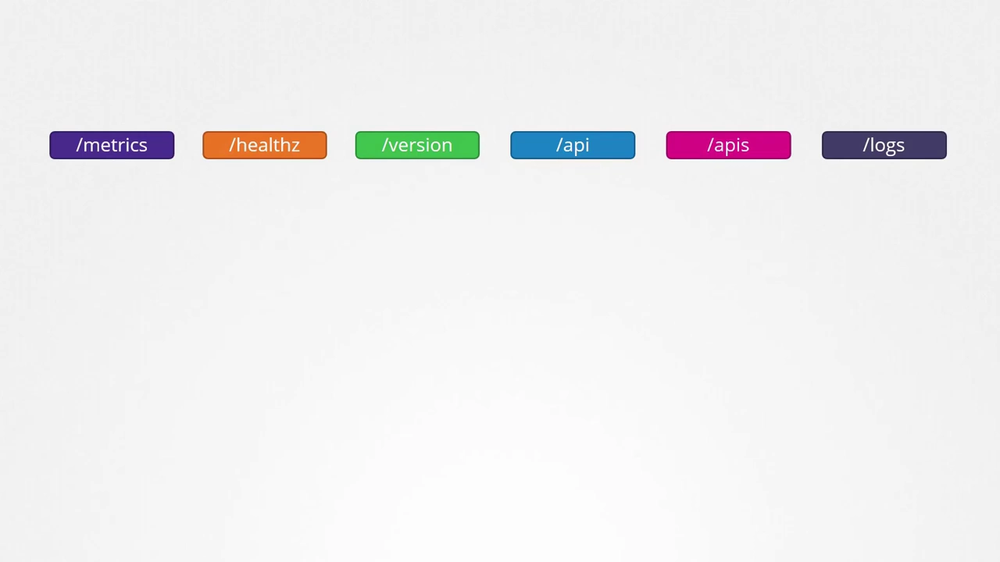

### 1.1 核心组：所有"核心功能"都在这里

**核心组是核心功能所在的地方**，包含 `namespaces`、`pods`、`replication controllers`、`events`、`endpoints`、`nodes`、`bindings`、`persistent volumes`、`persistent volume claims`、`config maps`、`secrets`、`services` 等等。[【跳转到 02:26 到 02:36】](https://www.youtube.com/watch?v=_65Md2qar14&t=146)

> 📌 **这是本条目与"命名空间"直接相关的一点**：`Namespace` 这个对象就属于**核心组**，它的 `apiVersion` 就是 `v1`（而非 `apps/v1` 之类）。[【跳转到 31:09 附近】](https://www.youtube.com/watch?v=_65Md2qar14&t=1790)

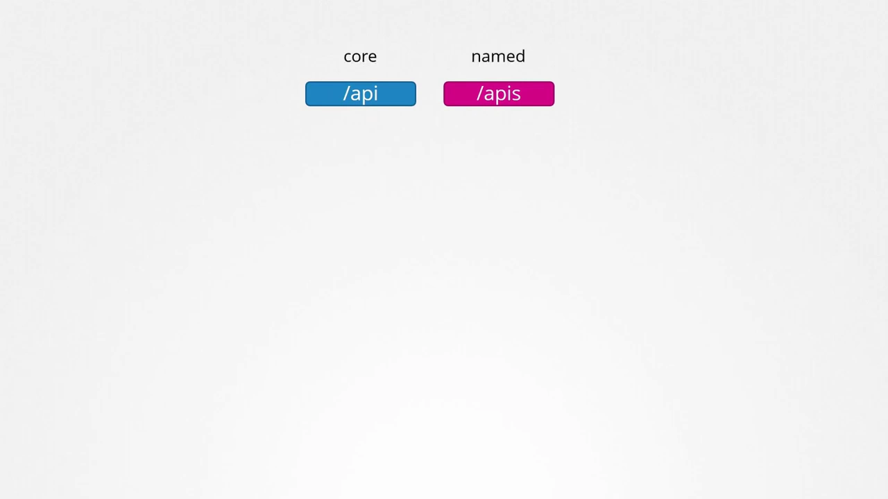

### 1.2 具名组：更有序，新功能都往这里放

**具名组组织得更规整**，而且**今后所有新特性都会通过具名组提供**。它下面包含 `apps`、`extensions`、`networking`、`storage`、`authentication`、`authorization` 等组。[【跳转到 03:00】](https://www.youtube.com/watch?v=_65Md2qar14&t=180)

- `apps` 里有 `deployments`、`replica sets`、`stateful sets`；
- `networking` 里有 `network policies`；
- `certificates` 里有前面讲过的 `certificate signing requests`。

**组是"上层"，资源是"下层"**：顶部那些是 API group，底部那些是组里的 resource。[【跳转到 03:25】](https://www.youtube.com/watch?v=_65Md2qar14&t=205)

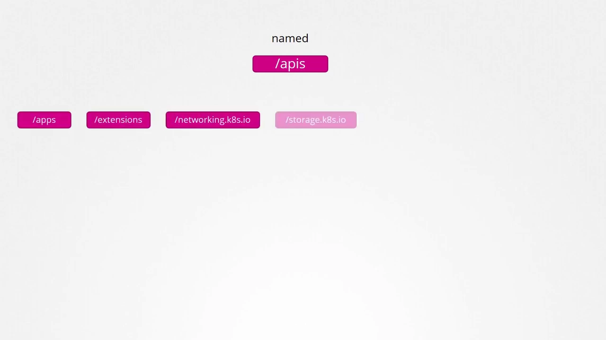

### 1.3 资源与动词（verbs）

**每个资源都配有一组"动作"**——你可以对它做的事情，比如 list deployments、get 某个 deployment、create、delete、update、watch 某个 deployment，等等。这些动作被称为 **动词（verbs）**。[【跳转到 03:50】](https://www.youtube.com/watch?v=_65Md2qar14&t=230)

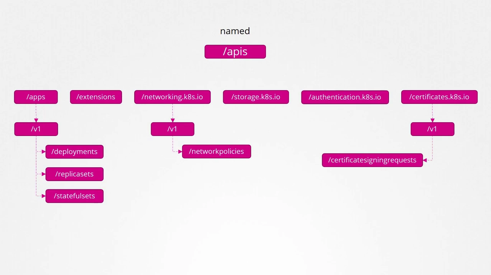

想确认"某个对象属于哪个组"，可以查 Kubernetes API reference 页面：选中一个对象，文档页第一段就写着它的 group 信息——`v1 core` 就是 `v1`。你也可以在自己的集群上看：访问 apiserver 的 6443 端口、不带任何路径，它会列出可用的 API groups，进而在具名组里返回所有支持的资源组。[【跳转到 03:55 到 04:20】](https://www.youtube.com/watch?v=_65Md2qar14&t=235)

**一句话小结**：Kubernetes 里所有资源都被分组到不同的 API group——顶层是 core API group 和 named API group，具名组下每个部分一个组；组下面是不同资源，每个资源配一组动作（动词）。[【跳转到 06:03】](https://www.youtube.com/watch?v=_65Md2qar14&t=363)

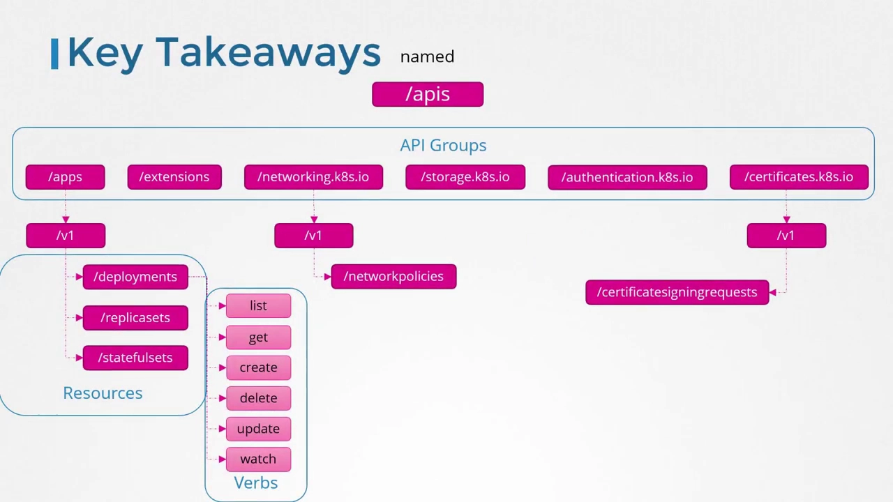

## 二、如何访问集群 API：证书认证与 `kubectl proxy`

如果你像演示里那样**直接用 `curl` 访问 API**，除了 `version` 这类少数接口，**其它大多会被拒绝**——因为你没有提供任何认证信息。所以要**用证书文件认证**，在命令行里把它们传进去。[【跳转到 04:30 到 04:45】](https://www.youtube.com/watch?v=_65Md2qar14&t=270)

另一种更省事的办法是启动 **`kubectl proxy` 客户端**：它会在本地 **8001 端口**起一个代理服务，并使用 `kubeconfig` 文件里的凭据和证书去访问集群。这样你在 `curl` 里就不用再指定证书了——直接访问本地的 8001 端口，由代理把请求用 kubeconfig 的凭据转发给 kube-apiserver。访问根路径会列出所有可用 API。[【跳转到 04:50 到 05:15】](https://www.youtube.com/watch?v=_65Md2qar14&t=290)

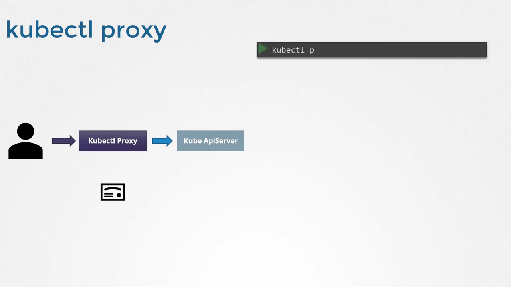

> ⚠️ **别把两个"proxy"搞混**：**`kube-proxy`** 是集群组件，用来实现**跨节点的 Pod 与 Service 连通性**（本课程后面会详细讲）；而 **`kubectl proxy`** 只是 `kubectl` 工具创建的一个**HTTP 代理服务**，专用于访问 kube-apiserver。两者名字像，作用完全不同。[【跳转到 05:30】](https://www.youtube.com/watch?v=_65Md2qar14&t=330)

## 三、API 版本与生命周期：alpha → beta → GA

`/apis` 下面就是各个 API group（`apps`、`extensions`、`networking` 等），**每个组都有不同的版本**。看到 `v1`，就代表这个组处于 **GA（Generally Available，正式可用）稳定版**；此外它可能还有 `beta` 或 `alpha` 版本，如 `v1beta1`、`v1alpha1`。[【跳转到 06:43 到 07:08】](https://www.youtube.com/watch?v=_65Md2qar14&t=403)

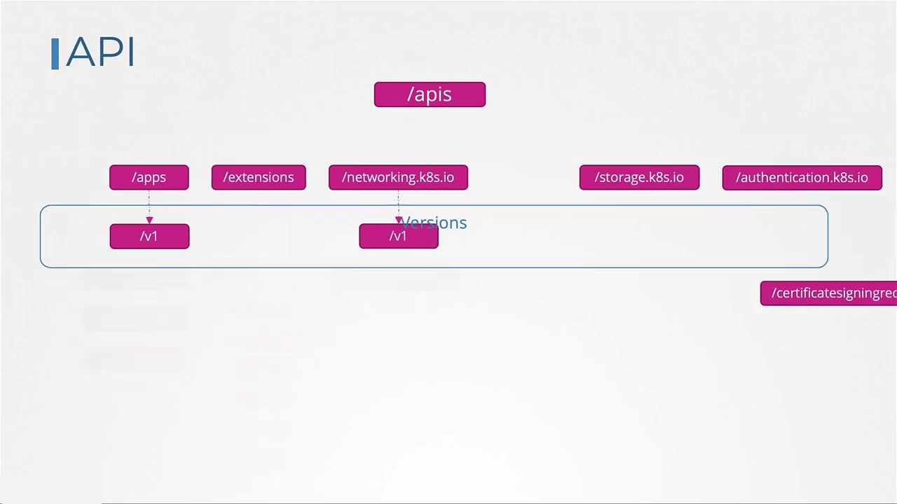

三个阶段的含义与"可靠程度"如下：

- **Alpha**：一个 API **第一次**被开发、合并进 Kubernetes 代码库、随版本发布时，就处于 alpha 阶段，版本名里带 `alpha`（如 `v1alpha1`、`v1alpha2`）。它**默认不启用**；可能缺少端到端测试、有 bug，不太可靠；而且**不保证未来版本仍存在，可能随时被移除**，因此只适合愿意尝鲜、给早期反馈的专家用户。演示时，处于 alpha 的组是 `internal.apiserver.k8s.io`。[【跳转到 07:20 到 08:56】](https://www.youtube.com/watch?v=_65Md2qar14&t=440)
- **Beta**：alpha 稳定一段时间、主要 bug 修完、有了端到端测试后，进入 beta 阶段，版本名带 `beta`（如 `v1beta1`、`v1beta2`）。beta **默认启用**、有端到端测试，但**不是 GA**，可能仍有小 bug；不过项目**承诺**它会走向 GA。演示时，处于 beta 的是 flow control 组。[【跳转到 09:04 到 09:29】](https://www.youtube.com/watch?v=_65Md2qar14&t=544)
- **GA / Stable**：beta 若干个月、若干 release 之后，进入 GA。此时版本名**不再含 alpha 或 beta，就是 `v1`**；默认启用、纳入一致性（conformance）测试；由于主要 bug 已在前两阶段修掉，它**高度可靠**，会在未来许多版本中持续支持，面向所有用户。[【跳转到 09:47 到 10:12】](https://www.youtube.com/watch?v=_65Md2qar14&t=587)

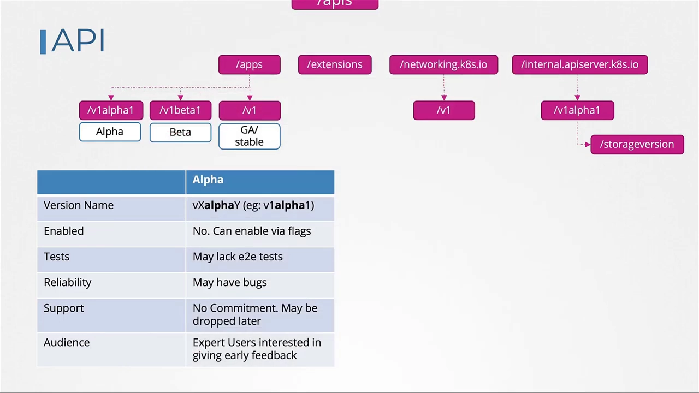

## 四、多版本共存：preferred version 与 storage version

你可能会注意到：大多数组（apps、authentication、authorization、certificates、coordination 等）都是 GA 稳定版，**可有些组却同时有多个版本**——例如 autoscaling 有 `v1`、`v2beta2`、`v2beta1`；node 组有 `v1`、`v1beta1`、`v1alpha1`。为什么？[【跳转到 10:53】](https://www.youtube.com/watch?v=_65Md2qar14&t=653)

**因为一个 API group 可以同时支持多个版本。** 例如 `apps` 组可以同时有 `v1`、`v1beta1`、`v1alpha1`——这意味着你在 YAML 里**用其中任何一个版本都能创建同一个对象**（如把 `nginx.yaml` 的 `apiVersion` 设成 `v1alpha1`、`v1beta1` 或 `v1` 都能用）。[【跳转到 11:17】](https://www.youtube.com/watch?v=_65Md2qar14&t=677)

但尽管多版本并存，**只有一个版本能是 preferred version，也只有一个能是 storage version**：

- **Preferred version**：**默认版本**。当你执行 `kubectl get deployment` 时，它查询的就是这个版本；`kubectl explain` 返回的也是 preferred 版本。例如若 `v1` 被设为 preferred，命令就查 `v1`。[【跳转到 11:27 到 12:17】](https://www.youtube.com/watch?v=_65Md2qar14&t=687)
- **Storage version**：**对象在 etcd 中存储所用的版本**。如果你用 `v1alpha1` 或 `v1beta1` 创建对象，这些对象会**在存入 etcd 前被转换成 storage version**（如 `v1`）。这与你在 YAML 里用哪个版本无关。[【跳转到 12:17 到 12:42】](https://www.youtube.com/watch?v=_65Md2qar14&t=737)

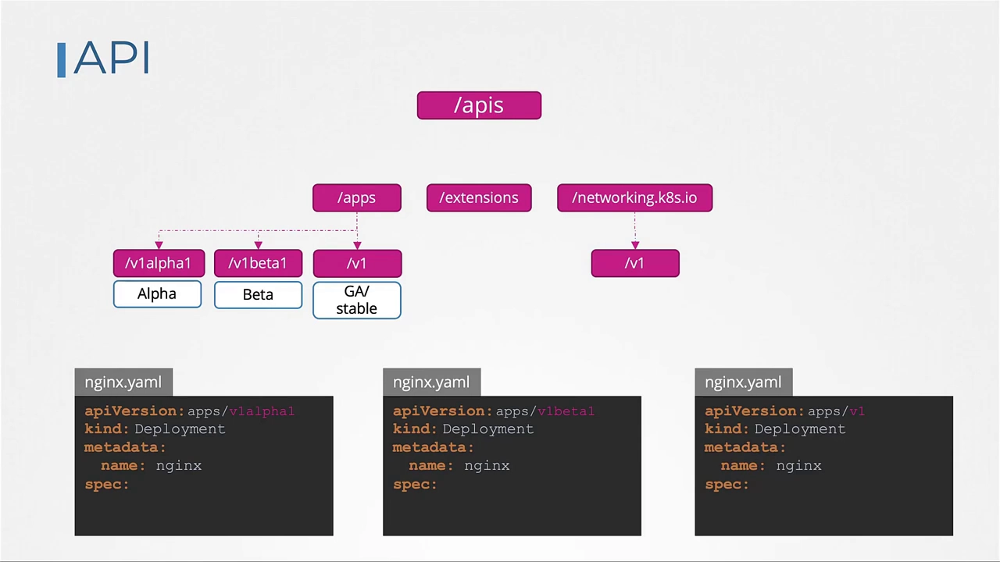

记住：**只有一个是 preferred、只有一个是 storage**；而且**通常两者相同，但也可以不同**。[【跳转到 12:42】](https://www.youtube.com/watch?v=_65Md2qar14&t=762)

### 4.1 怎么查这两个版本？

- **看 preferred version**：列出某个具体 API 时就会显示。比如打开 batch 组的 API 列表，会看到它支持 `v1` 和 `v1beta1`，其中 **preferred 是 `v1`**。[【跳转到 13:12】](https://www.youtube.com/watch?v=_65Md2qar14&t=792)

  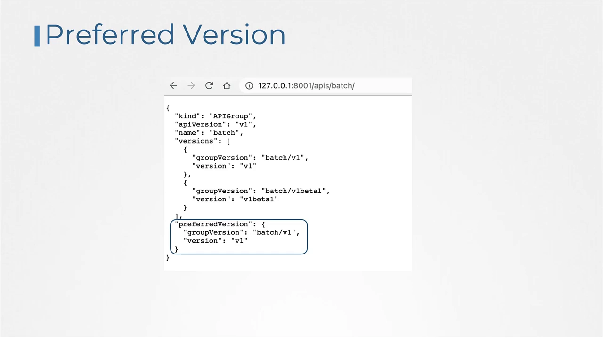

- **看 storage version**：目前**无法通过 API 或命令直接查**，一个办法是**直接查 etcd**：用 `etcdctl` 的 `get` 命令查询某个对象，输出里就能看到它的 `apiVersion`（例如某 deployment 的 `apiVersion` 是 `apps/v1`）。[【跳转到 13:37 到 14:01】](https://www.youtube.com/watch?v=_65Md2qar14&t=817)

### 4.2 启用 / 禁用某个版本：`--runtime-config`

要启用或禁用某个特定版本，必须把它加到 **kube-apiserver 的 `--runtime-config` 参数**里。前面提到的那些 alpha API **默认没启用**，所以你本想创建它们的对象会失败。[【跳转到 14:16 到 14:41】](https://www.youtube.com/watch?v=_65Md2qar14&t=856)

做法：把要启用的 API 以**逗号分隔**写进 `--runtime-config`，然后**务必重启 kube-apiserver**（每次改这些选项都要重启），之后就能用这个 API 了。[【跳转到 15:06】](https://www.youtube.com/watch?v=_65Md2qar14&t=906)

## 五、API 弃用策略：四条规则与一次完整的版本演进

既然一个组可以同时支持多版本，那就引出三个问题：**为什么需要支持多版本？应该支持多少个？什么时候能移除不再需要的旧版本？** 这些都由 **API 弃用策略（API deprecation policy）** 来回答。[【跳转到 15:16 到 15:21】](https://www.youtube.com/watch?v=_65Md2qar14&t=916)

作者用一个贯穿性的例子来推演：假设我们给 Kubernetes 贡献一个组 **`codecloud.com`**，下面有 `course` 和 `webinar` 两个资源；开发测试完成后提 PR 合并，作为 **`v1alpha1`** 发布。[【跳转到 15:46 到 16:11】](https://www.youtube.com/watch?v=_65Md2qar14&t=946)

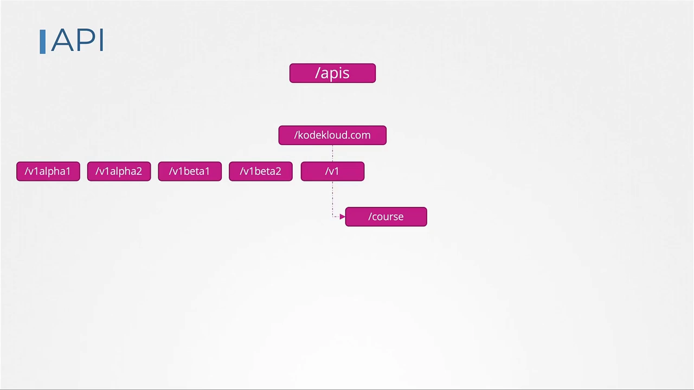

### 规则一：API 元素只能"靠升版本"来移除

假设 `webinar` 不受欢迎，想在下一个 release 删掉它——能直接从 `v1alpha1` 里删吗？**不能。** 弃用策略第一条：**API 元素只能通过"提升 API group 的版本"来移除**。也就是说，你只能在 **`v1alpha2`** 里把它删掉，而它在 **`v1alpha1` 里仍然存在**。[【跳转到 16:51 到 17:05】](https://www.youtube.com/watch?v=_65Md2qar14&t=1011)

可这就带来新问题：数据库里对象还在 `v1alpha1`，而新版本已变成 `v1alpha2`，你就得回头把 YAML 里的版本全改一遍。所以**新 release 必须同时支持 `v1alpha1` 和 `v1alpha2`**，但可以**把 preferred / storage version 设为 `v1alpha2`**——用户仍用旧 YAML 创建，内部会被转换并以 `v1alpha2` 存储。[【跳转到 17:10 到 17:35】](https://www.youtube.com/watch?v=_65Md2qar14&t=1030)

### 规则二：版本之间必须能"无损往返"

这就引出第二条：**在给定 release 中，API 对象必须能在各版本之间往返转换而不丢失信息**（唯一的例外是"在某些版本里根本不存在的整个 REST 资源"）。[【跳转到 17:59】](https://www.youtube.com/watch?v=_65Md2qar14&t=1079)

举例：一个 `course` 对象在 `v1alpha1` 里有 `type: video` 字段；转换到 `v1alpha2` 时引入了新字段 `duration`（`v1alpha1` 里没有）。当它再转换回 `v1alpha1` 时，就会多出这个新字段，而原本没有——所以**必须在 `v1alpha1` 里补一个等价字段**，让转换回来的 `v1alpha1` 与最初的 `v1alpha1` 一致。[【跳转到 18:24 到 18:54】](https://www.youtube.com/watch?v=_65Md2qar14&t=1104)

### 一次完整的演进：从 alpha 一路走到 v1

继续这个故事：修 bug → 进入 beta（`v1beta1` → `v1beta2`）→ 最终发布稳定版 `v1`。这就是一个 API 随时间演进的过程：`v1alpha1 → v1alpha2 →（如需更多 alpha）→ v1beta1 → v1beta2 →（如需更多 beta）→ v1`。[【跳转到 19:26】](https://www.youtube.com/watch?v=_65Md2qar14&t=1166)

当然，我们不必所有版本一直留着——**发布新版本时，必须弃用并移除旧版本**。于是就有了下面这些规则与最佳实践。

### 规则 4a：旧版本弃用后至少保留 9~12 个月或 3 个 release

假设以 Kubernetes 版本 `x` 首次引入我们的组，发布 `v1alpha1`（此时它是唯一的版本，自然就是 preferred + storage）。[【跳转到 20:16】](https://www.youtube.com/watch?v=_65Md2qar14&t=1216)

在 **alpha 阶段，我们不需要在下一个 release 里保留旧版本**。这正是规则 4a：**除各 track 中最新的版本外，较旧的 API 版本在宣布弃用后，至少要支持满——GA：12 个月或 3 个 release；beta：9 个月或 3 个 release；alpha：0 个 release**。所以**alpha 版本不必在任何 release 里保留**，而 **beta 和 GA 一旦发布，就必须支持 9~12 个月**。[【跳转到 20:41 到 21:06】](https://www.youtube.com/watch?v=_65Md2qar14&t=1241)

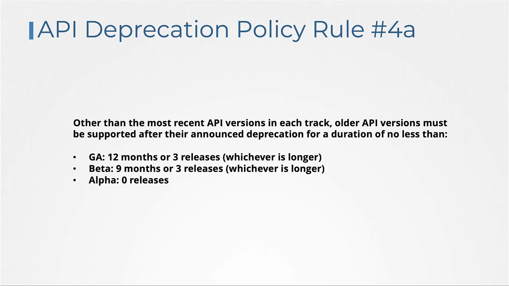

因此 release `x+1` 不再包含 `v1alpha1`——这可能会用坏之前用了它的用户，所以**必须在 release notes 里说明**这个变更（演示里就给了一段"移除 v1alpha2、请迁移到 v1alpha3"的示例）。[【跳转到 21:31】](https://www.youtube.com/watch?v=_65Md2qar14&t=1291)

到了 `x+2` 发布第一个 beta `v1beta1`；由于上一版是 alpha（`v1alpha2`），它**不必**出现在新 release 里，同样要在 release notes 提示用户从 `v1alpha2` 迁移到 `v1beta1`。[【跳转到 21:56】](https://www.youtube.com/watch?v=_65Md2qar14&t=1316)

进入 beta 后，规则 4a 生效：**beta 版本需支持 9 个月或 3 个 release（取更长者）**。

### 规则 4b：preferred / storage version 至少"晚一个 release"才推进

继续到 `x+3`，发布 `v1beta2`。按前面的规则，**从 beta 起必须把上一个 beta（这里是 `v1beta1`）也包含在本 release 中**。此时 `v1beta1` 被**弃用但未移除**（还会留几个 release 才真正删除，用它会显示弃用警告）。[【跳转到 22:21 到 23:11】](https://www.youtube.com/watch?v=_65Md2qar14&t=1341)

注意：**此时 preferred version 仍是 `v1beta1`，而不是 `v1beta2`**——这就是规则 4b：**给定组的 preferred version 与 storage version，只能在"已经有某个 release 同时支持新版本与上一个版本"之后才推进**。也就是说，`v1beta2` 还必须再等一个 release 才能成为 preferred / storage。[【跳转到 23:11 到 23:36】](https://www.youtube.com/watch?v=_65Md2qar14&t=1391)

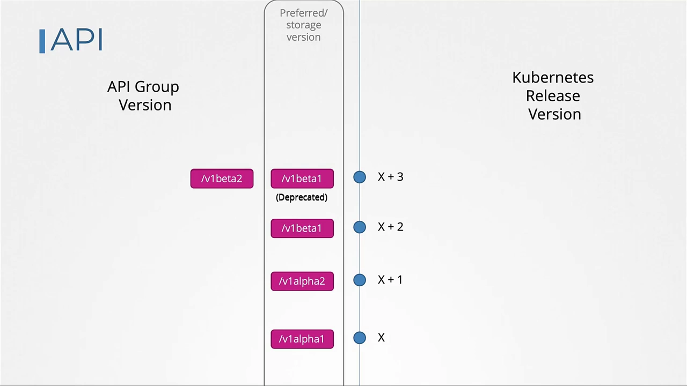

到 `x+5`，终于有了 GA 稳定版 `v1`，同时 `v1beta1`、`v1beta2` 仍在；此时 **`v1beta2` 仍是 preferred / storage**（因为这是第一个包含 `v1` 的 release），而 `v1` 也开始被弃用。到 `x+6`，`v1beta1` 满足"3 个 release"可以移除，**`v1` 成为 preferred / storage**，`v1beta2` 再留一个 release；`x+7` 不变；`x+8` 移除 `v1beta2`，只剩 GA 的 `v1`。[【跳转到 24:01 到 25:16】](https://www.youtube.com/watch?v=_65Md2qar14&t=1441)

### 规则三：只能"从高稳定性向低稳定性"弃用

接着假设要开发下一代 `v2`，先有了 `v2alpha1`。**能因此就弃用 `v1` 吗？不能。** 这就是规则三：**给定 track 里的某个 API 版本，只有在"至少同等稳定的新版本"发布后才能被弃用**——即 GA 可以弃用 beta/alpha，反之不行。`v2alpha1` 是 alpha、`v1` 是 GA，所以现在不能弃用 `v1`；`v2alpha1` 必须先走完自己的生命周期（`v2alpha2 → v2beta1 → v2beta2 → v2`），**只有到那时，`v2` 才能弃用 `v1`**。[【跳转到 26:06 到 26:43】](https://www.youtube.com/watch?v=_65Md2qar14&t=1566)

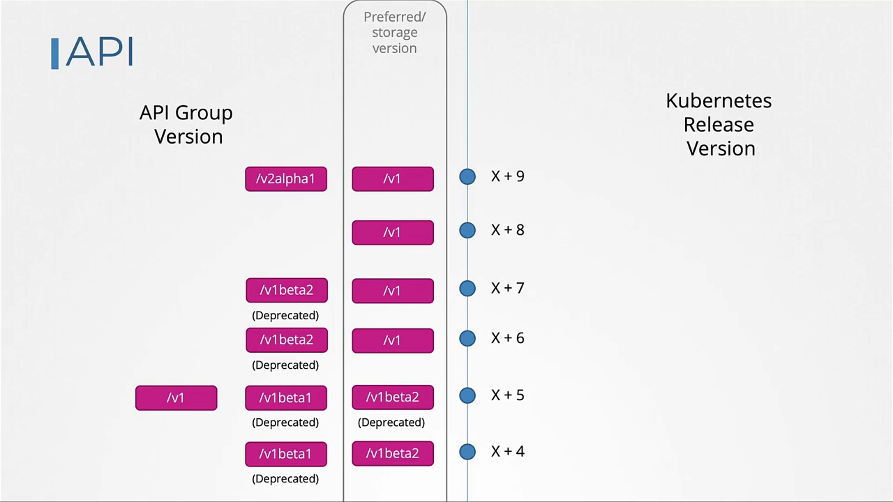

> 📌 **四条规则一句话记**：① 删元素要升版本；② 版本间要能无损往返；③ 只能"从高稳定弃用低稳定"；④a 旧版本弃用后按 12/9/0 个月或 3 个 release 保留，④b preferred/storage 至少晚一个 release 推进。

## 六、升级迁移：用 `kubectl convert` 转换旧清单

集群升级时，**会新增 API，也会弃用、移除旧 API**。当某个旧 API 被移除，你**必须把现有清单文件更新到新版本**。比如一个用 `v1beta1` 写的 deployment，升级后 `v1beta1` 被移除，你就得改用 `v1`；但手头可能有一大堆旧 YAML。[【跳转到 27:13 到 27:36】](https://www.youtube.com/watch?v=_65Md2qar14&t=1633)

**`kubectl convert`** 就是干这个的：指定旧文件和新的输出版本，它会把清单转换成新版本并在屏幕上按 YAML 输出。例如把一个 deployment 定义转成 `apps/v1`。[【跳转到 28:01 到 28:15】](https://www.youtube.com/watch?v=_65Md2qar14&t=1681)

> ⚠️ `kubectl convert` **默认可能不存在**——它是一个**独立的插件**，需要按 Kubernetes 文档的说明单独安装。[【跳转到 28:26】](https://www.youtube.com/watch?v=_65Md2qar14&t=1706)

## 七、动手实验：把这节知识用起来

演示的动手实验（KodeKloud 实验环境）用几个问题把这节知识串了一遍：

- **查短名**：用 `kubectl api-resources` 列出所有 API 资源，能看到短名、API 版本，以及**是否 namespaced**。deployment 的短名是 `deploy`、replicaset 是 `rs`、cron job 是 `cj`、CustomResourceDefinition 是 `crd`。[【跳转到 29:50 到 30:34】](https://www.youtube.com/watch?v=_65Md2qar14&t=1790)
- **拆版本号**：给定 `1.22.2`，可拆成 major / minor / **patch**，其中 patch 号是 `2`。[【跳转到 30:59】](https://www.youtube.com/watch?v=_65Md2qar14&t=1859)
- **查资源所属组**：`job` 属于 `batch`（`batch/v1`）。[【跳转到 31:24】](https://www.youtube.com/watch?v=_65Md2qar14&t=1884)
- **查 preferred version**：先 `kubectl proxy` 起代理（8001），再访问 `.../apis/authorization.k8s.io`，看到支持 `v1` 和 `v1beta1`，preferred 是 `v1`。[【跳转到 32:26】](https://www.youtube.com/watch?v=_65Md2qar14&t=1946)
- **启用 alpha 版本**：编辑 `/etc/kubernetes/manifests` 下的 kube-apiserver 清单，加上 `--runtime-config=rbac.authorization.k8s.io/v1alpha1`（改动前先备份），保存后 kubelet 会自动重启 apiserver 生效。[【跳转到 33:16 到 35:09】](https://www.youtube.com/watch?v=_65Md2qar14&t=1996)
- **安装 kubectl convert**：从 Kubernetes 文档页找到插件安装说明，下载后**校验 checksum**，再放到位并验证。[【跳转到 36:00 到 37:33】](https://www.youtube.com/watch?v=_65Md2qar14&t=2160)
- **转换并创建**：把根目录下 `networking.k8s.io/v1beta1` 的旧 ingress 清单用 `kubectl convert` 转成 `v1`，再把输出直接管道给 `kubectl create` 创建出来。[【跳转到 39:20 到 40:55】](https://www.youtube.com/watch?v=_65Md2qar14&t=2360)

## 小结

- **Kubernetes API 的两层结构**：顶层 **core group**（namespaces、pods、services……，apiVersion 就是 `v1`）与 **named group**（apps、networking、storage……）；组下面是**资源**，每个资源配一组**动词**。
- **访问方式**：直接用 `curl` 需带证书认证；更省事的是 `kubectl proxy`（本地 8001，用 kubeconfig 凭据转发）。别把 `kubectl proxy` 与集群组件 `kube-proxy` 搞混。
- **版本生命周期**：`alpha`（默认不启用、可能随时移除、仅供尝鲜）→ `beta`（默认启用、有 e2e、承诺走向 GA）→ **GA `v1`**（稳定、纳入一致性测试）。
- **多版本并存**：可同时存在多版本；**preferred version**（查询默认用）与 **storage version**（etcd 存储用）各只有一个，通常相同也可不同；对象存入 etcd 前会被转成 storage version。
- **启用/禁用版本**：改 kube-apiserver 的 `--runtime-config`（逗号分隔）并重启。
- **弃用四规则**：① 删元素须升版本；② 版本间无损往返；③ 只能从高稳定弃用低稳定；④a 旧版本按 GA 12 个月 / beta 9 个月 / alpha 0 或 3 个 release 保留，④b preferred/storage 至少晚一个 release 推进。
- **升级迁移**：用插件 `kubectl convert` 把旧清单换到新版本。

## 关键术语速查

| 术语 | 一句话解释 |
| --- | --- |
| Core group | 核心组，核心功能所在（namespace、pod、service…），apiVersion 为 `v1` |
| Named group | 具名组（apps、networking…），新特性从这里提供 |
| Verb | 对资源的动作：list / get / create / delete / update / watch |
| kubectl proxy | 本地 8001 的 HTTP 代理，用 kubeconfig 凭据访问 apiserver（≠ kube-proxy） |
| alpha | 最早期版本，默认不启用、可能被随时移除 |
| beta | 默认启用、有 e2e 测试，非 GA，承诺走向 GA |
| GA / stable | 正式稳定版，版本名就是 `v1` |
| preferred version | 查询（kubectl get/explain）默认使用的版本 |
| storage version | 对象在 etcd 中存储所用的版本 |
| `--runtime-config` | kube-apiserver 上用于启用/禁用特定版本（含 alpha）的参数 |
| API deprecation policy | 约束元素移除、版本往返、弃用方向与保留时长的四条规则 |
| kubectl convert | 独立插件，把旧 apiVersion 的清单转换成新版本 |
